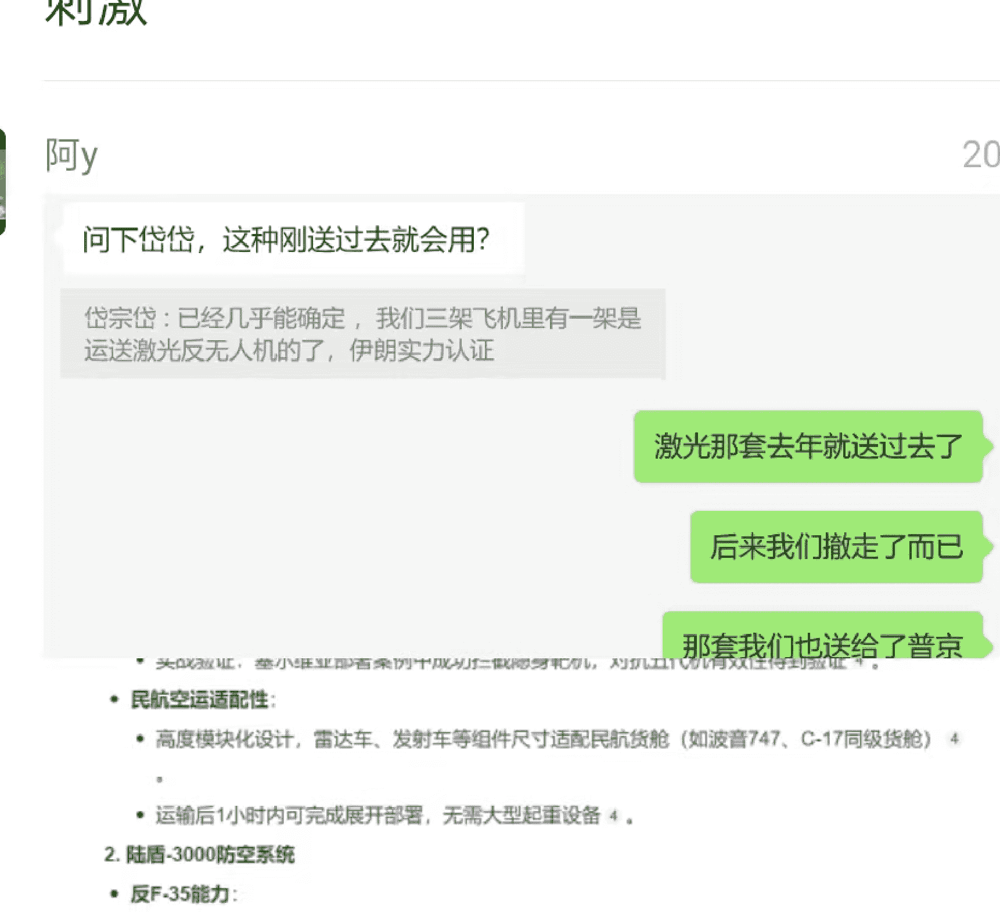

# 群聊

2025年6月18日

信磊 20:10:30
一场已经确定是激光无人机了
另外聚会会？

打个35又可能不是呢，我们有什么家伙是纳米级易上手有效吗

海海 山山 20:15:16
还是实验室
伊朗如果真的用了。那不是明天是我们的
全球都懂。只有我们这个能力。还能叫俄伦帝。

小文 20:16:24
没有准军事速率下可能我们东方西方空军的
彼防防导弹

曾行合 20:16:38
王蕾不会承认是我们的🤡；只要我们不理解

海海 山山 20:17:57
还需要别人认吗

小文 20:18:22
流量到底谁要在意的

小文 20:18:43
俏俏手还是当老吗

海海 山山 20:19:07
所有这些，不能叫俄伦帝。

曾行合 20:20:34
防御性武器应该取代，成纯的。理由是“推维护世界和平

海海 山山 20:20:49
占地桩，不是我们防了

小文 20:21:02
历史是没有胜利者书

信磊 20:21:26
你问我，这个历史是怎么写的？

马磊 20:25:12
我想知道中国金融还有没有没了

方磊 山山 20:25:31
你觉得呢

Follow your heart 20:26:01
左上角：AI生成的

信磊 20:27:18
方这个回留来的那我们大杀器拒绝武装，
那是现实爱文了
