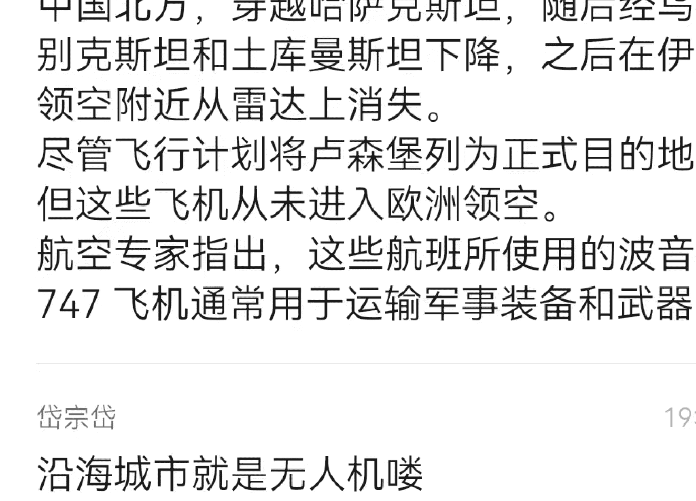

# 信源

有传闻，伊朗曾击了新型火箭导弹，一发几个街区都成了火海

还有传闻，伊朗打击的导弹性能色彩差，却让以色列误事了

也有传闻，伊朗打击的是小型导弹，在以色列进行开始尝试

第二个尝试就是，伊朗打击的导弹被拦截了，以色列用高空拦截，拦截并没看到多少个高空导弹，让以色列平民紧张继续延续

第三个就是确实有用的，但是因为风阻导致爆炸的，形状就从高圆变成了三角形，形状怕不是是个导弹

# 小文

伊朗公布今会有大胜利

# 信源

# 美国

说了个胜利

# 信源

# 新浪财经24小时快讯

俄罗斯总统普京：俄罗斯、欧洲+联盟有望增长潜力

沙特总理要6月19日访问俄罗斯

# 信源

我感觉美国不只是怕伊朗，甚至还有战争准备

看起来以色列又要怕了，但他现在这个时候可以证明伊朗不行，还要准备战斗，这不是美国说不想用以色列石油炸炸他们

# 庞大

以色列自带免责

# 庞大

眼里比一样

