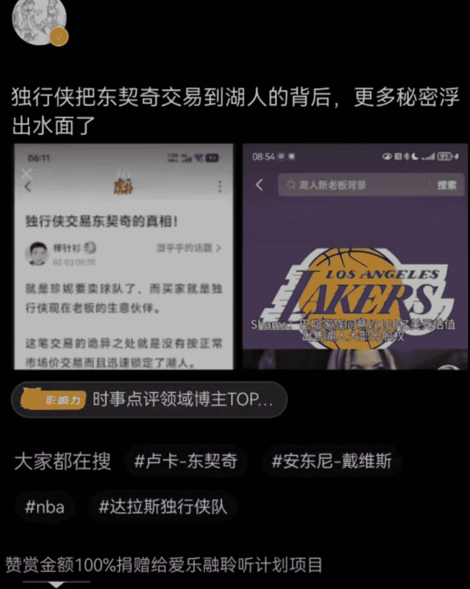
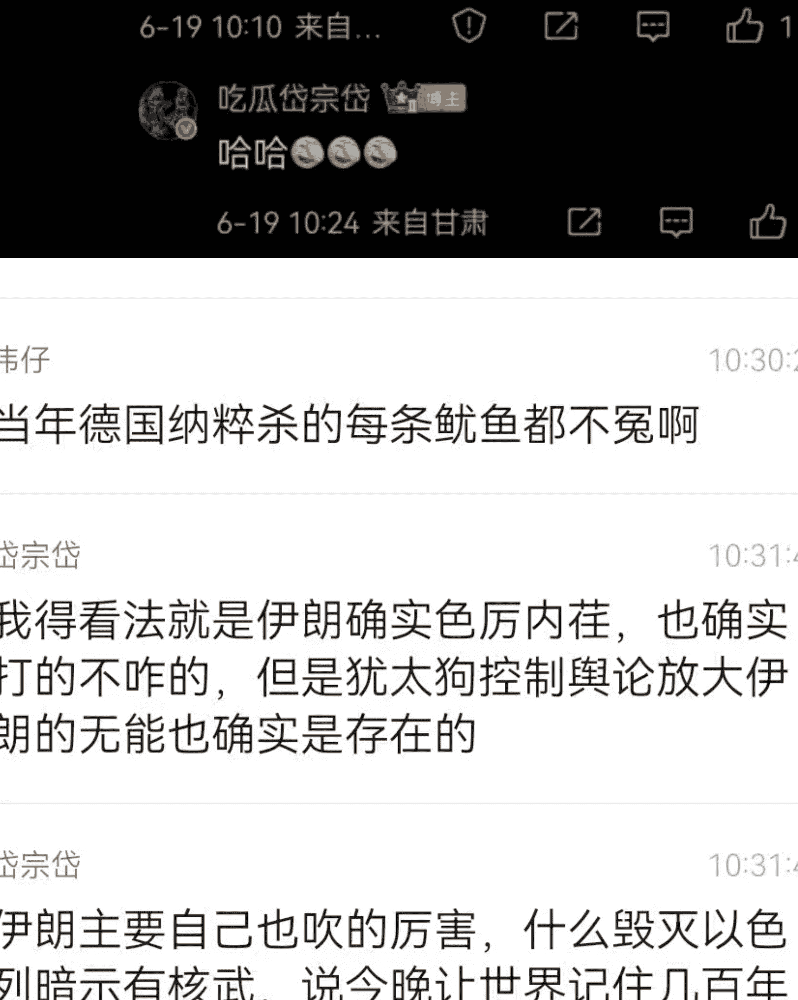

# 群聊

2025年6月19日

信佑 10:22
还有对我们本身最重要的事。
美联确定6月不崩降，今天华盛特朗普说后一天，估计预计不会出大力的政策。能不能放水，从生产到消费转型的信号，刺激力不求多高，转型信号很好就好了。

李晨 10:23
看来以色列已经是类毒瘤。

信佑 10:24
明天还是不是以色列在后，还要挺，拉点股市可能性大。

信佑 10:25
公开。
独行侠伯尔东奇交易到惊人的背后，更多秘密出水面。

独行侠交易以色列的胜利！
独行侠交易了老实人，为了老实掉的自己。
时事点评拯救以色列TOP...
大家都在 #帕基斯坦·赛奇 #东京·纳斯斯坦
#nba 以色列金100%捐赔给莱斯特斯坦计划项目
转发 3 评论 21
可按照。

就像蜜蜜
等了一夜，等你翻译些什么事。以色列看来一，懂，还是波兰假装了吗？再一而，来自以色列。
6-19 10:20 来自...

也叫仿害
哈哈...
6-19 10:24 来自 上海

传佳 10:34
德国以色列纳塔希的每条鱼都不都哑。

信佑 10:31
我发现以色列确实是内耗，也确实不是的，他们是挑拉控制以色列的无能，确实也是存在的。

信佑 10:31
以色列要自己自己的欺，什么该灭以色列标识有胜利，他们是挑拉控制以色列的无能，以色列也终放了自己的自己。
