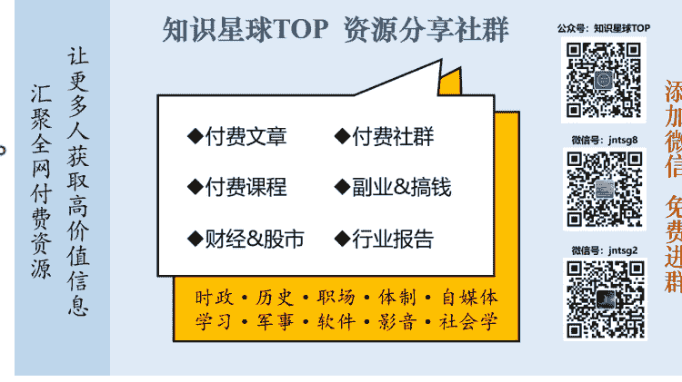

这是一篇比较学术性的文章。

大家看看的可能会有些吃力，我尽量用大白话来阐述，大家可以慢些。

# 1、今天的统战和过去的统战不一样

统战价值，是在近代中国诞生的一个概念。

来源于教员的三大法宝之一：党的建设、武装斗争、统一战线。

统一战线这个法宝诞生了统战价值这个词，也诞生了统战部这个特殊的全球仅有中国的部门。

是的，苏联没有统一战线的法宝，这个法宝是我们独创的，教员搞出来的，苏联都没有统战部。

但是，我今天文章论述的统战价值，和之前的概念不同。

教员提出统一统战价值的时候，是革命斗争时期，和国民党斗争，和帝国主义斗争。共产党长期以来是一个弱者斗争强者，而存在一个广大的中间派，教员提出作为我们为了斗争胜利要把朋友搞多多的，把敌人搞少少的，提出统战概念。

我们现在，并不是革命斗争时期，而是社会发展时期，这是第一点不同。

第二点不同，就是现在没有一个明确的敌人，至少美国还不是国民党反对派那样明确的敌人。

第三点不同，也是最重要最关键的，那就是中间派的大小问题。

共产党由弱到强，且长期是弱势一方，共产党自己的基本盘很少，中国存在广大的中间派还有一些可争取的反对派，可以说，争取中间派和反对派的统战行为，就是践行群众路线，扩大自己基本盘的行为。

但是现在不同了。

现在已经建国几十年，国家的基本盘士农工商、党员、爱国群众这些群体是最大的，中间派和反对派才是更少的体量。

而因为经济下行和一些社会矛盾、境外势力，现在主要问题已经不是中间派如何拉过来的问题，而是基本盘不断流失的问题了。

所以，当下的统战模式其实和教员时期的统战目标有根本的不同。

加微信信号jntsg2，免费资料群

教员时代，自己的基本盘小，所以决定中国命运的是广大中间派，统战就是争取中间派和反对派，变成自己基本盘。

我们时代，自己的基本盘已经很大，社会中间派反对派较小，但基本盘在不断流失，现在的统战首要目标是巩固自己的基本盘的同时，不断把中间派反对派转化为自己基本盘。

这是斗争时代和发展时代的不同。

斗争时代——基本盘小、中间派反对派大——首要目标争取他们就等于践行群众路线。

发展时代——基本盘大、中间派反对派小——首要目标巩固基本盘才是践行群众路线。

这个道理，统战部估计都不懂，还在按照祖传来的统战逻辑去搞统战工作，忽略基本盘建设。

导致当下很多魔幻的事情无法解释，以至于爱国的粉红群体都哀哀，爱国群众是最没统战价值的，因为本身就是基本盘之一不用争取。

好，这是第一部分，论述我们现在的统战工作和革命时代统战工作的三点不同。

然后，我们进入下一阶段。

作为个体，你的统战价值取决于三点。

## 第一点，你的利用价值是天赋价值

这是最简单最好理解的。

哲人说天赋人权，说一个人从生来就有一系列不言喻的天然权利，如言论自由、选举等等，这些权利还因各国的国情不同而异。

但是，你作为一个人，从出生来就天然具有各种利用价值，这个不分国家都是的。

主要是这三种：

一个是你的人生过程中不断产生消费，这是你自带的消费价值。

一个是主动被动的工作都会给社会提供生产力，这是你的生产价值。

还有一个如果是国家有战争，你作为大头兵去前线打仗，这是男性特有的战争价值。

还有一个国家需要生育需要新生儿，作为女性则有一项生育价值。

其中男性比女性多一个平时用不到的战争价值，女性比男性多一个具有时效性（绝经高龄产妇你懂的）的生育价值。

哦，女性的消费价值也天然比男性强，没办法，男人消费不如狗，还好这几年开始改变了。

天赋人权只是难以实现的幻想，天赋价值才是真的，只要你是个个人，你就有价值，或多多少而已。

你只要还在社会体系中呼吸还维持着生物特征，就算你彻底躺平不消费不活，你都拥有那么一丝丝的社会价值。

这是任何人生生来自带的。

这就是天赋价值。

利用价值是你天生自带，而这三大价值的大小程度，取决于两个因素：

一个是你个人因素。

一个是时代因素。

个人因素好理解，你特别能消费、特别能花钱、特别能工作特别996，而且还特别爱生孩子，那就是你个人主观性的增加你的消费价值和生产价值，你是在做大你的战略价值。

如果你生出一个奥林匹冠军的孩子或者是科学天才的孩子，那你更有战略价值了，对社会贡献更大了。

加微信jntsg2，免费资料群

如果你不仅自己996，还创业公司，带动了一群人的消费还缴税，你对社会的贡献更大了，统战价值更大。

如果你不开公司，单独上班，但如果你是天才，那么你自带的生产价值高于普通人几万倍。

这些都是你个人因素决定的。

大部分人的统战价值，其实是时代因素决定的。

### 广大群众是如何失去战略价值的？

| 阶段 | 特征 | 统战目标 |
| :--- | :--- | :--- |
| 斗争时代 | 基本盘小，中间派反对派大 | 争取中间派和反对派，变成自己基本盘 |
| 发展时代 | 基本盘大，中间派反对派小 | 巩固基本盘，不断把中间派反对派转化为基本盘 |

（注：此处原文OCR逻辑混乱，已根据语义整理为对比逻辑）

重新纠正：原文部分逻辑对应如下：

| 斗争时代 | 基本盘小、中间派反对派大 | 首要目标争取他们就等于践行群众路线 |
| 发展时代 | 基本盘大、中间派反对派小 | 首要目标巩固基本盘才是践行群众路线 |

这个道理，统战部估计都不懂，还在按照祖传来的统战逻辑去搞统战工作，忽略基本盘建设。导致当下很多魔幻的事情无法解释，以至于爱国的粉红群体都哀哀，爱国群众是最没统战价值的，因为本身就是基本盘之一不用争取。

好，这是第一部分，论述我们现在的统战工作和革命时代统战工作的三点不同。

然后，我们进入下一阶段。

作为个体，你的统战价值取决于三点。

## 第一点，你的利用价值是天赋价值

这是最简单最好理解的。

哲人说天赋人权，说一个人从生来就有一系列不言喻的天然权利，如言论自由、选举等等，这些权利还因各国的国情不同而异。

但是，你作为一个人，从出生来，就天然具有各种利用价值，这个不分国家都是的。

主要是这三种：

- 一个是你的人生过程中不断产生消费，这是你自带的消费价值。
- 一个是主动被动的工作都会给社会提供生产力，这是你的生产价值。
- 还有一个如果是国家有战争，你作为大头兵去前线打仗，这是男性特有的战争价值。
- 还有一个国家需要生育需要新生儿，作为女性则有一项生育价值。

其中男性比女性多一个平时用不到的战争价值，女性比男性多一个具有时效性（绝经高龄产妇你懂的）的生育价值。

哦，女性的消费价值也天然比男性强，没办法，男人消费不如狗，还好这几年开始改变了。

天赋人权只是难以实现的幻想，天赋价值才是真的，只要你是个个人，你就有价值，或多多少而已。

你只要还在社会体系中呼吸还维持着生物特征，就算你彻底躺平不消费不活，你都拥有那么一丝丝的社会价值。

这是任何人生生来自带的。

这就是天赋价值。

利用价值是你天生自带，而这三大价值的大小程度，取决于两个因素：

一个是你个人因素。

一个是时代因素。

个人因素好理解，你特别能消费、特别能花钱、特别能工作特别996，而且还特别爱生孩子，那就是你个人主观性的增加你的消费价值和生产价值，你是在做大你的战略价值。

如果你生出一个奥林匹冠军的孩子或者是科学天才的孩子，那你更有战略价值了，对社会贡献更大了。

加微信jntsg2，免费资料群

如果你不仅自己996，还创业公司，带动了一群人的消费还缴税，你对社会的贡献更大了，统战价值更大。

如果你不开公司，单独上班，但如果你是天才，那么你自带的生产价值高于普通人几万倍。

这些都是你个人因素决定的。

大部分人的统战价值，其实是时代因素决定的。

### 广大群众是如何失去战略价值的？

| 序号 | 阶段/事件 | 结果 |
| :--- | :--- | :--- |
| 第一步 | 外部环境限制 | 失去部分战略价值 |
| 第二步 | 海湾战争 | 失去部分战略价值 |
| 第三步 | 科技革命/机器人 | 失去部分战略价值 |
| 第四步 | 信息革命/AI时代 | 彻底失去战略价值 |

（注：原文OCR文本此处存在大量重复和乱码，已根据语义提取核心逻辑）

重新梳理：

教员时代，基本盘小，所以决定中国命运的是广大中间派，统战就是争取中间派和反对派，变成自己基本盘。

我们时代，自己的基本盘已经很大，社会中间派反对派较小，但基本盘在不断流失，现在的统战首要目标是巩固自己的基本盘的同时，不断把中间派反对派转化为自己基本盘。

这是斗争时代和发展时代的不同。

斗争时代——基本盘小、中间派反对派大——首要目标争取他们就等于践行群众路线。

发展时代——基本盘大、中间派反对派小——首要目标巩固基本盘才是践行群众路线。

这个道理，统战部估计都不懂，还在按照祖传来的统战逻辑去搞统战工作，忽略基本盘建设。导致当下很多魔幻的事情无法解释，以至于爱国的粉红群体都哀哀，爱国群众是最没统战价值的，因为本身就是基本盘之一不用争取。

好，这是第一部分，论述我们现在的统战工作和革命时代统战工作的三点不同。

然后，我们进入下一阶段。

作为个体，你的统战价值取决于三点。

## 第一点，你的利用价值是天赋价值

这是最简单最好理解的。

哲人说天赋人权，说一个人从生来就有一系列不言喻的天然权利，如言论自由、选举等等，这些权利还因各国的国情不同而异。

但是，你作为一个人，从出生来，就天然具有各种利用价值，这个不分国家都是的。

主要是这三种：

- 一个是你的人生过程中不断产生消费，这是你自带的消费价值。
- 一个是主动被动的工作都会给社会提供生产力，这是你的生产价值。
- 还有一个如果是国家有战争，你作为大头兵去前线打仗，这是男性特有的战争价值。
- 还有一个国家需要生育需要新生儿，作为女性则有一项生育价值。

其中男性比女性多一个平时用不到的战争价值，女性比男性多一个具有时效性（绝经高龄产妇你懂的）的生育价值。

哦，女性的消费价值也天然比男性强，没办法，男人消费不如狗，还好这几年开始改变了。

天赋人权只是难以实现的幻想，天赋价值才是真的，只要你是个个人，你就有价值，或多多少而已。

你只要还在社会体系中呼吸还维持着生物特征，就算你彻底躺平不消费不活，你都拥有那么一丝丝的社会价值。

这是任何人生生来自带的。

这就是天赋价值。

利用价值是你天生自带，而这三大价值的大小程度，取决于两个因素：

一个是你个人因素。

一个是时代因素。

个人因素好理解，你特别能消费、特别能花钱、特别能工作特别996，而且还特别爱生孩子，那就是你个人主观性的增加你的消费价值和生产价值，你是在做大你的战略价值。

如果你生出一个奥林匹冠军的孩子或者是科学天才的孩子，那你更有战略价值了，对社会贡献更大了。

加微信jntsg2，免费资料群

如果你不仅自己996，还创业公司，带动了一群人的消费还缴税，你对社会的贡献更大了，统战价值更大。

如果你不开公司，单独上班，但如果你是天才，那么你自带的生产价值高于普通人几万倍。

这些都是你个人因素决定的。

大部分人的统战价值，其实是时代因素决定的。

### 广大群众是如何失去战略价值的？

| 序号 | 公号/星球/社群 | 原价 | 领域 |
| :--- | :--- | :--- | :--- |
| 1 | 生财有术 | 2765/年 | |
| 2 | 怂容吃果群 | 365/年 | 时政、历史 |
| 3 | 记忆承载 | 365/年 | 成长、搞笑 |
| 4 | 欧洲金圈 | 328/年 | 时政、历史 |
| 5 | 虎文云会 | 699/年 | 时政、社会 |
| 6 | 体内主任 | 599/年 | 体制、职场 |
| 7 | 外人的视角 | 666/年 | 金融、时政 |
| 8 | 泽峰异语 | 4166/年 | 财富、成长 |
| 9 | 守护人总司令 | 599/年 | 时政、经济 |
| 10 | 江宁获府 | 365/属 | 时政、国际 |
| 11 | 政堂/顾诸子明 | 568/年 | 时政、经济 |
| 12 | 库学院 | 1399/励 | 金融、财富 |
| 13 | 大树译语 | 199/年 | 时政、成长 |
| 14 | 水犀欧大 | 1000/连 | 房产、经济 |
| 15 | 洪澜的宏观策略 | 4376/年 | 经济、搞笑 |
| 16 | 金政通/海涛南山 | 4576/年 | 股票、行销 |
| 17 | 猫的世界 | 299/年 | 时政、社会 |
| 18 | 飞沫 | 3600/年 | 股票、经济 |
| 19 | 米联趣锦间 | 599/年 | 经济、金融 |
| 20 | 茶茶圣财经 | 330/年 | 房产、股票 |
| 21 | 盈在八小时之外 | 365/年 | 成长、职场 |

（注：原文OCR文本此处存在大量重复和乱码，已根据语义提取核心逻辑）
