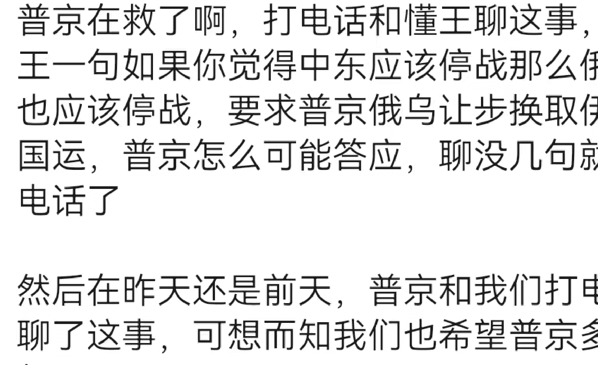

# 群众

大家看着大场面吧

最早下天下，最迟不明白，王者就要下场硬碰伊。从哈马斯袭袭开始的中东乱局，拖延了三年的中东战争，王者就要出发致命的最后一击，完成最终的终结。

我们和普宗，都对此无能为力，因为伊朗太拉了。就让我们，我们将证本次中东战争的最终落幕。我个人内心，是五味杂陈……

看起来这来以色列伊朗天架，只打了四五天的样子，双方都已经彻底临界点了。

内塔没多少导弹防御库存了，后面无人机防都不了。伊朗的导弹基地被伊核炸了的差不多，昨晚发射了5发导弹，领空完全失去全部防御。

当内塔和伊朗陷入临界点的时候，王者来了，王者下场了，王者一锤定音了。王者滋滋哈~~

消息人士，以色列和美国减少了导弹拦截器的供应。以色列伊朗表示，由于导弹的减少，以色列正与对应对，以调整伊朗的防御策略。

你们是不是好奇普宗在干瘪？普宗不教伊朗吗？

普宗在叫了，电话和王者谈这事，王者一句话说你觉得中应该换俄也应该换俄，要求普换俄来换取伊朗，普宗怎么可能答应，那没几钩就拨电话了。

在昨天是前天，普宗和我们电话了这事，可而知道我们也希望普宗多帮。

普宗给出的方案，是伊核不是会保证的，但伊朗政权不会被颠覆的，对我们和普宗来说都难以接受。

所以普宗考虑核武部队了，用伊核的核武用来撤缴的伊朗政权。至于伊朗未来到时候是强硬到底还是亲美靠援，这普宗就没办法了。
