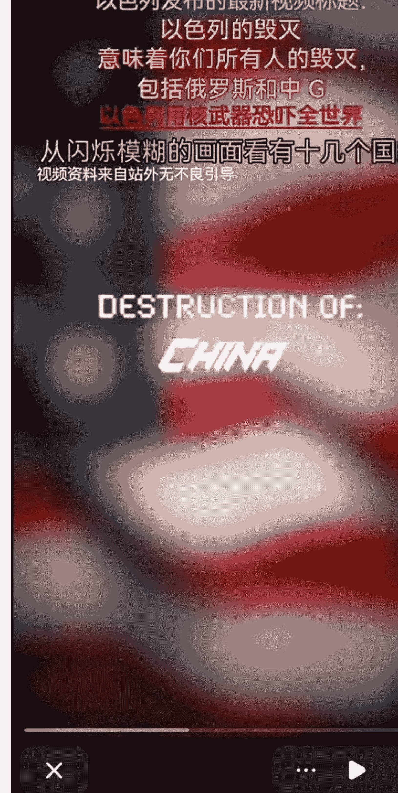

# 群像

伊朗被偷袭了，只是放了新型导弹，远程超重型导弹弹石，对以色列打击有有限。

我们外交动作很多，再次对伊朗，并与约旦和黎巴嫩通电。

以色列发布了一个视频显示以色列被袭击了，全球都会被拉下水。

值得一提的是，信息与以色列谈判这太大了。

国际在以色列表示伊朗代表了伊朗去美国，还有国际和欧洲进行谈判。

然后伊朗坚持说没有寻求谈判。

金十数据6月19日报道，伊朗军会在今天（6月19日）回应，可能对以色列开展“承诺3”的第13阶段行动，使用两个顶级推进的超重型导弹“泥石”对以色列境内主动发动打击。（CCTV国际视频）

属于伊朗的进攻回合，一段到底还是啪一个。

下面是内塔进攻。

以色列发布的最新视频标题：以色列意味着你们所有人的毁灭，包括你们所处的国家，全世界。从摩洛哥的沙漠到这里有十几个国家。

内塔真牛逼。

没援核的时候我都不怕，还有他怕。

当地时间18日，记者获悉，美国首正在为未来对伊朗发动攻击的可能做好准备，但社交媒体情报人士称，仍在准备中，可能会发生变化。以色列可能在未来进行。此外，情报人士的高级助理，美国特朗普在17日表示他已经批准对伊朗的攻击计划，除非以色列放弃其计划。

奎在等内塔尼亚准备的大杀招能否成为压倒以色列无条件侵略的最后一个杠杆。

另外，美国本土有B-21战斗机，现在停靠在西班牙的军事基地，加微信187658，进微微信群。

让绿色的他的毛
