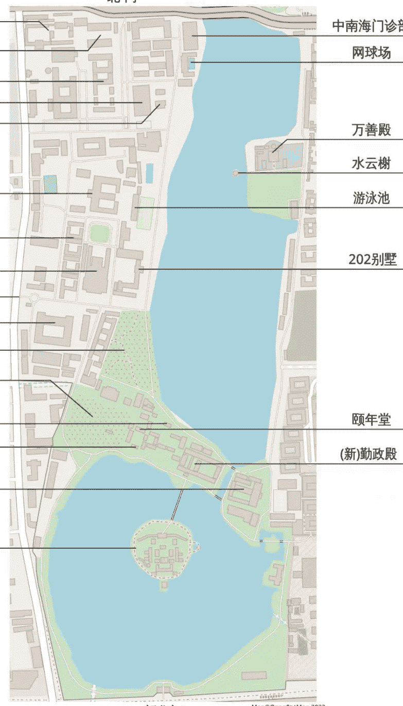

# 中东的事，能群聊。

微信:jntjsg8
微信:jntjsg2

免费进资料群

内事不能群聊。

我知道这些天大家想问内事如何。

美联储6月不降息，那我们这边也无法降息放水了，继续热看着吧。

你想想，去年美联储降息我们突然袭击，提前开9月局拉高股市，那个万物勃生机的市场场景，还历在目。

估计美联储也怕了，怕6月降息我们又暴力拉股市。

现在好了，中美两边继续热看着吧。

内事除了股市外，还有就是人事。

加微信信号jntjsg2，免费进资料群

之前一直传，三个top位置，党政军，在今年4中会上，让出一个政的位置，也就是zhuxi位置。

这个有迹可循，毕竟反对力量太大了，没有梧桐望望没有经济成绩，钢铁这股力量太大了，必要的让让步还是有可能的。

问题是谁上。

好几个人选，不歪，新二号，乃花花，重庆一魔都一。

甚至都在传大大会复工上这个位置。

现在看来，也可能是小丁上。

# 丁薛祥会见俄罗斯总统普京

新京报 2025-06-21 14:39

加微信jntsg2，免费进资料群

# 我们在里头的办公地址，已经经变了。

# 从之前的瀛台，换到丰泽园的菊香书屋。

# 知识星球TOP
付费资源分享群
添加微信
免费入群

| 序号 | 公号/星球/社群 | 原价 | 领域 |
|---|---|---|---|
| 1 | 生财有木 | 2765/年 | 副业, 搞钱 |
| 2 | 怂容吃瓜群 | 365/年 | 时政, 历史 |
| 3 | 记忆承载/碧艺西风 | 365/年 | 成长, 搞钱 |
| 4 | 欧洲中心 | 328/年 | 时政, 历史 |
| 5 | 克文青云会 | 699/年 | 时政, 社会 |
| 6 | 体制内任 | 599/年 | 体制, 职场 |
| 7 | 外局人的视角 | 666/年 | 金融, 时政 |
| 8 | 浑泽律异 | 4166/年 | 财富, 成长 |
| 9 | 守夜人司令 | 599/年 | 时政, 经济 |
| 10 | 江宁知府 | 365/篇 | 时政, 国际 |
| 11 | 政堂/顾子明 | 568/年 | 时政, 经济 |
| 12 | 书院 | 1399/扣 | 金融, 财富 |
| 13 | 大树村浅 | 199/年 | 时政, 成长 |
| 14 | 水果欧大 | 1000/连 | 房产, 经济 |
| 15 | 洪源的宏策略 | 4376/年 | 经济, 搞钱 |
| 16 | 金政通/海通山 | 4576/年 | 股票, 行研 |
| 17 | 酷的世界 | 299/年 | 时政, 社会 |
| 18 | 飞龙谈 | 3600/年 | 股票, 经济 |
| 19 | 米联锦见闻 | 599/年 | 经济, 金融 |
| 20 | 鉴茶茶经院 | 330/年 | 房产, 股票 |
| 21 | 赢在八小时之外 | 365/年 | 成长, 职场 |

+ 图书、报告、课程等各类高价值资源

- 免费群 每日分享份资源
- VIP群 每日分享所有资源（日均20+），75/年

# TOP资源 TOP级社群

# 西花厅

# 北门

国务院办公厅
总理办公室

国务院
第一~五会议室
国院小礼堂

繁光南

中南海门部

网球场

万善殿

水云树

游泳池

(新)延庆楼

西四所

怀仁堂

西门

202别墅

西楼大院

(旧)居仁堂

(旧)万字屋

菊香书屋

顾年堂

丰泽园

(新)勤政殿

潇清院

瀛台

新华门

加微信号jntg2，免费进资料群

当年教员建国后开始退二线，让周刘去一线主持经济工作，自己在丰泽园的菊香书屋读书。

这个历史经典，政坛的人都很清楚。

所以这个时刻，从瀛台改去丰泽园，不得不说和外界一些传法不谋而合。

如果没有梧桐，可能的的确不得不让出一个来安抚各方。

改变办公地点，本身就是释放一些信号。

看吧，如果是人畜无害的小丁上，那已经是最好剧本了。

所以你问我，梧桐可能存在不存在。

只能说，梧桐的主因以前是外因，现在是内因了。

内部倒偏的力度很大各种动荡，导致我们难下定决心梧桐。

但是，内部倒偏的力度过大，导致我们不得不梧桐渡危机。

加微信号jntsg2，免费进资料群
