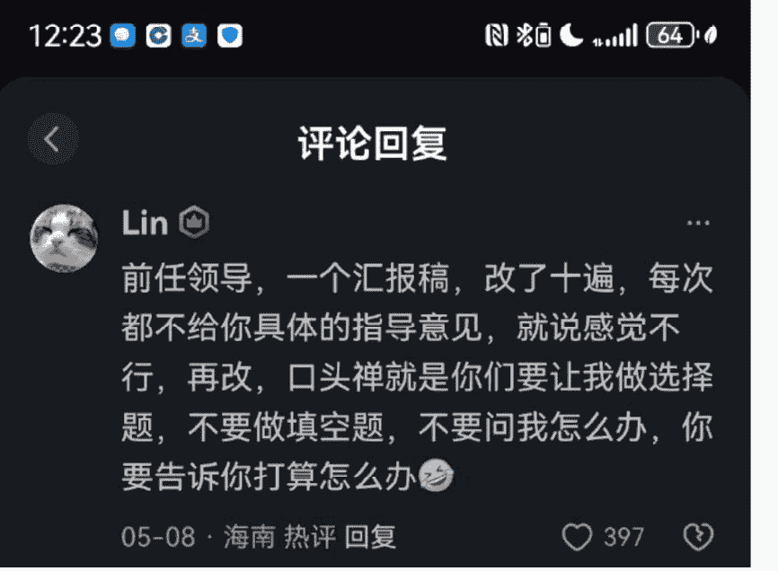

任何政治人物，或多或少都有其政治路线和政治理念。

有的政治理念和政治路线，是为其本人利益出发，这类人就叫政客。

有的政治理念和政治路线，是为国家人民利益出发，这类人就叫政家。

今天试举几个具体例子，就聊聊新时代批判过的几个政治路线吧。

第一个批判的，就是徐郭提出的军队国家化。

这个词，在欧美是很盛行的，欧美会实行分权制衡，军队不介入权力斗争，名义上只听从国家的。

中国国情不同，毛泽东在三湾改编时候就把党支部建立在连上，搞了党指挥枪，军队是听从政党的，建国后则听从一党专党的共产党。

国家主席是名义上的国家元首，但国家主席没有军权，军委主席才有。

这个就是关键。

但是，军队国家化，中共其实一直提的。

首先是建国前，国内还在斗的时期，当时中共没想自己统一全国，还对和平有幻想。

当时毛周认为军队国家化在一定条件下是行的。

——抗战胜利后，国共两党就“军队国家化”问题开展公开争论。国民党以“军队国家化”为名，要求共产党交军队，实质是企图削弱中共武装力量。

——毛泽东当时回应称：“我们完全赞成军队国家化与废止私人拥有军队，但前提是国家民主化。”

——“如果没有军队国家化，那军队就会成为反人民的武装集团披着国家的政治土匪。”——周恩来1945.9.27

后来共产党崩溃，蒋介石败退，军队国家化提法自然没提了。

但建国后，一度高岗有新搞法。

高岗想扳倒刘少奇，刘当时是白区部的代表，军队则是另一边，是红区干部，高岗就找军队助力的林彪，他自己则提出“枪杆子里不仅要出政权，更要出发党”的言论，说要军队红区干部介入政治要权力。

随着高岗的失败自杀，毛也随之批判了这个理念，坚持党指挥枪，不允许枪杆子介入高层政治斗争，但后面毛也没坚持住，发动文革后困难重重全国失去秩序，毛不得不依赖林彪稳住上下，放开了一大批红军干部扩大政治权力，如果林彪谋反成功了，那就枪指挥党了。

文革结束后，邓陈等元老继续缓慢削弱军队参政政治的能力，一个重要的设计就是军费。

改开前中国一直认为是要打世界大战，军费预算是军队拟定给国务院参考，然后在人大那边都是走过场。

开启了和平和发展的基本判断，邓百万大裁还有各种下马项目，特别是人大不再是走个过场，军费这个总额度当然是军委主席，但具体钱怎么分花，还得考虑人大，人大通过审议预算报告，专题询问，每年年初，军队和人大都是各种扯皮，为军费的问题扯皮。

比火如箭窝巢报复后，2025年两会期间，人大就要要求军方代表说明“提高经费效益”的具体措施，表示对军方的一些不信任。

这些事在欧美是曝光在大众眼前的，每年五角大楼都跟国会扯皮的全球皆知，中国不太一样，人大与军队互动以“提案-审批-监督”为主线，分支通过内部协商解决，极少公开化，所以大家对此感觉不明显。

中国向来是以文御武的，文官当政委员书记是个例子，用人大和政委对外军队一些制约也是个例子。

军队自然难受，不能放自我，但这种制约是部分制约，是有必要的。

俄还有，当年长者重启战备各种上马项目，为了减轻阻力，搞了戎装常委，就是让地方领导加入地方常委会，这帮人进去当然是吃瓜看戏，书记举手他们就举手，书记反对他们当然也反对，常委会基本不用考虑戎装常委的一票。

但搞了这些还是有用的，长者主要是想扩大军队和地方的沟通交流，协调好战备建设和经济发展，这个制度还是挺好的，现在也依然搞戎装常委。

但徐郭的做法不同。

徐郭军队国家化，名义上和国际接轨，但实际上是想让军队用中央委深度管制，军队国家化了，就是让国务院管，但人大没有足够的能力和技术管，这样军队国家化了。

后面几年，徐郭搞得很很有害，吹起来了，迷惑了很多部分干部。当然也有一些醒目的干部，比如今天的军委，他上位进入了视野。

因此被认为是徐郭嫡系，上位到了军委的位置。

徐郭这种野心引起了新时代的警觉。

新时代上台后干掉了徐郭，大批军队国家化。

警惕“军队国家化”：2015年6月8日“军队国家化”是西方提出的，在西方背景下，为了避免军队直接服务于某党，导致军队内部纷争，导致军队军事化。

军队国家化没有法理基础：2014年1月5日不久前，军委副主席许亮提出，要“军队非政治化、非国家化”，这命中了要害，具有很强的启示意义。新时代明确指出：“党指挥枪的原则绝对不能动摇”。新时代还去了古田，召开了古田会议，彻底定性是路线斗争问题。至此，谁在军队里提军队国家化，谁就是徐郭，谁就等着干掉。至此，军队国家化在学术和公共讨论中争议，官方持续强调军队“党的属性、国家属性、人民属性”三者统一。

第二个被新时代大力批判的路线，叫司法独立。和军队国家化一样，也是西方特有的名词。提出这个路线的人明面上是周强，暗地里是邓。团派的人曾经信奉民主那一套，把司法独立等一系列司法改革作为配套。邓很用心地培育了政法出身的周强，一步步推行到了最高法。周强搞了很多司法改革，我们慢慢说。

一个是员额制，这个制度设计的初衷是改进司法系统外行领导内行的弊端，想培养专业的法官，并给他们更高的薪酬水平来匹配。要知道，公检法系统可以说是体制内专业性强的系统。初心是好的，但没办法，员额制不能让领导占据份额，最终实行下来只是外行继续领导内行，而且外行还挤占内行的上升空间。员额制搞到后面，成了劣币驱逐良币，业界表示，之前中国最专业的那帮法官，自从员额制后不断的从体制内流失。而基层法官上看上升空间受限待遇水平一般后，有买房压力的男性越来越少去体制内法官，而是选择去体制外律师，这导致基层女性法官膨加剧了极端，加剧了男女对立。

第二个改革是跨地区司法，就是巡回法庭。周强：巡回法庭充分发挥司法改革“先行者”“试验田”“排头兵”作用。发布时间：2017-1-21 01:22:08 法制日报—法制网。周强在最高法院第一、第二巡回法庭成立两周年座谈会上强调，这个制度改革是基层十分赞成的。河南一个基层官员去拆迁，对居民说搞垮你们还不容易直接公检法一起上你们全家不拆就等着坐牢。还有各种案例，地方民众和民企知道民不与官斗，因为地方领导一个指示，公安和法院都跟着地方领导的支持去抓人去判刑，民怎么敢和官斗。县就是一个完全的政权了，因为乡镇都没有地方自决的执法司法权，而县一级就完全了。

改革后，中央将司法执法权下放到地方一级，导致了冤假错案很多，还有就是公权力不断侵蚀市场经济。为啥扫黑除恶总是春风吹又生？因为地方一级就有执法和司法权，黑恶势力的保护伞有着生长的土壤。周强搞的这个巡回法庭，是跨区域的，法官是垂直管理而不是地方管理，不一定听你的地方的招呼，甚至有些案子就是异地办理，江苏的案子湖南的人判，湖南的案子江西的人判。巡回法庭本质上就是想削弱地方司法权，将权力收回。目前这个制度还在执行，而且不错，但阻力太大了，没有达到预期目标。毕竟体制内你要放下权力很简单，但想收回权力太难了。

第三个改革就是司法公开。强制推行直播和文书上网，倒逼内部改革。但是，司法公开让一些干部不舒服，现在新时代不再提司法公开，文书上网都停了。这显然不是好事，这意味着外部对司法的监督都要没了。

第四个改革就是司法独立。周强甚至想一步发展成三权分立。这个改革只能说当时是有一定的理由搞的，因为军队国家化把持，在那些年实在是强势了。那些年政法系统不断膨胀，地方权力很大，甚至维稳支出大于军队。具体的案例就是重庆打黑，不管你有没有罪，抓进去后法院总能判你有罪，程序上找不到任何毛病。军队国家化毁了政法系统，所以周强就想回来，但办法没有。政治人物其实和程序员差不多，一个程序就是屎山代码都不要轻易改变，即使程序有很大问题但只要它还能运行就不要大改。？

第三个被批判的，则是党内民主建设。提出的主要代表，是曾经去哈佛进修过，被欧美誉为党内开明派的李源潮。我们可以从他的言论看出，他对党内民主的一些看法。

## 李源潮谈党内民主

李源潮的根本大意，是先通过党内民主，然后扩大到党外的人民民主。李源潮要加强党内下级的权力，让下级能更好监督上级。——李源潮解释道：“党内民主看作政治改革的基石，因为党内民主能实现多个目标：赋予党员权利，增加透明度，加强下级机构的监督，防止‘一言堂’。”李源潮认为，实现了党内民主后，就要进一步延伸到党外，实现人民民主。李源潮介绍了相关的背景：“尽管中国的人群众不像西方那么富有，在很多方面包括技术、城市建设等还不像现代国家那样先进。”李源潮说：“但是中国人民对于进步、对于国家的发展和未来充满信心。现在每一个人的进取心在世界上也是非常突出的。人们拥有强烈的进取精神和民族自豪感以及建设中国特色社会的雄心。中国改革开放最大的成果之一就是解放人的头脑，解放了人的思想。它成为了30年发展的最重要的动力。这一切自然需要民主发展铺平道路。”

整个过程循序渐进，李源潮认为不能用重庆模式那种暴烈的手段，而应该温和的循序渐进。

> 

李源潮强调说：“这是一个循序渐进的过程。为了建成有效的民主和法治，我们必须维持社会的。这就是为什么我们说改革是一种循序渐进的革命。它不是那种急躁的、暴力的，不是那种激烈的，也不是一种力量推翻另一种力量。它是一种内生的、有序的变革方式，同时它符合发展的规律，并且能够使国家和人民从中受益。”我们甚至可以认为李源潮这个政治理念，其实就是邓的政治治理。邓是真正的党内民主的，已经民主到九龙治水的程度了。你可以说邓软弱不敢斗争，但不得不说邓可能默认九龙治水分权力，他本人是支持党内民主的，不搞一言堂。但最终，李源潮的路线随着李源潮被被打而破产。

怎么评价李源潮的党内民主到人民民主的政治路线？怎么评价新时代对李源潮路线的几乎全盘否定？可以说：首先，扩大下一级的权力，让下一级有监督上级的权力，这是百分之百支持的。被全盘否定是最可惜的。谈最重要的一点，你知道为啥这些年基层都累死累活的吗？为什么这些年官僚主义形式主义怎么都没用？为什么基层减负了好几轮却越减越累？其实就是一句话，就是下级对上级根本没有任何制约的权力。

| 权力在上面 | 责任在下面 |
| :--- | :--- |
| 成绩在上面 | 工作在下面 |

| 瓜怪陆俗俗 | |
| :--- | :--- |
| 24-7-7 12:20 来自华为 Mate X6 典藏版 | |

没有任何权力的群体，在权力面前，都是待宰羔羊。即使你在体制内，看起来你是官，但只要你是下级，你在上级面前都是待宰羔羊。之前还有组织提拔一个领导，要问领导单位的下级干部，如果投票不通过就一票否决。现在这个都形形虚设了。下级完全没有制约监督上级的权力。

下级对上级根本没有任何监督制约的权力。

下级对上级根本没有任何监督制约的权力。下级对上级根本没有任何监督制约的权力。下级对上级根本没有任何监督制约的权力。下级对上级根本没有任何监督制约的权力。下级对上级根本没有任何监督制约的权力。下级对上级根本没有任何监督制约的权力。

所以，级搞司法改革后的最终目标还是会削弱中央对司法的干预，最终实现三权分立。这个有些理想想开了，或者说邓步伐太大不适应国情了。

新时代可以允许巡回法庭，削弱地方对司法权的把持，但不允许在高层搞司法独立，让司法独立于党成为三权分立中另一极。帮助地方的司法权收回，中央乐意。你要进一步削弱中央的司法权，中央就不乐意了。中国政法委，为什么叫政法？因为中国本身就是把司法当政治工作的。这是某一位最高法一号亲口说的：审判工作是政治性很强的业务工作，也是业务性很强的政治工作。

然后这句话的一号，被系统内称为法官。你可以说这个人是法盲，但不能说这些人不懂政治。因为这个问题可以上溯到马克思的理论。马克思主义认为，法律从来不是启蒙家追求的那种纯粹的道德正义公平，法律是统治阶级维护自身统治的工具。法律是为国家意志的统治阶级意志。马克思主义对法律有这个定义，就有了人民民主专政下法律无法独立的现象，就有了政法委。你要司法改革三分立，得和马克思辩证，得提出新的马列理论。后面邓铁锤也不奇怪了。周强：要敢于向西方“司法独立”等错误思潮亮剑。澎湃新闻 01-14 20:48。邓也放弃了司法独立的追求，不想从根本上改变，后面接手的人也开始矫枉过正，导致邓时代呼声很大的司法改革，在今天几乎没有什么新的动作。

> 政治人物其实和程序员差不多，一个程序就是屎山代码都不要轻易改变，即使程序有很大问题但只要它还能运行就不要大改，万一大改了连运行都运行不成了呢？

司法改革就在这里了，否决了错误路线是对的，但迟迟没有提出新的正确的路线导致司法不公还是有时发生的，比现在的春风女官和地方的远洋捕猎，这是很让人着急的。比如说，邓的司法独立要反对，但邓的司法公正一起反对，这就是矫枉过正了。这就是否决了错误路线但自己没有提出新的正确的路线。

大家可能对团派的评价不高，我也批判过，这帮人接接地能力不强，坐飞机来的，而且对西方民主思想比较信奉，可能会走上上西方的邪路。

但是，马克思主义不就是西方传来的吗？西方现有的政治理念难道就没有有一点点能借鉴的吗？

团派总体是温和开明派，是想走民主改革路线的，虽然他们的政治路线被证明弊大于利，被证明不适应国情，但里面还是有值得肯定的地方。

周强的司法独立是错的，但司法法公开是值得肯定的。

李源潮的政商阀门乡贤制是错的，但扩大党内民主根治官主义，然后进一步扩大党外民主，这个我是很赞同的。

还是那句话，中国共产党之所以伟大，不仅是带领人民成功打碎了一个旧世界，更是带领中国人民成功创立一个新世界。

否定对方的政治路线，是打破一个旧世界。

创立自己的政治路线并证明是成功的，才是创立一个新世界。

# 知识星球TOP
付费资源分享群

添加微信免费入群
微信: jntsg2

| 序号 | 公号/星球/社群 | 原价 | 领域 |
|---|---|---|---|
| 1 | 生业有木 | 2765/年 | 副业、搞钱 |
| 2 | 怂从吃瓜群 | 365/年 | 时政、历史 |
| 3 | 记忆承载/碧树西风 | 365元/年 | 成长、搞钱 |
| 4 | 欧洲金靴 | 328元/年 | 时政、历史 |
| 5 | 卢克文青会 | 699/年 | 时政、社会 |
| 6 | 体内主任 | 599/年 | 体制；职场 |
| 7 | 外局人的视角 | 669元/年 | 金融、时政 |
| 8 | 灏泽异谈 | 4166/年 | 财富、成长 |
| 9 | 守夜人总令 | 599/年 | 时政、经济 |
| 10 | 江宁知府 | 365/篇 | 时政、国际 |
| 11 | 政堂/顾子明 | 568/年 | 时政、经济 |
| 12 | 唐书院 | 1399/篇 | 金融、财富 |
| 13 | 大树乡谈 | 199/年 | 时政、成长 |
| 14 | 水库欧大 | 10000元 | 房产、经济 |
| 15 | 洪灏的宏观策略 | 4376/年 | 经济、搞钱 |
| 16 | 金政通鉴/北海道山 | 4576/年 | 股票、行研 |
| 17 | 猫留的世界 | 299/年 | 时政、社会 |
| 18 | 飞浅云 | 3600/年 | 股市、经济 |
| 19 | 米联债见闻 | 599/年 | 经济、金融 |
| 20 | 鉴茶财经院 | 330/年 | 房产、股票 |
| 21 | 赢在八小时之外 | 365元/年 | 成长、职场 |
| ... | | | 更多资源，不再列举 |

+ 图书、报告、课程等同类高价值资源

- 免费群 每日分享干货资源
- VIP群 每日分享所有资源（日均20+），75/年

# TOP资源 TOP社群
