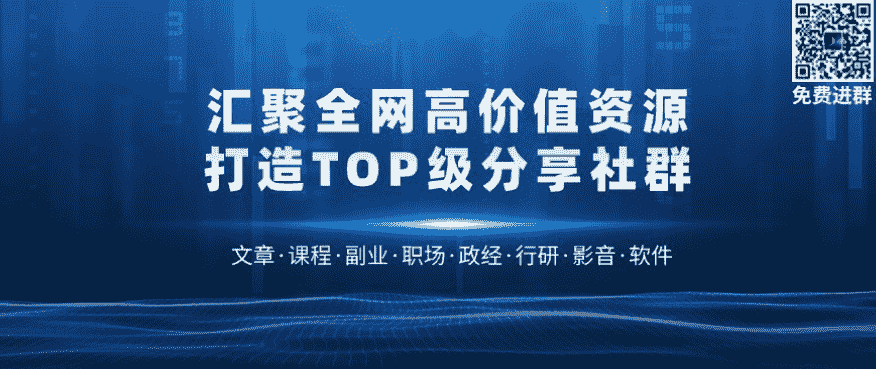
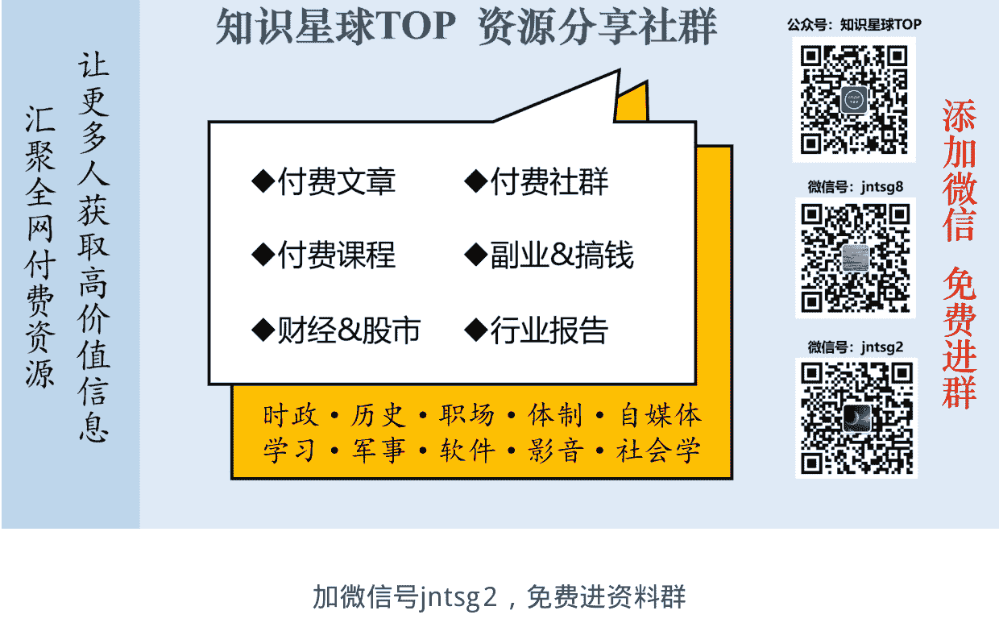

最近内事写了很多，马上要准备末年底政治局会议，讨论下半年经济工作，到时再写吧，就这几天了。

不过大家期望不要太高。

去年9月局会议那么激进，是因为有两个因素。

一个是去年三个季度的增速都不乐观，如果不刺激那么全年增速目标肉眼可见的完全不行。

还有就是美联储给中国送暖，竟然降息了，给中国巨大的操作空间。

内外因素才有了去年9月的激进。

今年这两个因素都没有。

年中数据出来了，增速不错，下半年稍微稳住，加上补贴，全年增速目标完成不是大压力。

美联储还没死降息，懂王各种施压，鲍威尔这几天还上门和鲍威尔撕逼，就就冲上去给他一拳头了。美联储内部也出了三个高层内鬼，前段时间还得鲍鲍威尔传出辞职新闻，这局势还在焦灼，难说美联储将降息。甚至悲观观点，今年就算降息也不是两次的200个基点，而是聊胜于无的75个基点，这懂王很难受，我们也很难受啊。

所以，今年两个因素都没有满足的情况下，本月局会议大概概率复刻不了去年的打鸡血的。

大概率是总结陈述上半年的那套，反内卷名下的产能，还有稳住楼市稳外贸，以及克制性的再提振下股市。

哦对了，一些瓜友问这次反内卷，其实我之前写了。

名义上是反内卷，其实就是去产能，还是供给侧去产能那套。

只是耶伦那年来华说我们要去产能，我们没答应，现在终于要做了了，不能显得我们知错了了，所以不叫供给侧去产能，而是反内卷这个新提法。

16去年产能，是刘鹤搞的，围绕钢铁、水泥、煤炭，主要是国企的。

25年的去产能，不仅国企，还有民企，就是光伏、电动。

价格肯定要涨价的，16去年产能很多人担心通胀，现在我们都通缩了怕什么通胀。

我们巴不得原材料涨价、大宗涨价，传导到消费端拉起通胀，日本陷入通缩后拉了30年都没拉出通胀。

且，上游涨价传导到下游是需要时间的。

这个时间，大概是三个月左右，和中国外贸涨价传导到美国消化库存后通胀升高一样，都是三个月的时间。

如果下半年美联储再降息，我们这边大举刺激政策，叠加三季度去产能传导的涨价效应出现，那么乐观的话，今年11月12月的时候，通胀会为大家缓解。

这是上面希望看到的。

因为今年还要走不出通缩，那就是连续三年通缩了，那就是怎么都掩不了的经济大衰退事实。

只能说，中国人民币国际化进程，实在是太慢了，导致中国金融政策一直没有主动权，只能看美联储脸色行事，搞的政策操作空间很小。

还有一个事东哥请国家救他了。

东哥和美团的外卖大战，是美团搞了东哥的蛋糕，东哥不爽，而国家刚好也不爽美团一家大压榨商家外卖小哥，于是国家和东哥一拍即合，东哥下场开美团。

其实，按照东哥和美团的行为，换在前几年啊，就是一顶顶资本无序扩张的帽子扣过来了，是国家默认支持东哥下场的。

但没想到马云出手了。

马云给东哥发下了军令状，入局外卖大战，而且百亿补贴是真的百亿级别的。

本来东哥靠流量和民心，还能和美团干的，预期能吃掉美团大部分市场。

但马云的大手笔一参，直接让大战变成阿里vs美团，然后京东要死了。

或者马云是看国家不爽，明知道国家搞这个局是为了不让美团一家独家定京东上位，但马云就是想换淘宝外卖上位。

所以支撑不住的东哥国家出手了。

本来年初就在搞反内卷，国家支持京东所以京东美团没扣内卷的帽子，然后淘宝救京东东哥救急，国家就把三家盯上了内卷的帽子，要三三家动兵了。

> ——2025年7月18日，国家市场监管总局约谈饿了么、美团、京东三家外卖平台，要求其遵守《电子商务法》《反不正当竞争法》《食品安全法》等法规，规范促营销行为、理性竞争。

国家看东哥坚持不住，出手叫停了。

但这样国家的布局也一半落空，本来想着是京东外卖崛起起制衡美团一家独大，现在是京东外卖后劲不足，饿了进化了很多。

东哥现在是恨死马云了估计。

当然，国家在京东的布局设计是落空了，但在其他商业布局上还是成功的。

一个是李嘉诚的港口买卖。

霍王最近求和和切，竟然在李嘉诚生意上妥协了，允许中国参与分肉。

# Walter Bloomberg @Deitaone

CHINA THREATENS TO BLOCK PANAMA PORTS DEAL UNLESS ITS SHIPPING GIANT IS PART OF IT- WSJ

由 Google 翻译自英文

# 中国威胁阻止巴拿马港口交易，除非其航运巨头参与其中——《华尔街日报》

25年7月17日，17:37 · 4.7万 查看

> 李嘉诚巴拿马港口出售成功和解，中运加入收购集团，占股30%，另外方是贝莱德45%，中海航运25%，长和的40几个港口包括巴拿马，变成了国资参股的合资企业。同日，中国停止对贝莱德占股的迪比公司的反垄断调查。这是未来几年的常态，中美摸谈判-瓜分世界，中国上桌了！感谢川普。25年7月25日，上午10:49 · 44 查看

# 懂王果然是实力内控。

然后张一鸣TikTok交易，出现转机。

# 路透：黑石退出寻求TikTok业务财团

记者 Sebastian Tong 07/19/2023 10:53 [转发] -- 路透一位知情人士，黑石已退出投资TikTok业务财团。
- 黑石原本计划由Sushanna International Group和General Atlantic财团获得少数股权
- 黑石拒绝对调整；TikTok立即回应路透质询
- 路透递询，尚清楚财团其他方是否参与

本来以为马斯克可以带头入股，但马斯克和懂王闹翻后没戏了。TikTok大概率还是卖，争论是非卖多少股份的问题。似国家给张一鸣安妥的手段，希望张一鸣带着资金，搞高精类型的医疗业务。

张一鸣对生命科学和医疗健康领域感兴趣，早在之前就通过子公司投资了多家医疗机构，然后张一鸣退居后，他在香港个人基金投入了细胞疗法等项目。张一鸣喜欢这个，就用安抚他，说服他。

# 马云不敢做的事情！

抖音集团在北京市建三级医院获批。市健委官网：抖音集团在朝阳区建设三级医院。该三级医院位于中关村朝阳服务地块（065地块），名称为爱瑞医院（待定）。变更信息公示显示，该三级医院为合营利性医院，面积8000平米。《朝阳区协议土地使用权计划书》显示，该国际化医院项目完成后，注册医生占比低于20%，亚洲卫生医生总量工作量不超过10%。

抖音集团在北京市建设三级医院。

# 智驾这块，不是很顺利。

华为那边的说法是，智驾打头，上半年试行，然后半年推广到全国。

> ——2025年4月1日，对于中国的智能驾驶来说，绝对是个纪念的日子。这一天，《北京市自动驾驶条例》正式实施，L3级驾驶车首次合法上路。

但小米后面出了事，就是高速祸死了三个女生的事，闹很大，部门一看不好，就延缓了事。

先是小米事，后是懂王搞事。如果没有高层克服阻力的话，预计明年才能全国推广智驾落地了。

这些商业的事介绍到这里，然后看国际。

最近柬埔寨和泰国在仗，没美国设计的。两国本来就有领土问题，然后上半年刚好死了人，两国开启紧张态势。

> ——2025年5月12日，柬泰边境“三角地区”的冲突，源于一座争议寺庙的修复工程。泰国边境警察声称柬埔寨士兵向泰国边境开火，造成3死7伤，而柬埔寨军方发布的监控视频显示，泰国巡逻队先越境拆除东方设立的界碑。泰国他信家族那个傻逗卖了。

冲突爆发后，洪森在电视讲话中播了17分钟录音，佩通坦用泰语夹高棉语说：“洪森叔，求你可怜我这个侄女，泰国不会真的断水断电，只是吓唬他们（东军队）”。

录音的第1分钟出现关键转折：佩通坦提到“父亲当年在金边说过，湄公河的水不能碰”，洪森突然打断：“他还说过前王的坏话呢！”

这句话引发泰国朝野震动，泰国枢密院迅速发表声明，称洪森“干涉泰国内政”。其实洪森和他信家族，算是20年的老朋友了。之前关系一直很好，他信家族在柬有2亿美元的投资。但这件事的确是泰国不对，首先开杀人了。

而且他信家族给出的解决方案，一直是让洪森忍一忍就过去了。他信洪森从2020年就开始忍，他望洪森不要得罪泰国军方不然他信难做。

洪森在2020年接受《日经新闻》采访时曾说：“亚洲至少懂得用地图谈边界，而他信总拿着钞票谈感情。”结果洪森忍了5年，忍出了泰国军首先开杀人。而且他信家族这个女的上位后不讲长辈情分，各种让洪森难受。

要追关系破裂的根源，需回到2023年，泰国大选后的基建博弈。

佩通政政府推动的“泰泰高铁”计划，要求柬埔寨以洞里湖航权换取投资，而洪森坚持高铁必须经过金边省，双方在路线规划上争不下。

此外，湄公河水资源也是矛盾点。泰国东北部农业灌溉依赖湄公河支流，柬埔寨在上游修建水电站，泰国农民抗议“断水”。所以今年泰国杀人事件后，洪森怒气值突破临界点，他觉得他信族忽视了，现在不忍了，暴跳如雷，而且通过通话内容报复他信族的佩通坦。泰国相对柬埔寨就是大国，所以他背后中国。去年末洪森儿子后悔，想要更多的钱，我们不惯他，立马撤走。洪森儿子服了，工程继续。

> 尽管柬埔寨是小国，但中国始终给予尊重。2025年4月，中柬签署合作议，明确中方占49%；对越南口的依赖从70%压至30%。4月份，洪森安抚好了中国，然后5月，勘测完成争议地区界碑钉入省，于是洪森破脸，两国打。洪森知道中国会帮他。

泰国相对柬埔寨很不爽。的确，柬埔寨第一见的是美国，，不接受。泰国拒绝第三方调节，泰国军队不服，懂王说不接受调节。

> 交易员 @myfxtader·1小时 美国财政贝森：与中国的贸易谈判已经进入新阶段。

#俄罗斯卫星通讯社：美国财长贝森：与中国的贸易谈判已经进入新阶段。会议将于下周二在瑞典首都斯德哥尔摩举行。这次谈判，很可能是最后一次，懂王说谈判接近收尾了。

# 【贸易谈判】美国总统特朗普表示，华盛顿与北京的贸易谈判处于收尾阶段，接近达成交易。特朗普在人工智能主题期间：“我们与中国处于结束谈判和达成交易的过程中。”美国电视台进行了转播。

# 特朗普称与日本达成一项大协议【特朗普曾说日本向美投资5500亿美元】#热点解析

目前还只有特朗普自己的发表，赤泽这次是第8次跑美国进行谈判，一会赤泽召开记者会说明谈判情况。

15%的关税如果是真的对日本来说还是可以接受的，5500亿的投资这个当初破访美时说的可是1万亿，不过这个钱指的是企业挖起来的又不是日本政府自己掏的看着就好。

下面重点，关于汽车和大米等农产品的开放，汽车的。

# 曾京聚会努力克制住诱人的冲动 央视网

05月04日10:20 来自自微信视频号 #对日本被拒绝与美国一道孤立中国 #“硬刚”美国 #日本首相对美国提话 日本经济再生大臣2日露出，与美国就“经济安全”问题进行讨论——日本媒体体析，所谓“经济安全”问题指的是美方要求日本站在美国境内，孤立中国。彭博社此前援引多名现和前任日本政府官员的报道称，东京方面不希望被卷入美国对华极限施压性行动中，其尤其不意局限对华经济来牺牲自身利益。日本首相石破于2日接受日媒采访时下重话，称绝不能接受美方的汽车税。

# 曾京聚会努力克制住诱人的冲动 央视网的微博收起

加微信信号jntg2，免费进群

# 知识星球TOP
添加微信 付费资源分享群免费入群

微信: jntsg2

| 序号 | 公号/星球/社群 | 原价 | 领域 |
| :--- | :--- | :--- | :--- |
| 1 | 生态有木 | 2765/年 | 副业，搞钱 |
| 2 | 怂众从吃瓜群 | 365/年 | 时政，历史 |
| 3 | 记忆承载/雯树西风 | 365元/年 | 成长，搞钱 |
| 4 | 欧洲金靴 | 328元/年 | 时政，历史 |
| 5 | 卢克文青会 | 699/年 | 时政，社会 |
| 6 | 体制内主任 | 599/年 | 体制；职场 |
| 7 | 外局人的视界 | 669元/年 | 金融，时政 |
| 8 | 灏泽异谈 | 4166/年 | 财富，成长 |
| 9 | 守夜人总司令 | 599/年 | 时政，经济 |
| 10 | 江宁知府 | 365/篇 | 时政，国际 |
| 11 | 政事堂/顾子明 | 568/年 | 时政，经济 |
| 12 | 唐书院 | 1399/篇 | 金融，财富 |
| 13 | 大树乡谈 | 199/年 | 时政，成长 |
| 14 | 水库欧大 | 10000元 | 房产，经济 |
| 15 | 洪灏的宏观策略 | 4376/年 | 经济，搞钱 |
| 16 | 金政通鉴/北海道南山 | 4576/年 | 股票，行研 |
| 17 | 猫豹的世界 | 299/年 | 时政，社会 |
| 18 | 飞浅云 | 3600/年 | 股市，经济 |
| 19 | 米联债见闻 | 599/年 | 经济，金融 |
| 20 | 鉴茶财经院 | 330/年 | 房产，股票 |
| 21 | 赢在八小时之时 | 365元/年 | 成长，职场 |
| ... | | 更多资源，不再列举 |

+ 图书、报告、课程等各类高价值资源

- 免费群 每日分享份资源
- VIP群 每日分享所有资源（日均20+），75/年

# TOP级资源 TOP社群
