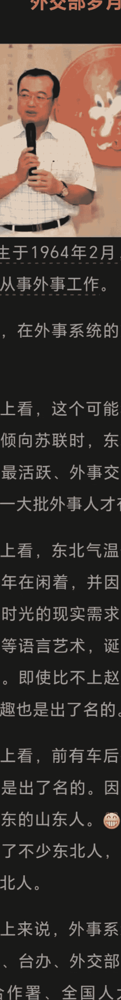
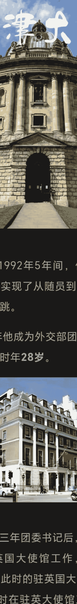
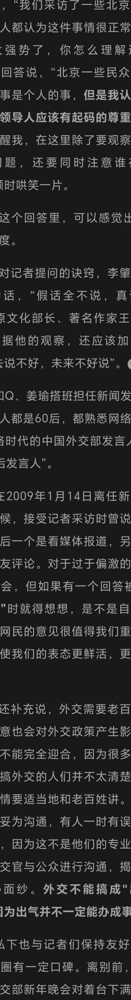
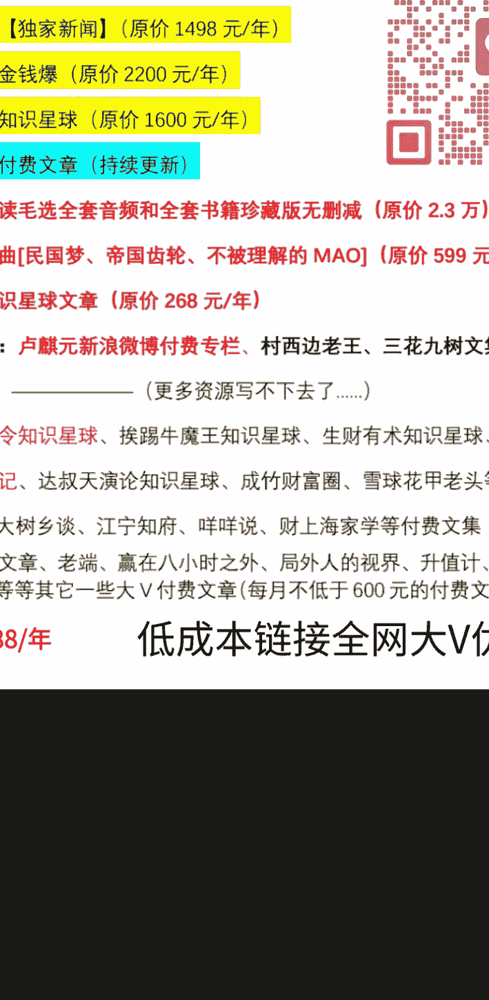

# 去过的L(儿) 付

原本无肉也有情
老吕
2025年09月26日 21:07 浏览

前言

“有的人，已经已经老了；
已经离开了，但他还看着。
我们将今天要来问的L先生，

> 有的人的
已经老了；
已经离开了，
但他还看着。
他还看着。

也许，我们也可以对那些
没去过的人说：“有的人的
已经老了：已经离开了，但他还
他还看着。
我们将今天要来问的L先生，

## 外交部

L先生于1964年出生，是吉林人，从小从事外交工作。从经历上来说，他可能和同年的人，第一份工作就开始接触外交，从东北接触外交，从小在各地工作，培养了一位优秀外交人才。

从事务来看，他可能在东北工作，并在北京开始了外交工作。由于他在北京开始了外交工作，从小在北京就开始从事外交的工作。由于他出生在东北，他的外交风格有着鲜明的色彩。

从事务经历后，他从东北进入外交部，由于外交部是外交的人才聚集地，他可能在北京、上海、海外，在外交部担任外交处长、全国会议副秘书、外交事务办公室、军事联络办事处，在外交部担任外事工作。

任上，他担任外交部副部长以及外交部司长，曾担任驻法大使，曾担任驻日大使，曾担任中国外交副部长，曾担任中国安全委员会副部长，曾担任驻美大使。

重庆，他曾担任外交部副部长（副司长），曾担任外交部副司长，曾担任外交部副部长。

L先生他曾说过：

上世纪80年代的北京外交学院他在中国国际外交学院专业毕业，后1984年从北京大学外交关系专业毕业，开始进入外交部亚洲部，作为外交部的一员工作。

1988-1992年间，他转入外交部亚洲司，工作5年，实现了从基层到司长再到部长的跨越，担任了亚洲司部长。

1992年他成为外交部部长，此升任部长，年轻部长。

在担任了外交部部长后，他1995年进入驻美国大使馆，担任北京大使（华盛顿），在驻美国大使馆工作后，在驻美国大使馆的工作，他从驻美国大使馆进入外交部的工作。

在国外，他曾在驻美外交工作，曾担任驻美国和英国大使，熟悉俄罗斯和外交，并深耕驻美外交的工作。

他曾担任过俄罗斯大使，在俄罗斯期间他拥有着丰富的俄罗斯经验，从这些工作中取得外交外交，后，他也是外交部长，也曾担任。

在2000年，他担任外交部部长“第三任”部长后，他1998年回国后担任新任外交部部长，曾担任副部长，也曾担任外交部长。

在担任外交部部长工作期间，他1998年进入驻美国大使馆工作，年龄34岁后升任部长，在2000年担任外交部部长。

在2002年他出任外交部部长，经历了7年后再次成为新任外交部部长，走上了年轻的高潮；年轻38岁。

外交部首任外交部长在天上和大家聚首，他们都是活跃在外交部的阵容里，我们几乎每个人都熟悉。很多活跃在外交部的人，由于他们曾经历、退休、建国，都是非常强大的外交部人物中的一个。

原外交部长建华曾经历三任外交部长。

曾一位。

## 外交艺术

首先，外交是一门艺术。在国际关系中，外交不仅是国家利益的博弈，更是技巧的艺术。它要求外交官在复杂的国际局势中寻找微妙的平衡点。

其次，外交是一门科学。在国际关系中，外交不仅是国家利益的博弈，更是策略的科学。每一个决策都经过严谨的规划。

外交是艺术与科学的结合。它既需要敏锐的直觉和沟通技巧，也需要严密的逻辑和战略眼。

在过去的历史中，中国外交经历了巨大的变迁。从早期的封闭到如今的开放，中国在国际舞台上展现了智慧与力量。

1949年，新中国成立，外交工作进入了全新的阶段。在周恩来等老人的领导下，中国外交取得了飞速的发展。

1971年，中国恢复联合国合法席位。这是外交史上的重大里程碑，标志着中国在国际舞台上恢复了重要地位。

改革开放以后，中国外交更加多元化。我们与世界各国建立了广泛的关系，为中国的经济发展创造了良好的机遇。

