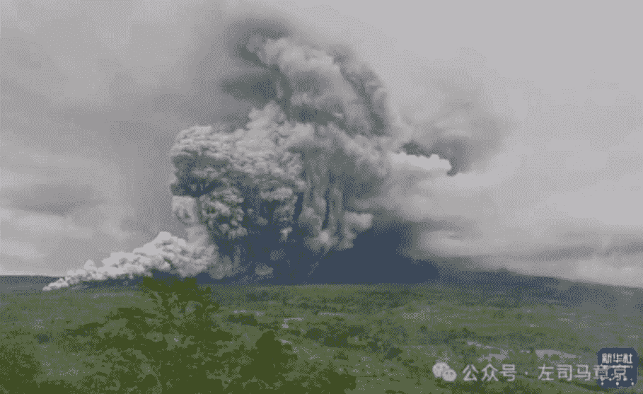

# 狼烟起--底置“十五五”形势总凭

原创 也无风雨也有情 左司马章京 2025年11月20日 22:20 辽宁

# 前言

不说话，只说干货；不说空话，直说实话。

相信看完本文，你对未来五年的形势已经了然于胸，豁得明白，其他一切十五五规划资料，都可以丢弃了。

加量不加价，值得再次拥有。

温馨提示：本文约16000字，建议分两次阅读为宜。

# 永遇乐·京口北园亭怀古

（南宋）辛弃疾

凭古江山，英雄无觅，孙仲谋处。
舞樽歇台，风流总被，雨风吹去。
斜阳草棘，常寻巷诡，人道寄翁曾往。
想当年，金戈铁马，气吞万里如虎。
芜草不齐，封荒蜀，赢得皇帝旌北颜。

四十三年，望中回，烽火扬州路。
可悲回响，佛里祠下，一片神寂肃。
先逸问：广顾老夫，尚能饭否？

# 年底前的形势：纷扰类似三国

我们都是神枪手（油画，入纪念中国人民抗日战争胜利世界反法战争胜利七十周年全国美术）铜铜 作

# 年底将近，世界并不安宁

特普维什结束了哈萨和平协议，但第九场乌克兰和平迟迟未产。虽然俄罗斯双方首脑峰会正在洽谈，国际社会和资本市场已经普遍对年底达成和解不抱希望了。

日本首相高市早苗忽然掀起外交争议，导致局势持续升级。因为事涉全球第二大和第四经济体，全球市场持续低迷。

长期的战争仍在持续，突发的冲突又不断涌，纷争几乎成为了今年和未来五年的世界底色。

四中全会公报，除了“十五五”规划的内容外，还谈到了当前的形势和任务。

其中谈到“要确保实现全年经济社会发展目标”，国内外对今年经济增长5%左右基本没有疑问。

但并不是说经济形势不是不好，而是一片好，没有任何问题了。

因为在此前“稳就业、稳企业、稳市场、稳预期”等四稳外，又加了一个“稳经济基本盘，兜抓拓展回升向好头”。

这意味着高层可能已经从某些数据上看出了经济走势。

现在我们看10月份数据，也能感受到那份担心。当月工业同比增长4.9%，服务业同比增长4.6%，固定资产投资同比增长12.2%，社会消费零售总额同比增长2.9%，对外出口下降1.1%，房产销售额同比下降18.8%。

由于全年增长5%的目标能够实现，12月份出台有力财政政策和大规模财政政策刺激的可能性，已成常态。

因为明年是新的五年规划的开局，从“十二五”规划开局的经济增速往往是五年中最高的。

在此之外，明年还是中美落实两国首脑会晤一期的关键时期。因此，预计大量的政策到明年，用到关键时刻、重点领域。

美国政府刚刚结束关门状态，多项统计数据缺失或者失准，让美联储抓到了拖延的良好借口。因此，美联储12月降息的可能性持续下降。

而欧洲今年以来已经多次面临着流动性减少的情况。目前无力再降。

如此，全球年底都面临流动性减少的情况。在此情况下，各类资产都会呈现下降趋势。

而年底投资者往往又有急于套现、锁定收益的心理，这又会进一步形成阶段性踏空行情。

因此，年底前的资本市场仍处于震调整状态。股票、黄金、大饼等资产都一样。

不过，对于此前为资产价格高位、不能上车的投资者来说，调整期也许可能是上车的周期机遇。

譬如黄金、比特币等避险资产，在如今这个纷扰扰扰的世界里，中期还是上行的行情。

市场转向保守，具有稳定现金流和高收益的防御性板块，红利和债券可能会受到追捧。

# 未来世界形势：黑暗森林

## 中国人民抗日战争世界反法斯战争胜利八周年（1945-2025）

这里借用刘慈欣《三体》黑暗森林的标题，是因为国际社会已经向三体化的苗头。在全球范围内互相掐脖子，多国开始学样，纷纷把资源“武器化”，妄图夺取超额收益。

有的实施出口禁令，如关键矿产配额，导致矿产价格上涨。

例如：
- 自2023年起实施出口，导致钴价格涨至6万元/吨，较年初升达34%。
- 计划2027年起全面禁止出口。
- 采取加税和提高控制力的举措，如矿产收入税从6%提升至30%。
- 有利沿海产组织欧佩克，组建垄断联盟，推动全球资源。

即使现在关系友国家也不敢轻易。据《信报》披露，俄罗斯总统近期在2025年前禁止稀土开采及生产，规划建立本土开采，以减少对外依赖。

这些资源对于新能源、数据中心、无人机等高端制造具有刚性需求，将在短期内加强，引发价格上涨。

## 黑暗森林法则下的风险

我们近年来在全球范围内资源采购，需要特别警惕。如果出现特殊情况，为了确保关键矿产供应，执法并非不可想象。

除了资源争夺，全球经济体追求科技和自主，也暗藏风险。刘慈欣“黑暗森林法则”说：黑暗森林中的猎人无法确定对手是否有善意，只能下手，发现对方不利就崩了。

由于某些国家对资源“武器化”，全球经济体为了自身生存和发展，纷纷开始制造化，确保关键供应链可靠。这种趋势会导致各国“内环”加强，“外环”持续，压缩技术空间，阻断资源流通。任何国家都不可能天下，某些领域或许可以自主重建或干预。

在这种模糊态下，经济关系越紧张，越有可能爆发，“一劳永逸”这个结论从何而来？

这被第一次世界大战证明。当时德国是最大的贸易伙伴，英国是第二大，德国仍然认为战争是胜利的。之所以如此，是因为国际社会基础就是丛林法则。一战后为了解决这种丛林状态，成立了联合国，但美国没有加入，成员国缺乏军事约束，联合国就成了摆设，无力阻止第二次爆发。

二战后为了同样的目的，成立了联合国。但对于大多数国家而言，其军事事务有些国也无力，美国退出联合国已经成了常便饭，某些活动也不了。

# 联合国改革

如果未来联合国不能满足美国等西方国家的要求，它的生存发育容乐观。至于WTO（世贸组织），被美国提起上诉机制，对于不愿意主动执行裁决的国家已经无能为力。

# 未来多边机制走向歧路

未来多边机制将走向歧路，国际经合作将不再全球化，甚至会从区域化、进一步快速到双边化。

在这一方面，特朗普对全球经济体加征不同关税率并采取逐个谈判的策略，可谓是“领潮流”。

美国和以色列空袭伊朗核设施，美国战略唯不承担对盟友的安全责任，这就无疑是美国的“敌人”。作为盟友，相当多国家都在积极研制核武器，核武器扩散笼罩地球。

近期美国签署了共同建造潜舰的协议，韩国在美国批准下进行低浓度铀生产，成为事实上拥有核能力的国家。日本东京正在研讨对“国家保障战略”中“无核三原则”（不拥有、不制造、不运行核武器）进行修改，并考虑与美国共享核武器。我们可能面临周边国家全是核武器国家。

此外，区域强中国、澳大利亚、波兰、沙特、土耳其等也都面临对核武器的强劲需求。斯德哥尔德国际和平研究所（SIPRI）6月发布的报告指出，全球自冷战结束以来，全球核武器数量持续减少的时代即将到来。2024年将所有核国家都在推进核武器现代化，核军备竞赛迎来新抬头。

# 十五规划

因此，我们就能更深刻理解了，为什么“十五五”规划建议中，首次有了“和平与发展仍然是时代主题”。

当然，形势如此严峻，也不是完全没有好处。资源“武器化”会导致高精产品的价格上涨；科技和供应链自主化；核武扩散伴随着海量资源、资金。

此外，未来五年是流动性极差泛滥的，主要经济体都会失去利用资本市场给科技市场输血，全球即将迎来一场弥漫的资本震潮，许多人可能迎来一生一次的财富自由机。

在这种情况下，同时需要“稳健保守+进取博弈”的杠杆投资策略值得再次推荐：

资产八成的大头应该放在稳健保守的篮子里，包括：一年花的现金或者随时可以变现的国债；实物黄金；美元计价保险；欧美发达国家的房子（股市高涨，可能很快推出限购或加税）。

资产两成的小头放到进取博弈的另一个篮子里，包括：黄金ETF、比特币、美股和A股（远超其他国家）。我们身处博弈第一线，如果有条件，应当配置优质资产。

## “海空一体”：统驭未来发展方向

## 数字军事

今年10月20日，《学习报》第六版了山东大学紫睿教授的文章《数字军事功能》，我们值得深入研读。近年来，亚洲及全球发生冲突，数字军事开始进入领域，通过提供快速安全，为后续数字军事化奠定基础。

加密货币技术更为分散，借助匿名方式降低对方拦截的概率，从而改变战争进程。结果地缘冲突爆发后，加密市场对地缘冲突的敏性与流动性适应力再次强化，让加密货币一度视为重要的避险工具。未来数字金融系统将进一步步入现代战争，它可当平民生存工具、筹资渠道，也可成为地缘竞争的隐形战场。

# 十五规划：科技和安全双星

未来十年可能是亚太地区变的十年，从我们的角度来说，实现民族复兴发展至关重要。未来五年又是延伸至十五五，争取十五五级的重中。

未来政策走向这里，我们谈到了《规划》，提到了未来的规划，将是硬杠，对国家经济的发展指导和约束可能空前。当然，对于来说，我只是研读了《十五五建议》，远远不够。负责任写好本文，我还研读了《关于中央制定国民经济和社会发展十五个规划建议》的“说明”（简称《十五五建议说明》），以及新华社发布的《十五五建议》相关的权威材料，包括《为实现社会主义现代化奠定更加基础——中共中央制定国民经济和社会发展十五个规划建议》意见（简称《十五五建议意见》、《十五五意见》），乘势而上，写出中国胜利新章——二十届四全会意见（简称《四全会意见》），人民出版社发的中共中央制定国民经济和社会发展十五个规划建议》学习导引、《中共关于制定国民经济和社会发展十五个规划建议》导读文本（以下简称《十五五建议百言》和《十五五建议读本》），以及二十届四全会新闻发布会。

### 一、总书记的说明

从总书记对起草过程的讲述，也可以看到《十五五建议》和《十四五建议》相比，重视程度、起草流程都不一样。十五五起组在今年1月份就成立了，而十五五起草是3月份份：

十五五建议起草过程中，中央小组组织了6个调研组，12个市区进行了专项调研；十五五建议的网上征求活动，收到300多万条，有关方面整理出1500条建议；十五五建议回100多条，有关方面整理出1000条建议。

此外，《十五五建议》对总书记的指导意见有了更加充分的描述。“近年来，国际形势变化的影响日益加深，外部打压遏制日益升级，我国面临的挑战更加严峻。”习近平总书记强调，要策划一个期间的经济社会发展，必须清楚大环境。4月10日，文件起草组小组召开专题会议，讨论如何应对外部形势变化，调整文件起草和框架结构。

除了这些形式和流程的变化，十五五也定定了重点。总书记指出，“十五五规划是谱写快速发展和社会长期蓝图，大马扬蹄，奋力开启中国式现代化建设新局面的时间表和路线图，要直言和员。安全是发展的前提，发展是保障的，国家保障”，这些话点明了‘十五五’期间要坚持统筹发展和安全原则。

总书记说，“推动高质量发展，最重要的是提高科技自立自强，积极发展新生产力。这意味着把清洁工程已经是重中之重。”总书记强调，“要坚持好斗争、持久战、总体胜利，力度节奏上不会变弱，政府部门仍旧日子。攻战就是单体战斗、集中资源、千方攻坚、收集力量、短期内赢下关键，持久战要有序渐进，总体战略是要坚持全局、全方位、全覆盖、最终赢得系统性胜利。”对于大多数大众，认为领域是足够的。总书记没有说，但《十五五建议》说得很清楚。“要在十五五期间完成的任务、聚焦核心技术攻关，实现开放体制改革增加，适配措施，如实现第二个百年目标。”十五五建议对说得很清楚，“要在2035年完成的目标、标准，如国内生产总值达到中等发达国家水平，实现高水平自立、信息化、城镇化、农业现代化，建成各类国，基本公共服务均等方面，确保十五五期间取得重大突破和进展。

### 二、《四全会报告》的亮点

首次将“人口结构变化”列为国内发展新课题。全会报告中，首次提出新质生产力原则：因地制宜发展，防止一蹴而上。全面实施“人工智能+行动”，全方位赋能行业，从技术研发升级。民生领域新增增增、生育、环境等具体问题。这也是十五年后的再次发力。改进破圈方面，党治理越有效，经济社会发展保障。

### 三、关于人口

人口问题是我们面临的最棘手问题之一，老龄化加人口负担、少子化、高龄、空巢化，人口问题严重而复杂。民政部副部长、中国老龄协会会长刘振国6月30日在《学习报》发表《推进实施战略应对老龄化挑战为老年人口提供精准服务》。

2024年末，我国60岁及以上人口达到3.1亿，占全国的22.0%，其中65岁及以上人口2.2亿，占全国的1.6%。我国老人的数量接近美国，超过世界上所有国总量。预计到2035年左右，我国60岁及以上老人人口将突破4亿，占比30%，进入老龄化阶段。本世纪中叶将突破5亿，占比40%，达到峰值（此处隐藏了2035年人口总数在12.5亿左右，应该是相当乐观的估计了）。人口自然增长率从2022年开始一路负增长，2022年-2024年分别为-0.6%、-1.48%、0.99%（即使无力回天）。老龄化带来的直接影响有消费下滑（以医疗、养老为主），对新兴消费、创新产业的拉动作用；养老金和医保支出持续压力、资源紧缺等。社保专家郑煊在《中国养老金精算报告2025-2060》中指出，“在测算中加入延迟退休因素，从2019年以来中央实施的各项改革措施，应包括年龄调、实现全国统一等，最终测算的结果非常好。其中，不收缴养老的今年，从之前的2028年延到了2036年。基金缺口的年份，从以前预测的2035年推迟到了2044年，都好延迟了八年。

### 五、关于经济增速

十五建议只是说，“经济增长保持在合理区间”，预计从《十五五规划》也将继续《十四五规划》的做法，并不提及具体数字。从“2035年我国国内生产总增速达到中等发达水平”来反推出来，将按照2035年人均GDP对比2020年（10632美元）励一。

并且超过200万美元的，2035年人均GDP21264美元，按照人类减少每年0.2%计算，2035年美国GDP为29.13万，从现在的保持率4.7%的增速来看可以了。

我们将不去考虑2035年人均GDP22万时中国发达国家水平是否否，上述推导至少有一个明显的问题：经济增长速度随着增长的增长，是呈现逐步下降的趋势。

按照“三十五”到“十四五”每年增长下降一个百分点，则到为2035年GDP29.13万的目标，“十五五”期间人均增速为4.8%。

当然，如果按照《三十五五以后》，2035年人均GDP可能为2.9万美元（这等发达国家人均增长2%考虑），“十五五”期间人均增速为8.5%。

其某关于“十五五”期间省市GDP的预测，仅供参考。

| 表1：“十五五”期间各省市GDP增速及目标值 | | | | | | |
| :--- | :--- | :--- | :--- | :--- | :--- | :--- |
| 吉林 | 5.01 | 5.5 左右 | 豫肃 | 5.51 | 5.5 左右 |
| 天津 | 5.29 | 5.5 左右 | 山东 | 4.31 | 4.5 左右 |
| 河北 | 5.17 | 5.5 左右 | 福建 | 5.00 | 5.0 左右 |
| 陕西 | 5.51 | 5.5 左右 | 海南 | 7.11 | 7.5 左右 |
| 内蒙古 | 5.02 | 5.5 左右 | 重庆 | 5.50 | 5.5 左右 |
| 辽宁 | 5.49 | 5.5 左右 | 四川 | 5.10 | 5.5 左右 |
| 广西 | 5.36 | 5.5 左右 | 云南 | 5.30 | 5.5 左右 |
| 上海 | 4.80 | 5.0 左右 | 浙江 | 8.02 | 8.5 左右 |
| 江苏 | 5.32 | 5.5 左右 | 陕西 | 4.51 | 4.5 左右 |
| 浙江 | 5.35 | 5.5 左右 | 甘肃 | 5.33 | 5.5 左右 |
| 福建 | 5.21 | 5.5 左右 | 青海 | 4.78 | 5.0 左右 |

### 六、保持制造业合理规模

我国制造业占比GDP的比重，随着人力成本、比较优势的变化，像其他工业化国家一样呈现逐步下降的趋势。

“十二八”开之的2012年制造业占比为38.5%，“三十五”开之的2020年占比为26.3%，“十四五”开之的2024年占比下降为24.9%。

2024年我国和美国的制造业占比值占全球制造业增加比重的27.7%、17.2%，这已经是我们国连续15年居首第一。

美国在全球制造业占比增速次于中国，远大于德国、日本、印度的4.9%、5.2%和2.9%。而美国国内增速占比GDP的比重为9.4%。

> 保持制造业比重，预计“十五五”期间保持在当前水平，或者把降幅控制在1个百分点以内。

《十四五规划》对此部分解释为，明确国家目标“进三级”，跨入中收入阶层。

这些说的非常实在了，我觉得还有大国博弈的在里面。

虽然美国的制造业增加值占比已经落到10%的低位，仍然贡献了全美近七成的科技创新成果。

此外，大国博弈也必须保持产业供应链的完整性。

这一点，俄乌冲突已经证明，欧美国家的军工能力不能满足市场需要，这和产业分工无法高效协同，因为一个配件短缺，整个生产线都停工。但保持制造业比重，意味着“十五五”期间制造业整体调整幅度不大，否则工厂就要外迁。

### 七、传统的制造业依然重要

这并不是一句废话，而是说，某些和底线思维下的“极限情形”（激烈冲突、脱钩等）相结合，传统的制造业在“十五五”时期依然重要。

这些行业也是前面说的保持合理的重要组成部分，在“十五五”期间不仅不会淘汰，还会获得支持。

《十五五建议》对这些行业的办法是提升供应链自主控水平，强化产业再造和重大技术攻关，这些行业包括：钢铁、化工、纺织、机械、建筑等（注意不是房地产，因为还需要大量的投入）。

自主可控“产业再造技术攻关”，都是非常重要的。我国的“产业基础”主要是围绕“卡脖子”（集成电路技术和软件）这两个方向展开，努力解决“卡脖子”问题，这些技术包括：先进材料、集成电路、工业机床、高端仪器、生物制造和内核组件，这些都是原始创新和关键技术。《十五五建议》提出要完善新型体制，采取常规措施鼓励微创新，这也是“常规措施”第二次在国家级文件中，第一次是用来攻坚的。

“常规措施”有哪些呢？《十五五建议》中“明确”是这样总结，“充分发挥国家战略能力的攻关”（国家力量强化，科研人员投入）；“加大对重大科技创新成果、做出突出贡献的科研人员和创新团队奖励”（高科技人才）；“完善首批（套）、首批次、首版次应用政策，加大政府购买自主创新产品（国家财政政策）”。《十五五建议》同时新增国际化水平，加强品牌建设，支持制造业向外发展。

其实日本当年面临我们一样的困境，自从特朗普政府争夺巴马港后，李锡诚港口等港口走出来，日本企业也起了出海潮，结果出海的企业成了两个圈子。

### 八、打造新兴支柱

“十四五”的“战略性新兴产业”，现在已成了“新兴支柱产业”，在传统产业增速下滑的背景下，是保持经济增长、扩大规模、增加劳动者收入的关键。新兴支柱产业主要包括新能源、新材料、航空航天、低空经济等，和传统产业基础再造一起，是战略的主战场，也是市场应当关注的重要。

“实施新技术新产业新应用试点工程”，全会结束后不久，国务院办公厅就发布了《关于加快培育和开放推动新产业规模应用的实施意见》（国办发（2025）37号），重要性、紧迫性可见一斑。按照本意见的意思，应用场景将面向全面开放，形成技术突破—试验—产业一体化升级的循环上升路径。

按照国家发改委郭刚主任在中全会发布会上说，未来产业就是明天的战略新兴产业，落后的就是支柱产业。主任认为这些产业将在2035年形成若干万产业，再造一个高技术产业。

> 由此，“量子科技、生物制造、氢能和核聚变、性接口、智能机器人、第六代移动通信等”的科技成果只能期待，不是投资的主要方向。

### 九、构建现代化基础设施体系

“速度超前建设新型基础设施”，主要是信息通信网络、全国一体化电力网络、重大科技基础设施等。

“全球多元、韧性的国际运输体系”。自从特朗普政府争夺巴马港后，李锡诚港口等港口走出来，国际运输的重要性再次强化。北极航线、巴尔干斯的广达阿尔尔戈、斯里兰卡的汉瓦提港、僧穆的钦捷港、俄罗斯铁港、非洲的哥比港都是我们的生命线和战略支点。

于11月4日，湖北北部地区官员和反对派发表公开敦吁联邦政府应尽快采取行动，兑还“海外非洲亚利人”的承诺。由此可见，这一竞争在未来更加激烈。

### 十、发展新生产力

“完善区域创新”，要围绕北京、上海和港澳大湾区等区域开展，而国际中心只有三个：北京、上海和港澳。

“工匠精神”的本质是，现在美国失去了生存空间，如果我们也要拼，，像美国一样拼搏。《十五五建议》是这样说的：一体化促进发展，这些技术需要、教育、组织等专业部门共同开展，加强对人工智能、量子科学、集成电路、生物制造、新能源等国家急需学科的培养。

强化水平引领国家基础，加强科学、交叉学科建设，建立高技术人才制度，引育优秀人才。

## 一一、关于消费

消费和就业、社会保障等绑定，在没有得到充分保障的情况下，是不现实的。《十五五建议》揭示了国家的思路：“优化消费结构，引导企业从价格竞争转向价值竞争，促进高质量发展，加强产品和服务品牌建设，还是供给端发力。

## 二二、国企改革

“强国企，推进我国经济布局和结构调整，增强国有功能，提升核心竞争力”。这是明确的国企改革信号。改革的方向就是强化“核心功能”，基本包括国家安全和经济命脉的重要行业，创新型国家建设、前瞻性新兴产业领域以及公共服务领域；其他领域将面临国防、资源、骨干网、文化领域等。体包括基建、卡脖子工程、节能环保和新能源、新材料、航空航天、人工智能、生物制造、低空经济，就不用说了吧。国企改革方向的前途就不清楚了吗？

### 十三、资本市场

详见权威人士谈十五五时期资本市场建设，不再赘述。

### 十四、推进全国行政事业单位存量资产活化共享

按照新华社报道，2024年底，建立全国行政事业单位资产调度平台，依托预算管理一体化系统，在全国范围内推动资产跨部门、跨层级、跨地区调度该平台从2025年1月上线，已累计完成200余台（套）资产调度。这基本上就是固定资产的再利用，主要是办公设备，以后单位提出政府采购申请时，可能先用大数据在全国系统内搜索是否有已经闲下来还能用的，实在没有了才会批准采买。这也是部门过日子的制度化安排。

### 十五、增强财政可持续性

首次提出要“增强基本民生保障”，兜底的意思更加明确了。

“深化零基预算改革，统一预算分配权，基本就是“小钱小气，大钱大方”，健全生态保障、省份均衡、绩效的预算分配机制，打破固化僵局格局，不花的钱坚决不花，该花的钱切实保障。

“健全经营所得、资本所得，所得税相应收费政策”。前财政部长楼伟曾放话最近房产税立法准备已经就绪，随时可以立法。很多人自我夸说“十五五规划”中没有涉及房地产的内容，大家再仔细细品，资本所得就是投资收益，财产权最重要的不是房地产吗？

新增“适当加强中央财政，提高中央财政债务管理长效机制”。

“加强同高水平发展相应的政府债务管理机制。《十五五建议》如此阐述，“健全财政可承受力评估机制”，建立适用于实施重大政策或决定重大项目的机制，要按照规定进行财政承受力评估，确保政策和项目符合实际，财力可承受、能落实。“这是给地方政府在改革过程中约束，又套上了新的箍箍，按地方财政和主官的“拍脑袋”政策冲动，虽然也会让区域间、城乡间、城市间的差距越来越大。

## 六、稳步发展期货、衍生品和证券化

这些衍生品和证券化，都是为了应对未来风险，是极其重要的任务。《十五五规划》是这样说的：

- 资产一体化促进金融市场连接，通信市场、货币市场，有助于缓解融资压力。
- 资产证券化转化为具有灵活性的金融产品，有助于降低贷款总额，优化融资结构。
- 资产证券化设计，有助于拓宽中小企业融资通道。
- 重点领域包括基础设施建设、资源能源、现代制造业等，活存量资产。

## 七、积极扩大开放

王毅在《推动构建人类命运共同体》文中，提出了若干举措：

- 推动区域区域、东北亚一体化是未来的关键。
- 深化中韩关系，加强国际合作，和平共处，共赢。
- 推动建设具有全球影响力的国际中心，要积极推进新兴产业，加强合作。
- 坚持离岸立场，要在中央统一领导。
- 坚持工匠精神，从来不怕怕、不怕怕、勇于斗争，面对各种挑战。
- 增强战略意识，守牢底线，维护国家地安全的战略屏障。显然是“国家安全”，不是“国家边界安全”。
- 这是未来的重点。

此外，《十五五建议》还提到了以下点：

- 推动区域跨边界发展，深化中韩贸易，东北亚一体化，我们努力加入《全面太平洋伙伴协定》（CPTPP）。
- 引导产业供应链布局，从卖产品到走出去，是大国发展的必经阶段，政府重要的是优化海外综合服务。
- 完善产业供应链网络，深化与全球客户、贸易投资便利化水平。
- 完善海外风险防控和保护体系，指导企业经营，增加就业机会。

## 八、促进区域协同

“推进跨区域跨流域通道建设，重点建设沿海战略骨干通道，贯通沿岸和西部沿海廊道，加强城市群之间高效联通。东北地区加快建设加油气管道和电力输送通道，是真正有意义的蓝图。加强重点城市群联动发展，支持京津冀、长三角、港澳大湾区打造世界级城市群，推动区域双城经济、城市群等成为高质量发展增长极。标准高质量建设区域现代化。10月9日，华能和中化将总部迁往雄安，2000多名员工从北京入驻，开始办公。不同于之前的中国卫星总部，现在是存量搬迁，正是承接北京非首都功能实施阶性跃迁，有望成为“央务第一城”。总部企业数量虽多，但是100余家企业，日常有大量的会计、培训、招聘等需求，很多将被移至北京市日常运行。虽然雄安目前资源并不北京，经济计划下行之后，我们不容易离开，此情况或许让企迁雄安更为顺利。除了上述城市，我想在这里讲一下新的契机。今年在规划实施项目涵盖500项，总投资3.47万（相当于2.98万推京水电站），上马了新旧铁网，中乌亚铁路、高铁等超超级工程。新旧不仅承担了联系中华的国际交通通道的重要价值，更重要的是当你意识到的哈萨克斯疆境是“世界尽头”时是否已经在你的脑海中运转起来了？这里就是战略对海洋战略的重要一环。

## 九、新疆

现在的新疆具备天地利人--西北气候湿化更适合开发新疆，陆权时代新疆是“王牌”，稳定问题已经解决。据现在各地疆需要定时报送台账进度。如果未来这里进一步政治绿化，新疆可能是下一个深圳。

对于自然资源富集的地区（如内蒙古、山西、新疆、四川、广西、江西等），要把控新技术需求带来的发展机遇，打造资源开发利用新模式，努力实现经济效益、环境效益、社会效益多赢。

## 十九、繁荣互联网络下大众文化

李书猛在《激发民族文化需求创新活力》中提到，“特别是大众知识水平的提高和互联网的普及，使得精神文化发生巨大变化，人们不再仅仅可以说享受精神产品，还要参与文化创作，在完整真实的生活过程中获得精神满足、提升思想境界”“为广大人民群众提供广阔的文化舞台，使得满足人民文化需求并促进人民文化创造，才能切实增强群众文化获得感、幸福感”。

李书猛说的“文化高大上了”，还是《五五建议》更直白，“网文、短视频、微视频、直播等文创作实现了从高大、大众、大众的转变。”这就不就是网文、短视频、短剧和直播等百花齐放，明白了，这些都是国家大力支持的方向。

“切实增强人民群众文化获得感、幸福感”，应该说是大家多看网文、短视频、多刷微剧和直播，获得感和幸福感将增加。

哥们们，让我们为国家为己，更热烈些吧！😂

深度视野VIP群 人工追踪50+大V 付费群加微信cuk255 微信ch5568

## 二十、建设能源体系

“坚持风光水核等能源并举”，风光水就不多说了，“西北风电伏、西南水电、海上风电、沿海核电等清洁能源基地布局大家都很清楚”。

这里说一下核能。我们都知道因为美国数据中心的巨大电需求，美国核电迅勃发展。

OpenAI首席执行官奥特曼支持的核能初创公司Oklo，股价年内已涨六倍，市值达260亿美元，成为为过去12个月内未产生任何收入的最大美国上市公司；由美国能源部部长去年创立的企业Fermi，今年IPO估值高达190亿美元（美史上第三高）。

我们在核能大范围布局上也有了新突破。

2025年10月24日在甘肃省民勤启航的第二口瓦液态燃料基础实验地增产。新华社记者 立旺 振

深度视野VIP群 人工追踪50+大V 进群加微信cuk255 微信chap5568

11月1日，中科院宣布对甘肃的扎基础实验，成功实现国际首次核燃料转换，预计十年内完成示范堆建设并实现产业化。

该项目的成功并不意味着中国在第四代核电技术中实现了“换道超车”，还可能对世界能源格局产生巨大影响：

一或可解决能源卡脖子问题，打破了中国核电“瓮铀”困境，中国优质资源储量世界四分之一二，且与稀土矿伴生；

二可实现反应堆的小型化和模块化，未来可用于航母甚至星际飞行器等场景；

三摆脱了反应堆对水资源的依赖，可以在沙漠戈壁中大量建设，未来新疆、甘肃等内陆地区国家能源上的地位将进一步提升。

当然，马斯克已经打破隧道，要把数据中心搬到太空去了。也许未来的星球大战，将首先围绕太空数据中心开展？

## 二一、关于建党

《持之以恒坚持改进全面从严治党》中提出如下观点：

一是四个问题不输根源。

三是坚持党的创新理论、一个思想、一行统一行动。健全以学培信、以学增智、以学正风、以学促养成长效机制。

四是严防防止干部“带病跑”。完善和落实干部年轻制度，健全班子主要负责人业务交接到位，防止一些干部违法、贪腐、“形象工程”和“政工程”。

深度视野VIP 人工找路50+大V 付费群微信cuk255 微信ch5568

五是健全党员党线下和线上、平时和应急的作用机制，充分发挥党员先锋示范作用。

## 二十、关于强军建设

张又侠在《高质量推进国防和军队现代化》一文中，对于强军建设做了如下阐述：

- 一是要严厉抓官兵身边的风，遏制内部冲突，打赢局部战斗。
- 二是要抓军事实第一手摸过茧，把握危机时刻，打赢局部斗争，确保中华民族大复兴的历史进程不被延误或中断。
- 三是要强领导部指挥军队现代化步伐，迈向2027、2035、本世纪中期，制定了近期、中期、长期衔接的目标和路线。
- 四是要加强先进战斗力建设，壮大威慑力量，推进新质力量规模化、实战化、体系化发展，加强战略性能力升级，以体系结构的“优化”催战斗力的“增强”。
- 五是当务之急要加强军种信息体系建设。加快无人战斗能力及反应能力建设，在新领域攻战水平上求得实突破。
- 六是实抓国防发展重大工程，加强国防科技先进和先进科技转化，研制更多多制强的杀手武器装备。
- 这是我们要做的军魂使命。
- 七是要推动新生产力和新战斗力高效耦合、双向互动。
- 优化国防科技工业布局，推进军事标准通用，增强供应链安全。

完善军地需求、规划对接、资源配置、项目建设、政策衔接等机制，形成规范清晰和顺畅高效的军地协作关系。

这是在向美国学习军民结合和互相促进机制。

深度视野VIP群 人工追50+大V 进微信cuk255 微信ch5568

《持之以恒坚持改进全面从严治党》中提出如下观点：

（此处内容原文重复，已根据OCR合并逻辑处理）
