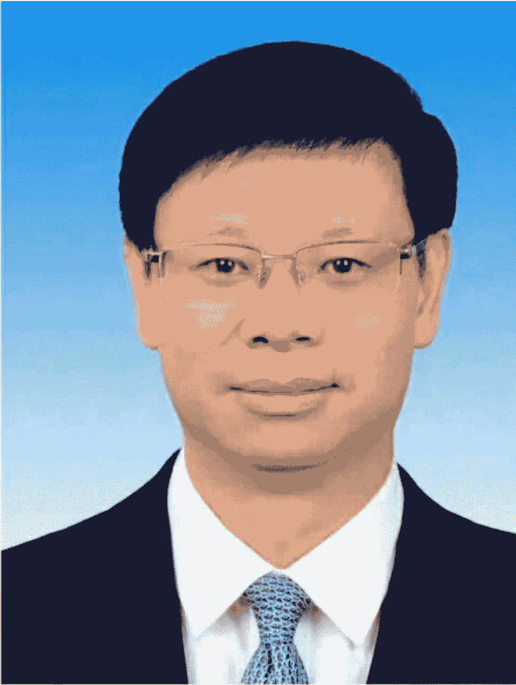
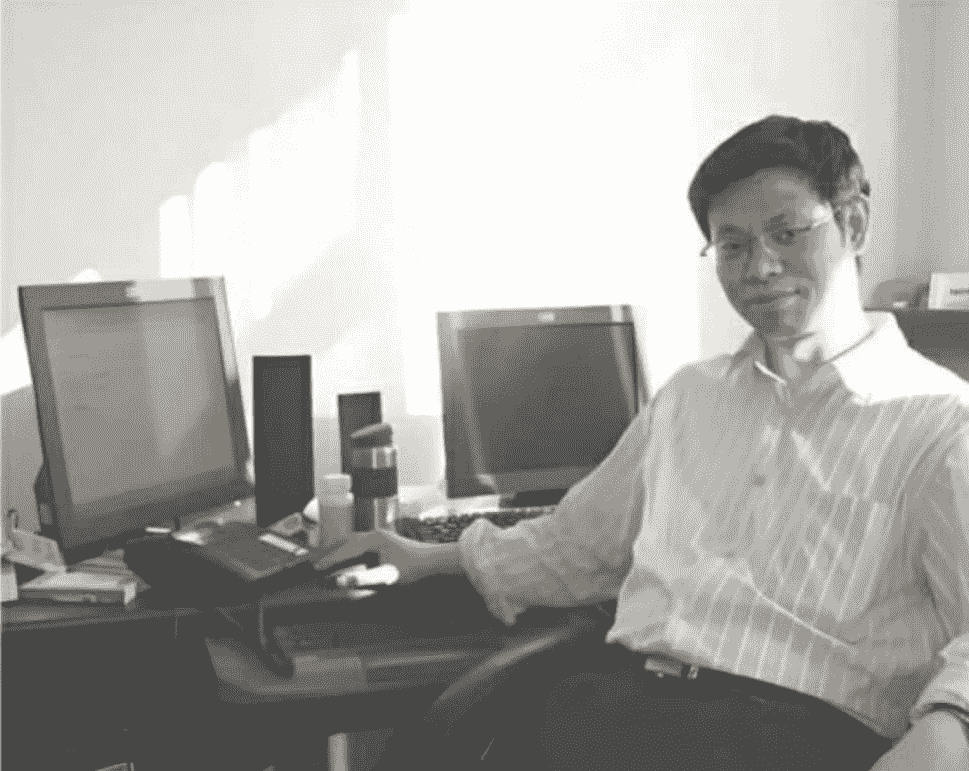
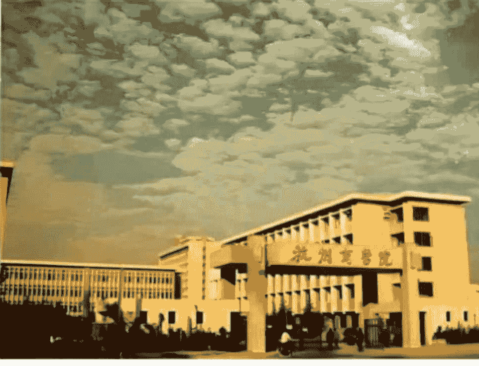
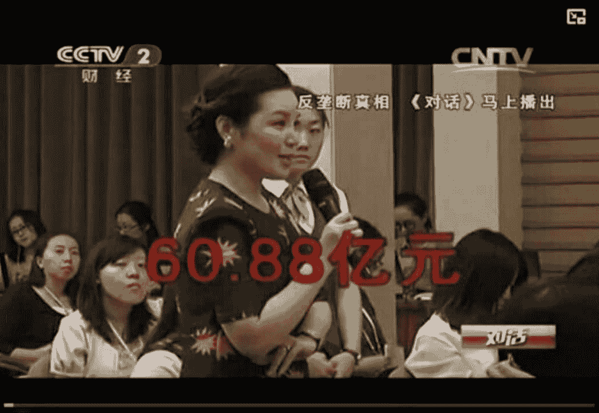
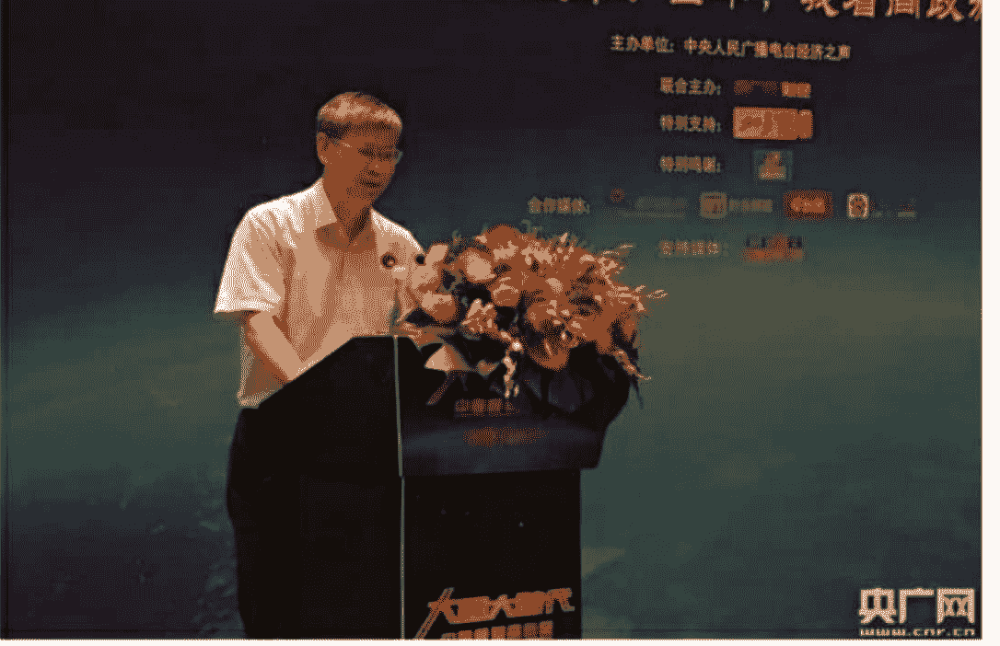
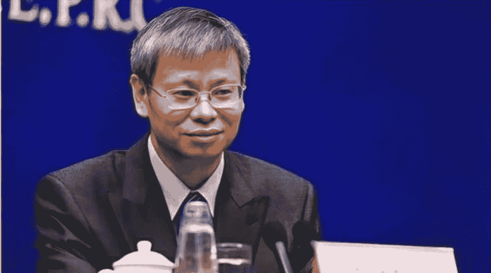
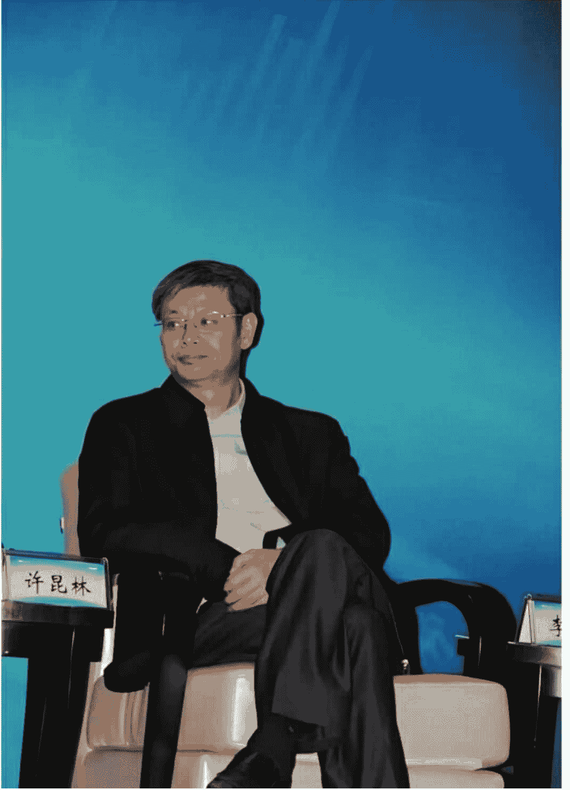

# 与时俱进许昆林

也无风雨也有情 左司马章章京 2025

2025 年 10 月 16 日

## 前言

15 岁考入大学，52 岁晋升副部，他在国家部委是如何脱颖而出的？

深度视野大V文集cuk255 有温度高质社群cuk255

有位长者曾经说，一个人的命运啊，当然要靠自我奋斗，但是也要考虑到历史进程。

不少人为长者重要的是踩中历史进程，抱怨自己没有发达是没有得到命运的眷顾。

但长者本身就是成功者，他说这句话的时候自然忽略了成功者自身的能力，只强调了“个人奋斗”和“历史的进程”。

但实际上能够多次踩中历史进程，与时俱进的人，本身也是不简单的。

譬如昆林。

## 平凡岗位露峥嵘

许昆林是一名“60 后”，生于 1965 年 5 月，是福建永春人。

据说永春的名字含义是“永远是春天”，因为该地气温常年在 20°C – 34°C 之间，非常宜居。

也许是家乡水气候的养育，许昆林日后也无论到哪里都能迅速适应，长期处于“永春”状态。

1980年，15 岁的许昆林考入杭州商学院商业企业管理系计划统计专业学习。

上世纪 80 年代的杭州商学院。

杭州商学院的前身是浙江杭州商业学校，1953更名为商业部杭州商业学校，在许昆林入学这一年再次更名为杭州商学院，2004年教育部批准更名为浙江工商大学。据说它是商业部直属高校中实力最强的一所。

不过4 年后，19 岁的许昆林并没有被分配到商业部，而是进入国家物价局检查司工作。这个司也就是后来国家发改委价格监督检司的前身。这也说明他后来大放异彩是有深厚专业底蕴的。

此后，许昆林按部就班顺序晋升：21 岁晋升副主任科员；23 岁晋升主任科员。

1990 年 6 月，25 岁的许昆林被提担任局机关团委书记，成为一名副处级干部。

当年 11 月，他成为收费管理司行政事业处副处长兼局机关团委书记。

3 年多后，国家机构进行改革，国家物价局入国家计委，许昆林成为国家计委价格管理司行政性收费管理处副处长、收费管理司收费管理一处副处长。

到 1996 年 5 月，在副处级职位上工作 6 年的许昆林终止于晋升为国家计委收费管理司收费一处处长，时年 31 岁。

1998 年，国家机构再次改革，国家计委更名为国家发展计划委，许昆林成为国家发展计划委价格司收费管理处处长。

2002 年 8 月，在正处级职位上工作 6 年后，许昆林终止于晋升为价格司副司长，时年 37 岁。

可能是许昆林的幸运数字，在副级司职位上又工作 6 年后，他终于在 2009 年 1 月接替李锚，升任国家发改委价格监督检查司，时年 43 岁。

在任李锚还在担任司长的 2007 年，国家出台了反垄断法，规定其中反价格垄断执法由国家发委负责，而在委内则由国家发委价格监督检查司负责。

但无论李锚还是后任，都没有办理过有影响的反价格垄断案件。

直到 2011 年 7 月，在中枢 CEO 的直接询问下，价格监督检查司被更名为“价格监督检查与反垄断局”（以下简称价监局），作为打击垄断行为、激活市场活力、推动“双创”的重要破冰者。

许林果断抓住了这个信号，当年 11 月就暴露正在办理中国联通和中国移动的反垄断案件（2011 年信息化蓝皮书披露我国宽带速率不及经合组织国家的十分之一，资费是发达国家平均水平的 3-4 倍）。

虽然后续没有公布具体处罚金额（按照《反垄断法》规定，处罚金额最高达 10 亿元），但根据许司长后来接受媒体采访时所说，两家公司都积极进行了整改，到 2013 年电信单位从 19 元/月下降到 9 元/月，联通的费用也从 14 元/月下降到 8 元/月，此后又持续了年的提速降费改革，有力地支撑了“互联网+”实施。

## 反垄断的高潮在 2013 年到来

当年 1 月，价监局对境外企业价格垄断断开了第一罚单，直指韩国、LG 及友达等六家液晶面板价格垄断行为，涉案企业令退还违法所得 75 万元，三星、LG、友达分别被罚款期由 18 个月延长至 36 个月。此案为京东崛起创造了有利条件。

当年 2 月，价监局又对茅台、五粮液开出了 49 亿元的大罚单，有力配合了当年的群众路线；

当年 7 月，价监局确认雀巢、惠氏、雅培、美臣、多滋等进口奶粉企业限制转售价格，践行了维护民生的责任；

当年 7 月，价监局调查了 13 家涉嫌参与市场价格操纵的黄金店，对上海饰品行业处罚了 37 亿元 50 万元，这个案件可能是许长后期与上海结缘。

这些案件以及 2014 年启动并延续 14 个月的高通反垄断案，许昆林成了国内外媒体采访和报道的对象，成了全国改系统最出名的人。

《对话》2015 来源：央视网

在 2015 年卸任局长后，许昆林接受了新华社南方周记者的专访，暴露了他办理重大反垄断案内幕，特别是办理高通案件的细节。

许回忆，办理高通案 14 个月内，他们与高通沟通了 28 轮，其中他本人和高通总裁就沟通了 8 轮。

第一轮，高通总裁带了 6 名副总裁过来介绍他们的经营模式，双方争论了 2 个小时，许说结束时建议对方，可以把发改委的资料回去充分准备后再来谈；

第二轮，对方带了 8 名副总裁过来，表示愿意整改但不承认违法，许长表示不能接受。许长说对方还给了一份报告，特意提示是时任反垄断委员会专家组张昕（《反垄断法》起草者、社科院研究院）撰写的。许认为张的行为严重违反纪律，立即向国务院反垄断委员会书面报告，虽然有人建议换届时换掉张（此时距离许咨询专家到期不足半年），但许认为不能姑息，必须严格维护纪律，最终促成了张被公开解聘，引发舆论热议。许司长也因此被西方媒体称为“作风强硬的执法者”。

直到第八轮，高通案件严重影响了投资者的信心，高通总裁“心服口服”地接受了 60.88 亿元的罚单，并表示不会进一步上诉，还将华增加投资。在司长看来，这是一个历史性的突破，此前高通公司在欧盟、日本、韩国都曾遭到查处，但都没有罚，这是高通在全球认罚的第一单。路透社曾评价许昆林是个足智多谋、机智精明的人。随着许从政协任发改委，许的路开始通达起来。

2014 年 8 月，原价格司司长曹庆、接替曹庆的刘振秋、副巡视员郭建英、两名副司长周望军和李才等五人先后落马，五个人都曾主管药品和电力价格。财新网评价：“国家发改委价格司近期已经超越山西省委办办公楼，成为最密集的贪官落马地”。

2 个月后，在价格曾工作 11 年，从副处长历练到副司长的许昆林，出任价格司长，成为天下第一司的“救火队长”。

上任伊始，许昆林就承诺将尽快推进价格改革，最大限度地缩小政府直接制定价格范围，完善定价机制和规则，使价格权力在阳光下运行。

改革前，国家电网利用自身垄断地位，通过压低购电价、提高售电价赚得盆满，引发业界诟病。改革后，电网收入以“成本+合理利润”固定下来，用电成本出现下降，国家发改委曾披露，通过努力降低企业电负担 470 亿元。

在价格司工作 8 个月后，许昆林接替他任投资司、中国铁路总总经理。无论是价格司还是投资司，都是国家发改委内炙热、手握重权的部门，许昆林能够在两个部门掌舵，而且难得的是，在此期间许曾多次兼任两个职位：从投资司升任国家发改委副秘书长的同时，仍然担任投资司近一年。

知情人士透露，上任始，许昆林就动员国家发改委投资司全体出门“找钱”，与其他位官员分别访问了 14 家金融机构，开展资金。对于投资，许昆林的思路是分类对待：对纯公益性的领域，收益比较主要的由中央预算内完成；介于两者之间的“夹层”，即准公益性的领域，一定回报但不高，并且需要的资金很大，周期较长，社会资本一般不愿意进入，又是整个经济发展急需的，投资的一个短板。为了补足这一短板，国家发改委推出了专项建设基金这一创新举措，最大的特点就是以资本本金的形式投入到具体项目。其中资本注入后，有效地促进资金流向实体经济。2015 年 8 月份，国家发展委员会通过国开行和农发行债筹集资金设立专项建设基金。专项基金的投向包括户籍改造等民生改善工程、重大水利工程等“三农”建设、轨道交通等城市基础设施和能源等重大基础设施，以及增强制造业核心竞争力转型升级等大领域。专项基金对于稳定投资起到了关键作用。不过要稳定投资速度，只靠政府投入是不够的。为了拉动民间投资，国家发改委做了两件事：一件是力推 PPP。2015 年 5 月，国家发改委在其官网上开辟项目库，向社会资本兜售 1.97 万亿元项目。后来又推出了第二批 1488 个项目，总投资 2.26 万亿元。2016 年 12 月 23 日，我国首条民营控股的高铁 PPP 项目杭绍台正式开工。第二件事就是为民间投资松绑。在投资司任职 9 个月后，2016 年 2 月，许升国家发改委副秘书长，同时仍兼投资司长。获得新的任命后，和他相关的第一条新闻就是：下一步国家发改委力推动解决民营企业在市场准入方面遭遇的“玻璃门”“弹簧门”“旋转门”等问题。2016 年 2 月，到龄退休，许昆林接任国家发改委副书记长兼固定投资司司长，虽然还是司局级领导，但已经跻身国家发改委领导群体，晋升高层只是时间问题，时年 51 岁。

可以说，许昆林在新时代崭露头角，无论是反价格垄断，还是推动电力价格改革，或者推进 PPP 项目建设，都是站在推进“双创”、“放管服”改革、投融资改革、供给侧改革等一系列大事业的滩头阵地上，他也抓住了机会，大干快干猛干加巧干，取得了引人注目的成就，加上有力加持，他的进步也成就了水到渠成的事情。一年后，他果然迎来了职业生涯的重要转变，在 19 大前履职上海市副市长。
