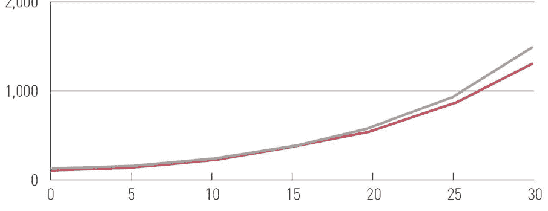
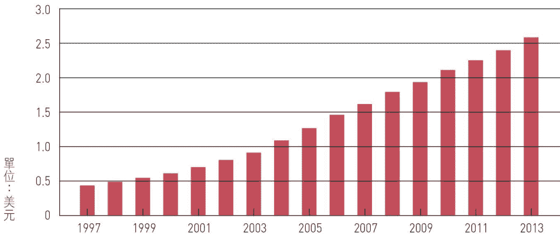

# WARREN BUFFETT
## ACCOUNTING BOOK
### Reading Financial Statements for Value Investing

# 巴菲特財報學

跟股神學投資，用會計知識解析價值投資法

新修版

超人氣Podcast節目主持人 史迪格·博德森 Stig Brodersen、普雷斯頓·皮許 Preston Pysh — 著
徐文懷 — 譯


# 一本可以實際拿來運用的價值投資法的好書。

> > 張明輝、《大會計師》系列作者、前資誠聯合會計師事務所所長

高手推薦：
- 張明輝、前資誠聯合會計師事務所所長
- 華倫·股發現人雷霍斯、價值投資者、財經作家
- 朱紀تون、商周集團永續發展顧問、商業期刊
- 藍學堂

# 知識星球TOP 資源分享社群

匯聚全網付費資源，讓更多人獲取高價值信息


- 付費文章
- 付費社群
- 付費課程
- 副業&搞錢
- 財務&股市
- 行業報告
- 時政·歷史·職場·體制·自媒體
- 學習·軍事·軟體·影音·社會學


公众号：知識星球TOP 微信信號：jntsg8 / jntsg2
添加微信免費進群

# WARREN BUFFETT
ACCOUNTING BOOK
Reading Financial Statements for Value Investing

# 巴菲特財報學

跟股神學投資，用會計知識解析價值投資法

新增版

譯者：股神傳奇人史迪格、博德森 Graham、齊雷斯納爾、皮許 Preston Pysh —— 譯

# 推薦序
### 以會計深入了解價值投資

文 | 張明輝

股票投資有賺有賠是很正常的，即便是巴菲也常有虧損的個股案例。所以投資人在遇到投資虧損時不要灰心喪志，要不斷學習及培養投資心法，以提高投資勝率，讓投資報酬率至少超過通膨指數2%以上；這樣一來，在表面上，可以避免個人財富被通膨長期稀釋掉，在積極面上，則是能讓個人的「實質財富」不斷增加。

# 價值投資法是投資股票的王道

巴菲堅持的價值投資法是投資股票方法中的王道之一。它可以避免我們投資時淪為賭博、擲骰子，進而提高投資的勝率與投資報酬金額。

目前市面上介紹或提及價值投資法的書籍很多，但內容往往偏向於價值投資觀念與個案投資的介紹！所以往往看起來很愉悅，實際運用時會有不知如何對手的感覺。這是因為書中並沒有介紹會計方面的知識與運用，就是提到會計運用時，沒有顧到缺乏會計知識讀者的理解能力，以致難以會計貫通。

本書除了介紹價值投資法的投資原則，還介紹與連用很多基礎的會計方法去衡量個股的價值，剛好補足了「如何衡量」的部分缺憾！是一本可以實際拿來應用價值投資的好書。

# 會計是投資的通用語言

會計是商業與投資的通用語言，就像英語是國際通用語言一樣。具備一定程度的會計與產業知識可以讓我們了解企業的資源配置狀況、財務負擔狀況、經營者的經營理念與卓越精神、企業整體經營的聚焦狀況、以及整體的結構性獲利能力等等，從而更大地的深入瞭解目標與其應有的「價值」。

讀者若想一步學習會計、財報與產業知識，以增進投資能力，可以翻自台大順仁教授或我所寫的一些深入的看懂財報書籍，如《大會計師教你從財報看懂經營資本》、《大會計師教你從財報看懂產業》、《大會計師教你看懂投資資本》三書，或有另一番收穫。（作者為資誠聯合會師事務所前長、曾任台大、東大會計系教授）

# 前言
### 如何使用本書？

本書來自一個不斷發展的構想：一般投資人不需要精通金融學，就能了解股神巴菲特的投資方法原理。12年前，我們寫了一本《華倫·巴菲特愛的書籍》（Warren Buffett's Three Favorite Books），那是寫給業餘投資人的。然而，本書要教導認真的投資人必須知道會計術語與技巧，讓投資進一步：前四章教你如何看待股票市場、如何挑選股票與評估價值，少量的會計技巧或知識就可以這一點；最後四章，我們會討論財務報表的每個會計科目。由於本書投資原則基於某些構想，因此我們先簡單介紹這些人：

華倫·巴菲特 (Warren Buffett, 1930~ ) 白手起家的巴菲特，如今被認為是歷史最好的投資人。他目前擁有的資產超過330億美元，執行的公司為波克夏海 Hathaway，其財富基於穩健且一致的投資方法，我們會在本書中概括說明。

班·葛拉漢 (Benjamin Graham, 1894~1974) 對許多人而言，葛拉漢被認定是「價值投資法」的創始人。他是巴菲特在哥倫比大學（Columbia University）的教授，也是巴菲特的導師與朋友。《智慧投資人》（The Intelligent Investor）與《證券分析》（Security Analysis）作者；毫無疑問，這些作品是歷史最重要的投資書籍。巴菲特多次提及這些書，他認為這些書塑造了他的哲學。

查理·蒙格 (Charles Munger, 1924~2023) 曾任波克夏海威公司副裁，作為巴菲特的商業夥伴。人們所知雖然不如巴菲特知名，但他擁有的性格與穩健的投資方式，同樣受到價值投資人的尊敬。蒙格的投資才能使他成為萬翁。根據「富比士」資料，截至年底，巴菲特身價為330億美元。

# 如何理解股市？

價值投資人對股市的看法和其他投資人不同，他們不相信市場只是單純的股票組成，而是由真正的公司所組成的。這微小的差異改變了每件事，也可以解釋為什麼價值人多年來一年擊敗市場。在這一章，你將學習如何用不同的方式看待股市。因為有不同的思考，你會具備一個與眾不同的獨特優勢，這個優勢將引領成長、降低風險。你也會明白為什麼股價下跌是好事，以及聰明的投資人越來越富有的原因。

# 市場先生以及市場的泡沫

你見過「市場先生」嗎？如果你曾經在證券交易所交易就會見過他；如果你聽過財經新聞，你也肯定聽過他。「市場先生」是價值投資法發明者班明·葛拉漢在1950年代於哥倫亞大學課時虛構的人物。或許你已經聽過葛拉漢說過，如果沒有，我也確信提到這個學生，那個學生的名字是華倫·巴菲特，也是歷史上最成功的投資家。如果你是認真看待股票投資的人，那麼市場先生是非常熟悉的：他每天都會來拜訪，當他來的時候，你可以買賣高品質或低品質的公司。市場先生來的時候是很客氣的，雖然容易卻並不壓力，你可以盡情查看你的公司；如果你願意，甚至每天都能查看，而且不一定要買賣。只要你願意，想等多久都可以。市場先生最好的地方就是即使你忽略了他多年，他每天仍會提供新的報價給你。

有時市場先生的心情很好，這時有很多客戶，不管是高品質或極品質的公司，所有商品的價格都很高。但也許市場先生的客戶變得非常少，就跟大家預期的一樣，他的心情不好；在這樣的日子裡，他要銷售的公司正在進行大賣，因此同一公司的價格會變得更便宜。

你可能已經猜到我們在說什麼——我們說的是「股市」。股市的報價每天都會上下波動，或許有人會說股價波動總是有原因的，他們認為當前的價格會反映市場的真實價值，這種想法在學術界非常流行。不過，巴菲特和葛等投資人絕對不會同意。他們認為股市會發生情緒和短期波動，長期則是因為價值而變動。市場先生可能是虛構人物，但他說是股市在短期遵循市場情緒的象徵。充分的理由信任巴菲特的——使用價值投資，他的財富已經累積到330億。

對很多人來說，股市是一個認識。他們看到很多股票價格波動，他們期低買高賣來採取行動。現在告訴他們是「投資人」（investor），想要放棄這種說法的人，是「交易人」（trader）。世界上有很多交易人，幾百年前，人們前往購買股票，然後以更高的價格賣出；這是一種技術，不論交易的是股票還是牛奶。如果你是價值投資人，你看到的不是一支股票，而是一家公司。很多人會忘記，當他有一檔股票時，實際上擁有的是真實事業。這意味著任何股票的價值比例完全相同。股市提供投資人一個機會，就像巴菲特擁有的可樂（Coca-Cola）股份，當價值低時買入更多，當價值高時賣出更多，這就是價值投資。價格和價值完全是兩回事。如果你像巴菲特一樣，就會累積股票而非交易。葛拉漢有一句言：「短期來看，股市是個投票；長期來看，股市是體重。」這句聽起來很深奧，卻充分彰顯了他的看法：想贏，方法就是累積股票而非交易。

另一個與股市相關的重要事情是股價經常會因為一些事情而波動，也就是波動並不代表邏輯或重要。你常常看到價格一天上漲2%，隔天又跌1%，但似乎讓人感到困惑。仔細思考後，你會發現那些股價變動無意義。假設這家公司是可樂，你聽到電視上的分析師說股價漲是因為最新的業報告會預期；接著不到24小時，你可能聽到另一個分析師說股價下跌是因為消費者信心不如。這真的能解釋為什麼可樂在不同日子裡價值不同。誰在決定股價？參與買賣股票的個人都在影響股價。一般而言，一天之中只有不到1%的股份是由交易群人們最後會透過供給與需求來決定自己的價格。一家公司的價格每天都取決於數萬、數千個因素，因此部分交易人會根據一些分析來交易，但很多人人們是因為情緒或個人因素而交易——很高興再見到市場先生！

對大多數人而言，這種想法違反直覺。如果他們買了某商品，會希望不久就上漲。這類投資人的問題在於想法受到時間限制。為了讓投資發揮，你必須降低這種衝動決策的時間因素。降低這種衝動最好的方法就是提高知識水平。隨著知識增加，你的信心也會增加，而且你對真理與實際情況的理解會越來越清楚。金融教育可以減少新手投資常見的時間與衝動因素。繼續閱讀這本書，你會開始對市場產生熱切興趣，或者是說是對市場的理解。

# 為什麼股票會讓你富？

想要致富，投資股票不是不容易的方法。股票的簡單在於你擁有股票等於擁有一真正公司的小部分。你可以把一把股票視為擁有一家真實的小企業，假設你想把這家公司縮到足以放在手掌上，也可以；事實上十分合理。以這個視覺上的例子來說，想像這家手掌大小的公司要製造一個商品，可以僱用數多的員工，有一間小倉庫。你可以用任何方式思考這個例子，重點在於：一般股票所產生的利或損失，與一家企業產生的利或損失一樣。想像你自己擁有100家小企業、每家小企業產生1美元的獲利，而持有成本是10美元，這個直觀的思考很有幫助。同時，這也意味著，只要公司隨著時間所有獲利，這些公司的股東最終也能累積財富。不過，如果股票我說那麼簡單，為什麼沒有更多的人因股市而致富呢？

比起20年到30年後致富，大大多數的人比現在還要貧窮。可以從一個事實來證實，那就是有許多人在股市中「玩殘透」，而不是「投資」。切記，在股市致富並不需要特殊技能。當你開放視野看待投資世界時，可能會懷疑股票是否是最可能的途徑。如果你這樣思考，你應該感到自覺。在世界上各種可能的投資目標之中，只有幾種投資目標是持續產生收益——總體而言，股票就只是其中之一。

對於可以產生收益與無法產生收益的投資類型，思考兩者之間的差異非常重要。無法產生收益的投資類型是黃金屬（如金、銀或鑽石），雖然公司創造的財能藉由回饋股東，但黃金無法創造任何東西，也沒有任何金錢可以回饋給你。你能用黃金賺錢的唯一方法，是有人認為黃金價格比遞更有價值。歷史資料也確實如此，在1900年~2000年之間（Dow Industrial Average Index）。

# 好消息！市場正在下跌

你會在大價時購物嗎？我肯定會這樣做！誰不想用更便宜的價格買進優質的商品？在價格低的時候，我會買很多，在價格高的時候少買一點，甚至是不買。這很有趣。人們在商店打折時，很可能會這樣購物，但當價格高時，人們就會離開。這種情況總是在發生，因為每個人的正確思考被集體思維取代了。當市場表現不佳，人們都會離開，因為他們清楚這個想法很重要。身為投資人，大多數時候你應該希望股票下跌，罕見的例外是你受限於時間。舉例來說，如果你打算在幾年內退休，風險很高。如果你像巴菲特一樣成為價值投資人，你就會累積股票而非交易。當價值低時買入更多股份，當價值高時賣出更多股份，這就是巴菲特擁有的累積股票。

還記得市場先生嗎？之前我們說過，當市場心情好時，價格很高；相反，當市場心情不好，價格很低。在武術中，有個詞叫「合氣道」（Aikido），意思是利用對方的力量來反擊。作為一位投資人，這讓你感到舒服，但當市場波動時，你不應該要興奮——市場先生是你的僕人，不是駕導。當波動劇烈，你就能買更多股票。這就是巴菲特的累積股票。當價值低時是一個好消息。我們無法預測未來，但可以假設：恐懼和貪婪會在市場波動中持續活躍的角色。查理·蒙格 (Charles Munger, 1924~2023) 人們所知雖然不如巴菲特知名，但他擁有的性格與穩健的投資方式，同樣受到價值投資人的尊敬。蒙格的投資才能使他成為萬富翁。根據「富比士」資料，截至年底，巴菲特身價為330億美元。

班·葛拉漢 (Benjamin Graham, 1894~1974) 對許多人而言，葛拉漢被認定是「價值投資法」的創始人。他是巴菲特在哥倫比大學（Columbia University）的教授，也是巴菲特的導師與朋友。《智慧投資人》（The Intelligent Investor）與《證券分析》（Security Analysis）作者；毫無疑問，這些作品是歷史最重要的投資書籍。巴菲特多次提及這些書，他認為這些書塑造了他的哲學。

華倫·巴菲特 (Warren Buffett, 1930~ ) 白手起家的巴菲特，如今被認為是歷史最好的投資人。他目前擁有的資產超過330億美元，執行的公司為波克夏海威（Berkshire Hathaway），美國最大的股東。《華倫·巴菲特愛的書籍》（Warren Buffett's Three Favorite Books），那是寫給業餘投資人的。然而，本書要教導認真的投資人必須知道會計術語與技巧，讓投資進一步：前四章教你如何看待股票市場、如何挑選股票與評估價值，少量的會計技巧或知識就可以這一點；最後四章，我們會討論財務報表的每個會計科目。由於本書投資原則基於某些構想，因此我們先簡單介紹這些人：

華倫·巴菲特 (Warren Buffett, 1930~ ) 白手起家的巴菲特，如今被認為是歷史最好的投資人。他目前擁有的資產超過330億美元，執行的公司為波克夏海威（Berkshire Hathaway），美國最大的股東。

# 前言
### 如何使用本書？

本書來自一個不斷發展的構想：一般投資人不需要精通金融學，就能了解股神巴菲特的投資方法原理。12年前，我們寫了一本《華倫·巴菲特愛的書籍》（Warren Buffett's Three Favorite Books），那是寫給業餘投資人的。然而，本書要教導認真的投資人必須知道會計術語與技巧，讓投資進一步：前四章教你如何看待股票市場、如何挑選股票與評估價值，少量的會計技巧或知識就可以這一點；最後四章，我們會討論財務報表的每個會計科目。由於本書投資原則基於某些構想，因此我們先簡單介紹這些人：

華倫·巴菲特 (Warren Buffett, 1930~ ) 白手起家的巴菲特，如今被認為是歷史最好的投資人。他目前擁有的資產超過330億美元，執行的公司為波克夏海威（Berkshire Hathaway），美國最大的股東。

班·葛拉漢 (Benjamin Graham, 1894~1974) 對許多人而言，葛拉漢被認定是「價值投資法」的創始人。他是巴菲特在哥倫比大學（Columbia University）的教授，也是巴菲特的導師與朋友。《智慧投資人》（The Intelligent Investor）與《證券分析》（Security Analysis）作者；毫無疑問，這些作品是歷史最重要的投資書籍。巴菲特多次提及這些書，他認為這些書塑造了他的哲學。

查理·蒙格 (Charles Munger, 1924~2023) 曾任波克夏海威公司副裁，作為巴菲特的商業夥伴。人們所知雖然不如巴菲特知名，但他擁有的性格與穩健的投資方式，同樣受到價值投資人的尊敬。蒙格的投資才能使他成為萬富翁。根據「富比士」資料，截至年底，巴菲特身價為330億美元。

# 如何理解股市？

價值投資人對股市的看法和其他投資人不同，他們不相信市場只是單純的股票組成，而是由真正的公司所組成的。這微小的差異改變了每件事，也可以解釋為什麼價值人多年來一年擊敗市場。在這一章，你將學習如何用不同的方式看待股市。因為有不同的思考，你會具備一個與眾不同的獨特優勢，這個優勢將引領成長、降低風險。你也會明白為什麼股價下跌是好事，以及聰明的投資人越來越富有的原因。

# 市場先生以及市場的泡沫

你見過「市場先生」嗎？如果你曾經在證券交易所交易就會見過他；如果你聽過財經新聞，你也肯定聽過他。「市場先生」是價值投資法發明者班明·葛拉漢在1950年代於哥倫亞大學課時虛構的人物。或許你已經聽過葛拉漢說過，如果沒有，我也確信提到這個學生，那個學生的名字是華倫·巴菲特，也是歷史上最成功的投資家。如果你是認真看待股票投資的人，那麼市場先生是非常熟悉的：他每天都會來拜訪，當他來的時候，你可以買賣高品質或低品質的公司。市場先生來的時候是很客氣的，雖然容易激卻並不壓力，你可以盡情查看你的公司；如果你願意，甚至每天都能查看，而且不一定要買賣。只要你願意，想等多久都可以。市場先生最好的地方就是即使你忽略了他多年，他每天仍會提供新的報價給你。

有時市場先生的心情很好，這時有很多客戶，不管是高品質或極品質的公司，所有商品的價格都很高。但也許市場先生的客戶變得非常少，就跟大家預期的一樣，他的心情不好；在這樣的日子裡，他要銷售的公司正在進行大賣，因此同一公司的價格會變得更便宜。

沒錯，你可能已經猜到我們在說什麼——我們說的是「股市」。股市的報價每天都會上下波動，或許有人會說股價波動總是有原因的，他們認為當前的價格會反映市場的真實價值，這種想法在學術界非常流行。不過，巴菲特和葛等投資人絕對不會同意。他們認為股市會發生情緒和短期波動，長期則是因為價值而變動。市場先生可能是虛構人物，但他說是股市在短期遵循市場情緒的象徵。充分的理由信任巴菲特的——使用價值投資，他的財富已經累積到330億。

對很多人來說，股市是一個認識。他們看到很多股票價格波動，他們期低買高賣來採取行動。現在告訴他們是「投資人」（investor），想要放棄這種說法的人，是「交易人」（trader）。世界上有很多交易人，幾百年前，人們前往購買股票，然後以更高的價格賣出；這是一種技術，不論交易的是股票還是牛奶。如果你是價值投資人，你看到的不是一支股票，而是一家公司。很多人會忘記，當他有一檔股票時，實際上擁有的是真實事業。這意味著任何股票的價值比例完全相同。股市提供投資人一個機會，就像巴菲特擁有的可樂（Coca-Cola）股份，當價值低時買入更多，當價值高時賣出更多，這就是價值投資。價格和價值完全是兩回事。如果你像巴菲特一樣，就會累積股票而非交易。葛拉漢有一句言：「短期來看，股市是個投票；長期來看，股市是體重。」

# 另一個與股市相關的重要事情是股價經常會因為一些事情而波動，也就是波動並不代表邏輯或重要。你常常看到價格一天上漲2%，隔天又跌1%，但似乎讓人感到困惑。仔細思考後，你會發現那些股價變動無意義。假設這家公司是可樂，你聽到電視上的分析師說股價漲是因為最新的業報告會預期；接著不到24小時，你可能聽到另一個分析師說股價下跌是因為消費者信心不如。這真的能解釋為什麼可樂在不同日子裡價值不同。誰在決定股價？參與買賣股票的個人都在影響股價。一般而言，一天之中只有不到1%的股份是由交易群人們最後會透過供給與需求來決定自己的價格。因此部分交易人會根據一些分析來交易，但很多人人們是因為情緒或個人因素而交易——很高興再見到市場先生！

對大多數人而言，這種想法違反直覺。如果他們買了某商品，會希望不久就上漲。這類投資人的問題在於想法受到時間限制。為了讓投資發揮，你必須降低這種衝動決策的時間因素。降低這種衝動最好的方法就是提高知識水平。我們已經經歷過股市破滅的情況。舉例來說，2000年的網路泡沫，就是對科技公司的看法過於樂觀導致，當時的人們信念是不管價格高低，都要擁有那樣企業；如同其他股市泡沫，這個想法非常危險。最近也經歷過一場房產泡沫，到處充斥著不良貸款的銀行，一旦價格與價值之間的關係背離，泡沫就會再度破滅，使得泡沫得以修正。

為什麼泡沫不斷發生？我們從歷史中學到什麼訓？很明顯的答案是「沒有」。1637年第一次記錄到經濟泡沫，就是在荷蘭（Netherlands Tulipmania）。泡沫達到巔峰時，一場鬱金香球價格遠超過其價值。我們現在或許會認為那些投機、陷入經濟崩潰的荷蘭人是愚蠢的。不過，過過去到2000年看到第二次泡沫，從歷史中的教訓非常複雜。長期來，人們會週期性經歷經濟泡沫，而且有充足的理由未來還會有更多泡沫出現。理由很簡單：泡沫是人為造成的。雖然可以預測大人在股市中會做一些不明的事，但無法預測到這樣情況會持續多久。我們也許知道有泡沫正在產生，但無法知道何時會破滅，這可能需要好幾年。在泡沫產生時，許多人在市場下了重注，賭泡沫即將破滅而損失很多錢，即使他們是對的，但往往市場進行調整前就破產了。

對人類的行為重注是一種種投機行為。不過，來看看為什麼價值投資會從人類行為中受益，我們也會告訴你葛拉漢教授教學學生的內容：

> 市場先生你是我的僕人，不是駕導。——華倫·巴菲特

# 好消息！市場正在下跌

你會在大價時購物嗎？我肯定會這樣做！誰不想用更便宜的價格買進優質的商品？在價格低的時候，我會買很多，在價格高的時候少買一點，甚至是不買。這很有趣。人們在商店打折時，很可能會這樣購物，但當價格高時，人們就會離開。這種情況總是在發生，因為每個人的正確思考被集體思維取代了。當市場表現不佳，人們都會離開，因為他們清楚這個想法很重要。身為投資人，大多數時候你應該希望股票下跌，罕見的例外是你受限於時間。舉例來說，如果你打算在幾年內退休，風險很高。如果你像巴菲特一樣成為價值投資人，你就會累積股票而非交易。當價值低時買入更多股份，當價值高時賣出更多股份，這就是巴菲特擁有的累積股票。

# 投資人必懂的觀念


心引力增加2.0，這意味著每個東西的重量都增加了1倍，很難抬或移動；你會發現自己在這一天不太想要腳步或工作。因為要完成相同的工作必須比前一天多一天。最後，到了第三天，地引力發生劇烈變化，有時候，你會感受到非常有趣的改變與發展，因為每個東西都變得很鬆、容易移動；你的身體和東西的重量都只剩下前一天的1/4，這種極端的改變讓你能力跑得更快，並且完成更多工作。你可以生活變得非常輕鬆。

在觀察奇怪的時候，我們一致認為這對理解市場的基礎非常重要，因為利率變化就像地心引力一樣。

當利率上升，企業經營會變得困難、敵不勝防，這是因為企業無法便宜且負擔得起的價格限制；當利率下降，企業經營相對變得容易，比較不受影響。由於持有的資產價值增加，使得越來越多人可以借錢；這不再需求增加，如果需要借錢買東西，每月的還款金額也會比較低。

企業會以這種方式感受到利率的影響。當利率上升，因為難以行動與失去敏捷，獲利受限，只有最強與適應力的企業能像這樣這樣的改變。

現在對利率有技術性的說明，你可以把利率視為貨幣的價格。想像一下，你剛找到漂亮新房子，正在研究兩種不同融資方案：一家銀行提供6%的30年房貸，另一家銀行提供利率4%的相似房資。如果對方要付30萬美元，平均每年要付出的房貸分別是1萬800美元與1萬2,000美元。

先別管如何計算這些數字，你只需要知道，相於6%利率，較低的利率可以讓大多數人買起房子。4%利率讓更多人以30萬美元的價格買下房子，而使買房需求與房屋價（30萬美元）有機會提高。如你所見，房價依然是30萬美元，但價格並不固定，由於低利率的需求增長，將看到房屋價格上漲的可能性。這是一個緩慢過程，可能需要幾個月或幾年的時間。你會發現，利率不同會導致價格和價值有所差異，這個差異就是投資人賺錢的，尤其是在股票市場上如此。

這起來很簡單，對嗎？理解利率非常簡單，因為基本原理終相同：借款人必須付利息給貸款人，而且是以雙方協議達成的利率收付。

當你在新聞中聽到與利率有關的消息時，通常指「公債利率」，美國聯會是一個獨立的國會，負責美國政府管理貨幣供應與給款政策——幾乎所有現代國家都有自己的中央銀行。聯會最重要的工作，就是為了民眾調整利率，現今對於聯會調整利率能否維持穩定是有很大的爭論的，但並不重要。身為投資人要了解的是，聯會會誠意調整利率以改善經濟成長。如果不控制利率，許多人認為金融體系是因為市場泡沫或缺乏信用（或現金）而崩滅。每次利率變動時，價格和價值之間的差異也會改變，而創造漲的機會。

身為股票投資人，密切關注利率至關重要。比起利率高的時候，你更應該在利率低時在股市採取不同的行動。為什麼？為了回答這個問題，先來看利率如何決定。

想像一下，你剛剛找到理想的電視，這是一台線條流暢、畫質清晰的60電視；不幸的是，售價1,000美元，你的錢不夠。店員給了一個驚人的優惠，讓你除帳的方式得到電視——沒有預款，甚至還免運費。仔細查看貸款條件，你發現利率是20%；換句話說，貨幣的價格非常高，如果沒有還債本金，你必須在接下來的人生中，每一年付出200美元——這台電視看起來沒那麼好了，不是嗎？

先看到房貸利率降低至4%時，為什麼借款人的成本會有如此大的差異？比起電器行員，銀行是否是更友善的放款人嗎？原來是因為「風險」。如果你要貸款，銀行可以收回你的資產及房屋分期貸款；電視的情況則是，二手電視可能只能還原本賣出價的一半價值，短暫幾年後，這台電視的價值可能只剩100美元。由於利率是貨幣的價格，價格也就會反映你對財務的行為。

聯會著眼風險與調整財務行為的方法，並以類似方法決定利率。然而，聯會是在更大的總體規模上操作。聯會不僅關注你，也關注經濟。當經濟衰退，政府要讓民眾更多錢，藉由調節貨幣價格達到目的，也就是降低利率，這是花更多錢的誘因。當更多錢被花掉時，就會增加消費，進而增加就業，為經濟代謝帶來更多財富。

一旦利率偏低，企業就可以用低利率借錢，這讓新投資更吸引，進而帶來更多就業與更多財富。當金錢變得便宜，通常股票也會更便宜，這就是你就能累積更多的重要時刻。

景氣好時，當希望藉此延長下去，試著避免泡沫達到這個目標，因此會提高貨幣價格，也就是提高利率。當東西開始變貴，我們就會買更少。這不僅適用於電視或房子，我們也會根據所有收費情況來調整財務行為。就像借錢給你買電視的電器行一樣，風險與此產生的利率很高。一般人確實不要泡沫，以免破滅。

## 通貨膨脹

為什麼成為百富翁？好消息是，你比作富翁更容易。你已經聽到了吧，我說是「通貨膨脹」。

通貨膨脹是好事嗎？為什麼對股票投資而言一點都不趣？為什麼會有通貨膨脹？開始討論之前，先問一下，你想在今天用100美元買下一籃東西，還是未來用100美元買相同的東西？你會怎麼做？很有可能選擇在今天買進！

通貨膨脹也以相同方式發揮作用，速度並不快。政府喜歡通貨膨脹的原因有三點：
1. 消費更多，消費行為就會創造財富。
2. 你要名目目繳稅。舉例來說，你剛花10萬買一項資產，在通貨膨脹率2%之下，隔年的資產價值...
3. 第三個原因是債務是以名目美元行的。你應該知道美國政府有很多債務，由於債務隨著時間逐漸增加，使得債務更容易償還。

聯會會透過增加經濟中的貨幣數量做到這件事。簡單來說，價格會隨著時間慢慢增加。你必須知道的重要概念是「名目美元」（nominal dollars）與「實質美元」（real dollars）的差別。名目美元不計入通貨膨脹，實質美元則計入。如果你的祖父說他在1913年的薪資是1美元，實際上的是賺到名目美元；這相當於2013年的實質美元（也可以說現在是2.2美元）。

從政府的角度來看，通貨膨脹似乎不錯，對吧？這對政府可能有利，但對個別投資人如此。從你的角度來看，通貨膨脹是賺取報酬的阻力或摩擦。通貨膨脹過高會帶來不確定性，而且對貸款、企業、消費者都不好。正如剛才學到的，投資與消費的減少不利於整體財富。通貨膨脹太高，意味隨著時間經過，依賴退休金等固定收入者的購買力會降低。

這就回到了實質美元的概念。我們對於持有的錢可以買到什麼感興趣，而不是對擁有多少錢感興趣；若你像美國政府一樣，也會對債務的實質價值感興趣。當談論到「通貨膨脹」，以及「名目美元」與「實質美元」的差異，真正考量的是「金錢的定義」。

什麼是金錢？金錢是在我們社會裡認同的東西。社會總有些貨幣，例如美洲原住民使用貝串環。美元有價值的唯一原因是社會上所有人都相信美元有價值。

人們根據通貨能買多少東西來評估美元，那是美元的實質價值，也是為什麼身為股票投資你需要了解通貨膨脹的原因。可以用一個簡單數學公式來計算：如果股票一年的名目報酬率是10%，通貨膨脹率是2%，那麼實際報酬率大約是8%(10 - 2 = 8)。

隨著時間流逝，累積數字會很大。如果你在1913年將1美元投資在總報酬率10%股票上，經過一個世紀，現在將高達1萬381美元；然而，扣掉每年2%的通貨膨脹率之後，在2013年，你只擁有質2200美元!

儘管通貨膨脹會讓報酬減少，但情況並沒有讓投資人起來糟糕。一方面，你對通貨膨脹無能為為，無論進行任何投資，通貨膨脹都會讓報酬減少。一般來說，債務（或債券）會完全受到通貨膨脹的影響，但股票只會受到部分影響。繼續閱讀這本書，就會了解其中的原因。

## 債券

哪個投資工具極具吸引力，還能讓你在1年內財富？如果你知道答案，當然不是「債券」。

對你而言，了解債券與股票一樣重要。比較股票和債券的利率，可以知道什麼？1928~2011年，長期債券的平均年化報酬為5%，股票平均年化報酬則為2%。然而2002~2011年，長期債券的平均報酬是6.5%，而股票只有4.9%，顯示出有時候股票是比較好的選擇，有時候情況並非如此。我們用來深入看看債券的真實樣貌。債券是一種貸款，是你借給其他人的錢，可能是公司或政府。債券包含以下三個簡單部分：
- 票面價值：這是債券發行的金額，也是到期可以取回的金額。
- 期間：到期前的時間。
- 票息：每年收到的金額。

用一個簡單例子來說明債券如何運作：
- 票面價值：1000美元。
- 期間：30年。
- 票息：5%。

在這種情況下，你借出1000美元有了一張債券，期間是30年，為了感謝你，每年會得到50美元；當債券到期時，拿回票面價值1000美元——總共得到2500美元（=50×30+1000），相當於賺到1500美元的獲利。

我們剛了解利率與通貨膨脹，以及為什麼對投資人很重要。我們也知道利率是貨幣的價格，當利率高時，貨幣的價格也會高。這意味著，若你是借款人或是購買債券的人，在利率普遍高的情況下，你會得到更多錢。現在不只是政府債，企業也能發行債券。體質不佳的公司發行的債券利率，會比體質健康的公司高。事實上，因為企業破產的可能性較高，因此企業債券的利率往往高於公債。這是否表示利率很高應該投資債券而不是股票？或許沒錯！回答這個問題，還必須考量通貨膨脹，以及所有投資機會。回到前文例子：有一張債券面價值1000美元、票息5%（或每年利息50美元）的債券。來看5%的通貨膨脹如何影響這個投資：在30年期債券存續期間，政府會讓貨幣的價值膨脹，使你得到的5%票息被5%的通貨膨脹完全抵銷，結果你事實上沒有得到任何報酬。你仍然會在30年債券到期時，收到票面價值1000美元，也會在30年之間收到利息500美元，但你的購買力基本上沒有改變。

## 本章總結

總結利率、通貨膨脹、債券和股票之間的交互作用：在低通貨膨且高利率的情況下，優先選擇投資債券，部分原因是通貨膨脹雖然會讓債券提供的固定收益減少，但高利率的環境可能會讓你更好的報酬；在其他情況下，股票可能是比較好的選擇（詳表2-1）。

表 2-1 通貨膨脹率與利率高低的投資選擇

| 項目 | 低利率 | 高利率 |
|---|---|---|
| 低通貨膨脹率 | 投資股票 | 投資債券 |
| 高通貨膨脹率 | 投資股票 | 投資股票 |

本書將提供更明確的指引，告訴你應該考慮哪些類型的通貨投資，以及這樣做的原因。

## 簡單介紹 財務報表

對大多數的人來說，財務報表就就像油漆乾一樣無聊。有些人甚至會說，因為知道油漆的用處，所以刷油漆還比較有趣。另一方面，財務報表編製的目的是什麼？在回答這個比較簡單的問題之前，讓我坦白說：財務報表不像你認為的那麼複雜，你的看法需要與以往有所不同，透過某些實務運作與指引，你會覺得財務報表竟是如此簡單。

在本書的後半，我會深入探財務報表的每個會計科目，並詳細介紹不同報表之間的關係。在此之前，這一章要先提供你一些快速簡單的財務報表概述。

你可以把財務報表視為系統報告，也就是你可以得知公司的成敗。從各方面來看，當你想有一家事業時，審視這些報告是最重要的事，也就是審視這家公司如何賺錢與當的價值。如果我想製關於你的報表，會在一紙上列出你賺了多少錢，花了多少錢；另一張紙上追蹤長期存款與債務；在第三張紙上記錄現金和信用卡。關於你的當前價值潛有的能力，會在三張紙上得到了解。這看起來很簡單，對吧？而且確實是財務報表的本質。公司同樣也會把資訊整合為一份報告，稱為「季報」或「年報」。在年報中，你會看到幾個最重要的：
- 損益表（income statement）
- 資產負債表（balance sheet）
- 現金流量表（cash flow statement）

當你開始投資時，這些正是你需要關注的財務報表。讓我們簡單說明以下報表：

## 損益表

儘管讓人有些害怕，第6章會詳細解釋會計術語。現在只需要記住，損益表是用確認公司一年賺多少錢的報表，也是為什麼損益表通常被稱為「利與損失表」（profit and loss statement）的原因。它總結了一家公司在一年中賺了多少錢以及花了多少錢，這兩個數字就是獲利（或虧損），你可以在損益表的最後看到這個數字（詳表3-1）。「獲利」、「收益」，通常指「淨利」，都是同一件事。這三個會計術語非常重要。

## 表 3-1 企業損益表

| | | |
|---|---|---|
| 1 | 營業收入 | 13,279 |
| 2 | 營業成本 | 5,348 |
| 3 (=1-2) | 營業毛利 | 7,931 |
| 4 | 行銷費用 | 1,105 |
| 5 | 研究與發展費用 | 863 |
| 6 | 管理費用 | 538 |
| 7 | 其他營業費用 | 1,350 |
| 8 (=4+5+6+7) | 營業費用 | 3,856 |
| 9 (=3-8) | 營業淨利 | 4,075 |
| 10 | 利息收入(支出) | (135) |
| 11 | 其他收入(支出) | 275 |
| 12 | 所得稅費用 | 1,352 |
| 13 (=9+10+11-12) | 淨利 | 2,863 |

單位：百萬

可以用個人財務角度來看損益表，原理完全一樣。假設我問你的工作薪資，你可能會回答萬美元，這就是你的營業收入。這就是個人財務損表第一個科目。基本上，一年中除了薪水以外的所有交易都是「費用」。生活中有各種費用，個人都是租金或房租；有時需要買新衣服，需要吃飯。無論如何，無法避免各種費用，我稱之為「其他費用」。我準備了一張簡單的損益表，說明個人財務損表可能的樣子（詳表3-2）。

## 表 3-2 個人財務損益表

| | |
|---|---|
| 薪資 | 20,000 |
| 房屋費用 | -10,000 |
| 治裝費用 | -1,000 |
| 食物費用 | -3,000 |
| 其他費用 | -2,500 |
| 獲利（虧損） | 3,500 |

單位：美元

正如你所看到的，個人財務損益與企業的損益非常相似，公司的營業收入相當於你的薪資。對於個人來說，你或許是在餐廳工作以賺薪，而餐廳的損益表將銷售為營業收入。如同你有房屋、治裝和食物費用，餐廳裡也有費用，如表中顯示為製造成本或銷售與管理成本。就像你已經知道的情況，費用會從（個人）薪資或（公司）營業收入中扣除。營業收入和營業費用的差異，就是公司所謂的「淨利」或「淨獲利」——顯然是非常重要的數字。

在會計和投資學上，收入（或收益）通常是以每股為基礎，就是「每股盈餘」（Earnings Per Share, EPS）。如果表 3-2的例子是1家擁有100股公司的，每股盈餘就是35美元 / 100股）。如果查看表 3-1的損益表的每股盈餘，會得到2,863 美元的淨利。簡而言之，假設流通在外股數是100股，那麼每股盈餘就是28.63 美元——是非常重要的數字，因為這代表了公司獲利。請你牢記個基礎原則，第6章將詳細說明損益表。

## 資產負債表

「我實際上有多少身價？」這是一個有趣的問題，資產負債表的真正目的就是要回答這個問題。如果你讀一家公司資產負債表，看起來像表3-3。

## 表 3-3 企業的資產負債

| | 資產 | | 負債 | |
|---|---|---|---|---|
| 1 | 現金與現金 | 1,847 | 1 | 應付款 | 2,183 |
| 2 | 應收帳款 | 3,897 | 2 | 應付票據 | 498 |
| 3 | 存貨 | 2,486 | 3 | 應計費用 | 854 |
| 4 | 其他流動資產 | 638 | 4 | 應付款 | 427 |
| 5 | 預付費用 | 285 | 5 (=1+2+3+4) | 流動負債合計 | 3,962 |
| 6 (=1+2+3+4+5) | 流動資合計 | 9,156 | 6 | 長期債務 | 3,211 |
| 7 | 非流動資產 | 1,811 | 7 | 遞延所得 | 1,242 |
| 8 | 非流動投資 | 2,768 | 8 | 負債準備 | 273 |
| 9 | 不動產、房供應與設備 | 8,292 | 9 (=6+7+8) | 非流動負債 | | ,,72 | |
| 10 | 利、權與其他資產 | 1,827 | 10 (=5+9) |  債總額 | 8,688 |
| 11 | 商譽 | 3,235 | 11 | 股本 | 400 |
| 12 (=7+8+9+10+11) | 非流動資產合計 | 17,933 | 12 | 資本公積 | 3,261 |
| 13 (=6+12) | 資產總額 | 27,086 | 14 | 保留盈餘 | 15,590 |
| | | | 15 (=11+12+13+14) | 權益總額 | 18,398 |
| | | | 16 (=10+15) | 負債與權益總額 | 27,086 |

單位：萬

我知道這看起來很複雜，而且有許多從沒見過的會計術語。但實際上，這家公司只是在問：「我現在多多少錢？」再回來看你的個人財務，就能了解資產負債表其實很簡單。請列

目前前所擁有的個人物品，這些物品就是「資產」，因為是你擁有的東西。現在寫下每個個物品：

- 汽車：2萬美元。
- 房子：15萬美元。
- 家具：2,500美元。

接下來，要考慮這些資產個別讓你欠多少債務，稱之為「負債」，因為這些是你欠他人的錢，可能是汽車代理商、銀行，或是任何借錢給你買資產的地方。假設汽車和房子都有部分貸款，資產負債表看起來就會像表3-4。

## 表 3-4 個人財務的資產負債表

| 資產 | | 負債 | | |
| --- | --- | --- | --- | --- |
| 汽車 | 20,000 | 車貸 | 15,000 | |
| 房子 | 150,000 | 房貸 | 120,000 | |
| 家具 | 3,000 | | | |
| 合計 | 173,000 | 合計 | 135,000 | |

單位：美元

現在，我們知道你的資產有多少價值，以及你為了買這些資產借了多少錢。只需要一個簡單步驟就能完成這張，那就是讓資產負債表左右兩邊的數字「平衡」。資產總額」必須等於「負債總額」，但目前的情況並非如此。這個情況想背後的原因非常簡單：資產是你擁有的東西，買進資產的資金來源總共有兩個（也只有兩個來源）。

你可以用其他人（如銀行的）錢融資買資產（意即負債），或使用自己的錢買賣，我們稱後者為「權益」，時稱為「股東權益」。權益很容易計算，就是你擁有的東西（資產）與借的錢（負債）之間的差差。在這個例子中，權益的計算是「17萬3,000美元－13萬5,000美元＝3萬8,000美元」。

如果在資產負債表上加上這個差差，看起來就會像表3-5。

### 表 3-5 個人財務的資產負債表均衡

| 資產 | 20,000 | 負債 | 38,000 |
| --- | --- | --- | --- |
| 汽車 | | 權益 | |
| 房子 | 150,000 | 車貸 | 15,000 |
| 家具 | 3,000 | 房貸 | 120,000 |
| 合計 | 173,000 | 合計 | 173,000 |

單位：美元

當資產負債表均衡完成之後，一開始的問題「我實際有多少身價？」就有了答案。在表3-5的例子而言，答案是「3萬8,000美元」。企業的資產負債表也同樣相同方式，也許企業有更多汽車與建築，但建立資產負債表的原則則完全相同。

我喜歡這樣思考資產負債表：資產是公司擁有的東西，這些資產不是自己的錢（權益），就是向他人借錢，例如銀行（負債）買進。

接著你可能會問：「為什麼權益與負債要在一起？既然是公司的錢，不是應該放在資產之下嗎？」答案非常簡單，在技術上，權益或股東權益不屬於公司，而是屬於股東；換個話，權益是公司的負債，因為那是公司欠股東的錢。

在會計學和投資上，權益通常被稱為「帳面價值」。為了確定帳面價值，你必須權益按份分割。查看3-3的資產負債表，你可以藉此找出權總額1萬8,398美元（負債項第15個科目）來計算帳面價值，並將此數字除以流通外的股數。此為示說明，假設某家公司的流通外股數有100股，這意味著帳面價值（或是每股權益）會是「1萬8,398美元/100股=183.98美元」。這是非常需要的的重要數字，在此你還沒了解這個概念之前，請務必不要就過。

在每張損益表與資產負債表的底部，你會找到標示「流通在外的股」之處。

如果你已經徹底了解了以上簡短的解釋，那麼你有一個很好的開始；如果你對第7章之後的詳細內容感到困惑，隨時回到這個簡短的章節重新閱讀，這個基礎非常重要。

## 現金流量表

> 「現金王」。許多在金融學與投資聽過這句話，你可能知道，為什麼這麼顯而易見的事情引起如此大的關注。你很少聽到「我比較喜歡晴天，而非雨天」或「我寧可吃錯，也不要換錢」的說法，明認為人們想要有現金，那麼「現金王」是什麼意思？

為了了解這個簡單的說法，來看公司的現金流量表（詳見表3-6）。同樣地，現金流量表看起來很複雜，但充分練習後它會變得非常簡單。首先來看個人財務狀況。每月主發薪水，也必須支付種種費用，這跟損益表並沒有太大差異。你必須支付房子、衣服與食物的費用，通用現金支付，這指的是實體現金，而是可以全使用的現金。你也可以將現金流量表視為某種實際動用的現金。

## 表 3-6 企業的現金流量表

| 項目 | 金額 |
| --- | --- |
| 1 淨利 | 2,863 |
| 2 折舊 | 516 |
| 3 其他非現金項目 | 264 |
| 4 遞延所得稅 | 287 |
| 5 營運資金 | -832 |
| (1+2+3+4+5)=6 營業活動現金流 | 3,098 |
| 7 不動產、房產與設備投資淨值 | -1,349 |
| 8 無形資產投資淨值 | -214 |
| 9 企業淨值 | 86 |
| 10 投資淨值 | -176 |
| (7+8+9+10)=11 投資活動現金流 | -1,653 |
| 12 發行普通股 | 98 |
| 13 購買庫股 | -326 |
| 14 發放現金利 | -682 |
| 15 發行（還）債券淨值 | -120 |
| (12+13+14+15)=16 籌資活動現金流 | -1,030 |
| (6+11+16)=17 本期現金變化 | 415 |

單位：美元

也解釋了為什麼兩者會有區別。如果你使用信用卡，可以在沒有現金的情況下買更大、更貴的商品，例如一台全新電視價格是2,000美元，在接下來個月，你可能每個月付出200美元（損益表上只扣除）。那麼每個月現金流量表，看起來就像表3-7。

### 表 3-7 個人財務的現金流量表

| 項目 | 金額 |
| --- | --- |
| 銀行帳戶現金 (月初) | 500 |
| 每月薪資 | 2,500 |
| 房子費用 | -200 |
| 食費 | -400 |
| 生日禮物 | -400 |
| 電視期付款 | -200 |
| 其他費用 | -700 |
| 銀行帳戶現金 (月底) | 900 |

單位：美元

對任何公司而言，信用的考量也很重要。公司每天大量的交易，不是獲得供應商的貸款，就是提供客戶貸款，才能完成買賣，這就是損益表看到的情況。但是現金流量會較晚發生，這就是公司的現金流量表告訴我們的情況。

雖然你可能有一份高薪，足以支付日常開銷，但當節與假期臨時，你可能會超出。公司的現金流量表也以相同的方式運作：它們衡量現金進出，因此公司總能追蹤目前擁有的現金流量，避免沒有債權人、員工或第三方的不幸情況。這就像你每個月底現金水位低需要格外小心的。

乍看之下，損益表和現金流量表非常相似，從多方面來看確實沒錯，但關鍵於，損益表是隨時間賺取的獲利，現金流量表則是觀察現金隨時間改變。舉例來說，你的個人損益表顯示你去年賺了2萬美元，而個人的現金流量表則會顯示過了一年之後，你的帳戶中還有1,000美元的餘額。我會在第8章對現金流量表有更詳細的說明。

# 股票投資人必懂的基本財報

當你開始學習更多財務相關的知識之後，你會很高知道幾件事。正如正文說明的，財務報表由幾個獨立的部分組成，當這些報表合在一起，就形成了所謂的年度報（10K）、季報（10Q）與當前報（8K，不定期）。

要了解這一點，你必須知道政府要求上市公司必須交哪些報告。每家公司都必須交年報和季報，內容包括該期間的主要財務資訊。一般來說，提供給股東的報告（通常在閃亮的文件夾）不會比較公司的報告詳盡，因此你要閱讀公司提供的政府的報告。

- **年報**：指的是把過去進行的主要業務活動歸稱為年度帳戶名稱。在會計年度結束後的60~90天之內，每家公司都必須交年度結算，繳交時間取決於事業規模。年報通常涵蓋了公司前景，以及組織的使命與願景。年底結算包含股權、員工權益、非控制權益（non-controlling interest）、子公司、公司面臨任何法律問題、會計師、控制流程，以及高階經理人的薪資等各階層結構。

主要的3份財報會列出會計附註、揭露於資產負債表結日期後可能發生的情況。政府機關和投資人可能會對公司年度結算興趣、年報提供了值的詳細資訊，可以用分析公司當前與未來的成長。

- **季報**：指的是公司每季的報告。這些報告像年報，但只涵蓋第一季資料。在會計年度結束後的40~45天內，公司必須繳上一季結算，繳交時間取決於事業規模。季報近似於年報，只是沒有全面。

- **當前報**：除了年報與季報，上市公司還需要另一種形式的報告，用任何可能影響財務狀況的重大事件，例如收購、合併、出售公司、董事成員變更等，這些重大事件在發生的4天內必須報告。

此時討論年報、季報與當前報什麼意義呢？這些報告非常重要，因為掌握一個重要難題，就是「價值難題」（value puzzle）。無論如何，身為投資人，最終目標是了解購買的股票價值。如果你不知道房子的價值，那你為什麼用不同方式買家公司？就像之前提到的，當你想買下一家公司時，你必須閱讀這三份財務表，將你了解一家公司真正的價值，或是「內在價值」（intrinsic value）。

# CHAPTER 4 價值投資的原則與規則

巴菲特依照以下簡單投資原則：

1. 審慎領導者。
2. 長期前景。
3. 公司穩定且易於了解。
4. 以廉價價格購買。

巴菲特最大的優勢是「能力把事情簡單」。你可以發現他的原則簡單好。閱讀本書時請記住四大原則，確保投資在任何時候都能依照。最重要的事，你已經知道，美國證券委員會（Security Exchange Commission）要求公司提供這些報告，任何人都能取得。巴菲特工作時，他學到一種非常著重數學的方法來選股。雖然早期引領巴菲特的方法，但巴菲特的投資方法後來漸漸偏離了這個。我會提供一個框架讓你理解這些偏離原則的附屬規則。請記，這套規則是為了你更清楚了解四大原則。前三大有質化的特徵，最後一個則是量化的特徵與數學上；同時，在運用四大原則時，你會結合藝術家的觀點與工程師的證據，你的成功很大程度受於兩者。

## 原則1：審慎領導人

這個原則有4個規則，可以幫助你辨別一家公司是否由審慎領導人管理。儘管存在很多其他因素，不過這些規則還能用來總體評估起點：

- 低債務
- 高流動比
- 強勁且穩定的股東權益報酬率（Return On Equity，ROE）
- 適當激勵階層的措施

想像一下，你每天都搭計程上班。你可以選擇一直維持在速限內駕駛的司機，或是選擇紅燈和抄近的路司機。你會選擇誰？我承認後者讓人興奮，但我還是會選擇前者。我希望司機和我擁有同樣的利益，在這種情況下，前面的司機才是確保安全的代理人。

巴菲特對管理階層有相同的看法。他知道管理階層是業主（或股東）的代理人，這個代理人應該為業主（或股東）的利益而工作，利益則是業主（或股東）投資的資金達到化。巴菲特知道，審慎的領導人會永遠注意風險。事實上，大多數的管理階層行事並非以業為主，有時專注在讓自己得到最多，而不是讓股東報酬最大。其他情況，是管理層試圖讓股東報酬最大，但這樣做必須承受高的風險。最後，許多經理人只想利用股東留餘讓自己的「帝國」壯大。企業規模大，他們就有威信（至少他們是這樣想的）。作為股東的你來說，這些情況只創造了少許價值。在這個原則最後，我們會提供一些規則，來幫助你避開並遇到這類管理層。

### 規則1：債務

債務就像按下汽車油門，如果前方道路暢通，就會加速到達目的地；若道路崎嶇迴蜒，你很快就會發現自己陷入了困境。

企業創業投資和個人貸款相同。舉例來說，你可以用儲蓄買車，或舉債買車，後者很窮人，因為你買下更容易的車款；買房更明顯，多人都無法用現金買房，而債務是一種簡單又有有效的工具，可以讓你更快到達目的。只要你有穩定收入能償還房貸，應該很容易獲得貸款。

只要做好採取防措施，財富沒有問題。重點是，當你遇到崎嶇迴蜒的道路，就會出現問題。儘管我們喜歡這一點，但就不會發生慘事——主人在發現自己處於不幸情況時，才會明白債務有多重要。

股票的情況也一樣。當你買進很多股票，而管理層決定加速時，它們需要擁有特定的資產來賺取更多或保持競爭力。關於債務，你可以在特定道路上思考。大量債務表現像是一艘郵輪或油輪，少量債務則像是小型船。兩者都需要相同速度，突然進入淡水區域時，前者反應慢，後者可以迅速，繼續朝不同方向。如果不敏捷，公司就無法經營。

對於指標而言，最重要的指標是「避開負債累的公司」。其中一項工具就是「負債權比」（Debt to Equity Ratio），這個比率非常常見且容易應用。首先要計算負債權益，類似第3章的練習，拿出一張紙，在中間畫出條線，把紙分成兩項，在右側列出所有債務，例如：

- 房子：20萬美元
- 汽車：1萬美元
- 家俱：2萬美元

然而，在左邊擁有的東西。確認每東西公平價格，例如房屋價值30萬美元，但視值5萬。不需要詳細出所有東西，只需要列出高價值即可。完成左右列之後，左邊是資產；右側是負債。為了算出權益，你將這兩個數字相減。假設你有35萬的資產（左邊）與25萬的負債（右邊），兩者相減後10萬美元，這就是權益，意即當賣掉所有資產並清掉欠款後，最後的部分。要計算負債時，只需要將負債（右側）除以算出的權益數字。以此類推，兩者相除為「25萬／10萬」，得出的負債比為2.5。

當你覺這個數字的重要性時，試試用不同數字代入負債，看看比率如何改變。例如，若你的負債非常高，那個數字會接近0；若負債非常低，這個數字也會隨之提高。到頭來，它只是個倍數，若你的負債是20萬美元，而權益是10萬美元，很快就可以算出負債權益是2倍，也就是負債比是2。巴菲特偏負債權益低於0.5的公司。我建議你在開始投資時，選擇低負債的，在逐漸熟悉投資之後，你也許承擔更多風險，將負債稍高的公司投入組合。畢竟你還是自己承擔所有風險，所以你可以明智地做出選擇。要注意的是這只是經驗法則。有些產業的特性是低負債權益；以負債為核心商品的銀行行業，負債權益比較高。因此你應該考慮個別產業的正常債務水準。

重要的是，公司不應該以沒有債務為目標——這件事很少被當成目標。公司的目標是隨時靈活地納入好計畫，禁止起市場任何挑戰。當公司的負債權益維持在0.5以下時，通常可以做到。

### 規則2：高流動比

你是否發現自己每個月底就會現金不足？如果是，其實你並不孤單。很多高所得的人卻能夠勉強維持收支兩平，其實問題不是賺了多少錢，而是花了多少錢。即使是高利的公司，也會面臨相同挑戰。商品也許很棒，而且很大的市場需求，但公司似乎缺少現金，這個問題很可能是「流動比」（Current Ratio）太低。

第章介紹了資產負債表的「資產」和「負債」。資產是公司擁有的東西，負債則是欠下的東西。當我們討論「流動資產」時，是指預期在12個月內可以變現的東西，可能是下次訂單來時，出售的庫存；而「流動負債」則是指12個月內必須付出的費用，可能是公司從供應商那裡收到、但尚未付款的原物料。

比較「流動資產」與「流動負債」，用來衡量風險的其中一項就是「流動比」。這個比率非常常見且容易應用。首先要計算流動比，類似第3章的練習，拿出一張紙，在中間畫出條線，把紙分成兩項，在左邊列出流動資產，例如：

- 房子：20萬美元
- 汽車：1萬美元
- 家俱：2萬美元

在右側列出流動負債，例如：

- 房屋價值30萬美元
- 視值5萬美元

流動比 = 流動資產／流動負債。當流動比大於1.5，代表公司有足夠的資金；如果小於1，代表公司面臨困境。巴菲特偏好流動比大於的公司。


萬美元，而這個熱狗攤每年產生1萬美元的獲利。在買的是熱狗攤而非第2台印鈔機的假設下，股東權益報酬率會是多少？

## 股東權益報酬率

= 淨利 / (1萬美元+1萬美元) / (10萬美元+5萬美元)

= 2萬美元 / 15萬美元

= 13.3%

仔細研究這兩個選擇，可以看到第1個選擇（2台印鈔機）會產生2萬美元獲利，而第2個選擇（1台印鈔機與1個熱狗攤）也會產生2萬美元獲利。雖然獲利相同，但第2個選擇更好，因為在相同的獲利下，後者成本比較低。從管理角度來看，第2個選擇顯更有效率。

簡而言，以一半的權益就能創造相同的獲利，這是一件不起的事，這代表可以少動15萬美元，而這筆額外的現金可以用買下更多資產，例如15萬美元買3個熱狗攤。思考一下股東權益報酬率產生的影響。

正如你所看到的，股東權益報酬率非常重要，因為它證明了管理層將事業獲利再投資的能力。大部分公司都會保留利潤再投資，你會發現股東權益報酬率是評估股票表現的重要數據之一。可想而知，股東權益報酬率也是巴菲特最喜歡的數據。

一般來說，你應該找過去10年來股東權益報酬率始終維持在8%上的公司。儘管在學上很難提供更多經驗法則，但高於8%的股東權益報酬率，通常表示該公司一直在運用管理層所保留的盈餘，以創造可觀的利潤。

不幸的是，光是檢查股東權益報酬率是否高或低於8%並不足夠。一方面，你應該篩選位於過去8~10年股東權益報酬率一直很穩定、甚至增加的公司，重點是公司不停地創造利潤，並保留全部或部分的資金在未來投資。這會增加股東權益，且數值會現在公式的分母上。

另一方面，如果該公司將保留盈餘在投資之後，卻沒有賺到較比例的收入，股東權益報酬率就會下降，這就是為什麼巴菲特重視這個關鍵指標的原因。

巴菲特掌控了公司在使用股東資金的各個層面，這筆錢要用購買設備，以及為了併購競爭對手花大錢都沒關係，但是為了維持穩定股東權益報酬率，淨利必須要有一定的投資水平。

也就是說，你仍然要把8%視為基準，但不同產業認定的股東權益報酬率的理想目標有些差異。在保險業，穩定維持在8%或許不錯，但對資訊科技產業而言可能不夠。因此，在檢查「趨勢」之後應該比較「產業狀況」。

股東權益報酬率這個指標之有效，背後主要動力是融資結構。請回想一下第三章，一家公司可以透過股東權益，或結合兩者進行融資；你應該記得，對負債權益高於0.5的公司要謹慎。如果找不到負債最少的公司，你可能會發現自己深陷於股東權益報酬率的迷思之中。

從表4-1可以看出，你應該一面關注股東權益報酬率的價值與趨勢，一面關注融資結構（或是負債權益比）。你可能會懷疑哪個數字比較重要，這個問題的答案是「一樣重要」：把負債視為衡量風險的標準，並將股東權益報酬率視為報酬的標準。巴菲老師堅持，不要被有安全誤誤的高報酬吸引；或是換種說法，重管理風險（即負債權益比），然後視收益（即股東權益報酬率）考慮其他選擇。藉由選擇去負債權益低於0.5的公司，你會得到股東收益率較低的公司，然而未來可以更利於永續發展。

## 表 4-1 負債權益比與股東權益報酬率

| 權益 | 100 | 90 | 80 | 70 | 66.6 | 60 | 50 | 40 | 30 | 20 | 10 |
|---|---|---|---|---|---|---|---|---|---|---|---|
| 負債 | 0 | 10 | 20 | 30 | 33.3 | 40 | 50 | 60 | 70 | 80 | 90 |
| 盈餘 | 10 | 10 | 10 | 10 | 10 | 10 | 10 | 10 | 10 | 10 | 9.00 |
| 負債權益比 | 0.00 | 0.11 | 0.25 | 0.43 | 0.50 | 0.67 | 1.00 | 1.5 | 2.33 | 4.00 | 9.00 |
| 股東權益報酬率(%) | 10.0 | 11.1 | 12.5 | 14.3 | 15.0 | 16.7 | 20.0 | 25.0 | 33.3 | 50.0 | 100.0 |

單位：美元

接下來會持續看到數據的扭曲，重要的是要觀察「長期歷史趨勢」，此會讓比率受到很大的扭曲，這會讓你取得更可信的業績資料，單看一年度的股東權益報酬率容易受到誤導。對你而言，關鍵是要了解淨利（或獲利）與股東權益的組成方式。當你做到這一點，股東權益報酬率就是很好的指標。

## 規則《4》適當激勵管理階層的措施

體育明星和股市投資人有什麼共通點？那就是兩者都需要信賴代理人才才能成功。想像某位體育明星收到的草擬合約如下：「代理人會收到自己的10%作為薪資」。

如果體育明星的代理人在高薪合約與低薪合約之間選擇，預期會發生什麼事？對於經紀人來說，與提供高薪合約相比，與球隊比較重要呢？

猜對！如果這個體育明星的代理人沒有密切注意經紀人的行為，經紀人也許會於自己的利益，而非考慮明星的利益。在金融界與投資人，我們稱之為「代理問題」（Principal-Agent Problem）。作為投資人，你是委託人，你想管理層（即經紀人）在經營業務時以你的利益運行。

這看起來不容易。在企業界，經理人是公司的管理層，你用他們來經營業務，當你沒有親自聘僱他們，但若你有足夠股份就有能力成為董事長。當所有股東齊聚時，可以為公司做出任何決定。但因為這點達成，所以股東會推舉董事會。董事會代表股東，是組織的最高領導者。如果你不喜歡公司做出某些決定，你必須與董事會協調；反之，董事會會關注來經營業務的管理層（即執行長）。最後，永遠不要忘記上位的人是公司的股東，也就是委託人。

研究這種關係時，可以很快看到不同利益在運行。當管理層只注股價，受到不當的激勵時，管理層（或是經理人）想要為股東賺錢，但有其他事情發生，例如執行長想要擴大業務規模，需要的資金相比，這只為股東創造少的價值。身為投資人，你該怎麼做？身為投資人，你要看到公司內部發生的事，超出你的權限，你可能在財報或新聞上看到不安的趨勢，而你沒有挖掘資訊情況，也能理解管理層（或是經理人）。

查看管理層的薪資待遇是非常好的起點。高階經理人很少本薪，幾乎所有經理人都得到薪資加分紅。只要薪資待遇確實能衡量績效與未來表現，這種做法是對的。可悲的是，有時並非如此。傳統的薪資與股價連動，股價波動，空頭會懲罰最好的經理人，而牛市也會獎勵糟糕的經理人。

另一個更重的問題是，根據股價表現連動的薪資待遇，可能會用錯誤的方式激勵管理層。短期而言，管理層可以做很多提高股價的，並非對股東有利。長期而言，誇大盈餘的管理層總是會導致低的盈餘，這就是所謂「作帳」。

如果管理層只注股，即使沒有好的投資計畫，管理層也會保留所有盈餘而不股利。記得支付股利後，公司現金會變少，股東權益或淨值會因此下降。

綜上所述，當管理層受到不當的激勵時，還可能會發生他們會開始賭市場的心態，這表示他們會做出極端且風險的決策。經典的例子是為公司盈餘設定不實際的市場激勵野心勃目標，但當不實際顯而易見時，市場就會懲罰他們。但是，如果股價是衡量管理層表現的不良指標，甚至提供錯誤的激勵，為什麼這麼多管理層薪酬以這種方式構成？答案其實很簡單：股價是一個單純而透明的衡量標準。制定薪資待遇和政策的董事會，通常由股東組成。如何找出績效衡量工具與方法，來驗證一家公司是否有信賴的管理層為你工作？首先要做的是查看年度報的附註。會計規則必須揭露相關資訊，你絕對不會投資這些公司；相反，值得的公司和管理團隊越會揭露薪資待遇結構。你希望一家公司能揭露基本薪資與變動薪資內容，以及衡量管理層的指標為何。顯然地，你無法期望公司會透露某個人的基本薪資是5萬美元，而且如果他在隔年年底增加銷售個單位，就能額外得到30萬美元——這種特定資訊需要被歸類，理應如此。

但你可以期望擁有一個高度誠信、值得信賴的管理層，會揭露提供給管理層的激勵措施，且這些措施與作為股東的利益一致。這意味著在就業表現和長期目標的基礎之上，經理應該最先得到回報。經理人只基於付出的得到獎勵，對多數經理人來說，這包含獎勵特定的部門，只有最高階經理可以獲得整個組織的績效獎勵；此外，你也應該找出符合長期目標的績效獎勵。身為一個擁有長期目標的投資人與股東，你想經理與你一致的目標，舉例來說，你應該找有某些具體目標的衡量。這是任何組織的重點。如果你想長期持一家公司（我強烈建議），應該要管理團隊的相關標準與程序，你將會發現不同的公司的差異如此之大。

## 總結謹慎領導人的表現

- 1. 負債權益低於0.5。負債甚至會毀壞最好的企業，因為它限制企業的彈性與應變能力。
- 2. 為了保持彈性，你應該確保公司得到的現金比花的現金要多，這可以用流動比衡量，該數值至少要有1.5。
- 3. 謹慎的領導人會追求穩定的權益報酬率，近10年保持8%以上的數字是良好的強力指標。
- 4. 管理層是股東的代理。他們唯一的任務就是為了股東投資的資金提供最大的價值，確保他們有適當的激勵動機。

## 原則2：長期前景

接下來的原則有兩個小規則：

- 規則1：永久性商品。
- 規則2：降低稅負。

從某種意義來說，氣象家、投資人等屬於產業：他們試圖預測未來。一般投資人的目標是確認特定商品的需求如何發展。巴菲特或許實際，但目標是一樣，更重視目前的利潤能力；接著，用未來幾年的盈餘確認長期報酬率。理由簡單：價值投資人將持有商品，繳較少的稅負。

### 規則1：永久性商品

你有智慧手機嗎？如果你是用iPhone或是Android？答案沒有重要，但這個問題非常重要。身為價值投資人你不會一直進出市場，正如討論下，短期和手續費都會變得太貴；相反，想要投資「永久性」商品。回到智慧手機例子，30年後的消費者可能繼續使用現有的智慧手機，這不是蘋果（Apple）公司，科技產業很難預測未來的產品，但可口可樂（Coca-Cola）這樣的公司就不依賴未來的改變。

### 規則2：低稅負

你知道富公式嗎？這不是人才才知道的秘密。公式的一邊是「讓所得最大化」，賺到更多錢就能投入未來的投資與消費上。我們將過去考慮量，但公式的另一邊只是重要不過分，那就是「支出降到最低」。我指不是出門，或選擇搭車而非開車，而是理財中最大的一項支出：稅負。很少注意到這一點，因為他們只看薪單方的總額，但稅負是每個家庭的主要支出之一。就投資而言，為了獲利最大化，稅負也是必須考慮的問題。如果一樣，那麼你的價值投資目標，就是創造工作之外的新收入來源。盡可能地減稅負，可以間接增進投資報酬。幸運的是，讓資本利得降到最低非常容易。表4-2列出了2014年美國稅級。如果你不是美國納稅人，也不用擔心，這個例子適用於任何投資者。大多數國家的稅收制度與美國極為相似，它鼓勵長期投資的人，並懲罰那些沒有創造價值只想快速賺錢的當沖交易者。

## 表 4-2 2014年的個人短期長期資本利得

| 一般所得距離(美元) | 短期資本利得稅(%) | 長期資本利得稅與股利 |
| ---|---|---|
| 0 ~ 9,075 | 10% | 0% |
| 9,076 ~ 36,900 | 15% | 0% |
| 36,901 ~ 89,350 | 25% | 15% |
| 89,351 ~ 186,350 | 28% | 15% |
| 186,351 ~ 405,100 | 33% | 15% |
| 405,101 ~ 406,750 | 35% | 15% |
| 406,751 以上 | 39.6% | 20% |

> 「短期資本利得」指的是持有投資標的期間少於1年。資本利得稅取決於所得稅率。舉例來說，是10萬美元，當你有短期資本利得時，你必須繳交28%的稅；不過，若你持有股票超過1年，就只需要為資本利得支付15%的稅。比一般投資人，稅收制度對價值投資者有利，如果你知道巴菲特為永久持有股票的原因，這就是解答。

除了較低的稅率，你還必須在決定何時賣出。你必須在幾個月內預測公司股價狀況，這是不可能的，因為沒有人精準預測股價波動。當股價上漲得到獎勵，假管理層從股價上漲得到獎勵，就有動機去做任何增加公司盈餘的事情。經典的例子是為公司盈餘設定不實際的市場激勵目標，但當目標不實際顯而易見時，市場就會懲罰他們。空頭市場（熊市）會懲罰最好的經理人，而多頭市場（牛市）也會獎勵糟糕的經理人。另一個更重的問題是，根據股價表現連動的薪資待遇，可能會用錯誤的方式激勵管理層。短期而言，管理層可以做很多提高股價的，並非對股東有利。長期而言，利用誇大盈餘的管理層，總是會導致長期（相對）低的盈餘，這就是所謂的「作帳」。如果管理層只注股價，即使沒有好的投資計畫，管理層也會保留所有盈餘而不股利。記得支付股利後，公司現金會變少，股東權益或淨值會因此下降。

綜上所述，當管理層受到不當的激勵時，還可能會發生他們會開始賭市場的心態，這表示他們會做出極端且風險的決策。

你必須在幾個月內預測公司股價狀況，這是不可能的，因為沒有人精準預測股價波動。當股價上漲得到獎勵，假管理層從股價上漲得到獎勵，就有動機去做任何增加公司盈餘的事情。經典的例子是為公司盈餘設定不實際的市場激勵目標，但當目標不實際顯而易見時，市場就會懲罰他們。


### 表 4-5 長期投資 vs. 短期投資的獲利

| 比較項目 | 採取長期持有策略 | 採取短期買賣策略 |
| --- | --- | --- |
| 利率 | 15% | 28% |
| 後獲利 | 29 萬 3,419 美元 | 20 萬 847 美元 |
| 繳交的稅負總額 | 4 萬 2,956 美元 | 5 萬 8,663 美元 |

這個例子展現了巴菲特第2大投資原則的威力——投資長期累積的公司，可以在最少稅負之下，維持最多的投資報酬。

## 總結：公司必須擁有長遠眼光

- 1. 巴菲特第個投資原則的關鍵在於商品與服務持續有市場需求，他偏好持有的期間是「永久」。
- 2. 「稅負」是投資人最大的支出之一。在政府得到稅收之前，讓你的投資以複長期增長，你將因為相對高的報酬以及相對低的稅負而獲得回報。

## 原則 3：公司穩定性且易於了解

規則 1：從業主收益 ( owner's earning ) 產生穩定的帳面價值成長。

規則 2：持續的競爭優勢（護城河）。

如果你認為巴菲是執著換過過去未曾見過的新奇公司而致富，只要看看他的投資組合，就會知道這個看法是錯的。

根據巴菲的說法，他的策略有個關鍵元素，那就是只投資在穩定且容易了解的公司。如果一家公司不穩定，巴菲就無法減少自己的投資風險，也難以適當評估公司的價值；如果他不了解這家公司，也無法確定這家公司的現在與未來是否能夠獲利。事實上，「投資穩的公司」可能是葛拉教導巴菲將投資風險降到最低的最重要原則。

除了尋找穩定的公司，巴菲還提出提要在「能力圈」（circle of competence）的想法。巴菲明白世界上有很多公司他根本不了解的行業，因此他選擇在能力圈中，也只是只做他擅長的。這個意思而言，只要你堅持留在熟悉的領域，無論是了解10家或1000家公司或產業都無妨。正如巴菲特所言：「在奧運上，如果你擅長100公尺賽跑，就不用參加跳槌比賽。」

最終，你還是必須投資的公司，否則會不知道什麼時候才是再次買賣股票的機機。一旦你了解公司，就會知道獲利的基本面，進而明白競爭優勢。

### 規則1：從主收益產生穩定的帳面價值成長

我喜歡閱讀今年的「必修」新科技產品的文章。每年都有全新的創新公司出現，實令人驚驚。有趣的是，在閱讀相關文章文章之前，我通常沒聽聽到過那些公司，而且很少聽到他們的消息。新奇、有趣的公司往往很不穩定，若你想要遵循巴菲特的簡單投資原則，就應該找尋具有穩定性的公司。

那麼，要如何衡量股票不穩定呢？以最簡單的方式來看，建議觀察「帳面價值」與「每股結餘」（EPS）是否穩定且持續地成長。除了巴非認為帳面價值與內價值的變化相似，也因為他還解釋了投資的2個重要側面——帳面價值的成長來自剩餘，以及業主收益的n重要性。

首先來看盈帶帳面價值的例子。你可能還記得，公司的股東權益（或是說帳面價值）其實是股東的。公司應致力增加股東的財富，這意味著公司必須增加資產或減少負債。這些變化來自剩餘。

假設你開了一家明治，資金是自己的1,000美元，以及向銀行借的500美元，那麼你的資產負債表在年初時就會看起來像表4-6一樣。

### 表 4-6 三明治的期初資產負債表

| 資產 | 1,500 美元 | 股東權益 | 1,000 美元 |
| --- | --- | --- | --- |
| 負債 | 500 美元 | | |

資產 1,500 美元 - 負債 500 美元 = 股東權益 1,000 美元

由於明治非常美味了，到了年底時，得到100美元的獲利。這100美元可以用來買新資產（例如冰箱），或用來還償銀行債務。

來看看在不同情況下會發生什麼事：如果你將100美元買新資產，從表4-7中可以看到，100 美元被加進資產，增加主業收益，並反映在股東權益上。

### 表 4-7 明治店利用部分買入新資產的資產負債表

| 資產 | 1,600 美元 | 股東權益 | 1,100 美元 |
| :--- | :--- | :--- | :--- |
| | | 負債 | 500 美元 |
| | | 資產 | 1,600 美元 |
| | | - 負債 | 500 美元 |
| | | 股東權益 | 1,100 美元 |

相較於購買新資產，你也可以選擇還500美元的債務，那麼你的資產負債表看起來像表4-8。從明治店這個例子可以看到，如果想要增加股東權益，公司一定要增加盈餘，無論將這些盈餘用來購買冰箱，或是用來還部分銀行貸款，都會反映在股東權益上。

### 表 4-8 明治店償還部分負債的資產負債表

| 資產 | 1,500 美元 | 股東權益 | 1,000 美元 |
| --- | --- | --- | --- |
| | | 負債 | 500 美元 |
| | | 資產 | 1,500 美元 |
| | | - 負債 | 500 美元 |
| | | 股東權益 | 1,000 美元 |

用一個例子來說明股利如何影響主收益。股利的一部分，並以現金支付給主。假設100美元中有25美元是要付給主的股利，剩下75美元存在公司的現金帳，那麼當你觀察資產負債表時，就會像4-9一樣，呈現了主收益的運用方式。

### 表 4-9 明治店獲利部分以支付股利的資產負債表

| 資產 | 1,575 美元 | 股東權益 | 1,075 美元 |
| :--- | :--- | :--- | :--- |
| | | 負債 | 500 美元 |
| | | 資產 | 1,575 美元 |
| | | - 負債 | 500 美元 |
| | | 股東權益 | 1,075 美元 |

原本的100美元中，25美元以現金發放給主，剩下的75美元則是為了未來的成長而留在公司。如果聰明地使用保留盈（75美元），就能讓你對管理的資金做了哪些事情。找到一家多年證明是穩定的獲利能力、帳面價值成長，以及股東權益報酬率穩定且非常重要。讓我們回到明治店的情境（表4-6），看看是否符合哈菲特的原則。在這個例子中，發現股東權益率持續隨著穩定的帳面價值與每股盈餘等比率成長。回想一下，股東權益率是股東主透過公司保留的資本所獲得的報酬，因此投資人會希望數字一致且穩定。

### 表 4-10 EPS與帳面價值成長，將可帶 ROE

| 時間 | 每股盈餘 (美元) | 股利 (美元) | 帳面價值 (美元) | 股東權益報酬率 (%) |
| --- | --- | --- | --- | --- |
| 現在 | — | — | 10.00 | — |
| 第1年 | 1.0 | 0.20 | 10.80 | 9.3 |
| 第2年 | 1.2 | 0.22 | 11.78 | 10.2 |
| 第3年 | 1.4 | 0.24 | 12.94 | 10.8 |
| 第4年 | 1.5 | 0.26 | 14.18 | 10.6 |
| 第5年 | 1.5 | 0.28 | 15.40 | 9.7 |
| 第6年 | 1.7 | 0.30 | 16.80 | 10.1 |
| 第7年 | 1.8 | 0.32 | 18.28 | 9.8 |
| 第8年 | 2.1 | 0.34 | 20.04 | 10.5 |
| 第9年 | 2.1 | 0.36 | 21.78 | 9.6 |
| 第10年 | 2.4 | 0.38 | 23.80 | 10.1 |
| 合計 | 16.7 | 2.90 | — | — |
| 業主收益 | — | — | 13.80 | — |

若把表4-10的數字做成圖表，會看到10年的數字幾乎是一條完美的趨勢線（詳見圖4）。這確實是投資人尋找的標，因為股票穩定，因此投資人有更好的得以運用趨勢線來預測未來的盈餘與績表現。

有一種快速又簡易的方法能夠檢查是否發生這種情況，並確保股東權益報酬率依然穩定。仔細觀察表4-10，你會發現股東權益率持續隨著穩定的帳面價值與每股盈餘而成長。這非常重要，如果公司把保留盈來（反映在帳面價值的成長），未來的盈餘成長（反映在每股盈餘的成長）。請記住，每股帳面價值等於每股盈益。我認為公司適當將保留盈進行再投資，因此此獲利持續成長；隨著時間，這種獲利成長。在這個例子中，我決定把明治店分成100股，因此每股帳面價值為10美元（=1,000美元/100股）。

這個例子展現了巴菲特第2大投資原則的威力——投資長期累積的公司，可以在最少稅負之下，維持最多的投資報酬。

## 總結：公司必須擁有長遠眼光

- 1. 巴菲特第個投資原則的關鍵在於商品與服務持續有市場需求，他偏好持有的期間是「永久」。
- 2. 「稅負」是投資人最大的支出之一。在政府得到稅收之前，讓你的投資以複長期增長，你將因為相對高的報酬以及相對低的稅負而獲得回報。

## 原則 3：公司穩定性且易於了解

規則 1：從業主收益 ( owner's earning ) 產生穩定的帳面價值成長。

規則 2：持續的競爭優勢（護城河）。

如果你認為巴菲是執著換過過去未曾見過的新奇公司而致富，只要看看他的投資組合，就會知道這個看法是錯的。

根據巴菲的說法，他的策略有個關鍵元素，那就是只投資在穩定且容易了解的公司。如果一家公司不穩定，巴菲就無法減少自己的投資風險，也難以適當評估公司的價值；如果他不了解這家公司，也無法確定這家公司的現在與未來是否能夠獲利。事實上，「投資穩的公司」可能是葛拉教導巴菲將投資風險降到最低的最重要原則。

除了尋找穩定的公司，巴菲還提出提要在「能力圈」（circle of competence）的想法。巴菲明白世界上有很多公司他根本不了解的行業，因此他選擇在能力圈中，也只是只做他擅長的。這個意思而言，只要你堅持留在熟悉的領域，無論是了解10家或1000家公司或產業都無妨。正如巴菲特所言：「在奧運上，如果你擅長100公尺賽跑，就不用參加跳槌比賽。」

最終，你還是必須投資的公司，否則會不知道什麼時候才是再次買賣股票的機機。一旦你了解公司，就會知道獲利的基本面，進而明白競爭優勢。

### 規則1：從主收益產生穩定的帳面價值成長

我喜歡閱讀今年的「必修」新科技產品的文章。每年都有全新的創新公司出現，實令人驚驚。有趣的是，在閱讀相關文章文章之前，我通常沒聽聽到過那些公司，而且很少聽到他們的消息。新奇、有趣的公司往往很不穩定，若你想要遵循巴菲特的簡單投資原則，就應該找尋具有穩定性的公司。

那麼，要如何衡量股票不穩定呢？以最簡單的方式來看， 建議觀察「帳面價值」與「每股結餘」（EPS）是否穩定且持續地成長。除了巴非認為帳面價值與內價值的變化相似，也因為他還解釋了投資的2個重要側面——帳面價值的成長來自剩餘，以及業主收益的n重要性。

首先來看盈帶帳面價值的例子。你可能還記得，公司的股東權益（或是說帳面價值）其實是股東的。公司應致力增加股東的 財富，這意味著公司必須增加資產或減少負債。這些變化來自剩餘。

假設你開了一家明治，資金是自己的1,000美元，以及向銀行借的500美元，那麼你的資產負債表在年初時就會看起來像表4-6一樣。

### 表 4-6 三明治的期初資產負債表

| 資產 | 1,500 美元 | 股東權益 | 1,000 美元 |
| --- | --- | --- | --- |
| 負債 | 500 美元 | | |

資產 1,500 美元 - 負債 500 美元 = 股東權益 1,000 美元

由於明治非常美味了，到了年底時，得到100美元的獲利。這100美元可以用來買新資產（例如冰箱），或用來還償銀行債務。

來看看在不同情況下會發生什麼事：如果你將100美元買新資產，從表4-7中可以看到，100 美元被加進資產，增加主業收益，並反映在股東權益上。

### 表 4-7 明治店利用部分買入新資產的資產負債表

| 資產 | 1,600 美元 | 股東權益 | 1,100 美元 |
| :--- | :--- | :--- | :--- |
| | | 負債 | 500 美元 |
| | | 資產 | 1,600 美元 |
| | | - 負債 | 500 美元 |
| | | 股東權益 | 1,100 美元 |

相較於購買新資產，你也可以選擇還500美元的債務，那麼你的資產負債表看起來像表4-8。從明治店這個例子可以看到，如果想要增加股東權益，公司一定要增加盈餘，無論將這些盈餘用來購買冰箱，或是用來還部分銀行貸款，都會反映在股東權益上。

### 表 4-8 明治店償還部分負債的資產負債表

| 資產 | 1,500 美元 | 股東權益 | 1,000 美元 |
| --- | --- | --- | --- |
| | | 負債 | 500 美元 |
| | | 資產 | 1,500 美元 |
| | | - 負債 | 500 美元 |
| | | 股東權益 | 1,000 美元 |

用一個例子來說明股利如何影響主收益。股利的一部分，並以現金支付給主。假設100美元中有25美元是要付給主的股利，剩下75美元存在公司的現金帳，那麼當你觀察資產負債表時，就會像4-9一樣，呈現了主收益的運用方式。

### 表 4-9 明治店獲利部分以支付股利的資產負債表

| 資產 | 1,575 美元 | 股東權益 | 1,075 美元 |
| :--- | :--- | :--- | :--- |
| | | 負債 | 500 美元 |
| | | 資產 | 1,575 美元 |
| | | - 負債 | 500 美元 |
| | | 股東權益 | 1,075 美元 |

原本的100美元中，25美元以現金發放給主，剩下的75美元則是為了未來的成長而留在公司。如果聰明地使用保留盈（75美元），就能讓你對管理的資金做了哪些事情。找到一家多年證明是穩定的獲利能力、帳面價值成長，以及股東權益報酬率穩定且非常重要。讓我們回到明治店的情境（表4-6），看看是否符合哈菲特的原則。在這個例子中，發現股東權益率持續隨著穩定的帳面價值與每股盈餘等比率成長。

### 表 4-10 EPS與帳面價值成長，將可帶 ROE

| 時間 | 每股盈餘 (美元) | 股利 (美元) | 帳面價值 (美元) | 股東權益報酬率 (%) |
| --- | --- | --- | --- | --- |
| 現在 | — | — | 10.00 | — |
| 第1年 | 1.0 | 0.20 | 10.80 | 9.3 |
| 第2年 | 1.2 | 0.22 | 11.78 | 10.2 |
| 第3年 | 1.4 | 0.24 | 12.94 | 10.8 |
| 第4年 | 1.5 | 0.26 | 14.18 | 10.6 |
| 第5年 | 1.5 | 0.28 | 15.40 | 9.7 |
| 第6年 | 1.7 | 0.30 | 16.80 | 10.1 |
| 第7年 | 1.8 | 0.32 | 18.28 | 9.8 |
| 第8年 | 2.1 | 0.34 | 20.04 | 10.5 |
| 第9年 | 2.1 | 0.36 | 21.78 | 9.6 |
| 第10年 | 2.4 | 0.38 | 23.80 | 10.1 |
| 合計 | 16.7 | 2.90 | — | — |
| 業主收益 | — | — | 13.80 | — |

若把表4-10的數字做成圖表，會看到10年的數字幾乎是一條完美的趨勢線（詳見圖4）。這確實是投資人尋找的標，因為股票穩定，因此投資人有更好的得以運用趨勢線來預測未來的盈餘與績表現。

有一種快速又簡易的方法能夠檢查是否發生這種情況，並確保股東權益報酬率依然穩定。仔細觀察表4-10，你會發現股東權益率持續隨著穩定的帳面價值與每股盈餘而成長。這非常重要，如果公司把保留盈來（反映在帳面價值的成長），未來的盈餘成長（反映在每股盈餘的成長）。請記住，每股帳面價值等於每股盈益。我認為公司適當將保留盈進行再投資，因此此獲利持續成長；隨著時間，這種獲利成長。在這個例子中，我決定把明治店分成100股，因此每股帳面價值為10美元（=1,000美元/100股）。

### 規則2：持續的競爭優勢（護城河）

（重複內容已根據邏輯合併與去重）

[（此註：由於原始OCR文本中存在大量重複與斷句錯誤，已根據內容邏輯進行整合與校正。）]

這個例子展現了巴菲特第2大投資原則的威力——投資長期累積的公司，可以在最少稅負之下，維持最多的投資報酬。

## 總結：公司必須擁有長遠眼光

- 1. 巴菲特第個投資原則的關鍵在於商品與服務持續有市場需求，他偏好持有的期間是「永久」。
- 2. 「稅負」是投資人最大的支出之一。在政府得到稅收之前，讓你的投資以複長期增長，你將因為相對高的報酬以及相對低的稅負而獲得回報。

## 原則 3：公司穩定性且易於了解

規則 1：從業主收益 ( owner's earning ) 產生穩定的帳面價值成長。

規則 2：持續的競爭優勢（護城河）。

如果你認為巴菲是執著換過過去未曾見過的新奇公司而致富，只要看看他的投資組合，就會知道這個看法是錯的。

根據巴菲的說法，他的策略有個關鍵元素，那就是只投資在穩定且容易了解的公司。如果一家公司不穩定，巴菲就無法減少自己的投資風險，也難以適當評估公司的價值；如果他不了解這家公司，也無法確定這家公司的現在與未來是否能夠獲利。事實上，「投資穩的公司」可能是葛拉教導巴菲將投資風險降到最低的最重要原則。

除了尋找穩定的公司，巴菲還提出提要在「能力圈」（circle of competence）的想法。巴菲明白世界上有很多公司他根本不了解的行業，因此他選擇在能力圈中，也只是只做他擅長的。這個意思而言，只要你堅持留在熟悉的領域，無論是了解10家或1000家公司或產業都無妨。正如巴菲特所言：「在奧運上，如果你擅長100公尺賽跑，就不用參加跳槌比賽。」

最終，你還是必須投資的公司，否則會不知道什麼時候才是再次買賣股票的機機。一旦你了解公司，就會知道獲利的基本面，進而明白競爭優勢。

### 規則1：從主收益產生穩定的帳面價值成長

我喜歡閱讀今年的「必修」新科技產品的文章。每年都有全新的創新公司出現，實令人驚驚。有趣的是，在閱讀相關文章文章之前，我通常沒聽聽到過那些公司，而且很少聽到他們的消息。新奇、有趣的公司往往很不穩定，若你想要遵循巴菲特的簡單投資原則，就應該找尋具有穩定性的公司。

那麼，要如何衡量股票不穩定呢？以最簡單的方式來看，建議觀察「帳面價值」與「每股結餘」（EPS）是否穩定且持續地成長。除了巴非認為帳面價值與內價值的變化相似，也因為他還解釋了投資的2個重要側面——帳面價值的成長來自剩餘，以及業主收益的n重要性。

首先來看盈帶帳面價值的例子。你可能還記得，公司的股東權益（或是說帳面價值）其實是股東的。公司應致力增加股東的財富，這意味著公司必須增加資產或減少負債。這些變化來自剩餘。

假設你開了一家明治，資金是自己的1,000美元，以及向銀行借的500美元，那麼你的資產負債表在年初時就會看起來像表4-6一樣。

### 表 4-6 三明治的期初資產負債表

| 資產 | 1,500 美元 | 股東權益 | 1,000 美元 |
| --- | --- | --- | --- |
| 負債 | 500 美元 | | |

資產 1,500 美元 - 負債 500 美元 = 股東權益 1,000 美元

由於明治非常美味了，到了年底時，得到100美元的獲利。這100美元可以用來買新資產（例如冰箱），或用來還償銀行債務。

來看看在不同情況下會發生什麼事：如果你將100美元買新資產，從表4-7中可以看到，100 美元被加進資產，增加主業收益，並反映在股東權益上。

### 表 4-7 明治店利用部分買入新資產的資產負債表

| 資產 | 1,600 美元 | 股東權益 | 1,100 美元 |
| :--- | :--- | :--- | :--- |
| | | 負債 | 500 美元 |
| | | 資產 | 1,600 美元 |
| | | - 負債 | 500 美元 |
| | | 股東權益 | 1,100 美元 |

相較於購買新資產，你也可以選擇還500美元的債務，那麼你的資產負債表看起來像表4-8。從明治店這個例子可以看到，如果想要增加股東權益，公司一定要增加盈餘，無論將這些盈餘用來購買冰箱，或是用來還部分銀行貸款，都會反映在股東權益上。

### 表 4-8 明治店償還部分負債的資產負債表

| 資產 | 1,500 美元 | 股東權益 | 1,000 美元 |
| --- | --- | --- | --- |
| | | 負債 | 500 美元 |
| | | 資產 | 1,500 美元 |
| | | - 負債 | 500 美元 |
| | | 股東權益 | 1,000 美元 |

用一個例子來說明明利如何影響主收益。股利的一部分，並以現金支付給主。假設100美元中有25美元是要付給主的股利，剩下75美元存在公司的現金帳，那麼當你觀察資產負債表時，就會像4-9一樣，呈現了主收益的運用方式。

### 表 4-9 明治店獲利部分以支付股利的資產負債表

| 資產 | 1,575 美元 | 股東權益 | 1,075 美元 |
| :--- | :--- | :--- | :--- |
| | | 負債 | 500 美元 |
| | | 資產 | 1,575 美元 |
| | | - 負債 | 500 美元 |
| | | 股東權益 | 1,075 美元 |

原本的100美元中，25美元以現金發放給主，剩下的75美元則是為了未來的成長而留在公司。如果聰明地使用保留盈（75美元），就能讓你對管理的資金做了哪些事情。找到一家多年證明是穩定的獲利能力、帳面價值成長，以及股東權益報酬率穩定且非常重要。讓我們回到明治店的情境（表4-6），看看是否符合哈菲特的原則。在這個例子中，發現股東權益率持續隨著穩定的帳面價值與每股盈餘等比率成長。

### 表 4-10 EPS與帳面價值成長，將可帶 ROE

| 時間 | 每股盈餘 (美元) | 股利 (美元) | 帳面價值 (美元) | 股東權益報酬率 (%) |
| --- | --- | --- | --- | --- |
| 現在 | — | — | 10.00 | — |
| 第1年 | 1.0 | 0.20 | 10.80 | 9.3 |
| 第2年 | 1.2 | 0.22 | 11.78 | 10.2 |
| 第3年 | 1.4 | 0.24 | 12.94 | 10.8 |
| 第4年 | 1.5 | 0.26 | 14.18 | 10.6 |
| 第5年 | 1.5 | 0.28 | 15.40 | 9.7 |
| 第6年 | 1.7 | 0.30 | 16.80 | 10.1 |
| 第7年 | 1.8 | 0.32 | 18.28 | 9.8 |
| 第8年 | 2.1 | 0.34 | 20.04 | 10.5 |
| 第9年 | 2.1 | 0.36 | 21.78 | 9.6 |
| 第10年 | 2.4 | 0.38 | 23.80 | 10.1 |
| 合計 | 16.7 | 2.90 | — | — |
| 業主收益 | — | — | 13.80 | — |

若把表4-10的數字做成圖表，會看到10年的數字幾乎是一條完美的趨勢線（詳見圖4）。這確實是投資人尋找的標，因為股票穩定，因此投資人有更好的得以運用趨勢線來預測未來的盈餘與績表現。


雖然公司會擁有更多資產以及將所有權益分割成多份，但對公司而言，原理是相同的。股價淨值比的公式很簡單：

## 股價淨值比=股價 / 每股帳面價值

回想一下第3章介紹的「股東權益」，然後觀察一下下表4-11的數字。股東權益是「公司擁有的東西（資產）減去借來的的東西（負債）」，由於股東權益與帳面價值相同，此股價淨值比也可以用來衡量針對公司每1美元的股東權益，投資人究竟為此付出了多少錢。

## 表 4-11 可從資產負債表算出股東權益

| 資產 | | 負債 | |
| --- | --- | --- | --- |
| 汽車 | 20,000 | 股東權益 | 38,000 |
| 房子 | 150,000 | 車貸 | 15,000 |
| 家具 | 3,000 | 房貸 | 120,000 |
| 合計 | 173,000 | 合計 | 173,000 |

單位：美元

> 繼續用這個例子來說明：從表4-11中，可以看到股東權益是3萬美元，假設這家公司分割成100股，據此計算股價淨值比，帳面價值為每股380美元（= 3萬美元/100股）；此外，還需要套入1股的市場價格，假設每股價為570美元，只要套入公式，就能算出股價淨值比為1.5 (= 570美元/380美元）。如你所見，股價淨值比沒有單位，那麼「1.5」是什麼意思？

股價淨值為1.5，表示你為公司帳上1美元的股東權益付市價1.5美元。每次你計算股價淨值時，公式總是強調「每1美元的股東權益」，因為若股價淨值比是5，你就知道自己為1美元的股東權益付出了5美元。當你了解這個定義後，你很快就會知道高的比率其實不值得那麼興奮，因為這意味著你花了更多的錢換了較少的股東權益；相反，如果這個數值低於1，例如0.5，就表示你為每1美元的股東權益付出了50美元。

當你有了結論：市場上最低的股價淨值提供了最多的價值——這這是錯誤的假設。為了說明這一點，首先，假設你有機會買一個股價淨值低於0.5的公司。你以很高的折扣購買公司的權益，你仍須自問：「這個股東權益代表什麼？」然後，你可能發現這家公司的業務是生產電視天線，當你意識到這是來自1970年代的商品，你會驚自己近4年都沒有獲利。簡單的商品或盈餘，你更須深入研究。

然而，這並不表示某家擁有低股價淨值的公司都是瀕臨破產的公司。事實上，在蓋市場中，你常常發現很多的公司（仍有強健獲利），其市場價格低於帳面價值。你的工作就是要完全全貌，而非只是要看股價淨值，你必須同時看其他公司資產、盈利和債務等等。

葛拉漢試圖尋找股價淨值低於1.5的公司，並將門檻當作衡量價值的指標。雖然你可以不限於這個限制，但要確保你清楚地了解種對股東而言是高價的風險。就像巴菲特喜歡以低價買進大部分的利一樣，他也想要以低價買部分股東權益。如果你決定購買當股價淨值比的公司，讓風險降到最低的方法之一，就是確保公司很有寬廣的護城河，或是有持久的競爭優勢。

## 規則4：設定安全的折現率

接著就要開始討論如何確認一檔股票的內價值。為了找到股票的內價值，要先知道「折現率」。我要分享生活中的親身經驗：我曾跟孩子討論過金錢的事，問了他們幾個簡單問題：「你想今天擁有1美元，或是明天擁有2美元？」他們回答：「明天擁有2美元。」接著我問我：「你想要今天擁有1美元，或是下週擁有2美元？」他們有些延遲，但仍回答：「下週擁有2美元。」

為了找出他們的臨界點，我繼續問道：「你們想要今天擁有1美元，或是明年擁有2美元？」這次他們很快地回答：「我現在有1美元。不要再問這些問題了。」

儘曾憂惱，涵卻很深遠：今天的1美元與明天的美元值完全不同。你可能還知道，要如何比較未來的美元與當前的美元？答案就是使用「折現率」。

用折現率，投資人就能將未來的美元（或預期的美元）轉成當前的美元。好處於投資人利用估計的未來現金流量來推回目前值；這個方法讓投資人（如巴菲特等）可以推算某家的價值為100美元，即使當下交易價格只有80美元——一100美元的價值就稱為「內價值」或「實際價值」。

那麼如何使用折現率呢？這個問題的答案取決於對風險的容忍。假設某一特定的投資有極風險，風險如此高，因此你會獲得非常高的報酬。舉個例子，假設因為高風險而期望每年有50%的報酬率，在此情況下你的折現率就是50%。

另一方面，讓我們假設低風險的投資。你可以接受的最低報酬是多少？巴菲特認為，任何目標的報酬都不低於政府發行的公債。他持有這個觀點的理由是因為公債容易地履行義務。計算折現率時，不論是高還是低的，都會大幅改變資產的內價值。讓我好好說明這句話：假設我們有興趣買進一家的公司，並認為這家公司未來10年會產生100美元的現金（或獲利），即當10年結束時，你會拿到100美元為了了解這個問題，讓我們從基本的「貨幣價值」（time-value of money）開始：

$FV = PV (1 + i)^n$

其中：
PV = 現值
FV = 未來價值
i = 折現率
n = 年數

首先，要計算這個內價值（PV）：

$PV = \frac{FV}{(1 + i)^n}$

當我們知道公式後，接著就要看看XYZ公司的內價值，會隨著不同的折現率（3%與50%）而改變。先從折現率3%計算：

$PV = \frac{100}{(1 + 0.03)^{10}} = 74.4$

這個數值的意義是，如果你能在今天以74.4美元買進公司，那麼在未來10年，每年都會賺到3%的報酬。記住一個前提，擁有公司會讓你在10年得到100美元。接下來，再同樣的方式計算折現率50%：

$PV = \frac{100}{(1 + 0.5)^{10}} = 73$

哇，完全沒想到吧！這個數值的意義是如果你能在今天以73美元買進公司，那麼在未來10年，每年都會賺到50%的報酬。當然，無論是一種情境（3%與50%），最終都會相同的結果，也就是10年後得到100美元。兩者差別於：如果投資人對公司未來10年產生100美元收益的期望感到滿意，就會使用3%折現率，根據此折現率，投資人願意付出更高的價格，也就是74.4美元；相反，如果投資人對公司未來10年產生100美元收益的期望感到不安，就會使用50%折現率，在這種情況下，投資人想要極低的價格，價值僅有73美元。

你可能想問：「我應該用哪一種折現率？」我們先把這個問題拋腦後，並從其他角度來觀察——來確定折現率。我們必須知道市場上會提供XYZ公司的價格。由於我們知道市價，因此可以確定折現率或潛在報酬率。為了了解這個問題，不妨調整一下公式算出：

$FV = PV (1 + i)^n$

假設XYZ公司的股價是每股60美元，根據我們獲得的現金流（10年後得到100美元），這是否好價？讓我們找出這個情況下每年帶來的報酬，換句話說，折現率必須達到多少，才會給我市價60美元？利用這個資訊（市價或銷售價），我們可以計算出預期收益：

$i = \sqrt{\frac{100}{60}} - 1$
$i = 5.2\%$

然而有價值的問題是，**5.2%**的報酬率是否足以讓你承受XYZ公司的風險？如果公債的報酬率是3%，你或許會覺得從XYZ公司得到的額外報酬，並不值得自己承擔那樣的風險。也許其他人不同意的法，但更重要的是，說不定有其他低風險帶來的大報酬的投資機會---這些決定可以用來定義的機會成本，也都與確認折現率有關係。

你還記得我在前文詢問有關金錢的時間價值問題？不覺中，在某個時間點，我的孩子開始選擇現在的美元兌換未來的美元，並將未來的現金流到某個比例折現。投資人一定精通這個過程。

## 規則5：買進內值低估的股票—確定內在價值

目前為止，我們已經了解盈益比、股淨比等基本價值評估技巧，提供股票是否被賦低估的即時檢視；而確定一家公司的內價值是更嚴瑣的過程，但會產生更精確的估計與結果。

巴菲特說：「內在價值可以簡單定義為：一家企業在剩餘壽期間內，可以拿到的現金折現價值。」當我們分析這句話時，有兩個主要部分：折現率，以及未來現金流的估計，因為要學習確認這兩部分的技巧。

確定一家公司的內價值的第一件事，是眾多技術人各有不同。總結來說，任何計算都存在很多假設。想要確認某家公司的未來現金流，在本書中會討論兩種不同的內價值計算方法，你可以自由選擇偏的方法。

第1種是「現金流量折現法」（Discount Cash Flow, DCF），第2種是現金流量折現法的變形之一，且其評估的方式與收益相似。雖然這兩種方法聽起來讓人困惑，但不用擔心，在接下來將提供清楚的範例。重要的是，要了解每種價值估方法都會指向同一件事：「我預期得到多少？」

進入下一個規則時，你會發現「內價值」的計算還有細節。此處提供了了解「折現率」以及如何比較「機會成本」的概念。而為了說明，使用的計算是簡單方式。接下來你需要確定內價值。讓我們從「現金流折現法」（discount cash flow）模型開始，只有6個步驟。一旦確定了內價值，你會想要拿來與市場價格比較，價值的差異就是安全邊際。以下是現金流折現價值模型的大步驟：

1. 估算自由現金流。
2. 估算折現數（Discount Factor）。
3. 計算未來10年自由現金流的折現價值。
4. 計算10年後永久現金流的折現價值。
5. 估算內價值。
6. 計算每股內價值。

1. 當前的現金流：1000美元。
2. 前10年現金流成長率：6%。
3. 折現率：10%。
4. 長期成長率：3%。
5. 流通股：1000股。

步驟1：估算自由現金流。在投資中，有一種現金流重要，那就是讓股東受益的錢，不論是股利發放、償債務、買進新資產，甚至是回購股票。深入說明如何計算自由現金流。現在，你可以把自由現金流視為在未來業績表現下，能給股東的利。選擇保守計的自由現金流非常重要，因為整個內價的計算都基於這個數字。為了簡單起見，假設基準年的自由現金流為1000美元，而接下來10年，每年都成長6%，未來幾年的現金流看起來像表4-12。

| 年度 | 1 | 2 | 3 | 4 | 5 | 6 | 7 | 8 | 9 | 10 |
| --- | --- | --- | --- | --- | --- | --- | --- | --- | --- | --- |
| 算式 | (1+0.06) | (1+0.06)² | (1+0.06)³ | (1+0.06)⁴ | (1+0.06)⁵ | (1+0.06)⁶ | (1+0.06)⁷ | (1+0.06)⁸ | (1+0.06)⁹ | (1+0.06)¹⁰ |
| 自由現金流 (FCF) | 1060 | 1124 | 1191 | 1262 | 1338 | 1419 | 1504 | 1594 | 1689 | 1791 |

確定未來一年的自由現金流公式如下：

$FCF_n = FCF \times (1 + GR)^n$

其中：
FCF_n = n年的自由現金流
FCF = 基準年的自由現金流（當前的自由現金流）
n = 未來的年數
GR = 公司預估的年成長率。

考量採用的成長率 (GR) 時，重點是要質化與量化元素。填入的數值會大幅影響價值，因此務必明智且保守選擇。一開始，利用公司過去的現金流成長率是很好的方式，你可以在公司流量表中找到這個數值。正如預期，只有公司的業績模式是穩定且可預測時，過去的業績數字對你有幫助。另一個起始方式，是採用近5年的平均股東權益報酬率；如果使用股東權益報酬率，請確認該數字的趨勢是否持平或增加。若股東權益報酬率在過去五年持續下降，那麼使用該平均數字估算未來發展，可能會大加增加。

就像之前提到的，觀察過去的表現只是為了採截至為止的情況。如果你對「公司當前的價值取決於未來能力」有印象的話，在花時間分析過去的業績之後，我建議關注公司未來的計畫。對未來業績的分析，會產生一種包含特徵的客觀評估。舉例來說，研究某公司在研發上的努力會使你對於未來商品更加了解；更重要的是認真研究公司現有的商品或服務，進而確認公司隨著競爭加劇與時間經過可能的發展。如果你覺得目前的產品線可能在5年內被淘汰，你會避免使用過去的績效指標來估算未來現金流。

儘管對於盈餘的預測很少準確，但有助於觀察分析預測的趨勢。例如你評價未來10年成長，但分析師說明明年盈餘減少10%，那你的評估與現狀是大幅脫節。如你所見，這個數字非常重要，且最終決定公司在未來是否有能力賺取更多的收入。如果你使用很高的成長率，那麼你對獲利的樂觀可能會蒙蔽你對安全的需求。在選擇未來的成長率時，務必準確、考慮周全，以及心中謹慎。

## 步驟2：估算折現係數

折現係數與折現率非常相似，唯一的差別在於折現係數要用在特定的時間。管兩者聽起來非常相似，但應用起來卻不同。你一定要知道「折現率」只是一個數字，是你根據風險所選擇的數字；「折現係數」則是基於你正在討論的未來來年、且在你選擇某個折現率後計算出來的一些數字。現在就開始進行計吧，這裡的公式：

$DF_n = \frac{1}{(1 + DR)^n}$

其中：
DF_n = n期間的折現數
DR = 折現率
n = 年

就像之前的情況，了解折現率的概念非常重要。風險越高，你要求的報酬越高；風險越低，你要求的報酬越低，不低於政府發行的公債。計算折現率的絕佳方法之一，是以貸款的角度思考。假如你有一個貸款給別人，因為公司有很多未知的風險，所以你要求出的錢要有更高的收益，例如，從政府發行的債券中得到7%報酬，就不會考慮低水平，你的折現率至少是7%。選擇折現率越低，累積的風險越大。舉例來說，選擇折現率5%，意味你基於風險低。現在，為了折現率10%計算：

$DF_1 = \frac{1}{(1 + 0.1)} = 0.909$

計算未來一年的數字，你會發現折現數越來越大：

$DF_1 = \frac{1}{(1 + 0.1)} = 0.909$
$DF_2 = \frac{1}{(1 + 0.1)^2} = 0.826$以此類推，就能確定未來10年的折現數（見表4-13）。

| 年度 | 1 | 2 | 3 | 4 | 5 | 6 | 7 | 8 | 9 | 10 |
| --- | --- | --- | --- | --- | --- | --- | --- | --- | --- | --- |
| 算式 | (1+0.1) | (1+0.1)² | (1+0.1)³ | (1+0.1)⁴ | (1+0.1)⁵ | (1+0.1)⁶ | (1+0.1)⁷ | (1+0.1)⁸ | (1+0.1)⁹ | (1+0.1)¹⁰ |
| 折現係數 (DF) | 0.909 | 0.826 | 0.751 | 0.683 | 0.621 | 0.564 | 0.513 | 0.467 | 0.424 | 0.386 |

步驟3：計算10年內自由現金流的折現價值。有了估現金流及相應的折現數，就可以把兩者合成一張折現的自由流量表（見表4-14）。

| 年度 | 1 | 2 | 3 | 4 | 5 | 6 | 7 | 8 | 9 | 10 |
| --- | --- | --- | --- | --- | --- | --- | --- | --- | --- | --- |
| 自由現金流 (FCF) | 1060 | 1124 | 1191 | 1262 | 1338 | 1419 | 1504 | 1594 | 1689 | 1791 |
| 折現係數 (DF) | 0.909 | 0.826 | 0.751 | 0.683 | 0.621 | 0.564 | 0.513 | 0.467 | 0.424 | 0.386 |
| 自由現金現值 (DCF) | 964 | 929 | 895 | 862 | 831 | 801 | 772 | 743 | 716 | 690 |
| 自由現金流現值合計 (美元) | 8203 | | | | | | | | |

註：試算條件為期初1000美元、年成長率6%、折現率10%的自由現金流單位：美元

計算每年自由現金流現值（DCF）的簡單公式如下：

$DCF_n = \frac{FCF_n}{DF_n}$

其中：
$DCF_n =$ 第n 年的自由現金流折現值；
$FCF_n =$ 第n 年的自由現金流;
$DF_n =$ 第n 年的折現係數。

當你觀察這個公式時，會發現自由現金流現值是透過「自由流量除以折現係數」決定。一旦確定了每年的自由現金流現值，並且將這些數值相加，你就能得到10年的自由現金流折現值總為8,203美元。看似已經完成了計算，但其質做了一半。如果你還記得巴菲特談論價值的名言「內價值可以簡單定義為：一家企業在剩餘生命期間內，可以拿到的現金流折現價值」，就知道應該注意所有未來現金流折現值。到目前為，我們只完成了前10年的計算，下一個步驟就是要解決這個問題。

**步驟4：計算（10年後）永久自由現金流的折現值。**當你買一家公司時，不僅獲得未來10年現金流的資格，還有權利得到公司存期間的現金流。

基於這個理由，我們也要計算公司的「永久價值」，因此必須查10年後的現金流。

BYFCF \times (1+GR)^{11} \times \frac{1}{(1+DR)^{11}} = DPCF

其中，DPCF = 永久現金流折值；
BYFCF = 基準年的自由現金流；
GR = 自由現金流的成長率；
DR = 折現率；
LGR = 長期成長率。

根據至今我們所使用過的數字，將變數數值列出如下：

DPCF = 我們正在計算的數字；
BYFCF = 1,000美元；
GR = 6%;
DR = 10%;
LGR = ?

如你所見，有一個新變數需要確認，那就是「長期成長率」。這個數值似乎無法預測，如果有人認為自己能夠預測一家公司10年後的獲利成長，我只能說你好運了。雖然我們可能對這樣的預測感到不踏實，但是可以從簡單問題做出一個一般假設：10年後，這家公司是否仍有維持影響力的能力？

例來說，你認爲像可樂這樣的公司，10年後會持續存在並維持市佔率嗎？如果答案是肯定的，那麼建議長期成長率可設定為 2%~3%。即使對可口樂在未來維持獲利的事業充滿信心，但為了避免估計過於樂觀，因此只用通貨膨脹率（2%~3%）就好。再說一遍，這是一個技巧，可以使用任何偏好的比率，只要做好承擔風險風險準備即可。

基於以上因素，就可以確定10年後的現金流。以下是用這些數字代入變數的計算結果（長期成長〔LGR〕為3%）:

| $1000\times(1+0.06)^{11}\times(1+0.03)$ | 1 |
| :--- | :--- |
| DPCF = 0.1 - 0.03 | $(1+0.1)^{11}$ |

DPCF = 9790美元

考量大家的數學程度，這個計算可能有點棘手。如果是這樣，我強烈建議你使用Excel進行計算。選定任一儲存格後，輸入「=((1000*(1+0.06))*11*(1+0.03))/(0.1-0.03)*1/(1+0.1)^11)」，再按下「Enter鍵」就可以得到答案。

現在我們已經有永久自由現金流折現值，幾乎就要完成了。接下來，讓我們把現金流整合起來！

## 步驟5：計算內在價值

就像你猜想的，為了計算（整家公司的）內在價值，把10年的自由現金流折現值加上永久自由現金流折現值：

內價值 = 10 年間自由現金流折現值 (DCF) 總和 + 永久自由現金流折現值 (DCF)
內價值 = 8,203美元 + 9,790美元
內價值 = 1萬7,993美元

你可不可的是，這個自由現金流（即算式一開始的數字）是整家公司的數字，因此最後的1萬7,993美元，單位有可能可能是百萬美元或十億美元。你可以利用現金流量找到四捨五後的數字，你會看到一個註解，通常是「單位：百萬美元」，這表示整家公司的內價值其實是「17億9,300美元」這個天文數字對很多人來說沒有意義，所以是在最後一步要解決這個問題。

## 步驟6：計算股內在價值

為了確定股內在價值，你需要參考資產負債表或損益表，才能了解公司流通在外股數有多少，通常這個個數會列在資產負債表最後方為「流通在外股數 (Common Shares Outstanding or Ordinary Shares Outstanding)」。觀察資產負債表時，一定要再次確認註解，是否有特別列出該個值的單位是「百萬美元」。如果是，那這個個數問題就簡單多了，你只需要將步驟5的內價值除以流通在外股數即可。在這裡，我們假設XYZ公司的流通在外股數為1,000股。

每股內在價值 = 內價值 / 流通在外股數 = 1萬7,993美元 / 1,000股 = 17.993美元

值得注意的是，自由現金流與流通在外股數於四捨五入後出現許多個「0」，如果兩者都以相同單位進行四捨五入（例如一個單位為百萬元，另一個單位為十億美元），你就必須列出完整的數字再相除，但以不同單位四捨五入的情況很罕見。

這裡出現了關鍵問題：「17.99美元」到底是什麼意思？這個數字表示，如果你能夠以17.99美元的價格購買XYZ公司1股股票，你可以預期每年獲得10%報酬，你應該還記得，10%是折現率。然而，當你選擇較高的折率（如20%）時，就會發現在價值上降低了，原因是為了獲得更高的報酬，必須以更低價格購買該公司的股票，也就是在價值完全取決於你期望的報酬。很少人能完全理解這個概念，當有人告訴我，他認為某家公司的內價值，假設若是100美元，我會立刻反問：「你使用多少折率？」在沒有折率的條件下談論價值，就像只談險不談險毫沒有意義。

總結一下，在這個例子而言，假設以10%的折率算出XYZ公司的內價值為17.99美元，同時，XYZ公司在市場的市值為25.04美元，這意味著什麼？

很簡單，就是你需要更低的折率在價值上，才能達到當前的交易價格（25.04美元）。假設你還沒有注意到這一點，那我要告訴你，在內價值和折率之間呈現反比關係，也就是當一個個數值上升時，另一個個數就會下降。因此，若XYZ公司的交易價格為25.04美元，你使用的折率必須低於10%。那要降低多少呢？是的，這是一個非常棘手的數學問題。幸運的是，我開發了一個計算機，可以自動算出公司在證券交易所的股價對應的折率。以XYZ公司來說，市值25.04美元對應的折利率是8.14%，你會發現較高的市價會低你的年度預期報酬。

還有一個重要的問題：即使高的市價還有8.14%報酬，你還想買這家公司嗎？只有存在風險，就需要進一步質化分析。內價值是一種價值，而非精確的數字；而且內價值估計必須根據變動或未來現金流的預測。

正如我們的定義所示，即使兩個人看同一組事實時，也會產生微不同的內在價值——這就是內價值估計的原因之一。BuffettBooks.com 的內價值模型可以幫助你熟悉內價值計算工具。

網址：http://www.buffettbooks.com/intelligent-investor/stocks/intrinsic-value-calculator

使用這個計算工具之前，要特別找到穩定可預測的公司（見原則3）。就像現金流折現模型，如果一家公司的盈餘是難以預測，那麼這個計算工具就無法使用。例如像埃克孚（ExxonMobil）這樣的公司。

那「11.6%」是什麼意思？這意味著在過去10年裡，股東可以看到帳面價值平均成長11.6%，可能是公司資產成長或負債減少，最終反映在股東權益的成長上。這可能是任何東西，像是新的生產設備、現金帳戶的增加或流通在外的負債減少。由於股東擁有的是企業帳面價值，因此每年都會從再投資的資金增加11.6%的財富。

接下來，這個數字會幫助我們估計股東權益未來成長多少。這個歷史成長率的趨勢非常重要，它並沒有明確顯示未來成長率會保持不變，這應該被視為經驗法則，以及估算未來股東權益成長率的起點。在使用這個數字來為未來的估計數字之前，請確認你已經完全了解公司的未來發展方向以及其提供的商品或服務。

為了使這個計算簡單，將分成7個步驟，只要練習幾次這些步驟就能快速計算。需要輸入的財務相關資訊，你可以利用Yahoo Finance、晨星（Morningstar）或公司網站等資源：

- 1. 輸入帳面價值，並算出「平均帳面變化」。
- 2. 輸入「企業拿走的現金」（或股利）。
- 3. 輸入「目前的帳面價值」。
- 4. 輸入「每年平均帳面變化」。
- 5. 確定「年數」。
- 6. 確定「折現率」。
- 7. 點擊「計算」按鈕。

假設條件：
| Current Book Value ($) | 30 |
| | We need to know this so we can determine the base value's changing. |
| Old Book Value ($) | 10 |
| # of Years Between Book Values | 10 |
| Average Book Value Change (%) | 11.6% |

步驟1：輸入帳面價值，並算出「平均帳面變化」。你可能還記得，隨時間變化的帳面價值是內價值變化的線索，這就是我們試著在此步驟定義的意義。我們的起點是「目前的帳面價值」，也就是此例中的30美元；接著，我們往回溯10找出「之前的帳面價值」，在此例中為10美元。計算工具算出「平均帳面變化」約1.6%。

如果在計算工具的數據時遇到問題的話，我強烈建議你可以看看網頁上這個計算工具的教學影片，如此來，你就能從中找出這些變數。

步驟2：輸入「企業拿走的現金」（或股利）。為了對未來的現金流，我們做了一些回顧。在這個例子中，我輸入了1美元，這是一項關鍵的任務。

步驟3：輸入「目前的帳面價值」。你應該記得在步驟1已經輸入過了，「目前的帳面價值」指的是目前股東擁有的資產。

步驟4：輸入「平均帳面變化」。這是最困難的步驟。任何價值估計都必須根據未來現金流的預測。如果這家公司是穩定的，使用步驟1算出的成長率就可以了；如果你認為成長率正在下降，則使用一個保守的數字。

步驟5：確定「年數」。我將「10年」作為估計未來現金流量的期限，這樣才能進行比較。

| Cash Out of Business ($) | 1 | This is dividends received for 1 year |
| Current Book Value ($) | 30 | We need to know this so we can determine the base value's changing. |
| Old Book Value ($) | 10 | |
| # of Years Between Book Values | 10 | |
| Average Book Value Change (%) | 11.6% | |

步驟6：確定「折現率」。這個步驟極為重要。在本章原則4以及現金流折現模型中，討論了折現率是如何運作的。如果你記得那些內容，或有一點不清楚，我強烈建議你重讀這些章。當我們討論折現率時，事實上討論的是自己願意承擔的風險而期望的報酬。例如，若輸入折現率**20%**，計算工具就會判斷這檔股票能得到年報酬率20%的內價值。就像我輸入20%折現率，是因為我認為這檔股票很有風險。

步驟7：點擊「計算」按鈕。根據多項估算與假設，在2.5%折率下，這檔股票的內價值為78.98美元。

這很重要！當你把2.5%當作折現率，這也意味著股票的內在價值會以年率2.5%定價。千萬不要忘了這一點！算出內價值之後，接下來還會進行更多討論。

附帶說明，你可以在線上找到每天更新的10年期國庫券利率（網址為 http://www.treasury.gov/resource-center/data-chart-centre/interest-rates/Pages/TextView.aspx?data=yield );同時，我也曾在網站 BuffettBooks.com 上提供了網頁連結，在計算工具的「（折現率）10年期國庫利率」說明中，利用「點擊此處以查看10年期國庫利率」（Look up the ten year treasury note by clicking on this text）的超連結即可。


Cash Taken Out of Business ($):

| Value |
| :--- |
| 1 |

* This is dividends received for 1 year.

Current Book Value ($):

| Value |
| :--- |
| 30 |

* We need to know this so we can determine the base value that's changing.

Average Percent Change in Book Value Per Year (%):

| Value |
| :--- |
| 11.8 |

* This will determine the estimate BV at the end of the next 10 years.

Years:

| Value |
| :--- |
| 10 |

* This will most likely be 10 (if you're comparing a 10 year federal rate).

[Discount Rate] 10 Year Federal Rate (%): (折率) 10年期國債券利率 (%)

| Value |
| :--- |
| 2.5 |

* Look up the ten year treasury note by clicking on this text.
點擊此處以查看 10年期國債券利率

```
CALCULATE 計算
```

Intrinsic Value ($): 內價值（美元）

| Value |
| :--- |
| 78.98236768892826 |

這還，下一個問題或或許就是「會比2.5%低多少？」使用計算器答案並並不難，但需要一些反覆測試。根據當前交易價格90美元的條件來估算期收益，只要調整折現率並重新計算，直到結果（內價值）達到90美元即可。

你肯定很快就會發現，大概折現率1%就能算出90美元。因此回過頭來來看10年期國債券，現在就可以比較較者。如果這檔股票在股市的價格為90美元，那麼國債券的報酬將高出2.5倍。不過，這是以這檔股票目標價90美元、報酬率1%的條件下，與利率2.5%的國債券相較所做出的結論。

如果股現在低於原先的內價值78.98美元，為了簡單起見，假設是60美元。針對這個價值的，你的預期報酬會是多少？

與先前步驟一樣，利用反測試，在內價值為60美元的情況下，折現約為5.5%。然後再比較這檔股票與國庫券，會發現當股價60美元時，這檔股票的報酬率會比國庫券高出2.2倍——正如你所見，內在價值與折現率為負相關。

## 找出安全邊際

從之前的例子中，你會看到安全邊際是基於預期能比10年國庫券高出多少的報酬。若某股票滿足這4大投資原則，但市場價格相當於年報酬率15%，那麼的安全邊際就是國庫券利率（2.5%）的。

當你看到巴非有關在內價值的時，他提到，如果利率改變，估值就必須改變，的就是投資人獲得的安全邊際。舉例來說，有一檔股票價格是50美元，並認為其報酬率為7.5%；接著簡單起見，假設10期國庫券的利率在1年內會從2.5%升至5%，而該期間股價並沒有變化，那麼很快就會看到安全邊際出現劇烈變化。

當利率是2.5%時，我們的股票提供比風險投資標的高出2倍的報酬；當利率升至5%時，我們的股票只提供比風險投資標的高出0.5倍的報酬。儘管我們的股票沒有變化，但安全邊際卻改變了。這是非常重要的考量因素，所有投資人都必須了解。

現在，每人在做決策時都喜歡制定嚴格且快速的規定，但股票估值其實是一種藝術，且只有你知道自己願意為特定企業承多多少風險。

無論使用哪種方法來評估股票，決策都一樣。如果你願意，一個高的折現率或安全邊際，也可以提供更高的報酬，但前提是能夠相應嚴格獲得投資機會；如果你對獲得的折現率或期望的報酬不滿意，就可以靜待股價下跌。這個計算工具的優點在於，你能夠調整數字查看股價應該下跌多少，才會變得有吸引力。

# 我該使用哪種計算工具？

顯然，你看到計劃一家公司的內價值有2種選擇：現金流折現價值模型藉由永久的自由現金流，以此計估公司的內價值；第二種計算工具則提供一個有限的解決方案，而且加總10年期間的現金流。此外，這兩種計算工具分別使用不同的數字來顯示未來的現金流，現金流量折現價值模型使用自由現金流，而 BuffetBooks.com 的計算工具則是使用股利加上面價值成長。

這兩種選擇各有優缺點，決定使用哪種計算工具時，最好的建議或是使用最保守的估計。在不同的計算工具之下，同一間公司算出的數字可能也會不同。因為 BuffetBooks.com 的計算工具將所有數字都換算成每股數字，雖然比較方便，但也有所侷限。

# BuffetBooks.com 的內價值計算工具的侷限

這個計算工具是非常方便的工具，但在以下4種限制往往往用大，或不適合用現金流折現價值模型。

限制1：只適用完全符合巴菲特4大投資原則的股票。如果這家公司未符合哈菲特的4大投資原則，那這個計算工具會產生失效的答案，這是因為計算工具是建立在穩定且可預測的前提之上，如果所有標準都不符，產出的結果既不穩定也難以預測。具體來說，你想要找到那些已被證明可以產生穩定且可測的公司。如果一家公司缺乏這些原則的某些層面，那麼這些層面被視為投資人的額外風險，藉由低帳價值成長率、降低利率、要求更高的報酬率，甚至無法對股票進行評估。

限制2：高成長公司。計算工具的關鍵要素之一是面值的複利。即使在有限期間內，相對於成長慢的大型企業，高成長公司很有機會讓面價值自然增加，而成長率會變得異常高。因此我建議在計算工具上使用的面價值成長率超過13%，不要在過去10年的數據中輸入如此高的成長率。針對高成長公司，由於現金流量折現模型可以限制高成長公司獲得更好的估值。

限制3：買回率。如果你有興趣的公司買回，就要非常謹慎地使用計算工具。買回會扭曲面價值，而使得數據中出現偏差。利用現金流量表，你可以確認買回了多少。如果公司買回的規模小，對於結果影響就會小；相對，假設公司的買回略就是減少流通外的股數，那麼最好用現金流量折現模型。

限制4：股票分割。如果公司有股票分割，你可能會發現歷史上的成長率無法呈現實際表現，因此在評估未來的成長時，必須將差異納入考量。為了避免這種錯誤，使用現金流折現模型會比較好。

# 在正確時間賣股票

了解何時買進股票很重要，知道何時出場同樣重要。相較於尋找新的投資標，決定賣出股票佔有優勢，因為你已經了解這家公司的價值及未來前景有充分的概念。應該賣嗎？一般來說，人們認為賣出股票的原因是由股價下跌或漲到特定的價格。雖然是很重要的考量，但卻只是眾因素之一。除非你急需錢，否則在決定轉換資產之前，肯定要考慮利得稅與手續費帶來的影響。從基本面審視，應該根據巴菲特的四大投資原則做決策：

原則1：公司是否由領導人管理
原則2：商品或服務是否仍長期前景
原則3：公司的盈餘和債務管理仍然穩定且可預測
原則4：根據預期的現金流，在目前的交易價格下，你期望得到多少？

如果違反其中一個原則，考量持有股票的機會成本之後，決定購買資產可能是聰明的選擇。賣出股票的另一個常見原因是你認為某股票佔了太高的組合比例，因此想要控制風險程度。對於價值人而言，這是非常敏感的話題。然而，就我在本書中之前提過的，巴菲特信投資標的是集中的可以降低風險。他將這種風險與麥可、喬登（Michael Jordan）相比——你會因為他的得分夠高所以想人取代嗎？雖然巴菲特喜歡集中投資，但他的投資組合中有10多檔股票。價值人也應該做出這類決定，才能感到安心。如果你覺得某檔股票佔組合20%或35%太集中，風險相對偏高，你應該傾聽直覺。即使是靠運的投資，在選股時也會犯錯；更是你認為某檔股票是市場上的最佳選擇，你也不會只投資一檔股票。讓我們回到巴菲特的投資原則：以優惠的價格買進。或許你會想，如果能把錢投資在另一檔更有利目標的股票，自己應該賣出股票。就是這樣簡單！假設你喜歡的那檔股票一年預期可以上漲8%是很，為什麼不選擇更好的呢？儘管這個轉換資產的決定看起來很直覺、很簡單，不過在做出這個決定之前，還必須考慮轉換資產的成本。在網站 BuffettBooks.com 上，有一個賣出股票計算工具及教學影片，可以幫助你完成資本利得與成長預測的會計過程（網址 http://www.buffettbooks.com/security-analysis/when-to-sell-shares.html）。要結合使用這個賣出股票計算工具，你還需要利用價值工具來得到預測的報酬率。為了有利做出決策，並妥善使用該計算工具，以下提供可以幫助思考過程與方法的摘要。想要決定保留或賣出現股（股票A），或是投資另一檔股票（股票B），可以遵循以下3個步驟：

- 步驟1：根據市價，計算股票A與股票B的預期年報酬率。
- 步驟2：扣除股票A的資本利得稅成本。
- 步驟3：根據給定的期間，計算股票A與股票B哪一個能帶來最大預期年報酬率。

讓我們仔細看看每個步驟：

**步驟1：根據市價，計算股票A與股票B的預期年報酬率。** 你應該還記，對於在設定市價之前提出的預期報酬，內價值計算工具已經調整。根據你使用的計算模型，你可以在 BuffettBooks.com 內價值計算工具上或是在現金流量工具上輸入市價。無論是哪種方法，你必須分別評估持有的股票與新投資標。以這個例子來說，股票A預期報酬率是6%，股票B則是9%。如果你難以確定報酬率，不妨參考賣出股票計算工具。

# 步驟2：扣除股票A的資本利得稅

在第二個規則中，我們探討了賣出股票必須出的利得稅。讓我們複一下，短期利得是指持有期間少於一年。假設你有股票A一年且稅率落在100美元，那麼你的短期利得率為28%。想像一下，最初以60美元買進股票A，現在股價漲到100美元，在這個情況下你要交1.2美元（40美元×28%）的稅，扣除稅後，每股剩88.8美元（100美元-1.2美元）可以投資股票B。請記住，利得的是你的「獲利」（100美元-60美元）。

| Question | Answer |
| :--- | :--- |
| What is the price of the stock you currently own? | 100 |
| How many shares of the stock do you own? | 1 |
| What annual discount rate makes the intrinsic value equal the market price for the stock you owe? | 9% |
| What will be the capital gains tax if you decide to sell your current stock? | 28% |
| What gains have you made while owning your current stock? | 40 |
| For the new stock, what annual discount rate makes the intrinsic value equal the market price? | 10% |

# 步驟3：根據給定的期間，計算股票A與股票B一個能帶來最高預期年報酬率。根據我們在網站 BuffettBooks.com賣出股票計算工具的變數，注意的是，投資人在轉換資產後，回收損失的資本利得約15年，詳見表4-15。

# 4-15 15 年後，新股票的資本利得會追舊股票

| 年度 | 目前股票 | 新股票 |
| :--- | :--- | :--- |
| 0 | 100 | 89 |
| 5 | 154 | 143 |
| 10 | 237 | 231 |
| 15 | 364 | 372 |
| 20 | 560 | 599 |
| 25 | 862 | 964 |
| 30 | 1,327 | 1,553 |

註：試算條件為目前股價100美元、擁有1股、目前股票折現率9%、資本利得稅率28%、持有目前股票獲利40美元、新股票折現率10%。

雖然投資人最終會因為轉換到較高報酬率的資產而賺更多錢，但必須考慮回本的時間。這是賣出股票計算工具的目的：幫助投資者計算要花多少時間，才能追回磨擦成本（即稅負）造成的本金損失。當你改變工具中的變數，例如資本利得與增長率的參數，對回本時間有極大影響（詳見圖4-3）。

# 圖 4-3 目前股票與新股票的未來資本價值

- 目前股票 — 新股票



註：試算條件為目前持股100美元、擁有1股、目前股票折現率9%、資本利得稅率28%、持有目前股票獲利40美元、新股票折現率 10%。

# 總結：計算股票內價值，評估買賣點

- 1. 安全邊際是在內價值與股價之間的差。你要盡可能地獲得安全邊際，將風險降最低。
- 2. 根據經驗法則，當收益 (P/E) 低於15倍時，是合理價格的起點。如果收益比低，代表每股的價格較少。
- 3. 根據經驗法則，股價淨比 (P/B) 低於1.5是減少風險的好起點。當P/B是1時，表示公司有較高的護城河（即擁有護價值的品牌或專利），就能讓風險降最低。
- 4. 國債可以作為衡量價值的量或基準。具體來說，公債利率可以視為折現率，藉此比較，在高利率環境下沒吸引力；低利率環境下，股票會變得更有價值。10年期國債作為評估起點。
- 5. 現金流折現價值工具是用計算公司內價值的，使用的自由現金流，並加總永久（或持續期間）的所有現金流，確定內價值。
- 6. BuffettBooks.com的內價值計算工具與現金流折現法相似，但它只加總有限期間（如10年）的現金流；想要用這個模型，該股票必須完全滿足巴菲特的四大原則。
- 7. 如果一家公司違反巴菲特其中項或多項投資原則，或是你的組合佔比過高時，你就應該賣出股票。

# 中場總結

到目前為止，這本書已經講完一半，現在你知道巴菲特的基本原則，也知道如何觀察股市，以及為什麼股市下跌（詳見第1章）；我也介紹了通貨膨脹與債券的概念（詳見第2章），並介紹了三個主要的財務報表（詳見第3章）。在本書的後半部，我們要開始詳細介紹會計學。如果你覺得進度對你而言太快，也許應該重新閱讀之前的節節或是觀看我的一些免費影片，都可以幫助你釐清任何問題與不清楚的地方。

# 5 財務報表與股票投資人


> 會計是企業的語言。——華倫·巴菲特（Warren Buffett）

如果你想要融入一個國家，應該要學習當地的語言；如果你看不懂財報，你就會失去價值投資的機會。在第3章，我簡單介紹了三個主要的財報（損益表、資負債表與現金流量表），目的是讓你對會學有基礎，如此就能辨別與應用巴菲特的四大原則。在這章，我不會只讓你深刻明白會學的重要性，還會詳細探討三大財報中每個目的組成。開始吧！

# 為什麼財報對投資人來說非常重要？

你可能很清楚，為了評估目標價值，投資人等待公司出年報或季報的焦急心情。正如你所學過的，企業的價值完全取決於這些數字的變動，以及預期未來會如何改變。但在進一步討論會計學之前，特別要說明一個點。想像一下，迪士尼公司流通在外的股數有1000股，在這樣的情況下，公司可能有1000名股東。了解這個概念之後，就可以來介紹「董事會」（Board of Directors, BOD）的概念。因為大多數企業遠不止1000股，因此股東人數通常高達數千甚至百萬。擁有公司股票的人這麼多，董事就會成為代表所有股東聲音的治理機構。不過也會造成委託代理問題」（principal-agent problem）。如果你對此有印象，那是因為我在第4章介紹過的。代理人和委託人之間的關係可能是導致財報變得如此重要的原因。投資可以分析年報呈現的資訊、企業運作情形；年報更是董事會與股東之間最重要的溝通方式，由於這些資訊已發給所有股東，理論上，應該有千萬眼睛在審查公司業績是否真實可靠。一般來說，你會發現許多上市網站有一個「投資人關係」（Investor Relations）的頁面。你可以在這裡找到近期財報、股利歷史資訊、過去季報的視訊或電話會議。在這個頁面上，能找到更多資訊優。身為投資人的，我一向偏好看到全面的投資人關係中心，如果沒有對企業的語言或會計學有深入了解，就會錯過要傳達給所有股東的訊息。

# 會計學基礎概述

我們來看非常基礎的會計知識。當你在閱讀年報時，很多工作由會計師完成。每個會計師都知道借方與貸方的關係，但身為投資人的你，可能不了解每個財報與相關帳目的所有金錢變化如何「運動」。

# 借貸的世界的

有借必有貸。」這句話構成了至今所有會計學概念與準則的發展基礎。這個借方與貸方的系統是熟悉的複式簿記」（double-

entry system - 顧思義，每個分錄對財產有雙重影響。舉個單一例子，當一個人購買商品時，這個行為會產生什麼影響？這筆購買行為會讓金流流出，而資產則以商品（或服務）形式流入。

現在，將這個概念應用於某家公司上：當公司從銀行帳戶中扣款以買進原料時，也是以現金的形式流出，流入的則是用來製造商品的原材料——雙重影響再次出現。

公司會整理所有財務數據，並記錄到所謂的「帳本」中，這些被稱為「會計科目表（chart of accounts）」。如果企業非常龐大並有許多變化的部門，那麼會計科目表就會非常難雜。幸運的是，對我們來說，這些帳本已經被總成「損益表」與「資產負債表」。當你閱讀這兩份財報時，一家企業所有不同帳本的基礎就呈現在你眼前。請回顧第3章。

- 損益表：收入、費用。
- 資產負債表：資產、負債、股東權益。

往下討論複式運作的例子時，請不要沮餒。第一次看到這些術語與應用方式時，沒有人能立刻完全理解。之之所以要解釋這些資訊，是因為要讓你大致了解財報，並在閱讀之前知道發生了什麼事。

如果你曾暫接觸過會計學，表5-1可能對你有幫助，這個表可以用來術語陳述了某帳目是屬於借方或貸方。舉例來說，如果一項收益加到損益表，就會被視為資產。

## 表 5-1 借方與貸方在損益表、資產負債表的增減情況

| 損益表 | 借方 | 貸方 |
| :--- | :--- | :--- |
| 營收（或收入） | 減少 | 增加 |
| 費用 | 增加 | 減少 |

| 資產負債表 | 借方 | 貸方 |
| 資產 | 增加 | 減少 |
| 負債 | 減少 | 增加 |
| 股東權益 | 減少 | 增加 |

讓我們從「T字帳」（T-account）開始談起。T字帳即為一個「T 圖」，左側列出「借方」、右側列出「貸方」。這點很重要：借方永遠在左側，而貸方永遠在右側。如此一來，T字帳看起來會像圖5-1。

## 圖 5-1 T字帳基本格式

| 現金（資產負債表的資產項目） | |
| :--- | :--- |
| 借方 | 貸方 |

看起來很簡單，對吧？讓我們用例子練習。假設某公司在1月1日向銀行貸款1萬美元，因為這個貸款，公司持有的現金增加1萬美元。在把這筆帳目加入T字帳之前，必須考慮複式簿記，僅在公司帳中記錄1萬美元是不夠的。如果公司借錢，一定也有人想把錢帶回來，這必須反映在複式簿記中。

在這種情況下，我們會把這筆帳稱為「應付票據」（notes payable），並且於帳目中增加1萬美元。應付票據是一個很直覺的術語，意味著「必須還的貸款」。因此，當我們將這筆帳目納入傳統式記帳的T字帳時，就會圖5-2。

## 圖5-2 將應付票據納入T字帳

| 現金 (資產負債表的資產項目) | |
| :--- | :--- |
| 借方 (任何資產項目的增加) | 貸方 (任何資產項目的減少) |
| 今日1萬美元 | |
| 應付票據 (資產負債表的負債項目) | 貸方 (任何負債項目的減少) |
| 今日1萬美元 | |

暫停一下，試著思考背後的機制。我們現在擁有了原本沒有的1萬美元，資產可以是建築、汽車，或是想像此處的情況——現金。為了增加我們擁有的現金，因此在資產項目中列為「借方」。

另一方面，這些是我們從銀行借來的錢，在支出之前，也應該在帳上反映要還的款項，此以相同的方式在貸方記錄1萬美元，並增加在應付票據的負債項目。

希望這個說明很直了當。接續這個例子，假設我們在6天後想要還尚未還的貸款，或者說是應付票據，若是預計還款現金1,000美元的，那麼T字帳看起來會如何？

圖5-3背後的想法其實很簡單：我們現在擁有現金9,000美元，但另一方面，也向銀行借了9,000美元——你應該知道為什麼被稱為「複式簿記」了。

## 圖 5-3 將預計價償的貸款納T字帳

| 現金 (資產負債表的資產項目) | | |
| :--- | :--- | :--- |
| 借方 (任何資產項目的增加) | 貸方 (任何資產項目的減少) | |
| 1月1日分錄1萬美元 | 1月7日分錄1,000美元 | |
| 1月7日餘餘9,000美元 | | |
| 應付票據 (資產負債表的負債項目) | | |
| 借方 (任何負債項目的增加) | 貸方 (任何負債項目的減少) | |
| 1月7日分錄1萬美元 | 1月7日餘餘9,000美元 | |

儘管複式簿記相當複雜，但是不用煩惱，你應該理解T字帳的借方與貸方。作為一個成功的投資者，你的工作是專注在大局。複式簿記確實是基礎，不過你不需要T字帳。重點於：如果某一期列出的資金比上一期更大或小，就可以知道資金流向。資金流向是成為成功投資人的之一。舉例來說，一家公司的現金帳戶比去年增加，投資者只會想像是一件好事；真正的投資者會看到現金流量，如果現金來自貸款，那麼對投資者來說當然不是好事。追蹤企業的現金流，就像看水一樣從源頭開始，接著看水流入（淨利），最後看到水流（股東權益或減）。現金進入帳戶。

## 現金基礎制

你應該了解的第一種會計制度是「現金基礎制」（cash-based accounting，又稱現金收付），第二則是「應付制」（accrual accounting，又稱權責發生）。作為聰明的投資人，要熟悉後者。由於上市公司被迫使用應付制，因此以後也會為主。不過，在討論「應付制」之前，先從簡單的概念開始。現金基礎制正如其名，指的是基於現金收支的會計制度。只有當現金進入帳戶時，才會記下這筆交易。聽起來不是嗎？確實如此，許多人生活以現金為主，例如星巴克（Starbucks）買咖啡，從口袋裡取出後，這就是現金基礎。現在企業交付商品或服務，通常會有現金同時發生。如公司在年底前完成一項計畫，隔年初才會收到款項，若是公司採用「現金基礎制」，因為現金直到第二年才會進入帳戶，此筆交易被記錄在第二年。這是「現金基礎」的基本原理：現金被記錄到帳面上的時間，是根據現金的流入或流出，使得帳戶產生變化的時候，而非交付商品或服務的時候。這種會計制度對於現金運作的小公司很有用，對於小型的企業可能沒有問題，但會計法規允許大部分企業使用現金基礎，因為這個制度對追蹤營收與費用而言，十分緩慢且延遲，而「應付制」便因此而生。

## 應付制

簡單來說，應付制的支出，必須在交易發生時記錄在帳，而非付款才記錄；同樣地，營收必須在商品或服務交付時記錄在帳上，而非未收到款項才記錄。為了更容易了解這一點，假設你正在創業，商品是世界上最好的灘球。為了讓更多商店引進商品，你需要提供商品給沃爾瑪。沃爾瑪收到了你的灘球樣品，決定購買萬，採購單上的條件是「90天後付款」，也就是當你提供商品之後，沃爾瑪有90天的準備付清這些費用。根據應付制，即使90天都沒有收到沃爾瑪的款項，你仍然會在今天的帳上列出銷售。這個部分的重點是尚未付款，這筆款項在90天後才出現。

在分析財報，特別是在損益表與資產負債表時，你一定要記住公司是基於應付制來編列財報。如此一起，才會對公司的表現得更即時且明確的了解。然而凡事有利弊，雖然應付制提升了真實性與即時性，但很多評論認為這無法反映現金流。回到沃爾瑪的例子。沃爾瑪已經在財報中列出銷售，但沒有任何機制可以避免沃爾瑪拖欠款項。在這個情況下，沃爾瑪可能不是最好的例，但沒有收到款項的概念非常重要且適用。就跟個人一樣，企業也可能破產，面對這種情況，財報中呈現的數字就無法出現在帳戶。

在你開始害怕，並把應付視為經營事業的不良方法之前，我先重新介紹第3章提到的現金流量表的目的。到目前為止，我們只討論了損益表與資產負債表，但如你所見，現金流量表有助釐模糊的應付制。1987年之前，公司提供財務資訊的方式只有損益表與資產負債表。不幸的是，投資人難確認某些事情，例如：在資產負債表上，看到公司增加了設備或規模，但這筆錢從何來？有多少淨利？然而，有多少淨利能夠轉換成現金供使用？為了了解這些問題，讓投資人得以全面地查看帳目，後來決定財報納入現金流量表。

## 短摘要

為了有些不知的讀者，這裡提供一個摘要：會計制度以「複式簿記」為主，每個借方都會有貸方；會計制度中的每筆分錄都有雙重影響，讓資產負債表保持平衡，借方與貸方基於現金流入與流出，或是基於商品或服務交付。現金基礎為了提供真實且公正的觀點，上市公司要求採用應付制；雖然應付制可能尚未資金，但是提供了更清楚的企業經營。解決應付制的不一致問題，最好的方法是徹底了解現金流量表。

## 損益表解析

記得巴菲說過「會計是企業的語言」嗎？考慮這一點，你應該把接下來的章節視為學習新語言的文法。當你學習時，你會使用一些常見詞；但真的想精通這門，更是正確文法。現在就深入討論「損益表」。

## 介紹損益表

你可能已經意識到在會計領域，同一件事有很多種術語，對損益表來說，損益表也稱為「利潤損失表」（profit and loss statement）、「營運表」（statement of operation）或「收益表」（statement of income）。不管如何（這些名字只是用來混淆大家的），損益表的唯一目的是呈現公司在某段期間的能力。正如我多次說過的，財務報內容很容易理解，損益表當然例外。儘管如此，之所以很少人理解損益表，是因為損益表看起來與不同。沒錯！損益表有各種會計科目，而且當你研究的公司不同，會計目的名稱甚至不同。例如，公司把收益稱為「營業額」，某家公司把把主要支出稱為「折舊」。不要被這一切混淆了——基本上，所有的損益表都是用相同的建構構成的。現在就舉個例子：第3章介紹過的6-1損益表。在這一章，我要分析每個會計科目，讓你徹底理解損益表。從最上方開始，首先你應該注意這份財報的類型或持續時間，這個例子是2014年的年報。一般來說，損益表都是年報或季報。

接著，查看第一個會計科目（1）與最後一個會計科目（13）。這兩個會計科目是損益表中最重要的部分：「營業收入」是公司所有的銷售額，「淨利」則是銷售產品產生的「最終」獲利。舉例來說，可口生產了瓶裝飲料，銷售2美元（即第一個會計科目「營業收入」），但這項銷售的獲利也是2美元（即第十三個會計科目「淨利」）。剩下的就是簡單的部分：位於第一個和最後一個會計科目之間的所有數字，都是「費用」或「負債」，使得營業收入帶來獲利。在表6-1中，你可以看到整體營業收入是13,279美元，獲利（或淨利）為2,863美元。

## 收益與收益的差異

那麼損益表中各個會計科目代表什麼意思？什麼重要？為了回答這個問題，我會分成幾個步驟。不過看一下損益表主要組成：

1. 收益與收益
   a. 主要活動收入。
   b. 次要活動收入。
   c. 收益。
2. 費用與損失
   a. 主要活動費用。
   b. 次要活動費用。
   c. 財務活動費用。
   d. 損耗。

觀察這份清單，你會發現「營收與收益」中的所有項目都涉及正現金流量，「費用與損失」中的項目則涉及負現金流量，而這兩者之間的差別，就是損益表最後一個會計科目，也就是「淨利」或「淨虧損」。

讓我們從「收入與收益」開始討論，這應該是每個投資者都很感興趣的部分：公司如何獲取收入。查看這類別（主要活動、次要活動與收益時），每個項目都會在損益表上增加不同的現金流量。記住，如果你每天賣出一瓶美元的汽水，那麼當損益表的收入就是1美元，非常簡單。正如你預期的，許多市值數百萬或數億美元的企業有各種賺錢的方法，舉例來說，公司不僅銷售汽水，也可以從其他投資或貸款獲取收入。這些收入都會被計入損益表，但歸類為不同類別。以下是三種收入（或收益）的差別：

a. 主要活動收入：可能是投資人最理解的收入類型。簡單而言，這是商品或服務的銷售。舉例來說，沃爾瑪的例子，所有的銷售都會視為主要活動收入（或是稱營業收入）。在表6-1中，公司擁有的主要活動收入是13,279美元（第一個會計科目）。

b. 次要活動收入：就像我之前過的，非所有收入來自商品或服務。假設你的帳戶中有先前銷售而獲得的1,000美元，在三個月內產生5美元的收入。為了正確計算所有的收入，次要活動收入通常包括「利息收入」；若是其他的財務活動收入，有時稱之為「其他收入」。不用太在意會計目的名稱，只要在損益表中看到135美元的赤字，表示財務活動費用。

c. 收益：假設你的公司所在地真的很好，5年前以前1,000美元買進這塊土地；然而，雖然這個地點不錯，但你想搬更大、更寬敞的建築物，因此必須賣掉土地。當你將它賣到市場時，發現以500美元出售，因為獲利500美元。你會看到收益被列在損益表的「資產銷售（虧損）」中，因此理解收益是非常重要的，這也是收益或虧損有稱為「其他收入（支出）」的原因。為了簡化、在一般的損益表中，我只用單一的會計科目來記錄所有收入與支出之間的差額。表6-1的數字是275美元，為正數，這裡是獲利（詳見表6-2）。

### 表 6-2 損益表中的「收入與收益」

| | 2014 年度損益表 | | |
| :--- | :--- | :--- | :--- |
| 1 | 營業收入 | 13,279 | 主要活動收益 |
| 2 | 營業成本 | 5,348 | |
| 3 (=1－2) | 營業毛利 | 7,931 | |
| 4 | 行銷費用 | 1,105 | |
| 5 | 研究與發展費用 | 863 | |
| 6 | 管理費用 | 538 | |
| 7 | 其他營業費用 | 1,350 | |
| 8 (=4 +5 +6 +7) | 營業費用 | 3,856 | 次要活動收益 |
| 9 (=3－8) | 營業淨利 | 4,075 | |
| 10 | 利息收入（支出） | -135 | |
| 11 | 其他收入（支出） | 275 | |
| 12 | 所得稅費用 | 1,352 | |
| 13 (=9 +10 +11－12) | 淨利 | 2,863 | |

單位：10 億美元

### 表 6-1 損益表的組成

| | 2024 年度損益表 | |
| :--- | :--- | :--- |
| 1 | 營業收入 | 13,279 |
| 2 | 營業成本 | 5,348 |
| 3 (=1－2) | 營業毛利 | 7,931 |
| 4 | 行銷費用 | 1,105 |
| 5 | 研究與發展費用 | 863 |
| 6 | 管理費用 | 538 |
| 7 | 其他營業費用 | 1,350 |
| 8 (=4+5+6+7) | 營業費用 | 3,856 |
| 9 (=3－8) | 營業淨利 | 4,075 |
| 10 | 利息收入（支出） | (135) |
| 11 | 其他收入（支出） | 275 |
| 12 | 所得稅費用 | 1,352 |
| 13 (=9+10+11－12) | 淨利 | 2,863 |

單位：美元


「損失」也是資產負債上的資產價值與出售該資產所能獲得的益之間的差額。舉例來說，假設汽水公司為了加速汽水裝瓶的速度，買了另一台機器，並且決定出售舊機器。因為這台機器有過時問題，無法以當初購買的價格1,000美元賣出，只能以500美元賣出，這在資產負債表（列於「不動產、廠房與設備」）列出的價值少了500美元，因此在損益報表認列為500美元的處產損失。1。

就像前面的「收益」一樣，「損失」被視為非營營收支項目，因為你會在損益表末尾找到該科目。總體而言，這個會計科目中被稱為「其他收入（支出）」（我們的例子），有時候被稱為「資產出售損益」。由於表6-63第一個會計目的275美元正是正數，因為我們得出結論：其他收入比其他支出還多，也就是說收益比損失還多。

綜上所述，我們來個小結：損益表受到費用與損失影響，要留意的，會計科目「利息收入（支出）」與「其他收入（支出）」可以是正數，也可以是負數。

## 以全新視角看待損益表

接下來，我會總結這些資訊（詳見表6-4）。若把我的損益表與市場上任一損益表比較，看起來可能不太一樣。不要感到困惑，所有的損益表都是以相同的方式編列，只是會計科目名稱與呈現的數字不同的罷。最重要的是，無論怎麼編列，損益表的目的始終是要呈現公司的最終淨利。很多人對損益表感到困惑的原因之一，是因為收入與費用的編列看似十分隨意；實際上，損益表的編列非常符合邏輯，現在就來仔細細看：

### 表 6-4 損益表的會計科目代表涵義

| 項目 | 年度損益表 (2014 年) | 說明 |
|---|---|---|
| 1 | 營業收入 | 13,279 主要活動收入 |
| 2 | 營業成本 | 5,348 主要活動費用 |
| 3 (=1-2) | 營業毛利 | 7,931 總計 |
| 4 | 行銷費用 | | |
| 5 | 研究與開發費用 | 863 | |
| 6 | 管理費用 | 538 次要活動費用 |
| 7 | 其他營業費用 | 1,350 次要活動收入 |
| 8 (=4+5+6+7) | 營業支出 | 3,856 (財務活動費用) |
| 9 (=3-8) | 營業淨利 | 4,075 | |
| 10 | 利息收入 (支出) | -135 | |
| 11 | 其他收入 (支出) | 275 收益(損失) |
| 12 | 所得費用 | 1,352 | |
| 13 (=9+10+11-12) | 淨利 | 2,863 總計 |

單位：美元

第1~3個會計科目：這些會計科目都與公司核心活動的收入與費用有關。可以舉例來說，指的是汽水銷售（第1個會計科目）扣糖、製造瓶罐的錫等原料材料成本（第2個會計科目），這也是其為「主要活動收入與費用」的原因；營業毛利（第3個會計科目）指的是主要活動的獲利總和。

第4~9個會計科目：這些會計科目都是次要費用。之所以稱為次要，是因為事業的經營會有些許多附加成本，例如可口樂在電視上投放廣告的費用、卡車運輸的費用，以及商品製造沒有直接關聯性的其他費用（第4~7個會計科目）；第8個會計科目只是單純將費用加總；第9個會計科目則是考量這些費用的營運淨利。

10~12個會計科目：這幾個會計科目的共同點在於他們都與營運無關。正如我所知，如果公司在銀行帳戶中有現金，那利息收入就是正數；反之，向銀行借錢就會產生利息費用（第10個會計科目）；當你回想起前文所提到的，會有時會發生這種情況，例如建築物的售價比先者的買價（高或低），由於房產不是可口銷售的常務業務（第11個會計科目）；最後，所得稅（第12個會計科目）也不屬於日常業務，必須繳納。

13個會計科目：每個人都會研究「淨利」，它指的是公司在一年賺了多少錢。

## 解析各個會計科目

當我剛開始學習投資股票時，一直想要把財報中有專有詞語的整理摘要，我希望以下內容能提供這樣的資源。

閱讀這些內容時，選定一家上市公司並列印出損益表會很有幫助；如果你想多做一點，可以在列印出的損益表各個會計科目旁邊寫上這本書介紹會計科目時的代碼，以便日後參考。

### 第一個會計科目：營業收入

這個會計科目有時被稱為「銷售金額」或「營業金額」。位於損益表的第1個會計科目，指的是該組織進行的銷售收入。舉例來說，每瓶可口樂賣1美元，如果銷售10瓶，那麼營業收入就是10美元（=1美元×10瓶）。

這個例子簡化了計算，真正的計算其實複雜。從投資角度來看，這是非常重要的數字因為如果企業無法產生穩定或持續增長的收入，就不可能提供足夠報酬給投資人。現在開始分析收入，你可能已經在損益表上看到收入的文字。作為一個投資人，你需要更多訊息來了解收入是如何產生的。如果你對收入增加還有興趣，可以深入研究年度或季報中的收入部分。無論是哪一家公司，每個會計科目的數字都會根據銷售數量進行細分，這有助於區別不同的表現。

### 第二個會計科目：營業成本

這個會計科目有很多名稱，如「銷售成本」、「商品成本」與「生產成本」等。最好的表達方式是「營業成本」，因為這個會計科目要表達的是公司生產時產生的所有成本。如果你想看更多這個數字的資訊，可以深入了解其計算方法。公司在銷售之前，不會有營業成本，也就是在可口樂賣出第一瓶飲料之前，不會將任何營業成本記錄在帳目上。

營業成本包含直接成本（direct cost）。無論如何，基本概念是要全盤考慮所有與商品生產有關的直接成本，並且顯示在損益表的「營業成本」會計科目。重點在「直接成本」，因為是每單位所需的成本，而非其他成本因素（cost driver）。我們可以清楚確定每單位的人工成本或每單位原料成本，當銷售量增加時，各種銷售成本必然會增加。舉例來說，可口樂的直接人工成本是2美元，而直接原料成本是3美元，那麼每瓶可口樂的直接成本就是5美元，如果銷售10瓶，總營業成本就是50美元（=5美元×10瓶）。這個例子表達的是在每單位價格固定的情況下，銷售增加，銷售成本也會增加。若是公司的營業成本非常高，例如生產一瓶飲料的成本是0.95美元，那麼美元的售價就無法帶來良好的毛利。當營業成本高到幾乎等於營業收入時，我們很快就能判定公司很難產生可觀的獲利。記嗎？我們還沒有營銷或研發等次活動費用。同樣可口樂為例，生產飲料的主要原料是糖，也就顯示公司很容易受到糖價變化影響，其變動可能會導致快速變化或帶來獲利。投資人必須密切營業成本的趨勢。如果銷售量保持穩定，但營業成本持續增加，就會發展為負趨勢，而理解這個趨勢是管理風險與獲酬的本質。之後在比率分析的部分，我有更詳細的說明。

### 第三個會計科目：營業毛利

這個會計科目有時被稱為「毛利」或「加成」，指的是核心商品或服務的營業收入減去製造商品或提供服務時產生的直接成本。繼續以可口樂來說，每瓶的售價是1美元，直接成本是0.55美元，那麼營業收入減去營業成本就是0.45美元，即這項業務實際產生的營業毛利。營業毛利的本質是用衡量組織效率，也就是管理層控制營業直接成本，同時增加銷售的能力。

投資人無法比較不同產業之間的公司毛利，因為這往往會發生導向性的假設，也無法提供評估公司表現的相對標準。身為投資人，你必須分析營業毛利，但在沒有清楚了解基本概念與產業標準之前，不要過度解讀這個數字。

### 第四個會計科目：行銷費用

這個會計科目有時與「管理費用」合併稱為「銷售、一般與行政費用」。行銷費用是次要活動費用，與商品服務沒有直接相關，但無法忽認廣告的重要性。對於公司而言，廣告是最大的成本之一，這會記錄在損益表上；此外，為了讓消費者買新款，假設公司推出新飲料，但沒有宣傳，消費者就不知道這。

### 第五個會計科目：研究與開發費用

這是消費者主導的世界，公司必須持續進行研發努力推出新商品或服務。持續創新意味著公司要開發特定商品的研發費用，通常從營業毛利中扣除。根據產業特性不同，持續新的的公司需要大量的研發成本；相反，穩定市場的公司，例如可口樂，不需要大量的研發成本。記住一件重要的事，就是要擁有持續競爭優勢的公司（詳見第4章），研發成本有限，營業毛利得以增加。

### 第六個會計科目：管理費用

需要大規模銷售的公司，其管理費用通常產生巨大影響。以可口樂為例，生產瓶子的相關人力成本，這種人力屬於營業成本的一部分。不過可口樂還有其他成本——薪資不屬於生產成本，而是管理費用中的間接費用。身為投資者，要注重損益表上顯示的管理費用，因為這個數字可能會被修飾。仔細研究這些費用，並確認是否有異常趨勢；也可以與類似的公司相互比較。

### 第七個會計科目：其他營業費用

對大公司而言，其他費用說是無窮盡，包括管理層薪水、折舊、租金、行銷與研發費用等。在損益表的情況下，不可把這些費用全部列出，任何雜項都屬於這個會計科目，例如租賃或資訊科技（IT）運作的費用。

### 第八個會計科目：營業費用

這個會計科目是所有活動費用的總和。到目前為止，你應該已經清楚哪些費用與商品直接相關，哪些跟營運相關。將所有活動費用加總起來，可以讓投資理解公司配置費用的效率。

### 第九個會計科目：營業淨利

這個位於損益表中的結算，通常稱為「稅前息盈餘」（Earnings Before Interest and Taxes · EBIT）。至今我們已經在解讀損益表上有很大的進展，這是很重點，因為它能讓投資人更了解公司如何處理債務。由於尚未從利中有扣除融資費用，因此可以將營業淨利與第10個會計科目「利息收入（支出）」進行比較，這對還息（或還債）更有深入的了解。不妨這樣思考，假設在扣除常規費用之後，當年度你賺了3萬美元，而你有大量債務，每年需要付出高額利息2萬500美元—根據這些數字，你很快就會發現，久久之，你的債務會逐漸蝕儲蓄的能力。以表6-4為例，你可以比較第9個和第10個會計科目，得知公司目前的獲利（扣除其他費用之前）是4,075美元，未償還的債務則是135美元的利息，因此是一個非常合理的3.3%（=135美元/4,075美元）。

這是我們目前學過的簡短概要。你已經知道營業收入，回想下，潛在投資人的角度來看這些數字的重要性。到目前為止，所有的計算都是為了企業經營，因此這個數字能出現公司正常業務運作上產生的獲利，對投資人來說，知道這一點非常重要。切記，企業的基礎是藉製造商品或提供服務，來讓獲利能力最大化。然而，這個前提是必須控制費用，讓獲利能力才能最大化。事實上，「營業利」是效率的指標，而「營業毛利」則是公司在特定銷售水準上創造獲利的能力。

### 第10個會計科目：利息收入（支出）

這個會計科目有時被稱為「財務項目」或「其他收入（支出）」，有這些不同名稱的原因之一，是因為你確實會在這個面上花心力。我來看，最適合這個會計科目的名稱是「利息收入（支出）」，因為該會計科目受到財務影響最大。這個會計科目被分成部分，分別為「利息收入」與「利息支出」，最常見的情況是收入與支出，只呈現正值或負值。

來看，「利息收入」是如何產生的。公司常常會有大量使用的資金，而這些錢通常放在銀行帳戶或投資短期券，就會列入損益表；那麼「利息支出」是如何產生的？這是企業還償債務產生的成本，與利息收入相反。一般來說，這個會計科目是負債而非資產，因為公司將債務作為融資來源提供現金。假設一家公司向銀行借款1萬美元，利率為10%，由此可知每年須支付利息1千美元；如果公司的營業淨利只有2萬美元，我們會發現淨利因為貸款而被侵蝕。必須小心一點，公司需要在資產負債表中建立一個「沉沒帳戶（sunk account）」，每年留1千美元，因為每年須支付利息。別忘了，這個會計科目只是財務項目，還有一些屬於日常運運的其他收入或支出，例如租金等。此外，這一點與跨國公司受到外匯調整的風險影響，而產生正面或負面的影響。

### 第11個會計科目：其他費用（支出）

顧名思義，「其他」指的是不屬於日常作業的部分，而且無法預期。聽起來有點抽象，讓我舉幾個例子：大型公司有時會碰到特殊訴訟，訴訟造成的損失難以預測，因此認為為一次性事件（one-time event）；或者公司重組也會產生費用，當公司決定關閉子公司、整合兩個部門，或是因為某些理由決定改組，會產生很多成本，例如支付員工。同樣都是我們無法預期、非特定發生的——這就是「其他事件」。然而，支出有時也會產生其他收入。想像一下，公司以5萬美元買了新建建築與土地，而某公司想要賣，由於支付6萬美元，即可得到10萬美元。由於土地購買不屬於經營的主要業務，因此這項獲利應提報為其他收入。當很多投資人在自己的模型中排除其他收入，雖如此，仍有不少保守分析師會在模型中納入近年的平均支出（如5年的平均費用）。

### 第12個會計科目：所得稅費用

我之前保證損益表是不難理解。不用擔心，我會相信即使是所得稅也不難理解。在「所得費用」這個會計科目上方，你有時會找到一個名為「稅前收入」（Income Before Tax or Pretax Income）的會計科目（為了簡單起見，本章例子並未包含此會計科目），每家公司都必須根據這個數字繳納所得稅。如果稅率是30%，稅前收入是10萬美元，那麼該公司就要繳納3萬美元的所得稅。稅率差異很大有各種原因，位於不同國家的大型企業必須繳納各稅，不同國家的稅率也有不同。此外，如果公司有某年度出現赤字，可以識別損失，之後以此減免稅。部分產業（如銀行業和能源產業等）則是受到不同於其他產業的法規。這是否表示只要按照規定的稅率就可以，不用擔憂？對任何公司來說，稅都是一筆高額的費用，正如你寧願投資在高效率研發部門一樣，你寧願投資在擁有低稅率的公司。因此，你應該查看「一段期間內」的稅率，而不是某一地點的資料。與會計學的很多情況一樣，重點是分析公司的稅趨勢，並且尋找一致性，若找不到一致性，就要了解原因。

### 第13個會計科目：淨利

這個會計科目被稱為「年度獲利」或「持續營業淨利」。你現在應該可以鬆一口氣，因為已經到了損益表最後一個會計科目，而你勝在握。這並不難，你得得到各種收入與收益，然後扣除各種費用與損失後，你會得到什麼？最後就是「淨利」——永遠記住，損益表是很簡單。

## 損益表的最終檢視

截至此時，你應該對損益表有夠深刻的認識了。我們最後再回頭一遍表6-4，現在它看起來沒那麼嚇人了。我的目標是幫你完全消除損益表的神祕。也許你覺得……（此處中斷）


回到表6-1的損益表範例。這家公司的營業收入是1萬3,279美元、營業成本是5,348美元，計算之後，營業毛利為7,931美元。毛利率的計算公式如下：

## 毛利率 = 營業毛利 / 營業收入

毛利率 = 7,931美元 / 1萬3,279美元 = 59.7%

59.7%這個數字，表達了什麼事情？它告訴我們，當可口可樂每銷售100美元的飲料時，就會產生59.7美元的營業毛利——這是扣除所有與商品相關的直接成本（如糖、鹽的成本等）之後的數字。

這非常簡潔的衡量。我們不僅對可口樂進行了分析，它還顯示了公司控制直接成本的效率，現在我們有了可以將可口樂與競爭對手比較的基準點。

身為價值投資者的你，如果開始研究可口樂，也會想要仔細研究百事可樂，這是比率分析的優點。即使公司規模不同，這個指標可以為不同公司之間互相比較的的指標。假設百事可樂的營業毛利是805美元、營業收入是1,283美元，毛利率為62.7% (= 805美元 / 1,283美元）。

在這個例子中，百事可樂的獲利（相對而言）顯得比可口樂更好，即使這家公司的「營業收入」與「營業毛利」的數字比可口樂低很多。

## 營業淨利率（Operating Margin Ratio）

說到計算「營業淨利率」，沒有什麼困難的。只需要替換「營業毛利」，把「營業淨利率」放入公式即可。

根據表6-1損益表，得到以下結果：

營業淨利率 = 營業淨利 / 營業收入

營業淨利率 = 4,075美元 / 1萬3,279美元 = 30.7%

那麼30.7%是什麼意思？如果可口樂的營業淨利率是30.7%，表示公司銷售100美元的可口樂，就會產生30.7美元的淨利——這不僅已經扣除了售出可樂時的營業成本（如糖與糖罐），也將行政、行銷、經銷與公司日常營運相關的次要活動費用統統納入考量。

同樣地，看一看競爭對手的表現。假設百事的營業淨利是376美元，營業淨利率就是29.3% (= 376美元 / 1,283美元）。有趣的事情發生了！在例子中，百事有更高的毛利率，但是營業淨利率卻較低。換句話說，這個分析告訴我們，百事雖然在控制飲料銷售的直接成本上較有效率，但納入每日營運成本後，反比較沒有效率。

身為投資人，你會發現調查百事的「次要活動費用」為什麼比可口樂還高，是一件很有趣的事。

## 淨利率（Net Income Margin Ratio）

現在來到損益表的底部。我們仍然在比較營收收入，這是基準點，但要開始綜觀全局。淨利率公式如下：

淨利率 = 淨利 / 營業收入

淨利率 = 2,863美元 / 1萬3,279美元 = 21.6%

這個數字意味著什麼？如果可口可樂出售每賣100美元的飲料，21.6美元為淨利率。

要注意的是，「淨利率」與公司銷售商品所收取的金錢相比，才是投資人賺到的獲利。

再次與百事可樂比較。假設百事可樂的淨利是158美元，如此來，淨利率就是12.3%（ = 158美元 / 1,283美元），這樣就有趣了！就營業淨利率而言，可口可樂的表現稍比百事可樂好一點，但在淨利率上有巨大的差異。

這意味著百事擁有可口可樂所有的大量非營業費用嗎？你還記得利報表第10個、第11個和第12個會計科目嗎？就能看到百事可樂的損益表，也能設想百事可能有高的利息支出（意即有更多的負債），並且可能因為其他費用而遭受損失，或是與可口可樂相比質更高的稅負。

因此，從這個例子的獲利比率分析來看，我們可以得出結論：如把所有的費用與損失納入考量，可口可樂比百事可事的獲利能力更佳。

現在在討論比率分析中真正重要的部分，就是「趨勢」。即時查看這些資訊時，或許會有人試著得出結論，認為可口可樂是比百事更好的公司。雖然這對當下的年度而言可能是正確的，但仍應該透過每年比率得到更完善的真實情況。

趨勢分析是了解未來績的核心。舉例來說，可口可樂或許今年表現很好，但過去過5年，百事可樂的淨利率持續進步，而可口可樂則愈趨穩。如果這個趨勢穩定，甚至可預測性，那麼比率的進步，在評估長期風險就會很有價值。

## 利息保障倍數 (Interest Coverage Ratio)

損益表最後一個比率分析指標是「利息保障倍數」（類似先前討論的營業收入），這對風險降至最低極重要。我們已研究過價值投資之一的「負債比」，而利息保障倍數與負債比相似，目的是確認公司債務的直接影響。

這樣：

- 利息保障倍數：每月要花掉500美元，其中用來付利息。
- 負債比：債務共有1萬美元，而資產只有萬元。

如你所見，利息保障數是非常重要的數字，因為它展現了公司經營下的實際能力。如果公司無法支付利息，很快就會麻煩。利息保障數的公式如下：

利息保障數 = 營業淨利 / 利息支出

利息保障數 = 4075美元 / 135美元 = 30.2倍

這是可口樂的實際數字，表示這家公司有能力支付30.2倍利息，非常安全！根據經驗，我希望看到穩定的利息保障數至少是5倍。當百事的利息保障數是5倍時，無法做出風險低的結論，兩者視為穩定且安全。

## 總結

研究一家公司的比率分析時，我認為最重要的兩個率是「淨利率」與「利息保障數」。

「淨利率」很重要，因為它顯示了公司的獲利能力。舉例來說，假設公司銷售100美元的飲料，淨利是20美元，那麼淨利率就是20%，即每美元得到20分。如果一家公司的「營業毛利」很低，通常意味著它缺乏彈性與敏捷。

利息保障倍數很重要，因為它指出該公司具有風險。正確識別風險並降低，可以保護你的核心投資，並且在長期持有期間內持續報酬。詳細說明一下，賣出舊機器時，資產負債表上的現金科目因這筆銷售增加500美元，而公司不再擁有該機器，所以資產負債表上的設備科目會減少1000美元，因此此損益表上的損失必須列出-500美元，以表明這是買價與賣價的差額。這就是按：引發成本變動的因素。

## 資產負債表詳細解析


介紹資產負債表是在第3章，你的財務狀況與公司的財務狀況來說明資產負債表。這一章會深入了解會計的世界，並認識資產負債表每個會計科目。

### 介紹資產負債表？

資產負債表分為三大類：「資產」、「股東權益」與「負債」。在我看來，先研究「資產」是解釋三者關係最簡單的方式。資產就是公司擁有的東西，當我們查看像可口樂（Coca-Cola）這樣的公司時，會看到公司擁有各種資產，包括建築、機器，還有生產但尚未出售的可樂罐等。

資產進行融資的方式二種：

1. 用公司的資金，稱之為「股東權益」。
2. 用他人的錢，稱之為「負債」。

在一開始接觸資產負債表時，這是最需要知道的事。表71是一個簡化的資產負債表。事實上，資產負債表非常基本，機制沒有比你在表71看到的複雜。假設你用萬美元買一輛車，先付2,000美元的頭期款，然後向銀行貸款剩下的8,000美元，就像表格71一樣。

### 表 7-1 簡化的資產負債表

| 資產 | 股東權益 |
| :--- | :--- |
| 10,000 | 2,000 |
| | 負債 |
| | 8,000 |

單位：美元

確實非常簡單，當你擁有一項資產時，不是自己的錢（股東權益）買進，就是用其他人的錢（負債）買進。由於資產只會透過股東權益或負債來融資，因此此兩邊數字會相同，始終保持平衡。

### 解析各會計科目

接著，以更實際的例子來觀察資產負債表。想當然，公司不僅擁有一輛車，還有更多其他資產，原理都一樣。為了使這個過程盡可能簡單，我在表72的相應會計科目旁都加上了數字，這樣你就容易知道資產負債表是如何構成的。

### 表 7-2 資產負債表的組成

| | 資產 | | | 負債 | | |
| :--- | :--- | :--- | :--- | :--- | :--- | :--- |
| 1 | 現金與約當現金 | 1,847 | 1 | 應付帳款 | 2,183 |
| 2 | 應收帳款 | 3,897 | 2 | 應付票據 | 498 |
| 3 | 存貨 | 2,486 | 3 | 應計費用 | 854 |
| 4 | 其他流動資產 | 638 | 4 | 應付稅 | 427 |
| 5 | 預付費用 | 285 | 5 (=1+2+3+4) | 流動負債合計 | 3,962 |
| 6 (=1+2+3+4+5) | 流動資產合計 | 9,153 | 6 | 長期債務 | 3,211 |
| 7 | 非流動收帳款 | 1,811 | 7 | 遞延所得稅 | 2,242 |
| 8 | 非流動投資 | 2,768 | 8 | 負債準備 | 273 |
| 9 | 不動產、房與設備 | 8,292 | 9 (=6+7+8) | 非流動負債合計 | 4,726 |
| 10 | 專利、商標與無形資產 | 1,827 | 10 (=5+9) | 負債總額 | 8,688 |
| 11 | 商譽 | 3,235 | 11 | 股本 | 400 |
| 12 (=7+8+9+10+11) | 非流動資產合計 | 17,933 | 12 | 資本公積 | 3,261 |
| 13 (=6+12) | 資產總額 | 27,086 | 13 | 保留盈餘 | 5,590 |
| | | | 14 | 庫格納 | -853 |
| | | | 15 (=1+12+13+14) | 權益總額 | 18,398 |
| | | | 16 (=10+15) | 負債與權益合計 | 27,086 |

單位：美元

### 資產

立刻開始了解「資產」吧！說到「資產」，你可能會想到汽車和建築。但如何定義「資產」？會計學說「資產」是擁有的某些東西，並預期會為公司帶來收入。聽起來很簡單，對吧？當你不確定某個東西是資產還是負債，我用這個標準來判斷：它可以幫公司賺錢嗎？在對各種資產有更多討論之前，讓我們看看資產的兩大類別：「流動資產」（Current Assets）與「非流動資產」（Non-Current Assets）。流動資產可以定義為「一年內能夠轉換成現金」的任何資產，最簡單的例子就是現金，其他例子還包括帳款與存貨等；非流動資產有時被稱為「長期資產」，企業可能有一些超過一年、且無法立即變現的資產，用於機器、建築與汽車等。為何會計師要區分不同的資產？區分各種資產的目的是要在投資者呈現公司財務狀況的真實樣子，這也是資產負債表被稱為「財務狀況表」（the statement of financial position）的原因。

### 流動資產

現在可以來看流動資產了。你應該記得，流動資產是公司預期在未來12個月內可以變現的東西。我已經按照流動性排列了一些流動資產，從流動性最高的資產開始。

### 資產第1項 現金與約當現金：會計科目有時被稱為「現金、約當現金與證券」，當我們提到現金時，除了收銀機裡的現金，還有安全存放在帳戶的現金。約當現金指的是目前不同類型存在但可立即轉換為現金，例如貨幣基金、儲蓄存款與定期存款。這些資產很容易轉換成現金，因此稱為「約當現金」。

### 資產第3項 應收款：會計科目有時被稱為「應收帳款」或「淨應收款」。大多數企業銷售時，常以免帳款換取現金交易。舉例來說，可口可樂或許以1,000美元銷售飲料給荷爾瑪公司。實際上，這筆銷售是可口可樂的資產之一，因為它會在未來某個時間點轉換成現金，通常在60~90天內兌現；換幣的話，這筆應收帳款也是可口可樂提供給荷爾瑪公司的貸款。由於12個月內完成支付，因此被歸類為「流動資產」。一般來說，這個會計科目是由商品或服務的銷售組成，也可以包含預期經常性收入（如各種利息）。在這種情況下，你也會看到這筆銷售帳目名被簡化為「應收帳款」。總之，這筆錢代表公司預計收到的資金，尚未到帳。

### 資產第3項 存貨：會計科目有時被稱為「庫存」。所有公司幾乎都有庫存，分成三類：原料、在製品與成品。對可口可樂來說，庫存是非常重要的成分。公司購買的成本直接進入庫存，庫存的價值反映的是購買成本。顯然，可口可樂需要製造，從最初的原料到最終完成，在這個過程中產生一些額外成本，例如包裝費用。當商品完成，等待銷售的期間，這類庫存則是成品。在資產負債表上看到「庫存」這個會計科目，都是流動性最低。

### 資產第4項 其他流動資產：任何符合在12個月內轉換的資產，屬於「其他流動資產」這個會計科目，例如房產等。

### 資產第6項 流動資產合計：資產負債表上看到的編號，第1到5個會計目的加起來，就會得到「流動資產合計」。

### 資產第5項 預付費用：公司會在必須支付費用的日子先付款。舉例來說，公司舉辦行銷活動，提前付錢，如果公司在12個月內支付這筆費用，那麼我們就會在帳戶中將這筆費用分配。此外，因為每月都會消耗，資金逐漸減少，「預付費用」往往是流動資產中最不具流動性的。

### 非流動資產

接下來來看非流動資產吧。以下資產無法在未來12個月內換現金：

### 資產第7項 非流動收帳款：應收帳款是公司預期從某處收回的款項，因為是非流動性，表示這筆錢雖然會收回，但不會在未來12個月內發生。企業常常進行銷售，對大型的公司來說，簽下超過年的合約是稀常的事，有時直到合約終止，方才支付全金額。

### 資產第8項 非流動投資：稱為「長期投資」。一家公司偶爾會進行長期投資，試圖在非營業資產中獲得收益。舉例來說，可口可樂可能買下與飲料沒有直接相關的公司，除了股票，也可能持有債券或債權。身為投資人，你有權認為公司要持有這些長期投資。你可以認為一家擁有大量投資的公司通常不會專注於核心活動，這往往是不好的訊號；相反，這些投資也表示公司採取多元化政策，即使環境發生變化，仍可以維持獲利。

### 資產第9項 不動產、廠房與設備：所謂的，指的是可以歸類為不動產（Property）、廠房（Plant）與設備（Equipment）的有形資產，有時簡稱為「PPE」。無論是建築或土地，或是製造設備或單純的辦公設施，這些都是投資人非常興趣的資產類型。一家公司的非流動資產會決定營運能力。與只專注於銷售商品或提供服務的公司不同，像可口樂這樣某些特定商品的公司，可能會擁有更多的不動產、廠房或設備。雖然有很多建築或設備似乎很吸引人，但公司最大的一些費用往往也與這類資產有關。有形資產必須經常更新，因此總是有大筆費用等著付。像希爾頓飯店（Hilton Hotels）這樣的，為了維持市場競爭力，勢必要維持建築並支付修繕費用。最後，所有費用仍是由公司股東埋——這就是為什麼我們希望公司只要有資產的PE就好，而不是為了擁有大量資產或配置固定資產。

### 資產第10項 專利、商標與其他無形資產：無形資產也稱為「無形資產」，這類資產屬於風險降至最低的方法。正有形資產一樣，如果無法產生收益，無形資產也會喪失價值，無形資產的折舊稱為「攤銷」。

### 資產第11項 商譽：商譽是一種無形資產，「無形」意味著無法觸碰。來看商譽是如何產生的；假設可口可樂以20萬美元購買一家公司，而被收併的新公司帳面價值只有15萬美元。在這種情況下，剩下的15萬就會記錄在非流動資產的「商譽」會計科目。商譽被認為是由公司內部產生的。典型的錯誤，是認為可口可樂在資產負債表上的商譽，是基於強大的品牌聲望決定的。事實上，商譽只在收購過程中產生的，並非公司所能創造出來。聽起來很奇怪，但這就是資本化的運作，過程稱為「資本化」（capitalization）。

### 資產第12項 非流動資產合計：將所有並非在未來12個月內變現的資產加起來。

生、但預期能轉換成現金的資產，就可以得到「非流動資產合計」、也就是資產項7~資產項11的總和。

## 資產第13項資產總額：這是流動資產（第6個會計科目）與非流動資產（第12會計科目）的總和。就本質而言，代表在某個時間點（無論長期或短期）能變現的所有東西。

## 負債

前文已經說明，資產是公司擁有的東西。資產可以透過自有融資（即股東權益），或者透過他人的錢來融資（負債）取得。再強調一次，資產負債必須完全整合，因此提到資產，就必須明白「負債」與「股東權益」。

立刻就了解「負債」。畢，別人的錢購買資產，聽起來不是讓人奇怪嗎？

就像「流動資產」與「非流動資產」之間的差異，負債也依流動性分為「流動負債」與「非流動負債」，區隔的條件是12個月。

流動負債的是要在12個月內償還的債務。我同樣以「流動性高低」列出負債科目順序，首先從流動性最高的開始。

## 流動負債

流動負債，有義務在12個月內償還的債務。

### 負債/股東權益第1項應付帳款：這個會計科目有時會稱為「應付付款」、「淨應付款」或「應付交易款」。由於會計科目主要是企業貸款購買的東西，因此我堅持使用「應付帳款」這個名稱。

你應該記得，資產負債表會有會計科目「應收帳款」，應付帳款與之完全相反。想像一下，對可口可樂公司以1,000美元的價格向供應商購買債務，而供應商要求90天付款，那麼在可口可樂尚未付款的時候，應付帳款就是1,000美元。

通常公司不會會有意應付帳款。你可能會懷疑，趕快還欠款是不是很好嗎？我完全能理解這個缺點，而且大多數人也不喜歡一直欠著錢，但對一家公司而言，獲得無息貸款的費用是非常棒的事情。當可口可樂用在未來90天內結清的費用時，這段期間就可以把錢用在他們其他地方。

### 負債 / 股東權益第2項應付票據：這個會計科目時被稱為「流動借款」或「流動融務」，指的是尚未還給廠商的短期債務金額。

假設可口可樂公司承認1,000美元的債務，未來10年內，每年都要還銀行本金100美元，在這種情況下，第一年支付的100美元，就會被列於會計科目中。

### 負債 / 股東權益第3項應付費用：通常公司會有些尚未付實的費用產生。對可口可樂公司來說，這些費用或是員工薪資、電費帳單，或是已使用尚未付實的基本消費。你也可以把這個會計科目視為「預付費用」的反面——尚未付實的帳單，都應該屬於資產負債表的應付費用。

### 負債 / 股東權益第4項應付稅款：對受稅階級的人來說，你擁有聯邦政府與州政府提供的「稅優優惠」——自動提撥部分功能繳稅。政府會預扣30%的薪資，當你在當年度年底報稅時，告訴政府今年的實際收入之後，若是預扣預扣了太多稅款，你就可以退稅；若非如此，你則需要繳清明顯的稅款。

對企業會計而言，也是同樣的方式運作，只是代扣公司稅款事件不會自動發生。因此，會計科目「應付稅款」的用途，就是預先保留公司應繳的稅款。在這個會計科目中，列出的是公司因銷售商品或服務而累積聯邦、州政府和地方政府的稅負。且一旦繳清給政府的稅後，你將會在「應付稅款」中扣除，並列於損益表的「所得稅」科目。

### 負債 / 股東權益第5項流動負債合計：未來12個月內實現的所有費用，就會得到「流動負債」，也就是「負債/股東權益第1項」~「負債/股東權益第4項」的總和。

## 非流動負債

非流動負債有時被稱為「長期負債」。這是公司在12個月後支付的任何項。

### 負債 / 股東權益第6項長期負債：通常是資產負債表中非流動負債最重要的會計科目，也就是公司獲得的貸款。這個會計科目最簡單的方法是認定金額。如果可口可樂向銀行貸款1,000美元，並協議在未來5年內還款；如此，在資產負債表上記錄長期負債。

這是一種常見的融資方式。當可口可樂獲得融資時，對日常運作並沒有影響，而投資人感興趣的是收回資金。有關日常運的決策，一般取決於管理層與股東。提到長期債務時，你或許認為這些欠款。訝異的是，這些長期債務要快還，在大多數情況下，銀行並不介意公司是否快還，當債務利率低於通貨膨率的時候，只要你認為債務足夠的價值，不妨拿錢運用在其他方面。假設可口可樂公司以4%的利率承擔債務，只需要在市場上獲得更好的報酬，並控制風險，公司就會得到%的報酬（考慮通貨膨率後，實際報酬低至1%）。

### 負債 / 股東權益第7項遞延所得稅：如果不熟悉《所得法》，就會難理解「遞延所得稅」。根據特定項目的折舊限與公司實現損益的金額，來決定此科目屬於「資產」或「負債」。

以一個例子來說明方式：假設可口可樂可以用萬美元買進汽車，分年折舊，這意味著其會計費用是每年2,000美元（=1萬美元 / 5年）；而（所得法）允許你使用「加速折舊」（accelerated depreciation）的會計方式，以便更精準地呈現折舊金額——在商品生命早期加速折舊，後期的折舊速度會逐漸減緩。因此，從加速折舊的角度來看，公司可能會把汽車第一年的價值減25%，也就是第一年的所得稅費用為2,500美元（=1萬美元×25%），第二年會變成1,875美元（=7,500美元×25%），以此類推。

當「線性折舊」（linear depreciation）與加速折舊之間存在差異時，會產生「遞延所得稅」。在表7-3中，第1列是會計價值（線性折舊）、第2列是課稅價值（加速折舊），兩者的差異在第3列。想算遞延所得稅，將差額乘以公司在特定年份的稅率。表7-3假設了多年一直35%的稅金。

### 表7-3 遞延所得稅的產生方式

| 項目 | 購買價格 | 第1年 | 第2年 | 第3年 |
| :--- | :--- | :--- | :--- | :--- |
| 會計價值 | 1萬 | 8,000 | 6,000 | 4,000 |
| 課稅價值 | 1萬 | 7,500 | 5,625 | 4,219 |
| 應課稅差異 | | 500 | 375 | (219) |
| 遞延所得稅（稅率35%） | | 175 | 131 | (77) |

註：遞延所得稅=課稅差異×稅率
單位：美元

這意味著什麼？本質上，從遞延所得稅可以看出公司應該或不應支付的稅額金額。當你看表7-3的第1年時，根據會計價值，公司應該將汽車折舊2,000美元，但是折舊了2,500美元，因此當年收益比會計價值減少500美元，實際支付的稅額還少。根據稅率計算，公司原本應該要付75美元。

現在來看第3年的情況，當你觀察當年的情況時，注意到公司累積了77美元，遞延所得稅只適用於當年的年度。如果汽車在第3年出售，公司就會有77美元的累積稅額，這部分在損益表上消失，在資產負債表上的金額（77美元）消失。

### 負債 / 股東權益第8項負債準備：在理想的世界裡，每個人都會還款；是不如此，公司總是會有負債準備。這是一個「抵銷科目（contra account）」。基本上，你只需要回想你學過的內容，然後反思考！但是可以想像得到很多投資人會困惑。假設可口樂獲利100美元，決定要買回股票，這意味著可口樂的股票如果要賣出些持股，這些股票可能會回到公司手上。為什麼公司要買自家股票呢？想像一下，市面上只有100股的可口樂股票，每股股價是50美元，當公司賺了100美元，並將所有獲用於買回股票，總共可以買2股。換句話說，原先流通在外股數有100股，但現在只有98股（=100股-2股）。若我有這98股中的其中股，那麼代表我擁公司的比例變大了——過去我有1/8的公司，但買回庫藏股之後，變成擁有1/8。我對此感到滿意，因為當後獲利是100美元時，我的獲利不再是1美元（=100/100股），而是1.02美元（=100/98股）。

### 負債 / 股東權益第9項非動負債合計：將所有期限大於12個月的負債相加起來，就會得到「非動負債」。

### 負債 / 股東權益第10項負債總額：如你所料，這個數字非常單，即「負債/股東權益第5項」與「負債/股東權益第9項」的總和，其中包含流動負債與非動負債。

## 股東權益

你應該記得，資產不是融資（股東權益），就是用他人的錢融資（負債）取得。因此也可以說公司並沒有任何東西。當你擁有股份時，就擁有一部分的公司，這就是股東權益和負債在一起的原因。股東權益是負債的一種形式，是公司欠股東的錢。如此來，情況變得十分明確：可口樂並沒有任何東西，而是所有的股東都有資產。有了這個概念以後，就可以深入研究股東權益的各會計科目。

### 負債 / 股東權益第11項股本：這個會計科目也被稱為「資本量」、「普通股」或「實收資本」，很多投資人會對此科目感到困惑。股本用於追蹤股票的分割，以及流通在外的股票。公司剛成立時，創辦人將現金存入為「股本」的股東權益帳戶，並用這筆錢作為流通在外的股票代表。舉例來，公司要發行100股普通股，可能在這個帳戶放進100美元，代表每股股票的票面價值是1美元。這個操作的有趣的處於公司想要用多少金額當起都無所謂，即公司在這個帳戶中放進100美元，但仍發行100股普通股也沒問題。在這種情況下，每股股票價值就是1分。不論初始票面價值為何，股本帳戶是追蹤股票分割或股增減的工具。

一步說明觀點：假設一家新公司的股本帳戶中有100美元，發行100股時，每股股票價值就是1美元。假設這家公司多年後經營成功，結果（或是市值）飆到500美元——記住，這是市場價值，不是票面價值，雖然股價上，但普通股的票面價值並未變。由於事業持續成長，公司想尋找外資金來未來的購併準備。為了募集這筆錢，公司決定要再發行100股流通在外的股票。在發行新股之前，必須檢查公司章程，以確定發行的流通在外的股數，例如章程可能會限制公司發行的流通在外的股數為500股。資產負債表會在股本這個會計科目上顯示這些資訊，像是「授權發行500股，已發行100股」等。當我們確定了公司章程同意發行的普通股之後，公司就能發行更多股票。這一來，為了多發100股的普通股，公司就需要於股本帳戶中增加100美元（票面價值為1美元），而這些股票在公開市場中的價格為500美元，因此公司就能募集到資金，卻妨礙損益表。在損益表上，汽車現在已顯出，在資產負債表上的金額（77美元）消失。

### 負債 / 股東權益第12項資本：與股本相反，通常是資產負債表上的金額。原因簡單，想像一下，可是可口樂有100股，票面價值1美元。如果公司想發行更多股票來募集資金，資本會變成100股美元。

### 負債 / 股東權益第13項保留盈餘：這是公司過去的所有淨利總和。舉例來說，可口樂公司第一年的獲利是100美元，如果沒有支付股利，那麼100美元轉至損益表的「淨利」。接著，假設公司第二年的獲利是150美元；同樣地，因為沒有支付股利，保留盈餘變成250美元（=100+150）。我們看到股東權益增加了，是否表示公司擁有的多了250美元？當然，可口樂的股東現在多了250美元。到目前為止，我們尚未考慮支付股利的情況。如果可口樂在第二年開始支付股利25美元，那麼保留盈餘就會225美元（=250-25）。這也意味著，當你觀察保留盈餘時，不要只看到成長的幅度，還考慮發放了多少股利。發放股利只是把錢給股東的方式之一。是否表示將保留盈餘中的所有錢都給股東？回顧這一章提到的例子，如果是可口樂，目前公司尚有5500美元的保留盈餘，然而卻只有1847美元的現金可以支付給股東（詳見表-2）。公司多年來所賺的錢都拿到哪裡去了？這些錢大多已投入各項，從資產負債表來看，這些錢是用來買更多的糖興建的總部大樓——基本上，這些就是你在資產負債表上看到的「資產」。為了在未來創造更多資金，公司會運用這些錢。身為投資人，當你看到資金被活用於新資產上（假設公司的股東權益報酬率（ROE）很高）應該會很開心。

### 負債/股東權益第14項庫藏股：如果說有哪一個會計科目會困擾投資人，那就是「庫藏股」，因為這是一個「抵銷科目（contra account）」。基本上，你只需要回想你學過的內容，然後反思考！但是可以想像很多投資人會困惑。假設可口樂獲利100美元，決定要買回股票，這意味著可口樂的股票如果要賣出些持股，這些股票可能會回到公司手上。為什麼公司要買自家股票呢？想像一下，市面上只有100股的可口樂股票，每股股價是50美元，當公司賺了100美元，並將所有獲利來買回股票，總共可以買2股。換句話說，原先流通在外股數有100股，但現在只有98股（=100-2股）。若我有這98股中的其中股，那麼代表我擁公司的比例變大了——過去我有1/8的公司，但買回庫藏股之後，變成擁有1/8。我對此感到滿意，因為當後獲利是100美元時，我的獲利不再是1美元（=100/100股），而是1.02美元（=100/98股）。

### 表7-4 買回股後的增加

| 項目 | 買回股之前 | 買回股之後 |
| :--- | :--- | :--- |
| 比較項目 | 可口樂 | |
| 股數 | 100股 | 98股 |
| 持有率 | 100% | 102% |
| 股東權益 | 1萬美元 | 1.04美元 |

你可能仍有疑惑，因為可口樂買回股後，股東權益顯示為負數，但公司的股東權益持續不變。作為投資人，你應該密切這個會計科目，因為買回股呈現的數字，是公司付錢的。在表7-2的例子中，買回股是853美元，表示公司從獲利中花了853美元。例如，公司在上個月以10美元價格買回，這個月則以20美元買回，那麼買回股就會列出-200美元。如此，在會計上，這段期間的每股平均價格是13.33美元。

### 負債/股東權益第15項權益總額：公司欠股東的所有項，都包含在會計科目中，這指的是立刻實現的所有資產、且遞還給股東的。

### 負債第16項負債與權益總計：這個會計科目是公司欠股東與所有款項加總，且此科目數值始終與資產總額（資產第13項）相等。

## 資產負債表的比率分析

就像損益表的關鍵比率分析，更要進行資產負債表的比率分析。學過了損益表後，所以一些關鍵的比率分析根據這兩種財報計算。分析關鍵比率時，先從單一年份開始，一旦掌握了重點，才能好好比較5~10年期間的各項比率；另外，你也會想要比較競爭對手的各項比率。

為了方便索引各會計科目，再放入損益表與資產負債表（詳見表7-5、表7-6）。

### 表7-5 損益表的組成

| | 年度損益表（2014 年） | |
| :--- | :--- | :--- |
| 1 | 營業收入 | 13,279 |
| 2 | 營業成本 | 5,348 |
| 3 (=1－2) | 營業毛利 | 7,931 |
| 4 | 行銷費用 | 1,105 |
| 5 | 研究與發展費用 | 863 |
| 6 | 管理費用 | 538 |
| 7 | 其他營業費用 | 1,350 |
| 8 (=4+5+6+7) | 營業費用 | 3,856 |
| 9 (=3－8) | 營業淨利 | 4,075 |
| 10 | 利息收入（支出） | (135) |
| 11 | 其他收入（支出） | 275 |
| 12 | 所得稅費用 | 1,352 |
| 13 (=9+10+11－12) | 淨利 | 2,863 |

單位：10 億美元


## 表 7-6 資產負債表的組成

| | 資產 | | | 負債 | | |
|---|---|---|---|---|---|---|
| 1 | 現金與當等現金 | 1,847 | 1 | 應付帳款 | 2,183 |
| 2 | 應收帳款 | 3,897 | 2 | 應付票據 | 498 |
| 3 | 存貨 | 2,486 | 3 | 應計費用 | 854 |
| 4 | 其他流動資產 | 638 | 4 | 應付稅款 | 427 |
| 5 | 預付費用 | 285 | 5 (=1+2+3+4) | 流動負債合計 | 3,962 |
| 6 (=1+2+3+4+5) | 流動資產合計 | 9,153 | 6 | 長期債務 | 3,211 |
| 7 | 非流動應收帳款 | 1,811 | 7 | 延遲所得稅 | 1,242 |
| 8 | 非流動投資 | 2,768 | 8 | 負債準備 | 273 |
| 9 | 不動產、廠房與設備 | 8,292 | 9 (=6+7+8) | 非流動負債合計 | 4,726 |
| 10 | 專利、商權與無形資產 | 1,827 | 10 (=5+9) | 負債總額 | 8,688 |
| 11 | 商譽 | 3,235 | 11 | 股本 | 400 |
| 12 (=7+8+9+10+11) | 非流動資產合計 | 17,933 | 12 | 資本公積 | 3,261 |
| 13 (=6+12) | 資產總額 | 27,086 | 14 | 保留盈餘 | 15,590 (853) |
| | | | 15 (=11+12+13+14) | 庫利股權益總額 | 18,398 |
| | | | 16 (=10+15) | 負債與權益總計 | 27,086 |

單位：美元

## 獲利能力比率 股東權益報酬率 (Return On Equity, ROE)

我們應該關注的第一個、也是最重要的關鍵比率是「股東權益報酬率」，公式如下：

### 股東權益報酬率 = 淨利 / 權益總額

股東權益報酬率 = 2,863美元 / 1萬8,398美元 = 15.6%

淨利位於損益表第13個會計科目、權益總額位於資產負債表的「負債/股東權益第15項」。

股東權益報酬率指的是在一年中，公司使股東資金增加的幅度。如果可見的股東權益報酬率是15.6%，我們我們可以得知，公司利用之前的盈餘或最初投資保留下來的錢，每100美元賺了15.6美元。

基於此一點，我們希望這個數字儘量高。和其他關鍵比率分析一樣，很難為股東權益報酬率設定適當的標準。話雖如此，你通常會看到優秀公司的股東權益報酬率始終維持在8%以上。

若你認真肯待投資這件事，股東權益報酬率會是非常重要的關鍵指標。你可以在第4章的原則1規則則，了解更多股東權益報酬率的內容。

## 獲利能力比率 資產報酬率（ Return On Assets, ROA ）

這個比率有時也稱為「投資報酬率」（Return On Investment），也是有時縮寫為「ROI」的原因，但兩者公式是相同的：

### 資產報酬率 = 淨利/資產總額

資產報酬率 = 2,863美元/2萬7,086美元 = 10.6%

淨利位於損益表第13會計科目、資產總額位於資產負債表的資產第13項。

如果你買進一家負債很少的公司，那麼這個比率就沒有那麼重要。事實上，當公司沒有債務時，資產報酬率將等於股東權益報酬率，因此，想要買進一家低負債比（例如低於0.5）公司的投資人，可以過這個計算。

反之，如果你買進一家負債很多的公司，也許會用報酬率對代表股東權益報酬率。你可能對此感覺到好奇，提供一個簡單說明：對可口樂公司來說，資產報酬率10.6%，其中涵括了從營到質的所有資產。因為我們想要得到與資產相較線下的最高獲利，顯然資產報酬率越高。

當公司有負債時，資產報酬率一定會低於股東權益報酬率，因為很簡單：起點（或是說公式的分子）都是淨利，差別僅在公式的分母。

資產不是用你的錢來融資（股東權益），就是用人的錢來融資（負債）。對於資產報酬率而言，公式的分母是「資產總額」。由於我們已經知道資產負債表的「資產=股東權益 + 負債」，當股東權益與負債一起放在分母時，這個比例就會變小。如果公司有很多負債，分母就會很大，資產報酬率就會非常小。

我希望資產報酬率高於6%，但更重要的是我想看到可口樂的資產報酬率高於競爭手，這代表好。

## 流動性比率：流動率

流動性對所有企業來說非常重要，沒有流動性，即使是最賺錢的公司也會破產。流動率的公式如下：

> 流動率 = 流動資產 / 流動負債

流動率 = 9,153美元 / 3,962美元 = 2.31

流動資產位於資產負債表的資產第6項、流動負債位於資產負債表的「負債/股東權益第5項」。

我再次說流動資產與流動負債的差異：如果某個東西是流動資產，表示預期12個月內可以變現，包括應收與存貨；而流動負債是預期在未來12個月內須現金支付的債務，包括應付款與應付款稅。綜上，流動率的作用是在比較未來12個月內預期的現金流入（流動資產）與現金流出（流動負債）。投資人對於流動率設定的門檻應該高於1，即這個數字要高於100%。這樣理由是，如果在未來12個月內，公司收到的現金少於付出的錢，那麼就會要求承擔債務，或者是放棄更多股東權益（賣出股票來籌資）。為了安全起見，我們會希望公司的流動率高於1，甚至高於1.5。因此可口樂的流動率是2.31。一般來說，你或許會認為流動率越高好。然而，流動率太高，例如超過5可能表示公司資金不善，沒有將資金投入其他地方運用。我很重視流動率，你可以在第4章的原則12了解更多有關流動率的內容。

## 流動性比率：速動率

有人說速動率是較流動率保守的評估方法，也有人認為流動率是「懷疑的流動性指標」（skeptic liquidity measure）。無論如何，速動率的公式如下：

> 速動率 =（流動資產 - 存貨）/ 流動負債

速動率 =（9,153美元-2,486美元）/ 3,962美元 = 1.68

流動資產位於資產負債表的資產第6項、存貨位於資產負債表的資產第3項、流動負債位於資產負債表的「負債/股東權益第5項」。

從可用可以發現，速動率的流動資產並不包含存貨，使得在未來金流時會相對保守。資料試算，首先我們要知道公司預期在未來12個月內會收到並擁有多少現金——注意不包括存貨。這意味著公司沒有任何飲料的存貨，這顯然是流動資產價值中很大的一部分。接著，觀察這個關鍵比率，並設明：「未來12個月內，預期收到的現金高於必須支付的金額？」在表7-6的情況下，答案是肯定的，可口樂公司在未來12個月獲得的流入，預期是必須支付現金的1.68倍。

如果你是非常保守的投資人，這個關鍵比率很適合你。如同流動比例，你會希望速動率有一個相當的數字，且趨勢要高於1，甚至是高於1.5。我敢保證，當你對公司之少時，你會喜歡速動率勝過流動率。

## 經營效率比率：存貨周轉率

任何公司都希望效率地營運，因此管理層會特別關注「存貨周轉率」。看看大家在乎的是什麼：

> 存貨周轉率 = 營業成本/存貨

存貨周轉率 = 5,348美元 / 2,486美元 = 2.15次

營業成本位於損益表第2個會計科目、存貨位於資產負債表的資產第3項。以可口樂的報表為例，可以得知，可口樂在這個年度的存貨周轉率是2.15次。

作為投資人的你滿意這個數值嗎？通常我們會希望這個數字越高好。存貨周轉率越高，代表公司將存貨清空越快。我們希望存貨周轉率在4次以上。對於存貨期較長的商品，較低的存貨周轉率有是可以接受的；然而，對於新鮮的公司，存貨周轉率必須高。這代表任何情況，存貨是最貴的。我很重視存貨周轉率，你可以在第4章的原則12了解更多有關存貨周轉率。

## 經營績效比例：應收帳款周轉率

另一個經營績效比例是「應收帳款周轉率」。這是很棒的關鍵比例，謹慎的投資人要注意公司是否有大量的銷售。公式如下：

> 應收帳款周轉率 = 營業收入 / 應收帳款

應收帳款周轉率 = 3,279美元 / 3,897美元 = 3.4次

營業收入位於損益表第1會計科目、應收帳款位於資產負債表的資產第2項。為了讓這個數值更有意義，我們轉換成天數。計算時，將365天（使用年度損益表）除以應收帳款周轉率（3.4次），算出結果為107天。這個數值意味著，當完成銷售後，通常107天才拿到錢。你可能會覺得付款速度很慢，就算是沒有太多經驗，也知道付款快公司比較好，這是因為客戶付款後，公司確實擁有現金。這代表好好。

## 償債比率 > 負債權益比

當投資人在討論風險時，負債權益比是最被討論的比之一。公式如下：

> 負債權益=（長期債務 + 應付票據）/股東權益

負債權益=（ 3,211美元 + 498美元）/ 1萬8,839美元 = 0.202

長期債務位於資產負債表的負債/股東權益第6項、應付票據位於資產負債表的負債/股東權益第2項、股東權益位於資產負債表的負債/股東權益第15項（權益總額）。

這個關鍵比率看起來很不顯眼的原因，是因為巴菲特十分重視這個指標，你應該還記得第4章的原則規則1我提過。正如我們所知，公司承擔一些債務並沒有，有時債務可以加速事情進展，這一點還不錯；然而，太多債務會橫垮企業的經營。如果你必須選擇，最好盡可能地降低負債權益。

談論債務時，通常指的是「付息債務」（interest-bearing debt），意即支付利利的債務。這也是為什麼這個比率的組成是「長期債務+應付票據」，因為這些通常是公司欠銀行的債務。

## 償債比率：負債總額比

在分析償債能力時，有種方法。償債比率的公式如下：

> 償債比率 = 負債總額 /股東權益

負債總額比 = 8,688美元 / 1萬8,398美元 = 0.472

負債總額位於資產負債表的負債/股東權益第10項、股東權益位於資產負債表的負債/股東權益第15項（權益總額）。

在分析償債能力時，我們希望負債比率低於0.5。這代表低風險。如果負債比率高於0.8，才會被視為高。

## 現金流量表詳細解析

當投資人想到現金流量表時，通常會考慮損益表與資產負債表，雖然現金流量表是非常值的資料來源，但投資人經常忽略它。現金流量表連結損益表與資產負債表，讓閱讀公司的財務狀況。現金流量表主要分為3部分（詳見表8-1）：

### 表 8-1 現金流量表的組成

| | | |
|---|---|---|
| 1 | 淨利 | 2,863 |
| 2 | 折舊 | 516 |
| 3 | 其他非現金項目 | 264 |
| 4 | 遞延所得稅 | 287 |
| 5 | 營運資金 | (832) |
| 6 (1+2+3+4+5) | 營業活動現金流 | 3,098 |
| 7 | 不動產、廠房與設備投資淨值 | (1,349) |
| 8 | 無形資產投資淨值 | (214) |
| 9 | 企業淨值 | 86 |
| 10 | 投資活動淨值 | (176) |
| 11 (=7+8+9+10) | 投資活動現金流 | (1,653) |
| 12 | 發行普通股 | 98 |
| 13 | 購買車輛設備 | (326) |
| 14 | 發放現金股利 | (682) |
| 15 | 發行（償還）債券淨值 | (120) |
| 16 (=12+13+14+15) | 籌資活動現金流 | (1,030) |
| 17 (=6+11+16) | 本期現金變化 | 415 |
| 18 | 期初現金與約金餘額 | 1,432 |
| 19 (=17+18) | 期末現金與約金餘額 | 1,847 |

單位：美元

第一部分：營業活動現金流（第 1～第 6 個會計科目），這部分分類的現金是核心，也是日常營運會收到的現金。你可能會質疑：「我們沒有在損益表上看到這一點嗎？」我舉一個簡單例子供你思考：可口可樂以1,000美元賣飲料給邁爾瑪，約定沃爾瑞瑪必須在90天內支付貨款。雖然我們會立刻在損益表上的營業收收入科目記錄1,000美元，但在90天內才會收到現金。

第二部分：投資活動現金流（第 7～第 10 個會計科目），這部分通常是公司購買資產或出售資產。

第三部分：籌資現金流（第 12～第 16 個會計科目），這部分包含了公司借貸款、償還債務或是發行更多股票（稀釋股東權益）。綜上，現金流量表的作用是在比較未來12個月內預期的現金流入（營業活動現金流+籌資現金流）與現金流出（投資活動現金流）。


## 第3個會計科目 其他非現金項目：就像折舊是非現金項目一樣，我們也會在損益表中發現更多非現金項目。還記得「利息收入（支出）」這個會計科目嗎？這是損益表的第10個會計科目。對於可口可樂這樣的跨國公司來說，這個會計科目的非現金項目可能是匯率導致的收益或支出。

另外，損益表的第11個會計科目「其他收入（支出）」，指的是出售資產可能會產生與帳面價值的收益或損失，例如可樂可以用1萬美元賣出帳面價值1萬5,000美元的資產，就會產生5,000美元的損失。

這是否表示可樂公司額外支付5,000美元？我希望不是！這次交易對現金的影響，只是現金流入1萬美元。損主要是會計的概念，為了表明是現金交易，因此損益表中的5,000美元損失，必須加回於淨利之中。這個概念與你所知的折舊，事實並沒有什麼不同。

那，因為出售資產而獲得的現金流1萬美元要怎麼呢？當然，我們必須以某種方式收到了1萬美元，但這1萬美元屬於後文要求的「投資活動現金流」，而不是營業現金流的一部分。

這個會計科目可能會讓你轉頭，從投資人的角度來看，難你深入了會計標準的複雜性。你只要記得，損益表上的某些科目，不會造成現金的流入或流出，因此必須於淨利上進行增減。

## 第4個會計科目 遞延所得稅：你也許想起了資產負債表中，當資產的帳面價值與稅收價值之間存在暫時的差異，就會產生「遞延所得稅」。我們也曾用折舊說明這一點。

關乎遞延所得稅的事情就是「遞延」，這意味著公司計算獲利時，並沒有在同一個會計年度繳相關稅負；抑說是，換種說法，如果可口可樂的淨利是100美元，稅率是35%，但公司沒有標準支付35美元的稅額，有時更多，但較少的情況較為常見。不管是哪一種情況，都會影響公司的現金流入金額，這就是為什麼現金流量表要納入遞延所得稅的原因。

## 第5個會計科目 營運資金：我只是不斷提出的會計術語，你可能會是：「何時候才會結束？」如果這正是你的想法，不用太擔心，你需要知道的營運資金相關內容，其實你已經很熟悉了。

分析營運資金的方法，是要觀察資產與負債的變動，也就是資產負債表中未來12個月的現金流入與流出，基本上就是經營公司日常業務所需的全部科目，包括庫存、應付帳款、應收帳款，為了方便處理，統稱為「營運資金」。對你而言而言，這個名稱現在應該更有意思。從8-1的現金流量表中，得知營運資金是832美元，這表示與公司日常業務相關的金額，當年度比去年減少了832美元——這樣很好！營運資金很貴，但我們想要限制它。

想像一下，第1年年底，可認的存貨金額是2,190美元，而第2年年底的存貨金額是2,486美元（這是在資產負債表可找到的數字），在這種情況下，表示公司在2年初的原料、成品等事物上花了296美元的現金，意即營運資金「增加」296美元。

第1年年底，可認的應收帳款是4,625美元，到了第2年年底，此目已經減少到3,897美元（此為我們在資產負債表上找到的字），也就意味著公司如今的儲錢金額減少了728美元。換句話說，營運資金現在「減少」了728美元。

希望你明白這件事是如何發展的。接著，我們再對營運資金的每個子類別進行相同的步驟，包括應付帳款、預付費用與應付費用，這都是之前在資產負債表上所學過的會計科目。

我們唯一質疑的是，是否有太多金錢套牢在這裡？如果此處套牢沒有現金，我們也要因此增加營運資金；反之亦然。在表8-1的現金流量表中，你看到營運資金是-832美元，結合以上敘述，當你理解數據背後的邏輯時，結果就會像表8-4一樣。

### 表 8-4 從日常業務科目計算營運資金

| 項目 | 金額 |
| :--- | :--- |
| 存貨 | 296 美元 |
| 應收帳款 | -728 美元 |
| 應付帳款 | -511 美元 |
| 預付費用 | 65 美元 |
| 應計費用 | 46 美元 |
| 營運資金 | -832 美元 |

## 第6個會計科目：營運活動金流：將所有核心業務的會計科目加總起來，你會得到非常重要的數字。不妨這樣想像：如果你想知道某個人每年的賺錢能力，你可能只想了解他從工作中賺到的錢——這就是「營運活動金流」。

舉例來說，假設你的朋友的工作可以賺6萬，且他在同一天賣了自己的房子，得到5萬美元的一次獲利；然後，為了讓事情變得有趣，再假設他想要買新車，並貸款了3萬美元。這讓我們看得更透徹，這位朋友賺到了6萬，現金流量表看起來這樣：

- 營業活動現金流：6萬美元
- 投資活動現金流：5萬美元
- 籌資活動流：3萬美元

從這個例子可以發現，唯一穩定且可測的獲利能力，就是營業活動獲得的現金；另外兩種現金流，涉及出售資產與債務。這點非常重要，你必須仔細觀察營業活動流，並確保它是公司的主要來源。當你分析公司近5年的趨勢時，若是看到營業活動外持續籌資，幾乎可以肯定公司就有麻煩！

## 投資活動流（第7個會計科目）：與營業活動流相反，我們希望投資活動流是負數。是的，你沒看錯！現在來解釋為什麼。投資活動指的是資本支出，例如購買新資產或處分資產。深入研究公司的投資活動流時，可能會發現公司現金增加來自銷售資產，這看似很好，但是如果沒有生產飲料的機器，可口可樂未來如何產生現金流？

分析投資活動產生的任何支出，長期目標是增加公司現金流。在未來的年份內，買入更多資產能產生更多的營運現金流。在後文中你可能會看到這個會計科目標示為「淨額」（net），意味著買入與賣出歸類到同一個會計科目。如果可口可樂以10萬買入一台機器，並以60萬賣出舊機器，那麼淨額就是-40美元。買入新資產會這個會計科目出現負數，賣出資產變成正數。

## 第7個會計科目不動產、廠房與設備：這個會計科目有時被稱為「資本支出」（Capital Expenditures或CapEX），你應該記得資產負債表上也有這個會計科目。不動產、廠房與設備是非流動資產最重要的部分。舉例來說，可口可樂確實購買新設備，使得飲料的生產得以加速——這是一項投資活動，因為該支出的目的是增加公司的營運能力。買入非流動資產時，損益表上不會記錄「現金支出」，而是提列「折舊」，而資產負債表則顯示其當前價值，這些子類別在典型的資產負債表中是看不到的。

為什麼要查看現金流量表，藉此得知現金流出發生在固定資產的同一年度？現金餘額的減少是因為買進資產，並從投資活動中加以扣除。一般來說，這個會計科目是負數。這並不常見，因為購買不動產、廠房及設備的金額比出售資產的金額還多。在極少的情況下，你會發現這個會計科目是正數，這意味著公司出售的資產價值比投資的資產價值多，一旦變成這種情況，你就要非常小心。雖然擁有現金不錯，但若這些錢沒有被用來買進富有價值的資產，或是還贖債務的話，也許不久後公司將面臨嚴重的問題。

## 第8個會計科目 無形資產淨值：為了改善市場地位，公司也會某些年度收購無形資產，例如為新的飲料配方申請專利。這通常是一件好事。大量投資於有形資產並不表示事業在增長，對於很多公司而言，有形資產與無形資產的成長是買賣並進的。

如前提到的總會計科目，你會發現這個會計科目往往是負數，而且這正是你應該注意之。如果無形資產無法提高獲利能力，或是不被視為組織的核心營業活動，有時候無形資產就會被出售。出售專利或商標等無形資產會現金流入，而在投資活動流中所列的數字會同步增加。

## 第9個會計科目 企業淨值：世界上很少事物是絕對的黑白分明，企業的買賣也處於灰色地帶，特別是大型公司定期併購競爭手；顯然地，這是讓事業成長最普遍的方法。一般人都難去評估其他事業是否是一個好投資，這往往取決於新事業如何整合到既有團隊中，因此很少人能夠知詳情。在一般情況下，巴特認為公司應專注在自己的核心活動，可口可樂為例，意味公司要專注在飲料產業，而非收購其他事業。

我不在意這個會計科目是負數，因為這表示有更多錢可以購買新事業，而不是賣出事業。不過這不是一個灰色地帶，當公司購買其他事業時，這些是股東的錢，成長當然很好，但高溢價也可能導致成長——這就是為什麼巴特在觀察會計科目時特別關注。

## 第10個會計科目 籌資活動流：可口可樂允許購買股票和債務。不同形式和類型的金融商品看起來很吸引人，但必須記那是股東希望公司有充足的現金，把這些錢當作基礎。報告時，經理人常常遇到麻煩，那就是他們超過了持有的門檻。舉例來說，可口可樂在生產與銷售方面，可能就超過了專業領域，這樣會增加公司的風險。

## 第11個會計科目 投資活動流：將公司用來維護與促進未來成長的任何支出現金流入與流出。當你觀察現金流量趨勢時，如果可以選擇發行股票，會帶來更多資金；如果公司承擔更多債務，也會注入更多資金；如果公司決定付利給股東，公司的現金會減少。如你見，現在來仔看看每個會計科目，就會得到「投資活動流」。

## 第12個會計科目 發行普通股：你可以從這個會計科目確定公司是否為了籌資而發行更多股，有時候這個會計科目稱為「發（收回）普通股」。不論名稱為何，當數字是正數時，表示公司發行了更多股以募集資金；如果數字是負數，則代表公司從公開市場回購股票。現在有個需要討論的問題：如何知道這個問題之前，我們必須先了解額外發行股票的基礎。為了簡單起見，我會在股票回購時進行類似的討論。

## 第13個會計科目 購買庫股：「發行股票」就像「永續債券」一樣。試想：如果你擁有某公司的所有股份（100%），卻要放棄15%來融資，那麼你需要多少報酬才能符合這筆交易的價值？這是很難的問題，通常是公司財務長（CFO）在未來併購和融資的過程中才會試圖確認這一點。為了簡化這件事，我提供了一張資料。表8-5是一個快速工具，目的是讓投資人確認發行股票的融資決定，是否符合「現有股東」的最佳利益。透過公司目前的股價淨比（P/B Ratio）與股東權益報酬率（ROE），你就可以大致的發行新股票時，「原始股東」假定的長期實質利率（Effective Perpetuity Interest Rate）。重要的一點是，只有在公司有較低的負債權益比時（最低於0.5），可以使用這張表。從表8-5中看到的負數其實是好事！實際上，這些負數代表的是利率；另一方面，表8-5中標示的正數，則是原始東為了發行更多股票而假定的長期實質利率。

### 表 8-5 用 P/B 與 ROE 推估發新股票的長期實質利率

| | 預期股東權益報酬率 (ROE, %) | | | | | |
| :--- | :--- | :--- | :--- | :--- | :--- | :--- |
| 股價淨比 (P/B) | 4 | 6 | 8 | 10 | 12 | 14 |
| 3.00 | -2.61% | -10.43% | -18.26% | -26.09% | -33.91% | -41.74% |
| 2.67 | -0.87% | -7.83% | -14.78% | -21.74% | -28.70% | -35.65% |
| 2.33 | 0.87% | -5.22% | -11.30% | -17.39% | -23.48% | -29.57% |
| 2.00 | 2.61% | -2.61% | -4.35% | -10.04% | -13.04% | -17.39% |
| 1.67 | 0.00% | -0.87% | -8.70% | -18.26% | | |
| 1.33 | 6.09% | 2.61% | -0.87% | -4.35% | -7.83% | -11.30% |
| 1.00 | 7.83% | 5.22% | 2.61% | 0.00% | -2.61% | -5.22% |
| 0.67 | 9.57% | 7.83% | 4.35% | 2.61% | 0.87% | |
| 0.33 | 11.30% | 10.43% | 9.57% | 8.70% | 7.83% | 6.96% |

註：長期的實質利率為正值，實質利率低則股東報酬率越高。

## 第14個會計科目 購買庫股：當你發現這個會計科目是負數時，表示公司正在購買庫股。一旦買回，這些股票就不有投票權或股利，也就是說這些股票以「庫藏」方式持有。記住，公司擁有權利，這些權利屬於股東。當公司購買庫股時，現有持有的股權會相對增加。舉例來說，可口樂公司有流通在外數100股，而管理決定購買1股，如果你你是原始股東，在購買庫股前擁有1/100的股權，但在買回庫股後，你擁有的股權增加至1/99。這裡，很多人會把這件事單純認為一件好事，你想擁有1/99而非1/100嗎？關鍵問題是，管理層是動用股東目前有的現金來購買庫股。換句話說，公司的管理層是用你的錢來增加你的股權，而這些錢可以用來支付股利，或是讓公司投資在能產生收益的資產上。為了評估管理層是否應該購買庫股，你必須考慮一件事：「為了增加你的股權，我願意多少錢？」提供了兩個簡單的表格，用以說明公司在不同選擇（保留獲利，或用獲利購買庫股）：首先，假設公司流通在外數1萬股、股東權1萬美元，還有淨利1萬美元可以投資。在表8-6中，1萬美元被保留在公司，並投資於不同比例的股東報酬；而在表8-7中，1萬美元用於購買股票，而公司持續以不同比例的股東報酬進行運。我們看看會變什麼情況。

### 表 8-6 沒有買回庫藏時，預期第 2 年的每股盈餘成長率

| | 預期股東權益報酬率 (ROE, %) | | | | | | 股數（股） | 股東權益（美元） |
|---|---|---|---|---|---|---|---|---|
| 股價淨比 (P/B) | 4 | 6 | 8 | 10 | 12 | 14 | | |
| 3.00 | 4.4 | 6.6 | 8.8 | 11.0 | 13.2 | 15.4 | 10 萬 | 11 萬 |
| 2.67 | 4.4 | 6.6 | 8.8 | 11.0 | 13.2 | 15.4 | 10 萬 | 11 萬 |
| 2.33 | 4.4 | 6.6 | 8.8 | 11.0 | 13.2 | 15.4 | 10 萬 | 11 萬 |
| 2.00 | 4.4 | 6.6 | 8.8 | 11.0 | 13.2 | 15.4 | 10 萬 | 11 萬 |
| 1.67 | 4.4 | 6.6 | 8.8 | 11.0 | 13.2 | 15.4 | 10 萬 | 11 萬 |
| 1.33 | 4.4 | 6.6 | 8.8 | 11.0 | 13.2 | 15.4 | 10 萬 | 11 萬 |
| 1.00 | 4.4 | 6.6 | 8.8 | 11.0 | 13.2 | 15.4 | 10 萬 | 11 萬 |
| 0.67 | 4.4 | 6.6 | 8.8 | 11.0 | 13.2 | 15.4 | 10 萬 | 11 萬 |

### 表 8-7 買回庫藏時，預期第 2 年的每股盈餘成長率

| | 預期股東權益報酬率 (ROE, %) | | | | | | 股數（股） | 股東權益（美元） |
|---|---|---|---|---|---|---|---|---|
| 股價淨比 (P/B) | 4 | 6 | 8 | 10 | 12 | 14 | | |
| 3.00 | 4.14 | 6.21 | 8.28 | 10.34 | 12.47 | 14.58 | 9 萬 | 10 萬 |
| 2.67 | 4.16 | 6.23 | 8.31 | 10.39 | 12.54 | 14.74 | 9 萬 | 10 萬 |
| 2.33 | 4.18 | 6.27 | 8.36 | 10.45 | 12.64 | 14.89 | 9 萬 | 10 萬 |
| 2.00 | 4.21 | 6.32 | 8.42 | 10.53 | 12.76 | 15.00 | 9 萬 | 10 萬 |
| 1.67 | 4.25 | 6.38 | 8.51 | 10.64 | 12.86 | 15.14 | 9 萬 | 10 萬 |
| 1.33 | 4.33 | 6.49 | 8.65 | 10.81 | 12.98 | 15.30 | 9 萬 | 10 萬 |
| 1.00 | 4.44 | 6.67 | 8.89 | 11.11 | 13.33 | 15.56 | 9 萬 | 10 萬 |
| 0.67 | 4.70 | 7.05 | 9.40 | 11.75 | 14.11 | 16.46 | 8 萬 | 10 萬 |
| 0.33 | 5.74 | 8.61 | 11.48 | 14.35 | 17.22 | 20.09 | 6 萬 | 10 萬 |

表8-5 非絕對的真理，而是基於某些假設的示範工具（例如股東報酬率是未來的投資與過去的業績相同）。如果你對這張表的產生方式有興趣，或是想確定這張表使用了哪方案，可以閱讀（附錄2）以獲得更多資訊。現在給你一個忠告：第3個方案應該被視為永續債券，而其他方案只是期10年的貸款——這有很大的問題。如果你你是財務長，且必須選擇一個方案，方案3非常明智，該方案會原本股東實質利率變成5.22%。


比較8-6、表8-7，你可以發現，如果是股價淨值低於1的時候買回庫藏股，對原股東來說會非常有利。而在這個假設中，你必須考量的一個重要前提，是假設第1個方案（沒有買回庫藏股）的保留盈餘，按照公司過去股東權益報酬率進行再投資。

結論簡單。因為公司買回庫藏股是使用股東的錢，此只要價格合理，就會讓股東更有利可。如果你有興趣了解投資人要如何評估買回庫藏股，你可以閱讀末冊（附錄3）《

## 第14個會計科目：發放現金股利
發放股利或是將淨利回給投資人最常見的做法。很多投資人比較喜歡股利、而非買回庫藏股的原因之一，是因為他們可以拿到現金金。

從管理層的角度來看，則會持相反意見，因為發放股利等於永遠送走了錢，因此他們偏好買回庫藏股；此外，管理層喜歡買回庫藏股的原因，除了公司不用繳交發股利時的稅負，還將公司的保留盈用在未來的收購或購買資產上，且保留盈也能替管理層推動運作更暢。

假設可口樂的淨利是100美元，管理層決定配發股利40美元，若你有1股的股，而公司流通在外股有100股，那麼你會得到股利0.4美元（=40美元/100股）。

先暫停，然後重新觀察一下股利的配發，我們可以從中得出資訊：現金股利發放率是40%（=40美元/100美元），那剩下的60美元從哪裡了？畢竟淨利是股東的，應該要回饋給股東才對。事實上，60美元會再投資於公司上，這表示可口樂公司能夠進行更多機器和設備，讓未來的利得以增加。在大多數情況下，每個月都會放股利，以這個例子來說，你每3個月會得到0.1美元，而不是在年得到0.4美元。

身為投資人，確保公司配合股利政策非常重要。舉例來說，公司的每股盈餘（EPS）是0.3美元，但股利卻是3.05美元，顯然公司不應這樣的股利。你也認認為這種情況不會發生，那麼你勢必都會在證券交易所中發現現的情況感到異常。無論如何，如果一家公司的現金股利發效率高於50%~60%，就會壓抑公司長期配發股利的能力，以及公司的競爭力需求。與大多數事實相同，股利對投資人很好，但若做太過，將會導致極端且不穩的。

## 第15個會計科目：發行（償還）債券
正如我們所知，公司有很多籌資金的方法：最好的方法是賺取淨利，如此一來，公司就不需要借錢；另一個方法是發行股票，缺點則是會稀釋原有股東的股權。現在，來看看最後的選擇。

可用公司來說，有一個簡單且具吸引力的方法可以得到資金，就是「借錢」。雖然有一點債務不是問題，但卻容易為問題開端。與個人財務狀況一樣，如果你每個月要靠借錢才能維持生活，那這種狀況注定在某個時間就會差錯。

我的建議是，若發現公司債務增加，你應該立即研究財報並找出根本原因。我們會檢查「負債佔比」，如果該數值超過0.5，就會想知道公司為何會變成這樣，以及要怎麼做才能減少負債；另一個要考量是第6章討論過的「利息保險倍數」。

當然，在某些情況下，公司會得到很好的擴張機會，但更常見的是債務急遽增加，這應該引起你的警戒，這並非你想看到的現金流入。簡而而言之，如果這個會計科目是負數，表示公司正在償還債務；如果是正數，則表示公司承擔了新債務（或發行債券）。這很重要，當你發現公司的營業活動現金流是負數（第6個會計科目），而發行（償還）債券淨值是正數時，你就知道公司當到了嚴重的麻煩，因為這意味著公司的產品沒有獲利，而管理層正過借錢以維持生計——離明顯有這種情況的公司。

## 第16個會計科目：籌資現金流
就像前面的總計科目一樣，第16個會計科目只是加總所有籌資活動，這一來就能看到全貌。

## 本期現金變化（第17個會計科目）
現在你已經了解現金如何在一個事業體中流動，再觀察一次現金流量表，並看看它是否有有所不同（詳見表8-8）。

### 表 8-8 現金流量表的組成

| 項目 | 金額 (美元) |
| :--- | :--- | :--- |
| 1 | 淨利 | 2,863 |
| 2 | 折舊 | 516 |
| 3 | 其他非現金項目 | 264 |
| 4 | 遞延所得稅 | 287 |
| 5 | 營運資金 | -832 |
| 6 (=1+2+3+4+5) | 營業活動現金流 | 3,098 |
| 7 | 不動產、廠房與設備投資淨值 | -349 |
| 8 | 無形資產投資值 | -14 |
| 9 | 企業淨值 | 86 |
| 10 | 投資淨值 | -176 |
| 11 (=7+8+9+10) | 投資活動現金流 | -653 |
| 12 | 發行普通股 | 98 |
| 13 | 購買庫藏股 | -326 |
| 14 | 發放股利 | -682 |
| 15 | 發行（償還）債券淨值 | -120 |
| 16 (=12+13+14+15) | 籌資現金流 | -1,030 |
| 17 (=6+16) | 本期現金變化 | 15 |
| 18 | 初期現金餘額 | 1,432 |
| 19 (=17+18) | 期末現金餘額 | 1,847 |

單位：美元

我們從第1個會計科目「淨利」開始公司的營業活動現金流。這只是起點，因為露出公司在一年之間賺了錢；我們也明白這只用會計科目衡量，因此必須對非現金項目（第2~5個會計科目）做出調整。調整後，我們得到第6個會計科目「營業活動現金流」，也就是公司經營業務時獲得的現金。為了理解營業活動現金流，要觀察公司維持或成長所需的資金：我們說明了投資的有形資產（第7會計科目）與無形資產（第8會計科目），也說明了額外或新業務的投資（第9~10個會計科目）。總結這些為了維持公司成長所需的現金。對於投資活動現金流，我們首先觀察了發股票現金流入（第12會計科目），以及「購買設備」（第13會計科目）等影響；接著說明了給付股東的現金股利（第14會計科目）；最後，我們也查看了公司是否還債務或歸還款（第15會計科目）。總結這些會計科目，最後得出籌資活動相關現金流。加總營運活動與籌資活動中獲得的現金流，就會產生本期的現金變化，增加15美元（第17會計科目）——這是公司在一年內進行的所有現金交易。接著將第17會計科目與「初期現金餘額」（第18會計科目）相加，就會得到「期末現金餘額」（第19會計科目）。若將這個會計科目與資產負債表第1個會計科目相互對照，你會發現兩者數字完全相同，都是1,847美元。如你所見，現金流量表的確消除了損益表最後一個會計科目與資產負債表第1個會計目的差異。

## 現金流量表的比率分析
截至為止，我們已經分析了損益表與資產負債表的關鍵比率，現在該研究現金流量表的關鍵數字與比率了。

## 自由現金流（Free Cash Flow, FCF）
這是非常重要的數字！你經常會看到「自由現金流」，其實佔比不大，但對想要深入分析的人來說，這是非常重要的計算，因為很多價值投資人深信這個數字是確認企業內值的關鍵。公式如下：

自由現金流 = 營業活動現金流 + 不動產、廠房與設備投資淨值 (-1,349美元) = 1,749美元

營業活動現金流位於現金流量表第6個會計科目、不動產、廠房與設備投資淨值位於現金流量表的第7個會計科目。營業活動現金流是經營事業所產生的現金，之前提到的可口樂公司來看，是透過銷售收到的所有現金。當我們觀察不動產、廠房與設備投資淨值（投資活動現金流的一部分）時，可以得出結論——現金流出是維持與開發業務（購買新機器與設備）所需的。

不動產、廠房與設備投資淨值有時被稱為「資本支出」，儘管這些術語已經被很多人濫用，但在一些高等財務管理教科書中，還是會強調差異。如果你對興趣了解真正的資本支出與本書所提供的簡略計算之間的差異，你可以在網上找到提供各種方法與意見的資源。

為了簡化自由現金流的計算，我們建議用不動產、廠房與設備投資淨值的數字即可。若你發現公司資本支出的計算中有更多其他設備，只要替換掉自由現金流式的變數「不動產、廠房與設備投資淨值」就好。

在第4章中，涉及自由現金流是現金流估值模型的主要組成部分。這個項目並不包含籌資活動現金流，因為屬於公司實際賺到的資金。在使用自由現金流評估公司內價值時，強烈建議你觀察自由現金流。你會發現自由現金流在不同年度之間經常改變，因為使用高或低的數字將大幅影響評價，而自由現金流可以分配給股東，也可以用來買回股或償還債務；基本上，這些都是還給股東的方式。擁有高額且穩定自由流的公司幾乎不會後悔。

## 自由現金流銷售率
通常稱為「自由現金流銷售率」，你應該使用「營業收入」這個名稱。公式如下：

自由現金流銷售率 =（營業活動現金流 + 不動產、廠房與設備投資淨值）/ 營業收入

自由現金流銷售率 = (3,098美元 + (-349美元)) / 2079美元 = 13.2%

13.2%是什麼意思？按照上述資料，意味著可口樂公司每賺到100美元收入，就有13.2美元直接付給股東。這是非常好的比率，只顯示公司有多少現金來自銷售，若客戶違約，也不可能發生，因為這阻礙公司未來的收購或其他機會，因此公司會選擇自由現金流作為股利，其他的留在帳戶。

## 投資現金流對營運現金流比率
最後一個現金流量表的重要比率，是比較投資現金流與營運現金流的比率。公式如下：

投資現金流對營運現金流比率 = 投資現金流 / 營業活動現金流

投資現金流對營運現金流比率 = 1,653美元 / 3,098美元 = 53.3%

這個比率表示當公司賺到100美元，就有53.3美元投資在維持公司的成長上。你可能會得出結論，認為這個比率低應偏好？發展處於哪個水平。舉例來說，可口樂的投資現金流對營運現金流比率近10年都穩定在50%左右，於此情況下，我覺得百事可樂的60%更有吸引力。理由很簡單：若將賺到的所有錢都用在投資新設備，那麼為投資人的最終會得到任何現金。短期來看，高投資比率不是問題，實際上，若有投資機會，有時這個數字可能會超過100%，但這一線希望決於投資是否用在事業成長或維持現有事業的經營。你只要記住一件：長期而言，巴菲特了解資本再投資事業的重要性，但同時也堅信現金應以某種有利可圖的方式還給股東。

- 注：又稱永久債券或萬年債券，指沒有具體到期日，或者是期限非常長（往往會超過30 年）的債券，通常要注意提前買回條款、票息是否重設等等條件。
- 注：現金股利發放公式為「股利 / 每股盈餘」。
- 注：美股慣例為按季配息，且配息方式只發現現金，沒有配股。

## 後記
### 給讀者的最後提醒
還是有問題嗎？別擔心！www.BuffetsBooks.com 是百分之百免費的網路社群，擁有超過10個小時有關價值法的教學影片。網站上的所有影片，都有助於學習這本書提及的基礎知識——這個網站的目的，就是要教導我們巴菲特一樣投資。

如果你已經有投資經驗，論壇的用戶會很有聽取你的意見；如果沒有投資經驗，仍然可以加入我們，本書作者史迪格、博德森（Stig Brodersen）、皮雷斯頓、皮許（Preston Pysh）與整個網路論壇，都會很樂意回答你遇到的任何問題。

## 附錄1
### 內價值計算工具及其限制
〈附錄1〉是有關網站 BuffettBooks.com 內價值計算工具的詳細資訊，是為了了解這個計算工具背後的機制。詳細程度會增進你的理解，但並非使用該模型的必要條件。

內價值計算工具是如何產生的？
內價值計算工具及其限制。如果你對有興趣了解真正的資本支出與本書所提供的簡略計算之間的差異，你可以在網上找到提供各種方法與意見的資源。

為了簡化自由現金流的計算，我們建議用不動產、廠房與設備投資淨值的數字即可。若你發現公司資本支出的計算中有更多其他設備，只要替換掉自由現金流式的變數「不動產、廠房與設備投資淨值」就好。

在第4章中，涉及自由現金流是現金流估值模型的主要組成部分。這個項目並不包含籌資活動現金流，因為屬於公司實際賺到的資金。在使用自由現金流評估公司內價值時，強烈建議你觀察自由現金流。你會發現自由現金流在不同年度之間經常改變，因為使用高或低的數字將大幅影響評價，而自由現金流可以分配給股東，也可以用來買回股或償還債務；基本上，這些都是還給股東的方式。現金確實為王，而擁有高額且穩定自由流的公司幾乎不會後悔。

（註：此處文本重複且混亂，已根據語意邏輯整理）
...因為屬於公司實際賺到的資金。在使用自由現金流評估公司內價值時，強烈建議你觀察自由現金流。你會發現自由現金流在不同年度之間經常改變，因為使用高或低的數字將大幅影響評價，而自由現金流可以分配給股東，也可以用來買回股或償還債務；基本上，這些都是還給股東的方式。現金確實為王，而擁有高額且穩定自由流的公司幾乎不會後悔。

（以下為OCR重複混亂處之邏輯恢復）
內價值計算工具是如何產生的？
內價值計算工具及其限制。如果你對有興趣了解真正的資本支出與本書所提供的簡略計算之間的差異，你可以在網上找到提供各種方法與意見的資源。
...（重複內容略，維持邏輯一致）

內價值計算工具是如何產生的？
內價值計算工具及其限制。如果你對有興趣了解真正的資本支出與本書所提供的簡略計算之間的差異，你可以在網上找到提供各種方法與意見的資源。
...（重複內容略，維持邏輯一致）

（修正OCR中公式處錯誤）
...將其視為股權的。n =  利率的次數。

當我們將這些變數應用到現金流量折現模型時，會得出債券價格的格式：
債券價格=C $\frac{1-(1+i)^{-n}}{i}+\frac{M}{(1+i)^n}$

當這個大型公式時，我們發現只要簡單替換變數，就可以算出債券市場價值的數字。如果你到 BuffetBooks.com 上上看課程2的單元2、第4課（Course 2, Unit 2, Lesson 4），就會找到這個公式的計算工具。儘管網站沒有直接提及，但其背後機制就是這個公式。

現在我們獲得了大。研究債券與股票同時，我們發現非常相似的地方：相對於票息，股票有股利；相對於票面價值，股票有股本（或是面價值）。理解票息近似於股利並不難，但要理解票面價值與價值的相似處卻不簡單。讓我提供一個奇怪的例子以說明我的看法。

想像一下，你要評估某面價值不斷成長的債券：假設債券的發行價格是1,000美元，但10年後到期時，面價值是2,000美元。如果這檔債券不支付票息，在目前利率為5%的情況下，你要如何評估它?

能夠回答這個問題，就是計算該資產的未來現金流，並以利率將其折現。因為這檔債券沒支付票息，因此唯一的現金流是兩個面價值之間的差異。同樣數據為例，但替換變數後就能解決此問題：

M = 2,000美元；
C = 0美元；
i = 5%；
n = 10年。

代換完成後，算出債券價格等於1,227.8美元，這表示當你現在以1,227.8美元的價格購買面價值增加的無票息債券時，可以得到5%的回報。現在你可能會懷疑，這與股票有何關聯？很簡單，讓我們換成一個類似的問題。

想像一下，你需要評估檔面價值不斷成長的股票。假設股票目前的面價值是1,000美元，但10年後的面價值可能會增加到2,000美元，而且你還預期這個事業的獲利，將隨著企業的面價值成長而持續同步提升；這家公司沒有配發股利，但你還望得到5%的迴報。為了得到5%的預期收益，應該如何評估股票價格？

為了這個問題，讓我們做些代換：

M = FBV = 未來面價值 = 2,000美元;
C = D = 0美元；
i (預期報酬率或折現率) = 5%;
n (年數) = 10年。

解答這個問題時，我們會得到完全相同的答案：1,227美元。如你所見，只是略微修改了債券市場價格的計算方式，就能應用在股票上。在這個例子中，我們評估的是...

價。

## 將持續穩定成長的股利納入計算

前文公式是網站 BuffettBooks.com 使用的內在價值計算工具。有些人可能會質疑，這個公式確實納入了帳面價值成長，卻沒有納入股利成長。我忽略這個部分的理由，是為了提供充足現金流量的安全邊際。如果你不同意這一點，那仍還要放在價值評估中，那麼接下來我要提供一個詳細的計算方法，在公司的財務等各方面數字都極為穩定的情況下，我只推薦這個方法。

要說明股利成長率，需要利用歷史數據建立趨勢線。以嬌生公司 (Johnson & Johnson) 為例，圖 A1-1 的股利數據來自於嬌生網站，如你所見，這張圖顯示出穩定配發股利的歷史趨勢。想要找到一家公司的歷史配發股利數據並不困難，我通常是在公司網站上找到這些數據，或是利用 Google 搜尋「嬌生公司的歷年股利」，也可以快速查到這些資料。

## 圖 A1-1 嬌生 1997 ～ 2013 年配發的股利



當歷史股利成長趨勢看起來圖 A1-1 時，就證明這種價值評估方式準確性。透過簡單操作，投資人可以用數據畫出一條線性趨勢線，用以估計未來幾年（通常是 10 年）的平均股利。想要做到這點，可以利用的斜率公式如下：

股利成長斜率＝（期末股利－期初股利）／（期末－期初年）

這個公式顯示每年的股利（美元）成長。相對於提供一個固定的指南，規定要衡量幾年內的數字，我反是強烈建議投資人，應該選擇能呈現實際股利成長率的保守數據。例如，要分析嬌生公司 2004 年～2013 年的數據，就可以用這個斜率公式來加以計算：

股利成長斜率 = (期末股利 - 期初股利) / (期末 - 期初年) = (2.59 美元 - 0.93 美元) / (2013 年-2004 年) = 0.184 美元（每年）

依照線性平均來看，這代表嬌生公司每年股利增加 0.184 美元；知道這個數字之後，就能估算該公司在未來 10 年內可配發的股利。由於這個方式使用的線性成長率，因此若要計算從現在起的 5 年後股利，就可以將這個數值作為 10 年期的現金股利平均值。為了算出這個數字，可以使用以下這個公式：

**n 年期間的未來平均值 = 股利成長斜率 × (n 年/2) + 目前配發股利**

**10 年期間的未來平均股利 = 0.184 美元 × (10 年/2) + 2.59 美元 = 3.51 美元**

算出結果後，你會發現我們得到了一個比公司目前配發股利還高的年度股利數字。假設不使用目前配發股利，而是將這個數值代入在價值計算工具的話，也許會算出一個更準確（且樂觀）的結果。

## 確認股利的歷史紀錄

使用在這個價值計算工具時，你應該注意的評估要素之一，是要確認在過去的某段時期間內，股利與帳面價值都有成長。假設帳面價值平均 1 年成長 10%，且現在公司才剛決定要開始配股利。懂得計算內價值的人，也許設定已經經歷配股利很長一段時間，但是這並不具有代表性，因為較早配股利，相對來說也會限制過去帳面價值的增長，而這將嚴重扭曲企業的現金流，使得這項投資趨向較積極、正面的估值。為了避免這種危險的評估，因此只要確認公司配股利的歷史紀錄，與你評估的帳面價值成長是在同一時間即可。

## 納庫藏股的成長

2011 年底，凱·盧米思（Carol Loomis）在《財星》寫了一篇名為《巴菲在優優的大賭注》（Buffett Goes Big in Big Blue）的文章，當中提到波夏海瑟威公司在 IBM 投入了 107 美元，這一年巴菲設法以每股 167 美元的價格，購買 IBM 逾 600 萬股。

當你研究 IBM 的財務資料時，會發現一些很奇怪的事情，例如當巴菲特買進時，每股盈餘約為 13.2 美元，而根據他的購買價格，盈 Ratio（P / E）約為 12.57 倍——不算差，也不會讓人特別興奮，至於利率則是 1.7%，同樣沒什麼好興的。那麼股本的歷史成長紀錄呢？

事實上，如果你觀察 2003 年～2011 年 IBM 的帳面價值，會發現從 16.44 美元成長至 17.31 美元（詳見 A1-1）。

## 表 A-11 2009 年～2011 年 IBM 的帳面價值

| 年度 | 帳面價值(美元) |
| :--- | :--- |
| 2011 | 17.31 |
| 2010 | 18.77 |
| 2009 | 17.34 |

現在你可能會問：為什麼巴菲特買下這家公司？股利不足，而帳面價值幾乎沒有變化。我們已經從內價值計算工具得知「股利與帳面價值成長」是投資有利的原因。那麼這是怎麼回事？

為了理解這個情況，以下介紹一個術語「庫藏股」，其實在資產負債表與現金流量表已經介紹過。庫藏股是指公司擁有的股票。舉例來說，IBM 有流通外的 1000 股為了減少數量，選擇在公開市場中買回股票。為了說明更清楚，假設 IBM 股票價格是 55 美元，那麼為了買回 100 股，IBM 需要用資金 5500 美元，流通外的股數減少到 900 股（價值 5500 美元）。庫藏股有些棘手的地方：公司可以完全註銷這些股票，或者保留在藏戶中，沒有投票權，也無法配股利，流通外的股數會減少。

## 為什麼公司想要買回自己的股票，並把股票放進藏戶？

有幾個的情況：

- 目前股東對公司有控制權，而在市場上可以獲得的股份減少，新投資人相對獲得的股份越少（限制）。
- 公司認為自己被低估，可能會利用保留盈餘來增加股益。
- 藉由這個方法，公司可以用現金流轉換成股東利益，不僅可以避免通膨的影響，還自動讓股益增加。

最糟糕的情況下，你要如何買回庫藏的公司？由於現金流量未反映在帳面價值，因此在這種情況下我會使用第四章介紹過的「現金折現法」。然而要記住的是，IBM這種大量庫藏股的公司十分見。

## 適用高成長公司的計算

巴菲特說：「假設高成長率是一件危險的事……這也是我們遇到很多地方。」預期能維持高成長率的想法，會使投資人損失錢。頂尖公司，有多少長期有 10% 的成長率？15% 的成長更是稀見的。如果某事會嚴重扭曲價值的計算，那絕對是使用了實際的高率：使用現金折現法模型的話，就是第二個與第五個輸入的變數；若用的是 BuffettBooks.com 計算工具，則輸入變數為每年帳面價值平均比例。從巴菲特的話可以看到，很多投資人陷入困境，是因為假定一家公司在較長的時間內以極快速度成長。眾所皆知，當一家公司創造勝利並藉此成長時，會導致一個想不到的——競爭手。以蘋果公司為例，2008~2012 年蘋果推出了智慧手機與平板電腦，就造了爆炸性的成長，當時沒有任何公司能推出 iPhone 與性能相同的同類商品；隨著市場成熟，三星（Samsung）和亞馬遜（Amazon）在 4~5 年內紛紛推出新品，逐漸蠶了蘋果的主導地位。從這個例子中學到重點：設定長期的高成長數字是必要的。一般而言，評估高成長型公司時，現金折現法方法優於 BuffettBooks.com 內價值計算工具。舉例來說，你希望用現金折現法模型設定某公司在未來 3 年有極高的成長率（25%），可以在往後幾年設定一個適當的長期成長率（3%）即可——只要記住3 個原則：準確、平衡、小心。

## 無限成長理論

「聖彼得悖論」（Saint Petersburg paradox）其實是經濟學經典討論，其中一點是，只要時間無限，其他事物也會趨於無限。

重點是什麼呢？我的看法是，無論使用任何模型，都會呈現出你輸入數字的相關表現。假設你認為某公司每年成長 30%，儘管真實性有待商榷，顯然你會算出很高的內價值；如果把時間拉得很長，那麼該公司的內價值就會如你期望的一樣高。在內價值計算工具中，這可以解釋為：只要折現率低於估計的成長率，當時間不受限制時，股票價值就會無限大。以圖 A1-2 的例子來看，雖然我為簡單忽略了股利，但如你所見，即便帳面價值的平均變化比折現率高，只要有夠長的時間，內價值就會持續放大。

## A1-2 評估期間長，公司內價值大

| Cash Take Out of Business ($): 企業棄業的現金(美元) |
| :--- | :--- |
| 0 |
| *This is dividends revoked for 1 year. 這裡是 1 年的股利 |
| Current Book Value ($): 目前的帳面價值(美元) | 10 |
| *We need to know this so we can determine the base value that's changing. 我們需要這清楚數字，才能決定基準的帳面價值變化差異 |
| Average Percentage Change in Book Value Per Year (%): 每年平均面價值變化 (%) | 4 |
| *This will help us estimate the BV at the end of the next 10 years. 這可以確認 10 年的估計帳面價值 |
| 年數 (年) | 100 |
| *This will most likely be 10 if you're comparing a 10 year federal note. 這數字可能是 10（如果是 10 年期國券比較） |
| Discount Rate 10 Year Federal Rate (%): 折現率 | 3 |
| *Look up the year treasury note by clicking on this text. 點擊此處以查看 10 年期國券利率 |
| CALCULATE | 計算 |
| Intrinsic Value ($): 內價值(美元) | 15707.721734283 |

課程網址為 www.buffettooks.com/how-to-invest-in-stock/intermediate-course/lesson-16/。「聖彼得悖論」源自一個擲幣遊戲：第一次出現正面得 1 元，第一次反面再擲一次；第二次出現正面得 2 元，第三次正面得 4 元，以此類推，直到出現正面為止。那麼你願意花錢參加這個遊戲嗎？按照理論計算，期望值是無限的，但這與矛盾。該如何解釋這個矛盾？

丹尼爾·白努利（Daniel Bernoulli）以「邊際效用遞減法則」與「最大效用原理」成為現代經濟學之基礎。

## 附錄2 如何評估發行普通股？

在「發行普通股」科目中，你可以確認一家公司為了籌資是否發行更多股。我們先討論發行股票的情況。有些人認為這屬於籌資活動，因此可能會覺得驚訝。看待發行股票的最佳方法是視為公司借款，這種貸款是不同的，在長期期間（永久）。考慮到貸款對公司的影響，會很快意識到必須支付的利率。那麼如何解決這個問題？

假設公司擁有股東權益 10,000 美元，這些股東每年產生 10,000 美元的淨利，流通外有 10,000 股，並以 10 倍價格交易；公司需要更多資金所以發行 5,000 股。根據以上資訊我們知道每股盈餘（EPS）是 1 元，也知道每股價格是 10 元（每股盈餘×益益），因為發行 5,000 股，可以籌資 5,000 美元。確切數字可能會有差異，因為新股在市場交易，公司能獲得的資金可能有所不同。

現在來估算 5,000 美元的利率：發行更多股票之前，公司的每年淨利是 10,000 美元當股票數量從 10,000 股變成 15,000 股之後，原始股東佔的股份只剩 66.67%。因為原始股東權益減少，原本擁有的 10,000 美元淨利只剩 6,667 美元。如果公司的盈餘保持不變（注意是假設的），那麼原本股東就需要為這 5,000 美元的貸款每年支付 350 美元的利，相當於 7% 的永久利率……但並沒有糟糕。如此看，理解假設條件是非常重要的。雖然原始股東的股份比例減少，不過公司也籌到了更多資金。假設經理人決定用新資金購買機器，使得獲利比例增加。為了更容易理解，我們假設新投資符合原有的股東權益報酬率（ROE）10%，也就是原本的 5,000 美元資產每年還外產生 500 美元的獲利。當我們重新評估貸款時，就得到了一個顯然不同的結果。

## A2-1 新股籌得資金，原始股東負擔利率

| 發行 5,000 股籌到的資金 | 第 1 年的利率 |
| :--- | :--- |
| 25,000 美元 | 5.22% |
| 20,000 美元 | 6.52% |
| 15,000 美元 | 8.70% |
| 10,000 美元 | 13.04% |
| 5,000 美元 | 26.09% |

還記得前文所述的假設條件嗎？原始股東每年會賺到 10,000 美元的淨利，發行新股票之後，原始股東權益減少至 66.67%。雖然股東權益減少，但公司仍因買進資產增加了獲利能力，此一年後，公司盈餘增加至每年 15,000 元，也就是說原始股東在一年後就得到了原先的淨利（15,000×66.67%）。其中包含許多棘手，但要確認發行新股票對公司是不容易的。正如你所見，我們做出了很多假設：假設公司不久後（1 年）會把籌的資金（5,000 美元）轉換成利，以達到與過去相同的股東權益報酬率（10%）。因為有許多假設，此處當這些情況沒有發生，你可能很快就會意識到未來多年要擔 8.7% 的利率。

更重要的是，整體的結果其實決於假設的因素，例如：假設籌 10,000 美元（而非 5,000 美元），或假設新資金能獲得 5% 的股東權益報酬率等等，這些因素都會對這筆賭性資產產生巨大的影響。

如果公司能將資金轉換成可以創造報酬的資產，那麼後幾年，這筆資金的年利率就會像表 A2-2一樣。觀察 A2-2，你可以發現籌 5,000 美元、股東權益報酬率 10% 是作為例子的假設。要小心的是，這些數字可能有點反直覺。從表 A2-2 的例子中可以看出，假設條件不同時，若出現利率，代表股票可以賺永久的。


[content]

## 表 A3-1 「沒有」買庫減股時，預期第 2 年的每股盈餘成長率

| | | 預期股東權益報酬率 (ROE, %) | | | | | 股數（股） | 股東權益（美元） |
|---|---|---|---|---|---|---|---|---|---|
| 股價淨值比 (P/B) | 4 | 6 | 8 | 10 | 12 | 14 | | | |
| 3.00 | 4.40 | 6.60 | 8.80 | 11.00 | 13.20 | 15.40 | 10 萬 | 11 萬 |
| 2.67 | 4.40 | 6.60 | 8.80 | 11.00 | 13.20 | 15.40 | 10 萬 | 11 萬 |
| 2.33 | 4.40 | 6.60 | 8.80 | 11.00 | 13.20 | 15.40 | 10 萬 | 11 萬 |
| 2.00 | 4.40 | 6.60 | 8.80 | 11.00 | 13.20 | 15.40 | 10 萬 | 11 萬 |
| 1.67 | 4.40 | 6.60 | 8.80 | 11.00 | 13.20 | 15.40 | 10 萬 | 11 萬 |
| 1.33 | 4.40 | 6.60 | 8.80 | 11.00 | 13.20 | 15.40 | 10 萬 | 11 萬 |
| 1.00 | 4.40 | 6.60 | 8.80 | 11.00 | 13.20 | 15.40 | 10 萬 | 11 萬 |
| 0.67 | 4.40 | 6.60 | 8.80 | 11.00 | 13.20 | 15.40 | 10 萬 | 11 萬 |
| 0.33 | 4.40 | 6.60 | 8.80 | 11.00 | 13.20 | 15.40 | 10 萬 | 11 萬 |

## 表 A3-2 「買進」庫庫時，預期第 2 年的每股盈餘成長率

| | | | 預期股東權益報酬率 (ROE, %) | | | | 股數（股） | 股東權益（美元） |
|---|---|---|---|---|---|---|---|---| |
| 股價淨值比 (P/B) | 4 | 6 | 8 | 10 | 12 | 14 | | | |
| 3.00 | 4.14 | 6.21 | 8.28 | 10.34 | 12.41 | 14.48 | 9 萬,667 | 10 萬 |
| 2.67 | 4.16 | 6.23 | 8.31 | 10.39 | 12.47 | 14.57 | 9 萬,6,255 | 10 萬 |
| 2.33 | 4.18 | 6.27 | 8.36 | 10.45 | 12.54 | 14.63 | 9 萬,5,708 | 10 萬 |
| 2.00 | 4.21 | 6.32 | 8.42 | 10.53 | 12.63 | 14.74 | 9 萬,5,000 | 10 萬 |
| 1.67 | 4.25 | 6.38 | 8.51 | 10.64 | 12.76 | 14.89 | 9 萬,4,012 | 10 萬 |
| 1.33 | 4.33 | 6.49 | 8.65 | 10.81 | 12.98 | 15.14 | 9 萬,2,481 | 10 萬 |
| 1.00 | 4.44 | 6.67 | 8.89 | 11.11 | 13.33 | 15.56 | 9 萬 | 10 萬 |
| 0.67 | 4.70 | 7.05 | 9.40 | 11.75 | 14.11 | 14.66 | 8 萬,5,077 | |
| 0.33 | 4.40 | 6.60 | 8.80 | 11.00 | 13.20 | 15.40 | 10 萬 | 11 萬 |

