# HAMPTON BY HILTON

# 知识星球TOP 资源分享社群

公众号: 知识星球TOP

汇聚全网高价值资源

打造一流资源共享社群

微信号:top28688

添加微信免费群

- ◆ 付费文章
- ◆ 付费社群
- ◆ 时政&国际
- ◆ 副业&搞钱
- ◆ 财经&市场
- ◆ 行业&科技

时政·历史·职场·体制·自媒体学习·军事·软件·影音·社会学

微信号:top28388

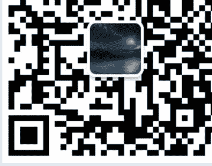

# 希尔顿集团
About Hilton

# 关于希尔顿
About Hilton

| 项目 | 数值 |
| :--- | :--- |
| 品牌 Brands | 24 |
| 国家/地区 Countries | 126 |
| 酒店 Properties | 8000 |
| 客房 Rooms | 120W |
| 全球每年服务人数 Guests served annually | 30亿+ |
| 希尔顿荣誉客户会员 Hilton Honors Members | 2亿 |

希顿集团在《财富》杂志与卓越职场研究所“全球最佳职场”百强评选中名列前茅；连续7年在道琼斯可持续发展指数中成为全球产业领导者。

| WALDORY ASTORIA | CONRAD | L X R NoMAD | Signia Hilton | canopy | Hilton | CURIO COLLECTION | Graduate | DOUBLETREE | TAPESTRY COLLECTION | EMBASSY SUITES | TEMPO | MOTTO | Hilton Garden Inn | Hampton | spark | HOMEWOOD SUITES | HOME2 | LivSmart Studios | Hilton CLUB | Hilton GRAND VACATIONS CLUB | Hilton VACATION CLUB |

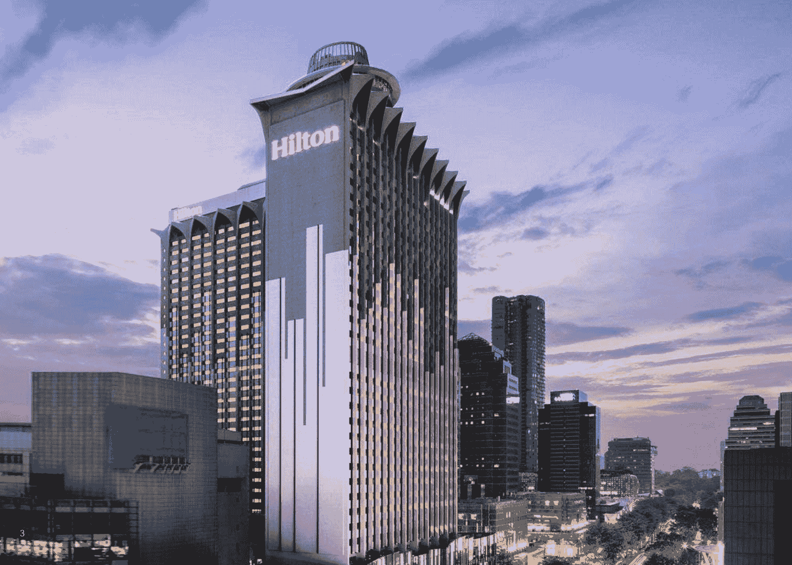

# 希尔顿 全球最有价值的酒店集团
World's Most Valuable Hotel Brand

# 全球酒店品牌价值榜单
Most Valuable Hotel Brands

| 排名 | 品牌名称 | 价值 |
| :--- | :--- | :--- |
| NO.1 | Hilton HOTELS & RESORTS | USD$117.7 bn |
| NO.3 | Hampton | USD$4.3 bn |

# 可持续发展认知价值榜单
Sustainability Perception Values

| 排名 | 品牌名称 | 价值 |
| :--- | :--- | :--- |
| NO.1 | Hilton HOTELS & RESORTS | USD$565 m |
| NO.3 | Hampton | USD$202 m |

> Brand Finance
> Brand Finance（英国品牌金融咨询公司）是全球性的独立第三方品牌评估和咨询机构

## 希尔顿百年创新发展史
100 Years of Hilton Innovation

### 1955年
希尔顿创建了首个全球预定中心-HILCRON. Hilton HOTELS LEAD THE WAY

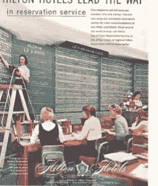

### 1927年
全球第一家在公共空间提供自来水和空调的酒店

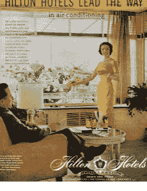

### 1947年
全球第一家在客房装电视的酒店

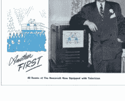

### 1965年
推出 Lady Hilton，这是首个为女性旅客设计的酒店概念。部分酒店设有女性专用楼层和客房，并提供专为女性量定制的特殊设施。

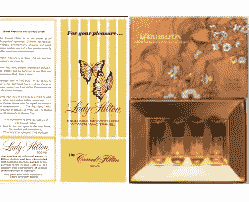

# OVER 100 YEARS OF HILTON INNOVATION

### 1973年
希尔顿开创了使用计算机技术的集中预订服务

### 2008年
希尔顿引入了LightStay，用于计算和分析环境影响

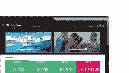

### 1987年
希尔顿推出希尔顿荣誉客会会员计划

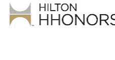

### 2009年
希尔顿酒店集团将其名称和标识更为希尔顿全球，将总部从加利福尼亚州迁至弗吉尼亚州。

### 2013年
希尔顿回归证券交易所，并使用股票代码HLT。

## 锦江国际集团
About Jin Jiang International

# 关于锦江国际
About Jin Jiang International

锦江国际（集团）有限公司是中国最大的综合性旅游集团，拥有酒店、旅游、金融三大核心业务。“锦江”是具有近百年历史的民族品牌，业务涵盖酒店、城市服务、食品及餐饮。拥有岩花园、昆仑、丽笙精选、丽笙、皇家金煦、锦江都城、康柏、丽枫、维也纳、白玉等高端品牌，为全世界的客人提供服务。16000+酒店、19亿+会员、1500000+房间。

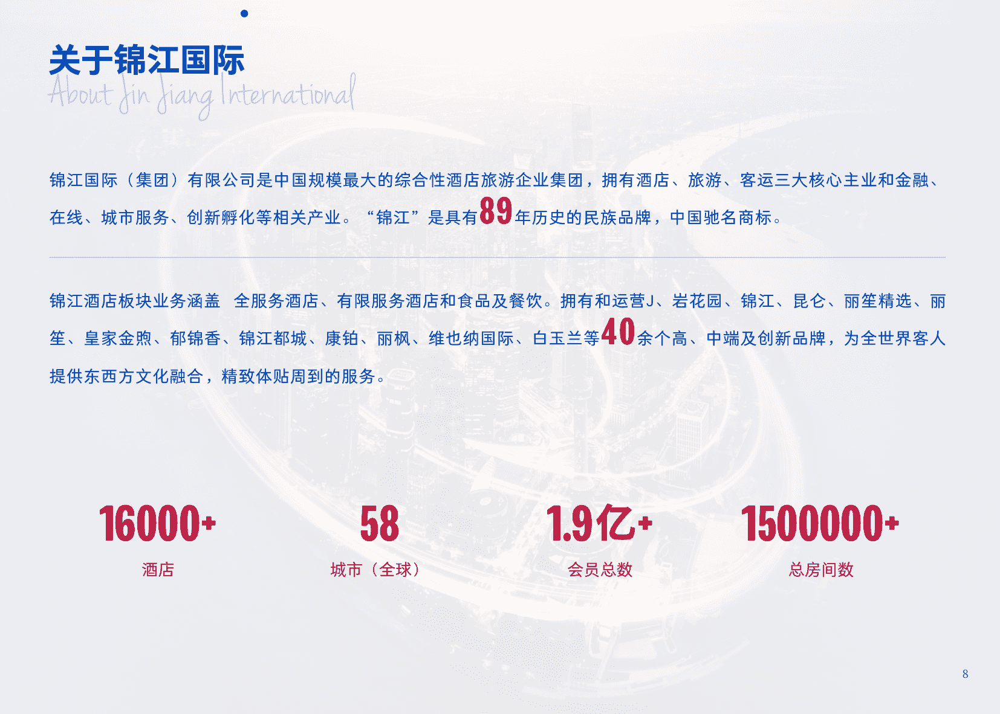

## 近百年历史的品牌
National Brand with nearly a Century

1993-2006年集团核心产业
- 1993年：锦江在线成立
- 1994年：锦江B股上市
- 1996年：锦江酒店
- 2006年：锦江资本上市（HK）

2019年：锦江国际集团跃身全球第二，亚洲第一，拥有近1.9亿会员的全球领先公司。

2009-2018年系列并购布局
- 1984年：全球首家希尔顿欢朋在美国孟菲斯
- 1951年：上海锦江饭店开业
- 1988年：上海锦江大酒店竣工并成为“上海第一高楼”
- 2003年：锦江国际集团重组成立
- 2015-2017年：所属企业中旅集团高等发展等
- 2020年：正式成立锦江店（中国区）

## EXTRAORDINARY HISTORY
历史传承品牌

百年“锦江”，见证着一个改变世界的时刻，并接待过来自150多个国家的500多位元首和政府首脑。

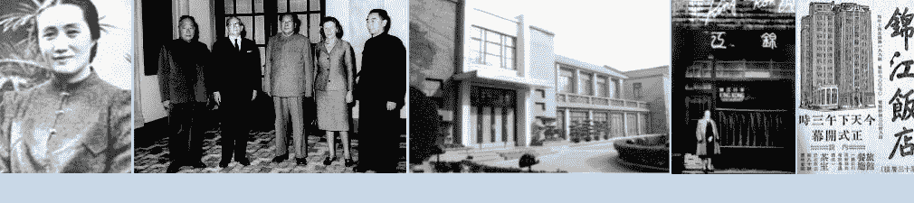

## 大型合作
The Cooperation

锦江国际集团与希尔顿集团希尔顿欢朋品牌合作续签
HILTON & JIN JIANG INTERNATIONAL
HAMPTON BY HILTON MASTER LICENSING AGREEMENT RENEWAL SIGNING CEREMONY

2020年12月，锦江国际集团与希尔顿集团续签希尔顿欢朋运营许可协议，双方约定至2034年在华开业逾600家希尔顿欢朋酒店。

# 希尔欢朋
About Hampton by Hilton

# 关于希尔顿欢朋
About Hampton by Hilton

希尔顿欢朋 (Hampton by Hilton) 是希尔顿旗下规模最大的品牌之一。1984年，全球首家希尔顿欢朋酒店在美国孟菲斯开业。其后四十年，希尔顿欢朋酒店快速扩展业务，目前已在全球40国家和地区，开业超3000家酒店，是全球最大也是最成功的国际品牌之一。

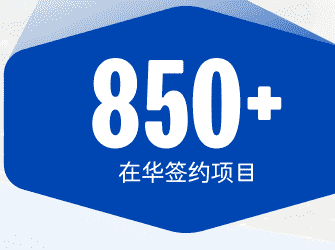

## 希尔顿欢朋全球发展历程
Hampton by Hilton Milestones

- 全球首家希尔顿欢朋酒店在美国孟菲斯开业
- 全球首家第1000家希尔顿欢朋酒店在美国加利福尼亚州海沃德开业
- 希尔顿欢朋全球第2000家在美国华盛顿市开业

- 1984年：全球首家希尔顿欢朋
- 2000年：全球第1000家希尔顿欢朋
- 2014年：全球第2000家希尔顿欢朋

- 1984年：正式推出住宿里的第一个100%保证
- 1989年：全球首创最权威、最广泛的特许经营排名，列《Entrepreneur》杂志年度特许经营500强榜第一
- 2011年：在《Business Travel News》调研中第一
- 2014年：全球开业酒店数突破3000家，遍布5大洲
- 2019年：连续15年列《Entrepreneur》杂志年度特许经营500强榜第一
- 2020年：毕马威卓越体验排名第一
- 2021年：高端品牌第一
- 2024年

## 希尔顿欢朋中国发展
Hampton by Hilton China Milestones

- 2014年：正式入希尔顿荣誉会员品牌
- 2017年：希尔顿欢朋中国项目签约数突破100
- 2019年：希尔顿欢朋中国签约数突破500
- 2020年：希尔顿欢朋中国第100家酒店在扬州盛大开业
- 2021年：希尔顿欢朋累计接待突破1000万
- 2022年：希尔顿欢朋第200家酒店在杭州盛大开业
- 2023年：希尔顿欢朋在华签约项目总数突破600
- 2024年：希尔顿欢朋在华累计接待人数突破2000万，在华业酒店数突破300家，入驻城市超200个，在华累计接待客数超3000万，中国开业门店超400家，且仍在以每3天1家的速度迅速扩张。

锦江国际集团与希尔顿全球签署独家战略合作，发布希尔顿欢朋品牌公寓，续签至2034年，中国成为第20个国家。

## 品牌定位和目标客群
Brand Positioning and target Customers

服务商旅精英和亲子家庭的国际高端商务连锁酒店品牌。

## 产品设计
Products & Design

### 空间布局
- 多功能大厅 (Multi-functional HUB)
- 健康格调餐厅 (Restaurant of Healthy Concept)
- 会客厅 (Meeting Room)
- 客房 (Guestrooms)
- 健身房 (Fitness Center)
- 自助洗衣房 (Guest Laundry)
- 大堂 (Hexagon Background)
- 宴会区 (Bar & Gathering Zone)
- 欢迎墙 (Welcome Wall)
- 饮料 (Welcome Drink)
- 饮品柜 (Beverage Station)
- 自台 (Buffet Area)
- 彩色座椅 (Colorful Chairs)

### 设施
Hotel Facilities
- **健身房**：配备全球一线品牌的健身器材与设备，任你挥洒汗水，重塑活力。跑步机、瑜伽垫、划船器等设备为客人提供多重选择。
- **洗衣房**：配有多台洗衣机及烘干机，可供多位客人同时使用，同时配有熨机，让每一次出行都能尽量舒适与洁净安心。

### 当地城市特色元素
Local Characteristic Elements
床头背景融合艺术画廊概念、属地文化、建筑艺术美术与抽象艺术图形相结合（Combination of local landmark with abstract art pictures of headboard wall）。

- 大床房 (King Bed Room)
- 艺术源 (Art work)
- 城市地标背景 (Local Landmark Background)
- 互动留言墙 (Interaction Board)
- 智能控面板 (Control Panels)
- 迷你吧 (Mini Bar)
- 可移动办公区 / 人体工学座椅 (Movable Desk & Ergonomic Chair)
- 沙发床 (Sofa Bed)
- 灵活移动小几 (Playful table)
- 彩色地毯 (Colorful Carpet)

## 客房房型色彩
Colors of Guestrooms
- 大床（橙色）：King Bed(Orange)
- 双床（蓝色）：Twin Beds(Blue)
- 套房（绿色）：Suite(Green)

简约现代的环境、新鲜的热早餐、种类丰富的西餐和饮料，打造健康饮食，为忙碌的旅途增添一份愉悦和安心。

### 双床房
Twin Beds Room

- 城市地标床背景
Local Landmark Background
- 智能面板
Control Panels
- 互动留言板
Interaction Board
- 迷你吧
Minibar
- 标准双床
Twin Beds
- 灵活移动小圆几
Playful table
- 可移动办公区 / 人体工学座椅
Movable Desk & Ergonomic Chair

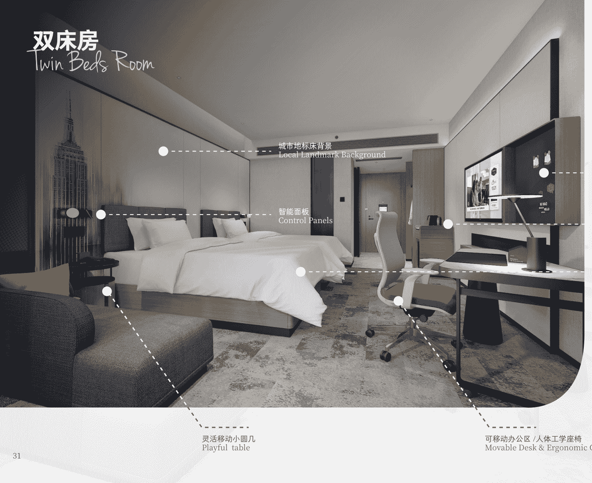

### 套房
Suite

- 开放式空间
Open Space
- 迷你吧
Minibar
- 双通道洗手间
Two-way Toilet
- 异形书桌/办公椅
Irregular Desk / Chair

- 旋转电视柜
Rotating TV Cabinet

### 客房卫生间
Bathroom

- 成品灯镜
Lamp Mirror
- 壁挂式化妆镜（不带灯）
Wall-mounted make-up mirror
- ��芯彩虹玻璃
Colored Glass with Gradient Effects
- “城市边缘线”概念玻璃图案
“City Edge Line" concept glass pattern
- 仿大理石砖
Marble Tile
- 大理石纹路踏板
Rock Beam with Marble Texture
- 洗手台-独立家具式设计
Wash Basin in Modular Design

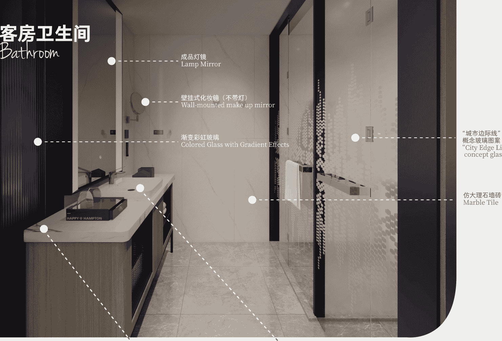

## 品牌文化
Brand Culture

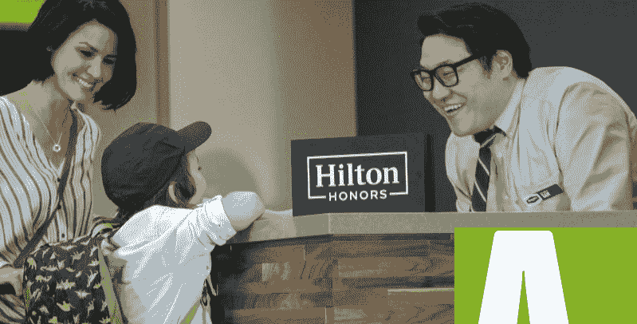

## F.

## A.

### 友善 Friendly
亲切友好/Friendly and Hospitable
传承希尔顿的全球服务标准。如朋友般真诚对待每一位旅客，提供高品质的服务。

### 可靠 Authentic
始终如一/High-quality and Consistent
每一位客临希尔顿酒店，都会提供品质始终如一的服务，让你轻松体验，畅享生活。

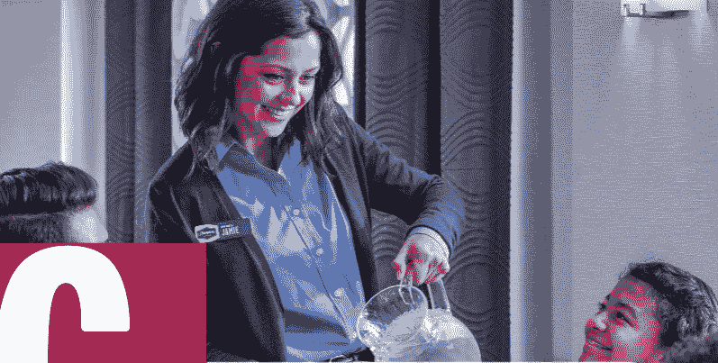

## C.

## T.

### 关怀 Caring
恰到好处/In Time and Just Right
我们在你的一举一动中，为你提供恰到好处的服务。

### 周全 Thoughtful
想你所想/Anticipate Needs and Flexible
我们时刻关注他人需要解决的问题，提出灵活的解决方案。

# 投资优势
Investment Advantages

## 投资希尔顿欢朋卓越优势
Investment Advantages

- 产品力
- 创新力
- 运营力
- 投资回报
- 品牌力
- 合作力

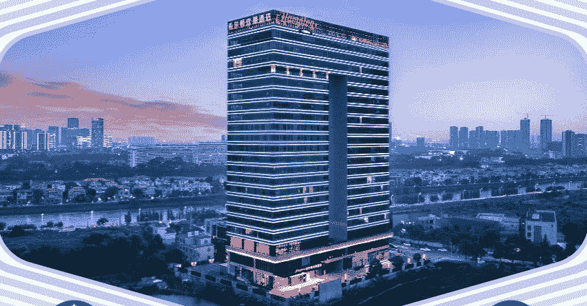

## 产品力

从亲子和商旅客群出发，不断焕升级产品模型，契合多场景入境需求。依托锦江全球采购共享服务平台，目前拥有2000+供应商，为全球超过40个品牌、超过14000家酒店、160多万间客房搭建可靠的供货台，提供优质产品和服务，采购优势明显。同时，品牌只要要求不到15%中央采购物资，其他物资均由品牌方给出标准，业主方可自行采购，从而达到合作共赢。不仅有效确保物资的优化品质，还能获得价格竞争力的优势地位，使投资人更省、安心、放心。

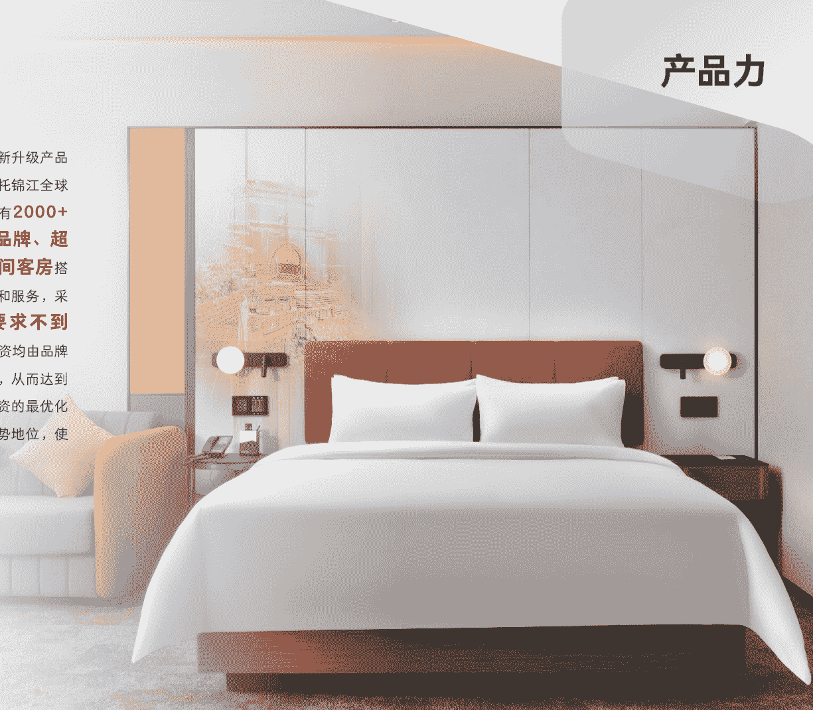

## 运营力

经过在中国市场近10年的发展，希尔顿中国团队卓越的运营实力和成熟可复制的酒店运营管理模式，是各分店经营的保证。独特的运营管理模型，高达16个服务触点，打造让人记忆难忘的欢聚体验。全品牌的平均客户评分接近4.9分，服务表率达到97%。

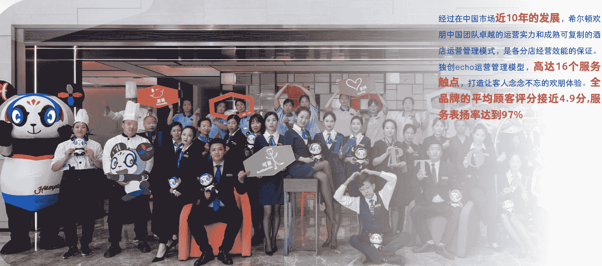

在数字化过程中，希尔顿品牌国际遵循三大原则进行，“Efficient高效的、Easy简单的、Enhanced增强的”即让业务流程能够高效开展，让赋能的技术能够落地简单，最终通过技术不断增强客户的入住体验。希尔顿品牌创立的2+1数字化系统体系，即总部BLI、Sofun、直销平台三大核心系统，可支持酒店全生命周期的高效管理，为门店提供完整的移动与智能化解决方案。手机端中服务、企业营销等独特行业前瞻性的各类创新项目在提升客户入住体验的同时，为酒店优化运营成本提供关键解决方案。

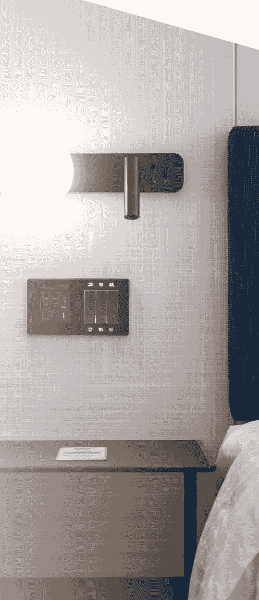

## 创新力

## 品牌力

希尔顿集团作为最早进入中国的国际酒店品牌管理公司，在中国酒店市场上，拥有无与伦比的高端品牌影响力，而希尔顿欢作为中国中高端酒店赛道的创立者和标准制定者，以灯塔品牌之姿态持续引领中国中高端酒店市场发展。在国际权威品牌价值评估机构Brand Finance发布的“2023年全球最具价值酒店品牌”榜单中，希尔顿欢享位列第三，品牌价值达到43亿美元。

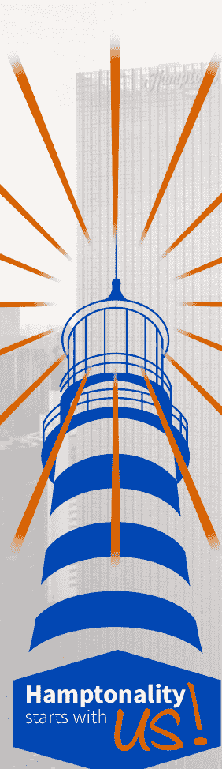

## 投资回报力

希尔顿集团与锦江酒店强劲的背景和资源，为希尔顿欢享酒店建立了全球广泛的市场营销与推广渠道保障，希尔顿全球客户汇聚有超过2亿精英客户，而锦江酒店拥有超过1.9亿会员，两大会员体系是希尔顿酒店源输的强大后盾，为投资带来稳定、高额的回。希尔顿在中国签约超过850+酒店，开业超过410家酒店，有成熟可参考的投资模型，锦江旅平台直销占比突破40%。

## 合作力

国际品牌独特的合作模式，将行业咨询、委托管理和特许经营等模式结合，与投资人建立起更紧密、深度的合作关系。从酒店的选址建设到后续的持续运营，希尔顿集团与锦江携手，为酒店提供了优质的保障。针对酒店生命周期的不同需求，打造了垂直管理机制，以及客房、餐饮、工程等业务线，设置了区域总经理负责落地，提升门店口碑。

## 加盟条件
Investment Conditions

- 城市要求：各大省会城市及发达省级及地级城市

## 选址要求
Site Selection

- 成熟区域：核心商业中心、高档居住小区、大型聚集区
- 交通枢纽：邻近机场、火车站及高速枢纽
- 预见区域：经济新区等
- 旅游区域：临近著名景区或历史区域

## 合作流程
Cooperation Procedure

- 提交相关资料
- 初步规划方案
- 现场评估
- 签署合同
- 项目启动

## 广州洛溪
希尔顿欢朋酒店

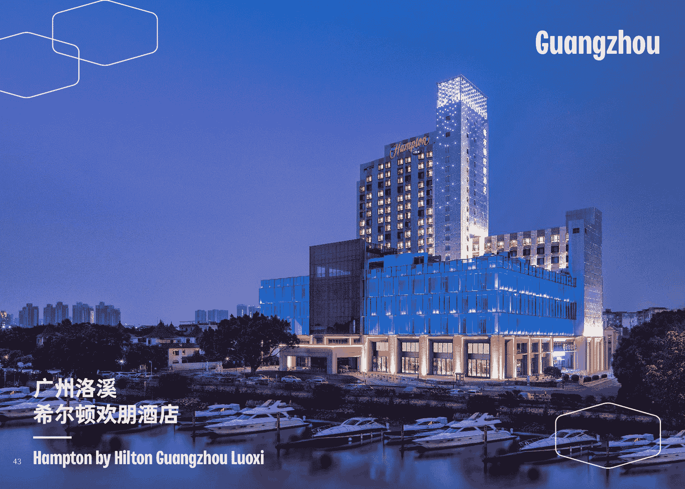

### 天津河
希尔顿欢朋酒店

### 邯郸永宁
希尔顿欢朋酒店

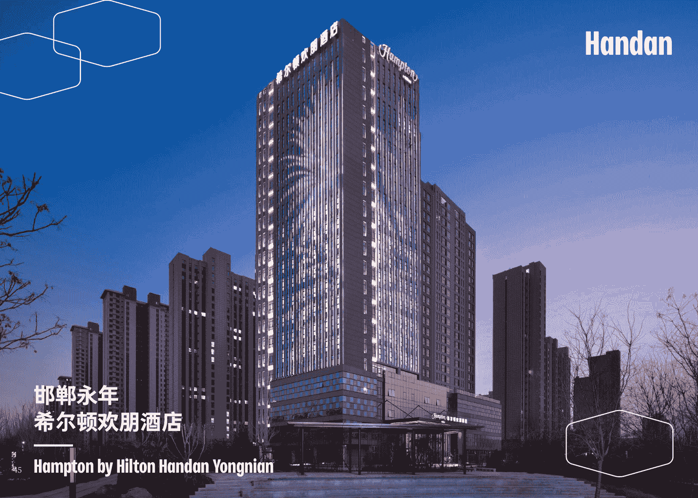

### 贵港
希尔顿欢朋酒店

### 天津站
希尔顿欢朋酒店

### 东莞松山湖
希尔顿欢朋酒店

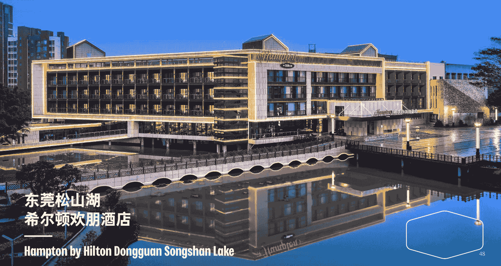

### 成都武侯新城
希尔顿欢朋酒店

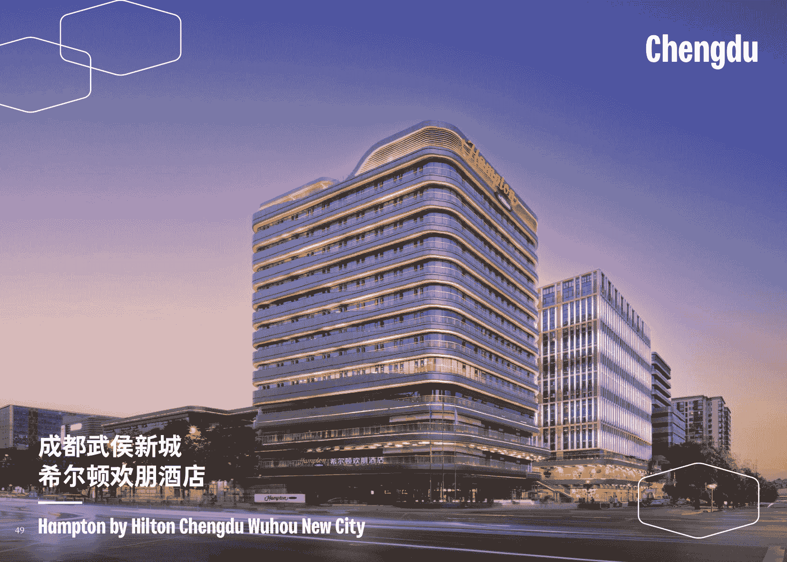

### 石家庄鹿泉开发区
希尔顿欢朋酒店

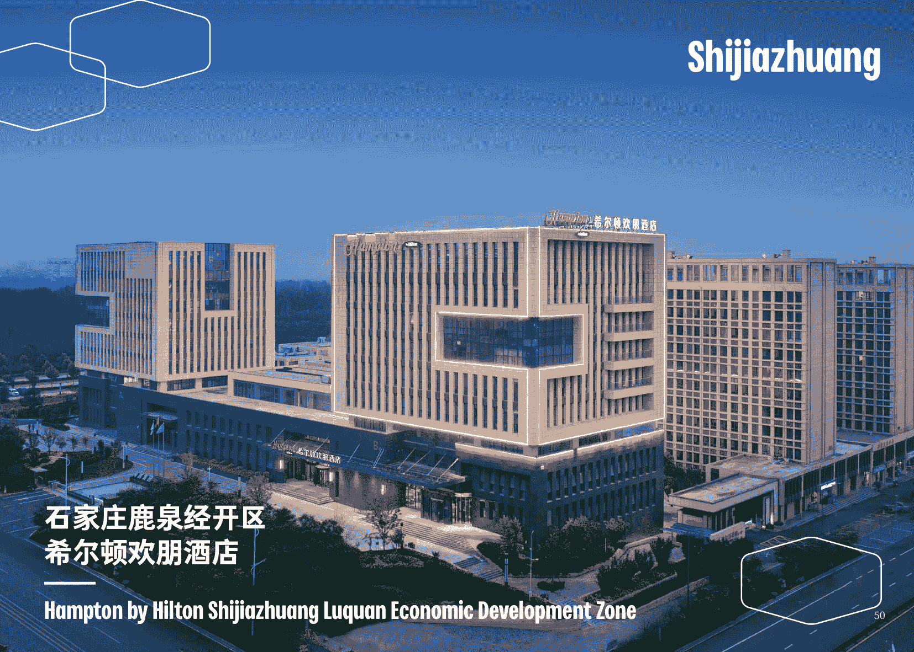

### 汕头潮阳
希尔顿欢朋酒店

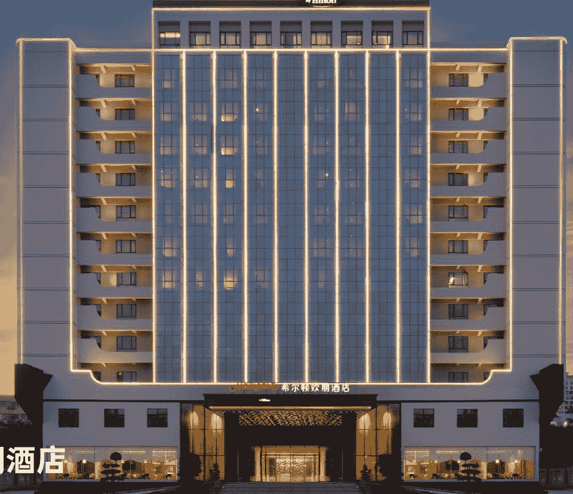

### 杭州良渚
希尔顿欢朋酒店

### 广州新塘
希尔顿欢朋酒店

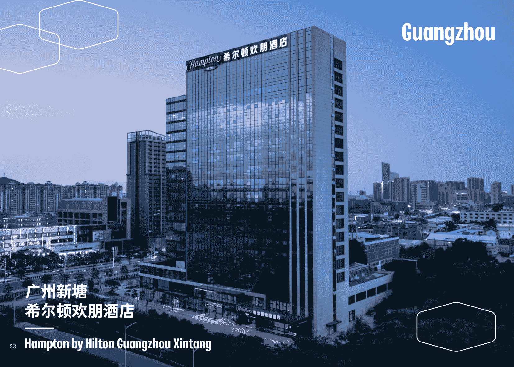

### 深圳福田华强北
希尔顿欢朋酒店

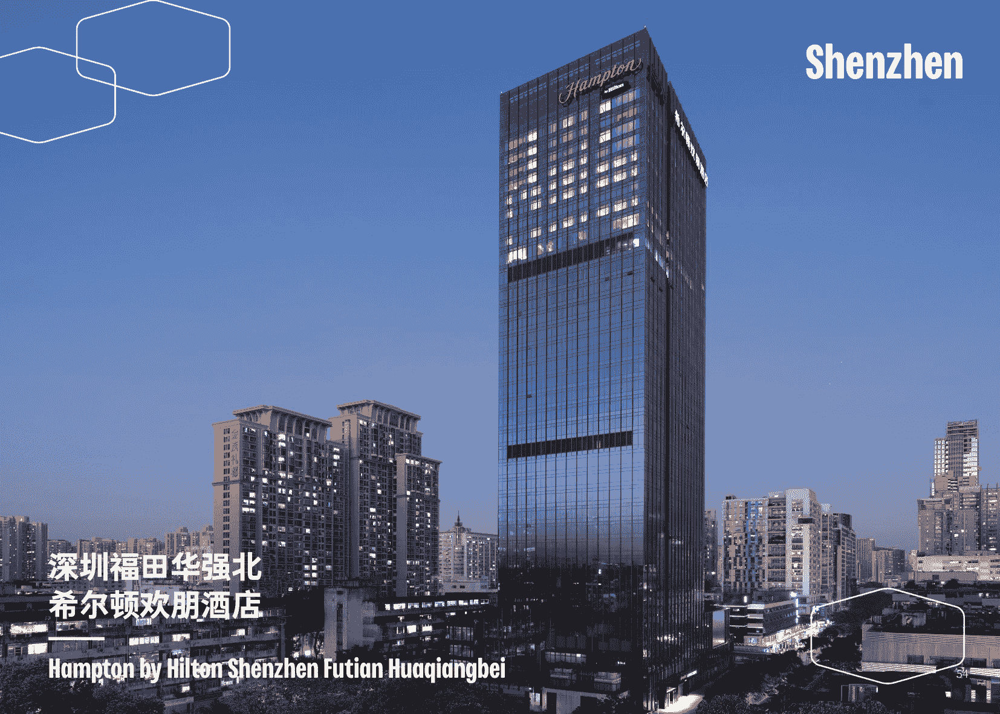

### 佛山陈村
希尔顿欢朋酒店

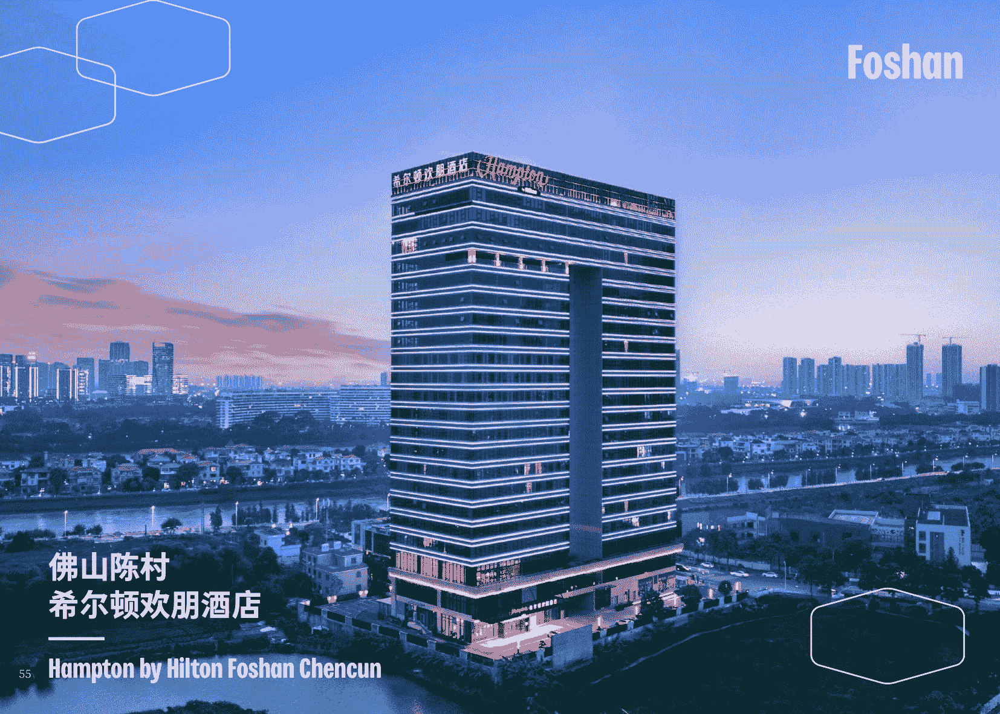

### 武汉黄鹤楼
希尔顿欢朋酒店

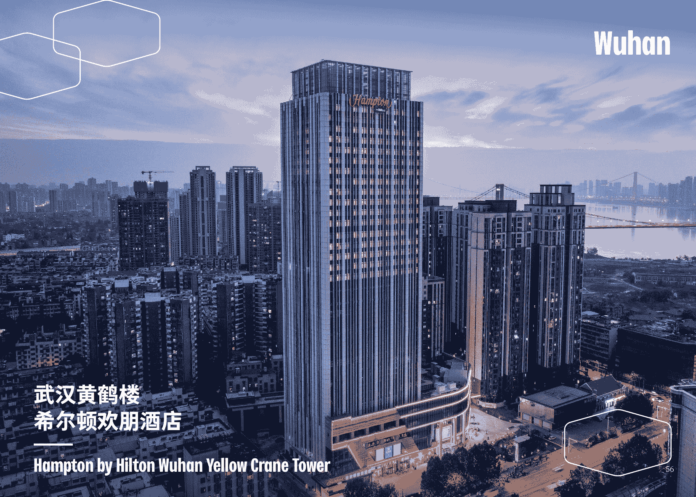

### 鹰潭
希尔顿欢朋酒店

### 北京中关村
希尔顿欢朋酒店

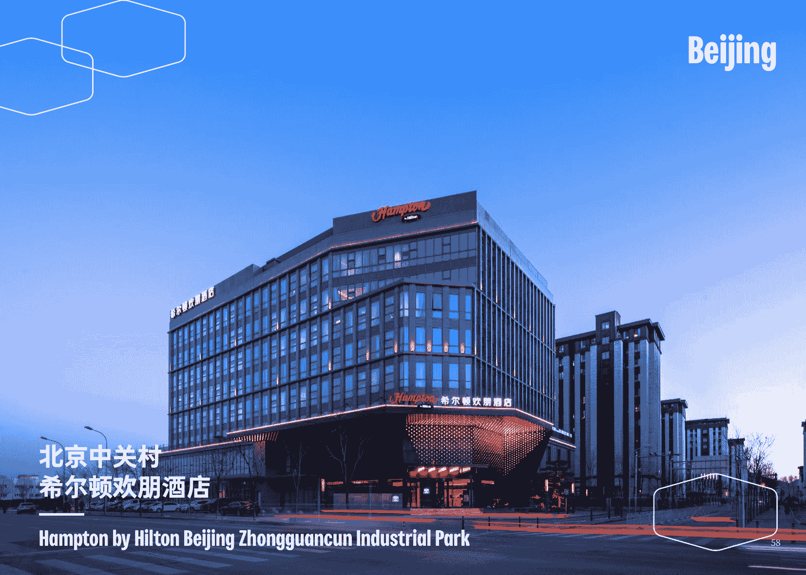

### 广州
希尔顿欢朋酒店

### 广州新塘高铁站
希尔顿欢朋酒店
