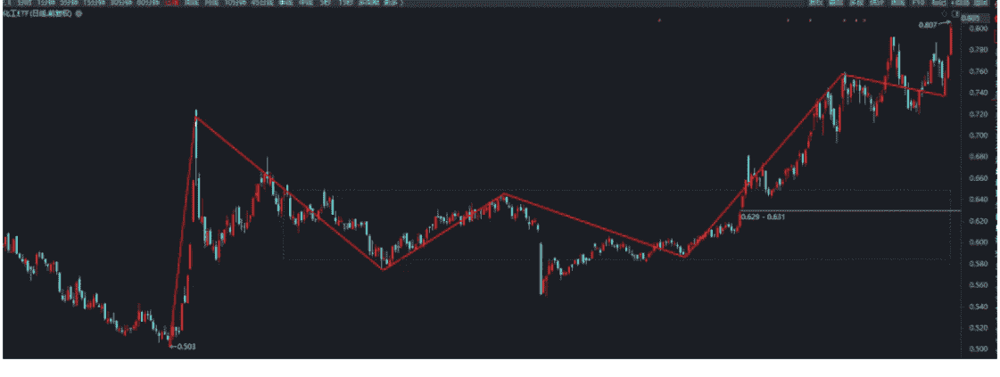
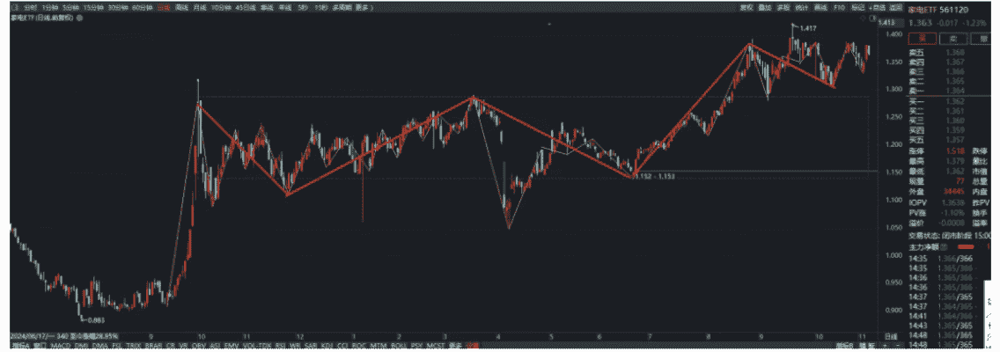
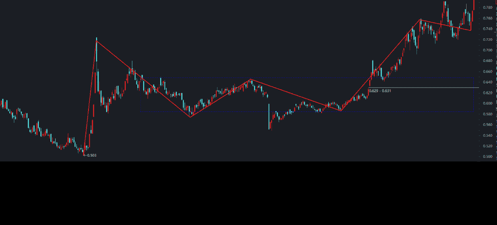

# 比较不错的板块

日日日挂 年行 2025年11月9日 18:17 广东 听全文 星星

按照周五提到的逻辑，我对板块进行了结构的划分，与化工近期的上涨相比，你能够看到异同同工之之处，而对于个股，就是按照板块 ETF 内的十大成分股去考虑，因为他们是面临真金白银流入的！

化工的结构：

而板块内的成分股获得真金白银流入：

| 代码 | 简称 | 名称 | 市价 | 涨跌 | 涨幅 | 振幅 | 成交量 | ... | ... | ... | ... |
| :--- | :--- | :--- | :--- | :--- | :--- | :--- | :--- | :--- | :--- | :--- | :--- |
| 600000 | 00 | 平安银行 | 15.12 | -0.05 | -0.33% | 1.25 | 1234567 | ... | ... | ... | ... |
| 600036 | 36 | 招商银行 | 35.45 | 0.12 | 0.34% | 2.10 | 9876543 | ... | ... | ... | ... |
| 601939 | 39 | 工信银行 | 42.15 | -0.10 | -0.24% | 1.85 | 5555555 | ... | ... | ... | ... |
| 600519 | 19 | 宁州财富 | 28.30 | 0.05 | 0.18% | 1.50 | 7777777 | ... | ... | ... | ... |
| 601088 | 88 | 中国银行 | 18.90 | -0.02 | -0.11% | 1.10 | 8888888 | ... | ... | ... | ... |

更多资源进群微信cuk255

而新的这个板块如图：

这个板块就是家电板块，ETF便是家电ETF。

个股情况：

| 代码 | 名称 | 行业 | 价格 | 涨跌 | 跌幅 | 振幅 | 最高 | 最低 | 换手 | 比率 | 3日涨幅 | 7日涨幅 | 14日涨幅 | 30日涨幅 | 60日涨幅 | 90日涨幅 | 180日涨幅 |
| :--- | :--- | :--- | :--- | :--- | :--- | :--- | :--- | :--- | :--- | :--- | :--- | :--- | :--- | :--- | :--- | :--- | :--- |
| 600338 | 海康电器 | 家电 | 28.45 | -0.05 | -0.18 | 0.15 | 30.45 | 27.50 | 1.12 | 0.01 | -0.65 | 0.95 | 5.13 | -1.02 | -0.43 | 5.32 | 7.91 | 108.17 |
| 600036 | 格力电器 | 家电 | 23.15 | -1.42 | -5.83 | 0.38 | 23.65 | 22.50 | 2.45 | 0.01 | -0.48 | -0.16 | 0.34 | -0.62 | 0.23 | -0.88 | 2.20 | -2.25 |
| 600019 | 京东方股份 | 家电 | 34.65 | -0.15 | -0.52 | 0.22 | 35.45 | 34.10 | 1.55 | 0.02 | -0.38 | -0.15 | 0.12 | -0.38 | 0.97 | 4.77 | 2.23 |
| 600099 | 美莱电器 | 家电 | 22.15 | -0.45 | -1.98 | 0.18 | 22.65 | 21.50 | 1.85 | 0.01 | -0.65 | -0.25 | 0.15 | -0.55 | 0.42 | -1.15 | -1.45 | -5.13 |
| 600068 | 海信电器 | 家电 | 29.15 | -0.15 | -0.63 | 0.25 | 29.65 | 28.50 | 1.35 | 0.01 | -0.38 | -0.34 | 0.23 | -0.62 | 0.15 | 0.88 | 4.08 | 40.24 |
| 600517 | 格亚电器 | 家电 | 10.15 | -0.45 | -1.93 | 0.22 | 10.65 | 9.50 | 2.15 | 0.01 | -0.65 | -0.25 | 0.15 | -0.55 | 0.42 | -1.15 | -1.45 | 22.13 |
| 603116 | 云记忆 | 家电 | 25.15 | -0.15 | -0.63 | 0.28 | 25.65 | 24.50 | 1.45 | 0.01 | -0.38 | -0.34 | 0.23 | -0.62 | 0.15 | 0.88 | 4.08 | 26.73 |
| 600060 | 力奥电器 | 家电 | 24.15 | -0.45 | -1.93 | 0.25 | 24.65 | 23.50 | 1.95 | 0.01 | -0.65 | -0.25 | 0.15 | -0.55 | 0.42 | -1.15 | -1.45 | 12.91 |
| 600030 | 苏阳股份 | 家电 | 18.15 | -0.45 | -1.98 | 0.22 | 18.65 | 17.50 | 2.15 | 0.01 | | | | |

更多资源进群微信cuk255

更多资源进群微信cuk255

| 编号 | 样品 | 含量 | 含量 | 样品 | 含量 | 含量 | 含量 | 含量 | 含量 | 含量 | 含量 | 含量 | 含量 |
| :--- | :--- | :--- | :--- | :--- | :--- | :--- | :--- | :--- | :--- | :--- | :--- | :--- | :--- |
| 1 | 600999 | 万方净 | 2.711 | 413.43 | 827414 | 鱼酯 | 5.74 | 65.27 | 3.52 | 2.43 | 5.36 | 9.62 | 5.16 | 13.27 | 9.13 | 7.67 | 7.38 |
| 2 | 600990 | 日本亚糖 | 1.192 | 246.67 | 618079 | 葡萄糖 | 0.46 | 23.90 | 0.85 | 1.06 | 5.58 | 9.01 | 11.28 | 13.72 | 14.20 | 16.50 |
| 3 | 600150 | 日双糖 | 4.38 | 246.67 | 618079 | 葡萄糖 | 0.46 | 23.90 | 0.85 | 1.06 | 5.58 | 9.01 | 11.28 | 13.72 | 24.20 | 16.50 |
| 4 | 600448 | 瑞糖 | 1.682 | 172.23 | 358756 | 蔗糖 | 4.29 | 22.95 | 1.15 | 1.35 | 7.44 | 8.51 | 8.01 | 10.75 | 12.26 | 18.16 |
| 5 | 600408 | 国内侧台 | 3.70 | 172.23 | 358756 | 蔗糖 | 3.23 | 17.82 | 0.63 | 0.74 | 5.36 | 5.11 | 5.91 | 6.33 | 14.59 | 11.54 |
| 6 | 600448 | 瑞糖 | 1.682 | 172.23 | 358756 | 蔗糖 | 4.29 | 22.95 | 1.15 | 1.35 | 7.44 | 8.51 | 8.01 | 10.75 | 12.26 | 18.16 |
| 7 | 600426 | 中阳糖 | 3.70 | 172.23 | 358756 | 蔗糖 | 3.23 | 17.82 | 0.63 | 0.74 | 5.36 | 5.11 | 5.91 | 6.33 | 14.59 | 11.54 |
| 8 | 600448 | 瑞糖 | 1.682 | 172.23 | 358756 | 蔗糖 | 4.29 | 22.95 | 1.15 | 1.35 | 7.44 | 8.51 | 8.01 | 10.75 | 12.26 | 18.16 |

# 比较不错的板块

## 深度视野（深度视野（深度视野）
- 深度视野（深度视野）
- 守夜人司令星球
- 接换魔王后星球
- 成达谈论星球
- 咸付财富圈
- 雪球花甲头
- A 视野
- 大树乡谈
- 江初国
- 咩咩说
- 上海海家
- 西风付费文章
- 老端
- 赢在八小时之外
- 局外人的视界
- 老A体制内

## 底部链接全网V优质内容
深度视野文集进群微信cuk255 深度视野（付费文集）
