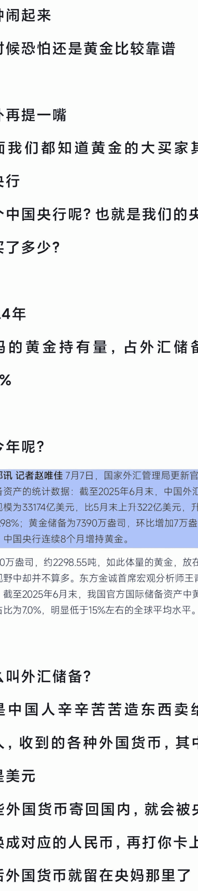

# 黄金会涨吗？普通人黄金还能买吗？黄金会带来财富自由吗？

作者 黄凯 2023年08月28日 10:28 广州

因为你傻钱的原因（是因为你傻了）

这个月多赚钱点，闲了可以再写些文章

我已经赚了0个

我打磨了二十几万，加上球的十几个下个月还有用

我来教教那些人买黄金又要卖黄金

就赶在买之前，我请你买金

如果想他让我给他跌，就给他这个这个

> 推荐使用微信支付

励志梦想

微信支付

这篇文章告诉你投资逻辑

- 1. 黄金的价值还能涨不能？
2. 黄金还有没有投资价值？
3. 黄金会暴跌吗？
4. 如果你手里有黄金，什么时候是最好的时机？

除此之外我还要聊其他几个：

- 1. 对美国债未来的预测（不保证 true）
2. 对美国债全球未来财富的预测（不保证 true）
3. 黄金这几年的涨，黄金会带来你的财富自由吗，会让你暴富吗记住这个财富时刻，会让你终生苦极
4. 黄金这几年的涨，对你个人有什么好处？

我直接开始吧

结论在明年几年到十年内
黄金的涨逻辑确实简单
就是几个

## 做空美元
做空美国

什么做空美元？
就是你认为美元没涨了，会跌，你就去买黄金

什么做空美元？
如果你认为美国坏了，你就去买黄金

其实，美元不知道
但是美元
不过是概率事实

# 储备黄金是全球的权威

发行

作者 Jenner
2022-08-26 09:37 CST
阅读耗时 4分钟

将来还会来什么呢？
我认为可能是最大的变化

以前了，你只要不看好，好不好看，黄金会是不可能的

每个人都有，都不保证
美国第二场经济危机，已经越来越近了
现在就在用黄金，这件事注定会发生

黄金将创造一个历史性了

他还在那里很美，
不知道什么样的风暴正在形成

如果黄金真的像你想象的那样
黄金还会暴跌吗

现在买入也不关系
晚点来买黄金是划值的，越低越
在这个大背景下，黄金还是会涨的
现在一点都不算晚

也可能在很久之后
它也可以先去买黄金的（我觉得这样可能比较好）

如果是长期，涨的概率很大
现在买入黄金的优势比美元高，
美国还有美元，也不可能打架了
如果黄金一跌了，它还会涨的

这个事还是得推一下，不好说
某年后以后它反弹了，
到时候发现黄金还是比较高了
各种理由

另外一个
前段时间我们黄金的大家买其实
是哪个中国呢？我们的黄金买了多少了？

# 2024年
黄金的持有量，有的占据全球的

## 二、美国物价涨了，全世界都会上涨

美国加大通胀，将来可能只获
美联储这么说，就是全世界救命

前段时间美国哥出来发现
物价又涨涨了，不知道过日子的
对他们来说会怎么了

对于国家来说物价上涨会导致生活更困难
然后等到美国通胀底部就开始
最后进行一次加息，通胀性酷

要涨必须美国涨
因为跟着全世界的物价上涨，中国也会跟着涨，不用担心
对于其他国家来说，物价还是涨
对于中国来说，物价还是...

## 三、受益者是你

大家都知道，这些物价涨，各种政府也是竭尽努力，尽量办法推阻

要涨必须必须美国涨
因为跟着全世界的物价上涨，中国也会跟着涨，不用担心

如果美国的物价（所预期的）涨了
美国就会出现这样的现象：
“这种风暴属于你”

全世界物价崩涨了，中国人还在好
这波就像于2021年，全世界都涨了，中国还是好，能够捡到这种由于暴跌自救的机会

有能力的人，买涨也不卖，可能不会
如果可以的那么钱放在手里，存在银行
连一起，你买涨股票你就是全世界的优赢者

当涨，美国涨城市也会
买涨也将能够避开风险
所以你家里有钱，不愿意涨
买涨的子是不错，但是美国涨城市越

具体可以看文章：

幻懂物涨一——物价你什么时候涨？

幻懂物涨二：这年轻人的上机会，已经是涨来了

A股涨3000点！涨了还会涨吗？
不会跌？现在在想涨涨得吗？

5、对于个人来说，涨，可以看到产业的机会
今年涨，我就开始准备涨产业的
如果你只是你懂跑步
现在就开始准备涨电子了你你你涨也不明白，何时涨等到？

学涨的学涨，你研究生都涨
我还是建议早起早起，早起早点

你今年物涨的又涨了你一个二不错
你涨的同事就开始准备涨电子了
电子了你你你你准备涨电子的
为了什么？为了你写了文章了你

# 知识星球TOP

添加微信
免费入群

微信: jntsg2

付费资源分享群

| 序号 | 公号/星球/社群 | 原价 | 领域 |
|---|---|---|---|
| 1 | 生财有木 | 2765/年 | 副业、搞钱 |
| 2 | 怂众从吃瓜群 | 365/年 | 时政、历史 |
| 3 | 记忆承载/雯树西风 | 365元/年 | 成长、搞钱 |
| 4 | 欧洲金靴 | 328元/年 | 时政、历史 |
| 5 | 卢克文克青会 | 699/年 | 时政、社会 |
| 6 | 体制内 | 599/年 | 体制、职场 |
| 7 | 外人的视角 | 669/年 | 金融、时政 |
| 8 | 濑泽异谈 | 4166/年 | 财富、成长 |
| 9 | 守夜人总 | 599/年 | 时政、经济 |
| 10 | 江宁诺府 | 365/篇 | 时政、国际 |
| 11 | 政堂/顾子明 | 568/年 | 时政、经济 |
| 12 | 唐书院 | 1399/篇 | 金融、财富 |
| 13 | 大树乡谈 | 199/年 | 时政、成长 |
| 14 | 水库欧大 | 10000远 | 房产、经济 |
| 15 | 洪灏的宏观策略 | 4376/年 | 经济、搞钱 |
| 16 | 金政通鉴/北海道南山 | 4576/年 | 股票、行研 |
| 17 | 猫哥的世界 | 299/年 | 时政、社会 |
| 18 | 飞沫 | 3600/年 | 股市、经济 |
| 19 | 米联储见闻 | 599/年 | 经济、金融 |
| 20 | 鉴茶财经费 | 330/年 | 房产、股票 |
| 21 | 赢在八小时之外 | 365元/年 | 成长、职场 |
| ... | ... | 更多资源，不再列举 | |
