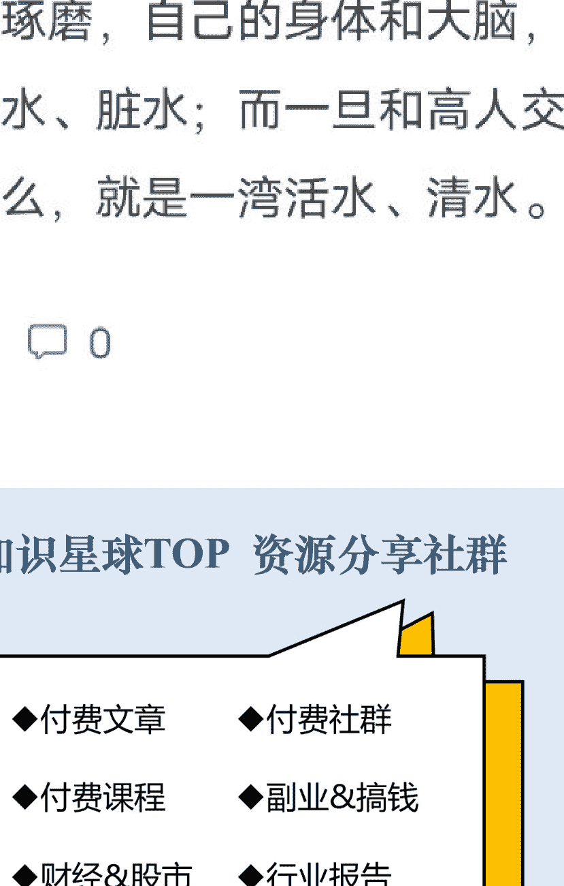
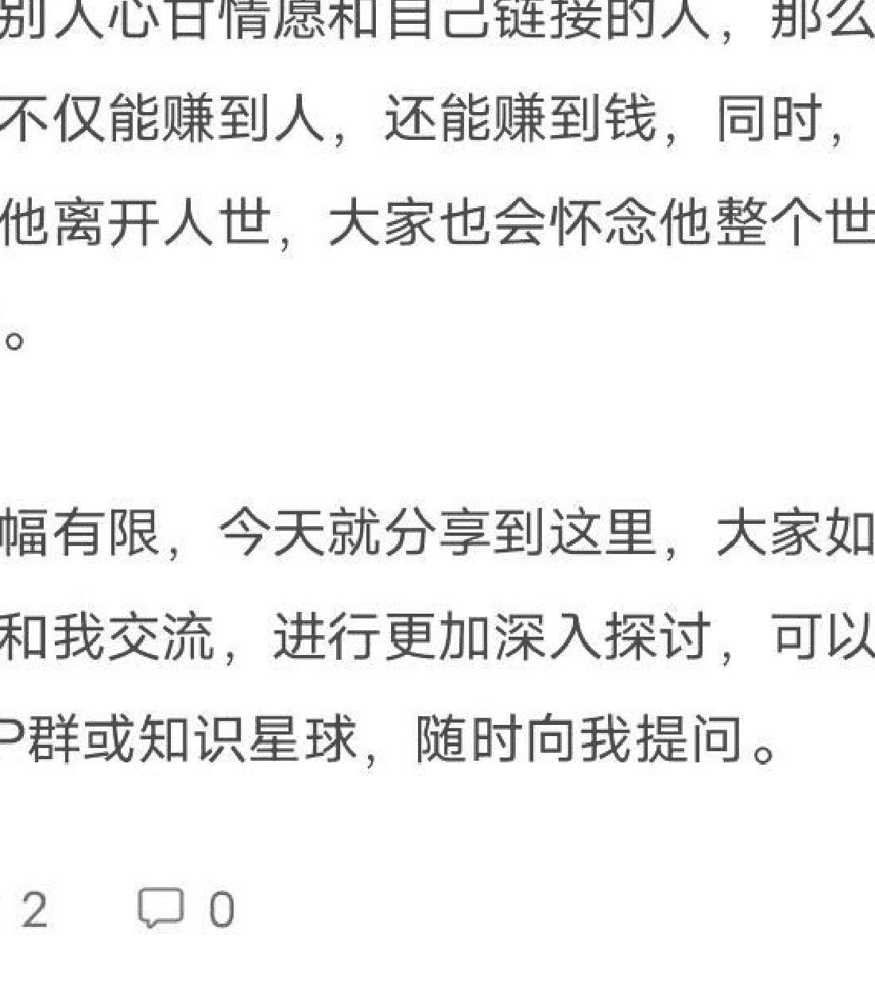

# 小语

来自博客

# 小萌的

2023年10月13日 备份文章

### 遇到过，我也不再害怕

但是，我遇到了一个很好的人，我又开始害怕了。
因为他太优秀了，我这么普通，我真的会失去他吗？

在他身边，我开始变得优秀了，我的工作也变得顺利，我的生活也变得丰富，但他真的吗？

如果我真的失去他，我该怎么办？
我害怕，我害怕失去他。

其实，我并没有想过失去他，只是我太没有自信了。

我想，如果我离开，他会难过吗？

我想，如果我离开，他会找到更好的女朋友吗？

我想，如果我离开，他会忘记我吗？

其实我最怕的不是他离开我，而是我离开他。
我想，如果我离开，他会过得很好吗？
如果我离开，他会遇到更更好的吗？
如果我离开，那他还会遇到我吗？

其实我最怕的不是他离开我，而是我离开他。

我想，如果我离开，他会过得很好吗？

我想，如果我离开，他会遇到更好的吗？
如果我离开，还会还会我吗？

但是，我真的不想离开他，我不想离开他，我不想离开他！

可是，我真的好爱他，我真的好爱他。

我想，如果我离开，他会难过吗？

可是我真的好害怕失去他，我真的好害怕失去他了。

我想，如果我离开，他会记得吗？

可是我真的好害怕失去他，我真的好害怕失去他了。

我想，如果我离开，他会难过吗？

但是，如果我失去他，我该怎么办？
如果我失去他，我会怎么办？

可是我真的好害怕失去他，我真的好害怕失去他了。

我想，如果我离开，他会难过吗？

可是我真的好害怕失去他，我真的好害怕失去他了。

我想，如果我离开，他会难过吗？

可是我真的好害怕失去他，我真的好害怕失去他了。

关注小语 查看更多精彩

# 情书的主

2023/10/28 跳文

妻子，你还记得吗，我们已经有了离婚的打算了？

“我，你还记得记得这封信（离婚协议）吗？这这封信，你看到了吗？

我本以为你根本没看，甚至以为你早就把它扔进垃圾桶了。

可是你真的在乎我吗？你在乎孩子吗？

如果你真的不在乎我，那我们该怎么办呢？

难道我们之间没有感情了吗？没有爱了吗？

如果你真的不爱了，那我们可以离婚吗？

如果你真的不爱我，那我们该怎么办？

如果你真的想离开我，那我该怎么办？

如果你真的不爱我，那我也该离开你吗？

如果你真的不在乎我，那我们该怎么办呢？

想知道更多故事？关注今日头条