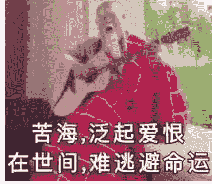
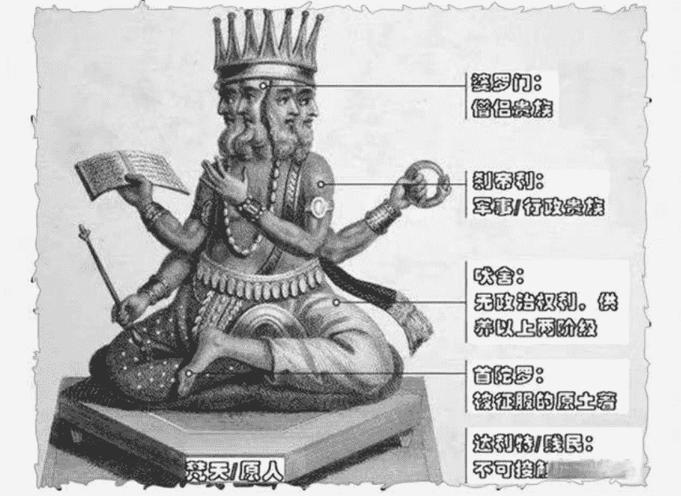

恋爱成功率分档的，人天差三六九等，恋爱活动中，卡位非常重要。

就像人生发财一样，你坚守多年，发财就那么瞬间。在东大，很多a9、a10。他们抓住了房产或者互联网的一波风口，瞬间上岸，脱离苦海。

而恋爱中的道理也是相通的，很多人根本没有把其中的原理搞清楚。所以在苦海里徘徊。

所谓恋爱相亲位分档：

- 最低的第五档，通过红娘相亲。
- 第四档，通过亲良好好友介绍。
- 第三档，出去搭仙。
- 第二档，兔子只吃窝边草。
- 第一档，婆罗门。

最低：两个现实生活中的失败者，又通过媒人相互厌恶了。

第五档有三类：

- 1、各方面条件比较差的人，在现实中异性几乎不会多看我们一眼，命中注定缘愁流星。
- 2、母单单身，对两性关系零认知，毫无情感灵敏度。
- 3、对另一半有太多不切实际幻想，霸道总裁上我，京沪流10套别墅上我；
- 既要又要典型的，你明明4分，非要6分，非要改善基因；
- 你明明各方面都很普通，非要对方温柔可人，上得厅堂下得厨房，床上功夫还要一流。

如果你不幸沦染上以上一条或者多条恶习，寡喜你，普提底层最低层恋爱者，俗称：达利特，中文翻译：不可接触者。

第五档人类众多，他们之中还可以细分为城里人和乡镇人。

最惨的应该是乡村男孩，他们就是38.8万彩扎的直接面对者。

收割只能落下。

每上一档层次，就会带来巨大的优势。第四档若自己自知，知道自身实力不够，没有太多不切实际幻想。

找靠朋友有两个极大的好处：他们一定衡量双方颜值、条件、家庭背景。只要给你介绍，在外人看来，你必然应该配。

你若别想什么爱情，你都在第四档，还要自己开车？传宗接代吧。

且，人给你介绍，实际上他/她是当中的，给你们做了担保。

我们毕竟还是人社会，人和契社会最大的区别在于，你违约以后人的信用也会扣分。

通过一个大家熟悉的中间人，你不可能跑跑。所以通过亲友介绍的成功率瞬间提高了一个档次。

我常规那些要付费的朋友，一定要从身边亲友找入手，想要介绍做好，没就找介绍客，让他们知道你单身。

把自己推出去，合一定会想起来。

第四档属于首等席，稍微爱情尚在线，很多人都结婚了。

第三档明显劣势不少。

你想要一个在大街上介绍的，他一定不会太差。

为高贵的女孩的运气不会太差？因为你太差的女孩根本找不出来。

一个男生主推控，至少他很自信，要么他颜值在线，要么他感情在线，要么他只有自信是足够的。

自信是关键，恋爱，生活中，事业中，只有自信的人会成功，自卑的人都完了，还会个毛呢？

你想你为什么匹配失败？男女结合就不是那回事？就不是看对方颜值？

你去相亲平台遇到好色孩子？

而相亲，是最快容易找到你审美点的方式。

合适相处，我们每次还会会有专属的BGM。

因为我在酒精酒吧里听这首歌有个女生上来说：“哟，你我好好”，然后我们恋爱了。

很不幸，我相亲失败的次数很多，我依然没有灰心，为什么？

因为对相亲一无所知。

相亲是用来卡你的极限，不是用来阿阿狗都要去打一杆，你和泰迪有什么区别？

我搭讪7分女，上天总会出没少的尤物来到人间。你看到了，就会忍不住，就像基因的指引一样。

有一次，我在公交站跟了她十站，到她下车才去问联系方式，只回了我一句：对不起，我有男朋友了。

没办法，7分女是各方面的条件都卡到了你的审美极限。

只有极大的内心，才去欣赏7分，才去搭讪7分。

### 第三档就是强大且自信

第三档最典型的代表就是黄毛。黄毛，又丑又矮，为何还有女生喜欢他？

因为在黄毛心中，全世界都是他的，他就是陈浩涵，拼尽口气，还会起话劝你你。

自信是关键，恋爱，生活中，事业中，只有自信的人会成功，自卑的人都完了，还会个毛呢？

第二档，作为贵族，他们最大的特点就是优越感。从小就觉得所应当的东西，对别人却是遥不可及。

黄毛能给你安全感，更是从小就觉得所应当的东西，对别人却是遥不可及。

还是用举例：目前有一个早期的，约了两年没见，这种感感。结果，没了一波澜。只是随便个你，消失了。

你若什么爱情，你都在第四档，还要自己开车？传宗接代吧。

你若别什么爱情，你都在第四档，还要自己开车？传宗接代吧。

你想了，就是一个自然的选择。

甚至我怀疑，她就是忽悠小奶狗，我给你点资源，你给我点演，顺便做做发泄工具+随时召唤的奴隶。

我可以肯定她妥妥突破了第二档，但远没有达到第一档。而且还算1.5档吧。

去哪儿参考第一档呢？隔邻居呀。

南北两位公主当，真婆罗门。

你看着她的眼神，高傲的低颅。一看就是富贵人太久了，对哈啥都不理，对任何男人都不不起兴趣。

北方将军的妹妹，南方三阔阔公主。理论上，她们有几百万可以选择，任何小鲜肉都会倾服。

眼神、眼神、还是眼神。婆罗门只能看眼神。

再来说说五档的男性。

如果你天生就是五档达利特，四档首陀罗，妈妈给出的配置就很差。请问如何改运？

废话，当然是拼命挣，把自己提升到净值8.5。

此时，你的爱情位强势达到2档，但是呢，你依然不如原生生态的二档，因为体验不一样。

这么告诉你吧，原生的刹利，可以做到你还拿着一个进入温柔些。另外一个心情不高，给她发消息，说她在外面等你，无论如何错20分钟。

你很纠结，也很痛苦......

为了让多个女孩在你身上贴，内的女孩，她们需要生活。

你可能做到让多个女孩在你身上贴，间接收收获的快乐。但你也要明白我们可不是为了金钱。

控制金钱靠输出才能长长久久。

答案是1~3w每月，这是一条东大的幸福线。根据地域不同，消费水平不同，你可以适当调整。

一年36w对于8.5来说，就相当于月薪30w白领，每月都去一次海底捞。

总结一下：认清自我的阶层，才能找到解决办法。至于你并不重要，只是一个名称。如果你是一个执行力极强的人，强者从不抱愁，你应该改变自己。提升主动出击的能力。

以上，祝你幸福。
