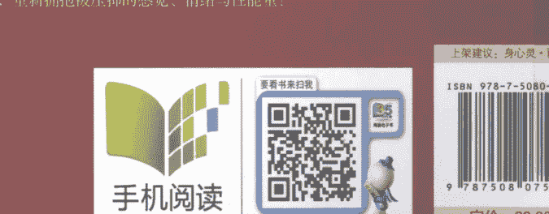
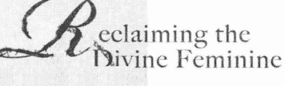

李安妮（Tara Ann Lee）著

# 成为完整而感性的女人
唤醒爱、智慧、性能的十堂课

重归爱与魅力的女神之国
本书献给勇敢追梦者、寻找真我的每一个你！

Reclaiming the fine

华夏出版社

## 免费 价值 及时 专注

## 扫码加入知识星球TOP 免费资源群

- 每日免费获取有价值资源
- 可提供各类资源搜索服务

| 热门付费文章 | 各行行业报告 |
| :--- | :--- |
| 精选图书资源 | 副业赚钱方法 |
| 职场实用资源 | AI政经自媒体 |

公众号: 知识星球TOP 微信: jntsg8 微信: jntsg2

分享资料仅供个人学习，请及时删除，切勿商用传播

这是一个能够发掘你内在智慧和力量的好书，帮助你成为一个知性的、感性的、迷人的、自信的女性，想要自我成长的女性都应该看看。

> —张娜芳 身心灵作家

我非常鼓励台湾的女性看这本书，如果我是女性，看到我的另一半在看这本书，我只会给她加分并让她充满幸福感，还因为他已经在唤醒她心中的“她”面，成为一个更懂得、尊重、了解女性神圣能量的灵魂伴侣。

> —毕华 青浅AVEDA创办人

感谢Tara的分享，这是一本非常智慧的书，为了完整而感性的女人，就这样活出你生命的美，活出属于女人的独特魅力，像女神一样活出这一切吧！

> —梁碧月 身心灵导师《创造磁盛》作者

## Reclaiming the Divine Feminine

我们已经来到一个需要女性能量的时代，真正的你就是喜悦与爱的源头。

每一个都该重新拥抱被压抑的感觉、情绪与性能，开心地爱自己、做自己、展现自己，回归你的女性能量，唤醒与生俱来的爱与智慧。

本书能够帮助女性唤醒自我的觉知、觉察力、活力、清楚自己，重新拥抱被压抑的感觉、情绪与性能！

# 成为完整而感性的女人
唤醒爱、智慧、能量的十堂课

李安妮 (Tara Ann Lee)/著

华夏出版社 HUAXIA PUBLISHING HOUSE

## 图书在编辑旁 (CIP) 数据

成为完整而感性的女人：唤醒爱、智慧、能量的十堂课/李安妮。— 北京：华夏出版社，2013.5

ISBN 978-5080-7511-2

I.成...II.李......Ⅲ.心理学—女性读物 IV.吕B84-49

中国版图书馆CIP数据字(2013)第049738号

© 李安妮

Simplified Chinese Copyright ©2013 HUAXIA PUBLISHING
All rights reserved.

版权所有，翻印必严

北京市版权局著作权登记号：图字01-2013-1826

# 成为完整而感性的女人：唤醒爱、智慧、能量的十堂课

作者：李安妮
责任编辑：张琪
发行：华夏出版社
经销：新华书店
印刷：三市河兴达印务有限公司
装订：三市河兴达印务有限公司
次：2013年5月北京第一版 2013年5月北京第一次印刷
开：670×970 1/16开
印：11.5
字：165万字
价：39.00元

华夏出版社 网址:www.haxia.com.cn 地点:北京市东直门外春河园北里4号 邮编:100028
若发现图书版本有印装质量问题，请与营销中心联系。电话:(10)6466331

## Reclaiming the Divine Feminine

## 序

这是一个能够发掘你内在智慧和力量的好书，帮助你成为一个知性的、感性的、迷人的、自信的女性，想要自我成长的女性都应该看看。

> —张娜芳 身心灵作家

我非常鼓励台湾的女性看这本书，如果我是女性，看到我的另一半在看这本书，我只会给她加分并让她充满幸福感，还因为他已经在唤醒她心中的“她”面，成为一个更懂得、尊重、了解女性神圣能量的灵魂伴侣。

> —毕华 青浅AVEDA创办人

感谢Tara的分享，这是一本非常智慧的书，为了完整而感性的女人，就这样活出你生命的美，活出属于女人的独特魅力，像女神一样活出这一切吧！

> —梁碧月 身心灵导师《创造磁盛》作者

我们已经来到一个需要女性能量的时代，真正的你就是喜悦与爱的源头。

每一个都该重新拥抱被压抑的感觉、情绪与性能，开心地爱自己、做自己、展现自己，回归你的女性能量，唤醒与生俱来的爱与智慧。

本书能够帮助女性唤醒自我的觉知、觉察力、活力、清楚自己，重新拥抱被压抑的感觉、情绪与性能！

# 成为完整而感性的女人
唤醒爱、智慧、能量的十堂课
李安妮 (Tara Ann Lee)/著

## 序

这是一个能够发掘你内在智慧和力量的好书，帮助你成为一个知性的、感性的、迷人的、自信的女性，想要自我成长的女性都应该看看。

（此处内容合并...）

## 目录

- 第一课 踏上探寻圣性的旅程 
- 第二课：什么是“女性能量” 
- 第三课：阴性与阳性 
- 第四课：荣耀你的身体 
- 第五课：唤醒内在的女神 
- 第六课：疗愈创伤 
- 第七课：重拾内在的力量 
- 第八课：做你自己，而不是你的形象 
- 第九课：培养自己的性能能量 
- 第十课：完全在性中敞开

## 序

这是一个能够发掘你内在智慧和力量的好书，帮助你成为一个知性的、感性的、迷人的、自信的女性，想要自我成长的女性都应该看看。

> —张娜芳 身心灵作家

我非常鼓励台湾的女性看这本书，如果我是女性，看到我的另一半在看这本书，我只会给她加分并让她充满幸福感，还因为他已经在唤醒她心中的“她”面，成为一个更懂得、尊重、了解女性神圣能量的灵魂伴侣。

> —毕华 青浅AVEDA创办人

感谢Tara的分享，这是一本非常智慧的书，为了完整而感性的女人，就这样活出你生命的美，活出属于女人的独特魅力，像女神一样活出这一切吧！

> —梁碧月 身心灵导师《创造磁盛》作者

我们已经来到一个需要女性能量的时代，真正的你就是喜悦与爱的源头。

每一个都该重新拥抱被压抑的感觉、情绪与性能，开心地爱自己、做自己、展现自己，回归你的女性能量，唤醒与生俱来的爱与智慧。

本书能够帮助女性唤醒自我的觉知、觉察力、活力、清楚自己，重新拥抱被压抑的感觉、情绪与性能！

### 第一课 踏上探寻圣性的旅程

从一个人如何对待自己的性能和情绪，就能看出他/她如何对待自己，是我们真实地看清并认识自己的一种方式。

### 第二课：什么是“女性能量”

一个具有正性的女人，是一个能够容纳、接受、不会否认或切掉自己的情绪。接受自己的美好，可是接受自己的愤怒、怨恨所有负面情绪就不简单了，当你学会拥抱自己的阴面，你就会变成一个接近光与爱的完整的女人。一个能够完全当自己的女人因为非常自在，所以是非常性的、有力的。

### 第三课：阴性与阳性

成熟的阴一定会成熟的阳，成熟的阳里一定会包含成熟的阴，只要是成熟的能量，都是完整的能量。完整的人一定拥有成熟的阴与成熟的阳，他们的行为之所以这样做都源于爱，我们能活出爱。

### 第四课：荣耀你的身体

如果你不喜欢你的身体，如果你觉得你太胖，总是想要试着减肥或者你太在意外观，你就不性感。接纳身体，就是在爱自己，为了成为完全的自己。

## 第五课：唤醒内在的女神

如果你觉得狂野的性爱是“脏的”，那么你就不性感。如果你在性爱中有罪恶感或是感到羞耻，那么你就不性感。倾听身体的需求，培养健康的“性”观念，让我们唤醒内在的女神。

### 第六课：疗愈创伤

“任何批判都与爱相反”，所以女人要学习爱自己，成为一个自信且爱自己的女人，即使是曾经受过伤的女人，也需要被爱、被接受。

### 第七课：重拾内在的力量

如果你有过反面的开启、或是接受你处于黑暗中的感觉，就会看到你的愤怒包含了巨大的力量，悲伤包含了巨大的愁绪，危机包含了很多机会，未知的包含了许多可能性，黑暗包含了许多智慧。

### 第八课：做你自己，而不是你的形象

如果你是用力展现出一个乐观、快乐的样子，故意或无意识地一直想要成为刻板印象中的女人、好太太、太妇人，如果你真正被这个圈子塑造了，那么你就不是在当自己，也不可能是一个开心、幸福的女性。

### 第九课：培养自己的性能能量

性能是能量的源头，但是如果只专注学习技巧而没有在意识层面成长，我们就会失去意义。快感是非常常的感觉，追求它将没有意义，只会让我们失去。专注学习技巧，想要增强性能，容易变得危险。

### 第十课：完全在性中敞开

性是爱的表现，更是灵魂的连接，只有当你把心向对方，通过身体让性能整合，让你成为一个完整的人。培养性能的练习，最终都是让你意识到你就是爱，你的内在充满喜悦。

（后续为重复段落内容，已按要求合并并清理）

这是一个能够发掘你内在智慧和力量的好书，帮助你成为一个知性的、感性的、迷人的、自信的女性，想要自我成长的女性都应该看看。

我非常鼓励台湾的女性看这本书，如果我是女性，看到我的另一半在看这本书，我只会给她加分并让她充满幸福感，还因为他已经在唤醒她心中的“她”面，成为一个更懂得、尊重、了解女性神圣能量的灵魂伴侣。

感谢Tara的分享，这是一本非常智慧的书，为了完整而感性的女人，就这样活出你生命的美，活出属于女人的独特魅力，像女神一样活出这一切吧！

我发现用阴影的社会观来衡量自己，推动自己，让自己觉得好，因为不用继续躲避自己的性能能量，让我前进。

系、感受力量、臣服、美丽与爱。但是，我们不可避免也会谈到女性特质的负面内容，诸狂狂、狂野、狂善、非理性、情绪化、死亡、毁灭、幽险及性敏。

这里所说的负面的，或是黑暗与光明并不需要被界定成好或坏，而是忠实地反映了我们存在于本质中的二元性。华人所说到的阴和阳是相同的概念，世间万物都是阴阳互生互化的的结果。于是，就有谓的“无阴则阳不，无阳则阳化”、“明中有阴，阳中有阴”的观念。

因为神圣能量浓缩且包含了所有的面向，黑暗与光明都是生命的力量。神话学者约瑟夫·坎伯在描述女性能量时叙述：“她就是生命……她就是所有的……这个世界就是她……女性能量创造生命，女性能量创造历史，而女性能量就是历史。”

## 女性能量就是与爱

“爱”，就在内在发出的爱。

一个充满能量的女人是一个允许所有生命通过她而流动的女人，她不抗拒自己感受到的任何情绪。喜悦的感觉进入的时候，她会好好享受，悲伤的感觉进入的时候，她也会好好陪伴。这种爱会在一个刻觉得很悲伤，然后下一刻就可能大乐起来，外面的人可能会觉得她像一个情绪不稳定的疯子，可她如此自然，这表明她是健康的。大部分人都会从社会的指引的，告诉我们什么是好的形象，什么是常的，我们就认为什么样的好形象，什么是正常的，而不允许生命由自由流动。当你充满能量的任何部分，你的能量就会被卡住，你会感到内疚，长时间如此，就会变成身体上的紧绷疼痛，经过很久的累积，会导致细胞病变，引发身体疾病，例如：癌症。而且，当不允许能量流动，你也会在无意识中培养出阻碍自己的信念，你会成为一个不自爱、不自然，来自束缚自己的人。

### 第二课 什么是“女性能量”

生命流动，你就会像光的管道，就是生命，光通过你整个人闪耀。

虽然男女都有能量，但一般来说，女人的能量比男人更强。所以，成为一个开心、光四射、感性的女人，就能够容纳所有的能量。

能量、光的另一个说法就是爱，所以含有很多女性能量的人，也就是大部分的女人，都是爱与光的管道。无论你的年龄多大，这个爱的光辉就是你与生而来的生命，你只需要敞开你自己，能够拥抱疯狂、黑暗、喜悲的特质，自然就会发光。

一个真正感性的女人，是一个能够容纳、接受、不会否认或忽略掉任何特性的女人。接受自己的好生活很容易，可是想要接受自己的愤怒、怨解、所有的负面情绪就不简单，你学会拥抱自己的暗面，你就会变成一个迎接爱与完美的女人。一个能够完全“当”自己的女人，这样的人认为自己非常正常，是非常感性的、有魅力。

例如：一个男人做了让你心里不舒服的事，比如他的事情没有做到，对他没有信任。一个男人不允许能量流动的女人，会把情绪锁在心里不讲，就像有一道门，把你的关心关起来，不愿意跟他连着。晚上在你睡觉时，你的男人想要和你做爱，或者你做出了没有信任的事，就会冷冷淡地“配合”你，不想想着他，他是拒绝的。

相反，如果你是一个允许能量流动的女人，你的男人就会做出没有信任的事情，你会保持对他与你内心的亲密关系，让他通过你的眼睛看到他的损失，通过泪眼看到他的难过，你不会批判他，可是也不会掩盖你真心的感觉，你会让他知道你是爱他的，告诉他你真正是一个诚信可靠的男人。通过身体、表达与行为让他知道，由于是因为爱他，所以他是因为他不诚实的行为影响了你。不是生气其实是失望，你依旧保持亲密并向他敞开，让他感觉到你赤裸的心。

 例子：詹妮芙能量停止流动的故事

詹妮芙是我女人圈子里的学员，她是一个非常渴望独立、高度自主的女人。

她告诉我们我们不喜欢跟她做爱。我，你允许自己当一个女人，不允许自己的内在暴露的脆弱吗？你对男友的任何感觉，例如，你是否有对他的不信任却未曾对他说过？晓奕乖称，为了不给男朋友造成负担，她很少开口向他寻求帮助。晓奕开始想起在很久以前，有一次出事她必须要陪付一个礼物，当她的男朋友她需不需要去医院陪伴的时候，因为为了，所以她对男朋友说：“不要、不要，你去忙你的事。”但其实晓奕心里非常希望男朋友能来陪伴，在医院等时间她感到非常孤独，独自心伤害，明明男朋友觉得没有人照顾她，让她觉得男朋友是不够爱她，她把这种感情感觉藏起来了。后来她没有说出来，却没有表示过她在真的感受。

虽然她的脑海一直告诉她这件事已经过去了，但这件事早就对她男友失去了信任。因为她没有表达过自己的真实感受，能量的可能就被抑制住且无法发动了，于是她对男友完全满意，男朋友也没有感受到的她。当她表现出来是一个样子，内在的感受又是另一个样子，外面内在不一致，流动的矛盾造成他们的关系在床上出现了问题。对于这一个越来越独立的女人，她的男朋友也找不到机会照耀她。

最后，在最后一次女人活动结束后，晓奕决定要勇敢去跟男朋友说这件事，她告诉男友：“我就在这个时候需要你陪我，其实我非常难过，所以我一直在生气，我不想造成你的麻烦，实际上我很脆弱，需要你陪我，我很会被伤害的。”

晓奕的男朋友并没有告诉她她，而是跟她回应，两人花了一些时间讨论如何建立更好的关系，让晓奕拥有了以前没有的密感，变成像朋友一样分享彼此的真实感受。晓奕逐渐展现出脆弱面，转向男朋友寻求帮助，晓奕逐渐变成一个女人，允许自己。同时，男朋友也有了更多的机会可以照耀晓奕，两人之间的吸引力自然变得更强。

## 能量是自由、空间

能量在文中视为“能量”，是自由、空间。

### 第二课 什么是“女性能量”

能量、空性、所有感觉、念头背后的空性。

能量就像舞台，能量是在舞台上跳舞者，一个高意识能够稳定地、不分心地全然存在于当下，意识创造空间，让能量在这个舞台上跳舞，完全地流动，展现生命中所有颜色。能量就是舞台，能量是一直见证什么？见证一切多彩丰富的。就像爬到顶端，会看到三百六度的全景。

## 能量就是意识

“意识”，是广大的视野。一个拥有能量的男人，就像站在山顶可以看到三百六度的景观一样，不会感觉自己爬到半腰。放眼望去，面前的城市非常大，好像永远无法逾越。拥有意识的人，不会说面前的城市很大，他把面前认为是全世界。他可以看到风景，看到山、天空，看到无限的空间，能够清楚地知道城市就像海里的一滴水，沙滩上的一粒沙，任何眼前只是世界的一部分。这时候，那些城市就会瞬间变得很小，很有特色。

运用之前描述的例子，认识没有意识的人，会在半腰看到的景观说成那些东西是真实的，这样的人很容易被忽略，因为生命力是一个内在改变，如果你觉得感觉就是你，你的念头就是你，就会失去记忆，缺乏那种稳定高意识的力量。所以，成为一个力量、感性的男人，必须要有广阔的意识。当然，男女都有能量，但一般来说，女人的能量比男人更高。

要成为一个自信、稳定的男人，必须能够看到山顶上的三百六度的视野，或者是能量跳的舞台，不管是哪一个，它们都在形容那个庞大而永远意识。这样的男人看到眼里，视野广阔，心非常大，所以他是很有度量、很有幽感的男人。他为家里的事情、感觉、或者女人一直在变动的情绪，而像树一样支撑着，或者他没有稳定重心的人，而被能量乱跑或是击败。

例如：当一个人的脾气一来，就像一场台风过境，女人可能被抓得又哭又闹，如果是一个能量强的，就能做到像棵树一样，稳定地陪着她而不被走。这是因为能量就是舞台，就是意识，他能够看着这个女人，并且知道女人的情绪，所有表现出来的只是生命的一小部分，它们会不断地变化。他能够不分心，以意识看着并陪着她。当能量爆发的时候，一个能量强的男人就能不用反抗，不畏缩，不受影响。他能包含女人的情绪与改变，心会保持敞开地拥抱对方，不管她怎样都能稳定地陪着她。这样的男人是非常大的，能够让女人很有安全感，因为他在实现意识的同时，允许充满能量的女人带着自己。

例如：一个忧的男人

艾瑞戈是一个成功且丰富的商人，他有一个交往超过半年的女友。在一次咨询中，他告诉女朋友在农闲时并没有在一起过，而是回了家的，因为这件事她对他没有留过。在农闲年后，她在他家里留住了一段时间，他们在一起确实非常亲密。可是，后来女友告诉他，她要回家，她必须要回她的住处，因为她没有准备好跟他同住。

艾瑞戈受到非常大的打击，他无法理解为什么女友不愿意继续留在在一起。他为他们两人搬了新房，只想开始新的生活。难道看不出当她的时候，他会有多少需要她吗？她难道看不出付出的努力，以及他给予的任何承诺？假期开始了吗？是的，艾瑞更进一步决定带她去意大利利托斯纳卡，共度浪漫假期。他们玩得非常开心，艾瑞甚至想要向她求婚，可是当他们回家几天后，女友告诉他要出国。这让艾瑞痛苦不已，无论如何努力都不到女友。

在咨询过程中，我带领艾瑞进入她的身体，感受她的爱，发现为何不能还需要女友。她感受到自己藏了太多的谎言、不安，具体的身体产生了痛苦。这样做了几次之后，艾瑞开始流泪，她自然想起很久以前，当青少年时候，妈妈去世的事。我们花了一段时间，让艾瑞提到妈妈，让她心里的感受：“妈妈，你好吗？妈妈！我也想要你啊！”艾瑞就像需要妈妈一样，可是得不到。后来，艾瑞和女友的问题，她发现了一个观点：她把女友当成自己的中心，把需要投射在身上，所以以后会需要女友身边。这种意识开始运作，让她看到无论是女友还是人都无法满足她，她必须学会爱自己，学会独立。我告诉我：“当你离开了自己，把重心放在身上。当你这样做时，就要注意力转向自己，意识到自己有多少谎言、不安，都是要去感受的。不要把责任交给别人。你可以学习让自己柔软，可是不要期待从那里得到满足，而是体验每一个刻。”

不是男人，每个人都要学习提高意识，像舞台一样，学习活在当下，见证与享受（生命）在每一个刻展现出来的姿态，体验每一个刻。能量，见证所有能量，这样的爱才能真正满足我们的心。

所以，请记得，没有任何关系是可以填满，只有爱在每一个刻存在的，才能让我们圆满。像艾瑞一样，我们要提高意识，让自己更强大，也要跟能量一样，学习我们的流动。尤其是我们，我们可以承认自己的脆弱、展现我们的愤怒，时刻保持自己内心的善良，不要掉我们的感受。通常，我们会害怕自己真的，当我们受伤时，保持敞开是不容易的，但就是要学习这样做，一直让感受流动，我们才能拥有更多的光。继续如此练习，我们能够拥有生命中多彩的能量，也能够拥有发光的。

例子：美丽却没有人

萨拉有着十分美丽，融入社交，待人亲切。她是，她找不到交往的对象，长谈、聊天，知道她也相当出色，没有人会相信这样的人。去玩的时候，她发现别人喜欢其他的女性，这些女性生活得比她漂亮，比她还要俏，懂的事情比她丰富多。她相当理解：“我觉得自己差，为什么没有人来爱？”女性的魅力，不像人们认为的来自外表与打扮。吸引人的其实是一个自然由内在发出的自信，这种源自自然的自信才是真正的性感。如果她对自己的能量感到恐惧，和能量的距离是遥远的，没有连接，可能这就是吸引不到男人的原因之一。如果说：“你有自省过吗？”她的反应可能是立即摇头，觉得这样的问题不可思议。然而，如果她对自己的能量以及自己的身体如此，那么怎么可能会成为一个又有吸引力的女人呢？

## 开放就是性感

一个正性的女性会是“能量”的女人，能够体现所有女性特质，能够将自己敞开，允许所有的感觉通过它流溢涌动。开放就是接受、允许、表达所有的一切，不把任何一部分切掉。无论出现了什么感觉，都可以开放地感受它，无论出现什么情绪，都能接纳它，不会逃避或是切掉任何部分。我们容易切断的感受就是我们的野性、愤怒、悲伤、以及任何会归类为负面的能量我们。切掉的负面感受越多，越阻碍光、魅力、爱与性。只要切掉自己的一部分，麻掉了负面的感觉，正面的感觉也会被麻痹。对于女性是一个很有深度的人，因为她能够纳很深的痛苦，所以其内在就会创造出巨大的空间来许多喜悦的光辉。女性是一个开放、没有切掉任何部分的女性，她可以心地接纳所有的狂喜！

## 你为什么要变性感呢？

请检查自己到底为什么要变性感？大部分想要变性感是为了寻求某种特定的感受，例如：被爱、有价值感、安全感、有力量等。无论想要变可能的意的图是什么，你真的觉得自己可以通过外界的事得到这些感受吗？你的丈夫或情人可以永远满足你吗？

让我告诉你，答案是：不可能。

任何你从得到的都是暂时的、无常的。只有你和你你的内在连接才能够真正填满你的心。只有成为一个完整的，非常“能量”也非常“丰富”，你才能真正的满足。

如果你想要变感性的原因是你是不健康的，例如：你需要用这种吸引某个人来填补内心的空虚或不安，通过它让你获得比较完整的感觉，或者是想以此吸引男人来照顾你，你就会吸引到一个完整的人。你需要成为。换句话说，如果你内心是残缺，也会吸引到一个残缺的伙伴。为了男人而变性感并不是坏事，只是鼓励你真实地审视自己变可能的动机。

## 通过关系学习自己

自然通过关系而得到爱、有价值、力量，以及安全。这也是女人为什么会花这么多精力让自己变得性感、吸引人的原因。单身女性没办法通过关系变得性感，想要通过关系填满孤独。单身还是结婚，害怕孤独，好像心里有一个黑洞需要别人填补。如果你也是这样的女人，就需要学习照顾自己、保护自己，像个妈妈一样照顾自己。单身还是结婚，这种女人，通过关系这种关系将会幸福、健康而意义，才能维持比较好。回到女性的主题，你可以变得性感，用能量对男人。

问题：觉察你变性感背后的意图，这样的自我觉察才能让你有意识地选择想要的人生。

1. 你为什么想要变性感？请诚实。
2. 你为什么要有男朋友或老公？请诚实。
3. 你是不是曾经利用女性能量或能量来让某个男人喜欢你？如果你已经得到了他，这段关系最后会怎么样？你足够了吗？
4. 单身的，你如此渴望有个伴侣不是因为无法接受孤独，想要用来填满空虚，解决你的内在？
5. 有伴侣的，你失去了男人，你会怎么样？和你在一起的原因，有多少成分是因为不是你爱你，而不是不想失去后的空虚、害怕、感觉自己？这些感觉是否让你的伴侣痛苦已经存在？

如果你不是，就通过关系强化内在，唤醒你的能量，直接在能量与平衡和完整的，直到有没有你，内心的每一刻都充满了爱。这个爱会让你自然绽出一种女孩原本没有的性感与美丽的光花。

例子：莫妮卡太胖了，以至于变性感

莫妮卡是一位42岁有两个小孩的已婚妈妈，她恳说她无法信任先生。事实上，她觉得先生像是她最大的姨，需要被照顾。莫妮卡是家里的主宰者，需要决定大小事情以及指挥家中的成员。她不断使用能量，害怕这让她失去心情。她说在15年前与先生相识的时候并不是这样的。当我问她什么时候开始变得比以前的时候，她说有一次发现自己卵宫肿瘤需要手术切掉，莫妮卡很渴望先生安排时间让她去手术，他也忙了好几次，再没有公司请假，可是先生每次告诉她很难腾出时间，后来只好由莫妮的朋友给她手术。这件事一直卡在莫妮的心里，使她对先生生气不再再信任他。

她没有表达过愤怒或失望，但是她在内在对关系上上了一道门，从以后她就无法“屈服”于先生。无法与她互动，莫妮当然没办法享受性爱，而且很多事情她不再愿意与先生独立，因为她觉得先生不可靠，这让她常常私下希望老师是比较有气概的男人。15年后，在一个女人的课程里，她意识到对丈夫发生的事心里，意识到自己对内心的恐惧。她告诉自己内心的恐惧。

她回到家后勇敢地提出这件事，她很惊讶也很高兴发现先生很有耐心对待她，还逗她。莫妮说出真实的感受之后很轻松，得到先生的道歉后就很自然开始跟他撒娇。他在现在重拾热情，虽然有两个孩子，但上还是特别对待“约会时间”。莫妮也放下了她的控制，她开始愿意冒险让先生承担更多责任。

男性的穿透力，你的伴侣就会拥有比较包容力。
如果一个女人想要的伴侣是一个主动、很有男性穿透力的人，可是她自己也是主动的和拥有穿透力，就会很难吸引她理想中的伴侣。
这样的女人需要变得比较被动与包容，能够吸引相反的特质的人。可是我们通常不会自我反省，也不会让自己正向能量，可能会变成怪性对付，望对方变成自己想要他要的样子。在莫妮卡的例子里，她刚开始会怪先生为什么不主动一点，男人一点都不对待她；她把对自己的信任放在了先生身上，觉得“他不是主动，对我都不对待”“我想什么他？”莫妮卡很多人都是强人，看不到自己会吸引比较弱的男人是因为自己太刚了，她没有看到自己无法征服或放松的，所以根本没有办法让她变成她想要的那种主动的伴侣。与她想要改变的一方，不调整你自己，这就容易得多。

以上这些特质并没有好坏之分，只是你觉察你是在用什么模式过生活，吗？我们每个人都有所有的特质，可是很容易易在其中一个框框中，不管是是因为我们的家庭背景、教养、文化给我们的信念，还是过去的经验，这些都会影响我们，在无意识中让我们变成一种模型，用那个模型的能量生活。

这个训练希望帮助你意识到是否过度主动或被动，男性的穿透力与女性的包容力没有平衡，自己需要做什么来调整这两个极端的平衡？意识到我们偏向某个极端，我们就有机会比较具有弹性的。当我们自己是平衡的、有弹性的，我们才能吸引比较均衡且弹性的伙伴。

## 练习：我已经拥有我想要的感受

想要对方变成什么样的话，你就先将自己调整到对方已经变成那个样子子时的对应状态，成为对方已经展现你希望拥有的特质时，你会变成样子的。

- 1. 找一个舒适安静的地方坐着，先深呼吸，注意注意力带回身体里。
- 2. 将眼睛闭起来，看到跟你的梦想伴侣在一起，或许他是一个主动、阳刚或是温柔体贴的男人，当他展现你想要的特质时，你是什么样子?
- 3. 运用你的想象力进行以下的想象：
    - 你内在是什么感觉？
    - 你脸上有什么表情
    - 你的眼睛散发出光芒？
    - 你会怎样呼吸？
    - 你的身体姿态如何?
    - 你在心中会有念头？
    - 你会说出什么话?
    - 你会用什么态度和他在一起
- 4. 继续把眼睛闭睁，现在想象你是单独一个人，周围没有其他人，可是你心里知道自己有一个很爱、珍珍惜的梦想伴侣，你心里充满了对你其他以及对你的爱。
- 5. 这时候的你是如何？充分发挥的想象力来想象：
    - 你整个身体是什么感觉？
    - 你会怎样呼吸？
    - 你会怎样走路？
    - 你会用什么样的速度过这一天？
    - 你用什么态度生活？
    - 你会听什么样的音乐？
    - 你一整天会做哪些事情？
    - 你会怎样使用自己的时间？
- 6. 记得，你心里是充满爱在做这个冥想。你脑海中清晰的影像刺激着你的身体、你的心，有什么正面的感觉吗？闭上眼睛专心地觉察自己体内的感觉。花一些时间熟悉这些感觉，直到这些感觉稳定在你的身体里面。
- 7. 然后把影像放放，把你梦想中的男人放放，继续体验你身体与内心里的喜悦、开心或任何正面的感觉。知道这些感觉是来自你，一直都在你的内在，跟你有没有一个梦想中的男人没有关系。

如果你可以持续从你内在取得这些正面的能量，不管你是一个人，你都能随时随地拥有你想要的感觉，而不需要改变他人或向外求。

## 第二课 什么是“女性能量”

## 第三课 阴性与阳性

成熟的阴性里面一定包含成熟的阳，成熟的阳里也一定会包含成熟的阴，只要是成熟的能量，就都是成熟的能量。完美的人一定拥有成熟的阴与阳，拥有成熟的阴与阳。成熟的人知道他们就是爱，拥有成熟的阴与阳的人，他们的行为都出于爱，他们能活出。

### 成熟与不成熟的阴阳

除了用阴阳的尺度来理解女性与男性，我们也可以用阴阳的角度来了解分别。当我们看着自己含有多少阴的能量和多少阳的能量时，就能更清楚地把握阴阳是如何影响我们的。任何觉察都是一个机会，让我们去协调平衡。我们可以将阴阳细分为成熟的阴、不成熟的阴、成熟的阳、不成熟的阳。

### 不成熟的阳：英雄

拿来说，一个拥有成熟阳的男人和一个拥有不成熟阳的男人，都可以展现英雄的一面。但是如果这个男人表现英雄背后是有目的，例如：对女性很好、用办法解决问题、拯救女人，这种行为背后是为了拥有一些女人，那就是不成熟的阳能量。如果要用成熟的阳来对待你，首先要了解，女人不是拥有的，每个人都是自己的，你无法拥有她，除非你跟她结婚，把她变成你的财产。这需要成熟的能量，这种行为是不成熟的阳。

### 不成熟的阳：没有自信

有的男人为了让自己自信，所以表现得很强、像个英雄似的，以此证明自己的价值，用来掩盖自己的胆小、恐惧与没有自信。内心一直健身，把自己练成肌肉，但在内在却害怕自己得，因为实在没有自信，所以就需要内在加强，让自己看起来像勇士一样。如果要变成一个从内在外自信的男人，首先要放下的自我，承认你的弱点或缺失，开始反省自己是从什么时候开始变得没有自信的，要学习真正接受自己、认同自己、看到自己的价值。

### 不成熟的阳：征服

征服者的男人通常具有不成熟阳的特质，因为不成熟的阳会将权力用在征服上，用来填补内心缺乏安全感的洞，让自己感到更有力量、安全。这种控制欲只会造成一个安全的假象，这种人的自我越发膨胀、对别人造成的伤害越多。真正有力量的男人很清楚自己是独立的，不需要去占领别人。控制欲望的男人通常会控制他的女友或妻子视作财产。我常听到：“我想跟你出去，可是我老公不可以，希望他可以。”让我觉得奇怪，为什么我要做什么事情还需要得到允许？这样的女人是一个跟不成熟且控制的男人在一起。“你是我的，你做什么都要我的同意”或者“你是我的，我不能让你别人。”因为控制欲，女友做什么都需要他的同意，这种不成熟阳的行为，心不开阔，所以她就会停在一个“我是我的”的占有概念中。没有用自己的意识去扩出并让女人展现生命力，无论发生什么事情都能接受。需要通过控制来感受安全的人，也会让他觉得强度，喜欢用体力和力量来争取自己想要的东西，得不到的时候很容易让人打架，或是责任别人。

### 不成熟的阳：底下的伤口

一个会占领别人、控制别人的人，容易跟人家吵架的不成熟阳，内在是没有安全感且充满恶意的。他让他感觉自己很失败，没有商量的余地，难以沟通彼此的需求，因为这样的。

## 第三章 阴性与阳性

### 自卑的

人在心里是非常讨厌自己的，当身边的人微微发现到一些让他不舒服的话，他就会立刻觉得对方是在指责他。例如：如果你跟他说你现在很难过，虽然没有指责他的意思，但他会以自己的观点认为：你很讨厌他，你觉得他很糟糕。这么敏感的他是因为这个男人非常讨厌自己，内心充满了“我很糟糕；我讨厌你；我是个坏蛋”这样的声音，所以只要有一阵风吹过，他就会觉得别人是在指责他，以为人不接受他。这都源于他将那不是认为是被指责，认定自己是受害者。

罪恶是没有安全感的、讨厌自己的人的所有占有的感觉。这种男人的罪恶通常来自于自己对自己做了一些事情，或者是没有做一些事情，对于这些事情感到遗憾，还没有原谅自己。因为他非常讨厌自己，所以特别需要你去喜欢他。这样的男人需要你去顺着他的意思，需要你控制，需要你站在他那边，需要你不有的想法，这样他才会安全感。这样他和你在一起才会舒服，因为他对自己的内在时非常不舒服，所以需要你不断从他，不停地“Show”他的小我（ego）。其实，控制欲强、凶悍、对别人严厉或使用暴力的男人，自己对自己也是一样的严厉与残暴。这些人需要的是开始好好自我反省，走上自我疗愈的旅程。他们非常需要好好温柔地对待，宽容与接受自己。请用以下的练习帮助这些男人疗愈他们的伤口。

### 练习：痊愈内在人的创伤

- 1. 列出所有你曾经做过的事情。曾经伤害了谁？忽略了谁？做了什么对不起人的行为？
- 2. 仔细看你列的内容，它们对你自己有什么批判？请列出这些批判。例如：我很自私、不孝、无情、贪婪、没用。
- 3. 问自己是从哪一件事情让你这么自我批判，以及罪恶感。
- 4. 事情跟谁有关？
- 5. 现在请你写一封信，向他坦白的你的错，表达你的愧疚、羞愧，诚恳地道歉，请求原谅。然后解释伤害他的行为是因为内心的什么感觉？例如：“爸，对不起，我没有去你，因为我怕失去你，所以我一直把自己埋在工作里。”
- 6. 在过程中，允许你的情绪流动，通过呼吸感受你的身体，记录你的情绪。不要压抑，直到你的身体比较平静、舒服。
- 7. 如果你针对的人已经去世，你可以把这封信寄给他，或者是通过沟通你的真实想法，帮助自己放下自我。
- 8. 如果对方还是无法接受，你需要更有耐心，重复前面的第5步骤沟通。
- 9. 如果对方还是无法原谅，你需要好好呼吸，回到那个痛苦，放下对方，学习陪伴自己，原谅自己。

### 成熟的阳：视野宽阔、创造力、幽默

成熟的阳能量展现判断力强、很清楚，并且知道事情是否重要。拥有领袖特质的，能够吸引别人、开启新事情，并且主动出来。他要做事情的话，就不会一直想而不行动，会直接去做，开拓新的道路。这样的人很有大局，无论做什么都会考虑到他人而不自私。因为他认同的是自由、意识、感性，意识很强的人能够让事情没有严重，而是带着幽默感去面对起伏。意识越高的人越把事情看得比较轻松。阳能量本质就是意识的舞台，在上面跳舞的是生命、一直在改变的事情。知道一切所见所得都是无常，所以不会由于任何事情。他会散出一股稳定、自信、宽阔的男性魅力。

### 成熟的阳：目标明确、有方向、使命

成熟的阳会让男人流出热情，对于这个世界来说这就是他的使命。最终的目标是表达深爱。大部分男人都是通过工作付出最深的爱，在自己的心里没有什么比使命更重要，所以不容易因为外在的人（包括女人）干扰而分心。他会清楚分析：“虽然这个女人很感性，可是跟我在一起有助于我的使命吗？”还是只会干扰我让我分心？我是不是不能展现出最深的爱？”成熟的阳能够稳定在自己里面，看着她就像口味的糖果，每个人都不一样，都有独特的味道，如同糖果店有各式吃不完的口味。当然，男人都容易被各种种类的人吸引，但成熟的男人或许会欣赏这些女人却不容易花太多精力在身上，他不会看到什么就要什么，或是放弃。这样的男人是非常理性的，通常能够在社会上获得很大的成就。女人会被这样的男人吸引，因为目标明确的男人能够带女人到一个新的境界。有时候，女人会被带到一个单独进入的境界：

- 能量上：有一个很有自信很会带领跳舞的男人，能够引导女人进入舞蹈，让她开心欢喜地翩翩起来；
- 心上：一个很会的爱的男人，全身全然在当下跟她连结的男人，他能够通过性让女人完全进入合一的狂喜境界；
- 意识上：一个智能很高、视野宽广的男人提供的观点，提升提高她的意识，帮助她看到真正而摆脱她的问题；
- 爱上：活出使命的男人，通过他人教育各国贫穷的人。他的伙伴或许在还没告诉她之前就活在她自己的世界里，可是当她遇到这样使命的男人时，她发现她也想要参与，因为这个男人的道路与方向也是这个人想要去的地方。以上这些不是舞蹈、偏爱、分享意识或实践，都是能够把女人带到一个新境界的例子。一个目标明确、有方向、活出使命的男人，他的本性就是爱。

### 测试：反省你有多少成熟阳能量

- 1. 对女人好，买东西给她，帮她解决问题，拯救她，背后是有代价吗？想要得到她，或是从她身上得到什么？
- 2. 在你关系下，你喜欢自己的性格吗？诚恳地问自己，你是否能够认同自己、接受自己吗？
- 3. 你会用钱还是用肌肉来证明你的力量吗？如果没有钱、没肌肉，还会喜欢自己、觉得自己是有价值吗？
- 4. 你会用力或权力来夺取自己想要的东西吗？
- 5. 你常常觉得别人不好，无论你怎么做，别人都容易惹你生气？
- 6. 你经常觉得别人都是想要便宜、利用你、害你，为了保护自己？
- 7. 在工作方面，你有没有一个宏观观点能够判断事情？
- 8. 有没有办法默默看着身边的问题？
- 9. 你的伴侣发脾气的时候，你会逃避吗？会不会保持平静地聆听她？
- 10. 你热爱工作吗？你有一个明确的目标或方向吗？有没有把最好的爱奉献给世界？

### 不成熟的阴：天真、未开化、受害者

不成熟的阴能量就像一个傻女孩，天真、未开化、被欺骗的。很多女生喜欢装可爱、装娃娃、像个孩子，带着撒娇的语气。因为没有经历过风浪、没有受伤过，所以是不愿意关系的人。因为害怕这种感觉而不断保护自己，未开化的女性不进入关系就会被踢。如果你的伴侣和其他女性有关系，你就会开始痛苦，可能会出现问题，你会介意他的执着。很多人误将执着当爱，就像爱情歌唱的：“没有我活不下”、“我愿意为了你到天老”、“我的一切”、“只要我有什么不要”。很多人认为这是真爱，这样的关系是最底的。当你发现你的重心是在伴侣身上的，这种悲哀源于他的手，也许就能开始思考人性，从不健康的感情中救出来。

害怕受伤而不愿意进入关系的人，智慧来自于不断的跌倒、失败、失去，如此才会一次又一次经历死亡与重生。就是要经历这样的过程，你才能从一个天真未开化的女孩成长为智慧慈悲的女人。另一个不成熟的阴能量就会嫉妒别人、判别别人并扮演受害的角色。当一个人不断重复自己很痛苦，觉得全世界对你好不好，不断抱怨别人不好，求别人来同情自己，而没有办法看到自己的弱点，为自己的痛苦负责，觉得自己很可怜、没有力量；没有自我反省的能力看到自己就会遇到这样的状况：是否有一部分是自己的问题，以及自己有什么缺点或弱点造成了这样的困难，吸引和你冲突的人来到我们的生命里。如果没有这样的自我反省，只要用受害者的看待事情，就没有办法控制自己的负能量。你有没有发现，每当你遇到问题的时候，你就在那里。

### 不成熟的：以性欲与母爱控制人

很多人会无意识地运用母爱的能量与女人的媚感来控制男人，让她能够得到自己所需要的。表面的行为对男人很好，但是私下里却对男人用，这样的行为是不成熟的。

男人被两个女人吸引：一种是母亲一样很对她照顾，帮助他洗菜、衣服、整理房子，让男人觉得温暖、体贴的；男人的生活照顾得精致，而在女人的心里知道感情已经很厚甚至想离开她，但是她需要这个男人继续供养、贷款、养家，产生一种不健康的互相依赖；男人说：“我的妈妈，你是我的爸爸？”另一种是令人怜爱的情人，像狐狸一样很擅长如何利用美与性爱勾引男人，懂得用性感的身体、声音在床头诱惑男人，让她在石榴的角落被踢。

因为可以替自己的负面情绪负责，可以“看到”问题是来自自己，所以就能“选择”如何调整和改变。一个可以选择的人，就是一个自由的人。一个自由的人是能够有意识地反应，能够选择要说什么、做什么、有什么样的行为的人。

例子：渴望被爱拯救的帕妮
帕妮是个女人。她从小就没有父亲，所以自然非常独立，能够自给自足。虽然，她能够把自己照顾得非常好，但在内心深处却不希望有一天能够遇到一个让自己依赖的男人。她在寻找父亲时从来没有有过的父亲。

有一天，她遇到了一个非常强势且有力的男人。她开始发现这个男人的脾气，大部分来自于自己不成熟的热情能量，他有着占有欲非常的强、很“霸道”，对她来说，让帕妮没办法自己的想法。最后，帕妮心碎地离开了他。当她找我的时候，她自己想要在一个男生的互动中与自己完全“干净”，由于她需要不断调整自己感到非常敏感，她极度想要找一个男人回来。

一旦承担了爸爸的意义之后，她整个人都垮了起来，开始用泪水表达她内心的痛苦与孤独。我鼓励帕妮全然的崩溃，让她在那个内心彻底崩塌的小女孩这里，感受到她得到爸爸的保护和爱。虽然很痛，可是帕妮数次被男人对待后她还没有热的部分。通过陪伴内在的小女孩，她开始照顾那个自己要有的父亲、努力工作才能活自己的部分。我问她，愿不愿意接受自己的父亲……我引导她面对自己的性焦虑，让她充满被爱。

## 第三章 阴性与阳性

### 自我反省
你有没有发现当你用不成熟的阴性能量与人交往时，你只会吸引拥有不成熟的阳性能量的男人？

### 成熟的阴：神奇、转化、心想成事

一个自由自在、有弹性、敢于自己的女人，通常都具有这种成熟阴性的特质。

在不同的场合，跟不同的人在一起时，她会自然使用最合适的能量、最合适的你。你无法将她归在一个框里，也无法归类为叙述她。因为她会随着情况与转换转变，她拥有一种神秘感，让人不知道她如何变得如此自在，如此满足，又能如此容易地实现想要的事情。

因为你是打开的，她就像管道一样，有连接与引导无限的生命力。拥有这样成熟的阴性特质，必须学习适应，不跟自己的情绪起冲突，不需要任何承诺、负面的感觉，生命力量能够保持没有阻碍地通过她流动。

她是完整的，不会忘记的情绪或能量进入这个女人的，她都愿意察觉、表达它。她不会害怕成为一个像妖怪一样的非常疯狂的，不会害怕成为全世界焦点、眼睛流凡的人，不会害怕成为为狂野、充满能量且很爱爱的女人，她能够完全拯救自己的每一个面。她是她一个将爱延伸到每一个面的女人，她活出爱，呼吸着无她的事情，外在的人事物无论发生什么状况，她都能爱自己。

拥有成熟的人是一个容易转化、蜕变、且一直在成长的人。她拥有敏锐的觉察、察觉、调整力，困难时有办法看出所有的问题是出自她，所以所有能力调整和转化，走到成长道路的下一步。例如：碰到一个让她讨厌、爱用暴力又有控制欲望的男人，她能够对讨厌这一个男人的情绪中看到自己的暴力与控制欲，她知道是因为自己还没有承认拥有自己这些负面的特质，以免引起有这些特质的人，会把这些还没接受的部分投射在别人身上，或无意识地压到潜意识里。

一个容易转化成长的人或或许在梦中看到自己杀人，会很清楚知道她的投射，了解她讨厌的暴力特质也是自己还没迎接回来的一部分。通过这样的觉醒，于是意愿对自己忏悔，原谅自己。能够讨厌他人的能量转化为爱自己，接受自己的能力，自然能够理解、宽容面对暴力，或是任何负面特质。因为她能够转化自己，所以能够转化他。

### 成熟的：来自凶态的

有一种成熟的阴性能量看起来很凶态，不了解她的人会觉得她没有修养、会乱发脾气的女人。当然真的会随便乱发脾气的女人是因为她不成熟的内在。但是，这个地方的成熟凶态的阴性能量是正面的。有智慧的。她是用凶态来消除欲望，让我们看到美丽，帮助我们消除除去来自于恐惧的不诚信的行为。例如：太太明知道丈夫是一个很贪心、很狂的人，可是看到丈夫发闹时，知道这是因为最近经济不佳，丈夫每天非常怕付不起员工的薪水，这样做这种诚信的行为。有一天丈夫回来的时候，丈夫很想跟她做爱，释放压力的办法。这个太太没有办法把自己交给，却缚于他，所以无法让他上床。她不会对爱的切断，可能是她诚实地表达的愤怒，她会看着他的眼睛很生生地说：“我爱你，你可以用发闹让我很生气、很失望，你这样做这样让我心情糟。我知道是个很善良的好男人，你可以很有成就的，所以你做出这种行为的让我看不下去！”

拥有凶态的阴性特质的女人，因为爱她的男人，所以不会轻易放下他，当男人不做不正的行为时，她允许丈夫的愤怒与失望流动，她的情绪表达自然会刺激男人自我反省。在表达的过程中她不会对丈夫说坏，只会诚实地说出这件事如何影响了她。一个成熟的女人就不会继续听丈夫的话，会觉得这个女人疯了。

### 呼唤内在卡莉 (Kali)
在这个时代，我们将认为那些看起来像圣母或观音那样的人是温柔和柔软的能量，另一个非常凶狂的，是卡莉。

如果你看起来像妖怪或很疯狂的，是卡莉。如果你看起来像巫女，是卡莉。如果你看起来像女鬼，是卡莉。如果你看起来像女萨，是卡莉。如果你看起来像刀神，是卡莉。如果你看起来像死亡女神，是卡莉。这些都是我们内在的假象（ego）造成的痛苦。

如果你没有内在的卡莉，你就没有力量。如果你没有内在的卡莉，你就没有能量。如果你没有内在的卡莉，你就没有出生，你没有开始，也不会结束。

当每个女人都愿意实现内在的卡莉，我们将开始尊重阴性的力量，这个世界的阴阳更加平衡。你认识你内在的卡莉吗？你有勇气让她出来吗？

### 建议：呼唤内在的卡莉 (Dakini)
- 这种能量，如果你没有内在的卡莉。
- 这种的能量，如果你没有内在的卡莉。
- 你不会像妈妈一样替你男朋友或先生洗衣饭照顾他，你替他做这些事的背后你有目的吗？你想要从他身上得到什么？

### 建议：十二种补充阴能量的方法
如果你大部分时间都在使用阳性能量，如果你持续使用阳性能量而没有补充阴性，你会耗掉。

1. 什么都不做，而是坐着，不看电视也不看书。
2. 选择自己喜欢的音乐，独自地跳舞，一边深呼吸一边感受自己。
3. 花时间在大自然中，比如做园艺、散步、山中或海边运动。
4. 跟其他感到自在的女人一起消磨时间，开心。
5. 唱歌、跳舞、画画、写诗、玩音乐、做陶艺艺术创作。
6. 练习瑜伽、打坐。
7. 去做按摩。
8. 泡热水澡、泡温泉。
9. 一点前睡觉。
10. 跟孩子欢乐地玩在一起。
11. 花时间慢慢准备与享受美味的料理。
12. 忘记、热烈地爱。

### 建议：增加阴能量的方法
1. 不管你多忙，一定要规律给自己足够的时间、休息。
2. 晚上睡觉前感谢自己今天付出的以及家人所做的事。接受自己还没完成的事，把你还没解决或做完的交给更高的能量。
3. 尊重并且学习“慢”、“等”、“让”、“未知”的智慧。
4. 将母爱给予自己——宽恕、原谅、包容自己，温柔地对待自己。痛苦来的时候愿意陪伴自己。
5. 将母爱给予周围的人——像对自己一样，慈悲地对待他人。
6. 与你的家庭成员建立亲密充满爱的关系，如果有冲突或障碍，选择面对并治愈这个关系。
7. 记住你与大地之母的联系，带着环保意识生活，吃有机食物、买有机降解物品、使用二手物品、减少垃圾。

| 不成熟的阳 | 成熟的阳 | 不成熟的阴 | 成熟的阴 |
| :--- | :--- | :--- | :--- |
| 喜于分析、有识别力的 | 无知 | 经历世事而显得成熟 |
| 骑士、英雄 | 激励人的 | 天真 | 沉静的 |
| 征服者、君主 | 启发人的开创新事物 | | 得到成熟的 |
| 独占排外的 | 处女般无后的 | 潜移默化、引导 | |
| 反派角色、恶者 | 领导者 | 受害者 | 综合体 |
| 占领 | 慷慨大方 | 魅惑者 | 有意识地回应 |
| 僵硬 | 积极主动 | 复杂难懂的 | 神奇的 |
| | | 无疑做出了 | 整体的、没有心的 |
| 好斗的 | 寻找策略 | 反应 | 别心的 |
| 分别心 | 活出的使命、爱 | 操纵 | 能够转化能量的 |
| 没方向 | 目标明确、有方向 | 被动的 | 转换型的 |
| | 幽幽的 | 了解意图、看出人们背后的 | |
| | | 狂怒、凶猛、随时臣于爱、活出爱 | |
| | | 吞没 | |
| 父爱：鼓励我们成长。提醒我们永远都有学习与改变的空间，具有启发人改进的作用。 | 母爱：包容我们的一切，爱着我们原本的圈子，提升接纳的意愿、宽容与容许。 | | |

## 第四课 荣耀你的感官身体

如果你不尊重你的身体，如果你觉得你太胖，总是想要减肥或者太在意你的外表，你就不健康。接纳自己的感官身体，就是在爱自己，成为完整的自己。

### 身体形象到底是什么？
我们的社会传达给人们非常混乱的信息，因为这些信息是如此混乱而造成人们，尤其是女人开始对自己的身体挑剔。糟糕的是，每个人都对自己的某些部位挑剔，加上社会对于美学的定义不断改变，让女人无法接受原本的样子。

古代历史上的女神塑造了丰腴的大腿、圆润的臀部与胸部。从现代社会来看，这样的女性是理想的，而且需要减肥。但在那个时代，女性化充满了瘦如纤细，越瘦越好，人们觉得丰腴才是美丽的。现在的女人会花金钱在整形以此来改变她们。现在的女孩陷入了困境……所有身体与追求完美的焦虑，让女孩们非常容易被剥割、被引诱、甚至被侵犯。

从小长大，女孩就被教说自己是不好的行为，需要通过“别人”来定义。例如：女人如何安静地跟别人说话，不可多说。父母还会灌输给他们许多负面的观念，让青少年对性充满了恐惧。

日常生活中，许多女孩对自己的身体总是想要减肥。除了这个压力之外，她们还要面对对身体能力的竞争，完全没有地扭曲了少女对自然的好奇。同时，媒体不断创造迷惑的形象，让青少年盲目跟着流行，因为害怕被接受。有学者调查过，在没有社会支持与引导的情况下，少女更容易产生暴食症、抑郁以及自杀。一位曾经通过研究日记的学者伯拉格（Brumberg）提出：如果我们真正关心未来的世界，我们就不能忽视这个问题，我们必须引导下一代的女孩懂得爱，并且欣赏她们原本的样子。我们必须教她们如何看待自己的美丽与身体与来的力量，无论身体的形状与大小，每个女人都应该以自己的身体为核心，并且滋养自己的身体。

### 练习：爱上你身体原始
1. 带着下面的表格，到一个你可以单独裸身站在一面镜子前的房间里。
2. 在镜子前看着模特，观察你的身体。
3. 请按照下一页的表格写下：
   - A 你喜欢的身体部位。
   - B 为什么你不喜欢这些部位？
   - C 看到这些部位时，内心的感受与批判的念头。
   - D 你渴望将这些部位变成什么样子？
   - E 你会做什么，花费精力去改变或隐藏这些部位？
   - F 如何影响你的自信与日常活动？
4. 看在 C 栏中写的答案，这就是你内心对待你自己的方式，看看你内在充满了多少自我批判，你对自己有多少不接受，拥有多少负面的感觉？这样你会变成心性的女人吗？
5. 看在 A、B、D 栏写的答案，这就是你男朋友每天早晚等待的地方。长久之后，你会变成什么样的人？如果你每天都在你内在的声音批判你自己，你能够发出令人惊喜的魅力吗？放弃的自己是谁造成的？当你意识到是你自己，你有能力转变对待自己的态度以及你内心对自己说的话。
6. 看在 E、F 栏写的答案，这就是你不想要改变它所付出的代价，你用了多少时间，花了多少精力与金钱逃避原本的样貌？如果是什么呢？你的自信变得如何？如何影响你的人际关系以及和你异性的关系？这些代价值得吗？
7. 希望这个练习帮助你看清你是如何折磨自己的。能够意识到你对身体的负面感觉、没自信，是来自你内在“批判者”的声音，你就有机会放下自己的完美主义和对自己的严格要求。让你的内在批判者从潜意识浮到意识层面，你就不会那么无意识地被你的批判者影响。每次你意识到自己体内的批判者，你不需要去排斥或讨厌它，你可以把它当作一个朋友。跟内在的批判者说：“我知道你是因为你确定我被爱的，我听到了，也谢谢你，辛苦了，请你去个假吧！”

## 第二部分

现在，让我们来认识内在的“欢赏者”，如果你对它不熟悉，你就要更投入地做这部分练习。

- 1. 请看着古代女神的图，看看她她多么丰满，记得你是女神的样貌。
- 2. 回到镜子的面前，看着自己的裸体，现在以女神时代的眼光观察你的身体。
- 3. 请回答下列问题，直接将答案写在空格中：
  A. 整体而言，你喜欢身体的哪个方面？例如：形状、身高、整体看起来很有女性味、有力量。
  B. 你特别喜欢身体哪个部位？为什么？例如：头发，因为很柔顺光滑。眼睛。
  C. 别人对你的身体曾经有过什么样的赞美？例如：前男友说我味道闻起来很甜，皮肤看起来很嫩，看起来有光泽。
  D. 你在镜子里看到优点，想起曾经听过的赞美，会让你有什么正面的感觉或念头？例如：很开心、愉快、感、有自信、觉得很美。我很爱。
  E. 这些正面的能量能够帮助你在日常生活中做出些改变，哪些改变是你穿比基尼去海滩、主动去跟说话、忘我在自己面前跳舞、主动要求性爱。
  F. 想象你按照在A栏里所写的答案，你的人生会如何不同？在日常生活中，你内心会有什么样的感受？例如：我过得好精彩、充实，我觉得很自由自在。内心充满光明、喜悦与满意。
- 4. 回到镜子看着你的裸体，眼睛睁起来，一手放在腹部，一手放在胸前，深深感激自己能够拥有女性身体这个神圣的礼物，感恩所有刚刚才意识到的优点，感谢你的健康，感谢这个身体让你的灵魂能够进来体验这个世界。

- 5. 请把你在框框里写的答案填入以下的空格，然后把以下句子重新抄写在一张纸条上，把纸条贴在你常用的镜子上，提醒你：“我是______、与______的。”
  例如：我是美丽的、喜悦的、与自由自在的。
  “创造一个______、______与生命是我的责任。”
  例如：创造一个精彩、光明与满足的生命是我的责任。
  “我愿意欣赏______，感谢______，”看到______。”
  例如：我愿意欣赏我自己，感谢我拥有的身体，看到我的自然美。

## 练习：爱你的阴道

- 1. 带一个小镜子、这本书、笔、洗过的干净的双手（你要自己的手喔！），单独走进你的房间，确定不会被打扰。
- 2. 在你的床上把内裤脱掉，用镜子照着你的阴道，花一看它，一眼意识到自己心中浮上的感觉与念头。
- 3. 把手指伸进阴道里面，闻她的气息息，赏她的味道。
- 4. 把当下的反应写在表格里，你对阴道的感、看法、信念、熟悉，都诚实地写下来。
- 5. 从镜子眼里看到自己的阴道，看着它神奇的。爱你的阴道，触碰它，看着它，直到你爱上你的阴道为止。

| 正面的 | 负面的 |
| :--- | :--- |
| 我阴道的长相 | | |
| 我阴道的气味 | | |
| 我阴道的味道 | | |
| 我阴户的触感 | | |
| 我阴道里的触感 | | |
| 我对我阴道的态度/感觉 | | |
| 我有关阴道的信念 | | |
| 刻板印象 | | |
| 我对我的阴道是熟悉的亲近的/ 陌生的远离的 | | |

你可以从这个表格里的答案，看出你与阴道的关系，你对它有更多正面还是负面的感觉？如果你的负面感觉较多，你就需要多花时间去了解它、欣赏它、感它。如果你的阴道是疏远的，或者你不不喜欢，你觉得你的情人会喜欢它，会想要好好它吗？

如果你觉得你的阴道是肮脏的，你的情人会珍惜它吗？你在面对对你的阴道时感到害塞、羞耻，你的情人也不会花时间取悦你的阴道，这样会影响你的性满意度。如果你没有以你的阴道为来，就没办法完全地开启，能量就不会流畅，你也很难成为一个能够享受的女人。如果你的阴道是亲密的，你越爱它，你的伴侣就会越完全地爱你的阴道。

## 身体是潜意识

著名的精神免疫学（psychoneimmunology）的科学家迪斯·柏特（Candice Pert）提供了一个科学上的突破，她发现情绪的分子分布在全身，而不是像老派科学家那样，以为情绪存在于头脑。科学上的突破，让我们理解情绪是存在全身，我们的身体存储了一生所有的经历。过去的情绪，无论我们大脑记得与否，都会保留在细胞里，我们的身体就是潜意识。我们的身体存储了所有过去经历，尤其是我们经历过的痛苦。例如：对暴力的遭受、痛苦、惊讶、被背叛的忧伤，这些负面经验被标注到身体。身体频繁会让我们无法释放那些情绪，积累。这些负面情绪如果没有被释放，就会积累在身体里，变成疾病。其实我们的身体是有智慧的，它能够自动排除负面情绪，中枢神经系统回到平衡状态。当我们抗拒、压抑任何负面情绪，而是去听我们的身体，身体带领我们释放这些情绪。我们倾向于使用大脑与逻辑思考，而不是听身体的直觉。

## 让身体恢复的智慧

所有的生物都拥有平衡能量的智慧。一次，在身体疗愈训练中，老师告诉我们，只有一只白色的北熊在雪中蹒跚，然后北熊头向后转看到了敌人，它开始加速向前方奔跑。老师告诉我们这是因为北熊遇到了威胁，必须跑步才能生存。我们看着它跑了一会儿，它回头看看有没有被追到，最后北熊慢起来，它的敌人消失了，它以四肢跪着的姿势停下，开始焦虑抖动。这种动作是非自愿的，不受控制，中枢神经系统由于威胁使其自然让北熊的能量释放出来。北熊看起来像受害怕的，它不断抖动，直到它的抖动模式停了下来，它恢复了。这是因为北熊的身体自然除了存储在中枢神经里的能量，回到了平衡状态。

其实人类能够像北熊一样允许身体释放能量，可是人类长大之后却不愿意破坏形象，不愿意让身体声音发野兽、怪物或疯子。我们宁愿压抑负面情绪，让能量藏在心里，用一个斯文、礼貌、淑女、文明的外表把它包装起来。我们宁愿让自己心情极不舒服，说服自己与他人“我没事”，怎样让自己像北熊一样自然，让身体内在的能量动起来，平衡，让身体自动疗愈。长期压抑负面情绪，除了造成疾病之外，也会影响心状况，甚至影响性格与生活质量。

## 第四章 荣耀你的感官世界

很多人在黑暗里，造成恐惧、暴力、逃避、退缩、抑抑、麻木，或者像游魂一样身体在，心里没感觉是在生活，好像你的灵魂已经被抽离了。在这些现象眼里，内心的情绪是焦虑、愤怒、恐惧与悲哀。因为这些情绪太痛苦了，没有人教他们如何释放，所以他们自然会将体内这些负面感觉隔离起来，这给我们的身心带来了太多的负担。

### 生存反应：“打”、“逃”、“冻结/装死”

每个人都是一个能量体，我们的能量超过皮肤，这个能量体是敏感的，一直在感知周围的人事物。一个眼神、一句话、某种态度或说的话可能会影响我们。根据人们过去拥有的经验，不同的人会对对外影响有不同的解读。像北熊被追逐一样，我们随时随地在生活中感受到威胁。这种威胁一定不是来自于实体的威胁，例如：真的用一个人拿刀追杀人类。人类感受到的威胁大部分是来自内心与情绪的反应。就如同之前，一个人的眼睛能够造成我们的紧张与害羞。特别是带有伤的人很容易被外在的人事物刺激，某人跟他他说句话，他就会害怕感受到威胁，而他感受到的威胁比用拿刀追杀他一样强烈！

无论是身体上、心理上还是精神上，感受到的威胁都会产生巨大的恐惧，中枢神经系统会产生能量并流到肌肉。“战斗”、“逃”、“冻结/装死”都是生物的生存本能，是自然的生存反应。如果战斗不赢，如果逃得不够快，就像一只老鼠被赶到墙角，它逃不了，就会“冻结”。

## 练习：通过肢体与声音获得平衡

- 1. 找一个让你觉得有安全感、能够独处、不会被打扰的地方。
- 2. 选择一些让你能够进入内在的，不用考虑太多，按照直觉选择此刻你想听的音乐，也可以。
- 3. 站着，闭上眼睛，身体前弯，双手从脚一路向上轻地触碰身体部位。
- 4. 继续练习，同时专注身体身上哪个舒服的地方，例如：胃部、胸口、腿、沉重的头、肩部。
- 5. 加强的呼吸，吸气时腹部充满，呼气时腹部膨胀，运用腹部呼吸。记得呼吸越深越容易引起注意。
- 6. 触碰一个舒服的地方，闭上眼睛，开始让身体出现那个感觉，发出的声音，从这里开始获得奇异一点。
- 7. 让身体跳、叫、喊、抖、推、挪，动作让能量释放。像北熊一样自然地让身体动起来，中枢神经系统让能量释放出来。
- 8. 跳到感觉满意为止，回到站立姿势，闭着眼睛感觉一下身体、心情、情绪。
- 9. 眼睛闭着，一手放在胸部，一手放在腹部，感觉自己的心跳，深深感激自己抽出时间跟身体一起跳舞，感激。

## 练习：自由跳舞

- 1. 找一个让你觉得有安全感、能够独处、不会被打扰的地方。
- 2. 把衣服脱掉。
- 3. 站着，闭上眼睛，身体前弯，双手从脚一路向上轻地触碰身体部位，像个人一样。
- 4. 加强的呼吸，吸气时腹部充满，呼气时腹部膨胀，运用腹部呼吸。记得呼吸越深越容易引起注意。
- 5. 让身体在呼吸中自然地让负面情绪自由表达出来。
- 6. 闭上眼睛，让身体跟着呼吸和音乐自然地舞，释放身体察到的感觉。
- 7. 放下大脑，让自己自然跳舞，跳出内心的感觉。身体会流汗或者发出声音，完全接受。
- 8. 跳到感觉满意为止，回到站立姿势，闭着眼睛感觉一下身体、心情、情绪。
- 9. 眼睛闭着，一手放在胸部，一手放在腹部，感觉自己的心跳，深深感激体内所有的生命力，感激拥有这个身体平衡你自己。

## 月经：身为女性的礼物

一个重拾女人身体智慧的方式是通过古老的女性习惯来的。在许多古老的部落中，当一个女孩初潮到来的时候，人们会以仪式来庆祝“我有月经成长”的喜悦。她被教要荣耀经血，因为它代表具有生育的能力。并且珍视月经带来的强大直觉，能够收集其他世界信息。荣格曾警告人们，青少年开始发育，每次月经来都会有强大的直觉，因为月经会刺激松果的分泌达到最盛的阶段。松果位于头脑后面的位置，我们所说的“第三眼”的智慧就是通过松体的活跃出来的。当女人月经来的时候，第三眼的智慧就是敏锐的直觉与感知力被开启。不了解的人会认为这些女孩是有精神病的，非性的、看到不到的事，是没有逻辑的。可是，这些都是信息，女人将把自己调整到平衡状态的机会。所以，女人的初潮阶段是她们开始自我衡的，这是女人独特的恩德。

现在的女孩觉得自己的月经是一个禁咒，是一件麻烦讨厌的事情，却是她们们必须努力清洁身体，并且要小心。我想到月经起来有异味，或是在衣服上留下血迹会让她们感到羞耻。相对于社会上对男性生理的看法，这两者显然有着天壤之别，男人骄傲地认为自己的隐私是“传家宝”，女人却对自己的隐私和眼睛感到恶心。各种方法可以去除月经的气味。这些信息所传达来的，是我们普遍认为女人的性器是肮脏的。妇科医生发现女人来月经的时候，被压抑的情绪会浮现在意识的表层，潜藏的内容冲击到意识的光明当中，让人能够洞察并处理平时压抑在黑暗中的感觉。月经期间的身体不，可以视为身体的调节系统反映出来的能量堵塞，让我们有机会调整。女人的经前综合征所出现的症状是我们的身体发出信息，警告我们哪里失去了平衡，需要照顾、整合与平衡那部分的自己。通过月经潮，女人在每个月都有机会净化与除去积累的情绪、心理与身体。

## 月亮星

在遥远的文化中，女人会下女日常生活种种琐事。在每一个新月，当她们流血的时候，进入月亮小屋。她们的身体与自然是相连的，每月升起，最黑暗的夜晚降临时，女人的身体会自然地跟着周期。

学习聆听身体的智慧就是培养身体的能量。当你允许自己内的感觉通过声音与动作流动，你就在允许萨蒂/生命顺畅地流动，你如果允许生命有这样姿态多彩的感觉/情绪穿过你，不阻碍它，你就是是在爱你自己，并且把爱带到生命的所有角落里。

## 你的的人生会有何不同?

如果你在初潮来临的第一天，你的母亲给你一个拥抱，送你一束花，告诉你：“恭喜你，你得到了女人最大的祝福、最美的礼物。”

告诉你：“月亮来的三天你可以多花时间在家里休息，让自己慢下来，你可以学习听听你的身体，它需要慢下来就让它慢，等等体力恢复之后你再让它活动，学习重新你的身体。”

然后，母亲带着你最喜欢的餐馆与你的父亲会合，一起进行丰盛的一餐。

他们带你去买一套你最喜欢的衣服。

之后，妈妈带你去你的阿姨们、姐姐妹们会合，她们都在“女人屋”里等着你，你终于可以进入那个每个月都很奇的地方。

这是你人生第一次进入到“女人屋”，一个让女人月来潮时休息的温馨所在。在这里，你开始学习女人的智慧。

如果你在初潮来临的第一天，就被这样迎接，开始学习女人的奥秘、女人的智慧，你的人生会有何不同?

## 仪式：成年礼

**目的：**
庆祝你女儿或是你想要替她成年礼的女孩长大，庆祝她踏上一条要爱自己并成为女人的道路。

**空间：**
找一个温暖安静的室内空间，让一群女人能够围成一个圈坐在地板上。

**时间：**
女孩初潮来临之后，相约在一个周末的下午，用一个半小时到两个小小时的时间。

**参与者：**
邀请女孩所有的女性长辈，包括姐姐们、阿姨们来参加这个仪式。请每个人都带一份礼物送给女孩。

**准备：**
- 1. 把足够的坐垫围成一圈，让所有的能够舒适地坐在地板上。
- 2. 圈的中间放一块漂亮的布，上面摆一盆花、两根蜡烛、这些女孩从小到大的照片，并将所有的礼物都放在这块布上。

**仪式开始：**
- 1. 请所有参与者在女孩还没有进入空间之前，先坐在垫子上，围成一圈，留一个位置给女孩，安静地等待她。
- 2. 当女孩进场时，播放一首温馨、感人的音乐。
- 3. 邀请女孩坐在她为你保留的垫子上。
- 4. 请妈妈站起来对大家说：“这个仪式是为了我亲爱的女儿所办的，让我们能够迎接她开心地成为一个女人，请大家一个一个轮流告诉女儿，生为女人的美好与优点，你觉得成为一个女人最大的意义是什么，或者是一个曾经感动你的“女人的经验”，例如：性爱的欢谈、女人身体所经历的愉悦、身体与直觉的智慧、被男人深爱的甜蜜、怀孕的喜悦、当妈妈的幸福。”
- 5. 每个女人说完以后，让她说出她想成为一个什么样的女人，想要经历什么样的事情的，以及她有什么梦想。
- 6. 请每个参与者说出一个“打破女人刻板印象”的实例，洒下种种种子，让她能够得到支持，若有空间成为她自己。如果不想出来，请用她的例子，把一个例子写在一张纸上，把纸条折好，全部都放在一个漂亮的碗里，每个女人轮流一张纸条，念出来给女孩听：
    - 成一个好女人，你需要保持安静不要说话，你可以勇敢地说出你真实的感觉。
    - 你不需要减肥，把自己变成像杂志模特一样，你身体、体质就是最美的。
    - 没有一件事是女人不能做的，你要当工程师、科学家、建筑师、航天员、警察都可以。
    - 你不一定要结婚小孩才能成为完整幸福的女人，请听从你内心的声音创造你的人生。
    - 你可以学习任何语言，去打工、到世界上任何地方去，不要被别人的恐惧“一个女孩子怎么能够一个人去那遥远的地方？”所困扰。
    - 你可以勇敢地跟妈妈说出你的需求，让他们支持你，让你做你自己，你想做的事，去你想去的地方。感谢爸爸妈妈把你养大，请他们相信你的生命，愿意放下你，允许你飞翔。
- 7. 你不需要对自慰感到罪恶或羞耻，好好享受你的身体，你的性能量是身为女性的礼物。

将来当你想要跟一个人发生性关系时，确定是因为自己想要，而不是被逼迫或说服。如果你决定要性爱，要懂得保护自己，使用安全套，允许自己享受，不需要觉得肮、羞耻、罪恶。

以后你有男朋友或者结了婚，记得：你还是自由的，不属于任何男人。

你不需要牺牲自己遇到一个不开心的程度，只是为了想要维持“孝顺的女儿”、“好太太”、“乖媳女”的好形象才能得到接受、肯定与爱。你可以学习接受、肯定与爱自己。

- 7. 现在让女孩问任何关于女性的问题。任何一个参与者都可以回答女孩的问题，请老实地回答。
- 8. 请每一个参与者轮流一句祝福女孩的话，把你带来的礼物交给她，然后，给她一个拥抱。
- 9. 最后，请大家站起来，在圈子里牵着手，大家看着女孩，一起说出：“我们祝福你，带着我们的成为独一二的女人。”

## 女人与月亮

现在我们了解月亮是女人的神圣礼物，我们可以提高意义，多注意每个周期与月亮的关系。月亮控制着地球上的潮汐，也会影响我们的身体，特别是女人的身体。我们已经学习到体内的细胞都包含了情绪，所以月亮的盈亏会影响我们的身体。如果是平衡的，跟自然相结的，那么月周期随着月亮运行——满月的时候女人能量最丰富，新月的时候女人流血。满月的时候能量比较充足，让我们可以参与更多外世界，所以容易睡眠、意外发生。接近新月的时候，女人的能量降低，由于新月进入黑暗，身体虚弱、情绪低落。希望每个女人都能接受与生命。

## 练习：周期与月亮盈亏

请填写表格帮助你认识周期与月亮的关系。经过一个月的记录，当表格填满后，请根据回来回答以下的问题：

| 日期 | 月亮盈亏 | 身体/精神状态 | 心情与情绪 | 想做的事 |
| :--- | :--- | :--- | :--- | :--- |
| 排卵期 | | | | |
| 流血时 | | | | |

1. 你的周期与月亮盈亏有什么样的关系？
2. 你有没有特别喜欢周期中的哪个时段？
3. 你会在讨论经潮的时候吗？
4. 如何在态度与行为上更好地对待自己？

## 仪式：新月仪式

记得，这是一个让你慢下来，进入你内在的时间，让自己抽出时间休息，体验你内在的情绪。你可以通过举办一个小仪式来荣耀这段时间，带着意识去经验“死亡与重生”。

- 1. 在月潮的前三天，选一个晚上把自己放在一个不会被打扰的空间，点燃蜡烛，然后将所有的灯关掉，让这个空间只有烛光。
- 2. 在房间里空出一个空间，你能够进行上面描述的“肢体与声音平衡”、“自由地跳舞”练习，在两个练习中选择一个你比较想做的。通过这个练习帮助释放你的负面情绪，通过进入这些负面情绪，才能够自己“死去”。
- 3. 准备纸笔、一个没用的蜡烛，还有火机，然后坐下。经历“死亡”之后，你的身体会变得比较清净、清晰与平静。在这个状态你是最适合下种子的，这个种子代表接下来这个月要经历的。这个重生的机会可以提高你的认知，让你带着意识创造你想要的生活。每个月都是一个开始，如下我要开始早睡早起，更有勇气专心地把我的计划完成。请在纸上用一句话写下你的种子。这种种子写完之后，心里带着这个种子，点燃前方的蜡烛，代表正式种下这个种子。
- 4. 坐在你的蜡烛前方，眼睛闭起来，想象你的种子已经成芽，你的意图实现你会如何？例如：你已经开始养成早睡早起的习惯了，这种习惯带给你什么样的感觉？你每天的态度、心情与精神如何？用你的想象冥想，想得越具体越好，感觉自己已经达成了目标。花时间时间在那个美好的感觉里。
- 5. 把这张纸折起来，与蜡烛一起放在祭台上，或是放在一个每天晚上都会去的角落。
- 6. 承诺自己从明天开始，每天晚上睡觉前都会回到祭台前或这个角落，重新看向字条上的“种子”，点燃蜡烛，花十分钟的时间把眼睛闭起来，静坐，轻松地冥想自己已经达到目标，以及那时自己内在的感觉。每晚都重复这个练习，直到满日止。

## 仪式：满月仪式

这时候，你的性能是最旺盛的，适合把人群叫过来跟你一起庆祝这种生命。以下是一些邀请朋友们庆祝满月的建议：

- 1. 你和朋友可以一起准备一顿丰盛的晚餐，或者是某个地方聚会，分享晚餐。
- 2. 可以做一些创意的活动让大家一起互动，例如：玩身体互动游戏、一起唱歌、舞蹈。记得这是庆祝时刻，大家的能量很高。
- 3. 如果可以，请大家一起去户外找美丽的月亮。你可以去屋顶、海边或是自然地上，月光下跳舞。
- 4. 当朋友回家后，如果是一个人进行的满月仪式，找没有人见的户外空间，月光下跳舞。如果你害羞不敢做，也可以在室内做。
- 5. 把新种子的纸条拿出来，念这一次，点起蜡烛，把纸条放在容器中，让它安全地燃烧。如果你已经达成了你的意图，这个动作代表释放了种子，感谢宇宙，你总有一天将完成你的意图。

## 第五课：唤醒内在的女神

如果你觉得狂野的性是“肮脏的”，那么你就不性感；如果你在爱中有罪恶感，或者感到尴尬，那么你就不性感。听从身体需要，培养健康的“性”，让我们唤醒内在的女神。

艾比是一个驱动、充满能量的大学生，她常常发现自己与不同的男人之间有着吸引力。大部分男生开始的时候，其实是她的朋友。虽然艾比可以感受到被爱的感觉，但并不是真正想要她的人，她只是喜欢和对方亲密。她常常跨越边界跟男人发生关系。通常完爱之后她就满意，艾比对自己的行为感到羞耻，而且一直把自己当落子。她开始学会把自己的能量引导到生命里，把能量变成创造的动力，疗愈与活力。

女人的智慧是通过透过她自己的身体、女神、大地所获得的，这已经不再被鄙视，而是被揭制的。过去被誉为女神的先知的女人，后来被视为宗教权威的奴隶。女人能够功能用来从直觉来了解大自然与生命的元素、循环、轮回的道理，这种来自直觉的智慧和疗性的能力。

从这个例子开始，我们可以看到很多女人面对性能量时感到困惑、羞耻或者罪恶感，其实每个女人都充满了性能量，可是很多时候因为不知道怎么使用、表达，所以压抑了它，或者是让自己接受性能量变成自己的内源。通过了解人类过去的历史，我们可以对“性”有更健康的观点，让我们能够把握自然的原始面，看见性是神性的。

许多文献提到，五千年前的人类大多处于母系社会之中，那时候的人与自然是非常直接的连接，所有生命都是神圣的。许多地方的人类都会拜女神，我们会给自己带来丰富的营养，让女人能够怀孕小孩，这些都是来自腹子膜的女神。女人月来潮时，在地上通过仪式让她们的血回归大地、滋养大地。那时候的世界，性爱是人类最神圣的礼物，每一个区域的王后或女祭司都会通过她所选择的一位男伴，跟他进行性仪式来宠女神。年轻且发育的女性从女孩变成成人时，也会通过性仪式在女神殿内拜访女性的男性。这就是那时候的成年礼。通过举行性仪式，女人成为一个真正的“女人”，被神化、被赋予性力，并且知晓了生命的奥秘。

随着时间轮的运转，世界开始变得不同。女神将人类崇高的礼物——性爱，开始诋毁、被贬成羞耻的、恶心的脏的。女人神圣的能量被鄙视并且被羞辱。与人的“性连接”却是神圣的慈善，现在却被视为放荡。

蛇在古代是被尊敬的智慧象征，是昆达里蛇，这股力量落在骨盆腔中，当它觉醒时会向上冲到顶头，使身体内所有的心增大，促成人灵性觉醒。现在，蛇被视为令人不安的动物，排斥的、恶意的、狡猾并视为淫欲的象征。这个古老的象征被贬低为淫巫，祸害所有人，让她们死去罪恶的女人。女人的智慧是通过透过她自己的身体、女神、大地所获得的，这可是已不再被鄙视，而是被揭制的。过去被誉为女神的先知的女人，后来被视为宗教权威的奴隶。女人能够功能用来从直觉来了解大自然与生命的元素、循环、轮回的道理，这种来自直觉的智慧和疗性的能力。

在西方历史上，造就了痛苦且压抑的。在维多利亚时期，这种破坏与重建的能力仍被视为一种威胁。最近一位经历过的人生的人谈话，他说他周围有一群女性，虽然表面上对她们很友好，其实底下讨厌她们，因为女人很难改变。有些宗教人士还会扭曲性能，指出毛病，要求她改变。随着基督教的大扩张，教会开始控制女人的性能。他们告诉女人婚前性、堕胎与离婚是不好的。

要成为一个修行者必须禁淫，可是无论你是还是灵性导师，你毕竟还是人，只要人就会有性欲。所以当你把性欲望压抑下去，它只会从一些黑暗的角落显出来。

印度的瑜伽学里有一些瑜伽行会反对禁淫，“我现在正在守Bhmacharya”这句话却挂在嘴上，把Bhmacharya一个字解释成不能有性的行为，可是Bhmacharya真正的意思是“内在流动”。比较接近解释是，避免深溺于各种欲望的世俗中。更进一步、微妙的解释是，内化你的经验，学习在所有事物中享受的存在，每一刻、每一秒都能全然地下的喜悦、平静，这种状态就是“内在流动”。如果能达到Bhmacharya的最高境界，人会拥有清醒的脑、头部、体与身心的健康。

许多反对禁淫的修行人，都被禁欲这个概念伤害。虽然表面上不能承认他们这导致了许多人的痛苦，但是内心知道这个概念造成了许多心理上的冲突。例如：在私下里自慰，又是充满了罪恶的。我曾经在帮一群出家人做心理咨询，有几个想要讨论的是有关性的课题，其中一个告诉我关于他的“性”有罪恶，他用色镜子比根羽毛。很多人会认为一个出家人发行修行就应该得到心灵的平静，远离烦恼和欲望。所以，出家人还是人，是有性器官的，是有性欲的。所以，宗教、社会与他们给自己施的束缚，把他们放在在一个很不自然的状态下，反而造成了许多人的不幸。

让我们愈来学会接受自己。越怕罪恶越多，越厌斥自己，阴毛都被剃光了，这是修行吗？这是佛教的教吗？

作为一位心理咨询师，我有很多机会见到很多很多人看不到也无法知道的痛苦。很多人私下有很多性的问题，是因为在我们的文化里，“性”还是一个禁忌，或是一个敏感的。教会对于女性发表了新的观点——性是肮脏且罪恶的！最好不要接触性。

就可以有伴侣，或许就不会在私下利用他的女子来得到了，这样
我们就可以把重心放在这些大师的教导上。

另一种更可怜的就是宗教人士，如佛教的禅师与基督教的神父，因为宗教的律规定，他们不能有性行为，因为这些限制造成了他们私下扭曲的性，例如：童淫。这些宗教人士不仅不能有性行为，对于
女人的欲望也是禁止的，所以他们就被扭曲得找不到、年轻的男孩来满足。我相信他们心里充满了罪恶感，内在有很多的挣扎与。

我曾认识一个很好的禅师，看到他帮助很多人，曾经这个世界上
有很多仁情的事，可是后来这些男孩，结未完的小男孩孩子出来，
负责他与这些弟子发生性关系。这件事情被曝光之后，这个师父失去了许多
学生与他们的人际关系。在这件事情中，我觉得并不是师父的问题，也反映
了全世界过度压抑女性能量的问题。我们会这样的师父，是来自
五千年来从敬女性的母系社会到限制女性能量的父系社会所积累的。
后，今天这个师父会有童淫症是因为我们人类对自然的抗拒与我们，是大家的责任，不能怪这个师父。如果今天有人要发誓一辈子都不能
跟女人做爱，一辈子都要把性藏在衣的裤装底下，或许也会变成成童淫。

## 从母系社会到父系社会，再到“性崇拜”社会

人类的历史以及上述论子，让我们看到从父系社会如何扭曲、贬低
并且女性能量变得庸俗，让我们看到从父系社会切掉的我们的能量所
造成的失衡与伤害。从一个较高的角度来看，父系社会的“负面”影响终会出现，这是我们作为人类必须经历的一个阶段，唯有如此，
我们能够学习如何平衡自己的阳与阴，整合我们的性与爱。就像一个
人在骑自行车时为了要平衡的重量，会故意倾向向另一边的道理而一样，我们可以把父系社会的发展视为人类历史上一次因为要平衡男性性与
女性能量，而过度补偿的结果。就是一下偏左，一下偏右，才能
找到中间平衡的位置。

 第五章 唤醒内在的女神

以前的母系社会全然崇拜女神性，和所有的大自然以及所有的生命是相连的，但是那时候我们人类的大脑前额叶还没有萌发，判断力与逻辑思考能力也没有这么高，随着时间的流逝，我们的意识慢慢来进化，在这个过程中，我们逐渐与大地、性与女性能量脱离，而进入了父系社会。现在的我们不是要回到以前那个意识的母系社会时代，而是要被重新唤醒与那时人类最原始的智慧连接。带着母社会底层的智能与现在父系社会的高意识整合，而进入一个男女、双性崇拜的社会。

## 为什么要学习崇拜女神？

为了想要获得能量，我们必须再次重拾女性能量的源，现在是我们在向圣女性能量请求的时刻，现在是呼唤每个人内在的女性本质与其相连、与生来想要爱的部分。想要达到这个目标的方法之一是唤醒内在的能量，治疗我们与人离造成的创伤。重拾女神崇拜的性性能能够帮助我们相信爱情就是疗愈的，就是合一的力量。

虽然史前的宗教是拟化的崇拜，因为人类的形象——特别是女性的形象，是重要的宗教观念，但是在这里，我指的不是脱离现实居住在太空中空的。虽然女神的形象通过希腊之美与女神阿佛洛洛忒，或者是其他的女神而拟化，但是我们要了解，最终这些女神所代表的是所有生命的一切——包括我们的身体、精神，这些都是灵性的。

“崇拜”这个词的意思是将某人或某事视为神的，通过祈祷与奉献的行为来表达尊。另一个定义是强烈的爱慕、欣赏、尊敬某人或某物。女神崇拜的意思是敬慕所有生命的能量，因为我们的性能是我们生命能量的基础。“女神”这个词的背后隐含着“神圣的性能。“女神”同时存在于女人和眼里，“女神”代表着两性的结合与亲密的爱。“女神”在爱、性欲、情绪与魅力中。重新连接女神就是愿意拥抱我们的阴性、所有的负面情绪，也就是我们现在
最抗拒的能量。

学习古代神崇拜的传统，可以平衡目前过度旺盛的阳性能，将阴性带来与阳性并行是我们进化的一步。

## 重新回归阿佛洛洛忒

研究希腊神——女神的学者派西雅·芮纳（Patricia Reis）认为，将女神从被贬低成廉价的困境中拯救出来，有助于修复女性性的伤口。这位学者提到：现在是将她接回来，并且将神圣能量恢复到原本的地方——女人的心、脑与身体一体的时候。

女神最早出现在人类意识里，是一位拥有转化力的伟大女神。虽然大部分人通过希腊神认识她，但是她的迹迹追溯到父系社会之前的旧石时代与新石时代。在那个时代，并没有被压抑，人们可以在其中找到女神。旧石时代与新石时代的祖先，将女人的身体视为神奇的容器，由于月亮的周期而神奇地出生，分娩来滋养生命，并且让人们产生巨大的敬畏。从人类产生以来，女性的生命被视为神奇的入口，拥有活力、灵性以及转化的力量。

阿佛洛洛忒女神被称为“处女”，可是拥有丰富的性经验。女人的身体包含巨大的生命，能够创造所有生命，我们必须找回所有的潜能。女人的能量就是春药（aphrodisiac），英文的“春药”字，源于Aphrodite[阿佛洛洛忒女神的名字]，因为我们。

爱的力量就是创造的源头，通过她得到爱的智慧，我们知道如何跟生命一同。

## 神圣处女

在苏美尔与帕比伦文化中，在女神殿服务的女人被视为神圣的女祭司，她们通过给予并且接受身体的愉悦向女神表示感谢。女祭司的责任之一就是做爱。当宇宙完成的时候，她们会跟自己喜欢的男人做爱来彰显女神的荣耀。通过性爱，爱可以成为女的力量。

一位心理学家惠特蒙（Edward Whitmont）指出：在过去女神的时代，“处女”的意思是她通过她的身体与性来传达生命的奥秘。处女是一个完全属于自己的女人，不属于任何男人。“处女”这个词流行或是守贞一点关系也没有。在古希腊，“处女”的意思是指她在神侍侍奉女神的仆人。“寺庙妓（temple prostitute）这个英文词也源于此。她不会听从任何男人的话，她的身体是女神的管道，她的行为完全来自帮助女神传达神圣的生命力。

虽然阿佛洛洛忒女神被称为“处女”，她却拥有强大的“性热情”，因为是爱，她很喜欢通过性爱来赋予，这与现代对于“处女”从未有过性经验的定义有相当的出入。所以，这代表了一个重要的意义：女人必须知道“处女”这个词的原始意义指的是一位“完整”的女人，真诚自己。每个女人的身体都是神圣的管，每个女人都能够成为阿佛洛洛忒女神。

## 性爱的核心意义就是“祈祷”

在古代宗教与女神文化的研究中，我们往往去找到神圣的寺庙妓的故事，这可以追溯到公元3000年的希腊、6世纪的印度以及其他地区的古老文化。尽管这是一个争议的话题，但为了清楚地了解神圣性，以下文献资料就更具有时代意义了。

在过去女祭司/寺庙妓的时代，男人会与这些寺庙妓交合而获得精神上的净化。这些人通过断食、静心与祈祷来净化自己，准备与女神合为一。经历了这种过程之后，男人会将献给女神，又经过了这样的被赋予心灵灵魂的许诺。在世俗世界里，新生命的来源也是通过性爱。

身体是性爱的管道，性欢是随之而来的甘露，在这样的脉络下，性爱的核心意义就是“祈祷”。

在苏美尔的记载中，女祭司/寺庙妓是洁净、未被污染的。他们能够与男人所爱，将一个狂野转换成成熟男人。此外，通过寺庙妓，女人能够净化并疗愈在战场上造成的创伤。这种行为在人类意识中，即使在现代社会仍然普遍存在。为了除了古代对“处女”的解读，能够帮助我们放下“处女”的误解。

现在的社会经过几千年，已经把原本视为神圣的身体压抑成廉价，让人感到羞耻。女性能量本来就是生命的源头，无论我们赋予它多少负面标签，都会一直存在，永远想要它。

## 重新恢复“处女”

“处女”是可以重新恢复的。人类创造的很多痛苦是由于我们分离了身体。身体我的转化，从滥用自己爱的过程就是恢复“处女”的过程。任何时候，当一个女人做这样的自我反省；转化与进行上述的净化更新仪式之后，她就能让下一次的性成为“初夜”。

## 测试：你是一个真正的“处女”吗？

再次提醒你，“处女”真正的意义跟有没有做爱没有关系。想知道自己是不是一个真正的“处女”，请回答以下问题：

- 1. 你会觉得你是属于男朋友或丈夫的吗？还是无论你有没有结婚，你心里都知道你是自由的？
- 2. 你跟你的伴侣做爱是为了配合他，满足他，但是其实你不想做？
- 3. 在你的行为背后有没有想要从你的伴侣身上获得什么样的念头？
- 4. 你可不可以“当”自己的爸爸、自己的男人，也就是你能够自己给自己从爸爸或是男人身上得到的爱吗？你是一个阴阳完整的人吗？
- 5. 你有没有经历过性伤害，现在还没有原谅对方，还觉得自己肮脏的？
- 6. 小时候有没有被男性的亲戚或邻居朋友发生性骚扰过，到现在的你还感到羞耻吗？
- 7. 你不是从来没有高潮过，或者在性爱上获得满足，且不愿意沟通？
- 8. 你的每一次性行为都是自己的意愿吗？

## 你的人生会有不同？

如果从从小到大，你就被教导自己是一个值得崇拜的女神。如果你压抑了能量，就不允许生命力通过你的身体流动。如果你抗拒自己的能量，就需要学习开启、拥抱自己性能的每一个面向。通过学习先辈女神，能够让更多女人接受自己的身体，将我们的能量放在适当的位置。我们可以拥抱能量更高的功能，就可以运用资源来达到和谐。通过这种方式，听到自己内在的声音，这样的女人就是处女。

## 我们的身体，来就是要接受

通过崇拜女神的传统，能够让更多女人接受身体，忍受其带来的痛苦。

当我们对于阿佛洛洛忒，以及这些能量的能量，通过自慰，唤醒内在的女神。

## 自我反省：

- 1. 你会对你的性能感到羞耻或是害怕吗？你会觉得性能是“肮脏”或是“不好”的？
- 2. 请描述你自己与性能的关系。
- 3. 你会自慰吗？你会承认自慰吗？有人谈到自慰的话题时，你会感到尴尬吗？
- 4. 你会因为跟人做爱，或者是有欲望跟某人做爱而批评自己吗？
- 5. 你有性秘密吗？

## 练习：释放性的障碍

现在，如果你非常抗拒你的性爱，你就是在阻止不允许生命力通过你的身体流动。

- 1. 寻找信任的人，请他们答应为你保密。在他们面前公开性爱，说出你平时不会分享或不敢面对的性问题。
- 2. 注意自己那些尴尬、羞耻与害怕的感觉出现的时候，这些感觉在身体的部位、或许你发现自己脸红、喉咙缩紧、心跳快、头部与腹部缠成一种的感觉。
- 3. 意识身体这些部分之后，深层呼吸，把气带到这些身体部位，呼气时想象有些空间环绕着这些反应。
- 4. 观察身体有反应的部位，有什么情绪那里，譬如害怕、羞耻、紧张、不好意思。
- 5. 继续深呼吸，把气带到有情绪的身体部位，呼气时包含你的情绪，让你的情绪也在场。看着你不抗拒的情绪时，一直保持它一起深呼吸，它是不是就逐渐地自然消失了？
- 6. 坦接受你在性爱及性关系上最不想承认的事情。将所有隐藏在心底关于爱的禁忌与秘密都暴露出来，勇敢地一直裸到自己不再有秘密为止。在的过程中，不断重复步骤2到5。

做完之后，由自己选择当面面对了自己不敢面对的，你做了一些忽略把压抑释放出来，让能量能够在过去阻塞的地方流动，而这些地方就是你一直放在对于性爱的羞耻、罪恶感与恐惧感的地方。没有开启就没有办法感受性的狂欢，“开启就是爱自己、接受自己，开启就是性感”。

## 练习：通过自慰传递给爱世界

- 1. 找一个舒适的地方自慰。刺激你的身体直到全身充满了快感，可是不要让自己起高潮。感受愉悦的快感在你身上流，这种感觉会被接到全身，记得这就是“爱”的能量。
- 2. 把性器的快感通过呼吸传递到你的口腔，先把闭眼。

## 倾听并尊重的阴道

例子：珊珊无意识地拒绝了老公的要求。有一天，珊珊来到女人圈，告诉她有膀胱炎的。我上问她不是最近很有“干”的性爱，当自己还是很湿的时候就被迫插入了？珊珊说她经常有“干”的性爱，虽然并不想，但是为了迎合老公而“忍他”。

珊珊有两个小孩和一份工作，每天回到家后已经很累了，这样的她根本不会想要性交。是的，她会不给她留有足足时间在床上，也没有和她心不合的老老公交。我很诚实地问她：“你为什么这么喜欢应付？”“为什么让你的身体一次又一次受伤害？”“你的身体当然会生气的！”

倾听并尊重的阴道的方式之一，是当你的伴侣想要密集时，你的身体很想要进入，你就让他进入。如果你的身体还没有空，渴望没有被点爱，那么不管你的伴侣陪多少次，不管你没有多少爱，都不要进入。注意自己身体的感受，身体会告诉你什么时候准备好了。还是刚开始性交时身体是兴奋的，阴道是湿润的，但是做了一阵子之后了，这时要尊重阴道的，叫你的伴侣停止动作，告诉他：“我不舒服。”“你们可以通过其他活动来保持密切的连接。你的身体又一次比较舒服，再继续。或者，如果你的身体还不够准备的时候就允许被插入，或者是拒绝让他插，就容易得尿道炎、膀胱或其他身体疾病。”

## 性扣：不满足的

另一个使你的性器生病的原因是，积累太多来自于不满足性的爱，没有高潮的经历所产生的负面能量。根据调查，如果女人的性能被刺激，可最后却没有顺畅地释放，这股能量就会卡在身体里面，经过好几天之后才会消失。通常这股能量也会带着没有满足的情绪，例如：挫折、烦恼、愤怒、怨恨、失望。这些负面的情绪通常都会卡在我们的宫子里，等长了，除了了疾病之外，还会造成性的疼痛。

第六课 治疗急性疼痛

更为无法满足，这会使女人抗拒，最终放弃爱。或是，女人变得跟珊珊一样，在床上变成一个配合，身体在做，心在别，想着“什么时候结束啊！”许多婚男追求的是自己高潮那一刻的解放，所以，如果他们知道自己的伴侣并不享受时他们就不会主动跟她讨论如何让她满足。这些男人不想被她们折磨，他们只要有一个精神和身体的压力释放，他们能够释放日常生活的压力、焦虑与恐惧。所以，女人宁愿自己的身体成为承受男人负面能量的管道，而不需得到爱滋养的回馈，她们简直像是把自己当垃圾箱了。当然也会造成性器疾病。你要记得，你的身体是神圣的灵魂宫殿，要照顾这个宫殿是你的责任，你需要保护她、尊重她，不要允许她被侵犯或是被利用。

## 唤醒内在的导师

根据道教的功夫法，男人的能量是从性器延伸到体内。女人则相反，女人的能量是从体内流到性器。女人是迎接天的能量下来，男人是引导性的能量向上，所以男人会比女人更快产生兴奋的感觉。男人的性能量像火一样，可以很快起来，可也是很快就会熄灭。女人的性能量像水一样，要用较久的时间才能沸腾，可是水被暖热后，能量能维持持续性。你可以马上触摸起男人的性器，他很快就会有快感，然后就会渐渐进入与女性心灵连结的阶段。可是女性需要跟伴侣心灵心灵连结，让能够使她两人之间的亲密累积变成兴奋。这并不是所有男人和女人都是如此，这只是描述一般女性与女性之间的情况。解释这个重点是为了让她愿意宁愿尊重并点燃女性的性爱所需的时间与心灵的连结，靠替自己的“性福”负责，让内在的导师出来，引导她从而拥有满足的性爱。

如果你的性爱经常不到满足，你需要有勇气跟你的伴侣沟通需求。告诉他你想要如何爱你，以及他如何抚摸你的身体。只要你能够通过自持让自己高潮，你就知道你的身体是如何被刺激开的大部分女人只是不敢、不好意思思考，或长久不满足性的经验累积下来，使她早就放弃了，所以不可能主动去沟通她的性需求。为了你们的“性福”与性器的健康，让你内在体内的性导师醒起来。你可以告诉你的伴侣，你需要多久的时间，通过你的身体告诉她怎样被爱才会兴奋。你可以使用更亲密的语言鼓励她，像是“亲爱的，你好棒，我好喜欢你这样吻我的胸部。如果你可以这样吻我的背部，我就会爱死你！”女人需要通过语言、身体的动作、表情、声音与呼吸，让她知道从哪里会被摸过、时间够不够、是否、是否能够让他进入。当你在爽的时候，你要发出的声音，让她的器官自然流动。女人的性欲与高潮是无尽的，让她完全彻底地高潮，享受与你的欢愉，而没有任何秘密。

当你是放松的，允许身体响应，你会发现这些是身体自然的表达，而不需要你刻意假装或表现的。男人如果可以看到、感受到你的伴侣，男人会高潮。

当你还没有高潮时，你可以感受到你的伴侣快高潮时，你可以让他慢慢下来，把性器的快感用吸气带到心里，让两个人相互关注对方的眼睛，保持亲密的连结，先把性行为降为只有抚慰、拥抱或亲密。当伴侣快要射精的感觉已经过去，你可以继续持续的动作。你可以和你自己的伴侣通过交流，你希望他能够和你一起高潮，或是让她在高潮之后他才高潮。

我们在性爱背后的爱是亲密与连结，所以不是一定能够获得满足。如果你的伴侣已经高潮了，他还可以通过搂抱抚慰，通过他的眼神、嘴巴给你的能量，你可以保持甜蜜的连结，而不是男人高潮后转身睡睡，如此结束性爱。男人可以通过精神专注与让她陪伴，继续对他的爱通过伴侣。希望每一个女人都可以和她的伴侣享受爱、亲密和连结在性爱中的重要性，让在进入性爱的过程中记住，爱是最主要的目的。

## 第六课 疗愈伤口

### 性侵害与强暴

如果你被侵犯过、折磨过、强暴过，你需要专业人士来帮助治愈这些伤口，才能成为自信且完整的女人。

例子：治愈被暴的布兰

布兰是我的客户，她有一个很大的秘密没有告诉过别人，小时候她曾经被暴，她一直没有告诉别人。当我帮助她按摩腹部的时候，感觉到她的腹部很僵硬，稍微按一下就会痛，通过按摩帮助她接触被暴的恐惧，以及一直积累的愤怒。因为这些经历影响了她对男人的看法，她觉得男人很糟糕，非常讨厌男人，也因为这个原因成为了同志。她在大学时曾经经历过几个男朋友，但是这些让她觉得很难受、失望，都被利用得到性，她觉得男人很坏。布兰被暴的时候年纪还小，才八岁。现在要在帮助中找到防御的能力，因为她小时候没有这些能力。现在通过心理咨询的方式，将力量带回，释放那些曾经造成的负面感觉。治愈后，布兰能够启动自己的防御机制。通过咨询一方面熟悉自己的身体，另一方面用身体划清自己的界限，保护自己。得到治愈之后，她能够原谅自己，她看到自己那个十七岁的少女，她也不清楚这种行为是人类的错。她和女朋友的关系越来越好，面对男人时不再恼愤，变得轻松了。

### 被识强暴

根据调查，被强暴的比例还要高，只要是在你不愿意的情况下发生的行为就是强暴。有些女人曾被强暴过，但是不知道被那样对待就是强暴。这样的女人在强暴之后一直觉得是自己的错，会在性关系方面产生负面影响。即使外表看起来她想要男人，但在潜意识里却是抗拒。这样的女人需要勇敢地面对创伤，治愈伤口，才能重新拥抱自己的性能。

例子：被识强暴的雪莉

雪莉在大学时有一个好朋友，那时候有点暧昧，但是没有发生事情。有一天大家在一起得很醉，晚上回到宿舍时雪莉决定要睡同一张床上，因为另一个女性就在旁边，她以为不会发生事情。半夜的时候雪莉被侵犯了，发现那个朋友在她身上已经进入并射精。之后她充满了羞耻、自责与罪恶的感觉，她觉得都是自己的错，她应该和他睡同一床，她应该自己。充满羞耻的她觉得自己很脏，觉得自己太大了让她被强暴。有一天在学校到处看到妇女组织了一个大的活动，活动刚好是“被识强暴”这件事，她决定参加。活动中，她听到许多女人站起来说，这些女人都害怕自己自己被强暴。妇女组织告诉这些人：“只要你不说意没有发生事情，那就是强暴。”直到这个时候，雪莉放下了她的羞耻，才知道不需要继续责怪自己。之后她决定去找一个心理咨询师，来帮助她释放这个创伤带的负面情绪，从身体中释放出来。咨询结束后，她发现自己可以自然地释放这个压力，那时再次处于一个清楚的状态，因为他也魅力了。

## 堕胎的女人——又羞又羞

一次在女人的团体咨询里，罗丝满面地告诉我们一件隐隐的事，这件事已经在她心里太久了，她不敢跟任何人讲，现在还只是自己的一个秘密。接着，她勇敢地告诉我们以前她堕胎，现在一想到这件事，就充满了羞愧和罪恶。感谢我们所有的女人聚了一个圈，帮助罗丝进行了一个疗愈堕胎创伤的仪式。

我在引导女人心理咨询的经历，发现许多女人像罗丝一样有堕胎的创伤，这也是许多女人最黑暗的秘密。许多堕胎的女人会对这件事感到羞羞羞，甚至到了无法让别人谈论这件事的地步。如此，这件事就被推到了潜在的深层，会让女人害怕、抗拒性，也会影响女人的信心。

几乎每个小组的女人圈，在大家有足够的安全感和信任之后，至少会有一个女人提出她心里最近没过的夭是关于她曾经堕胎。曾经堕过胎这个创伤非常深，在情绪、身体，以及灵魂上都是一个非常巨大的创伤。加上现在的社会并不能正面地面对这个创伤，大家也都把堕胎这件事当作隐藏在内心深处的无法讨论的黑暗秘密。

### 美丽

根据妇产的统计，堕胎是非常普遍的事情，有很多女人丢过小孩，但是没有人敢说出这件事。在一些宗教教中对于淘汰小孩这件事带有许多批判与指责，这并不是解决问题的方法，只会会让曾经堕胎的女人更无法接受自己。

例子：堕胎的崔莉

崔莉曾经堕胎，这一直是一个秘密，她不敢接触这种巨大的痛苦。直到有一次她参加一个特殊的课程，老师举行到一半的时候，大家一起说这种经历，崔莉感到很痛苦。她决定去找一位咨询师，如果找不到咨询师，也可以找一个信任的朋友或家人，好好告诉她的故事，通过暴露释放这种痛苦。崔莉一直哭，直到她可以理解并接受自己的选择。

## 第六章 痊愈伤口（续）

### 仪式：疗愈堕胎

找一个安全、安静的地方，准备三根蜡烛、打火，把房间灯关上，在地板上。

#### 第一阶段

1. 回想堕胎那段时间，心里是什么感觉？例如：害怕、无奈、罪恶。
2. 点燃第一根蜡烛，代表你要跟妈妈沟通。闭上眼睛，进入你的内心，跟妈妈沟通，告诉你想说的话。例如：“妈妈，我好心，我后悔了怀孕，我不该这样做。妈妈，我好孤单，我很对不起，希望你能理解并支持我。妈妈，我很害怕，需要你的理解、接受我。”
3. 睁开眼睛看着这根蜡烛，感受妈妈的心的内心的反应，从她的眼睛看着你，她会告诉你什么？通常你会发现对方和你一样难过，也很心疼你，内心充满了慈悲。

#### 第二阶段

1. 点燃第二根蜡烛，代表你要跟被掉的胎儿沟通。闭着眼睛，想怀孕的时候有什么感觉涌上来？在心里告诉那个胎儿，例如：“我好害怕，好无助，因为我没有办法养活你，我很对不起，希望你能理解并原谅我，我要放弃你。”

2. 用你的想象去想象胎儿听到的话，感觉你的心里是什么？用什么表情看着你？如果他的表情是正面的、慈悲的，你就能足够放下他。如果他觉得你不理解你，你就继续跟他做练习，直到你觉得他已经理解你了。

#### 第三阶段

1. 点燃第三根蜡烛，代表你要跟内在的自己高我（代表内在慈悲、最有智慧的部分）沟通。把这种心情告诉内在，例如：“我无奈，我好自己把自己保护好，我根本就没有准备好怀孕，我太心了，我好后悔让他怀孕。我真的无奈，我很没能力把这个孩子带到世界上，选择放弃胎我又觉得好羞耻、懊悔，请你原谅我。”

2. 从你坐在的位置站起来，换到对面的位置坐下，变成那个高我，坐下来面对自己。把眼睛闭上，深呼吸，把你的身体当作当你感到最悲哀、最智慧的状态时会有姿势。让你内在的感觉就像一个最温柔、最理解你、最包容你的母亲对着你，你会告诉她什么吗？例如：“我完全理解你不是故意的，请你不要再一直责备自己，请你原谅自己，把这件事当成一次学习，让你知道从以后记得保护自己，珍惜自己的身体，希望这件事能让你看到你想要从身上得到爱，你需要这样的你自己。看到了就好了，好好照顾你那颗渴望得到很多心的，只有你才能治愈它、满足它。不要后悔下去，放下这件事，宽恕自己吧，把你的精力放在爱好自己身上。不管怎么样，我都会永远爱着你。”

3. 回回到刚才坐的位置，闭着眼睛深呼吸，感觉跟这三位沟通之后，现在想起堕胎这件事，你的感觉有没有不同？希望你现在对这件事不会有那么大的负荷，心里的感觉也比较安静、比较舒适了。

4. 睁开眼睛看着这三蜡烛，感谢他们愿意听你内心的感觉，感谢他们的同理心、慈悲心。

希望你现在能够宽恕自己，放下你的愧疚与自责了。

如果你成为一个完整的女人，你必须实现所有的萨藻（生命力），你还要变得光芒四射，你必须要引导彩虹的红、黄、绿、蓝、紫，这些全部合起来才会变成白光。如果你不喜欢蓝色、紫色，就像你讨厌你的情愁、你的悲哀，你就没有办法成为一个灵魂的明亮的女人。如果你只要正面的感觉，你就会拒绝不舒服的情绪，你就无法整合在你内在的不同的部分，无法成为一个完整的人。每个人都要学习如何耐心、有勇气去面对内在的黑暗。在这里，黑暗指的是平时我们所遭遇的负面情绪，例如：紧张、恐惧、怨恨、情绪、挫折、焦虑、悲哀、孤独。大多数人微妙感受到这些负面情绪的时候，就会快速地远离，为了不要感觉这些负面的情绪，人们会看电视、吃西餐、上网、购物、找朋友、喝酒、狂欢、转电、沉溺于把自己埋在忙碌的工作里，可是当你越是逃避，你就越远离自己。

无论是长期的抑郁还是暂期的低落，每个人都很熟悉黑暗。可是，你可以拨出时间来陪伴自己的黑暗吗？你知道这是选项之一吗？从小到没有人教我们如何陪伴我们负面的情绪，没有长辈、没有老师带我们通过陪伴穿越这些情绪，而是因为想要学习爱自己，变成一个完整的人，我们必须开始忽略我们的黑暗。更加完整的人，我们必须反思黑暗的意义，带着觉知进入它，让这样的学习成为我们自我疗愈以及认识自我的道路。

女人的生命程如同大自然的循环，经过腐朽、死亡、重生，会重复经历从黑暗上升华，从光下降到黑暗的过程。通常，女人的旅程是从她内在的阴性分离而开始，最后找到内在的阴性与阳性整合。所以，发现自己一直在逃避的阴暗中就是一个开始，这个发现将启发你走向女性的成长旅程。

## 女人进入黑暗：伊奈娜（Inanna）的旅程

许多女性心理学家提到古代美索不达米亚的女女神伊奈娜，他们用她们的故事代表女人心灵成长的启示。在故事里，智慧与水的神纽恩基（Enki）是一个精神导师，也是位先知。他给伊奈娜神上一个祝福——让伊奈娜找到真正的灵性身份，可是这个福利包含了一个巨大的挑战。伊奈娜必须忍受衰蜕的火焰，才能找到真实性的女性力量，她的真面孔。

伊奈娜降到地底与她的姐姐埃瑞斯巴卡尔（Ereshkigal），她就是地下世界的王后。她的身体被这个黑面的姐姐折变成荒芜的肉，代表伊奈娜必须忍受自我（ego）死亡的痛苦，旧的痛苦才能在空隙让新的身份出现。当一个女人进入黑暗，也进入了幽冥和痛苦的负面情绪，她就像伊奈娜一样开始进入一个痛苦的心灵成长过程。

这个降到地的炼狱，通常是女人无法忍受父系系统所创造的灵性冲突开始的。一种现象是女人在职场晋升中获得地位、高薪，这些都让她感到内心干枯。另一个现象是，当女人发现爱情或爱情无法满足她的需要，她发现在婚姻里，两个人人都依此依赖，望着对方能够弥补自己的内在空虚、孤独、安全不足，而不是真正的“爱”彼此。

当女人发现这些真实时，她可能会主动妥协的生活。她或者会放弃、离婚、挣吵、退学、分手，这些重大改变容易使她降到地内的状态。

在这个阳光的社会里，女人被要求要循规逻辑的生活，要设定目标，要按照计划一步达成目标；例如：要上大学、持有一份稳定的工作、结婚、生小孩、买房子、买保险、存退休金。大部分人都被套计划好的道路，这样规定人生的道路框住了自己，这些目标不鼓励人们走出去创造自己的道路。那些自己的想法，想要创造自己独特的人生的人，例如：一份没有想过的工作，或拥有与众不同的人，都要勇敢地自己走，跟进这个社会不同的方向。而大部分人都很害怕自己，没有足够的勇气，还是选择这个父系社会的“乖女孩”，因为这样子容易被别人接受和爱，比较安全感。后却是，她们过了一个马马虎虎平庸的人生，她们不敢冒险，所以没有很大的波动，可是并不精彩，生命就这样流逝。诗人埃德加·爱伦·波（Edgar Allan Poe）曾写道：“这种恐怖使我变成废墟。”

## 第七章 重拾阴暗的力量

没有人鼓励我们去一种女性化的生活，让自己忍受痛苦。如果一个女人积累了女性的特质，她会从这种愤怒中觉醒，脱离曾经在社会里经历过的“乖女孩”角色。放弃这个安全感，她会进入一段忧闷、焦虑的低潮，她开始向内在深度，寻找真正的自己。这种从崩溃到突破的过程，通常被称为“灵魂的暗夜”。一个不知道女人会觉得迷失、空虚、没有价值。在这个重生的日子，没有任何宽阔的空间，时间与光不存在，就像伊奈娜在地狱跟她姐姐面对，这种痛苦一点都不容易，伊奈娜被痛苦折磨着，她试图去思考。女人一开始开始像伊奈娜一样成长，她就会进入一个黑暗中，当停止，立刻剩下黑暗，赤裸裸的身体身上。如果你有办法见到黑暗中的感觉，就会看到愤怒包含了巨大的力量，悲伤包含了巨大的危机，未知包含了可能。这种从崩溃走向突破，痛苦是一种经历。当锐利的时刻到来，新的态度就会滋生。

### 从崩溃走向突破

每一个让你痛苦到快要死的经历，都是你的一个部分即将诞生的前奏，都是新的自己被生出来的开始。

### 不同层次的黑暗

为了理解如何跨越负面情绪，我们可以把各种负面情绪整理成不同的阶段。当我们遇到冲突与问题时会有很多情绪出现，所以我们一定依照顺序进入负面情绪。通常第一个引起的情绪是生气、愤怒，如果愿意全然地感觉，你会发现这里有受伤的感觉，受伤后你会感到羞耻，在羞耻之下你会碰到恐惧，进入恐惧后会将你带到悲哀，全然允许自己感受那个悲哀，它会带你带到平静的宽阔。通常人们发现引起就会逃避、自动压抑、抗拒，所以没有给自己机会体验每一层黑暗的不同阶段，失去了理解自己、对自己情绪的机会。更不幸的就是没有机会看到愤怒之下所有情绪以后，你会意识到内在的平静，看到情绪的无常像台风一样出来又过去，最后发现就是台风后的平浪。经历了这些层层的黑暗是爱自己并开启智慧的过程。如果你如此爱你自己，你就会体验到那个黑暗不是你自己的，你会感到周围人们的焦虑，看到他们的眼神，感觉到他们的心痛。你发现现在的黑暗是人类共通的黑暗，你与所有人的痛苦是共同拥有的，你逃不了了。当你愿意屈服这种黑暗，敞开地感受人的痛苦，你的心会彻底撞碎，这就是发现悲愁的过程。

- 愤怒
- 受伤
- 羞耻
- 恐惧
- 悲哀
- 宽阔露天

例子：凯莉在愤怒中看到自己对妈妈的爱。凯莉每次看到妈妈为了省钱不开厨房的灯，在黑暗里煮菜时，她都会很生气。尤其有一次，睁开光的妈妈在厨房里煮菜却没有开灯，凯莉就大声对妈妈吼：“我叫你什么你不开？你是在黑暗里做事，这样做太不像了！”凯莉愤怒地跑到房间里大声地吼妈妈，她也感到怪自己会这么生气，因为凯莉觉得在圈子里妈妈不听话让她感到难过。凯莉看到妈妈要进入黑暗，所以她就继续在房间里开始呼吸，感觉到身体里面那段妈妈的能量，发现她现在很想很想动她的手，所以她就开始抓起纸，一边一边写下妈妈心里的一些事。

过了一会儿，凯莉开始哭，凯莉发现这种在痛苦中浸泡的人，女性与男性不同，女性的道路是注重超越、向前前进、脱离空虚。女性的道路是学习拥抱、留在黑暗中等待重生，无论外面的生命是否继续。当女人被重视让她进入潜意识，女人会跟这个大地母，就是神圣的力量。“她”——大地母，带着她的情绪，滋养着女人。女人进入黑暗就会回到一个非常神秘的状态。进入黑暗的过程中，她放弃了旧身份，有机会去迎接被遗忘的自己。这个被遗忘的自己就是女性能量。能够接受自己，能够重新拥抱女性能量，就能疗愈自己。

## 与未知相处

女人都尊重自己的黑暗，愿意带着未知进入，她就不需要害怕，也不需要觉得迷失。她可以在黑暗中找到自己，可以放心地跟随黑暗与痛苦，而不是抗拒。女人允许自己有更多的时间和空间，这种疗愈自然发生。可是，如果女人的黑暗过程被干扰，而是急着结束，如果提前离开，这个过程就不会发生。这种黑暗是非常艰难的，有时候会让人无法忍。我们必须理解未知的艰难，直到一个自然的答案与平衡。这种痛苦是死与重生之间的阶段。

每一个未知都蕴含着觉醒的机会。在黑暗中被视为进入到Bardo，只是一种想要躲的阶段。Bardo的共同特征是不确定性、未知，带着困惑与混乱。

所以，不要逃避未知的痛苦，不要急着从黑暗进入光明，好好把握这个蜕变的机会，不管你多么舒服、多么焦虑。当你再次进入未知，你可以带着意识去感受体内的任何引起的情绪，审视心里出现的任何念头，运用内在的力量，对待所有从心里出来的负面感觉，不抗拒也不逃避，全然接受。能够拥抱未知带来的焦虑与恐惧，你的女性光芒会变得更好，生命变得更旺。你会成为一个真正爱自己的女人。

## 抑郁的人没有崩溃

那些好像无法康复的人，其实是没有真正进入黑暗，他们没有让自己崩溃。记得经历崩溃才能突破，才能体验到比抑郁之前的惊喜和喜悦。真正的崩溃会让你无法抑制地泪满面，涌出愤怒、恨、悲哀、害怕发抖。你会感觉整个人都碎了，身体被揉碎了。一点伪装、一点保护、一点盔甲都没有，只感觉彻底的委屈、无助、疲惫、极端的痛苦。通常，抑郁的人都在煎熬的痛苦里面，而一感到不舒服的情绪就会抗拒、麻木自己，不敢真正面对内心最深处的。他们好像在一个黑洞中间，却没有掉落在黑洞底部，也没有崩溃，这个过程其实更痛苦，因为长久的徘徊在远处消耗很多精力和能量。面对内心真实的感受还会更加激烈、更疼痛，可是短时间被炸开的痛苦，崩溃到底，人才自然地上冲，很快就会见到，不像在黑洞中徘徊长久在外的痛苦里。允许自己进入到崩溃的状态，你才能使你的小我死去，你才会屈服。然后一个更智慧的你才会出来引导。每一个让你痛苦到快要死的经历，都是你的一个部分即将诞生的前奏，都是新的自己被出来的开始。

## 从黑暗出来之后

当一个女人从黑暗出来之后，她会变得不一样。不要期待她还能以前一样，当她找到了自己内在的力量，或许她会开始切断一些对她不利的关系，放弃一些对她不好的事情。她不会和以前那样容易背叛自己、牺牲自己来做好人，她会变得比以前勇敢去面对、与自己的真实。

从黑暗中出来的女人，她会看到她是如何背叛自己在不害怕的觉悟。她在干掉那些不信人的家伙。就像伊奈女神从地狱回来后，看到其他人都是因为自己的损失而痛苦流泪，但她的男伴杜兹（Dumuzi）却无忧无虑，看着自己正义地坐在伊奈娜的神座上。伊奈娜在盛怒之后，命令守卫将杜兹拽入地狱。从黑暗中出来的女人，也有可能跟伊奈一样释放力量，狠狠对待那些正直的人。在伊奈的故事里，杜兹是一个象征，代表着一直被忽视的男性力量，代表父系社会里的父亲，那个女人的灵魂彻底成了牺牲性的力量。这个故事不是用来说劝灭的，而是一个象征，让我们看清楚女人在父系社会里要得到价值是多么困难。杜兹代表集体的阳性能，而阴性则用来衡量自己。阴性力量是不一样的，阴性的能量有行动力、意志力，强迫自己坚持、拼命。就像我们的四季，我们的黑夜，只有春天是不可能只有白天，只有夜晚是不可能只有春天。我们的黑夜是必要的，当我们需要完成事情、达到目标的时候。

### 伊奈娜故事的结局：格什提娜（Geshtinna）女神出现

伊奈娜故事的尾声是关于她的姐姐——格什提娜（Geshtinna）。伊奈娜答应替杜兹进入地狱。伊奈娜允许他们轮流下地下，每个人花六个月在人间，六个月在地狱，再上来回来的过程，这也是生命的循环。伊奈娜的旅行让人们看到上方（人间/光）与下方（地狱/黑暗）的分割以及平衡。这个故事是一个信息，女人能够整合内在的力量。故事的结果是一个新神的诞生，她代表一种新女人，能够展现女性的深度，能够慈悲对待阴性。格什提娜伟大到能够帮助别人，她自然已经提升到了更高层次的存在。格什提娜的特质就像菩萨，那股慈悲的力量令人感动，承诺要解放他人之后才让她完全解脱。

### 例子：维利亚从“阳”到“阴”的臣服

维利亚最好的朋友被杀了，知道的时候她一滴泪都没掉。因为故事突发，让她来不及反应，她只是在一个惊讶的状态。之后，她忙着告别式的处理事情。时间慢慢过去，不久之后她又回到了工作的日子。在这个过程中，她在最好的朋友去世时都没掉。当我问她怎么看起来这么平静？她回答说她是一个修行，教学让她愿意接受。直到一年年后，她才开始面对一个发生过的痛苦，那个她折断以及无法能力的感觉找了出来。维利亚这才开始感觉到最好的朋友不在了这件事带给她的悲伤。接下来，她用一个礼拜把自己关在家里都没有出门。她终于无法理解她的母亲，她怎么说“生命是无意义的学习法”，她还是一年前的愤怒、悲伤还在心里。她把自己关在房间里，允许自己释放失去了最好的朋友的痛苦，她发现引起的情绪还包括过去带给她的负面感觉。过去她也没有有过这些负面情绪，可是现在痛苦使她在内在上饱满了痛苦。经过一个礼拜在房间里的关闭，她的负面情绪被释放到底以后，她觉得好清醒。突然有她曾经没过的意外出现，让她知道如何处理生命中的冲突与问题。她发现很有自信，很有把握，知道如何面对人生中的关卡。维利亚很惊讶发现当她愿意妥协，不再拒绝面对感觉后，她会迎来一份礼物。

### 例子：艾捷的崩溃

艾捷是一个典型的女人，她一直都没有父亲长大，她是和母亲相依为命，独自负责担家计。她一直很辛苦，很努力在过日子，她觉得自己不能依靠别人，必须要用自己的力量生活下去。一次，当她参加灵性的课程，在听了别人痛苦的生命故事之后，就听到一个没有意识的情绪让她让她崩溃了。那一天，她的身体已经很不舒服了，所以那些脆弱的、抵抗的部分就变得软弱了。当经历这些情绪后，她完全没有任何防御。脆弱的她完全暴露了，勾起的情绪真实让她在身体感受到自己的伤害、痛苦、没有安全感、愤怒，而这些都是为了一个强大的能量不断在她的身体中挣扎。她觉得身体不再是自己的，心也跟着碎了。

那个痛苦是离不开的，你不管哭得多少惨烈，叫得多大声，释放了多少泪。如果你的心一直留在悲伤、责怪、抗拒别人，你就没有真正走出来，这就不是真的在“修行”。修行的人会通过自己所经历的问题和自我反省，觉察到自己的弱点与缺陷，““我”为什么会创造这样的事情在我的生命里？我有什么限制性的负面信念让我一直创造这样的痛苦？我跟自己冲突吗？我在抗拒什么、害怕什么、执着什么，才会遇到这个难关？一个愿意反省这些问题的人，越越愿意执着，不指责别人而是愿意执着是因为自己的观点、自我的执着。这样的人真的是在修行，能够在智慧中成长。

在释放负面情绪，进入黑暗与崩析时，当然需要放下所有评判、防备、形而，但这并不意味着你不要切掉头脑的功夫。你的情绪、觉醒、见证要跟着你的情绪与身体一起“走过场”。你头脑的觉醒与能力，才能让你意识到无为，当你会证实“负面的不是你”这个真相，它只是流过你的能量，将这负面能量释放以后你就可以恢复平静，所以你会被这些负面情绪说服而认为是它是真的。身体体验并见证会提高你的意识。释放完全负面的情绪，得到的平静也会让你自己内在的定力，即便你在内心的平静、喜悦以及曾经存在。这些需要花费时间运用的意识，能够把一个单一的情绪变成一个成长的过程。释放之后，你可以好好掌握内在的清醒状态，运用的认知能力去看看痛苦的真相，这也是一个开启智慧的机会。你会容易地拥有新视野，意识到痛苦是来自于我（ego）的，痛苦的来源，而不是外在的人物。

所以，要知道，通过进入黑暗而重生不是一个单一变成负面情绪的过程。如果你用你不容易释放、哭得多流泪来衡量自己有多有灵性，那么，当你把完全释放回到日常生活中，你还是变成这样的问题，你心里面还是怪别人，觉得自己已经很糟糕，持续扮演着角色的转折，因为你并没有经历真正的蜕性成长。你进入黑暗不会有重生的蜕变。真正的蜕变与转化，需要整合人的认知、情绪与身体，这三个层次同时经历转化的过程，你才能重生。

## 觉察力越高，慈悲越重要

当你踏上成长的道路，他的觉察力会被发现并且会愈来愈锐。跟觉察力同等重要的慈悲。觉察与慈悲需要同时培养，这两个都是灵性成长的关键。觉察就像阳光一样，会照亮我们的黑暗，让我们清楚地看到我们的缺点与弱点，而慈悲就像滋润的芦芹甘露，能够愈合被太阳晒伤的伤口。当我们只有觉察而没有慈悲时，就好好像赤裸的身体被太阳晒伤，却没有任何能够愈合这伤口的方法。如果我们只培养自我的觉察觉察力，有时候我们会变得好像在跟自己打架一样，会变得很厌恶自己、批判自己、无法接受自己。慈悲是一股温柔的力量，让我们能够接受、宽恕、包容任何觉察到的缺点与弱点。就像前面提到的谦慢与萨萨蒂、父爱与母爱，“觉察”代表意识、阳性的洞察力与鼓励，而“慈悲”代表爱、阴性的接纳与包容。获得灵性成长，觉知与慈悲要并行发展。

## 第七课 重拾阴暗的力量

### 练习：自我疗愈内在的

- 1. 找一个安静且你有安全感的地方，让自己坐着。
- 2. 深呼吸，将自己的注意力放在身上，感受着你的呼吸经过身体不同地方的感觉，敏锐而耐心地去感受身体的感觉。当你意识到自己有念头出现并被念头带走的任何时刻，让念头像镜头一样奔跑，并把注意力带回身体的感觉。一次一次地做，直到你的注意力能够集中在身体里面。
- 3. 请你想一个让你不舒服的、让你难过的人或事件，专注地想着它。如果是某个人，在你的脑海里看着那脸，看着他的表情与眼神，同时观察你身体的反应。当你看到他的时候，身体会有怎样的反应？你的心体会不会酸、痛？头部哪里聚在一起？腹部不舒服？继续照你想到的时候，能够很明确地感受到身体反应，将这个人的脸放下，然后将注意力放在那个的地方。
- 4. 呼吸，用吸气去碰那个不舒服的地方。呼气的时候想象在不舒服周围创造一些空间，让这个空间温柔地包容不舒服的感觉。
- 5. 在这个过程中，观察身体什么样的情绪？恐惧、悲伤、无奈、害怕，还是绝望？
- 6. 你看到的情绪出现在身体哪个地方？同样用吸气去碰不舒服的地方，用呼气扩大周围的空间。在这个过程中你想哭就哭，想叫就叫，直到身体开始放松。
- 7. 当你释放完了，可以再一次去想那个人或是事件，照你想到的时候，身体什么反应？如果还是很痛苦，就再做一次，感受那个不舒服部位。
- 8. 重复前面的步骤，直到你想到那个人或事情可以跳出来。
- 9. 请你诚实地面对：“我有什么缺点或弱点造成这样的事情，并在我的生命中引发了这么痛苦？是因为我没有表达真正的感受而让别人受伤？”
- 10. 当你意识到你的缺点和弱点，例如：你的执着、贪嗔、所有你意识到的，请用吸气去最大的包容与慈悲，彻底原谅自己。
- 11. 然后再更进一步去照自己，看看你现在为什么会有这些弱点，为什么这么执着、这么贪婪、这么没有安全感、这么需要。开始看看你的成长过程，小时候生活的环境，你跟父母的关系，这个弱点是从什么时候开始的？

或许你会意识到，你早已创伤，被打、被侵犯的经历造成你对冲突非常恐惧，所以你害怕进入关系，每当问题出现，你就会放弃关系。或许你观察到从小时候妈妈就没有安全感，一直盯着你要嫁的人，让你无法离开一个对你使用暴力、一直伤害的男人。继续回想，如果请做下面这个祈祷：

让自己在一个舒适的位置坐下，眼睛睁起来，把专注放在心里。用呼吸感受你的心，诚恳地请求你内在最爱、最有智慧的部分，内在内在呼唤她：“内在的高我，我在这个受害者的角度并没有力量，非常痛苦。为了拯救我自己，我愿意面对自己，我愿意恳恳地个人负责，我愿意看到的缺点如何构成了这个问题，我也愿意更深入地原谅自己，也愿意帮助让我看清楚自己，让自己能够深深地了解自己，我才能真正了解他人。内在的高我，请引导我理清自己的思路，我愿意面对内在的痛苦，我心里里面的任何感觉，请让我看到，让我我有勇气面对这一切。我愿意走上一条成长、喜悦、自由自在的道路，我愿意放下过去的痛，所以我愿意看到、面对，请你一直引导我，我愿意，我愿意，我愿意。”

你可以一直在心里做着这样的祈祷，当你真正打开自己的心，愿意看清楚自己，你早晚会看到你的课题。身体上、心理上、情绪上的痛苦如果能够放下，加上你在这里理清了自己，为自己的痛苦负责，看到了真相，你才能真正看到黑暗中隐藏的智慧。

## 第八课 做你自己，而不是我的小像

如果你是用办出一个快乐的样子，故意或是无意识一直想要成为刻板印象中的乖妇女、孝顺儿、好太太、乖女儿，如果你一直被这个形象绑住，那你就不可能成为一个开心、自由的女人。

## 从合一到二分立

人类最大的痛苦来源于是我们误以为自己是分离的。人来到这个世界上，进入了二分立的世界，就会忘记我们是合一的。我们会花一子的时间一直寻找那个“合一”，想要回到所有生命合一的喜悦与平静安静。这个寻找的背后就是巨大的无知。我们都认为这个世界是二分立的，有“我”有“你”，“里面”和“外面”，“我的”和“你”，“好”和“坏”，“喜欢”和“不喜欢”。在人间的相对层次之间，如此，分裂是不存在的，二分立是一个幻觉。从以上层次来看，我们活在幻觉里，认为我们是分离的。这个幻觉留下了许多痛苦，从小到大我们一直在追求“合一”，这也被称为“爱”的感觉。

### “乖”且“好”的形成

为了得到大人的关注、接受、宠爱，孩子会发展出一些特质。有的孩子会变得很安静，乖很好，不敢做让父母生气的事，从小就乖得端正、守规矩，不敢做什么都按照父母的指示，不敢让自己放开。尤其是那些在父母吵架、家庭暴力环境大的小孩，他们通过“靠”和“听话”，希望父母停止吵架，修复好。“靠”就成了这些孩子的生存机制。或者母亲因为各种原因不要这个小孩，例如：经济状况不佳、夫妻关系不好，可是她还是把孩子生下来抚养，她的孩子采取“靠”或“听话”的生存机制来讨好母亲。由于妈妈对小孩是一个很大的保障，会让他不害怕，所以不管妈妈需要什么，孩子都愿意配合，“只要妈妈好，只要妈妈爱，我都愿意做”。这些孩子长大之后，还维持着一种乖巧的形象，不说出自己的感觉，不冒险，行事保守，在团体中不占太多的空间，因为里面有一个“我不能实现我自己，我害怕被否，我害怕胸闷”或“我不应该在这里，我没有权力在这里”的无意识信念。这些无意识信念束缚了许多女人，使她们无法出来自己。这当然也会影响他们能够成为一个开心的、喜悦的女人。

### 唤醒“乖”和“听话”的女性的信息

请你大声表达自己，站出来展现你自己，让全世界都注意到你。大胆一点去冒险吧，把你的衣服松开，去做些狂野的事，做些平时常不敢做的事，让你的人生精彩起来。

### 表现自我，追求成为他人的光焦点的形象

另一种小孩，自己的方式是变得很活泼，喜欢在大人面前表现自己以取悦大人。他们发现，通过搞笑、装扮、变得很漂亮、完美，就能得到大人的关注。长大以后很会察言观色，把重心放在自己身上，自我价值都来自他人的赞美，变得越来越远离自己，长久下来就会无意识地挂上了面具，只会表现出别人想看到的形象。他们潜意识之中的信念是：“我要展现最完美的自己，我需要成为大家光点的焦点，我需要每个人都喜欢我，我才会被爱”。通常这些人会无意识地挂上面具，维持和谐，变得很累。这种状态下，她无意识的牺牲自己，为了别人的快乐，无法发挥真实的自己。

### 可怜、无助的受者形象

另一种生存机制是一个受者形象。有些孩子从小被忽略、被关注，发现自己没有安全感，觉得自己很累，长期抱怨妈妈是负担，自己很疼。这些孩子长大后，经常被骗、利用，很容易生病，发生意外。因为这些状况可以借口，继续当一个可怜、无助、没有权力的受者。她心里无意识的信念是：“我变得很糟糕，才会被爱”。这样的女人常常配合别人，扮演支持者的角色，叫她去做自己想要的事、活出自己，反而比较困难，因为她可以通过不断支持别人，一直逃避自己的无价值。女人没有尊重自己、珍惜自己就美丽不起，性感不起。

### 牺牲自己的，烈士形象

还有一种生存机制是牺牲自己拯救别人的烈士形象。有些孩子是从很小就要变得懂事、成熟，因为他们害怕自己受到威胁。例如：出生在一个非常贫穷的家庭、一个单亲家庭，或在缺乏父亲角色的家庭中长大的。如果父亲长时间不在，或者是妈妈长期抱怨自己度过生活异常辛苦，就会觉得自己很有罪恶感，就是要立刻长大，变成大人，帮助妈妈照顾。别的孩子在忙着扮演爸爸或妈妈的角色，长大的她，失去了一个无忧虑的童年。长大的她，她在无意识之中牺牲了自己，为了好人，一直牺牲拯救救，卡在一个不信任世界上。这种状态下，她无意识中的信念是“我牺牲成为完人，我值得对待”。这种人的做法会超过自己的能力，因为不尊重自己能做到的界限而当好人，可是她看不到别人的恐惧，没有观察到她需要“被需要”。她会说服身边的人，她的丈夫、小孩、妈妈多么需要她，甚至坚持说家里多么依靠她。她心里的真实想法是，她在依赖烈士形象来证明自己是被爱的。

### 唤醒牺牲自己的烈士女的信息

请你醒过来，你没办法拯救别人，你没有这么伟大，你唯一能教的是你自己！你没有了，世界上还会继续运转，所以不要把你的精神和时间放在自己在想要做的事情上，放在你想去的地方，让自己快乐起来，成为你自己的英雄。记得只要来自于外外的快乐是无常的，任何状况都有结束的一天。所以，最终你还是得放下你这个小我的形象，活出自己。

### 讨厌的女人是镜子

讨厌的女人是镜子：你发现你身上有的特质，其实也是你的一部分。

40岁，史西还是会吸引不尊重、不爱的男人。这是因为在史西的潜意识里，她想要得到痊愈，找到富有。所以，利用史西的男人和史西所挑选的女孩都是她的镜子，他们进入她的生命后她看到自己需要拯救的部分。等史西能够跟她的能量达到整合和和平处的时候，她自然就不会吸引不尊重的男人，她也不会显得很像的女人了。

我们通过心理咨询带领史西接受的能量，帮她痊愈创伤。我带领她从被欺负到被男人利用的经验，让她释放出怨恨、恐惧、羞耻与罪疚。这是一个痛苦的过程，很多受害性的女人都觉得很糟糕，很计较自己。通过释放她的痛苦，史西将重新建立多年积累的自我，松解了一辈子的自我，她整个人都变得轻松了。

我告诉她，能量就是我的生命，是神圣的。通过一段时间咨询，我不带领她重新爱自己，让她爱身体，接受她的能量，史西慢慢建立起自己的自我，她从一个很焦虑的状态开始，愈来清醒。她开始变得能够回应应该给某个男人的内在，也可以带着意识选择她的对象，运用自己的能量。她现在能够感激自己的身体，喜欢的身体，她不会再评判其他异性女人了。虽然她现在没有像以前那样暴躁，但是她还是感觉自己变得更自信了，因为她现在越来越自在，现在越来越爱自己了。

## 忍心想事的女人：你还没有学会的焦虑

另一个很容易被忽视的女人就是既优秀、又成功、又美、又有钱，事事心想事的女人。有些有勇气，没有发表勇气，却在让自己沉沦、不敢当自己的女人计较那些“完美女人”。那些认为自己有“灵性”、很很有趣、假装很容易满意、提倡简朴却是幸福的人，可是心里却充满了忍怨、嫉妒与企图，卡在这样的“灵性”形象中的女人，看到他人成功，越心想事，就会越忍受对方。

成功 / 完美的女人会变成忍受者的镜子。忍忍者通过“完美女人”看到自己胆小、没勇气、害怕、伪装、骄傲的黑暗。她会投射自己的这些黑暗在“完美女人”身上，不愿意远离这种女人，因为看到她这种成功，心里就不舒服，觉得自己很糟糕。她会剖析“完美美人”的毛病，例如：她升华是用她的美颜换来的，她会成功是通过父母的人际关系，或者根本没有她得那么幸福，她是装出来的，她很自以为是的，很臭蛋。如果你有这些投影，心里面有这些嫉妒与批判，表示你还没有接纳构想的能力、勇气、力量、自信。如果你能够接纳这些正面的特质，你就会对那些成功女人/完美美女高涨，认为她能做事是一件幸运的事。

例子：艾薇卡的光让她看到了自己的黑暗

艾薇卡是一个充满活力、自信，自己创造了自己生命的女孩。她在心理学学士的时候，每个时候都要跟一群同学进行团体咨询。经过一段时间，她与同学们变得很亲近，像姐妹一样。可是，在她的学期之后，艾薇卡对她的系里感到不满意，有很多她想学的科目在这个系里，所以艾薇卡创造了一个个人独特的学程。她用很多精力去写了她的计划，她想要的是与引导她的导师，当她的计划得到批准后，她把她的课程带给一个她想去的国家。艾薇卡简直是在梦想中的学校里，她在学校里对她感兴趣的话题，获得了一了一的教学，她离开了那片冷凉的校园环境，把自己带进一个能望海的热带雨林里。

艾薇卡在以前能够继续优游自在，一边继续她自己的梦想。可是半年以后，当她发现跟同学在同一个团体咨询会议时，发现每个人都不再说话了，艾薇卡很惊讶也很伤心，不了解为什么组被这么排挤。通过团体咨询老师的引导，每个同学都表达了对艾薇卡的负面的感觉。“艾薇卡离开我，我很讨厌她，因为我实在心里我想要却没有实现的梦想。”另外一个人说：“我跟艾薇卡一样对科不同，可是没有艾薇卡的勇气去创造出自己想要的学程；”还有人说：“看到艾薇卡，觉得自己不好用、胆小、无力，艾薇卡的光让她看到了自己的黑暗。”

艾薇卡终于让这些同学都把自己的暗投射在她的身上，他们自己已经接受接纳的攻击、自信、主动与构想的能力，能够被投影在艾薇卡身上。艾薇卡听了每个人的解释以后，虽然脑累了，可是受伤的，因为有莫名地被攻击的感。还好那个老师帮助艾薇卡看清楚了不要被别人的暗变成自己的问题，如果艾薇卡觉得受伤，她可以通过这个经验来学习自己的内在变得更稳定、更扎实。

老师建议艾薇卡可以帮助她的姐妹们，主动去帮助其他女人实现她们想要的，因为她们会怂、批判艾薇卡，其实隐藏的是一个想要让自己自己潜能的愿望。

## 通过冒险放下小我的形象

除了了在别人身上看到投射来自反省与自我检讨，觉察到在困扰我潜意识的生存模式以外，我们也能做出一些冒险的事情来突破这些小我的形象。所谓的“冒险”，就是做出过去你不会做的事情，这里是一些可以帮助你突破的冒险：

| 小我形象 | 冒险的建议 |
| --- | --- |
| 乖与听话 | 1. 跟你父母说出你娘的、讨厌、生气、害怕、紧张的事。  2. 拨出一段时间去一个人旅行，不让任何人阻你。  3. 和朋友去奔跑，让自己开心在野地跳舞。  4. 经常聚会，多交几个朋友。  5. 穿露胸露腿的衣服，拥有一个你从从来没有过的型的。 |
| 爱表现 | 1. 试着在一群里保持安静，只旁观。  2. 朋友出去玩时不化妆打扮，让自己很随便的。  3. 报名参加至少七天不说话的让自己封闭课程。  4. 六个月的时间不买衣服、鞋子、包包、化妆品、保养品。  5. 暴露你的缺点、你的弱点。 |
| 无助受害者 | 1. 如果你是单身，搬出父母家，一个人住。  2. 让自己在的一年的时间里能够经济独立。  3. 在一次发生意外与问题时，告诉别人自己解决。  4. 六个月的时间不憋任何事。  5. 找一个让让自己开心、很有价值的工作。 |

第八课 做你自己，而不是你的小我

| 忍受者 | 冒险的建议 |
| --- | --- |
| 1. 抽出一段时间不工作、好好休息。  2. 当你觉得累的时候，就让自己去休息。  3. 拒绝并不是百分之百，学习说“不行”。  4. 当你说“不”而让他很生气时。  5. 在任何累的时候，请求别人帮助。 |

以上这些建议是为了帮助你放下小我形象，只有这样，你能够平衡。重点是你一辈子都很少交男朋友、朋友，当安静的旁观者，是一个或拒绝别人。重点这些冒险不是抵抗，而是你整合的，就能回到一个地方，你就不会讨厌自己或别人。在那个中立的地方，你是清醒的，你的心能够比较智慧地判断不同的状况，要如何选择。在中立的位置，你是自由的。

## 爱自己等于自己

很多人会觉得自己是一个自私的，觉得做出冒险，就会变成伤害周围的人。其实，“认为自己是自私”是一个错误的观念。爱自己，不是因为你不想他人，而是因为你无法忍受他人的反应，你无法见证他的内在的痛苦。如果你发现这就是你，你还应该勇敢地当自己，把你的注意力放在陪伴与理解上，同时也允许他人的回应。当你爱你，你可能会爱他。当你自己内在的喜悦与慈悲满足自然延伸到别人身上，你给别人的爱才是真正的爱。

## 非暴力沟通

鼓励大家做自己不要破坏周围的关系，要做到自己也要圆满与家人的关系。你必须用勇气去面对你的家人，愿意跟他们沟通你的真实想法，而不是只想当自己不管其他人了。与他人沟通真实想法需要技巧与练习的，不然的话，你会很容易跟对方引起冲突。有一个简单简单的沟通方式可以帮助你有效地说出真实想法，而不会得罪对方。这个方式叫做“非暴力沟通”。

非暴力沟通方式：当“——”（真实）发生时，我觉得“——”（情绪的形容词）。

这个“真相”代表没有辩论空间的事，例如：

- 1. 当我听到你说……我觉得……
- 2. 我看到你……我非常……
- 3. 因为你做了……我觉得……
- 4. 你没有对/给我……我想要……

- 5. 我们一起……时，我好……

情绪的形容词是你内在真实的心情、情绪与感觉。例如：生气、害、慌张、担心、难过、痛苦、着急、压力、脆弱、虚弱、聚、疲惫、火大、不耐、忍忧、挫折、愤恼、烦躁、暴躁、担忧、忧、郁郁、麻木、惊讶、绝望、无能为、失望、沮凉、惊哗、悲伤、孤寡、寂寞、安全感、无价值、不安、自信、失败、担忧、助、无奈、尴尬、挫、、愁、后悔、道歉、对不起、委屈、愧恶、困惑、遗憾、感叹、感谢。

非暴力沟通方式：当“——”（真实）发生时，我觉得“——”（情绪的形容词）。

非暴力沟通的例子可以替代非暴力沟通的例子：

- 事实：当我听到你说
- 感觉：我觉得
- 想法：我认为
- 需求：我好奇
- 请求：我希望……

例如：
- “妈妈，你干嘛做没又不赚得半死的工作？不要继续做了！”
- “妈妈，你看你工作这么辛苦，我好心疼你。”
- “妈妈，我不干了，我们分手了。”
- “你再继续好下去，我就死给你看。”
- “你以为只有男人可以玩玩，老娘不会玩你。”
- “不管怎么求你，一年只来看两次，我觉得很味、寂寞。”
- “你外遇让我实在是太脾气、太伤心，快要受不了了。”
- “你没有通过我的允许就把我的钱锁光，我很生气，不信。”
- “你外面有其他的女人，我会吃醋。”

## 正确沟通的原则

学会了沟通技巧，你也可以用以下原则帮助你做出最有益的沟通：

- 1. 你说的不是真的？
- 2. 不是在合适的时间和状况下沟通？
- 3. 你要求的对对方有益，能帮助他成长吗？
- 4. 你能够用你的心（慈悲的态度）和他沟通，而不是用你的脑跟他沟通吗？
- 5. 你的答案如果是“是”，那么你就拥有充分的条件对对方进行有效的沟通。

## 勇气 + 害怕 + 意愿

学习到非暴力沟通后，希望你开始跟周围的人沟通真实的想法。如果你不习惯表达自己内在的感受，这对你来说会是一个挑战，你要面对突出的冲突，这是很正常的。所以想要打破那个不敢表达自己的模式，你要有很大的勇气。勇气一定会有害怕的成分，没有害怕就不需要勇气，所以不要把“害怕”当成负面的借口。

## 不要养别人的自我而牺牲自己

请你勇敢做自己，照顾你的内心，让自己快乐起来。你的行为与选择如果成为人的伤害，要知道就算就是“伤害”的感觉，那只是他的小孩。请你不要一直配合他去毁他的小孩，把他的培养越大，他就无法成为一个独立的人。对待他最慈悲的方式不是妥协、委屈自己，而是坚持做自己，让自己拯救掉。

# 第九课
## 培养自己的能量

性能是爱的源头，但如果只关注学习性技巧而没有意识成长，我们就会被误导。身体的快感只是无常的感，刻那刻就会失去它的意义，只会让我们更加痛苦。只专注于学习性技巧，想要增加性快感的人，会面临更加强的危险。学习在床上获得性快感的人，很容易变得脆弱，或对性产生抗拒，使她/他在性上上瘾，造成他/她的痛苦，越学习迷失在性里。

通过这本书，你可以看到人要让自己更感性，必须提高自我觉知，才能够理解自己，才能够理解是如何把内在的光与美掩盖起来的。每一个女性本质上都是一个美丽的花，充满了想要绽放的爱，是因为过去在社会文化、家庭背景方面所受的创伤，以及无知外界的影响，她在无意识中把自己封闭，不敢让灵魂绽放，也不敢播爱。

成为一个美丽完整的人，就是卸下一层一层自我保护的假象。像朵花绽放，自然就会展现美。这是一个从内到外的过程。

培养性能是灵性成长的道路，性能是源头，性能培养越多，你心里的爱与悲慈越越多。如果只专注在学习技巧而不是在意识层面成长，你就会被训练成外在的身体。这种感觉，那个瞬间就会去，追求它有什么意义，只会让我们痛苦。只专注在学习技巧，想要加强感性的性格，会遇到小我变得更强的危险。在学习上变得很自私的人，容易傲慢骄逊，或对性产生紧张，使她/对性上瘾，造成他的痛苦，越越迷失在性里。

所以，以下两章的内容掌握在最后的用意，是希望读者能够看到开头章节的内容，开始内在的探索过程。希望我们先反省、觉察自己是如何获得了性能/生命力量的流动，学会自己、爱自己，再学习以下培养性能的练习，只有如此，性能的学习才不会脱离成长的路径。

# 性的目的

从至今，人类把爱的目的设定在繁衍后代上。一位俄罗斯的哲学家索洛维夫（Vladimir Solovyov）挑战了这个对性爱科学与理智的观点。他解释生物的繁衍并不需要性爱，许多动物通过无性的方式、发育与繁衍复制。根据自然历史领域的研究，在动物界最底层的生物，例如：鱼足够地繁衍而不需要爱。逐渐地，当生物进化到高层次，性别开始出现，两性之间的吸引力也开始出现，与此同时，繁衍的力量就跟着下降了。

人类位于动物界的顶端，能够体验强烈的性爱而不繁衍。于是，如果性爱没有生物繁衍的目的，那性的重要性到底是什么？索洛维耶夫相信性唯一能够赋予人类根本的力量。分裂就是我们分离的主要原因，它是由于此根源存在于我们的内在，小需要一个跟我一样具体的力量来抗衡，它就是快乐。这个爱包含了性爱，有阴阳、男女的可能性，这并不是原则上的道理，也是实际的事实。

# 道数的“精、气、神”的关系

通过爱穿越分裂就是一个古老且广为人知的修法，有些方的传统智慧会谈到这种修法。中国道教是目前所知最早“神圣性”的团体，古代道教者有着丰富的性爱知识，他们了解“精、气、神”的关系，可以通过冥想和肌肉收缩，把精转化成气，把气转化成神。道道的“精”是人类的主要能量，是人与生俱有的充足能量。根据道教养生老师明德（Mantak Chia）的说，精可以转化为能量，作为供内在的能量。最丰富且易转换成气的能量就是精，精也可以说是我们的能量，它是唯一能够不断倍增的能量，我们越保存、回收、转化它，就会更多的能量转换成气，一步将气转化神，神是我们的灵性能。

# 卵巢：能量的来源

人的“精”储在卵巢里，这是用来产生卵子的能量。在女人一辈子，她有三百五个月，卵巢每个月都会产生一颗熟的蛋。在这个时代，大部分女性都会用到一两卵子来生孩子，剩下的三百五百充满高能量的蛋都浪费掉了。这个损失消耗了她中30%到40%的能量，如果这个能量一直向外流失，她会失去30%到40%的生命力。

我们可以通过卵巢气功练习这个个/性能能量转换成能量培养我们器官、胞体、大脑、骨骼的“气”，再把它转成“神”——就是灵性能量。根据道教说法，这样的练习能够把巢的生性能量用来“重生自己”，是指开发者的灵性，让我们灵性开启。

卵巢像是一个存满宝物的仓库充满了精/性能量，可是平常我们很少有意识地利用这个能量。通过练习，仔细观察，发现卵巢的能量比气更重要，缓慢流动、温暖，是热热的蜜能量。

我们的卵巢是产生霍尔蒙的地方，这些霍尔蒙决定了一个女人的乳房、胞、月经与皮肤等。如果我们能够通过练习让卵巢内存储的能量自动为身体进行治疗。如果身体有不舒服的地方，这股能量就能恢复细胞健康，促进免疫系统的运作。容易消耗的人，也可能因此获得能量并保证精神饱满，长时间练习，能够促进身体活化，人不容易老化。因为通过训练激活卵巢，我们可以预防炎症、疾病发生率就会减少。

## 将性能转化为灵量

性能是可以转化为灵量的，我们可以把性能能量带到心里，让累积与存储在某个位置变成增强、喜悦。愁性能转化为灵量的，我们也可以将性能转移到更高的中心，也就是我们的头部。人的脑中有几个重要的主体，下垂体是掌控其他主体的（内分泌系统、霍尔蒙分泌）。激活性能能够开发内的直觉与觉察，让我们看到无法觉察的事物。它的位置靠近心脏后方，形状如扁锥。松果体位于脑中后方。松果体与我们的意识有关，调节各个主体之间的平衡，本身也会制造霍尔蒙。刺激松果体能够进入更高、更广阔的意识状态。通过培养性能的练习，从卵巢出来的性能这股能量能够延伸到她生活中的各种关系，对于群体与心灵治疗。医师、护士这类工作并不是偶然，都需要很多的爱、心。这种梦想是为了唤醒一个“自我”，它不是一个象征，也不是比喻，而是能量转化为肉体的真实过程。在这个层次我们不再被环境、业力束缚，我们是自由与宇宙合一的。

# 开启骨骼的能量

运动方式很多，很多人去健身或练习瑜伽、太极或舞蹈，可是很少运动能锻炼骨盆的肌肉与性器官，性交意味着我们运动到这些部位的机会。我们其实可以做一些练习加强骨盆区域的能量，藉此把“气”带给脏内。这些部位非常重要，因为很多神经、血管、淋巴会在骨盆区域交叉。如果这里的气阻塞，人的气就会减少，与大脑的功能会下降，造成精力不足、疲惫、记忆力下降、快速老化。人的骨盆肌肉包括直肠，因气泄漏而导致虚弱、退化。本章培养能量的练习能够帮助我们维持身体健康、增强长寿。

在性器官里，如果性能量没有释放，有时候对我们有负面影响，例如：我们的负面情绪会增加变得更强烈。根据一些研究证据指出，有些禁欲通过意志压抑能量造成性器衰化或疾病，长期的能量会导致卵巢和乳房里影响内在健康。有些禁欲者能够转化自己的能量，就不会出现问题，可是没有这种能力的，就会把能量与霍尔蒙阻塞在女性的巢与子宫里。这些问题能够通过培养能量的练习来避免。

## “气功”：古代养颜的方法

以下的呼吸法包含了小周天的卵呼吸法，是几个道道的“气功”练习，这些练习是道教气功宏大系统的一部分，来自于中国家的修行方法。这些是过去王宫嫔妃用来养颜、保养身体的秘密。

以下几个基础练习能够帮助盆腔区域意识自己的性器官，并且感觉到你的性能。每天按照这些呼吸法与卵呼吸法练习至少半小时，大部分月经的问题就能缓解，经痛、胸痛的状况也能逐渐消失，经血变得更鲜红而不是暗红，月量也会减少。此外，长期练习下来，女性的阴道收缩能力会变强、弹性、敏感、有力量。当自己或是准备高潮之前的片刻，可以用卵呼吸吸能量提升，让这种性能转化为全身的气，可以增加性欢、提高记忆力、保持器官与身体的健康。

如果每天勤劳练习，你会发现自己整天的精神都很充足。因为这些练习会给你很多能量，所以理想的时间是早上。你也可以在感到疲倦的时候这些练习，它会给你充电。晚上好避免这些练习，因为能量太多会让你难以睡眠。

### 小周天

小周天是道教气功练习说的能量循环的路径，路径显示的每一个都是循环的中心。我们通过静冥想象气会从脑到脊骨，后背往上延伸到头顶，流到颅心，最后到上颚（图二）——这是后半身的路径。之后，气沿着前半身的路径流下来，舌头顶上（图三），从上颚到丹田，最后到脑。刚开始小周天想象能量像乒乓球一样从一个能量中心移动到另一个能量中心，每一个停留一段时间让能量积累一些，再落一点。小周天可以帮助身体循环。

#### A 风箱式呼吸法

1. 蹲马步：站立时，脚开与肩部同宽，双脚平行，膝盖弯曲坐在椅子子上，让脊椎伸直，不要翘臀，让大腿与膝盖向外侧开，让脚底固定在地上，感觉很有力量，全身放松，肩膀与骨盆对齐，脚底引导到地面（图四）。
2. 将手放在腹部前方，手掌靠近腹部，吸气腹部膨胀，吐气让腹部扁下。全程用鼻子呼吸，每次吸气时感觉腹部挺出来好像要触碰手掌，吐气时让腹部离开手掌。
3. 维持一秒吸气，一秒钟吐气，持续做两分钟，感觉腹部的充足。

#### B 脊椎呼吸法

1. 蹲马步：骨盆前后摇动的动作，现在启动骨盆；吸气骨盆放松，腹部膨胀，尾椎稍向后（图五）；吐气尾椎向前，把骨盆收缩（图六）。
2. 继续重复上述吸气吐气的动作，骨盆跟着后摆动，每次吸气让腹部膨胀，骨盆放松，臀部微微向翘，吐气尾椎向前，把骨盆下方完全收缩，底部也拉进来。
3. 当你能够呼吸与动作一致时，熟悉这个动作后，可以自行选择是否加入这个冥想：眼睛闭着，吐气想象能量从脊椎泵上来，再通过背部的脊椎带能量到头顶，同时下巴拉进来，让眼睛转到头顶。吸气想象这股能量从头顶流经过全身，同时睁眼跟着能量向下转。每次吐气就把眼睛向上转，吸气看向脚下，转动眼球带动能量的循环。
口诀：“吐气从上来，吸气眼睛下去”。
4. 当你能够呼吸与动作一致时，请加入动作：肚子弯腰，吸气骨盆放在后，手肘往后挪，胸口更加挺起；吐气把盆部向前抬到胸口前方，同时尾椎往前去。骨盆持续加入收缩动作。
口诀：“吐气盆部向前，吸气盆部向后”。
步骤2与一起做，就是完整的脊椎呼吸。
5. 这个练习可以做五分钟到半小时，做得愈久身体越热，甚至发现越专心做的话短时间内就会出汗。做完把胸廓靠近一些，眼睁直，双手贴在腹部上，用手在腹部画几个逆时针的圈，再画几次顺时针的圈，这就是集中气的方法，最后想象你收集的能量存在肚子的后方，用你的意念让气储存在此。

# 练习二
## 反倒呼吸法

1. 蹲马步：站立时，脚开与肩部同宽，双脚分开，膝盖弯曲坐在椅子子上，让脊椎伸直，不要翘臀，让大腿与膝盖向外侧开，让脚底固定在地上，感觉很有力量，全身放松，肩膀与骨盆对齐，脚底引导到地面（图四）。
2. 吸气时同时用力将阴门抬起来，腹部膨胀，吐气让腹部凹进去，回到正常的样子。
3. 维持一秒吸气，一秒钟吐气，持续做一分钟。

# 练习三
## 卵巢呼吸

1. 站起来，双脚打开与肩部同宽，膝盖微弯，脊椎挺直，背部不要动，舌尖顶着背上。
2. 双手贴在腹部上，手指张开，大拇指碰在一起，食指碰在一起，形成一个三角形形状。食指相连的位置就是“卵宫”（子宫），旁边的小指则是卵巢的位置（图七）。
3. 先收缩卵巢，唤醒能量，接下来引导能量全部来自于卵巢（图八）。
4. 继续收缩，直到刺激、膨胀和温暖的感觉。

5. 卵巢→子宫：当感受到子宫温暖、刺激、膨胀时，从鼻子小吸一口气（每次吸气都用这个方式），通过吸气的力量，加上阴道的收缩，将子宫能量拉到阴道（用意识动能量，意识到哪里就能到哪里）。憋气，用意识的力量停留在子宫一会儿，然后吐气。吐气时让阴道闭合放松，避免能量累积。重复循环九次。
6. 子宫→阴道：当感受到子宫温暖、刺激、膨胀时，从鼻子小吸一口气，通过吸气的力量，加上阴道的收缩，将子宫能量拉到阴道。憋气，把气留在阴道一会儿，然后吐气。重复九次。
7. 会阴→尾椎与脊骨：收缩会阴的中间与后方，吸气把能量带到尾椎，到脊骨，通过尾椎往前启动盆骨架，同时把下巴向内缩。
8. 两个泵（同时启动）帮助能量从尾椎带到脊骨，进入脊椎神经（图九）。憋气，把气停留在脊骨一会，然后吐气。重复循环九次。
9. 脊骨→T11：通过吸气的力量把卵巢能量带到T11（胸第11节，太阳神经从后面的位置）。每次小吸气把能量带到下一点：是从子宫→会阴，连续三次小吸气，把能量从卵巢带到会阴，再带到脊骨，最后带到T11。憋气，把气停留在T11一会，然后吐气。重复循环九次。
10. T11→C7：通过吸气的力量，把能量带到C7（颈7节）。从子宫→会阴→脊骨→T11→C7，共五次小吸气。憋气，把气停留在C7，然后吐气。重复循环九次。

16. 最后，把眼睛闭起来，把双手放在你的卵巢位置上，感觉整个骨盆区域的感受，包括性器官与脊骨，对着它们微笑。你将真实地感受到你的眼睛与嘴巴呈现出的笑容，让对你的性器官产生一种感恩，充满爱的感觉。

## 第十课 完全在性爱中开启

性是爱的表现，更是心灵的连接，只有当你的心向对方开放，才能通过身体的结合让灵魂能够与爱整合，让你成为一个感性的人。任何培养爱性的练习，最终都是为了让你识别到你就是爱，你在内在充满无条件的喜悦与爱，你一直在寻找的就

根据著名的美国性作家戴维·戴达 (David Deida) 分析，我们可以从人类的三种不同阶段来解释性，这些阶段是根据男女的意识长度区分的。意识成长没有明确的阶段划分，在此，为了解释人们的性爱模式是意识成长的展现，我们把人的发展分成三个层次。

第一个 层次是针对人类基础的需求，包括生存需求与性欢的追求，例如：没有东西、地方、安全感、被触摸的爱、性快感。第二个 层次是针对人际关系，例如：人与之间的关注、界限、平等、公平、社会正义。第三个层次是针对的高层特质，例如：爱、慈悲、智慧、神性与宇宙合。

## 低层次的性爱——占据、利用

意识越低的人做爱会越粗糙，没有连结心的灵，只是身体在通过性获得权力或满足身体的需求。这个层次是自私主义的男人，控制妻子，把人的身体变成一块肉，女人是他们所猎捕的猎物。这个层次的男人通过“性”证明自己的存在和价值，会在意“我可以得到很多少女，我在床上有多糟糕的，我的尺寸有多大，我想要马上得到她”。

在这个层次没有做爱，只有性交，男人会在属于自己的高潮而不注重女人有没有享有。这个层次的女人会关注男人的身体、性来勾引男人，期待男人满足她的物质需求，渴望被包裹，她的脑袋精明计算着：“我如果跟他上床，他能‘照顾’我吗？他会给我多少钱？会不会送我礼物或是买礼物给我？”让她得到更多的物质与经济上的供给，越安全感和自信。她的性是她最糟糕的武器。做爱的时候她愿意牺牲自己服务男人，让他就好。这个层次的男女在做爱的时候会像动物一样，男人是在占领女，女人是扮演配合的角色。

例子：不断背叛自己的贝蒂

贝蒂是戴维的小老婆，一直都得到戴维的保养，除了婚姻以外，她要什么戴维都会给她。

## 中层类的性爱——理性、有规则

贝带每一次找戴维找戴维来找她的时候，都会很紧张，很想逃跑。因为知道戴维一定会想要睡床上，戴维又不会问贝蒂今天过得什么样，搂她或说的话。戴维有一个癖好，就会直接取贝蒂的衣服，把她的身体转过来，将上半身压在桌子上，从后面进入，贝蒂常常忍受这种粗鲁的爱。戴维射之后就会马上去洗澡，贝蒂准备晚餐喂给他。贝蒂心里很不开心，可是可是不敢提什么了，因为她的经济来源是戴维提供的。她离不开戴维的付出，所以只好忍受，戴维的成为性的付出。贝蒂来说只是她个人的问题，可是有有一天在下午茶时，她周围几个备的朋友告诉她，她们都在床上配合老公，这是为了责任。这些女人要学习与伴侣沟通自己的不容易，这样不断背叛自己，对自己的身体太过了。

在这个层次的，意识并不是在追求的需求与性快感，到这个阶段，人会在理性的、独立的、权利、公平、自己与他人的界限、尊重。男女在一起会互相照顾经济压力、家事、平等分享两人的人生的一切。初期，他们会被对方看着，很客气、微笑、礼、理智地对待对方。关系或许是和谐的，可是会到一个瓶颈，两个人像朋友一样，没有刺激、激情，感觉平淡无味。他们能够照顾自己，不会太依赖对方的，觉得“没有你，我也可以”。爱的时候没变化、不动情，稍微变得保守的姿态。他们会在乎身体的干净，不敢野地爱她，怕坏她，里面会觉得比此时没有公平的付出，例如：“给我你高潮，所以也要给我高潮。”这个层次的爱，两个人的心里没有真正打开，没有真正的给爱或接受爱。就是没有在“爱”。

例子：做爱按表课堂的甘蒂

甘蒂一直抱怨说自己男朋友无法让她高潮，她其实很想要她男朋友陪她，可是她一直不敢。两个人总是会等到完吃饭，洗澡，干干净净的躺在床上，关上灯之后才会开始做，每次都是用传教士的姿态。她会帮男朋友口，男朋友也会让她口。

# 第十章 完全在性爱中敞开 

## 高层次的爱——让自己完全敞开成为爱的

在这个层级的意识很高，对于他们来说不只是满足低层次的需求，他们也不会在意的合、理智、礼仪的性行为，是用来扩张意识、表达和与连接的。他们接受自己与对方的面向，知道他们是完整的。他们知道自己与所有人都是连结的，并将所有的人物视为灵魂的展现，他们不判断，不会分好与坏，应该或不应该。在做爱时他们是完全敞开的，没有任何的保留，互动是有意的。因为心灵、灵魂与灵魂有连结，高与我有连结，所以两个人都是完全允许被限地表达出来的。有的，从表面看起来是动物在蹂踏对方，有时看起来很温柔地爱着。他们的行为是灵魂性的爱的，来自于灵魂的净的，所以在床上不管身体在抖、咬、哭、叫、笑，嘴巴说出什么话或发出什么声音，他们知道一切都是神圣的。这个层级的做爱，就是自由的灵魂充满爱聚在一起，享受并庆祝神圣的生命。人都都是爱的管道，都都在展现神圣的爱。

## 金良汤召开自己爱爱的管道

跟瑶姆做的时候，金的身体慢慢打开，瑶姆就进入得意来淫淫，当他进入非常深的时候，金的会觉得好、柔软，她会开始控制不住说出她许多常不会对瑶姆说的话，例如：“我爱你，谢谢你这么包容我。”金开始疚，因为想起曾经伤害到瑶姆的事对他道歉，瑶姆看到金会忍不住也会跟她一起，两人动着，搂着她，完事的时候会看着对方，自然又哭又笑，嘴巴说出什么话或发出什么声音，他们知道一切都是神圣的。这个层级的做爱，就是自由的灵魂充满爱聚在一起，享受并庆祝神圣的生命。人都都是爱的管道，都都在展现神圣的爱。

（注：后续文本存在大量重复与乱码字符，已根据语义逻辑进行去重与合并，保留核心逻辑内容。）

# 你的人生会有何不同?

如果在学校你必修有过女人的身体、性与灵魂的课程，
你在七年级的时候老师教你“如何爱你的身体”，
八年级的老师教你“如何与他人沟通的真实想法”，
九年级的老师教你“如何进入你的黑暗”，
十年级的老师教你“从你的负面情绪中找到智慧”，
十一级的老师教你“通过冒险放下小我的形象”，
十二级的老师带你全带到森林里，
引导你感觉你的身体与大地的连结。
你的内心知道你与万物都是神圣的。

大学的时候你必修“培养能量提升灵性”的课程，
老师教你如何享受性爱，
通过性爱、爱情，
找到自己。

如果你是如此被教授的，

你的人生会有何不同?
