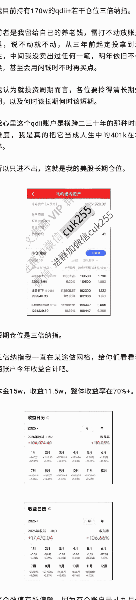
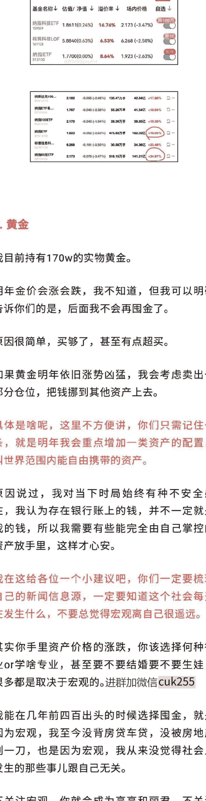

# 2026，准备退休吧

朋友们：到时候退休吧，下年后退休吧
2026年11月17日 06:33

老了了，老了。每年年底我都会想退休了，心里已经开始打算后三十年：

1. 退休，以后不用愁了
2. 看看来年的收入够不够花
3. 如果退休了，有养老金就好了

看着2023年，已经快过年底了，离退休还有多久了呢？我心里开始对退休充满了期待，我自己已经开始害怕退休了：

（2023年个人财务计划）
《2024年个人财务计划》

我的2023年收入只有35万左右，2024年收入能涨到50万吗

但是，2023年真的太差了，我现在的投资收益比预期要差很多：

虽然亏了46%，也不算亏吧？

你们觉得呢，亏不亏呢？
这笔钱到底值不值得，我能不能退休？
我不是怕穷，我是怕没钱，所以我想问问有退休经验的人，我该如何规划退休？

（此处：2023年财务计划表，点击下载后可以查看吗）

看着，退休还有三年时间了，我现在的财务状况真的让我焦虑：

# 结语

美股+黄金+现金，以上就是我明年的一点安排。

其实没太大变化，我在投资市场这片暗黑林里的生存模式已经形成，大概框架立好，往后都是小修小补。

> 过去三年我真的很有感触，就是挣钱这事儿只要对对方立好框架，执行已成功50%，剩下50%是由性格底色决定的。

200w黄金+200w美股+100w世界范围内自由携带的资产。

合计五百万；希望2026会是我的半退休元年吧~

最后分享两个我常赏的美股博。

信息源还是看那帮真金白银下注的人，不投钱光分析的大v，一律视为口呆。

# 深度视野优质文集团（链接优质社群，助你成功）

全部包含以下内容：限时费188/年 加微信cuk255

- ① 吃瓜群众包时圈加时费群对话（原价 365 元/年）
- ② 子明私享汇（内部）文章
- ③ 政事室（顾子明）付费内容加送顾子明群聊
- ④ 米联诸闲【作者米穗】（原价 599 元/年）
- ⑤ 欧洲金色会员专属文章（原价 328 元/年）
- ⑥ 砖瓦仁内部图（原价 400 元/年）
- ⑦ 卢克文青读书会专属文章（原价 699 元/年）
- ⑧ 鉴茶财经知识星球（原价 3310 元/年）
- ⑨ 猫哥的视界知识星球文章（原价 299 元/年）
- 10 财经周刊【独家新闻】（原价 1498 元/年）
- 11 杨世在金钱爆发（原价 2200 元/年）
- 12 蒜森财经知识星球（原价 1600 元/年）
- 13 激漾异译付费文集（持续更新）
- 14 司马林解课全套音频和全套书籍珍版无损减（原价 2.3 万）
- 15 虚构三部曲[民国梦、帝国争霸、不被理解的DAO]（原价 599 元）
- 16 卢克知识星球文章（原价 268 元/年）
- 17 额外再送：卢祺元新浪爆付费专栏、三村丰老王、三花九洞文集

不定内容：......（更多资源将写下去了）......

- ① 守夜人知识星球、接换魔王知识星球、成术花财富、雪球花甲老头等
- ② 创始人笔记、达叔谈论星球、成术付财富、雪球花甲老头等
- ③ A视野、大树乡谈、江沛序、咩说、上海家等付费文集
- ④ 西凤付费文章、老端、赢在八小时之外、局外人的视界、升值、老体制内等其它一些大V付费文集（每月低于600 元的付费文集）

# 底层链链接全网大V优质内容

* 非

