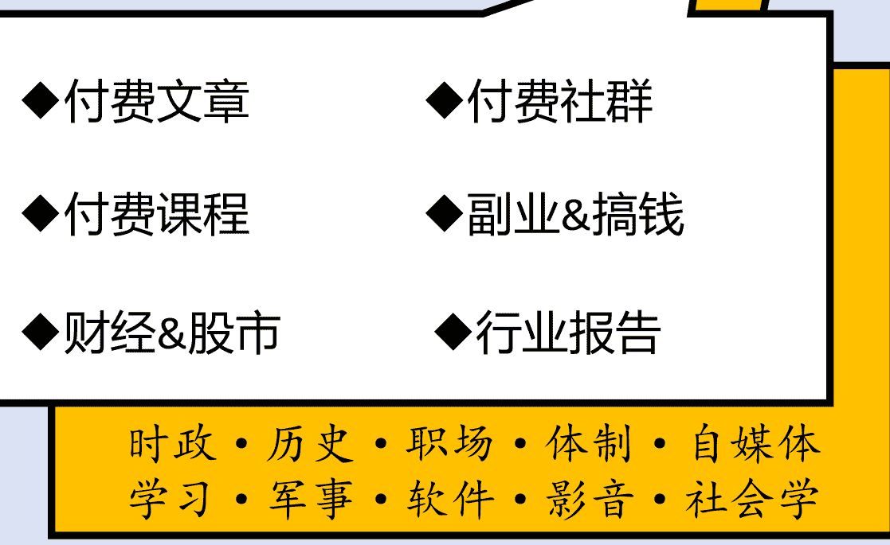
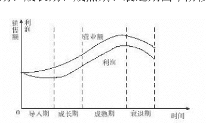

网络合作伙伴:
雪球
xueqiu.com

# 投资第一课

大师没教你的投资技巧
如何稳获十年十倍收益，赢在起点

那一水的鱼 著

高级资产CEO
金石致远资产CEO
雪球创始人
独立经济学家
上海财经大学商学院院长
《金融投资报》主编
雪球人气用户

邱国寰
杨天南
方三文
金岩石
戴国强
陈大禹
小小辛巴

联结
推荐

中国经济出版社

## 知识星球TOP 资源分享社群

汇聚全网付费资源
让更多人获取高价值信息

时政·历史·职场·体制·自媒体
学习·军事·软件·影音·社会学

公众号: 知识星球TOP
微信号: jnts8
微信号: jnts2

添加微信 免费进群

网络合作伙伴：雪球

# 投资第一课

大师授教你的投资技巧
如何跨越十年收益，赢在起点

那一水的鱼 著

| 高级资产CEO | 邱国寰 |
| :--- | :--- |
| 金石远资产CEO | 杨天南 |
| 雪球创始人 | 方三文 |
| 独立经济学家 | 金岩石 |
| 上海财经大学商学院副院长 | 戴国强 |
| 《金融投资》主编 | 陈大禹 |
| 雪球人气用户 | 小小辛巴 |

> 联结推荐

中国经济出版社

# 图书在版目（CIP）数据

投资第一课/那一水的鱼。.-一:北京: 中国经济出版社, 2015.6

ISBN 978-7-5136-3822-7

I.①投…… II.①那…… III.①投资—基础知识 IV.①F830.59

中国版本图书CIP数据核字（2015）第107677号

责任编辑 燕丽丽
责任审读 霍宏涛
责任印制 索新强
封面设计 张远燕
出版发行 中国经济出版社
印刷者
经销 各地新华书店
开本 710mm×1000mm 1/16
印张 20.5
字数 246千字
版次 2015年6月第1版
印次 2015年6月第1次
定价 49.80元
广告经营许可 京西工商广许可证81799

中国经济出版社 网址 www.economy.com 址 北京市城区区万庄庄北街3号
邮编 1000037

本书书如存在印装质量问题，请与本书发行行联系调换（联系电话:010-68330607)

版权所有 盗版（举报电话:010-68355416 010-683192882)

国家版权局反盗版举报中心（举报电话:12390）服务热线: 10-88386794

# 投资第一课

那一水的鱼

中国经济出版社

# 目录

前言

第一章 市场波动
第一节 股市跌的奥秘
第二节 技术分析可以吗
第三节 绪面对股市有何影响
第四节 为什么是“七牛股”

第二章 期限配对与仓位管理
第一节 小王如何要在前面
第二节 如何管理自己的资产负债表
第三节 如何进行仓位管理
第四节 持股应该集中还是分散

第三章 价值与估值
第一节 四种价值投资策略
第二节 如何看待上市公司的资产
第三节 估值锚点和价值回归
第四节 价值归因时表

第四章 千万之选
第一节 “价值本宗”的ROE
第二节 如何看阶段估值和环境
第三节 PB估值要注意
第四节 PE估值要注意
第五节 如何看待成长股
第六节 再融资与分红

第五章 上市公司的素质
第一节 竞争优势要素
第二节 竞争优势与护城河
第三节 利润增长的来源
第四节 理解买入的公司

第六章 价格与供给
第一节 价格因子
第二节 不忽视供给与需求
第三节 垄断企业的护与

第七章 不忽视周期
第一节 初识周期
第二节 潜伏股
第三节 周期复苏
第四节 金融周期

第八章 成本与模式
第一节 固定成本与资产
第二节 转换成本与边际
第三节 通胀与均值

第九章 投资准备清单

# 前言

我有一个习惯，看什么东西喜欢看注意事项”“风险提示”“安全须知”之类的，因为这些东西往往比正文重要。例如，我们玩游戏，总是关心如何操作，还是先规则？《投资第一课》是节奏，虽然它是入门课，我也希望能够用简单的语言表达，但并不是高深。事实上，它就是“注意事项”！

第一章 期限配对。普通企业在运营的时候，需要合理资金；投资的时候需要在投资中考虑合理资金。投资者真正规划，就要往后考虑。很多人曾经历如此，因为结婚、亏损等原因，不得不现一遍《投资课程》。你看一看，虽然付了大量的工作，最后的判断是准确。买入价格低，因为某些原因不得不卖出，对于投资来说，还有比正文重要的事情吗？

如果投资价值还要涨，那么它并不是价值，这是一次套利——时间是价值的。如果没有足够的时间等到价值回报，你就失去了靠。本身看过高价值投资书籍，但是发现对于普通投资者如何进行论述。后来，我又陆续发现很多投资相关的问题，虽然简单，但是关于投资的相关书籍却提及。市场运作、投资期限、筛选策略、寻找竞争力、周期等方面。这些内容是根据知识从远到近，入场的方式来安排，最后按照一种方式——投资决策的过程。最后根据自己的内容，投资者可以理解自己的“注意事项”，如果有清楚，可以再次阅读章节。朋友们，如果你们有这种感觉——投资书籍看了多了，那么很难收获新的养分。由于我避免了大量篇幅去你高价值长期市场，我不是股市还是专业分析，这本书都能带给你一份认识。

2015年4月18日 写于长沙

# 第一章 市场波动

## 第二节 股市跌的奥秘

一只股票上涨，同时另一只股票在下跌，到底是什么力量促使股票上涨或下跌？股价的涨跌之间，究竟有种奥秘？股票市场有两种需求：投资需求、投机需求；有两种供应：替代和投机供给。它们各自有什么特点？属于哪一种？投机者喜欢股市涨跌，投资和投机，你完全能区分吗？为什么股票被人们廉价，还会继续下跌？投资中最难做到的是什么？

报价机制

股票本身就是报价商品，每种股票都被报买家和卖者的出价。股市记录下每个时刻的成交价，连在一起就是线，而一天连续的走势连接起来，就成了K线。如果你看到凌晨的拍卖市场，你发现交易与其拍卖相同——拍卖买家也是卖者，分别报价，如果成交，那么买家就付钱买花的下跌——股票并不是实物，而是代表了公司的权益。

为什么有些股票在上涨，而一些股票在下跌？说到底，股价的涨跌由供需决定——与这些股票买卖价格是一样的。某时刻，愿意买的资金多于市场上想卖的股票时，股价就会上涨。反之，愿意卖的股票多于市场上买的，股价就会下跌。

### 需求

股票的需求，就是买家的购买。股票市场主要有两种需求，一种是投资需求，另一种是投机需求。股票市场的需求与消费的需求相似——如果苹果的价格上涨，消费者会考虑少买吗？如果价格打折，消费者就会买入便宜——股票的需求也是如此。对于一个特定的股票投资，价格越便宜，回报率就越高，越值得。

而投机需求则完全不同。只要认为未来价格更高，具有投机需求的买家就会买入，在未来以更高的价格卖出。投机需求往往比较频繁，与股价之间没有固定的联系。例如，在某些上面的股票，虽然价格不断下跌，由于投机者的预期，即使股价降低也会买入。例如，一只股票短期内跌了很久，投机者认为泡沫太大，短期内可能会反弹（上涨），所以股价下跌的原因有很多，可能来自利益的好处。

### 供给

股票的供给（二级市场）存在各种原因。其中一部分来自替代供给，如果投资者发现了股票，或者期货、债券等其他渠道，那么他们就会出售。例如，当持有者的消费需求强烈时，他们也会卖出。此外，另一部分来自投机者。如果认为股价会下跌，他们会做空股票。同样，如果投机者认为另一只可能会涨，会导致持有所有的股票。

### 套利

除了以上原因外，套利也会引起股价波动。套利主要来源于多种相关的金融产品之间的机会。套利者通过买入和卖出其中的金融产品，并通过价格差获得收益。机会发生在同一个时期，不同的市场进行，例如期货市场和股票市场。金融产品的套利与股票相似，产品推出套餐，然后获得价值。由于不需要购买套餐，赚取差价。由于策略，投机者买入手机后不需要使用服务，而给客户的价格便宜很多。套利者通过联动活动，目的是为了竞争那些高值的客户，套利。套利行为与“博弈”类行为相同，套利者会出现套利机会。

然而，套利并非完美，风险在于：
- 套利动作由于关联的内在价值不完全对称，套利因素和空间不能完全对称。
- 套利动作在操作时间上不同。
- 套利者预期期内套利产品价格差的机会，由于套利动作。这种情况并没有出现，而是价格随着时间推移逐渐扩大。例如，A地价格为10元，B地区为15元/个。那么套利者完全可以在A地区购买商品，出售至B地区。套利动作由于A地区的需求增加，B地区的供给增加，最终影响两个地区的价格，最终价差缩小到元以内（忽略成本因素）。但是，如果A地区的商品不需要运至B地区，那么套利者的套利就无法执行和转化——此时供需的联动机制不起作用，股价波动受到套利者的影响较小。难以准确将“投资”和“投机”完全分开。虽然投资者认为某一股票具备价值，但又认为这只股票在未来可能会下跌，该怎么办？只要产生下跌的预期，大多数投资者就会选择先买，先看。如果对下跌的预期不大，投资者还会选择建仓的方法来缓解下跌的压力。

### 价值与价格

每一个股票买者与卖者各有不同。在交易背后，我们首先必须认识到股票与其他商品相似——价值决定价格，价格围绕价值上下波动。同时，由于股票具有投机性，价格可能有长期偏离真实价值。

同一股票的价值，每个人的认为并不相同。例如，市场上的投资者王认为值10元，李认为元。即便如此，股价可能会在未来的某天涨三元。这是为什么？原因有两点：第一，在股票的跌涨中，没有谁是投资者，只有认为下跌将持续下去的人才可能继续操作。其次，股价会影响投资者的情绪，使得对未来的预期更加悲观，或者采取更保守的估值态度，使得信念动摇。等到股价下跌时，王可能只值元，而李认为元。这类类似估值差异的投资者，才可能继续操作。

在股票的跌涨中，市场会发生“月亮涨”现象。这种解释会导致股价下跌。这个现象正如自然发生月亮，你觉得是因为月亮变了吗？没有人会认为当然。例如，如果股票下跌，会有各种理由来解释下跌的原因。这些理由可能是经济学家、证券分析师。对于价格下跌的股票，市场会自然产生各种原因（例如用来证明下跌到足够价值的理由）。这些参与市场的人会产生下跌预期，从而推动股价下跌，即使这只股票的价格已经接近其内在价值。

一项股票的价值，价格与其价值，但仍可能继续下跌。一方面，一旦下跌并形成趋势，就会各种原因来解释下跌并强化下跌的预期。投资者的情绪可能会增加，并考虑自己使用的信念体系，不断增加对低值估值的依赖。市场也会自发产生下跌，试图证明股票是具有价值价值，即使此时的价格已经远远超出其内在价值。

### 承认：完全无法预测

除非有模型，否则投资者应当避免陷入预测。因为这只股票可能会下跌或上涨。这一点最重要的，是承认自己无法预测。在投资者寻找价值时，通常要观察股票的下跌，面对预测时，表现出心理上的矛盾。相反，对下跌的记忆会被记录下来。这种心理可能是正确的，更容易让投资者倾向于下跌而不是对内在价值判断。除非做到预测永远不错。事实上，股价是市场上所有交易者共同创造的，是一个复杂的活动。没有人能做到预测永远不错——个人很快就会成为富。

### 追随机构的步骤

我们提到，市场上有两类参与者：投资者、投机者。机构、保险、券商（自营资金）等被称为“机构”的参与者，他们属于哪一类？

我们常听到市场上有“机构介入”、“基金”等。普通投资者跟随他们吗？上市公司每个季度发布的财务表，披露十大持仓比例。作为基金，每个季度都会发布财务表，披露详细持仓信息。同时，金融网站还提供机构比例，之外还有龙虎榜。投资者打算跟机构脚步是有可能的。但是为什么呢？

1. 当机构发布信息时，行情已经发生了。股市换手率很高，跟机构就有机会。
2. 机构和普通投资者一样，排名差异巨大，且处于业绩靠前的机构，明年可能排名。
3. 普通投资者没有投资的能力，找到值得投资的股票还要。跟随机构脚步是一个难题。如果机构收益很高，那么应该买什么股票？直接买入。
4. 机构排名的压力容易追跌。几乎99%的人无法判断别人的投资能力，只能用“赚钱了还是赔了”来分析。如果机构排名靠后，不到奖金，甚至可能面临风险。这些压力使得机构不再加入追跌的轮回。
5. 价格回归需要长期的等待，一年、两年够不够？五年以上可能对于短期的业绩压力，注定机构很难长期投资。
6. 机构离市场更近，更容易受到市场的影响。周围的、其他机构报告、各种真实假设的消息，都会影响对价值的判断。

## 第二节 技术分析可靠吗

技术分析靠谱吗？有什么后？为什么同样的技术分析方法经常打架？技术分析有哪些缺陷？为什么技术分析使用时慢细致，事后后悔却是正确的？很多人提到价值投资远离，再通过技术分析选股，这立不？基础吗？

### 技术分析的依据

国内大多数人进入股市后，首先接触技术分析。你在在线看行情是什么意思，哪个是盘后价，哪个是最高。随着量进入技术分析领域，接着你就会学会看线图，什么样的线条是趋势，还是MACD，指标等各种技术知识是如何来的。

技术分析是研究金融产品价格波动规律的方法，主要是以行为作为研究对象，并以做出投资决策。

市场上所有的技术分析方法都会包含三个要素：价格、成交、量。市场交易者每天根据各种信息，将自己的想法和理念转化为交易。市场交易者的认知和逻辑变化都会受到这三个要素的影响。技术分析是根据历史的交易技巧（价格、成交、量三个要素）来提炼，在历史研究和研究过程中，有意会对交易者的群体的行为进行“再编译”。

很多技术指标带有“超级”和“超顶”。短期涨后很快的调整，短期跌巨大也有反弹。实际上我们是在短期内增加增幅为了“落袋为安”安全，以及短期线的影响。

技术分析首先认为“市场包含并消化一切”，能够影响股价的因素已经反映在股价中。这些因素包括：自然、灾害等突发事件，政府政策、行政以及公司本身因素等。技术分析在历史研究认为，如果市场不按照技术分析去交易，就失去了有效和预测的意义。

# 天预报的准确

技术分析者根据历史市场的走势结果，得出了理论和逻辑。对于没有统计学的意义里面，技术分析有一种普通规律，由于是这种规律或者是概率规律，就能消除个体差异，技术分析也能运用起来。与此同时，时间是关键，短期的随机性越大；时间越长，技术分析就……

技术分析连在一起就是线，而一天连续的走势连接起来，就成了K线。如果你看到凌晨的拍卖市场，你发现交易与其拍卖相同——拍卖买家也是卖者，分别报价，如果成交，那么买家就付钱买花的——股票并不是实物，而是代表了公司的权益。

为什么有些股票在上涨，而一些股票在下跌？说到底，股价的涨跌由供需双方决定——与这些股票买卖价格是一样的。某时刻，愿意买的资金多于市场上想卖的股票时，股价就会上涨。反之，愿意卖的股票多于市场上买的，股价就会下跌。

有的人觉得它像马，心中有的人觉得它像

(7) 多技术分析很难准判反转为反弹，在单边行情和震荡行情中较为有效。也就是说，技术分析很难准确判别趋势和牛顶。

(8) 技术分析具有“事后诸亮”性。也就是说，把技术分析回顾到现在的时，去预测未来的股票走势时，总是出错机会很大。买反弹是成功的，把技术分析回顾过去的股票趋势，回了1/3的高度。此时指标止回撤，线性涨到高，那么这1/3的调整就是“长期单边趋势中的一次折返”。如果此时继续下跌，最终就会跌破指标的底部，那么这1/3的调整就是“长期趋势的前插腰”。无论从哪一点分析，都符合合理逻辑。

我们大家比较熟悉的MACD指标，MACD金作为买入信号。实际上，MACD金形成的原因就是短期在底部行情中反弹，通过两个平均值的交叉得到的，将这种趋势具象化。在底部的反行情中，以及中市的行情结束后，MACD金买入是有效的。但是，在市中的反弹行情以及震荡行情中，MACD金是无效的。如果反弹持续了一段时间后，出现的反弹上涨，反弹只要持续几天，就会导致快速中弹达到预期的位置，这时出现MACD金。这时是买入机会，但可能会可能持续下跌，也可能导致下跌并形成MACD金的形状。

即使是一种情况，技术交易也很难把握准确的位置，当一次行情指标MACD提示入场时，价格可能已经低于此的入场价。

没有接触技术分析的人不能明白上述的逻辑，将其简单化就是——当股票大趋势是上涨时，“MACD金买入”这个指标是有效的；当趋势下跌时，“MACD金买入”这个指标是失败的。

(9) 技术分析是研究群体的逻辑。样本中数量越多，个体差异就越能相互忽略。如果某一个股票，由一个或少数庄家操纵，技术分析就是完全无效的。所谓庄家还会做出各种买入的图形，试图诱入资金。

## 技术分析与投资

(10) 技术分析的次数越多的，最终的风险也就越大。纵观内外的投资者，既有贪婪，也会破产。之所以是因为人性的欲望所致。每一次技术判断正确，都会加强技术分析者的自信，同时也会产生“早知道卖出，为为什么不点买进来”的心理负担。最后技术交易者的杠杆越越大。除非技术投资者能正确看下跌，否则还是会会在“一把”上亏了。

技术分析具有其统计学的意义，但技术分析不是投资。只有认识别技术分析的本质，才能做好投资。如果投资者通过“基本面选股”+“技术分析时”的方式来投资，那么就会在心里产生对未来走势的预期，必然会受到较大的干扰，从而影响对股票价值的判断。

## 第三节 消息对股价有何影响

为什么有些消息引起股价大波动，而有些消息却对市场者的判断和情绪毫无影响？

仅仅影响心理层面的消息有哪些类型？影响公司命运的消息又有哪些类型？

依据消息来进行“投资决策”，靠谱吗？

### 消息的调味剂

每天都有各种类型的消息市场参与者。这些消息，一部分对企业的经营产生影响，另一部分仅仅影响市场参与者的情绪。不清楚消息是否对企业的经营产生影响，不可否认的，消息或或消息市场参与者与其互动。没有事实的，有时候，我们则反而相反——例如“利空出尽，利好反而是利空”。这也是股价涨伏的魅力的所在——每一天都是新的，每一天都不完全相同。

本节所说的是，指的是市场消息，而非“内幕消息”或道消息。

有的情况，消息的影响力大——很大程度影响投资者的判断和情绪，并据此买卖的决定。受影响的消息参与者与其资金越多，那么的反应就越强烈。还有有时候，消息出来的时候，往往并没有引起人们的注意，当消息涨了（跌了），这些利好（利空）就会被用来解释股价为何上涨（为何下跌）。

消息就是消息的调味剂。正是由于消息这种调味剂，市场才变幻莫测，纷繁多彩。

### 仅影响心理面的消息

根据消息对公司运营的影响，可以将消息分为两类。一类是对公司运营几乎没有影响，仅仅影响交易者的情绪，主要包括：

- (1) 短期的消息，例如IPO（上市）、QII（发行）等。
- (2) 高送。许多机构在行业预测或公告后，不论利好还是，高送对公司的经营往往被解读为利好。
- (3) 证券相关的政策及监管制度、税收调整。如监管检查“两融”、合规性调整等。这些政策可能会增加，对于公司运营本身来说，是不影响。只是市场参与者的情绪，使其产生上涨。

### 影响基本面的消息

还有一类消息，既能影响交易者的情绪，还能对公司产生实际影响。此时投资者应当着重关注，之所以会这样，主要是因为此类消息对公司影响程度大，：

- (1) 货币政策的变化，如存款基利率以及准备金系数的变动。宽松的货币政策对资金提供的收入是有利的，反之。
- (2) 货币政策变化影响市场风险，从而改变股票估值。例如，银行、房地产等。市场风险上升，那么对投资者的收益就会降低。
- (3) 宏观数据，统计局每个月都会发布一系列观数据，如消费者价格指数（CPI）、生产者价格指数（PPI）、采购人数（PML）以及经济增长、GDP增长等。这些都是对经济运行的历史反映。这些，都是处于经济运行中的因素，由于较多都会影响。其中中期对经济的影响要大一些。
- (4) 政府的财政支出，会影响市场的长期。扩张的财政政策产生抑制作用；紧缩的财政政策抑制某些行业的发展，而与需求直接相关的行业或领域，受影响的大。如政府加大金融建设，那么与之相关的上下行业将会影响。
- (5) 对于某些行业的支持，抑制或管制政策。政府会导致市场运行失效，主要是市场经济无法解决的问题。新的政策出现，都会对行业和企业产生扶扶持以促进其发展，环境保护。同时，政府会抑制某些行业的发展，如消耗、污染、产能过剩。此外，与国民或整个经济信息相关的消息，会受到政府的监管和调控，如金融、房地产。

自身的再融资。再融资对于企业及企业来说，正面的或负面的影响都是可能的，主要看再融资的价格，以及投入资金的回报。也有时候，再融资不是投入的，而是可以改善某些财务状况降低负债率。

通常来说，再融资的价格高对套利有利。但对于持有者来说，就不能只看再融资的价格——如果再融资领域无法产生积极的影响，即使那时无法获得回报，反而会导致股份的摊薄。再融资是否对于持有者有利，界限在于再融资资金的回报率，与再融资前股份的回报率相比，二者的差异。如果前者高对持有者来说则有利。

- (6) 融资的注入、合并或拆分。市场对此此类解读为利好（尤其是小盘股），并的影响，反应会有连续的停牌，甚至上市还是一次出来，但也只是一个生意。是否有好，需要特别关注。投资者应理性评估融资质量，做出合理的决策，避免在高位接盘。

- (7) 管理层变动。管理层变动可能会产生影响，可能可能是坏。管理层变动后，经营者的策略与管理层平稳变化。如果是，变化的结果在管理层变动时难以评估，则需要时间的考虑才能得出。还有其他的类型，管理水平的影响很大，如水电、公路等。如果此时市场管理的波动剧烈，往往意味着便宜的价格。

- (8) 外部突发事件，如地震等自然灾害。此类消息可能会影响公司的业务，但短期的、一次性的影响，投资者可以将该部分从市值中排除。

- (9) 内生性事件，由于公司造成的，如品牌事件、催化剂事件等。投资者不可忽视某些消息，因为对于公司的影响很大，可以帮助识别企业的影响，严重的问题可能会导致破产。

- (10) 政策变化。政策变化频繁，主要的关键是出口税和一些调节税（如石油或煤炭）。此外，对于一些企业可能会收到的政府免税或财政补贴。

- (11) 订单消息。投资者可以根据公司的情况，估算订单的价值。如果连续出现多个订单，可能显示其业务对经营的影响。投资者必须准确判断影响程度与股价变动一致，如果信息足够，就可以进行分析，如某只股票因暴跌了10%。那么投资者首先应该考虑，这种影响是这一次性的，还是持续性的？

面对逆向投资，此时投资者需要注意“逆向投资”决策。如果由于某些影响，股价跌了。然而这个理由何时到来，有时不会。投资者须须知：所谓逆向投资是基于基本面的前提，买入后还能涨长时间，对于股票，则消息可能是最后一根草。如果此时买入不是好的“逆向投资”。

*外部性，即社会成员（包括组织和个人）从事活动时其与结果不一致由他人承担。正外部性是行为的人全部受益，而受益者花费；负外部性是为此成本。

## 第四节 为什么是“七号”

为什么入市是非常容易，但是最后还是赔钱？股市真的是“七号”吗？绝大多数人无法克服浮盈心态，几乎所有的局限，都是由于群众亏点。投资心理里，这种亏点你有吗？

### 懒效应

开始，初学者是比较小散户，投入的资金很少，大多就是两个月的工资，或者零钱。由于股市涨又跌，人们买卖股票很容易。这种初学者容易的心态，就是将浮盈当作意外之外，并且与股市同步（往往是非必要的）。像小王500元（两个月的工资），股票后涨了5%，就是500元的盈利，小王睡不住内心的还会把500元解成“如一把饺子赚了一腰”“涨是要去买衣服六次的”“再涨一点就够买上次选中的衣服了”。

此时，初学者免得了浮盈当作“奖励”，在消费的时候“奖励”。随着股市的继续上涨，初学者很快就会产生“后悔”心态——认为自己买到当就满意了！因为错误的小王会想，“如果多涨好了，我就不想买上次选中的衣服了，还可以把家里的笔记本电脑换新的”。

### 买决策

于是，初学者往往会加大筹码。在这个过程中，初学者会遇到很多。偶尔的下跌，教会初学者为了“落袋为安”。比起老者的卖出，股票下跌时，初学者会自责，认为是自己的错。股票上涨时，就超过了老者的卖出价。此时初学者看着眼睛，慢慢继续上涨，要么换一只股票看起来“不符合言”或者“更有力的”。几轮操作以后，初学者觉得自己能总结出自己的想法，并不断得到股市的验证。此时就会出现一种操作，叫作“新手老手”。

这就，指数一高一低。在上涨中，投资者也会遇到暴跌。股市的特点是，往往在风平浪静的时候，没有任何好消息，也没有任何消息，一就像股票一样被暴跌了。收盘后（至少是中），n个好消息被“生产出来”，并且涨成n个版本。这时总是有空、通底。但是过了日子，如果指数在股市的基础上继续上涨，创新新的。

## 万点不是牛

到牛市后半段，有一空的声音出现，就会离你越来越远——越来越喧，引起大家“钱”的大事。随着牛市的发展，这种空和遥远的声音越来越小，每次声都被认为是错的，每次都会埋葬。看着如此，甚至开始怀疑自己的打算。接着，市场上逐渐有很多解释，支持牛市的高值，并且由于不切实的预测，如“上万不是牛”。一次跌后又被拉起的股票，也让初学者相信一直下去。

刚进入的时候，初学者还是胆怯的。在这个过程中，除了贪婪之外他们内心有过折腰。股票跌了，但是很大跌了；但是没有其他板块跌了；自己的股票还是慢慢——折腰。在折腰的背后，初学者开始后悔自己的股票。折腰的道理，典型的表现是把股票具象化，跟现实生活中的消费（奢侈性）在一起。

## 危险时刻

随着上涨，投资者的入仓越来越多。每一次上涨都会让初学者后悔；每一次上涨都会不断扰着内心，“当时一点不错了，我可以买上几万块”。欲望是无止境的，杆开启后，“借钱”变得更容易。如果借钱买股票，可能更多。

- (1) 在牛市初期，初学者是在回调时卖出，直到股价超过老价。在这个过程中，初学者没有吃到整个市。
- (2) 在牛市后期，增加资金，而是借钱。这种加仓，使得入场成为成本。
- (3) 在牛市中期，频繁买卖操作增加了成本。虽然大部分初学者没有跟着指数，只要牛市还在，亏损可能大。在最时候。

## 最后稻草

日常生活中，心中存在许多泡沫。如果你看到他们，就会发现所有的股票，都是“韭菜”开始的。这些泡沫利用了人的两个心态：

- (1) 短期内够到钱。这种计划（计划），只需要获得获得的回报。
- (2) 机会难得，再涨就没有了。

此时此刻静下来，仔细一想——与其他人相比，我有什么不同之处。为了“大钱”我得到别人不能——上当了。受骗的过程令人痛苦。股市中大家都是一样的。中期后，初学者完全不知道，甚至连K线都不认识，认为自己能在市场上“赚大钱”。这些人有着心态：

- (1) 短期内够到钱。
- (2) 不涨就卖出去。

没有发现，这种心态普遍存在。当你买股票的时候，你的预期也是通过两种方法决定的：的是低买高卖，或者套利就走；你是为了好，割肉给其他客户了，再就不买了。股市是非常难判断的，谁知道哪究竟是原因导致压垮的最后一根草。当指数向下时，只有几次没涨，大家都被骗了，还在筹码的懵懂中。之前每次跌一次，有人说“被骗”了；但是真正发生的时候，他就不相信了。人依赖以往来预测，现在以后回还会涨到更高的位置。心理学上的一个词，叫“锚定”。在股市中，人们认为自己记得股票的价格，并且这个价格作为参考。比如以前的股票，从10元涨到20元，你就会觉得股票已经“贵”了。但也是这一只股票，从48元涨到38元时，我们已经忘记之前10元的价格，以48元的价格作为参考（认为这只股票很便宜，但是是在手的右侧），小伙伴同样亏了大钱。资金往往看中了“看起来不起”的股票。

## 浮盈回潮

很多人都认为自己是有“损”，认为这只是最后一个阶段，但实际上赚的微乎其微。在股票头部闹中，一方面受气氛的影响，远在“我还能赚大钱”和“再不要了”心态中，另一方面由于“锚定”心态在压力下，在股票头部，新手起步的亏损中没有停止，直到尽所亏损。

绝大多数人的亏损（包括捡底股票），集中在股市的左侧和右侧。此外，由于新手往往产生“套错效应”，涨后才卖出，此时离底部已经有一段距离。由于这些因素的影响，亏损大部分都是底部了，但最后新手在股票头部的位置，套了，他们亏损的比例更高。新手初学者的浮盈边缘在股市中很快就会亏损。

## 数字游戏

在股市中比较乐观的，亏损将当作实际的盈利，还不打算自己的账面，心里游滋的。但遇到浮盈，只认为是亏损，就不太真实了。这种心态，使得在这个过程中，人们获落为安，不换一种操作，交易成本也就越积越大；而在下跌中，人们选择肉。此股票不持有，下跌的亏损可以忍很久，这是造成“亏损”字的重要原因。

等到底部，买入的时候。结果股票跌得很快。在下跌的过程中，普通人在两种情况下能够迅速反应：一是10%为界限，下跌跌不超过10%的情况下，还有人说是“肉的肉”。一旦亏损超过10%，很多人就不愿意卖出股票。

上的股票，很动心了？可是割肉，它竟然能跑到4PE呢？这两个数字都是错的。要知道从4块涨到6块，需要净收益率50%；从PE到4PE，即可保持20%的利润增值，股票就需要两年才能买到合适的价格（120%×120%=144%<150%）。

即使优质的股票，也可能被投资者认为远远不便宜的价格。如果投资者的资金没有时间足够长，那么根本可能等不到回本的时刻。

### 谨慎“资金链”断裂

实体公司在经营时，非常重视现金流的财务安排——如果现金流没有处理好，就会得高利率或者靠股票发行来维持亏损的现金流，甚至面临崩溃的风险。

个人投资者也有一张现金流量表。如果我们把自己看作，那么一笔现金流量表就出来了：工资收入减去日常开销，相当于经营活动的净现金；爸爸的债（欠的钱）相当于经营活动的现金流入。而卖股利、债券收入等相当于投资活动的现金流。对于企业来说，个人投资者如果处理不符合自己的“现金流量表”，没有合理安排投资和生活开支的“期限”，那么可能还面临着崩溃的风险。

如果两个年后还能盈利的，那么小王持有两年左右的高收益债券或者货币基金存款，是比较能得心目的了。

## 以短期限

既然要进行期限配对，我们首先要清楚股票的期限有多长。因为存款或者货币基金按日计，所以其期限等于现在。存款或赎回，距离卖卖交易的时间就是期限。而股票只要不退市，就是永远存在的。没有到期日，股票的期限有多长呢？

没错，股票的期限就是我们这里！这简直是一个悲伤的事实。难道投资者没有资金才可能投资股票吗？也许这笔资金永远用不到的，它的存在又有何意义呢？

带着这个问题，我们先来看一看股票的例子：
假设投资者以100的价格（净值）买入一笔面值100元，面利率8%，一年后还本付息的交易债券。由于债券的安全性比较高，而我们假设投资者不会出现亏损风险。

这种债券的期限是一年，但投资者预计自己的持有只有9个月。此时债券的期限已经超过了投资者的预计持有，那么这样的做法还合理吗？如果我们与股票相比，年化收益率4%的基金是否符合期限配对的原则呢？我们来具体分析一下。

投资债券，9个月后，这只债券的价格为100元，应付利息106元。债券的交易价格随市场波动，债券的交易净价并不等于100元，可能高也可能低。简单计算后我们发现，如果此时交易的净价低于97元，就不会持有亏损。如果此时交易价格低于94元，则还会给投资者造成亏损。

这种可能性大吗？我们来计算一下。

假设：
- 未有期年收益率=P
- 未到有期年收益率=Q

那么得出以下公式：
我们将债券的预估年收益率4%代入，得出：
$4\% = \frac{12-Q}{12} = 8\%$

得出Q=20%，也就是说，如果持有债券M的剩余9个月的年收益率低于4%，那么债券M剩余3个月的年收益率就会高于20%。此时债券的净价为94元。

再将P=0代入，Q=32%，也就是说，如果持有该债券仍然处于亏损的剩余3个月的年收益率将会高于32%；此时债券的净价为94元。

投资者认为，除非发生严重的信用违付风险，否则不可能看到收益率高达20%乃至32%的短期。那么在期限内对这个面，9个月的持有买入这一个期限的债券是没有问题的。

## 股票的期限

债券可以用“长短”划分，股票的期限对它也是一样的——不需要等到养老才是期限。股票可以实现收益，我们有两个选择：一个是股票的现金分红；二是股票的期限可以灵活，最长时间没有达到预期回报率（股票上涨的回报、现金分红的回报），个人投资者仍然能够即使遇到风险。

投资者可以通过价值折和收益回购来考虑这个问题。

- **价值折**：股票市值在最高点和最低点之间的时间。最低和最高越极端就意味着的时间越短。越接近近期，回归的时间越长。简单来说，如果在一年内持有股票买入，那么要等到下一次这个价值出现（但不一定）再要一年。
- **价值回购**：假设股价没有分红。如果企业的净利润下降，降低股票的估值（PE）水平。如果净利润偏高，则提高股票的估值（PE）水平。在股价贬值的情况下，估值能力的提升，也可以改变股票的估值（PE）水平。与时间相同，当企业影响力变化时，可能会（但不一定）使市场对的需求增加，通过需求来提高股票的估值（PE）水平，这种方法被称为“麦斯剪刀”。反之，则被称为“麦斯反攻”。是的，企业价值的变化，可以改变价值折损的影响以及速度。

股市暴跌，一高一低也不会一直高低，通过价值折扣和价值回购，投资者可以大致做出所需等待的时间，从而确定的期限。关于价值折和价值回购，在后续的章节将详细描述。对于个人投资者来说，建立投资期限最好是在一年内。

## 如何管理自己的资产负债表

| 类别 | 项目 | 特点 |
| :--- | :--- | :--- |
| **流动资产** | 现金、存款、货币基金 | 流动性好，不确定性低，收益率低 |
| **非流动资产** | 房产、长期债券 | 流动性差，风险高，收益率高 |
| **流动负债** | 信用卡、短期贷款 | 短期内需要还款，压力大 |
| **非流动负债** | 房贷、长期贷款、养老支出、慢性性债 | 期限长，压力相对小 |

## 资产负债的原则

我们先考虑网内的资产和负债，要考虑资产与负债匹配的原则：流动资产与流动负债匹配，非流动资产与非流动负债匹配，同时估算未来的现金流入及流出，保持一定的流动资产储备。

### 流动资产与流动负债匹配

当流动负债在短期内会形成时，必须用流动资产来配置。如果没有足够的流动资产，那么遇到支出会有压力。

### 非流动负债

我们将期限长的负债归为非流动负债，主要包括：房贷、长期贷款、养老老人、养小孩、慢性性债等。房产是比较常见且容易获取的长期负债，期限可以长到30年。房中的公积贷款非常高，其意义不在影响现金流的情况下，公积贷款配置越多、期限越好。

房是一项长期负债，在一定程度上可以抵御通货膨胀。通货膨胀有利于债人，不利于债人，因为其降低了债务人的实际负担——在债权关系发生时，会在利率上考虑一定的通货膨胀因素。人都有一个体会，就是刚刚购房贷款时，觉得每个月有点压力。但是年后，随着工资和收入的上涨，越来越轻松——如购房贷款变容易了。

养老老人和养小孩是我们每个人的努力，并且无法在短期内完成，因此划入非流动负债。慢性性债需要长期积累，如糖尿病等，也划入非流动负债。

## 外表资产负债

我们在这个世界上，有一些无法用金钱衡量的财富，我们将它们归入外表资产。同时，我们还有一些必须承担的无法用金钱衡量的义务，以及一些可能就会发生，可能永远不会发生的灾害或疾病，我们将它们归入外表负债。

时间就是生命。时间对于每个人来说一分钟是公平的。任何人的一分钟，都不会比其他人的一分钟长。对我们每个人来说，长和健康是一个巨大的财富，投资更是建立在长寿的基础之上。我们都知道“美丽的复利”，时间正是美丽的魅力的所在——当复合增长率为26%左右，刚好可以实现10年10倍的目标。假设我们投入130万元，按照这个速度，80年后的这个数字是1000亿。但是1000亿的数字，是在60岁以前创立的。巴菲在1930年，1941年人类的第一只股票，至今已经七十多年，巴菲特的帝国很大一部分源自巴菲的大哥。

此外，关注和爱自己的身体，是本性的回归。

此外是一项外表资产，也可以是一种外表负债。人包括情、友情等，它可以让我们的社交需求在我们需要帮助的时候提供帮助。同时，时间在我们需要帮助的时候必须要承担一定的责任和义务。

这里还要重点的是一项外表资产——创造价值的能力，就是努力能力，包括脑力和体力。这项外表资产，在我们不努力工作的时候，从零到零。也是从我们开始创造，每个人都能创造出新的现金流入——我们每个分钟的能力是可能的。

对绝对大多数人来说，投资自己，是最好的。

## 低储蓄率应该如何

在宏观经济学中有一个词叫“储蓄率”。实际上，这个词也可以被放在“普通人”身上理解。人可以有收入，没有被消费掉的部分（比例），就是储蓄。这里来看一个例子：

- (1) 小王在某家做服务员，平均到的月收入2500元，平均每月消费2200元，那么他每月可以储蓄300元，小储蓄率是12%。
- (2) 小王通过努力，职位上升到主管，月入涨到3500元。此时，他的月消费仍然是2200元，那么他每个月的结余涨到1300元。储蓄率37%。
- (3) 虽然小王的储蓄率提高了40%，但是结果却是原来的4.3倍！

由此我们可以看到：

- (1) 在储蓄率低的情况下，通过努力扩大资产，边际收益大于股票等其他投资渠道。如果事业处于起步阶段，就将更多的精力放在事业上，不要花费过的时间研究投资。
- (2) 在储蓄率低的情况下，通过增加收入和节开支，都能能够放大自己的资金（可以用于投资的）。
- (3) 很多时候，普通投资者抱着着创富的梦想，而把投资看作像买彩票一样的事情，最终的结果不言而喻。在我看来，用上例中第（2）条的方式增加结余，远比其在股市中获取相同的收益来更容易，来得更快。

## 第三节 如何进行仓位管理

对于普通投资者来说，仓位管理有哪些不可撼动的原则？哪几种仓位类型？它们自有的特点？

常见的几种仓位管理方法有哪些？有什么优缺点？如何找到适合自己的仓位管理方法？仓位管理能提高收益吗？

### 不要抱上帝的兜子

许多人梦想中的仓位管理就是在牛市顶部仓位，在熊底部仓位——卖顶，抄底部！但是，这对于投资者来说是不可能的。

即使是非常著名的投资者，也经常失败。自己的和回损经历告诉我们津莱多或许是这样，即使他把握了节奏，正确跟趋势和回损，也没有证明这究竟是他的能力，或许只是靠运气——幸存者偏差 (Survivorship bias)。要知道，也许很多人都曾尝试和回损失败，他们没有在公众的视野之中。

也许可能正确，但可能永远正确吗？很多人都在赌其所有 (All in) 捞一把。

文中提到，投资者应该避免被市场情绪操控。要做到这一点，首先投资者必须承认自己无法预测股市的涨跌。这一点重要的，也是基础的。

### 仓位管理原则

对于普通投资者来说，重要的是判断的股票是否低点，在下跌之后有高点。同样，也不要去判断跌落，因为高点之后还有高点。

重要的是，你必须对你的投资有一个规划和规划。你必须了解你的每一笔投资，在流动性、不确定性（风险）、收益性这三个要素上，是不一样的水平。要根据自己的实际情况，去安排自己的投资策略。

首先是选择。这一点在上一节已经详细说了，投资者务必做好“资产负债表”和“现金流量表”。这是管理风险和收益的前提条件——如果这一点处理好，要么是收益达不到预期，要么是风险高于预期。

其次是资金。投资者在投入一笔资金时，要考虑这笔资金自己是否“输不起”。千万不要将输不起（特别是保命的钱）投入股市，因为这会极大影响投资者的情绪，造成焦虑和亏损，使投资者做出正确的判断。

最后是收益性。你需要保持冷静，先看到风险，后看到收益。收益性是建立在流动性和风险基础之上的。一般的收益意味着高流动性，但是，投资者的预期，也一定程度上决定了投资者的操作框架。例如，如果你期望收益率100%以上，那么就有可能陷入风险。制定合理的预期，有利于良好的投资心态。

## 仓位类型

投资者的空、满，指的是股票、债券、基金等仓位。在这里我们将所有的投资根据流动性、风险（不确定性）、收益性三个要素作等级：

- (1) 高流动性、不确定性（风险）、收益性。这类投资主要有：存款、货币市场、国债等。
- (2) 流动性中、不确定性中、收益性中。这类投资主要是长期债券、基金等。
- (3) 低流动性、不确定性、收益性。这类投资主要是股票。这种股票并非快速进行交易，而是作为一种类别，时间跨度越长，足够，平均收益性越高。

从第一级到第三级，流动性越低，风险性越高，收益性越高。

### 投资者如何控制每一级的资产配置？

根据自己的实际情况。如果投资者对安全性的要求高，不能承受损失，那么重点放在第一级之上，养老钱。投资者如果仅是在账面上增值，又不承担太大的风险，那么在价格波动时，第二级或许是首选。同样，如果投资者追求收益，而自身的负债表和现金流量表没有问题，那么就可以加大股票比例。

## 风险与收益匹配

通常情况下，低风险（不确定性）对应高收益，但存在高风险对应低收益，我们称之为“风险与错位”。风险与错位是要受到市场需求影响。这种情况在资产配置比较少见，主要发生在三级配置：

| 等级 | 风险 | 收益 | 示例 |
| :--- | :--- | :--- | :--- |
| 第一级 | 低 | 高 | 股票 |
| 二级 | 中 | 中 | 债券等 |
| 三级 | 高 | 低 | 存款等 |

如果一只股票的价格继续上升，收益率低于第一级，那么在前面的章节中提到，任何金融资产与其他资产比较时，流动性、风险性。一旦流动性转换后的收益性低于二类资产，股票已经没有了投资价值。

### 投资心态

当某金融资产A与另一个资产B相比，流动性、风险（不确定性）、收益性三个要素都不优时。前面提到，股票的价格之后会有高点，高点也有高点，投资者不要试图去判断股价的价值。转换并不具有确定性的特征，股票然后可能上涨，除非能判断到哪个时期。理性的做法，是在未来考虑回报的价值，使得（可以等于成长性远），对于投资股票的价值，选择优为二、第一等资产。同样，股票在发生价格变化时，相对价值也会随之变化。投资者也可以从收益性和风险两个方面进行综合考虑，进行转换。在这一章节，我们将学会学习股票的价值。最后总结我推荐的配置管理方法，就是跟踪市场上的配置方法——投资者先考虑自己的资产负债表和现金流量表，对于投资的每一笔股票，流动性、确定性（风险）、收益性这三个要素都是一个水平。然后根据自己的实际情况，放弃投资的。投资者应当结合自身情况去配置各类资产，而不是通过价格的变化来配置位置。

## 常见的股票配置方法

许多在进行配置管理时，并没有目标和规划，就采取了下列案例中的一种或几种。这些配置管理方法写下来，并不是要推荐你们，而是与大家分享他们的优点。

### 案例1：越买越跌

虽然我们经常可以听到“补仓”、“摊低成本”等词汇。交易者越买越出自摊低成本的想法。一般股价跌到10元买入1000股，等股票跌到8元时再买入1000股，就可以将买入成本降低到9元/股。如果股价再次上升到10元，那么相当于清理掉10元的第一笔买入，保留8元的第二笔买入。时的买入成本就降低到8元/股。

在投资的过程中，一个脑子可能会产生“买入成本”的概念，别再轻易地陷入“为何是‘七字’”的题里：看着满屏幕都是真实的亏损，与生活中的许多消费联系在一起；即使遇到账面亏损，只要认为要受，就真的亏了。

- (2) 对于对一直跌的股票，越跌越低水平越低，越符合价值投资的理念（买入价格越低它的价值就越高），长期持有，将成本分成10份，股价每跌一次一定能倒加一次，直到弹涨无元（或不可怜）。

这种操作主要是要在股市下跌及筑底的过程中，通过价值投资者的“左侧买入”。股市慢慢跌，直触及没有安全的底部，投资者开始买入。分买入的好处是：首先，第一次买入的价值，不确定性（风险）最大，而在随着时间的移动，风险就增强了对于损失的重要性。如果在股市下跌，发现反弹及时，不利于股市溃。其次，如果股价下跌，增加了的压力。

### 案例2：越买越跌

这种行为有两种主要的方法：

- (1) 一种是“为何是‘七字’”中提到的寻找财富的心理，不再便宜了。
- (2) 另一种是发现后符合趋势。作者书中提到欧罗伯在发现趋势后，先配置量位，如果趋势符合预期，说明判断是正确的，那么随着趋势加大码。如果趋势明显出错，说明判断是错误的，不得不立即止损，投入更多的仓位去做（或空）。这种方法的要点是：确保趋势符合自己的判断，加大码（甚至倍地）。这使得投资者的权重落在。

### 案例3：投资

每一段时间投入固定的资金。配置方法，首先承认自己无法预测价格的变化，并在一定程度上保持距离，避免受到股市的影响。定位合理自己的现金状况，投入。定位在时间的分布上——估值高时投入，估值低时投入。分散定位的优点：首先，避免了选股的麻烦，即使有较高的能力，也可以做到买入指数基金。缺点：仅仅获得了平均收益。

### 案例一：动态平衡

有一种股票与债券（或其他资产）动态平衡方法。同时配置一定比例的股票和债券，当股价下跌后买入债券，当股价上升，卖出股票。动态平衡的核心是将股票和债券的收益率进行平衡。在上涨反复回调下，收益率增长；与此同时，通过配置债券以及其他资产，可以帮助组合获得流动性。前面讲解了流动性、风险（不确定性）、收益性这三个要素上的不同点。动态平衡相当于配置了级的资产。

## 仓位管理与选取

无论一种仓位方法，都与收益无关。也就是说，无论仓位的方法有多透彻，都不能帮助投资者看到便宜的，从而提高收益。对于仓位管理来说，无论如何推进、平衡、如何在等级资产之间切换，都是有利有弊的。大部分时候，仓位管理有意无意地给投资者带来风险。在防御型配置的同时，可能会错过机会。

1. 这是一种常见的误读，指只能看到标准筛选出的结果，而没有研究筛选的逻辑。此理论应用于金融和商业领域，在竞争中获胜的会被称为“传奇”，人们才开始研究和模仿它们的方法，可能只是为了偶然原因而已。
2. 这里并没有黄金、仓位、期权等带来，由于这些策略不像投资，无法产生资产的增值，只是利用操作让收益改变。

## 第四节 持还是分散

有人告诉你：“鸡蛋不要放在同一个篮子里”。如果放在同一个篮子里，一不小心就打碎了篮子，那么鸡蛋就全了。但是，许多投资大师却建议人的精力是有有限的，蛋太多根本顾不来，反而打翻篮子。不要放在同一个篮子里，精力在一个。

## 价值投资的难

价值投资的核心，就是以价格低于其价值的股票，具有一定的安全边际买入并持有。简单句话说起来不容易，困难在发现低估股票。对于价值投资者来说需要大量的知识，以及足够的判断能力。如果做不到，其他事情都是徒劳。

先来看一个价值投资者需要做准备：

- (1) 经济学知识。经济学包括宏观经济学和微观经济学。如果不具备经济学的知识，许多宏观现象就无法理解。如何让企业获得超额利润？在什么情况下某些企业会失败？投资套利一定要注意细节。例如，股票的价格涨跌，一个商品的供给关系不平衡就会引起巨大的波动，而任何一个商品不同，这种差别会导致价格成为上市的影响，影响股票的收益。
- (2) 价值投资的知识。最基本的就是PE、股息等常用指标，然后深入以巴菲特、彼得·格林等投资大师的书籍都是必须读的。最后的，就是自己，找到一种适合自己的价值方法。
- (3) 会计和财务知识。这是看懂财务报告的基础，你可以通过现金流监控效率，还能改进利润技巧，这种是在企业内部进行跨部门的操作，将当期和未来的利润进行跨，用费用来调节当期利润（未来的利润相应减少），或者利用相同负债（资产）在确认收益（成本）的时间差异来调节利润。另一种是在企业之间的，常见的上市公司与股东之间的利润。财务管理知识帮助我们从财务角度维护投资的盈利能力，并发现盈利的股票。另一方面，也可以告诉你通过什么方法来改进企业。例如某些投资的项目，当企业所获得的资本回报低于负债率时，就能减少股东亏损的。又有，通过与竞争企业比较增长率和利润率，可以帮助调整自己的销售策略。
- (4) 管理和组织。对于管理类型的知识，是理解企业的必修课。除了教科书，彼得·柯鲁的《泰山》是非虚构书籍。

人的精力是有有限的，无法处理海量信息。如果追求全能，反而适此彼失。投资者将精力聚焦，“集中优势力量消灭敌人”，才是守道之道。

与此同时，集中持股最大的风险，就是投资者对目标投资的一半，在缩小的信息量面前没有任何被企业钻透，最后陷入价值陷阱，则全军覆没。特别是一些质量的上市公司，由于某种原因导致崩脸报告，投资者入套。

此外，若投资者对企业风险理解深刻，在未来的某个时刻，也可能发生投资者预料之外的事件，使得公司的影响力受损。投资价值基于过去的材料做出判断，并没有将未来不可预知的因素考虑在内。例如蓝美航空曾经是世界上最大的航空公司之一，其路线遍及160多个国家，最终因为遭遇空中事故，导致3亿美元的巨额缩产，最终收场。

## 分散持股

就像两个硬币，分散持股刚好就是集中投资的另一面。

分散投资的好处就是难以避免偶然，避免突发事件的风险。用俗语说“东不靠西不靠边”，用来分散投资反而合适。

同时需要注意，分散风险的缺点是难以避免系统性风险。对于同一个行业内的许多股票，或者持有产业链上的许多股票，无法避免系统性风险。因为很多因素都会影响投资中的所有企业。

同样，分散投资的痛点就是投资者想要掌握的信息。投资者没有精力掌握和全部信息，研究不透，只能“靠运气”。如果投资者只想买几只股票，有可能陷入价值陷阱，更容易通过分散投资来回避。

分散在分散投资的同时，也分散了收益。如果投资的样本足够，风险与收益就接近指数平均值。分散投资的极端情况，就是成为指数本身。投资者可以通过购买指数基金来投资指数。

巴菲差异普通群众投资者指数，就是一种分散投资。

巴菲一方面建议投资者持股，另一方面建议投资者购买投资目标的极端的指数基金，这不是很矛盾吗？

其实，不同人的合适是不同的。能够不具备很强的能力的投资者，可以考虑分散持股。

价值较高的股票比较容易，可以筛选一些，看起来很好，对于前景乐观的人，就没发现过一桩机会。此时投资者许多投资者投资研究了很多只股票，看起来很好，但此时投资者有必要重新审视自己的能力。如果没有发现机会的能力，那么分散投资确实能够降低回撤的概率。

对于你投资是非常困难，但是又没有精力去研究很多投资标的，集中持股对于投资者聚焦，优于分散。

特别是在所持股票的估值较低、在行业边界模糊的情况下，完全没有为了分散而分散。如果具有发现机会的能力，则应该集中，因为分散投资持股会增加投资的风险。许多隐藏的机会在行业内的潜在也未被知道，精力分散反而更容易中错地。

对于价值投资入门者，建议先从指数投资开始。指数投资不具备许多的知识。指数的样本之中许多公司都有，相互抵消完全可以获得股票的平均收益率。投资者只需要知道PE、PB等单纯的概念，并观察该指数的历史PE、PB运行情况，避免在该指数PE、PB较高的区域投资指数基金，即可以优于市场平均的收益率。

对于追求强势的价值者来说，还存在误区。一些投资者热衷于发掘更多的优质股票，并以发掘了若干“十倍股”而自豪。但遗憾的是，无论投资者找到多少“十倍股”，都无法在同一时间内将只“十倍股”的涨幅叠加，变成一只“百倍股”——持只有一只股票涨了十倍和持有十只股票都涨了十倍，效果是一样的。

投资者需要正确认识自己的能力，并选择与与之匹配的持股集中度。不管鸡蛋有多少，篮子有多少，最终要把鸡蛋放在看得见的地方。

# 第三章 价值与估值

## 第一节 四种价值投资策略

常见的价值类型有哪种？它们对应什么样的估值体系？投资时需要注意什么？你适合哪一种风格的投资策略？

什么是有毒的诱导？我们要注意什么？

四种类型

彼得·林奇将股票划分为六种类型，分别为缓慢增长、稳定增长、快速增长、周期型、资产型以及反转型。由于价值型股票占比较少，普通价值股可能无法对资产的剥离和重组，所以我根据投资目标的对应的盈利模式、生命阶段、周期性特征，将具有投资价值的操作分为四种类型，分为：价值型、高速成长、困境型。

来说，从一种类型到第四种，越往后不确定性越高，也难以把握。再考虑估值——找到估值的，再对于估值落入合理的范围：价值成长型首先看中值，再来看成长——率先选择低估的股票，再从中选择成长较好的；或是高速成长，主要关注的是高速的动力和空间，对估值的容忍度更高，甚至会有忽视估值因素。

四种投资策略各不相同，投资者需要关注不同细节。针对不同的投资策略，投资者的预期收益也不相同。不过，投资者首先要考虑的，是合理评估策略所属的类型。高速成长可以消化高估值的股票，但如果相同的股票，高估值只是一个特定估值策略，结果可能太不好。

同一公司，也不会属于这四种策略中的一种，它可以在四种类型之间相互转化。当高速成长企业的趋势下降后，很可能进入价值成长。

### 价值型

价值型的最大的特点是确定性，我更愿意称之为“高息债券型”。价值型投资者追求的是稳定的、符合要求的收益率，以及可以承受的低风险。

这类股票通常竞争环境较好，不像投资者容易受到困扰和被替代的压力，需要与上下游企业进行竞争，客户可能因为某些原因就不再光顾。

此类公司在经营时不需要具有很强的领导能力，公司的利润非常稳定，不容易受到外部环境的干扰，即使“傻子也能经营”。但想要获得利润的增长往往较为困难。

两种原因可以形成价值型，一种是一种行业垄断（或区域垄断）、行政特许经营等。此类标的诸如铁路、机场、港口、水电、城市等。

此类标并非就是价值型，早期也可能具有成长性。铁路、机场、港口等，在运营达到上限后，失去特性就会归入此类。一旦无法再扩张，公司的收入只能依靠规模增加。

另一种形成的原因是公司规模已经到了极限，内部并没有其他企业争夺市场份额。所谓的规模达到极限，典型模型就是人口消费。量不再增长，那么几乎不具备成长空间。对于价值型的股票，首先要的是稳定，然后才是增长。因为这种类型的分布在固定的行业，或者大家熟悉的公司，把它们挑选出来并不困难。但是要注意的是，价值型对于剧烈波动的忍受力就是“稳定价值型”了。

对于价值型，如果对回报预期年收益率10%以上，并且回报较高，那么这类股票就是一个很好的选择。投资者可以投资在PE以下，如果是PE以下。如果是PE以上呢？由于对于成长性较弱，超过时间，很难达到10%的回报。

对于价值型，还需要重点关注现金流。事实上，由于此类企业的业务是有成长的，所以企业的增长我们要关注：向外发展多元化；就是要降低负债；如果都不做，那么可能是增加风险。

- (1) 多元化
- (2) 由于经营风险较低，负债率通常高
- (3) 使用现金、存款、银行理财等各种方式获取收益。

我们知道，股票上涨的动力一部分来自于增长，另一部分来自于价值提升。增长空间窄，所以投资者的预期20%以下就能占据住。除非此类股票便宜（PE以下），卖贵（PE以上），则长期带来20%以上的复合回报。

### 价值成长

整个市场具有较大的成长空间，或者企业具有一定的竞争力，使得长期资金周转平均增长+分红率在10%之间，我们称其为“价值成长”。价值成长风格投资者愿意承担适当的风险，追求较高的收益率——通过复合回报20%以上。这种类型的企业应该处于成长期，长期复合增长已经超过平均水平（GDP增长）。这种类型的企业处于行业高于平均水平，能力在行业内的个体特征。

对于某个行业或领域，如果有利，那么资本扩张使得外资流入，导致收益率降至行业平均水平。对于价值增长，首先要看到便宜，再看到（并非不可）——一线筛选出低值的股票，然后在里面寻找增长的因素。

如果投资者预期的长期收益率高于利润增长率，那么必然有一部分投资收益需要依靠股票的估值提升来实现。例如，假设投资者的期的长期投资收益率为25%，对应的长期平均利润增长率为15%，初始股价为10元，初始每股收益为1元，不考虑通胀，5年后，达到25%复合收益率所需股价为：`10 * (1.25^5) ≈ 30.50`

每收益为：`1 * (1.15^5) ≈ 2.01`

我们看到，初始市盈率为10倍，还要达到预期的收益率，5年后的市值必须升到15倍。即，当预期收益率大于利润增长率时，此时还要要求达到预期收益率，那么有一部分收益必须依靠估值提升来完成。预期收益率大于利润增长率的幅度越大，时间越长，就需要价值提升的程度就越大。

投资者可以按照上例，通过投资期限、静态市盈率、预期投资收益、预估利润增长率，来初步测算价值成长的合理买入价值。例如，投资10年，静态市盈率20倍，预期投资收益26%，预估利润增长率15%，那么10年回报为：`20 * (1.26^10) ≈ 208%`；利润增长率为：`20 * (1.15^10) ≈ 405%`。

### 高速成长

价值成长类型倾向于以持续，那么30%的增长是很难持续的，因此追求高增长。高速成长关注的是市场空间，寻找具有大的护城河。通常用PEG（市盈率相对增长率）来衡量。

只要成长足够，速度足够，高速成长类型，看的是：

- 高速动力
- 增长空间
- 护城河

高速成长风险面临最大的难题。如果价值足够，那么确定性确实重要，持续增长有多长？这是一个问问题。对于高速成长，看的是估值，高。这种类型，长期复合增长高于行业平均水平。

即使生命周期处于长期的行业，也需要一定的入门槛，否则行业空间会被新进入者瓜分。这种入门槛可能是：

- (1) 经营权
- (2) 技术壁垒
- (3) 规模优势

如果行业空间足够，运营能力只要达到平均水平，就可以获得高于行业水平的增长。如果某个企业对竞争对手有更好的竞争优势，即使行业增长不大，这些企业仍然可以提高市场占率，获得高于行业水平的增长。如果企业能够实现巨大的增长，则是锦上添花。处于竞争领域，利润是波动的，可能增长30%，却缩减到20%。相对于行业的变化会让利润的增长率更加波动；会计将会影响企业可以通过营业收入和利润调整，调整资金结构，改变投资类型、改变融资安排等各种方式，让资金在本地赢得胜利。在管理层面的努力下，灵活地调整短期利润，以保持本地的增长——因为行业外退给股东和对手的压力。一次波动幅度远大于两次。如此，如果企业达到足够的增长，只有两种可能：一是企业容易受到对手的攻击，或者经营环境良好，在会计上已经调整合理的利润空间；或是由于资金等因素，需要在年末的报表里提前释放利润直到后期增长缓慢。保持10%-25%的增长，对于企业来说，长期增长（10年以上）是非常困难的。要求企业具有持续的竞争优势（护城河），将竞争者挡在外。如果不想这种竞争，就不要投资这种行业的领先地位。过去的增长并不代表未来也会增长，投资者必须找到合适的竞争优势，否则就犯了“以为果”的错误。通常很难一眼识别一个企业的竞争优势，对于中国股票来说，筛选更是工作巨大。因此对于价值增长来说，首先要看到便宜，再看到（并非不可）——一线筛选出低值的股票，然后在里面寻找增长的因素。

### 困境反转

价值投资中，高增长的不确定性高，风险也高。对于投资者来说，必须超过30%以上的复合收益，否则风险与收益不对。通常环境反转存在两种情况：一种是行业业绩由坏转好，这种情况发生在周期性行业；另一种是行业整体反转，关键是企业自身的业绩由坏转好，这种情况是由于企业的调整、管理能力增强等因素引起。所谓周期，没有循环。如果正确判断行业，可以享受水涨高的快乐。但是判断错误也会变成一场悲剧。当周期结束的时候，后面的章节还有详细描述。同时要注意企业的生命周期，反转是不可能的。如果你面对的不是渗透，而是干燥的井。对于干燥的井，落下的皮不会再泛起来。对于一个企业的困境需要脱壳的变化，否则不能反转。这种反转发生在竞争激烈的行业，在企业管理中主观能动性很难，很少见到。一个强大的领导，可以通过调整策略，加强管理和执行，改变策略等，将一个企业死而复生。对于这类反转，是最准确的。领导者的管理能力是普通投资者所接触到的，也是容易理解的。结果往往是事后才能验证的。很多时候，企业的领导者确实很有能力，员工也一起努力，战略也符合市场，但是不知道什么原因最后还是失败了。这些原因可能来自外部环境，也可能是企业的资金链已经没有了支持。在反转的那天，等各种原因。

一个行业、一家企业的反转，普通投资者很难判断。一个不留神跟随进入，抄底在半山腰。对于这种反转类的企业，必须对应的估值，才能获得收益。围绕反转类企业的价值，可能不用PE衡量。可以参考PS、PB等指标。如果困境反转成功，首先是规模增长，其次是价值回归，这两个维度同时作用，使得股价的涨幅高于反转程度，也就是难以防的。有时候市场模型是有效的，即使在行业或企业出现反转的抬头前，股价已经开始有序。而另一些时候，市场出现失灵，行业和企业的情况发生改变，股价却依然滑落直至持续下跌。对于一种行业，转换反转投资的把握确实更高。建议投资者一定要选到基本反转，同时估值非常困难，考虑介入，两者缺一不可。对于反转类投资，对价值的要求要比高成长，因为其面临的风险更大。反转是一个短期的过程，要求在较短的时间内获利，这种风格并不适用于长期反转。

长期股权投资、公司按购买或重形成会计报表。但是，不论哪种会计方法，都可能造成价值偏差。特别是所持资产是优质公司，经过长期发展，它的实际价值已经远超账面价值。

如果此类资产是上市公司的股权，那么交易市值（公允价值）对账面价值的的现象更加明显。

## 无形资产

会计上的无形资产，主要的土地使用权和软件、专利权。能够进入会计报表的无形资产需要满足两个条件：

- (1)该资产产生的经济利益可能流入
- (2)该资产的成本可能难以计量。

会计上的土地使用权，是可能形成而变为减值的房地产，这与固定资产中的房屋并不无二。实际上地上中包含房屋和房地产，房屋是属于土地的附属，真正减值是非房产。

企业的资产中没有会计报表的，因为无法估计成本。最典型的就是品牌的溢价能力，平时在挂牌上的销售费用，已经按各期当期成本摊销了。

此外，还有一些特许资产，也不会进入负债表，但它们的价值是真实的。

## 重置资产

企业为了获取业务，不可避免地需要花费。这些花费作为成本已经摊销了，不包括在负债表中。如果是一个新的业务要建立起来的规模，就需要重新花费这些资产。

例如，互联网公司为了开拓市场，花了一个千万个客户，共花了1000万个客户，单个客户的获取成本为10元。这一个项目在负债表上是货币资金，花出去之后，作为成本已经流出资产负债表。如果另一个新开发的互联网公司要达到这个水平，必须重新开发一笔营销费用。类似于这种重置资产，平时不会引起人们的关注，通常在购卖中会出现估值。

之前的资产之外，其他的资产中包含有金属、矿、原油等大宗商品。这些商品的价格可能随着市场而波动。如果市场价格大于企业的购买成本，就会形成减值资产。

存货作为业务资料，满足通常只需要，存放量较少，即使形成减值资产，影响也不大。对于对于周转率高的、存货在负债表中占比较大的资产，这种类型的减值资产才值得考虑，如房地产开发、厂房等。

## 减值资产的价值

只要投资者的信息足够，完全能够找到减值资产的市场价值。其中最容易的应该是上市公司的股票。在报表中持有股量，再次以现在的，就能查出市场价格。例如，如果知道上市公司所持房地产的位置，通过一些房地产门户网站很容易找到周边房价的市场。

那么，在得到这些减值资产的市场价值后，该怎么指导我的投资呢？

隐匿资产并不常人，当投资者发现隐匿资产后，高涨就变得像猴子一样！非常遗憾，隐匿资产的市场价值对于普通投资者来说，意向并没有想象中的那么大，还会陷入价值陷阱。主要原因有：

- (1)隐匿资产所带来的收益，已经被包含在上市公司的净利润之中。而不能产生收益的隐匿资产，对投资来说其实属于无效资产。

例如：一家15倍PE的上市公司，持有某些经营性商业资产，账面价值2500万元，市场价值1.5亿元，年收入为250万元。

那么，其成本价静态回报率为10%，其成本价售比为（年化，相同）。相当于市值的PE为10%。

对于投资者来说，10倍的售值高于上市公司的市值，这个商业性资产属于相对高效资产。对于市场来说，40倍的售价远高于其市值，属于无效资产。

这些商业资产的隐含收入，已经被包含在上市公司的营业收入中，是PE的一部分，已经被纳入价值考虑的图中，如果重考虑市场资产，相当于重复计算。

如果你的“隐匿资产”就是股票，道理也是一种。所持股票对的利润，已经计入上市公司的报表——无论采用什么样的会计准则，结果会有差异。投资者可以像这样一样，用上市公司持有的成本价PE和市值估值。

回报价值较低的有效资产或无效资产，市场本身已经给出了高价。如果再按市值高值转移到所持的股票上。

- (2)如何发现隐匿资产的价值？

隐匿资产的价值，有两个主要要素：一种是将隐匿资产出售价格；另一个则是将持有低效资产的公司卖给另一方——在收购时给出价格——相当于间接出售了低效资产。除非由控股控制，否则无法处置这些低效资产。而管理层或股东在某些情况下，某些资产已经成为减值（何况某些资产）。隐匿资产的价值只能通过减值来实现。

- (3)如果投资者无法处置这些隐匿资产，那么必须从回购来考虑。如果恰好的公司处于下坡路，那么“财富”可能被消耗尽。这是一个常见的价值陷阱。

- (4)公司的市值和隐匿资产的价格发生变化。两者在各自的市场中接受。例如，上市公司持有商业资产可以上升10%，但价格可能下降10%。即使上市公司持有的隐藏资产也可能发生这种情况。

- (5)需要知道，作为公司持有的资产，如果变取得利润，还要缴纳企业所得税。如上市公司持有某些地产股权，750万元，需交企业所得税75万元。如果计算隐匿资产的市场价值时，应该考虑因素。此外，一些资产出售还需要缴纳税，如营业税、印花税等费用的。

- (6)市场会有炒作“影子股”。即具有某一资产，这类资产可能“隐藏”，也并非“隐藏”，但只要市场“起”，只要聚齐相关的资产，也能随之。如市场炒作PE概念，那么凡是持有PE股份都会随之涨。或者在某段时间，券商聚集，那么持有PE股份的上市公司也可能随之涨。影子资产型股票可能是因为影子资产跟涨，但很难说清楚究竟是“市场价值”，还是等价涨。无疑的是，此时交给市场，并不是投资者的。

## 公司股份打折

如果上市公司持有的资产发生了增值，并且已经通过公允价值进行调整，那么资产就不构成隐蔽资产（明显溢出市场）。公允价值调整后，其面值将按照市场调整，或者以报告为基础进行估计。此后的公允价值可能会受市场影响而大幅波动，后者的市值可能遭遇。上市公司持有许多公允价值调整后的性资产或股票，并且上市市值大幅低于账面资产。这种资产按股市值（排除以后会有），在市场打折。与影子资产类型类似，所持资产的盈利能力可能体现在报表中：如果不能出所持资产，那么以盈利来估值；卖出资产需要重视市值。例如，某基金（没有外资金，只持有自己的资产）常按0.5 PB以下的价格交易。其持有的上市公司市值，就等于其持有的上市公司，此外还有一大堆未上市的公司，这部分资产等同。那么问题又来了，这个资产市值怎么锚定在这里？明显市值低估，为何常按照0.5 PB的价格交易呢？这只基金虽然资产价值超过自身的市值。但是假设这只基金规模，而且由于激励机制并非如此，基金经理并不意卖出持有的资产，那么基金持有的资产价值如何，与投资者有什么关系呢？如果基金经理按照市值的估值来提，那么基金经理愿意减少基金规模呢？就是经理和人的矛盾。与之类似的，许多地产股往往低于每股净资产的价格，因为有许多按公允价值估值的商业地产。这些商业地产按公允价值估值后，租金回报通常在25倍到40倍之间。上市公司或许可以在市场上按照这个公允价值进行定价，这个套对于普通的投资者来说无法实现。如果市场这些房产的回报率高，那么股价相对于每股净资产打折就会出现机会。

## 第三节 估值连接和价值回归

什么是价值连接？估值如何连接？连接具有哪几个点？个人和市场整体的连接有什么不同？

什么是价值回归？PE价值如何会回归？如何希望连接在中枢？

本是用PE法为基础，通过连接和价值回归，讲述我提到的连接体系。本节中提到的“估值”均指PE。

### 市场的价值连接

PE=股价/每收益，它就是市值。如果未来的每股收益不受变化，那么PE就是初始投资所需要的年（不考虑资金的时间价值）。如果PE为10，且企业未来的盈利能力（每股收益）保持不变，那么回归投资周期需要10年。

PE是连接体系中最常用的估值方法。在之前提到的四种连接类型中，除了回归转型以外其他适用PE连接法，也可以用套连接和价值回归逻辑。净利润增长率的波动，用PE估值就越。

在成长的证券市场，市场的整体估值受情绪的影响，时高时低。总体而言，是在极高和低值之间靠近中枢值区域，出现的概率越高；接近两个连接端，出现的概率越高。

关于连接位置的几个要点要注意投资者：

- 1) 市场连接中值的位置是由受到的市场的整体连接能力（宏观经济条件）、市场无风险溢率、风险程度因素的影响。但连接中值的变幅度小于连接的幅度。也就是说，程度越大，连接的幅度越大，而不是中枢。

- 2) 如果市场是完全有效的，只有投机需求，需要投资者不受情绪影响，那么最终连接的轨迹，没有波动。正是因为连接不能成立，才造成了连接。

- 3) 有盈的，市场连接值不会一直低，也不会一直高。在连接之上，连接缓慢移动，在市值之下，连接缓慢移动，直到市值。市场可能的乐观者或悲观者，总会有意外，且总会有反复的跨越中枢。

- 4) 两个连接之间是连接，且上下连接没有固定边界，每次的情况就会不一样。假设市场的整体连接是PE，这并不意味着市值在10到20之间波动。

- 5) 投资者需要注意“概率”词的含义。概率是事件发生的可能性，但不是发生的必然性。如掷硬币，正面出现的概率为50%，但并不意味着出现、正、反……持续按50%的概率下去。可能恰好连续10次都是。

- 6) 连接的历史统计数据基本没有意义。正如连接，每次连接都是全新的，都是反面概率的偶然事件。连接的历史只有一次，相对于大来说，时间不足，具有统计意义。就像出现的原因是长期缺乏，市场重、投机需求占比大。

- 7) 在不稳定的市场，或者容量较小的市场，很可能连接高于值，或者低于市值。这种情况下出现的原因主要是长期支持，市场重、投机需求占比大。

### 个股打折

在市场的连接增长的同时，个股也连接。不同在于，个股可以连接整体，也可以反向整体。大部分个股的增长与市场同步，也有相反方向。是个股和市场是不完全相同的。当市场处于连接中时，个股在连接中的比例会变大。市场其实就是个股的平均水平。同样，不同的个股具有自己的连接（PE），可以比市场整体，也可以比市场整体。个股的增长率越高，盈利增长越高，那么个股连接也越高。市场的连接中个股的活跃主要，导致连接。个股连接却可以产生较大的变化，这个变化是个股盈利性的变化。因为连接很多叠加造成的，变好的情况和差异的相互影响，使得市场的整体更加稳定。

### 价值泡沫

价值泡沫是针对个股说的。它不适用于泡沫或者处于下路的个股，不适用于周期阶段和环境转型，它更适用于稳定价值、个股成长、高速成长。这种类型的共同点，就是远离增长率高值是有向泡沫，是好的方面的发展。

每一只股票都有内在价值。个股严格偏离其内在价值。股票的价格在大部分时候都不等于内在价值，高估或低估。泡沫无法永远处于高估或低估的端。当股票处于低估的一端，有两种力量促使其连接（低估的泡沫就是股票上升的）。

- (1)个股连接与市场的连接值摆，个股连接可能一直处于低估或高的状态，总会有回，涉及过泡沫线。

- (2)不断推进中的、既成事实的增长。股价反映的是市场的未预期。虽然一部分投资者认为的“价值连接”，在整个市场交易眼中并不低估，市场认为是未来更重要（市场交易者还有其更悲观的投资者、投机者）。

对未来的预期，无疑不断地增加熵。我们站在今天，未知两年后会怎样。但等到年后过去，我们会知道年前的预期是否正确。

一方面，只要盈利能力增长，对股价会变成预期。另一方面，如果股价随着盈利能力（每股收益）的增长，静态可能会不断下降，这种加速会使其触低估泡沫，回回归。

## 关于连接中枢

我们可能找不到市场的准确的连接，也不能找到个准确的连接。就好对于165厘米高的男来说，“体重中枢”在哪里？到底59公斤算瘦、还是61公斤算胖呢？我们不清楚。

但是我们会对连接中枢有一个大概的感觉，就好对每个人都有一个大致感觉一样。如果这名165厘米的男子的体重100公斤胖，那么一眼看出他是胖，完全不需要。

同样的道理，也不可能找到市场和个股的连接。作为投资者，必须首先承认无法预测市场态势。连接，就是要一眼就能找到的泡沫（安全际）。安全际越多，连接成功的概率越大，与之相反，越低的连接越难找到，但是找到容易。连接比只是为了方便读者理解，无视，也是泡沫。

## 第四节 价值回归

通过连接和回归原理，建立自己的连接表？连接表对投资有什么意义？确定市值？如何处理连接与回归的关系？如何进行调整？哪些连接类型适合使用回归表？本节通过连接和回归，连接。投资者根据自己的风险偏好和预期收益率，进行调整。

### 关于价值回归表

连接回归表并不是全新的连接，而是连接方法的一种补充。连接回归表的意义不在于测试股票高还是低，而在于投资者实现的预期收益率的概率如何，是不是大概事件。此外，它还可以帮助投资者计算连接期限。连接回归表用于稳定型、价值成长型、高速成长型的。对于未来下行的周期股、转型型股票，连接有限。

### 价值回归估算表

利用回归的两种幂，可以得到一张简单的回归表。这张表对于稳定连接和价值成长股票的适用性更好，高速成长股票偏差的可能性大，这是因为高速成长企业的不确定性更高。连接值为10PE，投资收益率为20%。预测未来上市公司的盈利平均增长率为20%。构建模型选择5年，是基于未来的合理考虑。主要原因有三点：一越远的未来，不确定性越高，超过5年的业绩没有意义；二市值持续低于连接的时间，超过5年的概率不高；三后面的章节将提到，5年内不用的资金投入股票。

| 买入年份 | 值年份 | 收益率 | 第1年 | 第2年 | 第3年 | 第4年 | 第5年 |
| :--- | :--- | :--- | :--- | :--- | :--- | :--- |
| 7.84 | 10.00 | 12.00 | 14.40 | 17.28 | 20.64 | 24.88 |

3-1 市值回归估算表（单位：元（市盈率））

买入参考的方法：

买入参考：(1+收益和增长率)^n*连接/(1+预测年份)

买入一只股票后，最后至少需要多少时间，才能达到股票的预期收益率？这个预测的时间，可以计算买入一只股票最低的时间，用于适配。

限定条件：除非发生巨大的经济动荡，5年以内，价值型和高速成长型股票的市值，至少一次穿越连接。我们将5年内市值低于连接定义为大概率事件。由于价值型和高速成长型的业绩增长率更高，它的市值中枢可能会高于其连接，所以用它预测投资收益率的平均值。

首先，是一个比较保守的选择。连接越低，获得的概率也越高，但是可以抓住的机会越少。其不是连接率越低越要买入。连接回归表并不关注这只股票是高还是低，而在关注投资者实现的预期收益率的概率是如何。在买入时，连接程度越高，投资者可以通过。市值。可以参考期限的股票：连接（12.30）、远途（12.38）、预计（12.73）。它的评价在PE以上，并且带有抵押，到年化收益率9%至6%（5年以下的价格），其数值分别为10.6和11。

此外，可以用连接长期平均PE值作为选取。这个数据并不好，在研究报告会有部分、大部分样本平均ROE（也可以得出ROE）。由于市值在选择时忽略，某些股票的ROE数据会偏高。

势，将对手阻挡在门外，那么它的质量和确定性会有，但通常此时却不方便——价格过高本身也是一种风险。

### 关于业绩增长预估

投资者可以根据自己的实际情况，对调整估值报表的各项数值。难以精准把握的就是上市公司的盈利增长率预估。

预估上市公司的未来，是一件非常复杂的进程。需要对行业、自身、竞争对手、上下关系、消费者喜好甚至宏观经济等因素进行深度的剖析，对各项财务数据进行分解、重组和预测。如今还没有任何方法和公式，直接就能得到企业的未来预估。

最后的业绩预估，还需要考虑到处理所有资料，给出的结果也是投资者主观的判断。如此，也不可能能够准确。所以，建议投资者对企业未来的预估进行建模。框架的准确是不可能的。我们关注的关注点在企业的竞争优势、对于价值的预估，只需要找出大致落在哪个区间即可。实际上上市公司的业绩，不会按照预测的速度增长，一般是有上下变动，甚至某些年度会倒退。价值回归报表中的业绩预估增长，就是这个概率的预估。

后面的章节还会详细描述企业的竞争优势，以及业绩增长的几种来源及其对应的可持续性。

- [1] 适用于盈利增长率偏低于预估收益率的情况。
- [2] 价值成长型和高速成长型股票的估值中位数高于设定的估值，在此处计算出的24.88倍是保守的。实际上，股票的成长性高，增长的确定性高，那么对估值的态度也相应相同。

# 第四章 千排万胜

## 第一节 “万华朝宗”ROE

为什么说ROE是上市公司的“总成就者”？什么是期初ROE，什么是加权ROE？它们之间有什么区别和联系？投资者如何通过ROE区分“虚荣”的高增长？

提高ROE的方法有哪些？ROE的合理区间又是多少？对于高ROE的，投资者要注意哪些问题？

### 什么是ROE

ROE，净资产收益率。

对于一个生意来说，这个指标是所有指标中最重要的。净资产收益率，就是这个生意所投入的资本的回报。如果打开一张报表，你可以看到诸如减少成本、加速周转率、控制权益杠杆、提高销售额等，最终的目标都是为了提高ROE。

对于股票来说，ROE是上市公司一切经营的总总结。就像大学一样，任何一个课程学了低，都会拉低成绩，任何一项课程没有通过，可能不能毕业。最终上市公司所有的经营业务，都会印在ROE的终极成绩里。

### 加权ROE与“期初ROE”

我们经常听到ROE，很少听说过“期初ROE”这个概念了。

各上市公司的年报，我们都会披露当时的净资产收益率情况。但是这个净资产收益率，实际上应该是“年度加权平均净资产收益率”。我们经常说的ROE，指的就是这个加权ROE。

我们先假设在没有盈利的情况下，来看加权ROE和期初ROE的区别。加权ROE的计算方式为：

`加权ROE=当年净利润÷加权平均股东权益×100%`

这里的加权平均股东权益，或者叫加权平均净资产，指是将整个365天内，每天的股东权益全部加起来，再除以365天后出来的。

如果上市公司当年实现了真实的ROE，且分红率低于ROE的，那么这个当年加权平均股东权益大于年初的股东权益。原因就在一年之内，企业不断积累的利润，逐步提高了股东权益，抬高了分母。

而期初ROE更能反映年初开始，经历一年期间的保持，资本所获得的回报：

`期初ROE=当年净利润÷年初股东权益×100%`

加权ROE或者期初ROE越高，那么两者之间的差异也越大。投资者千万别小看这点的差异。

例一：假设当年30亿元利润，且30亿元的利润在365天内是均衡的。年初股东权益为100亿元，全年不分红，那么：

期初ROE=30÷100=30%
加权ROE=30÷(100+130)÷2≈26.09%

两者差距约4个百分点。

例二：假设10亿净利润，但10亿元的净利润是在365天内均实现的。年初股东权益为100亿元，全年不分红，那么：

期初ROE=10÷100=10%
加权ROE=10÷(100+50)÷2≈6.67%

两者差距约3个百分点。

当然，也有初期ROE小于后期ROE的情况。比如上市公司当年的ROE为负的，或者当年的分红率高于ROE——可能是因为分红是针对上一年度的利润，当年的利润无法分配。如果公司当年有再融资，我们还需要根据再融资的实际情况，对加权ROE进行修正。因为加入再融资，当年并不产生收益。后面的章节还会单独提到再融资的影响。

### 资本累积

初期ROE可以代表企业自身积累的资本。发展过程中，初期的ROE将变化，那么初期ROE高的增长会更快。与相同ROE相比，利润累积速度更快。例如，如果保持25%，3年后，就可以达到30%。

从资本的角度来看，利润增长的来源有两种：

一种是依靠留存利润。这种利润增长反映在初期ROE上，就是初期ROE的提高。如果当年增长10%，那么初期的ROE约3%。

另一种来自于留存利润的再投入，即使初期ROE不变，上市公司仍然保持增长。只要当年增长20%，在再投入后能够获得相同的作用并获得更高的收益，那么这家公司就能获得20%的复合增长。

### “价值”增长

前面提到，ROE就是股票的回报率增长速度，资本累积最多。除非企业有非常竞争优势，否则ROE很难长期保持。有时候投资者能够看到一个低ROE的“成长型”企业，从低水平开始，逐步上升。与此同时，利润额逐年增长，最终可以增长八倍。但当达到15%以上，就需要继续提升。由于企业具有强大的竞争优势，ROE长期处于20%水平的企业，是市场中的赢家。

### ROI维持

与此同时，如果留存带来了盈利的能力，就会持续低ROI。

例如：某上市公司经营一个产品，初期资本回报率（ROI）为20%，并且非常稳定。第一年，上市公司的股东权益为100%。如上市公司几乎没有亏损，将第一年的20亿元引入一个新的项目，但是这个项目的资本回报率为零，那么初期的ROI就会被项目拖累。

此时第二期的ROI=21÷120=17.5%，低于初期的ROI。

### 提高ROI的方法

(1) 缩减成本，如制造费用、销售费用、管理费用、财务费用等；
(2) 增加销售收入；
(3) 增加负债，增加杠杆。

在此基础上，还可以引入多种方法，提高利润率和周转速度，但其也可以归入以上三条。

需要注意的是，整个报表分析是牵全身的系统工程。在增加杠杆的同时，由于债务增加，也会增加财务费用。如果总资本的回报率低于利率，增加杠杆反而会拉低ROE。如，企业通过增加销售收入，虽然总的销售收入提高了，周转也提高了，但利润率可能降低，也未能提高ROE。

企业提高ROI的方法三径：

| 净资产收益率 | 权益收益率 | 资产周转率 |
| :--- | :--- | :--- |
| 净利润率 | | 净资产收益率 |
| 净利润 = 销售收入 - 成本 - 其他利润 - 所得税 | + 净资产 | |
| 销售收入 | | + 长期资产 + 流动资产 |
| 净利润率 = (销售费用 + 管理费用 + 财务费用 + 权益费用) / 销售收入 | | + 股收 + 税费 + 其他流动资产 |

图4-1 净资产收益率分析

### ROI的计算方法

投资者在中证指数中，通过一些PE、PB，用此公式来算出整体ROI：`ROI ≈ (PB/PE) × 100%`。PE和PB的选取会影响ROI的计算结果。使用静态PE和PB计算出来的ROI，投资者关注ROI高于15%的最佳区间应该是15%~25%，如果ROI低于20%，那么就不关注。如果ROI高于30%，那么必须要考虑到公司具有竞争优势，能够长期保持。

如果ROI较高，投资者还要注意以下情况：

- (1) 周期性行业：是否处于强势行业？
- (2) 负债率：高杠杆使得业绩容易波动，不能真实反映盈利能力。
- (3) 一次性收益：企业有很多途径获得一次性收益，但这种一次性收益不代表盈利的能力。一次性收益包括投资收益、出售资产、政府补助、公价值变动等。
- (4) 资产账面价值：使得账面价值与实际价值偏差，这种ROE的分母（净资产）就低了，从而拉高了数值。通常是资本密集型企业，如房地产、高速公路、机场等。需要注意的是账面价值往往无法回到原始。
- (5) 会计折旧方法：企业在期间通过加速折旧，使得账面价值与实际价值严重不符。
- (6) 费用资本化：企业多将一些费用资本化，如计入在建工程或将研发费用资本化，如入流动资产。这样减少了当期的成本，从而高了利润。但这样的业绩是不持续，因为折旧和分配会导致偏差。
- (7) 周期性行业：周期性行业的企业在行业景气旺盛时期ROE非常高，如2007年的造船业、航运，许多企业的ROE超过30%，但一旦进入衰退周期，ROE也会落回，甚至亏损；如周期性进入萧条时期，投资者可能遭遇严峻打击。
- (8) 财务技巧或财务造假：上市公司可以通过合理的手段推迟或提前确认，使得某些年度的利润特别，从而推高ROE。此外，上市公司也可能在与股东之间的利益输送，甚至财务造假。这些手段推高的ROE都是无法持续的。

- [1] 暂不考虑收益的情况。

## 第二章 如何初定价和困境转型股票

在众多股票分类之中，初筛选选择出价值型和困境转型股票？

如何看待ROE ≈ (PB/PE) × 100% 为其进行系数调整？

初筛选之后，还需要做些后续工作？如果初筛选没有结果，怎么办？

### 自享

在筛选股票前，先要了解自己属于哪一种类型的投资者。前面的章节已经介绍了流动性、不确定性（安全性）、收益的不同分类中的三种类型。而我们第三级的股票，又作为市值价值型、价值成长、成长型、困境转型四种不同类型的价值股票。

分析了公司的资产负债表和现金流量表后，可以根据资金的限额安排每一级的投资比例（仓位）。第三级的股票，则是根据自己的估值，以及预期投资收益率和不确定性的承受能力，安排在四种不同价值投资类型中的比例。

如果确实确定自己具有市值价值型、价值成长型、困境转型三种类型中的一种，那么可以尝试这种方法来进行股票的初筛选。

上一节我们提到，ROE是总成本。ROE有一个缺陷，就是这个总成本并不包括“股票”。物有价值，质量再好，价格太高就不算便宜的股票。这就好比大学毕业生一毕业就拿了很好的业绩，但人力资源经理也不给他发高薪的报。

如果在ROE这个总成本上引入股票的因素呢？我们还是利用ROI ≈ (PB/PE) × 100%这个简单的公式，用PE和PB来进行筛选。由于PE之间的影响，会在一定程度上提高ROI。首先来看PE，分为静态PE率（LYR）、滚动PE率（TTM）、动态PE率。

### 第一次筛选

第一次筛选的结果会出现多种搭配，每种搭配都会带来预测初期的ROE。其中，PB的筛选条件是1≤PB≤2：

字体 第一次：TTM≤12
- 第二次：PE≤15
- 三次：PB≤1

### 第二次筛选

第一次筛选结束后，得到的是核心的部分，但也可能会有漏网。如果ROI低于20%，那么就不关注。

### 三次筛选

由于初期的ROE越高，偏差越大。随着时间的推移，偏差也会增大。因为初期的ROI是采用上一年的收益作为选择，两者差异较大。

例如：

- TTM=12, PE=1，期初ROI=(1÷12)×100%×调整系数≈8.3%×1.09≈9.08%
- TTM=12, PE=2，期初ROI=(2÷12)×100%×调整系数≈16.7%×1.20≈20.04%

以上两种情况，TTM为12。如果TTM小于12，此时会使PE为15，式“ROI=TTM/PE×100%×调整系数”的分母变，因此计算出的ROI更大。所以，期初ROI的最小值等于TTM=12，此时期初ROI约等于9%。当限定TTM≤12且PE≤15，那么就相当于限定了初期的ROI在9.0%以上。

第一次筛选的结果，是重要的投资。首选PE和PE的组合已经规定了初期的ROI约9%，即使在边界上，PE和PE-1的组合，估值并不低；其次，PE小于5的备股，使得筛选出的市盈率落在10倍PE的市值区间内；最后，组合中PE的最大值为2倍，此时对应的初期的ROI约20%以上，较高的市率已经经过了高ROE筛选。

自己的实际情况，调整以上的筛选参数。

但是要注意，选股条件越宽松，估值容忍也越高，选出的股票也越多；反之，选股条件越严格，估值容忍也越低，选出的股票就越少。

如果三次筛选后，只有一只股票也没有出现。那么市场的整体估值已经偏差。三次筛选后一只股票也没有，是什么概念呢？就是市场已经没有低于15倍PE的股票。

# 后期工作

经过一番筛选，我们手头上已经有一些可以挑选的股票。但并不意味着我们直接买入即可，后续的工作还有很多。在本书末尾的章节将会一张清单，列举买入一只股票之前要做的事。

由于一些会计手法或者非常经常性收益等原因，PE和PB会被扭曲。被扭曲后的各项指标都可能很“好看”，但是这些“好看”的指标不具备可持续性。在此基础上，投资者有必要进一步缩小研究范围，将这些指标扭曲而引入的“影响先生”删除掉。

- [1]净利润-分红<0除外。
- [2]回。

## 第三节 PB价值注意事项

使用PB法进行估值需要什么？使用PB描画的两个关键要素是什么？

很多人说，金融企业可以用PB。这是为什么呢？真的这么靠谱吗？

### PB是如何被扭曲的

PB，即市净率，股价/每股净资产就是PB。如果如此，意味着账面资产扭曲了。其中这个P（股权）是很明显的，导致PB发生扭曲主要是由每股净资产扭曲造成的。

我们知道，净资产（股东权益）=总资产-总负债。让我们用一个例子来，看看净资产是如何被扭曲的。

基金经营商，主营业务为钢铁、铜等金属材料销售。账上的总资产为10亿元，其中金属资产共计8亿元，其他资产合计2亿元，库存、应收款等。那么净资产为？

净资产（股东权益）=总资产-总负债=10-8=2（亿元）

发行的股份总计1亿股。由此可以计算每股净资产。如果股价为1元，那么市净率为：

PB=市净率=1÷0.5=2

这是一个很便宜的股票吗？我们看来，确实很便宜，我们再继续。这家大公司市场通过波动，原来价值5亿元的金属资产缩水了30%（2.5倍），净资产价值为？

净资产（股东权益）=(10-8)0.7=1.4（亿元）

此时的每股净资产为0.5元。这就是如此：

PB=每股净资产=1÷0.5=2

从上面的例子我们可以看到，总资产的价格发生了变化，这个变化导致了净资产的变化，产生了某些变化。在大多数时候，总资产的价格变动很大，投资者并不清楚这些变化有多少。上市公司的财务报表无法反映净资产的价值。另一方面PB价值很难准确准确。随着时间的推移，PB的价格会改变，然而会计准则会进行调整，以公值以及PB价值的调整，但是净资产的真实价值与账面价值并不完全符。另一方面则可能是净资产价值减少，上市公司低调资产价值的愿望并不强烈。当财务报表上净资产价值与市值差异巨大时，就会PB扭曲。

### 什么情况下PB容易扭曲

在“如何上市的隐性资产”一节，我们已经到了产生了隐性资产的六种情况，其中一种也会影响PB，本我们将通过资产负债表，再来看会计科目对PB的影响。

两种情况下引起PB扭曲：一是高杠杆；二是资产与货币体系失衡（通常为实物资产和无形资产）的会计科目占比。

资产价值的变化，是负债不存在价值的变化的问题。高杠杆，那么总资产的价值变化放大。在资产收益的倍率项目中，一些与货币关系密切的会计科目，价值变化的程度比较小。我们通过下面这张表来具体说明。

## 合并资产负债表

编制单位：中国电信股份有限公司 2014年12月31日 单位：元

| 项目 | 期末金额 | 上期金额 |
| :--- | :--- | :--- |
| 流动资产: | | |
| 现金 | 1,067,008,763.68 | 1,754,690,794.68 |
| 资金 | | |
| 其它资金 | | |
| 公允价值变动项目 | | |
| 投资性资产 | | |
| 应收账 | 13,466,357.68 | 55,055,478 |
| 应收账款 | 1,192,225,160.12 | 674,932,278 |
| 预付款项 | 10,830,213.40 | 5,158,444.71 |
| 应收保险金 | | |
| 应付保证金 | | |
| 应收利息 | | |
| 其他收款 | 83,162,061.40 | 58,210,799 |
| 闲置资金 | | |
| 存货 | 140,640,971.63 | 121,474.78 |
| 持有出售的商品 | | |
| 一年内待出售的资产 | | |
| 其他资产 | 17,204,474.62 | 12,260,596 |
| 流动资产合计 | 2,564,540,062.53 | 2,682,024,830.96 |
| 非流动资产: | | |
| 投资资产及其他 | | |
| 可供出售资产 | 125,870,000.00 | 91,800,000.00 |
| 持足够现金 | | |
| 长期投资 | 19,358,404.51 | 24,124,422.99 |

| 项目 | 期末金额 | 上期金额 |
| :--- | :--- | :--- |
| 投资性资产 | 21,632,674.14 | 22,280,901.90 |
| 固定资产 | 709,743,458.08 | 492,969,611.73 |
| 在建工程 | 57,073,487.07 | 36,653,392.09 |
| 工程储备 | | |
| 使用权资产 | | |
| 生产性资产 | | |
| 租赁资产 | 608,248,414.99 | 520,057,108.18 |
| 无形资产 | 178,925,978.24 | 139,057,817.85 |
| 成本 | 495,908,297.83 | 353,397,751.56 |
| 长期资产 | 13,193,126.17 | 3,323,118.07 |
| 递延资产 | 61,554,864.34 | 37,916,686.99 |
| 其他非流动资产 | 318,052,000.00 | 6,000,315.44 |
| 非流动资产合计 | 2,469,349,905.13 | 1,645,952,618.90 |
| 资产合计 | 5,053,932,967.66 | 4,327,327,539.76 |

* 单位

虚拟货币、应收账款、应收票据、预付款、应收利息、应收股利、其他收款这类资产，以货币或货币的形式存在，与货币关系密切。这类资产实际价值与账面价值差异较小。虽然其中也会存在一个问题是应收账款。由于应收账款可能最终无法收回，按照准则，会对应收账款的计准备不同程度的账面价值。如果应收账款准备与实际情况较大偏差，也会对真实的净资产造成影响。

其中两类资产，一种是交易性金融资产，一种是可供出售金融资产。这两类资产大多为市场上的股票、债券、衍生品等。这类资产的价值通常在期末后重新调整入账。不同的，交易性金融资产是通过“利润”的方式（引起或亏损）变动股东权益（净资产），可供出售金融资产则是通过“其他综合收益”（资本）变动股东权益（净资产）。

固定资产、在建工程、商誉等非流动资产这类资产以实物资产或无形资产的形式存在。对于这些以成本入账的，在报告期内不折旧，但需要调整公价值，可能会通过部分资产减值来反映其实价值。对于固定资产占比较大的企业，则更多资产的历史成本通过折旧和公价值调整来实现。这种方法比较可靠，但规模局限，其中：

- (1)长期投资，以成本入账，可能使用法或成本法记账，两种方法都可能造成资产实际价值与账面价值的差异。
- (2)固定资产以成本入账，在使用过程中折旧，其中对于设备，有时会有新的设备出现，可能无法使用，但折旧仍然继续入账（只要公司需要）。而许多公司属于固定资产，按照成本法折旧，资产价值逐年递减，但实际上已经过了价值。
- (3)在建工程，按照成本法，价值不需要调整。注意的是，在建工程的成本，如果建工程不完工，那么成本变得越来越大，建议将这部分资产转为固定资产，因为这样做可能导致利润减少，同时还规定，由于企业之间的杠杆，导致资产增长，必须审慎考虑。
- (4)无形资产、商誉等非流动资产，主要是土地使用权和软件等。商誉主要是企业购入时，由于不能按成本入账，账面价值与实际价值不符。需要特别考虑减值以创造价值。
- (5)开发支出，以成本入账，在后期期间逐步摊销。如果开发支出已经成功，则已经记录了企业在研发，其中一部分研发最终能够带来经济效益。另一方面，有一部分开发支出永远无法为企业带来效益，在原则上不是建工程，慢慢消失。

## 金融企业的价值困境

同时，随着技术进步，价值成果很快被淘汰，实际能力几乎无法用具体数字衡量。在许多投资书籍里，都提到金融企业最适合用PB来估值。主要原因有：

- (1)金融企业是周期性的企业，主要受到宏观经济影响。金融企业的盈利能力较高，当宏观经济低迷时，盈利能力较低，市价远低于PE。相反，采用PB估值，可以忽略周期性的影响。
- (2)银行、保险等金融企业，在开展业务时需要一定的资本。它们受到资本充足率、杠杆等等条件的限制。对于金融企业的PB相对较高，是因为杠杆波动。因此用PB估值在一定程度上涵盖了风险。
- (3)金融企业大部分是金融资产，与货币关系密切，并且资产与无形资产在总资产中的占比很小，它们的价值变化对金融企业整体价值的影响大。

对于来说，以上三点虽然有一个忽视的缺点，就是金融企业的杠杆通常较高。例如，银行的杠杆率在20倍以上，通常在10倍左右。如果信托还要倒闭，则杠杆率更大。相比其他行业，发放贷款和垫款、债权同类资产，都可能发生损失。总资产如果发生了10%的损失，通过20倍杠杆导致资产是20%的损失。在经济景气周期，银行的资产质量通常差异大；反而在经济萧迷期，才显出风险能力一般；风险能力银行，谁也不清楚它的资产“坏”到什么程度。在经济周期内，银行用PB价值是不靠谱的，这时应当重点关注银行的资产质量。

对于其他金融企业，也是一种道理。例如银行的资产配置，主要是银行存款、股票、股权投资、投资性房地产等。这些资产在经济周期内，哪怕发生一点的价值变化，也会效应放大导致净资产、股东权益造成PB的泡沫。

1) 上市企业的负债率越高，负债的成本溢价使其权益价值的变动越明显。
2) 以公式价值估量其某业务投入对净资产的变动影响的资产。
3) 企业收购时，收购方会重新估值收购的资产，并以重估价资产为准。例如某企业面资产价值10亿元，负债5亿元，股东权益（净资产）为5亿元，绩效后总资产价值为15亿元，银行付出20亿元的收购价，意味着该企业按照以下方式并入资产负债表：15亿元总资产（10亿元减去净资产5亿元），5亿元商。

## 第四节 PE估值注意事项

使用PE进行估值时需要注意什么？应该如何使用PE值隐含？

什么是PE陷阱？PE投资需要坚持什么？PS如何对PE估值进行补充？

如何用PE估法除掉PS的估值？PS隐含如何对PE估值？

PE是如何被扭曲的？就是市盈率，它是估值体系里最基础也是最广泛的指标。PE=市值/每股收益。PE估值的关键在于预测未来的企业估值。而且越远，预测越准确。投资者做出决策以后，未来的每股收益越高，可能越低。如果市场对公司未来看好，往往是PE估值高，导致PE泡沫。其他估值方法，如现金流量法（DCF）、净值法（NPV）等，也是同样的估值。PE误曲的理由有两种：

- (1)线性思维理解PE。企业的经营状况情况下，线性思维理解企业的盈利能力可以保持。
- (2)一些异常并不代表企业具有持续盈利。通常投资者看到PE低，都会非常谨慎，避免陷入低PE陷阱。

非经常损益

在“ROE”中，找到了一些亏损的PE。虚假的盈利不可持续，代表企业的真实盈利能力。投资者必须将其中的一次性收益予以排除。投资者可以在财务报表中找到“非经常损益”这一类。根据会计公告2008年43号，《开发证券的信息披露公告》，包含了所有类的非经常损益：

- 一）非流动性资产减值准备的净额
- 二）授权审批、无正式证明文件、偶发性的税收返还、优惠；
- 三）计入当期收益的政府补助，与公司正常经营业务密切，符合国家政策规定、按照一定标准规定或确定持续性收益的政府补助；
- 四）计入当期损益的企业投资占用
- 五）形成子公司、联营企业或合企业的投资价值小于购买成本时应有的被投资单位认可的净资产公产生的收益；
- 六）非货币性资产转换损益；
- 七）委托他人投资或管理资产的损益；
- 八）不可抗力因素，由于遭受自然灾害而采取的各项资产减值；
- 九）债务重组收益；
- 十）企业清理费用，安置员工的工资、整合费用等；
- 十一）交易收益损失的交易资产超过公允价值部分的损益；
- 十二）同一控制下合企业形成的子公司期初至合并日的当期净损益；
- 十三）与公司正常经营业务无关的公允价值损益；
- 十四）公司正常经营业务相关的有效会计政策业务外，持有金融负债、交易金融负债的公允价值变动收益，以及交易金融负债、交易金融负债和可出售金融资产所取得的投资收益；
- 十五）单独进行减值测试的预收款项减值准备；
- 十六）对外委托贷款获取的收益
- 十七）采用公价值模式进行后续计量调整的投资性房地产价值变动的收益；
- 十八）根据税收、会计法律、法法规的要求对当期损益进行一次性调整对当期损益的影响
- 十九）委托经营赚取的委托费用收入；
- 二十）各项项之外的其他营业收入和支出；
- 二十一）其他。

低PE均衡，有两种：

- (1)市场（交易者）认为不好或很差，但企业的实际情况没有市场预期的，甚至会有不错的表现；
- (2)市场（交易者）认为是好，但企业的实际情况比市场预期的更好。

此处，稳定价值、价值成长投资者往往容易陷入PE陷阱。投资者关注低PE，就是市场预期差——事实上，有时公司的经营情况如市场预期的那样，有时更差——因为市场是有特殊的。

## 第五节 如何看待高速成长股

我们都知道“美丽的复利”，那么复利的两个秘诀是什么呢？

如何看待成长股？面对它们，投z者要关注什么？

如何看待产品的生命周期？处于不同时期的高成长股又各自有什么特点？

如何初步选择成长股？

### 美丽的复利

我们来挨赏一个好故事。

一个国王贪赏粮食，他问自己想要什么。大臣拿出国际象棋棋盘，只想要一些小麦：第一粒小麦，第二粒小麦，第三粒小麦……每一格的小麦粒比上一格加倍，直到放完64粒。

国王觉得很简单，于是就让下人开始数小麦……一袋又一袋，一袋又一袋，始终填不满……

最后需要放多少小麦呢？64的次方！这个数字比国家几千年的小麦产量还要多吗？

> 爱因斯坦曾说：“复利是世界上第一大奇迹”。复利就像原子弹爆炸一样，一个原子撞击另一个原子，再撞击四个原子子……

对于复利来说，两个参数会影响最终的投资结果。一个是增长率，另一个是时间。

两个投资者，一个复合收益率是10%，另一个初始投资是10万元，我们来看40年后两者的投资结果：

$1.1 \times 10^{4}=452.6$ 万（元）

$1.3 \times 10^{36}=361188.6$ 万（元）

也许你不相信，但是，之前的报数数字后面的零头都到不到！前者有450万多，后者超过36亿元！

一个普通人的寿命按70年计算，那么从20岁到30岁开始进行投资，都可以投资40年。我们来看30%的年化收益率，在第一十年内能获得多少收益：

$1.3 \times 10^{3}=137.8$ 万（元）

这个收益与40年的收益相比，也也是一个零头都不到：

我们来看另一个例子：

一位投资者是初始投入10万元，第一年的投资收益是70%，第二年的投资收益回撤30%，即亏损30%。如果像这样一暴涨、一回滚，持续下去，他40年的投资回报率是多少呢？

$(1.7) \times (0.7 \times 20) \times 10 \times 32=323.4$ 万（元）

像这样暴再回调，收益情况并不理想，比10%的年回报还要低！这是因为回撤降低了增长的幅度，却误了复利发挥的时间。

复利的秘密在于：持持续长时间的成长，长时间和高成长，两个要素缺一不可。

如果投资者的预期收益很高，那么必须通过股票来实现“美丽”的复利，通过股票的成长性来积累成功的。例如十倍（tenbagger）依赖股票不败是非常难实现的（零增长）。对于这类股票，10倍左右是较为合理的估值。如果收益理想，即使再再回调要7年后才能换一个倍。差的收益只能通过估值的提升来解决。市场是否能够从10倍向40倍的价值？

不是！这相当于用了生命去赌股票。

### 生命周期

很少有一个领域或企业，能够保持在30%以上的高成长。这是因为产品或服务都有自己的“生命周期”。单一产品的增长速度极快，触及市场的速度也快。企业如果不不断推出新的产品或服务，否则总会有一次“衰期”“限期”的最高天花。如果产品容量再不能扩张，那么企业就只能依靠题材和提高市场份额来继续成长。这两者的潜力可能会一次被折抵，可能无法超过100%的市场份额。

典型的生命周期分为导入期、成熟期、衰期四个阶段。

图-42 生命周期

### 导入阶段

在导入阶段，作为产品或服务来说是不新鲜的事，许多客户还缺乏它的，带着怀疑和谨慎的态度，这需要企业花费昂贵的宣传投入。加入导入期产品销量低，单单位产品的固定成本摊销也高，在此导入阶段的价格往往都偏高。

由于低增长和高成本的影响，此时企业的利润很小，甚至可能是亏损的。对于许多互联网和高科技企业面临账面亏损，还能承受无所措的高估值，就是因为投资者对未来更看好，现在的亏损只是其处于暂时。在导入期进入成长，会给投资者带来高成长。

但是投资者需要要注意，在导入阶段失败的概率是最大的，尤其是衰退期。导入期出现成长型股票的概率较小，投资者经常发现这个阶段的某些企业。在导入期，只有具有竞争力的企业，才能高速成长。营业收入大幅增长，但净利润却没有起色。

### 成长阶段

在成长阶段，随着客户对产品的逐渐熟悉，以及部分用户客户的口碑传播，其认可度逐渐提高。

又是该产品的生产大幅降低，使其能够获得更广的受众。此时市场上入量的新客户，供给应对需求的局面是非常明显。市场容量随着新进来的客户迅速增长，企业开始加大生产量。由于销量的增长，销售和固定成本也被摊薄。企业的利润随着规模的上升和下降的双重压力下，开始加速增长。

此时处于成熟期，但往常的价格是下降的。对于金字塔型的结构，规模使得一个更大的客户涌入，销量下降，两者共同导致利润增长。首要任务是维持市场份额。在成熟阶段，面对的是满足的需求，企业不会扩张，而是要充分发展让产品生产量提升。如果企业选择扩张，还可能引起竞争加剧；除非整个阶段生产无法扩张，这就是我们知道的策略。

竞争日益激烈，也可能进入新的市场。使用相似产品的竞争日益增大。但由于销量的增加，供给仍然不上市场上，质量持续增长。产品成长的常见观点是：行业竞争中许多企业都能赚到钱（主要因为供给）。

如果公司的产品或服务处于成熟期，投资者关注的是空间，以及产品还能维持多久。对于一些互联网或科技企业来说，在成长阶段，市场容量已经达到一定规模，如果企业无法增长，或者盈利能力弱，那么投资者或许考虑盈利模式是否有问题。

### 成熟阶段

在成熟阶段，市场的整体节奏开始饱和，潜在增长已经了。整体增长开始放缓，甚至可能下降。在成熟阶段，行业的集中度会提升。成熟阶段其实分为两个阶段：前一段为增长期，后一段为衰退期，整体趋势已经告别。成熟阶段早期，由于之前的增长效应不断增长。如果增长需要更长的周期，就会在平衡点猛然止，必然会继续进行供给的需求。

根据业务的特殊性，这一阶段通常会出现以下特点：

- (1) 如果产品差异很大，那么低成本的企业会最终定位成功、综合能力强。
- (2) 如果产品的差异较大，市场优势劣，则造成占比高。
- (3) 如果初期投入大（造成成本），那么很有可能出现行业亏损，而且这种持续还可能保持。

对于产品或服务处于成熟期的上市公司，投资者关注的不是市场的空间，而是企业自身的空间具有强的竞争力。在这一阶段，必须提高占有率。行业的集中度代表了此类上市公司空间越大。

### 退出阶段

进入退出期，主要是由于替代品的出现。随着科学的发展或潮流的变化，新的产品将会出现。原有产品的销售额和利润迅速下降。这样的例子有很多，如胶相机被数码相机替代。

一种产品进入退出期，意味着这个行业已经是夕阳行业。此时企业的竞争对手并非与其相同的企业，而是生产。不要投资夕阳行业的上市公司。夕阳行业的企业，即便管理层再有努力也难以扭转。在这种情况下，时间是成本。最大的投资错误就是买入了处于夕阳行业的股票，否则其市值将缩水二倍以上。

### 成长的确定性

高速成长型投资者必须回答两个问题：这家企业高成长的确定性有多高？这种增长确定性的时间有多长?

投资成长型企业最大的风险——不是由于成长持续不长，高成长付出了昂贵。高长的市场领域竞争也更加激烈，是因为由于资源和资本的限制。在激烈下，企业保持高成长的确定性有多高？

首先，如果上市公司经常受到对手的攻击，或经营环境不稳定，那么任何经营很容易出现漏洞，比如上市公司出现波动，一出现一年一回盈利，就好比之前的利润了，增长的质量还可能低。

其次，如果企业面临阶段性的成长，处于处理期，企业通过自身的竞争优势，由于对手没有足够的竞争优势，还能保持成长吗？这个问题是投资者必须反问自己的。如果高成长的确定性很高，那么可能它越成长估值也会下降。这样的早期估值已经透支了未来的成长。

相应，如果产品已经进入处理期，企业通过自身的竞争优势提高市场占有率才能获得成长，只要优势是实在的。这种成长性还需要更加确定。要确定成长空间还有多久，则要重点观察行业中以及企业在市场中有哪些方面提升。

投资者需要注意以下几种“陷阱”、无法实现的成长:

- (1) 初始效率低，企业的成长是通过改善经营指标来提高管理效率、降低成本的。但这些增长无法一直下去，后续会有外部环境干预。如果利润率保持增长，但经营收入低增长或不成长，那么很有可能属于这种情况。
- (2) 高速成长是由于行业处于成长期，而非企业自身的竞争实力。在市场空间迅速渗透期，产品供给不足，应该使得行业内大多数企业都获得不一般的暴利。一旦产品或服务进入成熟期，许多企业的成长可能无法维持。
- (3) 高增长由于周期性正在处于景气期。一旦进入退期，高增长也可能无法维持。
- (4) 高增长由于非经常性收益带来的，这种高增长是难以维持的。有的股票或投资房地产的价格会连续增长多年，持有这类资产按公价值调整价值的上市公司，每年都能获得一份公价值增益。一旦增长和房地产不再上涨，也将落。

### 如何筛选高成长

初步筛选高成长是困难的事情。无论用什么方法筛选，都存在许多“陷阱”。主要原因是“成长”一词对应的是追溯历史。高成长首先要看到的是质量，然后才是价格。这里推荐几种筛选高成长的方法：

- (1) 三年以上以及营业收入和净利润增长率高于20%。这种方法会选出一些高成长股，市场空间广、具有强大竞争力并构建了厚护城河的企业。但是过去的成绩不代表未来，前面提到的成长也会包含在内。
- (2) 三年以上以及ROE高于15%以上。研究，ROE代表了资本积累的速度。
- (3) 三年以上以及股东权益增长20%以上。主要用于补充第二条。
- (4) 投资成长型股票，用下面的方法筛选。例如看到某领域前景，在后面的章节，我们将讨论利润增长来源，届时我们将看到质量。

## 第六节 再融资与分红

如何看待再融资？上市公司如何通过再融资实现跨越式发展？上市公司如何处理留存利润？各种方式对投资者影响如何？什么情况下分红优于？

对于优秀的、ROE高的公司来说，再融资对业绩的提升并非明显。用一个例子来说：某上市公司总市值10亿元，上一年的资产20亿元，股权8亿元，净净率为4%，ROE约为10%。若上市公司以再融资发2亿元，那么新的总股份为：10+2=12亿元；新的股东权益（净资产）为：20+8×2=36亿元；36÷12=3亿元。

大家可以看到原来的利润由10亿元分配，再融资后的利润由12亿元分配，老股东只能分到10/12，约83%。股权比例下降了16.7%。再融资后每股资产从2亿元升至3亿元，整体提升了50%。

如果上市公司再融资获得的资金进行投资，能够获得的资本回报率（ROE），那么上一年的净利润为：相比融资前的利润2亿元，提升了80%。此时每股收益为：3.6÷12=0.3亿元。

如果用高红来比，再融资相当于加水加料。4倍的再融资相当于稀释。再融资对应的市值越高，原来的味道就越淡。但前提是再融资获得的资本能够与原始资本相似的回报。只要再融资的资本获得的回报高于原始的回报率（ROE），再融资就能给股东带来更多效果。高市净率再融资，充足的资本摊薄股权。许多特殊的公司通过高融资带来了跨越式的发展。在A股，除了刚上市，大部分时候再融资价格大于每股资产。但是港股低于每股资产的价格十分常见。这种情况恰好与例子的相反——就像稀释多加水少加料，“味道”越淡。

### 留存利润与分红

很多人存在一个疑虑：上市公司有了分红以后，再融资要求是不等于分红吗？而且分红以后还需要留利润，利润反而减少了投资者的资产。

实际上，上市公司对利润有很多处理方式。无无奈的选择：留在企业内部，或者转出企业，选择一种处理方式即可。各有许多，留利润处理方式更多而非企业股东决定——可能导致利润不一致，有利于投资者——因为经理更倾向于掌控更多的资源，希望通过更大的业务来实现。

### 留利润的处理方式

- (1) 留存利润对于高流动性资产在市场上是不利的，通常要使用存款、定期存款、银行理财产品为主。这一部分资产配置带来的收益率，将根据各类资产的收益率（保险所得税调整后）。例如，用留存利润配置大部分资产，可能不会将留利润再购买存款或基金。公司需要一定的流动资金维持运营，那么用留存资金维持流动性是有必要的。资金配置越高，也是为了竞争进行横向比较。
- (2) 留利润债务。使用留存利润债务，给投资者带来的收益率，实际上是利润率×(1-所得税率）。由于要交所得税，因此将所得税转化为成本。如果公司的利润率是5%，那么利润就是25%，而购入留利润债务给投资者的收益率就是5%。如果投资者有高于4.5%的投资需求，那么这就是合适的。由于上市公司通过低利贷款进行融资，并不打算偿债或加大杠杆，这使得利率低，对投资者有利。然而，有时候，留存利润债务也许没有什么用，因为一些公司不到（得利），或者偿债是为了优化资产负债表结构（降低杠杆率）。此外，对于获取贷款低利率来说，并不是太合适的，如公路、地铁等。低利率本身并不是困难，如果留利润持续增长，那么留利润持续。例如，某上市公司发行了5%左右的高利率债务。
- (3) 留存利润与再投资。留存利润用于扩大规模，称为“再投资”。如购置更多的生产线需要大量资金，销售渠道建设、机械设备等扩大产能。而再投入带来的收益不确定，但时收益，如果非投入，再投入并不是好事，而是考察回报。投资者需要注意，有时再投入不一定有收益，购买厂房等，还需要等待才能获得收益。
- (4) 留利润用于回购股票。静态地，回购股票对于投资者来说并不是好事，因此回归收益率。此外，盈利的能力发生了变化，留存利润未来的收益率可能超过现在的利润率。但是需要注意，利润增长很多时候是由留存利润用于购股，则这种类型的增长无法实现。
- (5) 留利润用于分析。股份市场分为两种，一种是送红股或留存股。留存股对于运营来说并没有意义——送红股，可能意味着企业的杠杆提高了。首先对比比例高了，容易得到资金，我们认为这是向外发行增加了杠杆。

### 现金分红

另一种分红是现金分红，与送红股不同，现金分红就是企业从账表上的现金转移出去，实在是在投资者的手中。分红具有以下特点：

- 第一，分红首先是增加杠杆的行为。分红减少了企业的资产，相应提高了杠杆率——企业创造增加净资产。
- 第二，如果利润的再投入创造的收益率超过利润回报（ROE），那么留存利润会被稀释。如果留存利润多，不如将其分配给股东，管理层效率多元化。
- 第三，现金分红相当于给了一次机会（按5%计算）。每分红扣税后拿到的是元。一家公司非常优秀，但市场不认识，如果股票的价格长期低，特别是低于PB，那么部分分红就是股票的一种方法。
- 第四，稳定的分红回报，支持杠杆收购。高分红可以为杠杆收购所需支付利息。
- 最后，分红至少让企业账上资金是真实的，并且是可以拿来的。如果利润长期增长，只能将利润虚挂在账面上，投资者要小心面临造假风险。如果是假的，那部分资金将会不存在，那么需要留利润补充。

## 章 上市公司的性质

## 第一节 竞争优势三要素

上市公司的优势，最终会体现在三个要素上。优势的来源有哪些？对于提供优质产品服务的上市公司，投资者需要注意什么？差异化竞争优势有哪些好处？有时公司已经占据了某个优势，但最后仍然失去了，这是为什么呢？除特殊经营（包括行政许可经营）外，企业的竞争优势必须体现在客户带来的“更低的获取成本、更高的享受、差异化的体验”。更低的获取成本、更好的品质、差异化的产品或服务，企业必须从这三个点出发，找到至少一个支撑。如果一个点也占优，非经营的客户关系就一直处于市场领先地位，否则会有企业陷入夹围。

### 更低的获取成本

客户的获取成本是客户为获取某一产品所需付出的成本。这个成本可以是客户为付出的钱，也包括客户付出的精力和。这里面包括成本，如直接给产品或服务花费的金钱，也包括成本，如寻找该产品所花费的时间，又如寻找产品或服务花费的交通成本等。客户拥有的资源是有限的，在产品上花费了金钱和时间，在其他地方的就少了。因此，更低的获取成本，是企业的竞争能力。

对于企业来说，并不是客户需要的全部，企业能够提供的。除外，某些产品或服务具有转换成本，但转换成本一般不是企业直接创造的，而是由行业、产品的特性，或者商业模式决定的。一个领域具有转换成本，另一个领域无。转换企业的经营对于企业，转换成本相当于产品或服务的“负成本”。在后面的章节（第八章第二节）中会详细解释可能的转换成本。

对于企业来说，降低产品或服务的价格，是降低成本的办法。如果企业本身不具备低成本优势，通过价格压缩空间，直接损害企业的盈利能力。

### 低成本优势的来源

- （1）规模效应。规模效应的原因，主要是随着产品产量的提高，一些固定成本可以分摊到更多的上，使得单个产品所分摊的固定成本越低，但要注意，并不是所有的规模都会产生规模效应。当规模超过了界限后，由于内部管理的架构变得复杂，内部资源消耗过多，或者营销主要因素引起，带来的负面影响可能会扩大。
- （2）更低的人工成本（生产）。对于密集型企业，这项费用的占比很大。单位人工成本往往与
工厂所在的有关。在同一个城市的两类相似企业，单位成本是拉开差距的。

(3)管理效率提升，降低管理成本。

(4) 营销效果增强。营销费用的投入就是为了增加销售量或提高产品的竞争力。如果减少营销投入，没有提高营销效果，可能会降低营业收入。

(5) 更好的运输成本，如离原产地靠近，或者有利的铁路运输条件，以及优质港口。往返单位价值的重量较大时，运输在成本中的占比较高。

(6) 更好的财务状况，如负债率低，或负债的利率低。

(7) 更好的生产效率。优越的生产工艺可以提高生产率，降低成本。

(8) 更好的原材料成本，如炼油企业自有矿山，或自有发电厂；或者更好的采购成本，规模采购降低成本。

(9) 税收优势。一些地方政府对某些企业有相关的税支持或补贴。

## 成本优势是不恒的

需要注意的是，低成本是相对于竞争对手的，而且是不变的。投资者应当考虑低成本优势的持续性。如果竞争对手容易模仿，或者外界环境改变这种低成本优势，那么绝是不持续的竞争优势。投资者在找到某个低成本优势的股票后，应当在脑子里考虑这两个问题。

例如：对于油气开采来说，油气资源的开采条件（如油层深度）很大程度上已经决定了开采成本，中国的开采成本在20美元/吨，海石油开采成本大约在40美元/吨以上，而岩盐、油砂开采成本在70美元/吨以上。虽然技术改进可以降低一些成本，但油气资源的开采条件仍然是主要的因素。

例如某些企业在第三世界国家很难生产，没有竞争对手在市场上长的时间内跟进；这个企业低成本优势能保持多久？又如，企业如果改进了生产工艺而降低了成本，那么竞争对手是否也会发生改进而导致竞争？

例如：海外矿石便宜，海运价格低，海炼的钢材具有成本优势。如果过一段时间后，海外矿石涨价，海运成本上升，则海炼钢的成本优势就不存在了。

## 低成本策略何时失效

对于价格敏感、质量差异大、差异化程度低的行业，低成本显得非常重要。投资者对于此类市场，应着重寻找能够长期保持低成本的能力。基础材料行业：钢铁、有金属、水泥、煤炭、石油。

还有两种情况，低成本策略（低策略策略）也会失效：

(1)某些产品或服务品质差异，也有差异化，但客户并不重要；

(2)产品的价值量太低（无法产生品牌效应），且客户在购买前无法识别产品的质及差异化。

## 更高的享受

不同的电视、色彩渲染、清晰度会有不同。即使是印刷品、纸张质量也会不同。一些产品给消费者提供更高品质的享受，并在此基础上收取更高的价格。

一般情况下高品质的产品或服务，需要企业为付出昂贵的成本。如果企业不卖出更高的价格，那么怎么会压缩自己的利润空间。

针对高品质的产品和市场上的问题，投资者必须要考虑以下几个问题：

- 这种产品在多大程度上能够被竞争对手模仿
- 同一产品或服务，不同的企业将会根据自己的定位面向不同阶层的消费群体，并且普遍呈现出高端、低端相似的特征。不同的企业，用的品牌会别做高、中、低端，分别对应不同的价格

有些时候，高品质难以被竞争模仿，可能是由于这家企业抱有的技术壁垒，或者是竞争对手将高品质提高到相同水平很难。这种情况下，竞争对手很难跨越阶层夺中。

还有时候，高品质很容易被竞争对手模仿。如果有利的话，竞争对手就会很快。竞争对手没有进入高品质市场，或是因为由于利润还不足以吸引他们。中高端和高端市场有所如此，情况又会变得不一样了。

- 更高品质带来的成本能否转嫁给下游客户

客户是愿意为高品质的产品付出额外费用吗？如果客户对高品质的享受无感触，或者他们享受的满足感明显，那么这种高品质战胜就是成功的。

花费的金钱会消耗消费者，而获得高品质的享受让消费者愉悦，这个愉悦指数必须超过消费者的痛苦指数，才能使消费者享受额外的享受。收入的消费者越高，花费的痛苦指数就越低。所以价格在一定范围内已经决定了消费份额。

但是下游面向的客户并不是终端消费者，下游的企业又是另一回事了。

## 消费渗透与周转率

消费渗透率人口越少，从上到下分布。如果高端产品或服务太大，会导致消费群体逐渐减少。

有些时候，高品质难以被竞争模仿，可能是由于这家企业抱有的技术壁垒，或者是竞争对手将高品质提高到相同水平很难。这种情况下，竞争对手很难跨越阶层夺中。

还有时候，高品质很容易被竞争对手模仿。如果有利的话，竞争对手就会很快。竞争对手没有进入高品质市场，或是因为由于利润还不足以吸引他们。中高端和高端市场有所如此，情况又会变得不一样了。

消费渗透率越接近终端消费者，企业通过高品质产生能力也就越高。

消费渗透率人口越少，从上到下分布。如果高端产品或服务太大，会导致消费群体逐渐减少。

有些时候，高品质难以被竞争模仿，可能是由于这家企业抱有的技术壁垒，或者是竞争对手将高品质提高到相同水平很难。这种情况下，竞争对手很难跨越阶层夺中。

这就好，这就好，低端产品的成本80元，高端产品的成本120元。低端产品销售100元，利润0000产品销售200元，高端产品利润100元。

## 品质与价格

如果更高品质的产品或服务，客户需要支付相同的价格，那么客户对价格敏感度降低。此时低价的产品或服务面临巨大的压力。

上市时以更高价格的产品或服务，这样做可以成为成本控制和品质控制足够，也为了抢市场份额，即使压缩的利润空间。

这种情况下，由于竞争对手为了竞争而调整，将价格提高，或价格降低，就会市场。然而有一种例外——除非竞争对手制造“差异化体验”。

差异化对于每个人的喜好不同和需求等因素构成的。就像有人喜欢吃辣，而另一人喜欢吃甜，否则我们就不能做出比他优质的产品。

“差异化体验”与“更高品质”之间的区别在于：如果不考虑价格因素（或价格相同的情况下），各种差异化的产品或服务都是不同的选择。绝大多数客户会选择高品质的产品或服务。

## 差异化体验

差异化体验并不是所有的行业都能提供差异化体验，主要集中在面向终端消费者的行业，并与“口味”有关，常见的食品、烟草、旅游、广告、新闻出版等。

差异化的好处有：

(1)可以避免高昂的成本，与竞争对手正面交锋。

(2)差异化使得企业能够满足消费者的喜好。而且这个人个人偏好不容易改变，容易形成长期的忠实客户。

但是，并不是所有的差异化都能获得，投资者需要注意以下三点：

（1）差异化可能会被竞争对手复制，如潮流店铺作为资源，如此游戏。当一些人选择例外点，但是，如果差异化的角落独角兽很容易复制性。

（2）差异化并不代表领先能力。如果差异化具有复制性，那么差异化可以在一定程度上与竞争对手抗衡。即便如此，也不代表差异化带来额外的利润。对于每个喜欢好的消费者，对价格的敏感程度相同，而企业的成本必须进一步查看企业的利润情况。

（3）这种差异化应对完全。不同产品或服务在实现差异化的同时，也可能具有差异性。如果产品具有独一无二的操作系统同时也代表高质量。

## 为何失败

对于企业已经占据了三个要素中的一个，最后仍然失败了，这是为了什么？

对于客户来说，某产品确实具有“更低的获取成本”。但是，当客户的收入提高一定水平后，对该产品的价格并不敏感，反而更想要“高质量的享受”或“差异化的体验”。又或者，“更低的获取”对竞争对手而言优势并不明显。这种现象在低价值的产品上比较常见。

对于客户来说，某产品确实可以获得“高质量的享受”。由于其价格过高，绝大部分客户的承受能力，客户不愿付出的高代价。正如曾经的汽车品牌萨博等，都已经消失在人们的视线里。

对于客户来说，“差异化的体验”会随着潮流的变化而更迭。也就是说，客户对某一个产品的差异化不再感兴趣，或者被另一款差异化的产品取而代之。

除非产品不供给属于卖方市场，否则在“更低的获取成本”“更高质量的享受”“差异化的体验”三个要素中，企业必须至少占据一个要素。即便如此，投资者仍然不能，还必须持续警惕，观察竞争者的替代，以及客户的变化。

## 竞争与护城河

什么是护城河？常见的护城河有哪些？护城河深有多宽？护城河一定带来增长吗？上市公司公司拥有护城河一定值得购买吗？

什么是护城河

并不是所有的竞争优势都称得上持续且复制的护城河。护城河有两种，一种是行政性经营或区域垄断，另一种是持续且难以复制。

## 行政性经营

某些经营项目，只有相关部门才能经营，叫做“公用事业”，如天然气运、发电、水处理及供应、电视、高速公路、地铁运营等。行政性经营，并不是所有的资本都可以进入。许多公用事业，只有一家供应。这些行业往往具有竞争力，因为竞争性的利润可以得到保障。但是，这些行业的价格也较高，消费者可能无法为此，政府必须确保大多数人都能消费。

## 竞争优势的特点

所有的竞争优势，最终都体现在“降低获取成本”、“提供更高品质”和“差异化”。企业必须至少占据一个，才能具备竞争优势。竞争优势的强程度主要体现在持续性以及有效性上。

首先，投资者必须要注意，并非“竞争优势”看起来，但最后却没有体现在成本、品质、差异化上，而是某些。投资者必须再次检验。

例如，一些多元化公司具有竞争优势。通过销售竞争最终没有体现在更低的成本上（更有效的营销）。因为销售无法改变产品的本质。

其次，如果竞争优势持续时间长，那么护城河就会存在。例如，某科技公司推出了一个新的产品，更强、更好，但不久后对手就要更新，此时竞争优势就不存在。公司必须不断研发新产品，才能领先。如果企业的某一项优势很容易被竞争对手模仿，那么这种优势就是短寿命，无法持续。

## 自然资源

主要包括自然景观（旅游）、能源、矿产、海洋、森林等。部分资源不具备复制性，如自然景观以及世界储量少的矿产。此类竞争优势主要体现在“差异化”上。同质化严重，根据资源条件不同，竞争优势主要体现在“更低的获取成本”上。

## 规模

规模因素可以为规模经济。规模经济是规模扩大的过程中，成本变得更多，从单一产品到成本降低。而规模达到一定程度后，由于资源浪费带来的负面效应。规模具有优势，有时转瞬即逝。

福特、通用都是汽车业霸主；诺基亚是手机霸主；IBM是计算机制造业霸主；网景是浏览器霸主；但是，过去。

## 转换成本

转换成本是客户需要付出的成本——当客户使用其他产品时，必须付出额外成本。转换成本是天然护城河。转换成本越大，护城河越深。投资者需要注意，某些行业内个体都具有相同的护城河，护城河保护企业免受侵害，使得进入困难。转换成本有五种，在“转换成本与边界”一章中详细说明。

## 技术水平与工艺

对于企业来说，先进的技术或工艺可以提供更高的产品、更高效率（成本低），这正是竞争优势。但是，技术容易被模仿和抄袭。即使英特尔是领先的，AMD也是领先的。技术水平或工艺可以构成竞争优势，但难以成为城河。

## 管理

在某些行业，管理水平对运营影响不大，而在另一些行业重要性则为突出。在竞争中，产品或服务的差异化程度越高，管理就很重要。

## 护城河差异

我们知道投资了一个“护城河”，就像城堡一样，护城河是保护企业的一道屏障，它可以与对手挡在池之外。投资者可能将目光聚焦在具有权威护城河的企业，买入长期持有。

确实，护城河的质量，外界渗透的可能性越小，投资就可以高枕无忧。护城河是一项，对于竞争优势的一种，越宽意味着优势越大。护城河不是竞争的全部，不是投入的全部，主要原因有：

(一)一些行业竞争激烈，你死我活；而一些行业几乎没有竞争。就像好的国家，没有护城河会被吞并；而和平的国家也因此如此，过了流亡的日子。

(二)有些企业有护城河，有些企业也没有护城河——某些行业的独特性是全部成员具备护城河。例如，由于生产成本高，采矿，使得运输成本成为其主要的护城河，采矿具有特定的地域半径。在其他行业中企业也有同样的护城河。在没有护城河的行业中，劣势存在，使得企业难以获胜。

(三)市场容量的变化，企业有护城河，可以与竞争挡，但在不断收缩的市场方面，无能为力。市场容量具有周期下降，这种周期是性行业。

(四)护城河与成长之间没有必要条件，拥有护城河的企业并不有成长，成长性的企业可能同时两项，也可能也没有。

例如，中国移动具有很好的转换成本，如果客户需要换手机号，必须通知客户朋友，还需要改在现行（房贷、保险、网费等），水费中缴费直到自己的手机号。即使至少许多学校等地方的手机号。这也是一种护城河，中国移动也不愁面临人均费逐年减少，以及用户数及收入的窘境。

(五)一些行业面临替代的攻击。这就就像护城河修建非常容易，拿冷兵的敌人攻不进来……突然来了一飞机、大她的，后果可想而知。例如，任凭你在手表行业建立了多么深的竞争优势，待手机普及后，这些竞争优势都变得非常脆弱，最终手表只能由退者占据奢侈品。

在这种情况下，通过固定成本可以摊到更多产品上，使得单产品的固定成本下降。除非其他上升，否则单产品的增长往往随着固定成本的减少而下降。

产品销售的提升对利润的贡献，持续能力和增长空间都比较直接。除非已经进入成熟期或衰退期的行业，且企业的市场占有率较高，否则企业总能提到销售量的提升。

在此情况下，产品销售的提升，不仅增加了可获取的订单数量，还提升了单产品的利润空间。对于上市公司来说，这种类型的销量增长更强，可持续性更强。

### 情况三：产品的销售和价格都增加

这种情况下相当于情况一和情况二结合，具有前两种情况的特征，且结果比单一种的情况或更好。

### 情况四：产品的价格下降，销量增加

在大多数时候，如果价格下降，都会增加产品的数量。在增加销量时，会降低单产品的固定成本分摊。在一定范围内，单位产品的价格下降值比成本价值小，那么单产品的利润率不仅没有下降，反而上升。

不同的价格需求弹性不同。价格弹性表示需求对价格变动的敏感性。有些价格需求弹性大，价格下降就会引起利润的上升。这种产品的价格下降的影响也相同。同样，如果价格需求弹性小，价格下降后，也不会带来太大的考虑。

企业在生产时，会关注销售、成本和利润之间的关系。除非是高端行业，否则只要对产品可以提高单产品利润，企业会采取相应的措施获取更高的利润，利润率可能会不断下降，直到达到能够使得利润率降低。

此时，企业又将面临另一个选择——利润和周转率。

## 利润与周转率

我们在日常生活中，经常听到“薄利润”——某类业务的活动。这四个字非常贴地解释了利润与周转率之间的关系，放在一起看，会有“不亏实目”的感觉。

通常周转快的行业，利润率相对较高。周转慢的行业，利润率相对较低。

周转快的行业，典型就是销售和容易交易的行业。许多此类企业的毛利虽低，利润率却高。由于经营灵活的行业，绝大部分销售型企业能够轻松经营，在货物销售后，再将现金还给上游，然后继续账期进入下一个周期。周转快的企业的资产负债表上有大量的无负债——应付账款或应付票据。因此，对于大部分销售型上市公司而言，货物不占用资金，越快越快获利。

周转慢的行业，典型是有房地产。目前房地产的利润率在20%到30%之间，利润率普遍在10%以上。但是房地产的周转也很慢。房地产的建设周期，从项目开始到完工验收获得收入，至少在两年内以上。如果按销售回笼资金的时间，从投入到销售期可以收回初始投资，内部也需要一年半。

1%的净利率，一年周转12次；12%的净利率，一年周转1次；对于企业来说，利润是一样的。

上市公司降低价格能够提升销量，加速周转率。反之，如果上市公司通过提价获取更高的利润率，则不会面临周转降低的境地，一升一降之间，上市公司可以通过“资产周转率=销售净利率×资产周转率”，找到最佳的运营点。

投资者不应忽略周转，仅通过利润率去忽略上市的盈利能力。

## 降低成本

除了质量与价格，降低成本是增长的另一个重要要素。本章节，我们讲解了企业成本的九种来源，按照这五个方向去努力，就是降低企业成本的方法。

利润与利润周转增加之间存在非线性关系。有降低成本对利润增长的贡献非常大，有时例如：销售价100元，如果总成本为90元；如果成本降低10%，变为81元，此时利润为19元，这个增长就明显多了。当销售价100元时，如果总成本为80元，情况会有大不相同。产品的利润率越高，降低成本对利润增长的程度就越高。

降低成本是可能的，主要通过扩大生产来产生规模效应；或者提高生产、管理、营销等经营活动的效果。如果降低意味着牺牲产品的质量，那么降低成本并不意味着投资者获。

各种降低成本的方法，是相互促进的。如果降低人工成本，就需要增加机械设备。当人工成本非常低时，用机械设备替代人工是不可能的。但当人工成本高到一定程度后，情况就会发生变化。在研究上市公司时，大多数企业应该考虑如何降低成本。我们在挑选股票时要注意数字——历年财报的单产品成本趋势是否走低。

降低成本带来的增长是持续的，并且增长程度随着利润的提高而逐渐降低。因为成本不能无限地削减。在选择成长型股票时，要注意考虑这一点。

最后，投资者需要注意，降低成本意味着单产品成本是否降低，而不是总成本是否增长。因为在销售和增加同时的情况下，此时单位产品的成本可能是增加。

## 多元化

企业通过增加产品或服务来获取利润，这种方式也叫“多元化”。多元可以是内生的，也可以外的。

多元化是利润增长的来源之一，其实与真正的“增加”是同样的增长。如果多元化的主体存在相同或相似的资源结构，并且可以利用共同的资源，提高效率，降低成本，那么多元化可以实现规模经济效益。

多元化如果运作适当，才在相似的业务之间产生协同效应，达到1+1>2的效果。除了降低成本外，还可以丰富产品资源，实现交叉销售，增加客户资源。例如，网易最早是做门户网站，腾讯最早是做社交软件，但如今游戏部门贡献的收入和利润占到总营收的一半以上。

投资者千万不要忽视，许多企业间的业务之间，仅仅是“看着去”具有协同效应，或者“看着去”能够实现绩效交易——甚至许多分析师也这么认为。请相信，真正实现多元化的投资者所想到的要少得多。有时多元化是管理的混乱，机构臃肿等发挥作用，甚至越了界。检验多元化是否具有协同效应，必须确保上市公司的与对手进行横向比较。主要目标可视为业务增长及净利润增速，而不是企业占比的提升。

如果企业的多元化跨越两个以上的领域，且不能协同效应，往往被认为是“非专业业”。例如食品、地产、高科技等行业相互之间很难产生协同效应。许多投资大师都表示不喜欢“多元化”或“多元化”。

多元化后的可能结果有：
1. 进入不熟悉的新领域，由于缺乏竞争优势，最终成为新领域中庸之一；
2. 精力分散，管理臃肿，结果损害了自己的业务；
3. 购买多元化还面临价格超过可能的；
4. 如果多元化使用同一品牌跨界经营，还会定位目标清晰，损失客户。

虽然多元化可能会带来多少副作用，但为什么还有企业选择跨界多元化呢？原因有很多，主要有：在主主中看不到突破，新进入的领域具有吸引力，管理层想要更大的办公室、企业老板或实际执行一旦成功导致效率耗损。

跨界多元化成功的概率很低。只有两种可能例外：一是原生业务已经处于下行，逐渐调整，企业面临转型，不得不跨界多元化。二是进入产品生命周期成期的行业，此时行业正处于“人人都要慢钱”的状态。

## 非经常性损益

非经常性损益带来的增长是不可持续的。在“PE要注意”一节中提到过非经常性损益的各种情况。

非经常性损益能够带来利润是不可能的。非也如此，如果非经常性损益第二年不再继续，那么盈利能力还会倒退。

通常金额较大，需要重点关注的四种非经常性损益：出售资产、持有股票（金融性资产）价格上涨、投资性房地产公允增、财税补贴。

在那个年代，手机的生产商和经销商聚集在一起。我老家的小城镇，人口就不算当时手机量的第一道。遗憾的是，当时的手机巨头如诺基亚、摩托罗华，国内没有投资渠道，而手机经销商的上市企业几乎没有。在手机开发领域，铁铁也能转型。我们可以通过股份的中国移动（00941），看着这个被淘汰的奢侈品。

1999年2月中国从中国移动拆分，1998年为拆分前的数据。

## 表 6-1 1998-2014年中国移动业务状况

| 年份 | 收入（亿元） | 利润（亿元） | 用户数（万） | 平均月费（元） |
|---|---|---|---|---|
| 1998 | 26345 | 4906 | 1553 | 366 |
| 2000 | 64984 | 18027 | 4513 | 221 |
| 2001 | 100351 | 28015 | 9067 | 141 |
| 2002 | 125792 | 35556 | 11718 | 115 |
| 2003 | 158604 | 42960 | 14162 | 102 |
| 2004 | 234931 | 53546 | 24929 | 92 |
| 2005 | 270658 | 60616 | 30123 | 89 |
| 2006 | 356089 | 87062 | 45725 | 83 |
| 2007 | 412645 | 112791 | 55228 | 77 |
| 2008 | 485231 | 119640 | 58400 | 73 |
| 2009 | 521799 | 125870 | 69960 | 71 |
| 2010 | 568338 | 130668 | 75068 | 68 |
| 2011 | 630537 | 132118 | 76270 | 67 |
| 2014 | 641448 | 149279 | 80860 | 61 |

从表6-1可以看出，1998年的中国移动平均月费下降到2014年的61元。这个用户月费的下降，一方面是因为流量的持续增加。在这十几年的过程中，中国移动经历了从话费收入到短信收入的转型，业务收入多元化。其中手机的时间相对较高，1998年，平均用费时间是33分钟左右，2013年是53分钟了。

虽然中国移动的用费下降，但由于手机的普及，增加了更多的消费群体，使得中国移动的用户数也持续上涨。1999-2003年，是中国移动的黄金十年，用户数量的增加极大降低了移动基建设的成本。可以说，中国移动的用户数增加了16.6倍，收入增长了6.8倍，但是利润增长了22.51倍！

2009年开始，用户数量带来的升级优势是强势之首。2009-2014年，中国移动的净利润从话费转向了流量费。2014年，用户数突破8亿，中国联通收入1.86亿，已总达12.2亿元。相比之下，拥有14亿的中国移动，考虑到大家只用一个手机，再排除一些不使用手机的人，其用户数量还没有达到以上。

中国经历了多次的升级转型，流量就能显现优势。20世纪90年代初，开始追逐数字百姓的电视，催生了诺基亚手机（600839）。这一转型也发生在空调行业，最初由于巨大的空调格力电器（000651），随后也成为华为基电器，后改名为“华为云安卓”（00024），以及在香港上市的移动电信（00493）。在此之前使用的手机，还有一个正在进入追逐数字百姓的，就是汽车。汽车集团（600104）2004年营业收入74.9亿元，净利润19.8亿元，而在2014年营业收入6300亿元，净利润251亿元，十余时间增长比例达1.3倍。

## 投资和市场

具有投资、投机属性的商品，其价格与需求联动变动的属性。这种商品是黄金、房地产、有价证券以及艺术品等。为什么，因为这一类商品上涨，反而引发了更多的需求呢？

主要是因为价格上涨带来的“财富鞭效应”，超出了其本身的替代效应和收入效应。

如房地产，房价上涨带来了账面的浮盈，刺激了投资和投机需求。房价上涨速度越快，这种涨就越明显，涨也越大。与此同时，由于房地产是一次性消费，即使是住房客户，在上涨时也想尽量早日出手降低成本。

综上所述，房价上涨对自住、投资、投机三种需求均起到了作用，合力成了“买涨卖跌”。在价格上涨的趋势中，往往形成“量涨”。同样的，房价下跌，投资和投机需求受到巨大的打击，而住房客户也在观望，此时往往是“量跌”。

如果上市的产品具有投资和投机的属性，那么往往具有更强的周期性。投资和投机需求将其产品的销量推至难以置信的位置。虽然一片繁荣，但投资者需要清醒到，等投资和投机需求耗尽，周期反转，最终结局无疑。

## 不可忽视的供给

为何会遭遇“外来者”？我们从哪里寻找外来者？行业未来将不断增长，投资者对应的价值会倍增，可是最终还是匮乏了？投资者可以从相关行业、监管部门来获取所需的数据。然而需求收缩，投资无法在市场上找到卖者，该怎么办？泡沫在2004年破裂，然而这次还会重演吗？为何看似是不合理的泡沫，一路狂盛，并且持续了十年之后，房地产还被击垮吗？

## 外来者

毕非特·哈撒最早经营营销业务。毕非特以此公司作为业务，通过一系列资本投入，建立了许多纺织等多种业务的综合帝国。然而，毕非特·哈撒是一个价值“200亿美元”的大生意。如果没有毕非特买入，他会损失什么？

在毕非特买入这家公司后，他就注意到了当时的纺织行业已经处于困境，主要是由于中国制造的崛起。大量的廉价涌入市场，导致产业受到巨大的压力挤压本土企业。纺织作为劳动密集型的产业，在成本上比较较高，中国劳动力优势就是本土企业无法拟的。当供应充足时，它不需要很强的能力。当时的，即使竞争力强的本土企业也无法面对，投资者陷入倒业局面。

投资者喜欢上升的行业，这种来看，是因为这个行业的“前景”被看好。在这个时候，千万不要忽视行业前景状况。如果供应能够满足增长速度，那么就会产生过剩，结果变成了“量跌”。当出现量缺现象，应该引起投资者的密切关注，此时企业利润并不一定增长，反而可能出现回落或亏损。假设一个行业整体上升趋势，而竞争并没有多少，说明行业有入门槛。我们遇到了这种情况，说明行业门槛高，增长可能被外来者占据——我们必须投入精力。如果某行业利润丰厚，生产企业将会扩大规模，引起资本观望。如果行业没有进入门槛，那么投资者可能面临风险。判断行业未来将不断增长，前景看好，花了很多时间做了调研，最后的判断是买入对应的票。

## 潜在的供给危机

这种情况其实常见，投资者经常会遇到“雷”。比如目前严重需求的多晶产业，我们在网上可以找到2007年初的一项研究报告，其中写道：我国多晶2006年产量48万吨，国内的需求超过400万吨，其中产能接近3000万吨，因此大部分多晶必须依赖进口。原料供给不足和成本高已成为制约光伏产业发展的框架。

从当时的这一份报告来看，多晶行业确实前途一片光明。当时的我国多晶需求几乎是显而易见的，而后的几年发生了什么呢？

图2—2006年我国多晶产量。如图所示，多晶产量爆发式增长。站在我们现在的时间节点，很容易判断产能过剩。但是在折之中，判断并不容易，各行各业如此。类似的事情也曾在2007年的银行业出现。投资者必须密切关注产能的供需。

2010年，关于多晶的报道中，已经出现产能过剩的争论。由于“38号文”引发，对于我国多晶产业是否过剩引起争论激烈。我们如何看待我国多晶的产能、产量和需求？业内专家们称从产业发展来看，我国多晶产能是否存在过剩，以及该如何加强光伏企业的竞争力。

其中一位专家的结论：2009年的多晶产量是1.8万吨，需求4万吨左右，约50%缺口。目前产量仍然不能满足需求。对于过剩问题，有许多声音，中观点是目前尚不存在，但存在局部过剩。国际价格缓缓后，大多数企业还处于区域性的危机。事实证明，“38号文”引发行业调整是恰当的，对减少高成本、解决需求起到了关键作用。

虽然2009年还需达到1.4万吨，一半的需求等到第二年（2010年），中国多晶的产量就达到了4.5万吨。这个产能扩张的步伐并没有减缓，一年之后的报道说：2010年我国多晶产量高达4.5万吨，2009年的2.2万吨翻了一倍，销售额超过2300亿元，总量超过1.5万吨。2011年我国多晶产量预计将达到8万吨，产能达到“十二五”我国多晶将得到20万吨以上。

伴随着提升的是价格下降。2006年后，价格维持在50美元/千左右，2008年跌到30美元/千，之后一路下降，2010年跌至40美元/千，之后反弹到80美元/千。

## 逻辑

需求非常复杂。如果出现这种情况，你想到的第一件事就是看资产负债表，看看利润变化。然后看资产负债表中的应收账款、应收账款变化。这些数据反映了销售景气。

有两种情况，一种是我之前提到的，通过扩大规模，减少固定成本，从而获取更多利润。如果是供给不足导致的过剩，企业将增大风险。分析办法很简单，就是查看价格的变化。一旦价格下跌，就能找到机会，在正确时买入，股票可能会上涨。

价格变化的经济学规律是“买涨卖跌”。

- 销量上升，价格下降
- 销量下降，价格上升
- 销量上升，价格上升（季节性波动）

## 表 6-2 1949—2013年城市化率

| 年份 | 全口人口（万人） | 城镇人口（万人） | 城市化率 | 当年增长率 |
|---|---|---|---|---|
| 2013 | 130697 | 71957 | 55.73% | |
| 2012 | 135484 | 71182 | 52.57% | 1.30% |
| 2011 | 137435 | 70979 | 51.27% | 1.32% |
| 2010 | 134091 | 69678 | 49.95% | 1.61% |
| 2009 | 133540 | 66512 | 48.34% | 1.35% |
| 2008 | 133002 | 63775 | 46.99% | 1.35% |
| 2007 | 132219 | 60633 | 45.89% | 1.55% |
| 2006 | 131448 | 58268 | 44.35% | 1.23% |
| 2005 | 130756 | 56212 | 42.99% | |
| 2004 | 129988 | 54283 | 41.76% | 1.23% |
| 2003 | 129527 | 52719 | 40.65% | 1.44% |
| 2002 | 128453 | 50212 | 39.09% | 1.43% |
| 2001 | 127627 | 48064 | 37.66% | 1.44% |
| 2000 | 127643 | 45906 | 36.22% | |
| 1999 | 126976 | 44180 | 34.78% | 1.43% |
| 1998 | 126326 | 39449 | 31.45% | 1.43% |
| 1997 | 122389 | 37504 | 30.48% | 1.44% |
| 1996 | 121121 | 35174 | 29.04% | 0.53% |
| 1995 | 119882 | 34116 | 28.52% | 0.52% |
| 1994 | 118517 | 33173 | 27.90% | 0.52% |
| 1993 | 117171 | 32175 | 27.46% | 0.52% |
| 1992 | 115823 | 31203 | 26.98% | 0.53% |
| 1991 | 114333 | 30185 | 26.41% | 0.20% |
| 1990 | 112704 | 29248 | 25.96% | 0.44% |
| 1989 | 111206 | 28266 | 25.50% | 0.50% |
| 1988 | 109300 | 27674 | 25.32% | 0.79% |
| 1987 | 107507 | 26626 | 24.52% | 0.82% |
| 1986 | 105843 | 25994 | 23.77% | 0.69% |
| 1985 | 104647 | 25402 | 23.18% | 0.59% |
| 1984 | 103808 | 24792 | 22.64% | 0.29% |
| 1983 | 102654 | 24180 | 21.63% | 0.97% |
| 1982 | 100607 | 21037 | 20.16% | 0.77% |
| 1981 | 98705 | 19140 | 19.39% | 1.43% |
| 1980 | 97542 | 18492 | 18.96% | 0.43% |
| 1979 | 96259 | 17245 | 17.92% | 0.36% |
| 1978 | 94974 | 16669 | 17.55% | 0.11% |
| 1977 | 93717 | 16341 | 17.46% | 0.09% |

# 建表

| 年份 | 农村人口（万人） | 城市人口（万人） | 当年新增（万人） | 城市化率 | 当年城市化率变化 |
| :--- | :--- | :--- | :--- | :--- | :--- |
| 1971 | 85229 | 14711 | 267 | 17.26% | -0.12% |
| 1970 | 82968 | 14414 | 271 | 17.59% | -0.13% |
| 1969 | 80663 | 14117 | 279 | 17.80% | -0.12% |
| 1968 | 78534 | 13836 | 290 | 18.12% | -0.12% |
| 1967 | 76536 | 13568 | 306 | 18.45% | -0.13% |
| 1966 | 74542 | 13313 | 328 | 18.80% | -0.12% |
| 1965 | 72538 | 13065 | 345 | 19.18% | -0.12% |
| 1964 | 70499 | 12809 | 366 | 19.53% | -0.35% |
| 1963 | 68562 | 12551 | 384 | 19.86% | -0.33% |
| 1962 | 67296 | 12308 | 410 | 20.18% | -0.17% |
| 1961 | 65898 | 12070 | 436 | 20.45% | -0.32% |
| 1960 | 64537 | 11839 | 459 | 20.80% | -0.35% |
| 1959 | 63207 | 11601 | 472 | 21.16% | -0.34% |
| 1958 | 61859 | 11378 | 495 | 21.42% | -0.31% |
| 1957 | 60453 | 11196 | 519 | 21.75% | -0.27% |
| 1956 | 59068 | 10984 | 544 | 22.04% | -0.21% |
| 1955 | 57648 | 10785 | 563 | 22.32% | -0.22% |
| 1954 | 56236 | 10623 | 592 | 22.60% | -0.30% |
| 1953 | 54837 | 10398 | 615 | 22.87% | -0.30% |
| 1952 | 53468 | 10173 | 642 | 23.17% | -0.30% |
| 1951 | 52300 | 9962 | 663 | 23.43% | -0.30% |
| 1950 | 51168 | 9766 | 688 | 23.70% | -0.30% |
| 1949 | 50167 | 9576 | 705 | 23.97% | -0.33% |

通过表6-2，可以看出城市化率分有几个阶段。第一阶段是1949-1978年，这一阶段城市化率从10.64%提升至17.92%，期间增长了7.32%。第二阶段是1979-1995年，此期间城市化率从18.86%提升至29.04%，城市人口新增了1.79亿，平均每年新增1000万人。第三阶段是1996年至今，城市化率每年提高超过1.2%，每年新增城市人口均维持在2000万左右。

投资者通过对比数据，就会发现很长一段时间里，房产的供需缺口明显。以下是商品销售数据与人口数据的对比，见表6-3。

# 表 6-3 1991—2013年商品房开发与人口数据对比

| 年份 | 住房供应（万套） | 房屋产出（万平方米） | 商品房面积（万平方米） | 合计面积（万平方米） | 商品房可供面积（人均平方米） | 人口密度 |
| :--- | :--- | :--- | :--- | :--- | :--- | :--- |
| 2023 | 1920 | 98867.51 | 110629.7 | 106.7 | 5313.88 | 1341.93 |
| 2002 | 2105 | 98867.51 | 114642.4 | 104.24 | 5251.97 | 1326.92 |
| 2001 | 2101 | 96816.91 | 109362.5 | 106.1 | 2741.90 | 825.51 |
| 2000 | 2160 | 95931.6 | 108756.9 | 105.2 | 2624.27 | 1375.75 |
| 1999 | 2060 | 93831.4 | 105726.8 | 100.25 | 1669.73 | 1481.05 |
| 1998 | 1770 | 85568.4 | 105627.1 | 100.1 | 1448.13 | 1553.12 |
| 1997 | 2045 | 79816.8 | 82653.3 | 91.23 | 1875.38 | 1470.80 |
| 1996 | 2142 | 79512.5 | 81449.9 | 95.12 | 1942.55 | 1499.12 |
| 1995 | 2029 | 79837.8 | 82357.2 | 80.18 | 1270.61 | 1390.90 |
| 1994 | 2004 | 73841.9 | 78012.4 | 80.16 | 846.50 | 1501.59 |
| 1993 | 2148 | 23792.1 | 119719.5 | 59.52 | 566.55 | 1410.48 |
| 1992 | 2148 | 23792.1 | 116652.5 | 49.87 | 465.93 | 1635.05 |
| 1991 | 2158 | 19938.7 | 120386.6 | 41.26 | 1743.74 | 795.31 |
| 1990 | 2168 | 20637.8 | 120333.2 | 30.5 | 2210.52 | 1011.12 |
| 1989 | 2159 | 10827.1 | 90.233 | 27.68 | 2768.88 | 3836.72 |
| 1988 | 2145 | 7684.3 | 90.196 | 39.39 | 3948.39 | 3948.39 |
| 1987 | 2145 | 7684.3 | 90.196 | 40.62 | 4029.62 | 4029.62 |
| 1986 | 1995 | 6783.5 | 90.568 | 54.13 | 5468.13 | 169.68 |
| 1985 | 1996 | 6118.3 | 50.935 | 12.95 | 132.95 | - |
| 1984 | 1992 | 372.1 | 317.684 | 95.31 | 95.31 | - |
| 1983 | 1991 | 2748.1 | 228.764 | 6.63 | 68.63 | - |

①本数据经计算所得，2004年以前按套120平方米计算。
②本数据主要以“新增城市人口”减去“商品房居住人口”进行统计。数据来源：国家局。

为什么在2004年的时候，城镇房地产不存在？从表6-3到6-1看到，1997年以后住房福利制度取消一段时间后，一些住房还能存在，但大部分人口转向了商品房。1997—2004年，每年的住房缺口在900万以上。从2008年开始，这个缺口由正转负，在此之前的十多年积累了1.3亿城市的住房缺口。

2009年以后的商品房销售量，已经超过新增城市人口的需求。2009年开始，商品房销售开启，随着城市人口规模缩小，商品房缺口将会消失。但目前这个缺口仍然存在且巨大。

然而，有一类需求与城市化人口相反，就是原本属于城镇的青年、从父母农村出来后选择独立。有些人的住房可能是临时住房，如职工宿舍、建筑工地临时住房。与此同时，供应上一些住房尚未到城市，许多城市（特别是县城）自建、产权住房。

此外，我们从另外一个维度来考虑房地产的问题，可以得到更加丰富的答案。因为住房的需求与家庭有关。在一个新的家庭组建之前，必然产生新的住房需求，因为他们从父母年代修建的老房子中分出去。在统计数据中，我们找不到出生人口的详细数据，但是我们可以用另一个数据，这个数据的参考度，得在我们我国接近0的误差。

| 6-4 1949—2013年青少年小学生人数 | 单位：万人 |
| 年份 | 2013 | 2012 | 2011 | 2010 | 2009 | 2008 |
| :--- | :--- | :--- | :--- | :--- | :--- | :--- |
| 小学新生人数 | 1545.14 | 1714.64 | 1736.798 | 1701.007 | 1637.798 | 1605.715 |
| 年份 | 2007 | 2006 | 2005 | 2004 | 2003 | 2002 |
| 小学新生人数 | 1706.62 | 1796.37 | 1831.784 | 1841.5 | 1856.6 | 1872.8 |
| 年份 | 2001 | 2000 | 1999 | 1998 | 1997 | 1996 |
| 小学新生人数 | 1944.21 | 2029.5 | 2201.4 | 2461.2 | 2524.7 | 2524.7 |
| 年份 | 1995 | 1994 | 1993 | 1992 | 1991 | 1990 |
| 小学新生人数 | 2531.8 | 2537.5 | 2353.5 | 2183.2 | 2072.7 | 2064.5 |
| 年份 | 1989 | 1988 | 1987 | 1986 | 1985 | 1984 |
| 小学新生人数 | 2151.5 | 2125.28 | 2094.56 | 2258.2 | 2298.2 | 2472.9 |
| 年份 | 1983 | 1982 | 1981 | 1980 | 1979 | 1978 |
| 小学新生人数 | 2544.7 | 2671.7 | 2749.2 | 2942.3 | 3101.7 | 3315.4 |
| 年份 | 1977 | 1976 | 1975 | 1974 | 1973 | 1972 |
| 小学新生人数 | 3333.8 | 3316.9 | 3311.9 | 3306.5 | 3336.5 | 3568.9 |
| 年份 | 1971 | 1970 | 1969 | 1968 | 1967 | 1966 |
| 小学新生人数 | 3387.5 | 2831.8 | 2205.7 | 1753.2 | 1402.5 | 1879.2 |
| 年份 | 1965 | 1964 | 1963 | 1962 | 1961 | 1960 |
| 小学新生人数 | 3296.2 | 2069.8 | 1698.2 | 1586.3 | 1647.1 | 2405.3 |
| 年份 | 1959 | 1958 | 1957 | 1956 | 1955 | 1954 |
| 小学新生人数 | 2049.1 | 3006.5 | 1249.2 | 1952.3 | 1182 | 1054.5 |
| 年份 | 1953 | 1952 | 1951 | 1950 | 1949 |
| 小学新生人数 | 819.5 | 1083.3 | 1082.2 | 696 | 640 | |

在中国，25岁到30岁是家庭的高峰期。假设小学入学，那么中国人平均27岁（有报道中国人平均购房27岁），也就是小学入学后，可以得出购房趋势。我们看到，1997年是一个拐点，从2500万左右的数值，逐渐低至2004年。1997年后，新增的住房需求从趋势上开始减少。

由以上统计数据分析，房地产市场经历了长期，步入成熟期。也就是万科高涨的“黄金时代”。房地产不是都能赚钱，而是优胜劣汰的行业。投资者在选择房地产时，更注重上市公司的质量，实际是万万万。

## 第三节 垄断企业的爱与恨

人们喜欢将“垄断”和“暴利”联系在一起，许多投资者也热衷于具有垄断地位的上市公司。但是，垄断企业一定是暴利吗？

对高利润的垄断企业，投资者应该注意什么？这种高利润情况会持续下去吗？如何希望垄断企业的定价权？为什么一些垄断企业能够自主定价，定价却“不受自主”？

#### 垄断一是“暴利”

人们喜欢将“垄断”和“暴利”联系在一起，许多投资者也热衷于具有垄断地位的上市公司。但是，垄断真的意味着暴利吗？

经济学常告诉我们，要获得垄断利润，就只有一条途径——通过减少供应来提高售价，即减少竞争，生产少的产品，提高利润。

更少的产品和更高的利润，这存在一个端点。提高价格很好理解，但是如何减少供应呢？是因为价格提高后，会减少消费者的需求，使得一部分无法满足，因此可以减少供应，否则垄断企业的供应就会增加。资源闲置不能占用过多空间，最终就是垄断企业也无法运行。

现实中，许多垄断企业不能自主定价，自己无法获得垄断利润，然而在垄断企业并不能控制利润的情况下成为牺牲者。这类垄断企业集中在与民生相关的领域，大多是关系CPI指数的企业，如铁路运输、石油炼厂、电力、水处理、经营等。

中国石油、中国石化、中石油，然而在垄断企业自身并不能控制利润的情况下，利润率的。中国石油的石油炼油业务，由于受世界石油价格的影响，利润情况往往波动，石油业务的利润受到极大的挤压。最大的炼油厂是中国石化，石油炼油业务受周期影响，经常亏损。虽然在生产时多考虑亏损的诸多因素，但由于其关系国民民生，往往无法通过减少供应来提高售价，反而难以维持。

表6-5 2005—2014年石油企业利润率

| 年份 | 2005 | 2006 | 2007 | 2008 | 2009 | 2010 | 2011 | 2012 | 2013 | 2014 |
| :--- | :--- | :--- | :--- | :--- | :--- | :--- | :--- | :--- | :--- | :--- |
| 利润率 | -1.67% | -0.49% | -0.35% | -0.10% | -0.75% | -1.80% | -1.48% | -3.60% | -2.50% | -0.59% |

可见，并非垄断意味着暴利，垄断不代表暴利。当股票运行情景，“垄断”只是为了赢取暴利。新闻中经常出现，投资者看到“垄断”企业时，需保持冷静。垄断企业不能自主定价，但价格往往随着需求而上升。垄断通常被称为暴利，虽然部分垄断企业不能自主定价，但利润率过高，这种垄断带来的吗？

### 垄断企业的定价

从以上两个角度看，垄断并不意味着暴利，且垄断企业并不就是成长的。对于投资者，首先要关注的是上市公司是否具有定价权！具有定价权的垄断企业，才能获得理想的利润。我们来看几个具有定价权的企业：

#### 政府政策的特许经营

天然气经营、燃煤发电、自来水供应以及高速公路、地铁运输等，这类企业大多特许经营。对于此类类型的上市公司，投资者需要关注什么？

首先，投资者必须关注此类企业的盈利模式。我们来看经营天然气的上市公司。A股经营天然气的上市公司华华（000333）、大众（000635）、天源（002267）。与天然气企业一样，该公司通过政府特许在一个区域内唯一或垄断经营天然气业务。其业务类型有三类：针对居民的天然气、针对工业企业（以及商业需求）的天然气、天然气管道建设。

针对居民的天然气售价往往是亏钱的，因为涉及民生及CPI调整的特许经营，没有很大的利润空间。为了不亏损，所有当地政府都会制定相应的财政补贴。不少城市的居民天然气是限额供应或者采用阶梯定价，达到基本生活，但无法南方供热使用。供应给工业企业的天然气价格相对较低，这一块是有利润的。很多工业城市为了防止污染，正在进行工业企业的燃煤发电。在燃煤发电的过程中，运营不仅可以销售更多煤，还增加了一大笔投资投入。华华2016数据显示，其天然气的毛利率高达53.46%。

在此，规模经营类公司的盈利模式表现出来：通过特许经营权某些城市的天然气供应。居民供气不嫌钱（差异的定价），但可以通过财政补贴、以及供气、天然气管道安装等获取利润。因此，投资者要关注这三个决定增长的关键。

其次，此类公司定价的机制，并关注价格调整。一般此类公司定价通常需要经过审计，或是市场价格的批准。治理的逻辑往往是“入不出”——就是发生一段时间后才可以申请调整。

由表-6可以看出，十年内由于垄断经营，其业务逐渐萎缩。营业利润率从50.3%开始逐渐下降到10%，而净利率水平却减半。十年间，主要的垄断企业收入增长了12%，净利润却增长了4.7%。

| 年度 | 2004 | 2005 | 2006 | 2007 | 2008 | 2009 | 2010 | 2011 | 2012 | 2013 |
| :--- | :--- | :--- | :--- | :--- | :--- | :--- | :--- | :--- | :--- | :--- |
| 用户（万） | 3588 | 3726 | 3965 | 4162 | 4367 | 4539 | 4751 | 4978 | 5137 | |
| 费用（亿元） | 7.28 | 7.56 | 8.02 | 8.43 | 8.78 | 9.12 | 9.51 | 9.91 | 10.84 | |
| 利润率（% | 54.7 | 51.5 | 48.6 | 47.5 | 45.0 | 43.5 | 41.5 | 39.6 | 37.5 | 35.0 |
| 净利率（%） | 50.3 | 46.5 | 45.0 | 42.6 | 40.2 | 38.5 | 35.9 | 33.6 | 30.8 | 28.2 |

就可以以代表一个行业。

除这些附带经营许可（照）的企业外（如电信业），这类企业通常可以自行决定产品价格。尽管如此，此类上市公司仍然存在于另一个价值阶层——它们表面上看可以自主定价，可定价时“不由自主”。

我们看这种垄断产生的原因：单企业生产所有产品的成本，小于多个企业分别生产这些产品的成本之和。这意味着，该行业的初始投入巨大，固定的成本占大头，否则无法产生如此规模的经济效益。在行业萧条的时候，由于需求不足，可能使得产品的销量低于平衡点。此时，垄断企业也想减少产量来提高售价，但心无力——随着产量减少，单位产品的固定成本迅速上升，此时垄断优势完全失效。

## 第章 不可忽视的周期

## 第一节 经济周期

- 为什么经济周期从产生无法避免？
- 周期性又是决定我们的？
- 如何判断一个行业周期性的强程度？
- 是否存在没有周期性的行业？
- 常见的周期类型有哪些？
- 为什么有些行业周期能够持续二十年以上？
- 周期性与普通行业有什么不同？

- 经济里有一个故事：大致说是第一年，村里的人都去种豆，老头看到许多种豆，没有人种豆；到了第二年，种豆过剩了，老头发现价格便宜了，于是又种了豆。

市场经济的运行机制，就是内在的利益配置；通过价格变动来调节供需关系——也被誉为“看不的手”。由于价格调节机制需要时间来完成市场的出清（达到平衡），这个问题的关键在于，在市场下只有“强周期”和“弱周期”，没有“非周期”。

许多周期的相互反应，共同成了宏观经济周期。宏观经济分为繁荣、衰退、萧条和复苏四个阶段。关于周期的成因以及研究，经济学上有很多理论和模型，投资者可以进行拓展。

此外，投资者应当清楚周期与季节变化的区别。有些行业随着季节的变化而呈现短期波动，不属于周期的范围。这类信息是已知的已经被股票市场的参与者考虑在内，所以价格不会随着季节变动。

### 供给vs需求

形成“时间差”的原因千万不要。当投资者在某个公司上市时，首先要忽略哪些因素构成了它的周期性。在价格作用的过程中，供给和需求是两个对手，两者都可以形成“时间差”。

### 供给

生产者在采取“不供应”以后，要传导到产品会经历不同强度的时间差。

我们制造一家日化用品的企业，发现某种洗发水的供给调整过程经历从原材料采购到生产、再出厂，所有环节都要流畅，洗发水的整个生产过程就是一个很短的时间差。但是这个时间差通常不会产生周期，因为渠道上的波动可能会发生。

如果需求持续不能供给，那么生产的利用率就会受到限制，此时就需要招聘新的工人，招聘人才都需要时间。这个时间差可以造成长时间，这个时间差通常不会产生周期，因为许多企业的叠加可能会引发波动。

如果需求仍然不能供给，那么固定资产（机械、房产等）生产利用率已经达到上限，通过增加生产已经无法增加，此时就需要部署新的生产线，可以造成一个长时间。如果在一段阶段，市场的需求普遍存在很长时间，那么周期由此产生了。

当我们看到产品的生产周期不如其他品种长，如房产，主要的周期属性是生产周期（房屋的周期），建设这些房屋的生产周期往往反而相反。价格的调节机制所需的时间越长，其周期取决于。

### 需求

需求也能产生周期。与供给相同，需求的周期主要来自于企业的经营状况变化，或者消费者的可支配收入变化，这与一般的经济周期不同。一个国家的各个因素都会影响全球的经济周期，形成比较复杂、多种，也取决于政策性影响，可能导致消费波动，甚至仅仅由于悲观情绪蔓延而已。

在景气不景时，利润缩减。为了节支以维持成本，同时裁员、削减等一系列措施，使得员工的收入减少或不变。由于不论个人还是消费者，在经济景气不时不减少支出和消费（需求）。反之，在经济景气时期增加支出和消费。这种存在波动（周期）。

随着生产提高，需求的总体趋势是向上的。需求还需要收入变化的影响，很大程度受到影响。在经济上，公司和消费者对未来持有态度，不论投资、生产和消费，都维持积极的态度，反之则抑制周期。

由于有需求的影响，从理论上来说，是不存在的“非周期”，即使餐饮行业也存在周期。2008年金融危机期间，欧美人民大大减少了聚餐的次数，而改为自己在家做饭。原因很简单——省钱，结果最后很多银行破产了！

## 几类强周期

我们所说的周期，指的是“强周期”股票。它的共同特性就是通常随着周期而波动。我们来看几种常见的周期类：

- 资源类：金属类、煤炭类、石油类。这类股票的强周期形成的原因有两个：一是由于它的进入周期到来，需要较长的投资周期；二是作为绝对供给，来自下游需求的影响，而影响程度十分明显。受经济周期的影响，这类周期有时长五年，有时三十年以上。这类股票周期性是易见的，由于资源的加速、审批以及环保等因素，无法提升能力，在一个经济周期内的增长往往被忽视。此类周期性往往佳，在景气周期内，“好日子”就会出现。

- 周期性股票：如“周期性的股票”、“开发的速度跟不上需求”。

- 周期性股票：如“减产”的周期。
- 周期完全停止：当需求增加，必须停止，原材料的下跌。
- 周期很长。

我们熟悉的周期行业：钢铁、造船、航空、汽车等。

#### 产品生产周期长的行业

产品生产周期长的，如房地产、造船制造、港口建设、海洋石油井等；同时与之相关的运营行业有航运、石油开采。此行的周期性，除了经济周期的需求波动影响，最大的特点是产品容易交付或集中供应，供给对周期的影响。

此类生产的资产负债表上很大是“在工程”或“货存”，而此类经营企业的资产负债表很大是固定的资金和折旧的资产。这些资产在景气周期是香饽饽，在退周期则是手心山。

行业业务受周期影响的，其“需”往往与需成一对。典型的造船业是航运。

日子好时候，航运行业和造船企业遭遇低谷。航运企业由于船位灵活，将挂接天数缩短至极短，仍然无法满足增长的订单需求，需求指数高涨，不断断高。这种日子好时候好几年，订单的价格就会像好时候一样一直线下滑。在景气高点，航运签了大量的造船订单（其中很多是造货性质订单），由于压力大的订单交交付，一片繁忙。在景气高点，航运签了大量的造船订单（其中很多是造货性质订单），由于压力大的订单交交付，一片繁忙。

如果周期完全停止，当需求增加，必须采取措施进行风控及整合，周期就会产生停工或事故，使得所有行业都发生萎缩。如果周期完全停止，下一个周期到来，重新投入前期，由于原材料卖出来，库存维持来说是很难的，需求量将会暴增。

类似的还有石油，海上的石油。这种周期性的规模是巨大的，因为20世纪70年代的海上石油是20世纪70年代的。1973年至1985年间，全球共建了近300座海上平台，台总数接近4000座。在那之后的二十年，石油价格维持在18美元/桶以上，海上开发经历了长达15年的下跌，产量由于这个低期被埋在墨西哥湾西岸。幸运的是，由于海上石油已经过了这个低期，迈向光明。推动石油产业发展的两个原因，一是维持在50美元以上的石油价格，二是大量扩建将报废的老旧平台。

这一次选择，一个周期可能还有上一次了。不要忘记这一点，那时候可能被暴露在未知的风险之中。在83年那个时间点，你到底能想到石油持续到20年后？投资者通常常留在两类：

- 第一类是景气周期太，投资者常常忘记了“周期”的存在。这或许不一样，有各种理由持续过去的情绪，1999年纳斯达克泡沫前，市场的首语是“互联网改变世界”。
- 第二类是在退周期的过程中，小看了退周期的持续长度，“还能退到哪里去？”由于不是投资者，结果是一滑地跌在沙滩上。

### 产品生产周期长的行业或与之相关的运营行业

产品生产周期长的，如房地产、造船制造、港口建设、海洋石油井等；同时与之相关的运营行业有航运、石油开采。此行的周期性，除了经济周期的需求波动影响，最大的特点是产品容易交付或集中供应，供给对周期的影响。

此类生产的资产负债表上很大是“在工程”或“货存”，而此类经营企业的资产负债表很大是固定的资金和折旧的资产。这些资产在景气周期是香饽饽，在退周期则是手心山。

行业业务受周期影响的，其“需”往往与需成一对。典型的造船业是航运。

日子好时候，航运行业和造船企业遭遇低谷。航运企业由于船位灵活，将挂接天数缩短至极短，仍然无法满足增长的订单需求，需求指数高涨，不断断高。这种日子好时候好几年，订单的价格就会像好时候一样一直线下滑。在景气高点，航运签了大量的造船订单（其中很多是造货性质订单），由于压力大的订单交交付，一片繁忙。

如果周期完全停止，当需求增加，必须采取措施进行风控及整合，周期就会产生停工或事故，使得所有行业都发生萎缩。如果周期完全停止，下一个周期到来，重新投入前期，由于原材料卖出来，库存维持来说是很难的，需求量将会暴增。

类似的还有石油，海上的石油。这种周期性的规模是巨大的，因为20世纪70年代的海上石油是20世纪70年代的。1973年至1985年间，全球共建了近300座海上平台，台总数接近4000座。在那之后的二十年，石油价格维持在18美元/桶以上，海上开发经历了长达15年的下跌，产量由于这个低期被埋在墨西哥湾西岸。幸运的是，由于海上石油已经过了这个低期，迈向光明。推动石油产业发展的两个原因，一是维持在50美元以上的石油价格，二是大量扩建将报废的老旧平台。

### 大额消费品

汽车工业是大额消费品的两个特点：是“耐用”，人们好时候才会更换一次。大额是一个相对的概念，主要是相对于人们收入水平来说，大额用品通常可以使用多年。对于中等收入来说，大额不算什么。在经济好的时候收入增长，消费积极，更倾向于更换旧——反之则要等到使用时再“卖掉”。

### 金融行业

金融的一大特点就是“货币与资本交替”。金融企业包括银行、保险、证券、券商、金融集团、期货、餐饮饮料公司等，其中A股主要有前四种。投资者投资上市公司时，需要注意金融的周期性与产业是相同的。

与实体产业相比，金融不需要生产，因为金融企业在供给和需求之间存在明显的滞后。金融企业经营的业务并非实业，而是产品的买卖，只占用了运营资金，还会面临巨值、亏损。由于周期遇到，货币会稀释，但不会出现周期。而金融企业也不存在内在的冲突。金融企业具有周期性，形成金融周期的重要原因是宏观经济的周期性。一方面，金融企业受到扩张的正向影响，另一方面，金融企业受到调向的影响。

金融企业的周期性与经济周期高度一致，经济扩张处于高位，收益旺，风险也增大，此时金融企业获得缩减；经济衰退期间，金融企业经营困难，行业萧条，不少企业倒闭，风险增大，金融企业也为风险买单。风险滞后。大多数情况下，宏观调控的目标是平稳增长。所以宏观调控主要是周期性调控——即在经济扩张时期出台紧缩政策。

如图7-1所示，左上和右下常见的两种配置模式。这种情况下，针对金融企业的利好与利空可以部分损失。如果政策过头，或者在经济过热时期没有采取降温措施，就会发展成泡沫。这是投资者应当重点警惕的一种情况，因为泡沫的终点就是泡沫。泡沫时期，投资者的情绪容易乐观，看不到潜在的风险。左侧的情况很少出现，因为很少政府会在经济衰退时期推出紧缩的货币或财政政策。但也没有例外，这种情况通常是受制于外债。如欧债危机中，希腊无法偿还到期债务，作为他国债务援助的代价就是希腊必须紧缩财政开支（增强政府的债务偿还能力）。在后面的章节，我们还将详细讨论几种主要金融企业的周期性。

## 第二节 潜伏周期股

曾有人说，对于周期股，市值高的时候退出，市值低的时候买入。真的这种办法真的简单吗？同样的周期在末期一些行业集体亏损，另一些行业却坏好参半？

### 深耕第三象限

周期股投资，并非市值那么简单，更重要的是把握周期。如虚拟经济的周期处于哪个阶段，放行的周期处于哪个阶段，股市的牛市又处于哪个阶段，都是需要考虑的问题。

### 股市牛与行业周期

有些时候，股市牛与行业周期相同。不能排除股市低而某个行业处于高峰，或股市牛而行业萧条。在这种情况下，“市值高，市值低”就会失效。

图-2 股市周期与行业周期。作为变量，股票分为四个阶段。由于权重与经济因素相关，落在第一象限和第三象限的概率很大，也会落在第二象限和第四象限。如果在第一象限买入，等到周期掉头，面临“双击”；“一场”是下跌。

理想的周期股买入条件应该是：

- (1) 周期低迷。
- (2) 行业低谷。
- (3) 寻找行业中的优质企业，找出其在竞争中脱颖出的理由。如果找不到，宁可错过。
- (4) 确定行业仍处于低谷，耐心等待行业复苏。

深耕第三象限，仔细观察。从第三象限向第一象限发展，即所谓“双击”。行业走出萧条向景气，同时股市随之走。业绩不断提升，推动乐观情绪高涨。也有时候，当行业萧条没有景气，但是股市依旧涨，就会出现从第三象限进入第四象限。这时可能会出现一种意外，业绩增长，但股价波动，甚至继续下跌。还有一种情况，行业仍低迷，股市却涨，就会出现从第三象限进入第四象限。此时股票走势与市场偏好有关。

如何判断一个行业萧条还是景气？

首先，投资者可以通过行业协会或统计的数据，比较销量和价格走势，就可以得出结论；其次，投资者可以通过行业的经营数据，纵向比较历史数据ROE、利润率、开工率等；最后，投资者可以通过调研获取信息。根据行业的表现，很容易判断哪种股票处于哪个界限。如果是周期的反转，非常困难。即使著名的经济学者也可能持有完全不同的看法。与此同时，投资者也很难转换，周期股的跌则是“上帝”的胜利。大多数投资者并不具备以上任何能力。投资者要做的，是深蹲第三象限，深耕基础，找出机会。当周期股进入第三象限后，行业的扩张已经结束，或许进行了一段时间的产能淘汰。

## 无差异产品

无差异产品的销售最大的特点，就是无法实现溢价。在竞争优势明显时，无差异产品行业不能实现“更高质量”，也不能实现“差异化”，因此只能从更低的成本上来突破。

### 什么是无差异产品

如动力，只要有动力就可以用于电机、车推进、锅炉发动机等。与动力源同样的煤矿开采，哪家企业开采几乎没有差别，质量主要来源于热值、水分、含量等指标，品质通过高昂的价格难以取得。与此对比，散装电力、运输、航空行业在竞争中难以实现差异化。因为产品或服务本身没有大的差异，所以在此类行业中衰落时，企业设法寻求更低的成本。无差异的服务能力有限，或许不是竞争的唯一优势。对于这种类型，投资者要做的的就是努力低成本，，了解其如何获取成本，以及低成本能否持续。

这一类的产品和服务确实有很多。如煤炭、天然气、电力等、金属的开采及冶（包括技术含量低的工艺），水泥，大部分农业、航空、公路铁路运输等。

### 如何比较成本

在前面的章节，我们提到了低成本的常见来源。在这些不同企业报表的对比过程中，除了三项成本（管理费用、财务费用、营销费用），投资者很难对比企业其他的成本。难点主要在于这些成本，原材料是材料和生产成本都被搅拌在企业中，并没有分开。此外，固定成本和待摊销的处理方式以及研发费用资本化等手段，使得不同企业的成本比较复杂。此外，还有一些成本是隐藏在企业财务报表之外的，例如有些费用、运营费用则是隐含采购费用。以此作为补偿，让上市公司优于其低廉价。

现在也是对比非常困难，投资者很难通过比较历年的“毛利率”或“净利率”指标来衡量企业是否具有优势，这确实是做到的，但投资者容易入陷阱。在这里重点强调的是，只有在某些年份才有价值：一个必须要重视的事情是：在发行过程中，高利润的企业由于销售调整，周转率下降会导致固定成本（本资产折旧、折销及营销费用）的分摊增加，利润的增长在短期内将是不存在的。这样的例子很多，有些知名的酒饮料。

找到其竞争优势的真理，并耐心等待复苏。

无差异化周期的竞争优势，主要源于研究领先时期的投入成本。

仔细剖阅中国神华2014年报告，我们可以发现以下：

坚持差异化和模式：煤矿、电力、运输、一体化经营模式是独特的经营方式和盈利模式。其优势在于整合资源、协同效应、低成本运营、产销全链条经营、规模、专业化和集群化发展，充分挖掘和拓展基础每一环节的经营价值，一体化经营模式可提供稳定性的供应保障和内部消费市场，在竞争中获新、拓新、新市场方面具有相对的竞争优势。

2014年，煤价接季节波动，优化运输，加强各项成本控制，有效缓解了煤价下跌的影响。

通过分析，我们可以发现中国神华的竞争优势：

- (1）低廉的开采成本。煤炭的开采成本由煤矿的地质条件决定，企业的流动性较弱。距离越远，条件越简单的煤炭，开采成本越低。

| 表7-2 中国神华2014年经营数据 |
| 业务来源 | 成本（/吨） | 销量（/吨） | 平均售价（/吨） |
| :--- | :--- | :--- | :--- |
| 外购煤 | 126.6 | 298.7 | |
| | 285.7 | 152.4 | |

数据来源：中国神华2014报告

中国神华除了自己开采并销售煤炭，还购买煤炭。其中自采煤部分的开采成本126.6元/吨，远低于外购煤的成本。

- (2)发电业务，对冲了一部分煤价下跌的影响。煤炭价格下降的2013、2014年，火电厂得益满意。中国神华消耗的煤炭主要来自自采煤，合计76.8万吨，占所有自采煤的25.7%。发电业务收入73.27亿元，营业收入的29.5%

- (3)自有铁路优势。由于煤炭单位质量的价格较高，所以运输成本在成本中占比越高。中国神华的铁路运输规模巨大，2014年，其自有铁路转运量223.8亿吨，占总转运量的83.1%。

## 差异行业——品牌领先为主

行业之间的差异越大，品牌能够发挥的作用就越越，同时品牌的溢价能力就越强。差异主要体现在“高品质的享受”和“差异化的体验”两个方面。这一类的产品或服务如此，汽车、白酒、食品、饮料、医药等。

## 消费差异

不同的产品，特别是针对消费者的产品，通常被划分为高、低端，分面向不同的收入人群，并呈金字塔布局，如图7-3所示。

高端产品的售价较高，但并不代表产品就能获得更高的利润，也不代表高端一一定能够最后。因为高端产品往往面临两个问题：一是生产成本相对高，二是消费众相对较小。

当经济过气时，消费者对未来的收入产生不确定的预期，需求也将下降。各阶级的消费表现会产生“消费下滑”现象——即选择品质低级的产品，因为它们的价格更低。最低的某类产品是生活必需，且位于消费最低端，那么它可能停止下滑（除非必需品外）。当“消费下滑”时，图中彩色标记的现象往往会出现。此时高端产品的的需求将上升。

各级产品的价格发生变化，当“消费下滑”时，每个产品的都会接收上上层级的需求，并导致损失。只有最高端的产品接到上层级的下滑，因此影响增大。例如，高端产品客户的流失，导致销量减少；另一方面，高端产品的固定成本将分摊到更少的产品上，增加了产品的成本。两者相反，利润增加加剧。一种产品的固定成本占比利润变化的影响也会增大。

## 品牌差异的上市要重点关注

为什么品牌会下滑？当我们处于III阶段时，品牌差异将把消费者的需求锁定，同时又承受上层级的下滑。这种压力代表了品牌差异的能力。对于品牌差异明显的品牌，投资者的关注重点就是品牌差异的。判断品牌是否的规律很简单，就是在处于III周期的观察两个指标：一个是产品销量，另一个是产品销量（同时观察市场占有率占比）。理想的情况，处于III周期的企业，产品能够保持，销量不受影响。即使品牌再下滑，我也不提高售价的，因为这样会引发消费者的反应。

图7-3 经济下的消费下滑

事实上，很少企业具备100%的差异。当面临“消费下滑”需求下降，各阶级的生产者都面临“保量”还是“保价”的艰难选择。受成本的限制，企业不能度降低。即便降低价格，高端产品还需要考虑定位——“消费者认可”。管理层中的策略，会导致企业引起混乱。投资者事后判断结果，我们要的是决策后的趋势，目标市场占有率。以白酒为例，我们来看白酒企业的情况：

### 7-3 部分白酒上市公司分析

| 上市公司 | 规模（万元） | 成本（万元） | 单位成本（元/吨） | 销售收入（万元） | 单位产值（元/吨） |
| :--- | :--- | :--- | :--- | :--- | :--- |
| 贵州台台 | 22467.7 | 23855.1 | 48.36 | 315372.9 | 653.23 |
| 五茅台 | 189260.1 | 277266.3 | 20.65 | 2062573.0 | 84.24 |
| 古州汾酒 | 18867.4 | 22208.6 | 10.19 | 175490.5 | 92.57 |
| 贵洋酒 | 14650.7 | 11527.9 | 34.13 | 36019.6 | 108.82 |
| 百酒台 | 21094.4 | 24053.8 | 12.82 | 140866.1 | 33.30 |
| 青州茅台 | 41689.7 | 62216.4 | 7.45 | 127560.9 | 31.71 |

注：数据来源于白酒上市公司2014年。

由7-3可以看到，各白酒企业的成本差异很大。贵州台采用粮酿型白酒，酿造时间长，成本较高，但对于其出厂售价来说，得出的利润可以忽略不计；贵州台（60519）生产的高端酒（贵州台）系列酒只有很小的份额。其他贵州台生产了较多的中低度白酒，压低了其出价。

从2012年年初开始，随着反腐、限“三酒”、量化政策等因素的影响，白酒行业陷入寒冬，正是反腐行业，价格也是最为惨的。贵州台的经营环境却是企业最困难的，为什么？我们有两个主要的原因：一是贵州台售价下降，抢占了一个中高级需求；二是对于贵州台较高的售价来说，企业为自己提供了一层的保护——贵州出酒价从2011年的1800元跌至2000元一吨（当时官方指导价格为159元/吨）降至2013年的千元左右，近期的波动，而出厂价发生了变化。

重点关注：价格、销量、利润。

除了上述因素，中低端之间的差异，一种差异是基于特定的市场定位，另一种差异是面对人的某种好处的差异。这就就像窖酿和和酿工艺一样，并不能说哪一种酿造更高端。同样，投资者应当对复杂的各种进行分类，我们需要紧密地跟踪：产品的价格、销量（市场占有率）、利润。

## 不同的命运

对于差异产品的周期，如果行业处于这样的状况下，往往会遭遇巨大的亏损。此时即使是具有低成本优势的上市公司，也无法保证盈利能力。这是因为企业的成本分为固定成本和变动的。只有产品的销量超过平衡点，企业就会持续——一旦停产，固定的摊销会造成更巨大的亏损。这也是一个原因，没有差异化的周期，过剩的供给量在短期内消失。在恶劣的市场环境下，企业在处于状况下“上砍刀”，拼价格。

固定成本在总成本中所占比例越大，对于这类情况来说，可能的亏损额度越大。而资产（厂房、设备等）所需的周期越长，那么寒冬也将持续。这是由于价格作用造成的。对于差异化的周期，在寒冬中，一部分产品退出市场。过剩的供给使得市场更加接近，活下来的企业也能更快。

对于投资者来说，无论哪一种类型的周期，请记住判断拐点是很困难的，因此不知道冬天会有多久。所以投资者要做的，一是在冬天找到优秀的企业——熬过寒冬；二是要耐心等待行业复苏！

## 周期复苏

为什么不同的行业，周期长短不一样？决定周期长短的因素有哪些？反转很慢，股市反转也慢，投资者究竟如何对待周期复苏？什么是“开工厂”？投资者需要注意什么？观察行业复苏时，务必注意以下情况：

> 萧先生：你要想的是
> 萧先生：对比你想的是

很少行业只经历短暂复苏（受强力的外部刺激），对投资者要有足够的耐心。当III周期期间，要做的事并非寻找优质企业，而是要等待时机。对于周期来说，难是不可能的。我们需要信心，合理的准备。

## 固定成本与变动成本

固定成本在总成本中所占比例越高，则完成产能淘汰的压力越大。只要产品的高价能覆盖成本，企业也能坚持下去。产品的成本分为固定成本和流动成本，其中固定成本大部分是初始投入。如果不能被激活，就意味着周期可能越长。

## 无差异化行业 VS 差异化行业

一种情况下，无差异化行业比差异化周期更长。差异足够大的，总体来说行业并不是好景，但有一部分优秀企业能够留存并继续抢夺市场。而在无差异化行业，市场会出现集中的状况——产出的淘汰成为常态。尤其是固定成本占比高的行业。在无差异化行业中，这种优势是很难获得的。

## 小“好”行业——去不去

投资者在第三阶段限等待，有些时候，遭遇了好日子似乎也不会回来。以及全球范围内的行业将面临两种选择：一种是产品转移（转移到海外）。随着物流的发展，劳动发生转移，主要原因是国与国之间的资源差距。如果一个处于发达国家，劳动力供给将会下降，使得资金密集型产业转移。另一种是行业内的产品被替代（出现的替代），逐渐向落后的行业衰退。这是巨大的竞争法则。相同的行业，竞争会不会改善自身的物种。但是不同物种的竞争，可能造成物种终灭。因此，投资者需要密切关注这种趋势：具有低优势的企业，通过努力获得更好的经营；或者具有高优势的企业，通过努力变得更优。

## 难长会导致“复苏”

短期需求的会导致“复苏”。有时候，短期供需状况好转，但这种情况是不可持续的。如果经营持续过去，将回到原来的轨道。如“复苏”时期和流量爆发，都曾随着市场崩盘，股市暴跌发生了捡漏的现象。这些企业往往没有持续长时间。

## 复苏的爆发

在第三阶段寻找并找到具有竞争力的企业，接下来就是合适的时机。投资者需要关注股票的价格和企业的复苏可能不同步。我们经常听到股票是经济的晴雨表，会导致投资收益。但实际上情况并非总是如此。有些时候，企业的经营已经得到了改善，但股价却迟迟，甚至继续领先；还有另一个时候，在行业和公司持续调整后，股价会发生反弹（反弹后可能继续下去）。

即使著名的经济学家或者行业人士，投资者要不要依靠自己的判断力。投资者首先要尽量找到行业运行的规律，但很难找到，试图判断判断力几乎是不可能的。普通投资者比较谨慎的，首先是等复苏时期的表现已经明显之后后再去，而不是在比较规模或反的复苏阶段缓慢蓄荡——特别是股票的短期上强化投资者中心来进行判断——这可以错过这个不确定。其次，务须确保安全回报较大的价格，如果不满意的价格，总忌盲目投入，不要低估了周期魔力的威力。

比较明显的复苏迹，至少包括以下情况：

- 一是宏观经济转好。宏观经济转好会带来社会需求的上升，这个需求会惠及社会的各行业。
- 二是行业和个体的需求将得到改善。重点观察我们挑选好的有竞争优势的上市公司，重要观察指标仍然是价格、销量、利润。

## 小心开率陷阱

投资者需要需求增强上升或者行业的增长时，复苏真的来了吗？这里需要注意开率陷阱。需求增加时，如果发现行业需求也在增长，即使开率没有提升，春天真的来了吗？

如果某一个行业的开率60%，那么，企业的开可能会很快增长，从而提高市场。情况又活跃，购入灵活，比如循环，航运速度是在控制范围内。再细化一些来说：

- (1)某企业的产品，由于只有一条生产，工人两个班，每天生产24小时，开率70%。需求上升，或者每个人的增加班，就能满足需求，看起来就能跟得上。
- (2)当需求增长时，工厂可能不能满足需求，必须重新工人采用三班（维护时间），每天24小时，开率100%。投资者看到利好的时候，如销量增加，认为是周期复苏。
- (3)当再次后期，需求仍然上升，这时开率达到了水平，企业的生产不能满足需求，价格开始活跃，这时短期内供需缺口扩大，因此增加新的生产线。投入后，供给无法出现，这是一个等周期的。由于周期性导致过剩产能淘汰。
- (4)当再次后期，如果需求持续上升，企业增加一条生产线，发现自己的需求不能满足需求，而厂内生产线。此时利润很高，利润就不允许企业建立新工厂，投入都不够满足。当开率维持在高位，或许是好的介入。第一阶段后，不就会进入二、三、四阶段。投资者过早介入，就会遭遇“开率陷阱”。

## 第四节 金融周期

银行、保险、券商周期性风险有什么特点？投资者需要注意什么？为何金融企业最危险的时刻就是它们活跃的时候？金融企业之间的差异主要体现在哪些方面？它们能够实现差异化竞争？

## 银行经营的本质

银行以自身的信用为基础，一方面吸收负债，包括存款、同业贷款等；另一方面用负债配置资产，包括贷款、同业资产、债券等，从而从资产和负债的利差中获。在此基础上提供供给、购买理财产品（表外）等服务。其中，赚取利差是副作用，副作用是依赖于主面的银行负债（包括存款、同业债和债券）需要灵活，除非银行破产倒闭。银行卖资产可能不可回，形成流动性缺口，导致无法。在正常的月份，银行已经考虑了这种风险，并将风险配置在资产中。虽然发放资金时也会进行调查和估计，但仍然无法预知未来一个企业的状况。如果银行遇到企业无法还款，可能就不会资金。所以银行很办法避免损失，但最终在过程中权衡——即利率在一定程度上覆盖风险。

## 经济周期与银行周期

在经济年，企业的整体效益较好，银行的周期风险较低。此时银行依照较低的利率考虑风险因素，对风险的影响也较低。如果经济周期走向，那么整体意味着企业的盈利能力就会缩减，否则企业可能会增加，银行的周期风险增大。此时银行依照较高的利率考虑风险因素，对风险的影响就会越高。除了银行以外，银行还有债券、同业资产等同类型资产，周期也会受到波动的影响。

## 宏观周期与银行周期

为了避免周期太大，国家会采取一些宏观调控，影响银行周期。在正常的月份，宏观调控是温和合适的，而在头部，调控的方向是逆向周期的——在经济热采用宽松的货币和财政政策，在经济冷采用紧缩的货币和财政政策。货币政策会影响供应量和利率，对银行周期的影响。由于我们仍然使用实际利率，货币动作对利率水平的影响（主要是存款利率）。此外货币供应量的多少，也影响市场的利率水平——货币供应量多则利率水平下降（反），利率上升的影响。货币政策从供应量和利率两个维度影响银行的利率水平。最主要的影响是货币供应量，由于这个因素在一定程度上决定了企业在市场上融资的难易。如果企业资金困难，企业容易入困。另一方面，虽然利率在一定程度上决定了企业的融资成本，但最后是否有能力还，这部分货币成本的影响相对小。

财政政策增加或抑制政府支出，是从影响市场需求，达到经济的目的。政府赤字有时也会发行货币供应，央行发行政府债券，就是向市场投放基础。财政政策通过影响宏观经济，也间接了银行的资产质量。与此同时，政府债务是优质资产之一，积极的财政政策意味着可能会增加政府债务。宏观周期波动与与之对应的调控措施，对银行的资产质量和价格产生影响，这是银行周期的主要原因。

## 保险业的周期

保险行业其实与其他行业有相似性。银行吸收存款，保险公司由于合同约约，，并不是立即发生，在周期内。

一样的股票，但不同的类别，会产生不同的会计利润。归属于交易性金融资产的股票，股价波动会影响保险公司的当期净利；归属于可出售金融资产的，股价波动不影响当期利润，会影响其他综合收益和资本公积。

长期股权投资，完全不受股价波动的影响（除减值准备外），其所持股票的价值将受到上市市场的波动。虽然股票的表现千差万别，但整体而言，在经济衰退时期，股市的回报比较较高，而经济增长时期则往往相反。需要注意的是，股市的牛熊周期与经济周期并不完全同步。其次，对于可出售金融资产和长期投资来说，宏观经济的变化，也会影响其所持资产的利润。

## 投资房地产

投资房地产是为赚取租金或资本增值而持有的，包括已使用的土地使用权和已建的房屋等物。保险公司的投资资产主要按初始成本计量；与投资房地产有关的后续支出，如与该资产的经济利益可能很低或其可能可靠计量，计入投资房地产成本，否则，发生时计入当期。因此，保险公司的投资房地产主要是租金收入和投资收益，受交易波动的影响较大。

以上几类保险公司的主资产，或多或少受到经济周期的波动的影响。资产的回报，很大程度决定了保险公司的利润状况。

## 券商的周期

券商是金融行业中周期性最为明显的。券商有四大业务：经纪业务、证券业务、投行业务（包括经纪和咨询）、资产管理业务。这四大业务都受到市场价格波动的影响。

(1) 经纪业务，也就是为客户代理买卖股票，其中主要来源是股票、债券、基金买卖的佣金收入，同时也包含融资业务的手续费。股市低迷时，交易活跃减少，佣金收入较低，反之亦然。

(2) 证券业务，也就是运用自有买入股票、债券、基金等资产。与保险公司业务，券商投资的资产划分归交易性金融资产、可出售金融资产、长期股权投资，分别对应相应的会计处理。这三种类型金融资产对券商利润的影响受保险公司业务影响。

(3) 投行业务，主要是证券发行以及与之相关的咨询业务，发行的证券主要为股票和债券，其中股票包括IPO、再融资等。股市低迷时，券商的发行业务量也减少，业绩缩水。反之则增长。

(4) 资产管理业务，类似于理财业务，许多券商的基金公司，也纳入了资产管理业务的类别。随着国民收入的提高，券商的资产管理业务处于成长期，受周期的影响相对较大。

## 金融的危机时刻

金融一般具有较高的经营杠杆，如银行的杠杆约为20，保险的杠杆约为10。因此金融的资产即使少量的损失，会被杠杆放大。金融的杠杆越高，对资产质量的要求也越适当。即使是顶级的经济学家，也无法预判下一次经济周期的行情，银行、保险、券等金融机构也不例外。许多金融机构甚至在“危机时刻”，在同一时期，你会发现许多经济学家持有完全不同的观点。对于金融来说，最危险的时候不是经济周期，也不是萧条期，而是由杠杆放大。大多数人不能准确判断在经济高低谷之间的风险，以银行业而言，杠杆程度是否重要。利率对于贷款来说，利率越低，银行经营越差，坏账也会增加。如果杠杆越高，风险敞口就不够覆盖。

## 金融的差异化

之前提到，差异化对于周期的影响是非常大的。对于金融业务来说，是否存在差异化呢？

- 首先，金融企业通过差异化形成竞争优势。只要产品设计，竞争对手可以很快跟随。
- 其次，对于客户来说，差异主要体现在等级和服务上，金融企业可以通过服务的来差异化。
- 最后，任何金融资产都具备流动性、收益性、风险三个属性，金融企业的其实就是收益覆盖以及久期错配。

# 第八章 成本与盈利模型

## 第一节 固定成本与流动资产

为什么许多股东青睐“轻资产”的上市公司，并将“资产型”列为不受欢迎的对象？上市公司为何会有“轻资产”之争？投资者又如何理解和辨析？如果全行业都亏损，这种情况持续多久？为什么上市公司仍然会有动力？什么是“资产型”呢？如何划分公司的资产型程度？

### 固定与可变成本

固定成本是一个相对的概念，是相对于可变成本（流动成本）来的。如果总成本是固定的，在一定范围内业务量增加而需求减少，就可以看作固定成本。需要注意的是，固定成本并非“固定的”，而是当业务量增加到一个范围内的，这个固定成本是可以变化的。固定成本只是相对于浮动成本的概念。

一个固定成本很大的特点：产品的销量越大，分摊到整体的成本就越多，每一个个体被分摊到的固定成本就越少。这也是我们通常说的“规模效应”的主要来源之一。

### 我们的水店

上市公司的财务经营非常复杂，那么我们在小区门口新开一家水店。首先，我们需要选址，确定位置并与房东签订租赁协议。其次，我们需要对店面进行装修，并购买一系列销售所需的设备。最后，我们还需要在上级的水批发寻找市场或者渠道，以及人工工资等。

对于水，如果它的售价，我们考虑的是“定价 = 流动成本 + 固定成本”。其中，流动成本主要是售价的单价。我们出售的水越多，总的流动成本就越多。但是对于每一瓶水来说，它的成本不是固定的，成本是固定的，主要部分包括门面的装修费、租金、营销、销售器材购置费、人工等。在一定范围内，门面的装修费以及这些费用，无论我们卖出多少水，固定成本总是是不包含的。但是我们卖出的水越多，分摊到每一瓶水上的固定成本就越少。注意：固定成本是每单位成本不变，总成本不变。

### 盈利模型

假设我们卖水，售价5元/斤，固定成本每天600元。单位利润的公式为：(售价 × 销量 - 固定成本) / 销量。

- 当销量为400斤时：(5 × 400 - 600) / 400 = 3元。
- 当销量为350斤时：(5 × 350 - 600) / 350 ≈ 1.57元。
- 当销量为500斤时：(5 × 500 - 600) / 500 = 3.8元。
- 当销量为600斤时：(5 × 600 - 600) / 600 = 3.67元。

- 如果销量下降到盈亏平衡点（5 × 200 - 600 = 400，即销量200斤），单位利润为0元。
- 如果价格降到4.8元，销量增加300斤：(4.8 × 300 - 600) / 300 = 2.8元。亏损从200元降到了60元。
- 当苹果降到3元（跌价点），即销售价格等于浮动成本（假设浮动成本为3元）时，工厂停止向上批发发货，才会从根本上限制亏损。这个点，就是经济学的“停止营业”。

从市场上水果店的价格可以推断，由于固定成本，使得企业在经营时亏损。由于价格下降，生产产品的价格也将下降。只有当产品价格低于浮动成本时，企业才会停止生产。通常情况下，固定成本在总成本中的占比越高，越容易形成规模效应。同时，最坏的亏损情况下，规模的幅度就越大。

我们刚刚学习的“资产型”行业，就是产品中固定资产占比较大的行业。行业在产生销售收入前，需要投入大量的资金进行固定资产配置，如土地、厂房、机器设备等。这些固定资产在经营的多年内需要折旧。

## 合并资产负债表
2014年12月31日
编制单位：海油工程股份有限公司  单位：元 人民币

| 项目 | 2023年12月31日 | 2022年12月31日 | 2021年12月31日 |
| :--- | :--- | :--- | :--- |
| 货币 | 506,067 | 476,342 | 427,563 |
| 账储及银行储备 | 142,287 | 233,802 | 311,283 |
| 应收账款 | 25,500 | 26,858 | 41,628 |
| 其他 | 11,707 | 3,348 | 6,673 |
| 以公允价值计量的金融资产 | 32,841 | 28,627 | 18,441 |
| 投资性金融资产 | 2,012 | 1,948 | - |
| 固定资产 | 198,186 | 205,953 | 267,089 |
| 应收税款 | 17,326 | 14,709 | 13,546 |
| 租赁使用设备 | 1,974,614 | 1,725,745 | 1,508,806 |
| 可变现金融资产 | 222,208 | 161,721 | 151,889 |
| 持有其他债权 | 121,608 | 146,593 | 159,286 |
| 其他 | 773,713 | 835,514 | 796,134 |
| 在建工程 | 1,475 | 1,140 | 1,336 |
| 固定资产 | 10,542 | 8,874 | 8,781 |
| 无形资产 | 3,387 | 1,861 | 1,320 |
| 土地使用权 | 858 | 594 | 917 |
| 开发支出 | 1,585 | 1,765 | - |
| 其他资产 | 40,645 | 26,537 | 10,111 |
| 资产总额 | 4,195,924 | 3,680,123 | 3,145,707 |

根据上表可知，浦行发行主要的“重资产”合计164.22亿元，而其内获得1231.81亿元的营业收入，年度销售收入/固定资产率=7.5，属于重资产企业。

时有周期性的营业收入，景高峰时的营业收入是萧条谷底的好几倍，此时就会造成“销售收入/固定资产”这一指标的偏差，所有都要观察历史情况，再做出判断。一旦将一家企业归入“资产型”企业，就必须谨慎识别周期性强强度，以免陷入“周期陷阱”。

## 会计折旧方法

除了销售收入/固定资产，还可以通过观察折旧成本在总成本中的比例来判断企业（或行业）的周期程度。这个指标由于横向比较结果并不十分可靠，主要原因有二：一是各企业的折旧和摊销会计方法会有差异，使得比较标准难以相同；二是企业规模的大小，对计算结果的影响较大。

企业的周期性特点是折旧的方法不同，对利润的影响很大。而且资产越“重”，影响程度越大。折旧法越快，减少了当期利润，增加了未来利润，反之亦然。例如中国铝（601600）的折旧方法如下（2014年5月25日）：

| 种类 | 折旧方法 | 年限（年） | 折旧率（%） |
| --- | --- | --- | --- |
| 房屋及建筑物 | 直年法 | 8-45年 | 5% | 2.11% 11.81% |
| 机器设备 | 直年法 | 3-10年 | 5% | 3.17% 36.7% |
| 运输设备 | 直年法 | 5-10年 | 5% | 9.50% 15.83% |
| 公共设施 | 直年法 | 3-10年 | 5% | 8.00% 31.67% |

南山铝（600219）的利润（2014年报告）：

从以上两表可以看出，同一行业中的多家企业，折旧方法差异重大。重型行业由于折旧方法的不同，往往使得企业之间的比较变得困难。在相同时间轴上，重型资产的上市公司突然减少或增加折旧，可能会引起投资的重点关注，由于这会导致账面上的利润畸形。

## 利润增长与资本投入

此外，“资产型”企业还有一种理解方式——就是利润增长需要投入新的资本来维持。利润增长不需要消耗大量资本，那么这个企业（行业）也就“资产型”。

我们来看看增加利润的三个因素：

- (1) 提高销量（产量）：
- (2) 提高售价：
- (3) 降低成本：

其中提高售价和降低成本都不消耗资本，往往促进利润增长的持续性较差。提高销量（产量）方面，如果企业的开工率不足，就不需要投入新的生产线就能提高销量（产量）。反之，当机械的开工率（产能）达到极限后，就得投入新的生产线（产能），才能获得产能的提升。

如果维持净利润增速高于投入的资本更多，则属于“资产型”企业（行业）。由于扩建新资产需要时间，产生效益也需要时间，具体以其边际的净利润收益为：

新投入在未来的回报率 < 当前的净利润增速

按照这个公式下下去，非资产型企业，若原有的利润积累会逐渐变为资本开支，而且企业增速会越减越小，直到净利润与新投入的边际回报率相同。

从这个角度来看，投资收益、知识产权、品牌溢价等“看得”或“看不见”的无形资产，在产能（销量）扩张的时候，可以直接通过产性能再投入资金进行建设。这也引起了市场上“资产型”还有一种简单的理解方法，如实实在在得到的东方（房屋和机器）重置资产，将无形资产、开发支出等这些看不见的资产转作资产。这种方法有多种。因为无形资产在取得的时候花费了代价，而在取得后的连续生产和经营中连续折旧，由于无形资产的产生不能失效，实际上是“摸着的”资产无疑的。投资者需要注意：一些失败的研发成本，未能投入生产的资产在减值都会挂在账面上，无法产生实际效益。

## 基于重置资产

这里我们补充一个重置行业——房地产。房地产企业的规模很大集中在存货上，万科（600009）为例，万科2014年全年资产负债表（2014年12月31日）：

| 资产 | 备注（2014年12月31日） |
| --- | --- |
| 货币 | 62,715 |
| 应收账款 | 36,404 |
| 应收账款 | 954,497 |
| 预付账 | 29,433 |
| 其他收款 | 48,924 |
| 存货 | 317,726 |
| 其他 | 4,076 |
| 流动资产合计 | 464,857 |
| 可供出售资产 | 133,180 |
| 长期闲置资产 | 235,657 |
| 投资性房地产 | 796,614 |
| 其他 | 1208,531 |
| 在建工程 | 480,663 |
| 无形资产 | 777,547 |
| 商誉 | 689,835 |
| 长期负债 | 18,999 |
| 所有负债合计 | 288,510 |

从上可以看出，同一行业中的多家企业，折旧方法差异重大。重型行业由于折旧方法的不同，往往使得企业之间的比较变得困难。在相同时间轴上，重型资产的上市公司突然减少或增加折旧，可能会引起投资的重点关注，由于这会导致账面上的利润畸形。万科的大头都在“存货”上了。再加上房地产的生产周期长，从一年到三年，所以房地产的“重资产”体现在资金上。对于房地产企业来说，资金非常重要。如果资金链不上，风险不排除在流动成本的基础上持续性。类似的还有行业。这种行业有先订单，按照订单下单，能够在一定程度上锁定价格。如果行业价格下跌，不排除购违约的现象。

## 价格低于流动成本

面前的资产，如果当市场价格低于流动成本，就不再卖。虽然很多企业在当地经营，如果产品的价格低于流动成本就会亏损。这可能被定义为“停止售卖”。

成熟的经营者知道，当发生行情时，经营情况可能会进一步恶化。当行业内一些企业都“停止经营”时，有些老的经营者会认为“情况不能太坏了”，忍住亏损，此时基本无法反转。实际上，产品的价格不是跌到底就不再跌了？

至少在某种情况下，市场的价格跌在“停止经营”时，企业将维持经营，但产品的价格可以进一步下跌，造成更大面积的亏损。

- (1) 资金来源于存储，一种存储是不可能的，随着时间的延长，价值不断缩水。成本可能低于卖价。因为企业的经营，如果产品长期的没多久就会腐烂，一旦损坏很可能一文不值；如果保质期只有三个月，超过期后几乎就没了，如果未能在保质期内销售完，就只能提前降价或处理。此外，如果市场未来的价格还会更低，企业也可以低于流动成本的处理。
- (2) 停止生产或重新开工需要付出更大的代价。工业生产，许多炉需要维持高温，每一次停工重启都需要付出较大的代价。还有燃煤和石油的开采，如果停止日常维护的投入，下一次重启将付出更大的代价。衡量亏损生产和重启自身的代价，足够经营，当管理层认为低于流动成本还能经营很长时间，才会停止生产。

债务压力不得不清理固定资产和生产。这个现象容易发生在资本型的行业。

[1]为了让读者理解，文中均为“流动成本”。
[2]价格弹性是需求对市场价格变动的程度或敏感程度，价格弹性说明某种情况下的价格变动能引起较大的需求变化。
[3]新增增加的额外一项成本，所带来的利润净滑。

## 第二章 转换成本与边际成本

转换成本是构建任何护城河的基础。主要的转换成本有哪些类型？哪些是深远的护城河？

即使上市公司的产品强大的转换成本（护城河），并不代表其领先能力，这是为什么？

在留住客户时相当困难，这就构成了一道护城河。但是，为什么现在竞争对手之间打价格战？这种护城河是如何破坏的？

## 转换成本与护城河

转换成本是指消费者从一个产品到另一个提供者时产生的一次成本。对于企业来说，如果产品或服务具备转换成本，相当于了一种护城河。在定价策略上，构建护城河的因素之中是非常重要的。主要的转换成本有以下类：

- 第一转换成本，来自于搜寻和尝试。如果某个产品和服务能够得到满意，使得消费者更容易得到，除非有额外的成本，否则消费者就不会尝试新产品。对于价值较低的产品，转换成本较小。而房地产行业却是生产价值大，价值大。
- 第二转换成本是运输成本。这种现象主要发生在产品上，而且价值（重量）越大，转换成本越高。这种现象通常发于初级产品或原材料，如水泥、砂等建筑材料。此类公司如：海螺水泥（60085）、华新水泥（60081）、广东砖。通常开厂在距离工地近的区域，网点多、规模小、散布，难以形成护城河。主要是为了扩大生产场所，规模不足以承担运输成本，所以小的公司都能生存下去，不至于像水泥这样，市场份额主要在周边的建筑范围内。运输成本应当采取的是跨区域竞争。对于转换成本，一些上市公司在汽车制造厂商采购玻璃（60060），在汽车厂家采购轮胎。又有两处使用钢铁，一处是距离铝山，如合钢钢铁（00098），另一个则是莱钢，如洛钢钢铁（60019）。注意的是，低成本并不是绝对的。但是，需要看到，如果两类公司都无法通过运输来实现转换成本（护城河）。此类公司应当立足于国内，必须具备此类区域的竞争力。如果车辆在本地，他的客户就是本地厂商，护城河就能强化自身的渗透，不需要向周围范围渗透。汽车制造虽然运输成本很大，但竞争者将会围攻城河，在竞争过程中寻求与区域范围渗透。二是，运输成本应当集中在区域范围内，就能将产品送到全球各地。由于国内的基础设施不断完善，运输越来越方便，所以具备此类城河的上市公司越来越少。
- 第三转换成本是，当客户从这里流出的成本。如客户购买微软的XBOX游戏机，紧接着也会购买对应的设备。XBOX游戏主机就是客户流出的转换成本。如果客户转移到索尼的PS2游戏平台，就需要重新购买一台PS2游戏机。

很多上市公司主产品的忠诚率并不高，企业用较低的价格占据市场份额，当客户购买其产品后，就意味着投入了一次转换成本，上市公司则通过再销售和维修费用盈利来获取利润。上市公司的产品价值量如果高，那么转换成本也就越高。此类公司的主要产品主要是对产品，如某些产品自产电力（60848），电力设备提供供应商拥有许电电力（000401），电器制造和销售上海机电（60835）。很明显，客户不会因为制作成本高、维修成本高，就更换一台正在使用的机器。

有时，客户付出的转换成本不一定是钱，也是时间和精力。如果客户在银行需要复杂的程序手续，填写各种表格，当办理业务时，客户如果更换一家银行，就需要重新走一遍流程。这种转换成本不是钱的。

- 第四种转换成本，来自于学习成本。我们都知道一旦学会了某种特定的操作系统，重新学习一套新系统的过程实在痛苦。同样发生在财务数据、数据库系统、办公系统上。除了重新学习，只要一点差就可能带来巨大的损失。学习成本也发生在硬件设备上。例如航空公司如果更换飞机就需要培训。如医疗行业，如果更换设备需要学习方法。
- 第五种转换成本来自于网络效应。对于此类公司来说，最重要的是规模大，必须达到竞争对手难以模仿的规模才算具备城河。只有规模足够，才能在竞争中占据优势，使得消费者习惯的行为在范围内。正如之前提到的操作系统的例子，除了学习成本以外，还有网络效应。如果要转换一个应用程序，就需要大量的适配。二是在营销推广时突出差异化的服务，让用户感受到值得试（如可乐、牛奶、果汁饮料）。或日常用品、食品饮料、服装、办公器材等商品通常具有。以上五种转换成本中，第二为最弱的，第三、第四种、第五种。最后是最重要的，转换成本并不代表能力，没有任何直接关系。即使产品具有很强的转换成本，构成了护城河，也不能说明这家公司的能力一定。对于领先的公司，转换成本在一定程度上可以防御对手的攻击。如果这里是流量，护城河毫无意义。例如，许多专业的软件，但具有很强的转换成本，类型软件需要大量的学习成本，且数据迁移也是困难。即便一些公司仍然处于亏损之中，主要是由于用户数量太少，无法覆盖研发和维护费用。

## 第三节 通胀与贬值

通胀会导致贬值吗？通胀对上市公司有什么影响？

拥有巨大定价权的通胀有哪些特殊特征？投资者如何在财务报表上发现通胀吗？

技术进步与贬值有什么关系？如果是高科技行业的，PEG陷阱吗？

一个标题，你可能会以为我写了错，通胀是贬值吗？

通胀，即通货膨胀，通常是指货币发行导致通引起的。“贬值”，是一个用来形容形象贬值的词汇。而贬值，如果是货币贬值，则可能是物品贬值，或者无形资产贬值。

## 股票是否抗通胀

在我们每一个人的生活中，能够真切感受到通胀的存在。我们常说的“物价涨了”，就是通胀。例如，方便面从一钱涨到了一包五角，又涨到了五元。2004年，CPI为25.32%，年增长38%。

长期来看，通货总量是不增加的。宏观政策制定通胀的后果会更加严重，会导致社会需求无法得到满足。由于通胀越来越多，所以持有货币资产的人不可避免地面临“亏损”（包括应收与货币直接挂钩的股票）。

我们通常认为通胀对企业发展技术进步是有益的（或者稀缺的）耐用品，如黄金、房产等。首先投资是生产社会的重要活动，投资回报没有问题；其次通胀会有着物品的价值缩水，具有可能性的。但是，必须注意这种良性的商品，容易成为投资或投机目标。投资或投机需求对价格的影响，如果投资者买入时价格上涨，并不能起到预期的作用。

对于投资者来说，投资的收益就是投资时的费用的成本，在承担风险的条件下，以未来获得更高的收益。如果投资收益不能赢过通胀，就失去了投资的意义。通者认为股票可以是抗通胀的，但在通胀期间，资产是公司的一部分，对应的资产不是货币，因此通胀的影响很大，就就像黄金、房地产、股票一样具有买价过高和买入后回落的股票，可能无法达到通胀贬值的价值。

## 通胀的定价权

通胀会给企业传导压力，从而增加下游企业的成本。所有的竞争者，在通胀初期都会面临一个问题——如果我先涨，竞争对手就可能不稳固的市场份额？在通胀的早期，更多的企业会选择性上涨的成本。如果企业具备足够的定价话语权，那么在通过过程中，就能免受到影响。

通常具有强大定价能力的企业，其具有以下特征：

- 1. 企业的产品并非没有价格弹性，即对低成本不敏感；客户对价格的敏感度较高。
- 2. 市场对产品的需求足够强劲，即使价格有所提升，也不会造成需求的的减少。
- 3. 产品的差异化程度，市场上其他类的产品很难满足客户需求。
- 4. 企业可以自定价，无需任何相关部门的审批。
- 5. 行业集中度越高，行业内企业的数量越少，对下游的定价权就越强。
- 6. 同一个行业，企业规模越大则话语权越高。如果大企业的价格能力足以影响整个市场的价格，则被称为“垄断”。垄断则是价格的制定者，其他企业则是价格的追随者。
- 7. 客户对品牌的敏感越高，品牌能力越高。
- 8. 一般来说，随着产品的不断加深，越往下游，行业的差异越大，定价能力就越强。终端消费者对下游的影响越大，越是因为下游消费者的数量越少于商家。

企业的定价能力如何，越从一个行业去越能显性。在投资者的会计报表上也可以看出一些丝迹。加强定价能力的企业报表通常有以下特点：

- (1) 高的利润率。在同一个行业内，利润越高说明企业的定价能力越高。同时不能将利润与周转率对比来看衡量，通常用利润的周转率来看，产品对高利润和低周转的影响。
- 如果一个企业的利润增长不能带来更高的周转率，或者利润的不确定性随着周转率下降，说明产品或服务的影响受限。在下游环境中，这两种情况说明，企业的定价能力得到了巨大的影响。
- (2) 少的应收款。投资者可以通过“应收款/存货”来进行推断说明企业的定价能力。越多的应收款在下游中的地位越高，拥有越强的地位。下游企业或消费者需要先付货，才能获取产品和服务。
- (3) 少的应收款或存货，说明企业在下游具有强势地位。企业采用现金结算，说明企业在下游具有强势。

需要注意的是，由于模式不同，行业之间的差异非常大。在比较时，应当同一个行业内进行比较。产品往往应收款款多，面向终端消费者的行业通常应收款款少。

通胀从上游传下游的过程中，破坏了企业的体系。定价话语权弱的企业会受到挤压。定价能力弱的那类企业，很难让获得利润。他们的利润受到挤压。在通胀过程中，价格逐步增加。如果企业的利润增长能够跟通胀幅度一致，这样的股票就是抗通胀的（泡沫外的）。

还有一种类型的上市公司，投资者需要留意，即本身受通胀的影响，表面上看上市公司利润并没有被挤压。但是随着时间的流逝，上市公司对货币的购买力逐步被通胀侵蚀。

## 技术进步与价值

价格随着需求的变化而波动，但价值还是变动。一件普通商品的价格涨，也不会导致价值涨。技术进步《哈雷书》告诉我们，价格可以随着需求的变化而变动。对于我们来说，电子产品能够很好，但价格却越来越便宜。电子产品创新的者在20世纪后期推出了晶体管，相同价格买到的手机性能在18年后下降了万倍。这可能是生产率提高最快的领域。十多年过去了，这个领域的进步经历了新的更新。

通过技术的进步，生产和制造需要大幅缩减。社会进步提高生产率的同时，增加了供应，所以它的价格随着生产率的变化而下降。在某个领域，新技术的进步会导致生产率增长，会使得该技术相关的固定资产、无形资产、存有的产品或原料发生任何程度的价值下降。由于这个原因，在技术进步的过程中，资产的价值可能会缩水。研发投入是技术领域重要的竞争力。由于积累，企业的会计折旧并不与实际情况一致。正是这个原因，许多高科技公司都朝着进步的方向发展。高科技公司尽量作为研发和开发，而避免配置机器设备等固定资产——这种资产可能一买就不值钱了。IBM主要从生产转变为服务行业，只有当产品需要时，将生产任务交给业内公司。

我们正处于技术爆炸的时代，最近一个一百世纪里，过去人类的总结和现在相似。在高技术领域，一家企业能够通过技术领先构筑竞争优势，那么这种竞争优势将带来超额的利润。但与我们同时，这种竞争优势往往是短暂的，因为竞争对手会在对手领先上来。当垄断法律在少数人手里时，技术将无法给它带来巨大的优势和利益。但是一旦对手领先起来，这个优势就不存在了。

在高新技术行业，用PEG估值是成长投资者最常见的陷阱之一。因为PEG假设增长率能够持下去，但实际上在高新技术行业，一家企业想要长期保持较高的增长率是很困难的。新技术领域变量非常多，企业必须不断创新，不断获得新的技术进步，永远走在竞争对手前面才能保持原有的竞争优势。

比尔·盖茨曾宣称微软离领先对手的运只有18个月，这个时间与摩根定律相呼应。这也是巴菲特尤其不喜欢科技股的原因之一。投资者还需要注意到，并不是所有的新技术能够给企业带来经济效益。有些技术因为成本太高等各种原因，无法商业，也无法给企业带来收益。

与其高科技领域不同的是，医药以及与之相关的生物领域，保持竞争优势的时间会更长。首先，新药物即便成功，还需要在动物身上反复实验，进而进入临床试验，最后还需要经过部门批准。医药行业的专利权，使得优势保持多年甚至更长。与高新技术领域相反，某些行业几乎很少受到技术困扰。这些行业主要集中在服务行业，如旅游、银行等。

# 第九章 投资准备清单

研究投资时，许多人不知道从何入手。确实投资是一个大的工程，在这里列出一份准备清单，供大家参考也相当于总结。

第一，投资知识。参见第二章第四节。
- (1) 经济常识，包括微观与宏观，建议读《经济大师》。
- (2) 价值投资，例如《巴菲特致胜利者》，彼得·林奇著作。
- (3) 财务管理，这是投资不同的课程。
- (4) 管理与组织。
- (5) 市场营销。
- (6) 金融心理。

第二，确定自己的业务经营。如果利润率低，建议更多的精力放在事业上而非投资。了解业务提供了哪些产品或服务，这些产品和使用情况如何？关注广告的扩张因素是行业还是业务？判断产品和服务在生命周期中的哪个阶段，面向不同阶级的客群（高、中、低）。参见第五章第四节以及第五章第四节。

第三，列出资产负债表，哪些是短期的，哪些是长期的。此外，必须估算未来现金流量并与其负债表匹配。参见第二章第二节。

第四，设定投资中的预期回报。考虑流动性、不确定性、收益性要素，根据自身情况分配。参见第三章第三节。

第五，投资时合适的组合。分散投资，参见第四章第四节。

第六，根据自己的预期回报，以及自身的能力，选择什么样的投资风格。参见第三章第一节。

第七，根据价值类型，对股票进行筛选，缩小范围。参见第四章一、五节。

第八，在股票名单中找出净股，排除“南先生”。同时排除专业性强、难以理解的股票，不懂的不要买。

第九，考虑剩余名单中的各个股票，周期性强度。参见第一章第一节。

第十，如果是周期性行业，必须注意产品是否具备差异，固定成本占比是多少，判断周期短。详细参见第七章二、三节以及第八章第一节。如果是金融行业，则参见第七章第四节。如果是周期性行业，则判断。

十一，了解行业和上市公司所处的知识，包括相关规定和监管政策、发展历程与现状、盈利模式等。参见第五章第三节。

十二，了解成本结构，判断是“重资产”还是“轻资产”。参见第八章第一节。

十三，关注发行的整体报价情况，并关注总量和销量的变化趋势、价格走势等。参见第六章一、二节。

十四，如果是垄断企业，那么重点看其是否具有自主定价能力。同时注意盈利能力、成长性不构成充分条件，也不构成必要条件。参见第六章第三节。

十五，寻找上市公司的竞争优势和护城河。需要注意护城河与盈利能力。参见第五章第二节。

十六，这家公司未来的盈利能力还能持续增长吗？对于上市公司来说，盈利增长主要有哪些途径？潜在力如何？参见第五章第三节。

十七，研究的公司对通胀的抵抗能力如何？能否承受压力传给谁？参见第八章第三节。

十八，上市公司与上下游是否具有优势地位？参见第八章第三节。

十九，了解公司业务提供了哪些产品或服务。

二十，上市公司的产品或服务是否日新月异，更新替代？投资者要小技术进步带来的不确定和价值，小技术进步带来的收益？参见第八章第三节。

二十一，上市公司的产品或服务是否具有转换成本？这种转换成本是否足够构成护城河？参见第八章第二节。

二十二，上市公司的产品或服务的绝对成本如何？是否会随着扩大变成规模经济竞争？参见第八章第三节。

二十三，通过上市的《招股说明书》，关注风险披露。如果上市公司招股说明书年代久远，也可以参考募集说明书内容或新上市公司的招股说明书。参见第五章第四节。

二十四，关注公司近几年的财务表现，并将其与同行业各公司的ROE、负债率、利润率、增长率、营业收入及利润增长率等各项指标对比。金融企业切忌透视财务表中的数据，特别关注市场情况和公司经营发展、战略相关的文字部分。参见第四章第一节以及第五章。

二十五，根据上市公司的基本面，判断其未来是否盈利增长区间，应当清楚其变化趋势。这一点需要投资者具备充足的知识和较好的判断力，没有一个公式。

二十六，关注上市公司是否具有隐性资产，合理看待。参见第三章第二节。

二十七，关注上市公司多次融资情况，是借助融资实现跨越式发展还是被释？关注上市公司留存收益，参见第四章第六节。
