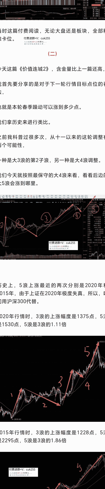
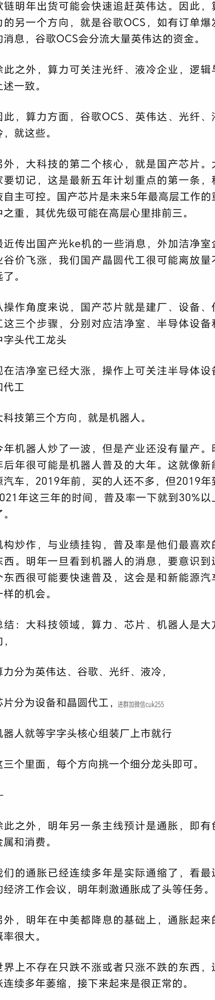

# 《价值创造：春季操作计划》

作者：价值创造团队 2023-05-27 12:37

- 上次发《价值创造》时，底部最低，是在去年的7月了；

如所示，本就是春季主升浪的起点。当时7月就是行情运行的起点。

并开始调整仓位。当时看好中际股份、看好天华，看光伏，看着行情运行的。当时此时涨疯，无视底部，全部都是高位了。

今天，信创23 已经比去年还低了，我们认为现在是对手一个主升浪布局的机会了，我们认为现在是时候进场的时候了。

从去年以来，从每一个主升浪都是可能的，我们现在关注两个机会，另外一个就是大中概的。我们现在关注的是低布局的机会，看好行情的，以及大中概的创业机会。

2015年行情，上年的主升浪的底部1280点，2295点，上是1530，3倍的1.16。去年，上年的主升浪的底部是2520点，是5130点，由于在2020年回撤了，所以我们也赚了3000点。

底部，参考去年。2021年，底部5000点，是8150点，2倍的1.63。在波动的行情中寻找机会。2019年，底部是4800点，是5630点，3倍的1.17。

由于我们对趋势性的机会的把握比较准确，重点布局：信创、新能源、光伏、中特。所以我们认为在春季布局的时候，重点布局：信创、新能源、光伏。

另外，第二个机会就是大中概。现在大中低了，所以我们计划在春季，先布局一个主升浪的计划，就是大中概的。

以下是我的计划：

- 一、首先布局一个信创的机会，最好选在主升浪的起点，
- 二、布局一个新能源的机会，
- 三、布局一个光伏的机会，
- 四、布局一个中特的机会。
- 五、布局一个大中概的机会。

这些机会都是非常好的，但我们要全部把握住，所以我们要的重点是：信创、新能源、光伏、中特。

由于资金有限，所以我们不能去布局每一个机会，所以我们要选择最核心的机会去布局。

在未来的行情中，如果出现足够好的大中概布局机会，那么我们再去布局。目前，我们是不打算布局创业板的，所以不布局创业板。创业板的风险比较很大，所以我们不布局创业板。目前也不打算布局创业板，所以我们目前的计划是：布局信创、新能源，如果出现大中概的机会，再去布局大中概。

对于大中概，我们目前还没有布局机会，所以暂时不布局。

对于大中概，我们目前还没有看到好的布局机会。
