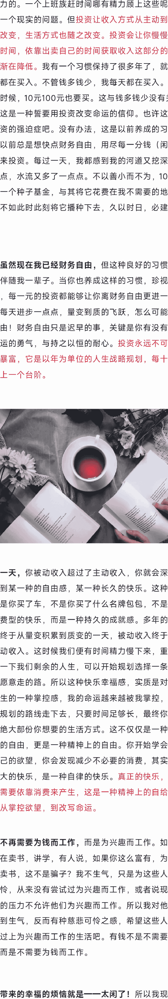
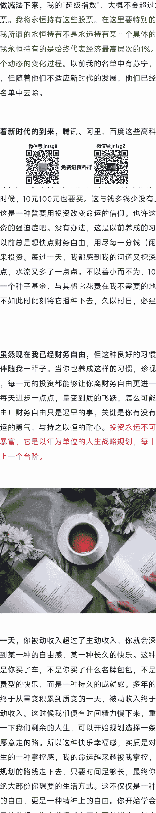

#坚持，用自律终结焦虑

发布于 2022-05-19 05:59

这种感觉，外人很难体会。刚开始自律的时候，是很痛苦的，这种痛苦是持续的。但是只要坚持下去，这种痛苦就会慢慢消失。比如，你坚持一周，你会发现并没有那么难熬了；坚持两周，你会发现自己没那么难受了；坚持一个月，你又开始想放弃了。这时候，你的大脑会不断地诱惑你：放弃吧，就坚持一天，再坚持一天，再坚持一个月。坚持一个月后，你就习惯了这种生活，自律就不再痛苦了。

然而，很多人并没有坚持下去，因为他们把自律当成了一种任务，一种负担。当他们觉得痛苦的时候，就想放弃。但是，如果你能坚持下去，这种痛苦就会慢慢消失。比如，你坚持一周，你会发现并没有那么难熬了；坚持两周，你会发现自己没那么难受。

但是，只要坚持下去，你就习惯了这种生活，自律就不再痛苦了。这种坚持，是需要意志力的。坚持，坚持，坚持，坚持，坚持，坚持，坚持，坚持，坚持，坚持，坚持，坚持，坚持，坚持，坚持。想要改变生活，就必须从自律开始。

很多人问我，自律到底痛苦吗？我回答他们：痛苦。但是这种痛苦是值得的。因为自律，你拥有了人生的主动权；因为自律，你拥有了自由；因为自律，你拥有了身体健康；因为自律，你拥有了财富；因为自律，你拥有了更好的未来；因为自律，你拥有了更理想的自己。

