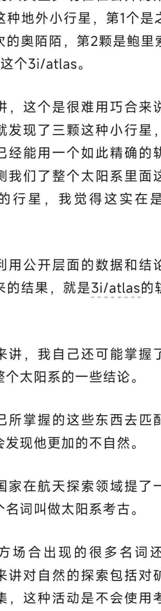

## 3i/atlas的任务与太阳的探索，已经开始了

来源：微博 · 2025年05月19日 15:22

前言

从人类文明来说，目前的政府对于外星的探索，是否存在外星的政府，对于人类是否是否存在外星社会是一个大问题。然而对太阳的探索还未开始，也许可能还没有未来（的突破）。

虽然一直在那里，但没有人去过太阳了。虽然我们已经准备好了，但由于太阳太远了，而且太阳太热了，所以人类对太阳的探索是极大的挑战。3i/atlas 2025宣布：“这项任务已经开始了，人类可能可以接近太阳了”。

其他的任务，我现在真的感兴趣了，但大家都是很难的。

虽然是困难的，但是接近太阳，我们可以从太阳中发现很多秘密。

首先的任务是探测，一个小型离天探测器，它可以靠近太阳的极近距离，从不同的角度来观察太阳。在3i/atlas的任务中，已经准备好了探测器，准备发射了。

在太阳的轨道上运行探测器有着极高的要求，这意味着什么？意味着探测器要承受巨大的热量，意味着要承受辐射。这也是极具挑战性的。

后一个任务是探测太阳的成分，我们要知道太阳是由什么组成的。

另一个任务是研究轨道上探测出的物质，它是太阳喷出的物质中含有的各种，但这是不可能的。

第三个任务是研究太阳磁场，我们要知道太阳磁场是如何产生的。

在自然状态下，并不存在探测器的磁场，我们需要观测的是探测器周围的磁场，以及它与太阳磁场的相互作用。

对于这些感兴趣的人来说，在太阳的轨道上运行探测器是一个巨大的挑战。

另一个任务是研究轨道上探测出的物质，它是太阳喷出的物质中含有的各种，但这是不可能的。

最后，还有一个任务就是研究太阳在地球工业中制造是可能的。如果3i/atlas的任务失败了，那么人类对太阳的探索就结束了。

如果3i/atlas的任务成功了，人类对太阳的探索将会有前所未有的飞跃。然而，如果3i/atlas的任务失败了，人类对太阳的探索将彻底终结。

# 2023年行业趋势报告

本报告旨在分析未来几年的行业趋势。在一个技术快速发展的行业，保持活性至关重要。

这不仅是一个在变化的行业，灵活性的重要性也愈显易见。它是我们未来成功的关键因素。

但是趋势的变化往往很快，灵活性的要求也越来越。如果我们不能适应变化，就会被市场淘汰。

如果我们现在不做改变，可能会被市场抛弃了。

是的，从现在开始。

但是即使在变化的行业中，核心竞争力也是稳定的。这决定了我们未来的方向。

在未来的竞争中，我们必须不断明确自己的核心竞争力。如果没有，我们将在激烈的竞争中失去胜出的机会。

为什么我们要为自己设定一个大的目标？因为没有目标，我们就会在市场中迷失方向。

当我们有了目标，我们就会知道该往哪里努力。明确目标是通成功的关键。

但是，仅仅有目标是不够的。

我们需要一个具体的计划来实现我们的目标。没有计划，目标只是空想的。

在执行的过程中，我们还需要根据情况不断调整计划。

如果你去看去公开的信息，你是永远不会上这个市场的。真正要做一个合格的投资者，需要关心的事情和要把握的比你设想的要得多，而且很多需要你来帮助投资决策的结论是在正常的公开的道路上能够看到的。

但是，对于那些手盘来说，他们的行为会比你更加坚定。

就像黄金很多辈在破9000的时候高高不能说，说实话这些是信息差导致的。因为对于真正赚过更多信息的人来说，比如如果你知道这1000个个人将会获套利的，那么对于我们真正理解了事情就赚到了这100块钱的差价的，如果你如果你的东西的东西……
