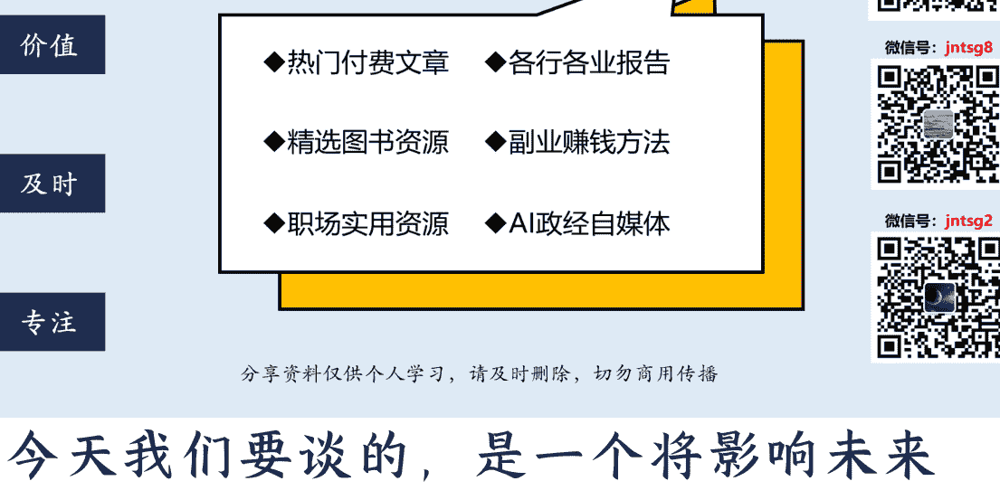

# 这个贯穿一代人的趋势，将重塑未来 20 年 2250611《政经参考》节

今天我们我们要谈的，是一个将影响未来 20 年、贯穿至少一代结构的趋势，它是底层发展逻辑的巨变，也是真正的时代洪流，很多事情会完全重塑。

最近，上海发布了最新的人口数据：截至 2024 年末，上海 60 岁及以上人口占比，达到了惊人的 37.6%。老年人口扩张相对的，则是出生率的持续走低，根据上海市健委在 2024 年 5 月公布的数据，2023 年上海的总和生育率，就是平均每对夫妇生育子女的数量，只有 0.6，在全世界大城市中排名倒第二，倒数第一是隔壁的韩国首尔。

上海只是中国趋势下的一个微缩影，这正是我们今天要讨论的“老龄少子化”，就是一方面老年人口比例持续上升，另一面人口比例持续下降，带来双重压力。

这是中国未来 20 年社会发展的基础性变化。它的影响将渗透到经济产业结构、财政体制、社会保障乃至思想观念等方面。今天和明天的两节课，我们就来谈一一，这个不可逆的趋势，会如何改变我们的生活与未来。

好，正题开始。

## 中国老龄少子化的现状

我们先谈一谈中国老龄子化的基本情况。

我们通常用 65 岁以上人口占人口的比重，来衡量一个国家的老龄化程度。2000 年的时候，中国 65 岁及以上人口占比超过 7%，正式进入老龄化社会。到 2021 年时，这个比例突破 14%，中国迈入深度老龄化社会；现在，则是进一步上升到了 15.6%。

与此同时，中国的生育率持续走低，2024 年出生人口只有约 954 万，相比 2016 年峰值的 1700 万，近乎腰斩。

中国的老龄少子化，有五个鲜明特征：

- 第一，规模前。中国 65 岁以上老年人口已经达到 2.2 亿，占全球老年人口的分分之一；而 60 岁以上的老年人口，更是达到了 3.1 亿。
- 第二个特征，是速度惊人。中国从老龄化社会过渡到深度老龄化社会，对应 65 占比从 7% 上升到 14%，只用了 21 年。根据中国社会福利与养老服务协会发布的《银发经济蓝皮》预测，中国将在 2030 年后，进入超老龄社会，也就是 65 岁以上老人占比将超过 20%。这个过程，德国用了 36 年，意大利用了 20 年，日本用了 12 年，而中国预计只会 9 年。中国的老龄化速度，比这些发达国家都要快。
- 第三个特征，是呈现高龄化趋势。中国的高龄老人，也就是 80 岁以上的老人，规模远超其他发达国家。根据专业机构育畅人口智库在《中国人口预测报告2023》中给出的数据，中国 80 岁以上人口占比，将从 2023 年的 2.8%，激增到 2050 年的 11%。
- 第四个特征，是未富先老。中国在 2021 年步入深度老龄化社会时，人均 GDP 只有 1188 美元，显著低于其他国家。同一阶段，日本人的人均 GDP 是 29467 美元，美国是 55675 美元，德国是 3122 美元，从这一点来看，中国确实是未富先老。
- 第五个特征，是城乡倒置。中国农村的老龄化程度高达 19.3%，显著高于城镇 12% 的平均值，留守老人、农村养老等现象，十分突出。

而少子化，则是推动老龄化加速的关键因素。

中国曾有过三轮婴儿潮，分别是 1950-1958、1962-1975、1981—1991 年，但 2000 年后形势发生改变，第四轮婴儿潮缺席。2016 年后出生人口连续下降，2023 年的生育率降到了 1.0 左右，远低于维持人口规模水平。人口结构正在发生根本性重构。

## 人口结构巨变下的经济巨变

老龄化趋势对中国的经济发展有哪些影响？它不是单纯的人口统计现象，而是底层逻辑的重大颠覆。从几个来说：

第一，劳动力市场的转型。最直接的冲击是劳动力供给面临“双降”。一方面总量下降，中国 15-59 岁的人口在 2013 年达到峰值，到 2024 年已经缩减到 8 亿，预计 2035 年将进一步缩减到 7 亿。另一方面则是年龄老化，根据数据显示，中国 45 岁以上劳动力占比，从 2000 年的 22% 上升到 2022 年的 23.2%。

动力供给在减少，经济仍然需要增长，核心出路是：年龄结构老化，45 岁以上动力上升，意味着社会必须重构生命周期，让老年劳动者成为中坚力量。

第二，消费领域的变化。随着老龄化的加深，整体消费倾向出现多方面的改变。老年人消费占比提高。根据国家统计局的数据，中国居民医疗保健支出占比从 2013 年的 6.9%增加到 2023 年的 9.2%，而年轻人消费占比从 7.8% 到了 5.6%。同时，老龄化加剧会让市场更注重健康服务类消费，而不是地产、汽车等。

另外，消费主导切换：

- 经济驱动力的转换：过去人口年轻，地方政府依靠“基建-土地-信贷”的消费循环可以驱动增长；但在老龄化社会，地方政府依靠消费来拉动增长。
- 不同资产的价值变化：老龄少子化社会对医疗、养老等服务需求激增，这些是知识、技术和人才这样的“软资产”，而不是传统意义上的土地、厂房或设备类“硬资产”。
- 资本配置也要重构：年轻的时候，人口红利还能消化一些资本浪费、产能过剩、僵尸企业；但老龄化下这些消化不了，必须突出企业创新和技术升级。

第三，创新面临考验。在科技创新这件事上，年龄的作用大于经验，颠覆性创新往往来自年轻群体。美国国家经济研究局的报告指出，诺贝尔奖获得者的平均年龄是 39 岁，顶尖发明家的创新峰值在 30-45 岁之间，年轻人敏锐的洞察力是年者经验无法弥补和替代的。当前，中国劳动力年龄中位数已经从 2000 年的 34 岁，上升到了 2020 年的 40 岁以上，2035 年将达到 45 岁左右，这会影响国家科技新的发展轨迹与比较优势。我们需要激活各种创新。

## 对产业格局的重塑

接下来的重点来了，老龄少子化对产业格局有哪些深远影响？这绝不是“某些行业收缩、某些行业增长”如此简单，而是一场涉及生产要素、需求逻辑、商业模式的深层迭代，从功能性需求转向适应老年社会。

首先是消费业上，年轻人口减少直接冲击“青春经济”行业——比如快时尚、电子竞技、母用品市场，增长放缓，甚至收缩。而健康医疗、养老护理等服务需求激增，服务业加速发展。

在中国泡沫破、进入超级老龄化社会后，医疗保健消费增速长期保持在 10% 以上，远高于 2.2% 的私人费用均增长。中国的医疗保健业也会出现类似趋势，根据国务院发布的《健康中国2030纲要》。

另外，年轻人和老年人消费主导切换会有更深刻的影响：

- 经济驱动力的转换：过去人口年轻，地方政府能够推动“基建-土地-信贷”的消费循环可以驱动增长；但在老龄化社会，地方政府依靠消费来拉动。
- 不同资产的价值变化：老龄少子化社会对医疗、养老等服务需求激增，这些是知识、技术和人才这样的“软资产”，而不是传统意义上的土地、厂房或设备类“硬资产”。
- 资本配置重构：年轻的时候，人口红利还能消化一些资本浪费，如产能过剩、僵尸企业；但老龄化下这些就消化不了，必须突出企业创新和技术升级。

功能性需求失效，消费结构上出现“没人买”与“无人卖”并存的局面。
