# 广州应用科学学院
教师人工智能素养提升与应用指南
（通用版）V1.0


广州应用科学学院
《教师人工智能素养提升与应用指南》编制组

# 免费 价值 及时 关注

# 扫码加入 知识星球TOP 免费资源群

- 每日免费获取价值资源
- 可提供各类资源搜索服务

| 热门付费文章 | 各行行业报告 |
| :--- | :--- |
| 精选图书资源 | 副业赚钱方法 |
| 职场实用资源 | AI经营自媒体 |

公众号：知识星球TOP 微信信号：jntsg8 微信信号：jntsg2


分享资料仅供个人学习，请及时删除，切勿商用传播

# 教师人工智能素养提升与应用指南
# （通用版）V1.0

教师人工智能素养提升与应用指南编制组
2025 年 3 月

# 目录

前 言 .................................................................................................................1
1 人工智能知识领域 .......................................................................................................4
1.1 人工智能基础知识 ....................................................................................................5
1.2 工具与平台基本操作 .......................................................................................................7
1.3 人工智能的教育应用 ...............................................................................................8
1.4 人工智能的科研应用 ...............................................................................................9
2 人工智能能力构成 ........................................................................................10
2.1 人工智能技术理解与应用能力 ...................................................................10
2.2 人工智能赋能教学能力 .......................................................................12
2.3 人工智能赋能科研能力 .......................................................................14
2.4 人工智能伦理与数据管理能力 .......................................................................15
3 人工智能使用规范 ........................................................................................17
3.1 规范应用行为 .......................................................................................18
3.2 强化风险防控 .......................................................................................20
3.3 构建治理体系 .......................................................................21
3.4 违规用人工智能案例 .......................................................23
4 教师人工智能素养提升路径 .......................................................25
4.1 强化政策引导机制 .......................................................................26
4.2 优化自我学习策略 .......................................................................27
4.3 丰富培训源体系 .......................................................................28
4.4 改革教学模式方法 .......................................................................28
4.5 提升科学研究能力 .......................................................................29
4.6 强化伦理道德约束 .......................................................................30
5 延伸阅读 .................................................................................................31
附录 1 人工智能工具的使用 .......................................................................32
附录 2 DeepSeek 应用指南 .......................................................................77
附录 3 人工智能在教学中的应用 .......................................................117
附录 4 人工智能在科研中的应用 .......................................................151

## 前言

人工智能 (AI) 为新质生产力的核心引擎，对全球经济社会发展和人类文明进步产生深远影响。习近平总书记指出，“人工智能是引领科技革命和产业变革的战略性技术”。随着人工智能技术的加速发展，教育生态正在深刻重塑，人类社会进入“智慧教育”时代。这一场系统性变革既为教师专业发展带来了全新的机遇，也对教师能力结构提出了全方位的挑战。

## 智慧教育时代的教师发展机遇

在教学实践中，AI为教师提供了智能化工具。通过智能教学平台，基于学生行为数据构建个性化画像，动态适应的教学方案。智能教室与虚拟实验室的应用，不仅丰富了教学场景，更将教师从重复工作中解放出来，使其专注于教学设计与创新。在学术研究领域，AI技术成为科研创新的加速器。机器学习算法可以高效处理复杂数据，帮助教师发现规律；数据分析工具更为跨学科提供支撑，推动教学研究向数据密集转型。同时，规范的技术应用框架为教师提供了操作指南，确保技术应用的透明性与安全性，为教育创造了健康生态。

## 智慧教育时代的教师发展挑战

技术迭代与应用复杂性要求教师持续提升数字素养。面对更新的智能工具，教师需要在理解技术原理的基础上，将其教育应用边界。教学模式的变革要求教师实现角色转型，从知识传授者转变为引导者与创新者，既需要更高的教学设计能力，也需平衡技术性与人文关怀。科研伦理与数据安全成为新的挑战。技术应用涉及教育数据的采集与分析，教师必须确保数据获取的合法性与使用的规范性。同时，技术滥用风险的防控、算法的规避，对教师的伦理判断力提出了更高要求。此外，持续学习的压力与时间管理的挑战，意味着教师的职业韧性。

## 智慧教育时代的实践探索

为响应教育强国、教育数字化转型部署，广州应用科学学院团队编制了《教师人工智能素养提升与应用指南（通用版）V1.0（以下简称《指南》）。《指南》构建了教师人工智能素养框架，明确了教学提升路径，详尽介绍了人工智能在教学与科研中的具体应用，具有普及性、系统性、实操性、本土化特点，是国内首个由高校编制并向全社会发布的教师人工智能素养提升与应用指南，为教育数字化发展战略提供了蓝图。后续，将根据人工智能技术的最新进展不断更新《指南》，期待与教育仁携手，共同谱写人工智能教育新章！

## 教师人工智能素养框架

教师人工智能素养框架（Artificial Intelligence Literacy for Teacher—AI）是《教师人工智能素养提升与应用指南（通用版）》的核心内容。框架涵盖了3个一级维度以及4个二级维度相互支撑，共同构成了全面的教师人工智能素养框架。

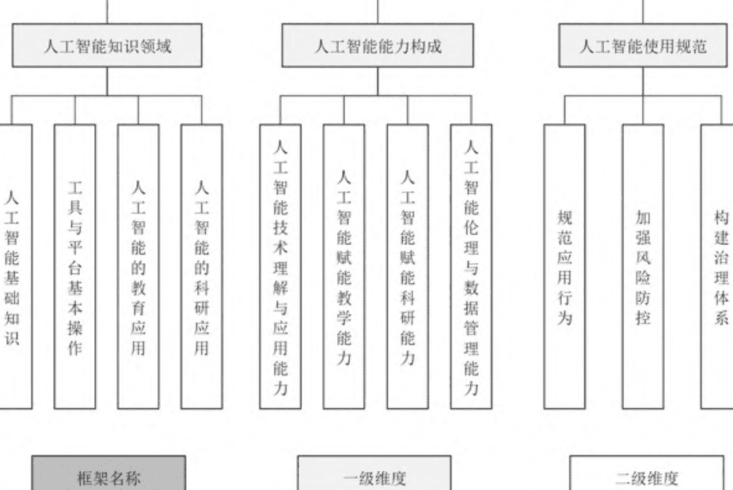

## 人工智能知识领域

部分内容主要是帮助教师建立对人工智能的基础认知，理解其核心概念、原理以及应用领域。首先，回溯人工智能的发展历程，从机器学习到深度学习，再到大语言模型，展现AI技术的演进。其次，介绍常用的人工智能工具，帮助读者快速应用于教学与科研中。最后，深入人工智能在教育中的具体应用，包括生成式学习、文献检索、数据分析及可视化等方面。

表 1 人工智能知识领域维度

| 一级维度 | 二级维度 | 三级维度 |
| :--- | :--- | :--- |
| 人工智能知识领域 | 人工智能基础知识 | 定义范畴 |
| | 工具与平台基本操作 | 发展历程 |
| | 人工智能的教育应用 | 核心技术 |
| | 人工智能的科研应用 | 常用工具介绍 |
| | | 生成式学习内容 |

### 1.1 人工智能基础知识

#### 1.1.1 定义与范畴

人工智能是指模拟人类行为的技术，涵盖计算机视觉、自然语言处理等领域。人工智能包含了很多，如机器学习、深度学习和大语言模型。机器学习是人工智能的基础，深度学习是机器学习的核心，大语言模型能够生成自然文本在各领域中有着广泛的应用，也是当前的研究热点。

#### 1.1.2 发展历程

- (1) 图灵测试（1950年）：艾伦·图灵用于衡量机器是否具备智能的标准。如果机器能够通过文字交流让人们无法区分与其人类，则认为其具有智能。
- (2) 深蓝击败卡斯罗夫（1997年）：IBM的超级计算机深蓝战国际象棋冠军，标志着机器在复杂策略中超越人类。
- (3) ImageNet挑战与深度学习的崛起（2012年）：杰弗利·辛普顿开发的AlexNet在ImageNet挑战中取得突破性胜利，证明了深度学习在图像识别中的潜力。
- (4) AlphaGo击败世石（2016年）：DeepMind的AlphaGo胜围棋世界冠军，展示了深度学习和强化学习的强大能力。
- (5) Transformer架构的提出（2017年）：Vaswani等人在论文《Attention Is All You Need》中提出，引入了自注意力机制和多头注意力，彻底改变了自然语言处理。
- (6) GPT-3发布（2020年）：OpenAI推出的GPT-3拥有1750亿参数，展现了强大的自然语言生成能力，成为大语言模型的重要里程碑。
- (7) 大语言模型多模态与轻量化趋势：Transformer架构逐渐多模态（如GPT-4的图像理解能力）和轻量化（如稀疏注意力机制）方向发展，以降低计算成本并提升效率。
- (8) DeepSeek-R1的发布（2025年）：该模型是一个由DeepSeek开发的高性能AI推理模型，有着卓越、强大的推理能力、完全开源、多模态交互等特点，是当前国内最热门的大语言模型。

#### 1.1.3 核心技术

- (1) 机器学习：人工智能的核心技术之一，通过数据中学习规律，使计算机能够准确预测、分类、聚类等任务，而无需显式编程。主要方法有：监督学习、无监督学习、强化学习等。
- (2) 深度学习：深度学习是机器学习领域，通过模拟人脑网络的结构和功能，处理复杂的非线性问题。核心组件有：神经网络、卷积神经网络、循环神经网络、生成对抗网络等。
- (3) 大语言模型：大语言模型基于Transformer架构的AI模型，能够理解和生成自然语言。核心技术有：Transformer架构、预训练和微调、生成式AI等。

### 1.2 工具与平台基本操作

#### 1.2.1 常用工具

- (1) ChatGPT：常用工具。
- (2) 通义千问：国内工具。
- (3) DeepSeek：国内大模型。

#### 1.2.2 基本功能

- (1) 注册：基础操作。
- (2) 界面：熟悉界面。
- (3) 输入：交互与功能。

### 1.3 人工智能的教育应用

#### 1.3.1 教学内容

利用AI工具生成教案、课件，提升教学效率。

#### 1.3.2 作业批改与反馈

自动批改作业和考试，提供个性化反馈；指出薄弱环节，建议。

#### 1.3.3 虚拟AI助教

虚拟AI助手提供24小时支持，实时解答学生的疑问，收集学习反馈，提供建议。

#### 1.3.4 智能评价与反馈

通过分析学生学习数据，提供个性化反馈；分析教学效果，提供改进建议。

### 1.4 人工智能的科研应用

#### 1.4.1 科研趋势预测

利用AI工具分析文献和研究方向数据，提炼研究热点和趋势，预测未来研究方向。

#### 1.4.2 文献检索与综述

利用AI技术快速检索文献，自动生成文献综述框架和内容。

#### 1.4.3 数据分析与可视化

利用AI工具自动清洗和预处理数据，使用算法进行分析和建模，生成直观的图表。

#### 1.4.4 论文写作与润色

利用AI工具生成论文框架和内容，检查语法错误，优化语言表达，自动生成参考文献。


# 广州华学院

## 人工智能能力构成

本内容着重于教师人工智能能力的核心要素，旨在为教师的专业发展提供理论指引与可能的路径。通过细致剖析人工智能在教育场景中的应用，紧密结合教师的职业特性，从技术理解与应用、助力教学创新以及科研能力等多个维度出发，系统且系统地构建教师人工智能能力的构成体系。

具体而言，技术理解与应用能力要求教师深入掌握人工智能的基本原理与关键技术，熟悉其算法逻辑和应用场景。熟练运用 AI 进行优化教学安排、科研成果转化，实现技术与科学知识深度融合，助力教学科研创新。教学创新能力要求教师利用 AI 设计个性化学习路径，结合学生特点开发教学资源，创新教学模式，为学生定制专属教学方案。科研能力则强调教师运用 AI 技术高效处理数据、挖掘科研线索，开展跨学科研究，解决复杂科学难题，推动科研工作取得新突破。如表 2 所示。

| 一级维度 | 二级维度 | 三级维度 |
| :--- | :--- | :--- |
| 人工智能能力构成 | 人工智能理解与应用能力 | 技术理解能力<br>工具操作能力<br>技术迁移能力<br>教学优化能力 |
| | 人工智能教学能力 | 个性化教学能力<br>教学模式创新能力<br>科研协作与沟通能力 |
| | 人工智能赋科研能力 | 跨学科研究能力<br>科研创新能力<br>理论判断能力 |
| | 人工智能治理与管理能力 | 数据管理能力<br>人文平衡能力 |

# 人工智能技术理解与应用能力

### 2.1.1 技术理解能力

教师应具备对人工智能基础理论的深入理解，包括但不限于机器学习、深度学习、语言模型等核心技术的工作原理与应用场景。此外，更重要的是了解 AI 技术的最新发展趋势，如生成式 AI、大语言模型及其在教育领域的应用价值。需要理解其工作原理，包括预训练、微调、提示工程等技术细节，并能够应用于教学资源生成、智能问答系统开发等场景。

### 2.1.2 工具操作能力

通过实际操作，教师能够将 AI 工具用于教学资源开发、学生行为分析、课程优化等场景，提升教学效率与质量。

- (1) 教师需要熟悉掌握 AI 工具与平台的操作能力。包括利用智能教学系统进行课程管理、学生互动与学习数据分析。例如，利用超星 AI 工作的强大功能，为学生提供个性化的学习资源。
- (2) 掌握 AI 生成内容的操作能力，能够生成高质量的教学材料（如课程、作业、案例）或设计新的课程内容。例如，利用 ChatGPT 生成教学案例，或使用 MidJourney 制作视觉化的教学素材。
- (3) 对于理工科教师，还需要掌握 Python、R 等编程语言，能够进行数据清洗、分析与可视化。例如，使用 Python 的 Pandas 处理学生成绩数据，或利用 Matplotlib 生成行为分析图表。

### 2.1.3 技术迁移能力

教师应具备将 AI 技术与学科教学融合的能力。要求教师不仅掌握技术，还能将其灵活迁移到具体学科场景中，实现技术与教学的协同创新。

- (1) 在理工科教学中，教师利用 AI 模拟复杂的实验或优化实验设计。如，利用 AI 算法模拟物理实验中的粒子运动，或通过机器学习优化化学反应条件等。
- (2) 在人文社科教学中，教师借助 AI 工具进行文本分析、情感分析或生成个性化学习材料。例如，利用自然语言处理技术分析历史文献中的关键词，或通过生成式 AI 工具为学生定制个性化的阅读材料。
- (3) 还要求教师具备跨学科融合的能力，能够将 AI 技术与自身学科领域相结合，探索新的教学方法与研究范式。例如，在经济学教学中，借助 AI 模型进行市场预测与分析。

## 2.2 人智能赋能教学能力

### 2.2.1 教学效率化

通过 AI 技术对教学数据的深度挖掘与分析，教师能够精准识别教学中的痛点与难点，从而优化教学策略，提升教学效率与效果。

- (1) 利用学习分析追踪学生的学习行为数据，如学习时长、作业完成情况、测试成绩等，通过数据挖掘技术，深入剖析这些数据，准确发现学生在知识掌握上的薄弱点。
- (2) 借助 AI 工具化课程内容结构，提升教学资源的针对性和有效性。例如，利用自然语言处理技术分析教学内容，识别重点与难点，并生成相应的教学辅助材料，AI 还可以根据学生数据动态调整教学进度，确保教学内容与学生能力匹配。
- (3) 基于 AI 分析结果，教师可以针对性地调整教学策略。例如，根据学生的弱点设计复习课程，强化巩固；补充丰富的教学资源，辅助理解；或者灵活调整教学进度，使之更符合学生实际。能够显著提升教学效果，助力学生更好地掌握知识。

AI 技术为教师提供了强大的个性化化学学习工具，能够根据学生的个体差异定制学习路径，并在此时即时反馈与学习建议，从而实现因材施异的教育理念。

- (1) 借助自适应学习系统，为学生定制个性化的学习路径。例如，根据学生的学习进度、知识掌握情况和学习风格，动态推荐适合的学习资源和题目。不仅能够提高学生的学习效率，还能增强学生的学习兴趣与动力。
- (2) 通过智能辅助系统，为学生提供即时反馈与学习建议。例如，系统可以自动批改并生成详细的分析报告，帮助学生及时纠正错误。
- (3) 智能 AI 交互功能为学生提供即时的建议。通过大语言模型，生成个性化的学习材料或设计个性化的任务。例如，根据学生的学习需求，针对性的选题。
- (4) 教学系统中的 AI 工具平台为教师提供了便捷的个性化支持，帮助教师高效实现因材施教。

教学创新对于教师来说至关重要，根据当前的发展和学情，要求教师积极探索新型模式。

- (1) 利用 AI 技术辅助混合式教学，在线与线下结合；例如，通过 AI 工具生成学习资源。
- (2) 对于翻转课堂，利用 AI 技术为学生提供学习材料并通过课堂进行互动。此外，AI 技术可以帮助教师分析学生的数据，识别疑点，并在课堂上针对性地讲解。
- (3) 利用虚拟现实（VR）和增强现实（AR）技术构建沉浸式环境；例如，在教学中，学生可以通过 VR 技术模拟实验，从而在安全可控环境中掌握实验。

## 2.3 AI智能赋能与沟通

### 2.3.1 科研协作与沟通能力

AI技术的快速发展为科研协作带来了革命性的变革，教师能够突破限制，实现高效协同。利用 AI 技术分析数据、开发协作平台，不同领域的学者可以消除学科间的壁垒，促进交叉创新。例如，在生物信息领域，AI技术成功连接了生物学与计算机科学；在环境科学领域，AI模型整合了环境学、地理学等学科科学，提高了准确性；在文学领域，通过AI模型助力发现文学作品中隐含的规律，提高了研究价值。

### 2.3.2 学科能力

教师应该具备AI技术与自身领域相结合的跨学科能力，解决复杂问题。在经济领域，借助AI模型进行市场预测与分析，或通过AI工具分析消费者行为，为决策提供支持。在法律领域，AI技术可以帮助教师分析案情、协助完成复杂的工作。例如，利用自然语言处理提取法律信息，通过智能推荐系统提供案例。在心理学中，利用AI技术分析学习特征，提供参考。

### 2.3.3 科研创新能力

AI技术能够显著优化科研流程，提升科研效率，帮助教师快速形成研究结果。

- (1) 利用AI辅助获取相关领域的动态。例如，通过自然语言处理技术提取文献关键信息，或利用知识图谱发现研究热点。
- (2) 通过AI驱动实验设计，教师能够优化实验方案，减少试错成本。例如，利用强化学习模型优化参数，通过模拟预测实验结果提高准确性。
- (3) AI还可以支持数据的自动化分析与可视化，帮助教师发现研究结果。例如，生成可视化图表，直观展示研究结论。
- (4) 此外，教师还可以利用AI生成报告，总结研究发现与创新点。
- (5) AI还可以促进科研协作。例如，利用协作平台实现科研团队工作，通过AI工具辅助撰写论文。

## 2.4 人工智能与管理能力

### 2.4.1 批判判断能力

在 AI技术应用中，教师需要识别算法偏差、数据隐私、技术伦理等问题。教师在教学中引导学生正确使用AI工具，培养其伦理意识与社会责任。例如，在AI辅助决策时，教师需要关注算法的公平性与透明度，避免导致的不公正现象。

### 2.4.2 数据管理能力

教师应掌握数据全周期管理的技能，包括数据的收集、存储、处理、分析与保护。例如，在收集学生数据时，教师遵循遵循知同意原则；在数据存储与传输过程中，教师应采用加密技术确保数据安全；在数据分析中，教师需避免数据滥用或误用。这种能力不仅是技术层面的要求，更是数据合规性与安全性的保障。

### 2.4.3 人文平衡能力

在 AI技术应用中，教师应注重教育的本质，避免过度依赖技术而忽视人文关怀。例如，在利用AI工具进行教学时，教师需关注学生的情感需求与价值观塑造，避免技术工具取代师生互动。通过平衡技术与人文，教师能够在教学中实现技术与教育的和谐统一。

# 人工智能使用规范

| 一级维度 | 二级维度 | 三级维度 |
| :--- | :--- | :--- |
| 人工智能使用规范 | 规范应用行为 | 避免依赖 AI 技术 |
| | | 防范偏差视角 |
| | | 甄别错误信息 |
| | 加强防风险防控 | 严格保护学生隐私安全 |
| | | 防范学术不端 |
| | | 强化知识产权和版权 |
| | 构建治理体系 | 强化伦理审查与数据能力 |

人工智能技术的快速发展深刻重构教育生态，推动教学模式向智能化、个性化转型。作为AI教育的实践主体，教师肩负着技术向善、守护教育本质的使命。因此，在面对AI引发的伦理失范、隐私泄露、学术危机等风险时，教师必须始终坚持“技术为教育服务”的核心原则，将《新一代人工智能发展规划》《全球人工智能治理倡议》等政策规范化行为准则，以人为本、安全可控、公正透明、责任明确并持续发展贯穿教学过程，既要运用AI提升教学效果，更要坚持教育者的主体地位。

为了实现人工智能与教育事业的深度融合、协同发展，构建一个安全、可靠且可持续的教育生态至关重要。在此过程中，教师于教育教学场景下运用人工智能时，需严格遵循人工智能使用规范。规范要从三个维度展开，即规范教师自身的行为、强化防风险意识、着力构建完善的教育治理体系。同时，为增强教师对人工智能伦理问题的重视，本部分特意增加了揭稿风、数据泄露、AI侵权等典型违规使用AI的案例作警示。

### 3.1 规范应用行为

- (1) 教师不应完全依赖AI技术，忽视了教育中的情感关怀，作为教育者的角色和责任。
- (2) 教师应增强对数据隐私和安全的认知，同时对学生进行数据安全与隐私保护的培训。
- (3) 教师要积极探索新型教学模式，利用AI辅助教学的方法，持续提升学生对人工智能的理解、应用力。
- (4) 教师应引导学生理解AI辅助的作用，独立思考。在教学中，教师可以组织学生讨论，分析AI提供的答案的合理性和局限性。
- (5) 教师鼓励学生在使用AI之前先尝试，培养自主习惯。这不仅有助于防止学生过度依赖，还能提高学习兴趣和创造力。

### 3.2 防范偏见

风险是由于数据集存在偏见、缺乏多样性，以及算法对特定群体产生负面影响。

- (1) 教师应识别AI生成内容中的偏见，损害个体的权利。
- (2) 教师应引导学生认识偏见的存在，批判性地评估AI输出。
- (3) 教师应对AI生成内容建立有效的验证机制，通过权威媒体、官方数据库进行交叉验证。
- (4) 教师在使用生成式AI设计材料时，特别是涉及事实和观点等关键内容的，应明确标注并说明其生成过程，确保真实准确。
- (5) 教师将AI辨别能力纳入学生素养培养。

### 3.3 识别错误

风险主要由于人工智能基础模型中大模型可能产生“幻觉”（Hallucination）。

- (1) 教师应加强对人工智能生成内容的辨识能力，将其生成内容作为教学参考，避免误导。
- (2) 教师应对AI生成内容存在事实性错误时，及时发布声明。


## 3.4 违规使用人工智能案例

### 3.4.1 大量撤稿风波

2023年9月，《物理写作》刊登的一篇论文中出现了“重新生成回复”（Regenerate response）的字样，表示可能在使用ChatGPT的痕迹，最终该文被撤稿，这也是第一例因使用 ChatGPT 而撤稿的SCI 文献。

根据《自然》（Nature）的报道，截至2023年，全球有超过1万篇学术论文被撤稿，其中9408篇论文出自亥维（Hindawi）旗下的出版社，除了“同行评审造诈、论文工厂和出售作者身份”等常见撤稿原因外，“使用AI”正成为撤稿的一大主因。

英国出版社 Sage 宣布从旗下期刊《Journal of Intelligent and Fuzzy Systems》(JIFS）中撤稿416篇论文，此风波导致涉事数据大多来自中国和印度高校引发关注。技术内容检测显示，这些论文存在复杂的语句、构造的引用网络及缺乏硬核的作者信息，其写作模式与人类习惯严重不符，最终被确认为“非真实性”成果。

### 3.4.2 数据泄露

2025年2月，某匿名论坛曝光的AI产业链中，黑客通过伪造未成年人信息购买AI工具，利用二次开发API接口截取用户数据。这些被取的200GB“学生隐私数据库”包含毕业文档、家庭住、学籍信息甚至银行账户线索，在黑市以88-588的价格交易。更严重的是，部分骗子充分利用这些数据实施“教育退费”骗局，单笔涉金额高达13.8万。

2023年11月28日，来自谷歌、华盛顿大学等的研究发现ChatGPT数据泄露漏洞，ChatGPT多次重复一个词，模型可能会输出个人信息。随后，OpenAI证实部分ChatGPT Plus 服务订阅用户的姓名、电子邮件、支付地址、信用卡的后四位和信用卡有效期等被泄露。

### 3.4.3 AI 侵权

2024年2月8日，广州互联网法院作出全球首例生成式人工智能平台侵权责任判决，认定被告 AI 公司侵犯了原告对奥特作品的复制权和改写权。

2024年4月23日，全国首例 AI 生成声音人格侵权案，在北京互联网法院判决配音师胜诉，AI 开发者使用配音师声音、开发涉AI文本语音产品未获授权，构成侵权。

2024年6月20日，北京互联网法院在线庭庭审理了四起画师起诉 AI 绘画软件运营者著作权案件，该案为全国首例涉AI绘画模型训练著作权案件。

2024年12月30日，长沙中院终审判决某网络公司通过“AI一键成片”功能非法传播《庆余年》短视频片段构成侵权，需赔偿80万元停止侵权行为。

## 4 教师人工智能素养提升路径

人工智能与教育的融合引发了教育系统的巨大变革，无论国家、社会还是教师自身，都对教师素养提出了新的要求，呼吁教师素养与技术环境匹配。教师在具备专业素养的同时，需要培养人工智能教育素养。为此，教师积极探索人工智能素养的提升路径，对教师自身提升整体素质具有重要意义。

《指南》从多维度协助教师适应人工智能的快速发展。政策引导方面，学校应出台激励政策与规范要求，激励教师提升人工智能素养并确保工作有序推进，同时积极争取外部支持。在自学习、培训支持与教学创新维度，也将为教师提供丰富的资源与方法，助力教师掌握人工智能技术，推动学校教育事业向新高度。教师人工智能素养提升路径如图所示。

### 教师人工智能素养提升路径

| 强化政策引导机制 | 优化自我学习策略 | 丰富培训资源体系 | 改革教学模式方法 | 提升科学研究能力 | 加强伦道德约束 |
| :--- | :--- | :--- | :--- | :--- | :--- |

图2 教师人工智能素养提升路径

## 4.1 强化政策引导机制

### 4.1.1 学校制定明确的专家，共同制定一套全面、科学的教师人工智能素养标准

学校联合相关领域涵盖信息知识、信息技能、信息伦理与道德等多个维度，并将这些标准涵盖知识……并针对人工智能技术的应用提出具体要求。同时，建立相应的考核评估体系，将教师人工智能素养纳入教师评价、职称评定等体系中。

### 4.1.2 学校加大投入与支持

学校加大对人工智能的投入力度，为教师提供必要的资源和技术支持。包括资金、设备、软件等方面投入，以及建设高质量的人工智能基础设施。还要建立激励机制，设立专项计划、提供奖励等。

### 4.1.3 学校制定计划与目标

各学院结合自身教师人工智能素养的实际情况，深入分析当前教学过程中在人工智能应用方面的不足之处，规划并制定学院“教师人工智能素养提升行动计划”，以确保教师在未来能够有效地将人工智能技术融入教育教学中。

为保证计划的实施效果，设定明确具体的目标非常重要。这些目标包括提升教师人工智能的能力，还应增强学生对人工智能技术的理解和兴趣等多个维度。同时，需要清晰的时间节点，以便于跟踪……并调整策略。

### 4.1.4 资源协调与支持

为支持教师人工智能素养的提升，各教学单位与计算机学院、人工智能学院相关部门建立密切关系。通过协调各部门，统筹必要的技术支持、共享资源并开展培训，为教师营造良好的学习环境。

## 4.2 优化自我学习策略

### 4.2.1 建立自主学习

教师需要根据自身专业背景、教学需求及个人兴趣制定学习计划。一方面，构建“基础知识——成长——能力评估”三维轨道；另一方面，实施立体化学习，包括核心理论如机器学习、深度学习，以及技术操作如编程、数据处理等技能。教师应利用各种在线平台，接触到最新成果，不断拓宽边界。

教师应关注行业动态，通过权威博客、社交媒体及时获取人工智能领域的最新进展。定期阅读顶级期刊和学术会议，了解当前的发展趋势。

### 4.2.3 发展与应用

教师积极将人工智能技术融入教学实践，例如，参与智能系统的设计辅助学习过程；参与人工智能项目，将教学与研究结合。

## 4.4 混合教学模式

### 4.4.1 探索混合教学模式

随着人工智能技术的不断发展，混合教学模式已成为教育领域的必然趋势，为学生提供更为丰富、更加个性化的学习体验。成功实施混合教学模式，教师需要具备较高的人智能素养和技术应用能力。教师应熟悉各种在线教学工具，并且能够与教学内容有效结合。此外，教师还应关注学生的个性化需求，及时调整教学策略和方法，确保每个学生都能获得最佳的学习效果。

## 4.5 提升科研能力

### 4.5.1 智能增强认知

教师可以人工智能突破个人局限，构建智能化科研支持系统。通过语言处理与知识图谱技术，人工智能可以梳理全球学术论文轨迹，提炼学科前沿，生成动态发展的研究地图。人工智能辅助假设，输入初步理论模型，系统即时调取历史数据进行验证，显著降低成本，使教师能够将更多投入到创造性思考。

### 4.5.2 重塑师生共同

人工智能技术正在重构实验室场景下的师生互动模式。基于人工智能的实验设计平台，教师可以与学生共同制定研究方案，人工智能自动化寻找参数组合并预测结果，将传统的“导师命题——学生执行”的单向模式，转化为“人机协同探索”的创新生态。在数据分析环节，人工智能实时生成可视化反馈报告，帮助教师精准诊断学生操作偏差，将教学反馈颗粒度提升至微操作层面。智能化协作不仅提升效率，更通过沉浸式科研实践，培养学生思维与人工智能素养，实现知识传递与创新能力培养的深度融合。

## 4.6 加强伦理道德约束

### 4.6.1 加强宣传教育

教师应树立正确的信息理念和价值观，确保在使用人工智能技术开展教学时始终坚持守道道德底线。学校可利用在线学习平台，发布相关信息与道德的课程和资料，方便教师随时阅读和学习。同时，组织教师参与相关的实践活动，参与学习、志愿者服务等，通过实际行动加深其对……的理解。


# 广州华南科技学院

同时，人工智能通过自动化工具，优化了学校的运营效率，为教育管理者提供了更加科学的决策支持。

人工智能的发展前景令人期待。随着技术的不断进步，人工智能将在更多领域展现出巨大的潜力。在教育领域，人工智能有望实现更加精准的个性化教育，还将推动教育资源的共享与普及，打破地域和时间的限制，让更多人享受优质的教育资源。

人工智能不仅是技术的进步，更是人类智慧的延伸。为我们提供了前所未有的机遇，也带来了新的挑战。我们将积极拥抱这一变革，探索人工智能在教育中的应用。希望本部分内容能够帮助老师更好地理解和运用人工智能工具，为学校的未来发展注入新的动力。

## 国内高校人工智能应用成功案例

人工智能工具的使用培养能力、提升素养、推行智慧教育和满足个性化需求为目标。在教学中，人工智能的应用更是重点关注和研究的对象。学校越来越期望通过大数据平台和人工智能的先进技术来推动教育改革。虽然技术不能取代教师的作用，但在人工智能时代，教师使用人工智能手段进行教学模式的变革，成为提高教育质量的关键之一。

我国的教学体系不断向教学、科研和管理等方面的科技化深入发展。下面介绍一些国内高校在人工智能应用方面的成功案例。这些案例展示了人工智能在教育中的巨大潜力和广泛应用前景。

北京航空大学的《人工智能赋能的课堂交互在线教学平台》案例基于生成式大模型、模拟器深度学习引入智能技术，打通教师线下各个教学环节，实现授课前预习-中学习-课后复习-课程贯穿学习闭环，以校园322个智慧教室为基础，开展课程资源的开发化。以在线教学平台为支撑条件，开发了全天候智能知识引导助手，解决学生学习过程中的各项问题。

国家大学基于迭代大模型构建的大规模个性化智慧教学体系，包括：英语口语智能训练系统，从不同维度及时反馈；英语写作智能批改系统，提供即时评价和修改建议；探索新型生成性教学资源制作模式；基于知识图谱打造自适应学习体系，学生可根据个人需求进行自主学习；AI虚拟教师智能问答，可在提供二十四小时知识学习服务的同时，展示专业知识问题的关联知识和引用资源。

广州南方学院的 AI 教学线下混合教学模式探索，利用服务架构构建的智慧课堂平台，覆盖课前、课、课后教学过程，实现课程和教学资源的数字化与智能化管理，有效提升了教学管理效率，增强了课堂互动。

2023~2024学年，该学校建模课程取得显著成果，教学资源丰富，教学互动频繁，课堂氛围活跃，学生参与度显著提高。最终该案例列入 2024 年广东省教育管理信息化建设与应用优秀案例。

美国亚利那州大学利用 ChatGPT Edu 实现个性化学习并推进研究工作，包括人工智能驱动的行为健康培训、偏见检测和增强劳动发展，将 ChatGPT 推广到每一个学院。例如“AI写作伴侣”利用 ChatGPT 支持学术写作，为学生提供即时反馈，加强他们的互动。再基于 ChatGPT 的聊天机器人“SAM”通过帮助学生练习与人之间的对话，让学生真实练习他们的鼓励技能，而 ChatGPT 提供的互动记录可以作为教师给学生期末评分的依据。甚至还有博士生利用 ChatGPT 将晦涩难懂的科学点招募志愿者转化使得大量科学术语变得且易懂的内容。

以上这些成功案例展示了人工智能在教育中的巨大潜力和广阔前景。这些创新应用，人工智能不仅提高了教学质量和管理效率，还为学生和教师提供了更多个性化和灵活的学习与教学体验。接下来，让我们深入了解如何实际操作和使用人工智能工具。这些步骤和技巧帮助教师更好地掌握这些先进技术，在教学和学习中发挥最大的效益。

## 2 人工智能工具实际操作与技巧

大模型是基于深度学习的大规模神经网络，在应用层，通常采用 Transformer 模型，通过自监督学习对海量数据进行预训练，形成对语言、逻辑和跨领域知识的深度理解能力。这类模型（如 GPT-4、PaLM M）参数量可达千亿级，展现出巨大的上下文理解、文本生成、多任务迁移和跨领域处理能力，能够完成项目书摘要、旅游路线规划、策案编写等任务。

值得注意的是，大模型通过注意力机制动态捕捉语义关联，结合人类反馈对齐，其输出符合人类价值观。在应用层，用户可以通过微调、提示工程等方式定制模型，但需注意仍存在幻觉风险。当前技术已突破单一模型限制，支持图像、音频的多态交互，为智能化提供了通用基座，其应用持续拓展至科研、教育、商业决策等场景。

通过对比表，当前主流模型工具在功能上呈现出显著差异。从技术维度来看，这些工具聚焦于以下几个方面：

| 模型名称 | 核心功能 | 特色功能 |
| :--- | :--- | :--- |
| 豆包 | 问答、创作、聊天 | 法律逻辑、情感分析、智能体 |
| Kimi | 长文本处理（20万字以上）、文件解析（PDF）、多语对话 | 智能体、文档解读 |
| 讯飞星火 | 语音交互、多模态理解（图文） | 智能体、视频对话 |
| 文小言 | 搜索（富媒体）、记忆、个性化、阅读 | 智能体、思维导图 |
| 通义千问 | 长文本对话（10000字以上）、文案创作、逻辑 | 社区、文件解析 |
| 文心一言 | 文档处理（1000字以上）、多语言（越语）、编码 | PPT 创作、智能报告 |
| 数据分析 | 结构化任务、语音、照顾 | PPT 助手、AI 视频 |
| 安全防护 | 信息检索、生活助手 | 文生视频、图生视频 |
| 灵感版 | 市场调研、行业分析 | 金融能力 |

根据下载次数，截止到目前下载最多的是豆包，因此将介绍豆包的基础以及进阶功能。

### 2.1 豆包

豆包是字节跳动公司基于大模型开发的一款多功能 AI 助手，2023年8月推出，旨在为用户提供智能化的对话、创作和支持。它支持 APP、客户端、网页、插件等形式，广泛应用于个人和企业场景。其智能功能可以提供高度个性化的 AI 助手体验，用户可以根据需求定制风格、技能和背景，甚至克隆自己的声音。

#### 2.1.1 获取方法

- (1) 手机 APP：应用商店搜索“豆包”并安装
- (2) 电脑版：https://www.doubao.com/download/
- (3) 网页版：https://www.doubao.com/chat
- (4) 浏览器插件：https://www.doubao.com/browser-extension/landing

#### 2.1.2 手机 APP 快速上手

(1) 消息提问（基础功能）
当打开豆包的手机 APP 时，选择一种方式登录，登录后就会如图2-1(a)的界面，这是豆包大模型界面，图2-1(b)则是微信消息界面。因为豆包与微信的操作逻辑非常相似，所以通过两者的对比能够更快上手豆包。


(a) 豆包界面 (b) 微信消息界面

2-1 豆包与微信界面对比

先介绍豆包基础功能之一的“发消息功能”，如图2-1(a)所示，点击“消息编辑”，输入你想要问的问题，比如：广协科什么时候开学、帮我总结一些最近流行的网络语言。豆包大模型将会给出如图2所示的两个正确的回复。


(a) 广协科学开学时间 (b) 总结热门语言

2-2 发消息提问

(2) 电话（基础功能）
如果用户不想打字，那么也可以像微信一样给豆包打电话。豆包用语音对，如图2-3(a)所示的两个按钮，点击其中一个按钮就会进入2-3(b)所示的对话界面。进入语音界面后，就能实时向豆包模型进行语音提问或指令。在2-3(b)上方有一个“文字”按钮，点击后将实时聊天内容显示在屏幕上，2-3(b)下方分别是“静音”和“挂电话”功能。


(a) 电话按钮 (b) 语音界面

2-3 电话提问

(3) AI 生图（特色功能）
点击2-3(a)下方的“AI生图”按钮，即可进入2-4(a)所示的界面，该功能可以根据你输入的文字生成具体的图片。比如输入“帮我生成一张广州番华学院的图”，即可得到2-4(b)所示的四张图片。生成如果不满意，可以点击再次生成或保存到手机。


(a) AI 生图界面 (b) AI 生图结果

2-4 AI 生图功能

(4) 豆包日报、翻译功能（特色功能）
点击2-1(a)中的特色功能往左滑动，能看到更多功能。左侧找到“豆包日报”并点击，即可让豆包汇总今天的热点新闻；继续左侧找到“翻译”按钮并点击，进入2-5(b)的界面，输入需要翻译的文本，如“人工智能工具指南”，结果如图2-5(c)所示。


(a) 豆包日报 (b) 翻译文本 (c) 翻译结果

2-5 豆包日报与翻译功能

（5）切换智能体（王牌功能）
所有的操作都在一个类似的聊天窗口界面中进行，也就是说面前只是一个名为豆包的“联系人”进行对话。与微信相似，我们还可以把这些“联系人”称为智能体。在豆包 APP 中不是称为联系人，而是称为智能体，或者你可以叫它AI。豆包大模型已经回答我一切问题，为什么还需要智能体呢？因为它还不够个性化，而且智能体在专业领域、交互风格、功能和情感上有许多特色，更好地满足多样化场景和需求。通过上面的介绍，我们已经知道豆包具备语音、答题、翻译能力，不过豆包大模型一直是一个管家的姿态与我们对话。若我想让它以英语老师的姿态练习英语，或者让它通过拟像“熊二”的姿态逗我开心，就需要切换智能体。

点击2-6(a)中的“返回对话界面”按钮，将出现2-6(b)中的对话界面。在2-6(b)中，右上方的放大镜是搜索智能体功能，中间的智能列表，并且几个初始智能体Mia、珍珠、林黛等，下方的“发现”按钮则是智能大全。你会发现这个界面与微信消息列表非常相似，实际上搜索智能体类似于添加新好友。现在先点击“搜索智能体”按钮。


(a) 豆包界面 (b) 对话界面

2-6 智能体列表

点击“搜索智能体”按钮，在搜索框中输入“英语阶梯”，出现了如图2-7(a)界面，不妨选择Lily（初级英语阶梯），此时就会进入2-7(b)界面，开启与Lily智能体的英语对话。


(a) Lily智能体 (b) 英语练习

2-7 英语练习

（6）创建智能体（招生老师）
假如我是某中学招生老师，每招生季就有无数家长咨询中学的分数、环境、学费等问题，只要有一个智能体能够回答这些问题就好了。帮自己创建一个智能体！如同2-9(a)所示，点击页面右上角的“+”，选择创建。在2-9(b)所示填写智能体的名称和描述，写好后点击“声音”选项，可以选择预设声音，或者克隆自己的声音。


(a) 录制我的声音 (b) 成功克隆自己的声音 (c) 一键完善资料

2-9 创建智能体

###设定描述
我是某中学招生老师，今年总分820，招生人数108人，录取线750分左右，空缺700分以上仍有机会录取。

点击“克隆声音”按钮，进入2-10(a)的界面，根据屏幕长按“录制”按钮，录制内容；稍片刻即可将声音克隆下来。接着按照2-10(b)所示点击“完成”按钮；此时回到了设置界面。由于资料很多，不想填写就点击图2-10(c)右上角的“一键完善”，将信息进一步完善了；然后点击“创建智能体”按钮，自此距离成功创建智能体还一步之遥。


(a) 录制我的声音 (b) 成功克隆自己的声音 (c) 一键完善资料

2-10 克隆声音并一键完善资料

点击“创建智能体”按钮后，将出现2-11(a)所示界面，选择公开——所有人可见，即可创建一个智能体并共享给所有APP用户。如图2-11(b)所示。该“招生老师”智能体的知识涵盖互联网上关于某中学的信息以及设定的特定信息。若后面有招生变更，可以继续添加或修改原有的智能体设定。至此，就能将智能体分享给家长们使用了。


(a) 选择权限 (b) 招生老师智能体

2-11 智能体创建成功

下面尝试与某中学招生老师智能对话，直接向它提第一个问题：我的孩子今年中考787分，可以被你们学校录取吗？它的回答如图2-12(a)所示，完全符合我们在图-10中设置的知识。第二个问题是：你了解水中中学今年的录取分数吗？数字有多少人希望录取中学？它的回答如图2-12(a)所示，智能体会给出与它身份不匹配的回答，并欢迎孩子报考自己的学校。这就是不同智能体之间个性化的体现，若把相同的问题抛给大模型，它就会从网上找到中学录取分数来回答你，而自己创建的某中学招生老师智能体则严格遵守本分，不做过多延伸。

对比不同智能体的差异后，发现就得给这个某中学招生老师吧，如图2-12(b)所示，这个智能体还会发出跟自己完全一致的声音，非常智能且神奇。

已的声音，使得Kimi在通话和语音交互中能够与用户的声音交流，极大地提升了沟通的个性化和真实感。如图2-13所示为Kimi智能助手的基础功能。

(2) PPT助手（免费，网页版）：Kimi的PPT助手功能是网页版的一大亮点。用户只需输入主题或关键词，Kimi便能一键生成结构清晰、内容丰富的PPT 文档。生成的PPT不仅包含文字内容，还能自动匹配相关的图片、图表和索引元素，大大节省了用户制作演示文的时间。此外，用户可以在网页直接下载生成的PPT 文档，方便后续的编辑和分享。这一功能特别适合需要快速高质量演示的商务人士和教育者。如图2-14所示为Kimi网页版的PPT助手。

(3) 微信文档解析：Kimi的微信文档解析允许用户直接导入微信中的文档，进行深度分析和解读。无论是合同、报告还是学术论文，Kimi都能快速提取关键信息，生成摘要，并提供详细的解读和建议。这一功能不仅提高了文档处理的效率，还帮助用户更好地理解和利用内容。特别适用于需要频繁处理的办公场景。


## 2.3 讯火星大模型

讯火星大模型是由讯飞公司开发的一款领先的人工语言模型，以卓越的中文处理能力为核心优势，能够高效完成对话交互、文本创作、以及多语言翻译和复数学计算等多种任务。作为一款专注于中文场景的AI模型，讯火星在语言理解、语境分析和语言生成方面出现，能够精确捕捉用户意图，并提供高质量的自然语言交互。无论是日常对话、文档撰写，还是跨越语言沟通，讯火星都能快速响应，满足用户多样化的需求。讯火星大模型还具备强大的学习能力，能够不断的数据训练和算法优化，提升其处理复杂任务的能力。随着技术的不断迭代，讯火星大模型正在成为推动人工智能技术的重要力量，为各行业带来更好、更智能的解决方案。

### 2.3.1 获取方法

- (1) 手机 APP：应用商店搜索“讯火星”并安装
- (2) 电脑版：https://xinghu.xfyun.com/desktop-app-download
- (3) 网页版：https://xinghu.xfyun.com/desk
- (4) 浏览器插件：https://xinghu.xfyun.com/browser-plugin-download

### 2.3.2 特色功能

(1) 智能体：与具备的智能体功能类似，用户可以设置智能体的描述，使其拥有独特的性格和风格，甚至可以克隆自己的声音或其他人的声音，让智能体更个性化。用户还可以将智能体共享给他人使用，方便与他人进行交流和互动。

(2) 智能体群聊：用户可以将几个不同的智能体引入一个小组进行聊天，智能体之间能够根据指定的描述和性格进行互动，产生许多的对话和交流。用户可以观察智能体之间的互动，也可以参与到群聊中，与智能体进行交流，体验与多个智能体同时互动的乐趣。

(3) PPT 生成（收费，网页版）：用户可以在网页上的讯飞星火大模型中使用 PPT 生成功能，输入相关主题和内容要求后，模型会根据用户的需求自动生成精美的PPT。用户可以根据生成的PPT进行进一步的编辑和修改，以满足自己的需求。这个功能可以大大节省用户制作PPT的精力和精力，提高工作效率。

(4) 视频对话（小星畅畅功能）：用户可以通过视频与智能体进行理解和回应，智能体能够根据用户的视频内容进行回应。这种功能不仅增加了交互的趣味性，还让用户能够更直观地与智能体互动，仿佛与一个真实的人面对面的交流。如图 2-15(a)所示，当我们在视频中提问后，它就会告诉我这是一瓶矿泉水，并且在结束视频通话后，显示如 2-15(b)所示的对话记录。


图 2-15 视频对话（小星畅畅功能）

## 2.4 小文言

文言是百度旗下的核心功能包括多媒体搜索、多模态输入、文本与图片创作、自然语言处理服务。其核心优势能够满足用户搜索、理解、创作的多样化需求。小言支持语音搜索、图片搜索和多模询问，用户可以通过边选、边看等方式获取多模态结果，极大提高了交互体验。此外，小文言还记忆个性化功能，用户可以根据喜好、职业等定制化服务，并自由订阅新闻、游戏、天气等信息。在性能上，小文言通过先进的算法和模型优化，显著提升了语义理解、文本生成及处理能力，广泛应用于智能客服、智能写作、文本翻译等领域。截至2024年9月，小文言活跃用户突破千万，累计量超过20亿，成为自然语言领域的重要创新力量。

### 2.4.1 获取方法

- (1) 手机 APP：应用商店搜索“小文言”并安装
- (2) 电脑版：https://wenyan.com/pc
- (3) 网页版：https://yiyan.baidu.com

### 2.4.2 特色功能

(1) 智能库：小文言能为智能体创建一个不超过20MB的专属知识库。这意味着智能体可以学习并掌握更多的知识，从而在对话中提供准确、个性化的回答，为其设定特定的背景。

(2) 思维图：小文言能够根据用户的输入或对话生成思维图，帮助用户梳理思路、总结要点。生成的思维图可以以图片形式呈现，方便用户在学习、工作或创意中使用，提升信息整理效率。如图2-16所示。

(3) 社区：小文言的社区功能允许用户浏览和分享感兴趣的图片、视频等内容，用户可以在社区中关注、发表评论。这种互动不仅丰富了用户的使用，还激发了更多灵感。


图 2-16 思维图

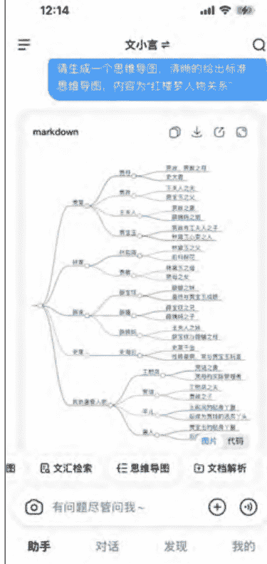

图 2-17 社区

## 2.5 天工

天工是由北京昆仑万开发的基于千亿级语言模型的智能助手，集搜索、创作、文档分析、绘画、PPT制作于一体，旨在为用户提供高效、精准的智能化服务。

### 2.5.1 获取方法

- (1) 手机 APP：应用商店搜索“天工”并安装
- (2) 网页版：https://www.tiangong.cn

### 2.5.2 特色功能

(1) 彩页：以一种结构形式呈现内容的视觉化工具，用于宣传、教育和知识分享等场景。天工彩页通过 AI 技术，提供丰富的主题模板、页面布局、文字样式和组件，支持用户快速生成高质量页面。用户可以使用粘贴或输入内容，AI自动生成大纲并支持元素拖拽和操作。适用于教育、营销、个人创作等领域，完全免费，显著降低门槛，提升内容创作质感。如图2-18所示为天工AI首页。

(2) 高级搜索：普通模式快速、简洁；高级模式能深度满足用户需求，查询丰富信源，提供深入的内容。用户可以根据需要切换两种模式，并在搜索结果页支持“相关扩展”功能；基于提问，提供更多与问题相关的背景知识、概念解释、理论基础等，帮助用户全面理解问题所涉及的领域，尤其适合财经、科技、学术领域。

(3) 文档与音视频解析：天工支持100万字的长文本，支持解析 pdf, word, excel, txt等多种格式，以及音频文件、视频文件和网页链接。内容包含简介、脑图、重点、字幕。解析结果全面、呈现完整，满足各种办公、学习、娱乐需求。如图2-19所示为智能功能入口。

(4) AI PPT：天工具生成能力。输入具体需求，即可生成完整、在线编辑的PPT大纲，或上传相关文档，通过AI提炼大纲内容，天工可以快速符合PPT需求的图片，同时自动生成与演示主题匹配的图片素材，最终匹配适合的PPT模板；AI PPT支持个性化定制功能，根据需求选择页数、受众群体、演讲场景等，生成符合要求的PPT作品，并支持下载，下载时可选择PDF/PPT。


图 2-18 彩页功能


图 2-19 智能工具

## 2.6 通义千问

通义千问是由杭州阿里巴巴开发的大语言模型，代表了当前的人工智能领域在自然语言处理方面的领先技术。它基于大规模预训练技术，通过海量数据进行深度学习，从而具备了强大的语言理解和生成能力。通义千问不仅能够处理文本数据，还支持多模态输入和输出，包括图像、音频等多种形式，使得它在处理复杂任务时更加灵活全面。

### 2.6.1 获取方法

- (1) 手机 APP：应用商店搜索“通义”并安装
- (2) 网页版：https://tongyi.alyun.com
- (3) 微信小程序：搜索通义

### 2.6.2 特色功能

(1) PPT创作：支持万字长文本，自动生成PPT，并提供pptxx文件下载。

(2) 口语练习（手机 APP）：用户可以通过实时对话来提升语言能力。通义千问能够根据用户的口音、语法和流利度提供实时反馈和建议，无论是学习外语还是日常表达，这一功能非常实用。

(3) AI 证件：通义千问自动生成符合要求的证件（如身份证、护照等），帮助用户生成不同场景的证件。如图2-20所示。

(4) AI 试衣：通义千问利用先进的图像处理技术，允许用户上传照片选择不同的款式、颜色和尺码，AI生成真实的试衣效果，帮助用户更好地了解服装，特别适合购物场景。

(5) AI 生视频：分别有文视频、图视频两种方式。生视频功能需要用户输入文字，通义千问根据文字生成匹配的视频，包括旁白、画面和背景音乐，用于快速制作宣传、教育等类型的视频。

(6) AI 修饰：包括扩图、风格转换、去水印等。


## 2.7 智谱清言

智谱清言是由北京智谱华章科技有限公司的一款基于GLM生成式AI助手。智谱清言凭借强大的语言理解与生成能力、多模态交互以及广泛的应用场景，成为在国内AI助手领域的佼者。它的免费、易用的特点使其深受学生、职场人士和技术爱好者喜爱。

### 2.7.1 获取方法

- (1) 手机 APP：应用商店搜索“智谱清言”并安装
- (2) 网页版：https://chatglm.cn
- (3) 微信小程序：搜索智谱清言

### 2.7.2 特色功能

(1) PPT助手：智谱清言可以根据用户提供的主题和内容要求，自动生成PPT演示文稿。用户只需要输入关键词，系统就能快速生成包含图表、文字和布局的PPT，如图2-22所示。

(2) AI绘画：智谱清言具备强大的AI绘画功能，用户只需要描述想要的画面，系统就能根据描述生成相应的图片。支持多种风格，适用于插画、设计、艺术创作等。

(3) AI视频：分别有文视频、图视频两种方式。文视频功能需要用户输入文字内容，智谱清言可以根据文字生成匹配的视频，包括旁白、画面和背景音乐，适用于快速宣传、教育等。视频视频需要用户上传图片，智谱清言可以根据图片内容生成相应的视频，实现图片与视频的便捷转换。如图2-23所示为AI视频功能界面。

(4) Zero推理模型：智谱清言采用Zero推理模型，能够实现更高效的自然语言理解和生成。第一步：输入文件（点击上传文件）或网址或主题；第二步：确认数据可用，可以生成“智能PPT”；第三步：点击下载。点击预览可以进行修改、自动生成内容、有更多模板可选。

### 助手
生成ppt三步走
- 第一步：输入文件（点击上传文件）或网址或主题
- 第二步：确认数据可用，可以生成“智能PPT”
- 第三步：点击下载PPT或视频

PPT主题（输入网址或主题）
使用教程
想想看使用示例
请在底部对话框中发送“图片示例”
参考文件
上传文件

清酷·AI视频
倾载视频，智能升级，尽情创造！
生成视频2.0
灵感描述
上传图片：支持JPG/JPEG/PNG格式，文件大小不超过10M。非必须，可通过提示描述辅助视频生成，描述文案可以简短，妙有趣。
视频特效
新年黄金字体：在绚丽的图片中出字体，为视频添加动态效果
基础参数（清晰、帧、时长）
AI配音
视频去水印
快告诉我你的问题吧

图 2-22 PPT 助手

图 2-23 AI 生视频

## 2.8 海螺AI

海螺AI是由上海稀宇科技有限公司（MiniMax）开发的一款基于多模态语言模型的智能助手，支持文本、语音、图像、视频等多种交互方式。旨在通过人工智能技术提升用户的工作效率和生活质量。海螺AI是一款功能全面、性能卓越的智能助手，适用于工作、学习、生活和创意等领域。

### 2.8.1 获取方法

- (1) 手机 APP：应用商店搜索“海螺AI”并安装
- (2) 网页版：https://hailou.com

### 2.8.2 特色功能

(1) 语音通话：海螺AI支持实时对话，用户可以通过语音交互。该功能不仅支持自然语言对话，还能根据用户需求提供查询、日程管理、翻译等服务，提升效率。如图2-24所示的海螺AI界面。

(2) 视频生成：用户可以通过文字描述，海螺AI自动生成相应的视频。该功能结合了自然语言处理和视频生成技术，根据文本内容生成动画视频，适用于短视频制作、教学等。

(3) 生动视频：用户上传图片，海螺AI可以根据图片生成动态视频。利用图像识别和合成技术，将静态转化为流动的视频，适用于创意设计、社交媒体内容创作等。

(4) 音色（网页版）：用户可以通过输入文本，海螺AI将其转换为流畅的输出。该功能支持多种音色选择，适用于语音播报、有声书等场景，帮助用户实现文本到语音的转换。


图 2-24 海螺界面


图 25 图视频

## 2.9 腾讯元宝

腾讯元宝是一个基于大模型打造的AI助手，集成了AI搜索、AI总结、AI写作、AI绘画等功能，致力于为用户提供智能化、高效的服务。无论是在办公、学习还是日常生活中，腾讯元宝都能通过强大的AI能力简化流程、让生活更加便捷。

### 2.9.1 获取方法

- (1) 手机 APP：应用商店搜索“腾讯元宝”并安装
- (2) 网页版：https://yuanbao.tencent.com
- (3) 微信小程序：搜索腾讯元宝

### 2.9.2 特色功能

(1) AI图像：用户可以通过文字描述，生成对应的图像。适用于创意设计、插画制作等场景。如图2-26所示为腾讯元宝界面。

(2) AIPPT：根据内容自动生成美的排版，节省设计时间，并提供pptx格式下载。如图2-27所示为轻松AIPPT界面。

(3) AI视频（手机 APP）：输入文字描述，AI自动生成相应的内容，适用于短视频制作、广告创意等。

(4) AI修修（手机 APP）：包括扩图、风格转换、更换背景、去水印等功能。

(5) AI陪伴（手机 APP）：用户可以选择角色进行对话，如奶奶、熊大、羊羊，适合亲子互动。

(6) AI外教：通过对话方式进行语言教学，提升学习兴趣和效果。

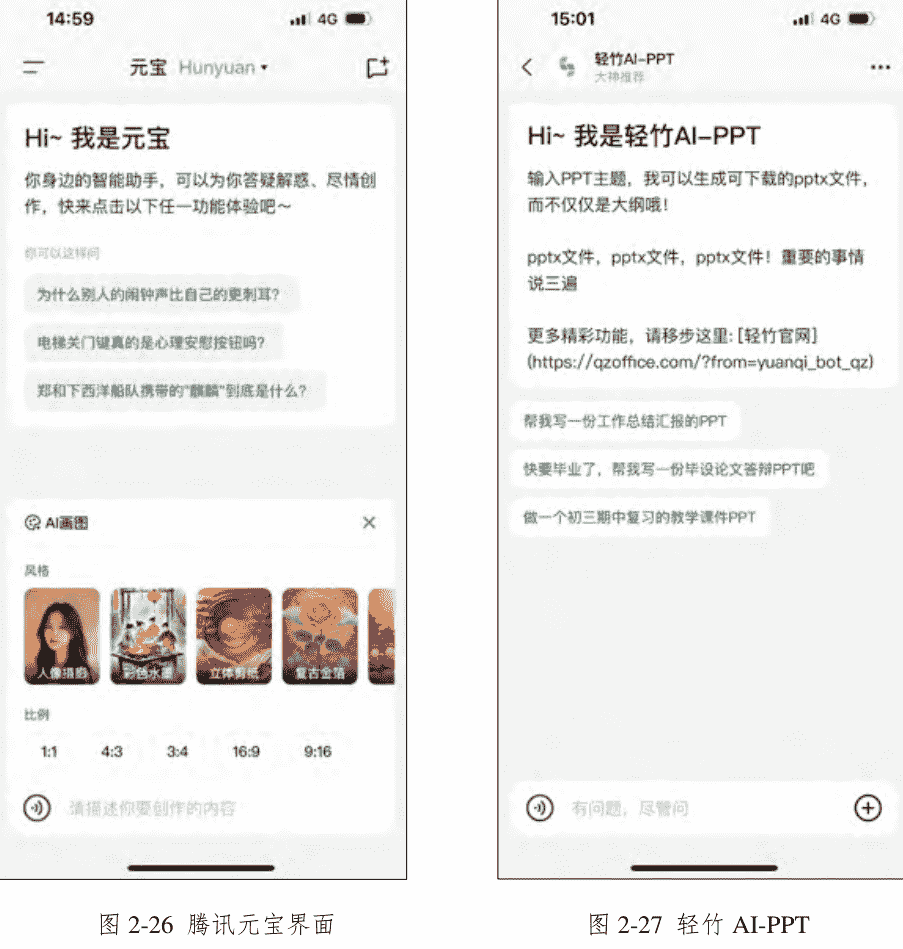

图 2-26 腾讯元宝界面

AI绘画
画风
| 1:1 | 4:3 | 3:4 | 16:9 | 9:16 |
|---|---|---|---|---|

## 2.10 360 智脑

360 智脑是北京小米360公司研发的大语言模型，具有强大的自然语言处理能力。它能够理解并生成自然语言文本，完成各种任务，如聊天互动、文本创作、语言翻译、回答问题等。

### 2.10.1 获取方法

- (1) 手机 APP：应用商店搜索“360 智脑”并安装
- (2) 网页版：https://chat.360.com/

### 2.10.2 特色能力

(1) 沉浸式模式（通话模式）：这个模式就像一个真人朋友聊天一样。360智脑会更自然地回应你的话题，理解你的意图，并给出更贴心的回答。该模式适合长时间聊天的场景，如学习英语、倾心事、编代码等。你可以在这个模式下享受更真实的对话体验。图2-28所示360智脑的操作界面。

(2) 增强搜索（联网搜索）：这个功能就像一个超级搜索引擎。它不仅能快速找到你需要的信息，还能理解你的问题，给你最相关的答案。该功能适合需要查找最新信息的场景，如了解新闻、学术研究、分析市场等。你可以通过增强搜索功能找到你需要的资料。图2-29所示增强搜索界面。

(3) 文档分析：这个功能可以自动阅读和理解各种文档，比如文章、表格、图片等。它能提取出重要信息，总结内容，甚至发现隐藏的规律。该功能适合处理大量文档的场景，如审查合同、分析财务报表、写调研报告等。


# 广州番科技学院


图 2-28 360 智脑界面


图 2-29 增强搜索

## 2.11 跃问

跃问(StepChat)是上海阶跃星(StepFun)推出的一款免费的智能问答产品，旨在为用户提供高质量、个性化的问答服务。阶跃星作为一家 AI 大创业公司，虽然技术实力强，但在公众认知中却非常低。公司在2023年4月成立后，到2024年3月才首次公开亮相，期间几乎没有对外发声。这种“卷起来全力奔跑”的策略，使得公司在技术上有显著的突破，但在公众认知度上相对落后。然而，这种低调并未影响其在技术上的突破和资本市场的认可。随着技术成果的逐步落地和商业化进程的推进，未来阶跃星可能会在公众视野中占据更重要的位置。

### 2.11.1 获取方法

- (1) 手机 APP：应用商店搜索“跃问”并安装
- (2) 网页版：https://platform.stepfun.com/

### 2.11.2 特色功能

- (1) 图片生成：跃问的图片生成功能基于先进的生成式 AI 技术，用户只需输入句话或一段描述，系统即可快速生成符合要求的图片。无论是创意设计、社交媒体贴图还是个性化插图，跃问都能轻松实现。如图 2-30 所示跃问的软件界面。

- (2) 文件分析：跃问支持多种格式的分析，包括但不限于文档（如 PDF、Word）、图片（如 JPG、PNG）、表格（如 Excel）等。通过智能解析和深度学习，跃问能够提取文件中的关键信息，生成摘要、统计数据或可视化图表，帮助用户高效处理和分析文件内容。

# 广州越前义学院


图 2-30 跃问界面

## 2.12 百小应

百小应是北京百智能于 2024 年 5 月 22 日推出的首款 AI 助手，基于其新一代大模型 Baichuan 4 开发。百小的核心优势是“懂搜索、会提问”的 AI 助手，旨在为用户提供智能、高效的搜索和问答体验，帮助用户解决日常信息查询、学习补助、工作支持和创意激发等需求。

### 2.12.1 获取方法

- (1) 手机 APP：应用商店搜索“百小应”并安装
- (2) 网页版：https://ying.baichuan-ai.com

### 2.12.2 特色功能

- (1) 智能搜索：百小应具备多轮搜索和定向搜索能力，能够精准理解用户需求，提供专业、丰富的知识和资源。相比单轮搜索，多轮搜索在复杂的场景下能够获取更深入的信息。如图 2-31 所示为百小应界面。

- (2) 文档处理：用户可传输 PDF、Word 等文档，或输入网页链接，百小应能快速阅读并分析长内容，如上市公司财报，只需一分钟即可完成。

- (3) 多模态交互：支持图片上传和解读，用户可以通过图片补充信息，获取更精准的回答。同时支持语音交互，提升使用便捷性。

- (4) 金融能力优秀：首创领域级约训练方案，金融能力领先 GPT-4o 近。


图 2-31 百小应界面

## 3 资源推荐与工具介绍

## 3.1 AI大模型性能排行

若知道中文大模型综合性能，可以搜索一些评测榜单，如 Github 上 jinlee1991 的 chinese-llm-benchmark 中文大模型能力排行。截至 2025 年 3 月 1 日，该榜单涵盖 195 个大模型，chat-gpt-4、o3-mini、谷歌 gemini、Claude3.5、智谱 GLM-Z、文心一言、百川、讯飞星、腾讯SenseChat、minimax 等国产模型，以及 DeepSeek-R1、deepseek-v3、qwen2.5、llama3.3、phi-4、glm-4、书生 internLM2.5 等开源大模型，如图3-1 所示为中文大模型综合能力排行（可选）。左侧例为大模型，右侧例为大模型综合。由于不同大模型在其擅长的领域有所侧重，所以大模型性能指标的排名并不能反映其实使用情况。

| 模型 |  | 分数 |
| :--- | :--- | :--- |
| DeepSeek-R1 | 深度求索 | 90.9 |
| Claude-3.5-pro | Anthropic | 89.7 |
| DeepSeek-turbo | 华仞 | 87.9 |
| qwen2.5-max | 阿里 | 87.4 |
| qwen2.5-large | 讯飞 | 86.8 |
| Claude-3.5-lite | 蚂蚁 | 86.7 |
| GLM-4-Plus | 智谱 | 86.6 |
| kimi-latest | 月之暗 | 86.4 |
| ERNIE-4.0 | 百度 | 86.2 |
| gemini-2.0-flash-thinking | 谷歌 | 86.0 |
| xwen-4 | 阿里 | 85.9 |
| gemini-2.0-exp | 谷歌 | 85.8 |
| DeepSeek-R1-Distill | 阿里 | 85.7 |
| SenseChat-v | 商汤 | 85.6 |
| qwen2.5-instruct | 阿里 | 85.4 |
| MiniMax-Text | 月之暗 | 84.8 |
| gpt-4-turbo | OpenAI | 84.7 |
| Claude-3.5-Sonnet | Anthropic | 84.6 |
| ERNIE-4.0-Turbo | 百度 | 84.5 |
| deepseek-chat-v3 | 深度求索 | 84.3 |
| internlm-max | 书生 | 84.2 |
| gemini-2.0-flash-exp | 谷歌 | 84.0 |
| chat-4o-latest | OpenAI | 83.9 |
| SenseChat-v2 | 商汤 | 83.9 |
| gemini-2.0-flash | 谷歌 | 83.8 |
| 360-gpt-turbo | 360 | 82.9 |
| yi-lightning | 万科技 | 82.8 |
| qwen2.5-preview | 阿里 | 82.7 |

图 3-1 中文大模型综合排行（可选）

# 广州轻工学院

## 3.2 AI工具导航 (https://aitool.cn)

AI工具导航是一个专注于收录和推荐国内外热门、创意、前沿AI工具和网站的平台，旨在为用户提供一站式人工智能集，如图2所示的AI工具导航界面。以下是它的主要特点：

- (1) 功能全面：收录了100+AI工具，涵盖AI写作、AI图像生成、AI音频转换、AI视频制作、AI编程开发、AI创意设计等多个领域，满足用户在不同场景下的需求。
- (2) 每日更新：每日更新最新AI工具，确保用户能够接触最沿的AI技术和应用。
- (3) 教程与指南：提供简单易懂的教程和指南，帮助初学者上手AI工具，即使是完全没有AI基础的用户也能入门。
- (4) 新闻与快讯：设有AI快讯板块，每日更新AI行业的最新动态、突破事件，帮助用户了解人工智能领域的趋势。

适用人群：对AI技术感兴趣的个人、学生、职场人士以及开发者。


# 广州越莉学院

## 3.3 AMZ123 AI工具导航 (https://www.amz123.com/ai)

AMZ123 AI工具导航是AMZ123下的AI工具导航网站，专注于跨境电商卖家提供AI支持，同时适合普通用户，如图3-3显示的是工具导航界面。这是它的主要特点：

- (1) 分类清晰：收录了数百个AI工具，涵盖AI聊天、AI绘画、AI设计、AI音频、AI视频等多个类别，帮助用户快速找到所需工具。
- (2) 跨境电商导向：针对跨境电商卖家，提供AI文案生成、AI图像生成、AI优化等工具，帮助卖家提升运营效率和广告效果。
- (3) 免费工具推荐：推荐了大量免费AI工具，例如ChatGPT、文心一言等，用户可以使用免费体验这些工具的功能。
- (4) 教程与案例：提供AI工具的使用教程和实际案例，帮助用户更好地理解和应用这些工具。

适用人群：跨境电商卖家、内容创作者、设计师以及普通用户，尤其是希望通过AI工具提升工作效率的。

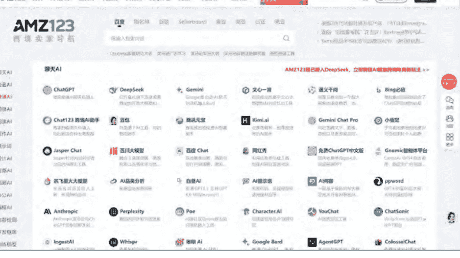

## 参考文献

- [1] 张可为。数据和人工智能在民办高校教学中的应用研究 [J]. 科技创新导报，2018, 15(18): 217+219.
- [2] 广州学院[EB/OL].https://www.nfu.edu.cn/info/2151/1151.htm.
- [3] 西安学院[EB/OL].https://www.xai.edu.cn/info/1027/7237.htm.
- [4] OpenAI[EB/OL].https://openai.com/
- [5] Yang A, Zhang B, et al. Qwen2.5 Technical Report[J]. arXiv preprint:2412.15115,2024.
- [6] Zeng A, Xu B, et al. Chatglm: A family of large language models from 130b to all tools[J]. arXiv preprint:2406.12793,2024.
- [7] 中文大模型能力测评[EB/OL].https://github.com/jinlee1991/chinese-llm-benchmark?tab=readme.

# DeepSeek 应用指南

# 目录
- 1 DeepSeek简析 ........................................................ 79
- 1.1 DeepSeek 是什么 ................................................................. 79
- 1.2 为什么选择DeepSeek ................................................................. 79
- 1.3 DeepSeek 版本及配置 ................................................................ 81
- 2 DeepSeek 的线上用途 ....................................................... 82
- 2.1 官方平台 ................................................................. 82
- 2.2 校园网 ................................................................. 83
- 2.3 AI搜索 ................................................................. 85
- 2.4 天工 ....................................................................... 86
- 2.5 腾讯元宝 ............................................................... 87
- 3 DeepSeek 的应用场景 ....................................................... 88
- 3.1 教学应用场景 ................................................................. 88
- 3.2 学习应用场景 ................................................................. 92
- 3.3 科研应用场景 ................................................................. 96
- 3.4 管理应用场景 ................................................................. 99
- 4 DeepSeek 的本地化部署及调用 .......................................... 103
- 4.1 基于Ollama的DeepSeek本地化部署 .......................................... 103
- 4.2 基于Docker的OpenWebUI镜像安装 .......................................... 109

# DeepSeek简介

## 1.1 是什么

DeepSeek，杭州深度求人工智能研究有限公司是一家创新科技公司，成立于2023年7月，由知名私募巨头幻化孕生，专注于开发先进的大语言模型（LLM）和相关技术，通过其数据馏技术获取更精炼、有用的数据。DeepSeek V3和R1是DeepSeek推出的两种人工智能模型，分别用于不同的任务和场景。

DeepSeek V3专注于日常查询。通过自然语言处理（NLP）和机器学习技术，能够理解并生成自然语言，广泛应用于学习、工作和生活等领域，支持文本生成、代码补全、图像理解等任务。

DeepSeek R1是高级推理模型，专注于复杂问题。它模拟人类列出具体的思考过程，适用于深度推理的任务。开启这个功能后，DeepSeek会逐步推理思路，不仅给出答案，还会展示思考过程。通过检索外部知识的强大能力，让答案的准确性和专业性大幅提升，对于复杂科学知识的析和教学方法的讨论极为实用。

DeepSeek V3和R1的推理系统采用了分布式专家并行（EP）策略，通过优化计算和通信实现了更好的吞吐量和更低的延迟。DeepSeek V3和R1的推理服务在H800 GPU上运行，确保了最佳性能。总的来说，DeepSeek V3适用于日常事务，而DeepSeek R1则适合深度推理和复杂问题解决的场景。

## 1.2 为什么选择DeepSeek

在当今教育领域，人工智能技术的快速发展为教学、科研和行政管理带来了前所未有的变革。DeepSeek作为一种先进的大语言模型，凭借强大的数据处理能力和深度学习算法，正在教师的教学创新、科研突破和行政效率提升提供全新解决方案。它是一套推动教育模式变革的催化剂。

传统教学中，教师投入大量时间设计课程，批改作业和解答复杂问题，DeepSeek通过智能生成与动态交互能力，让教育回归“以学生为中心”的本质。例如，在备课环节，教师只需输入教学目标与知识，即可快速生成包含案例分析、互动和分层教学的完整方案；在课堂实施中，它能很好地适配学生知识水平，甚至模拟不同基础的提问，帮助教师预测教学难点。在课后，DeepSeek的作业批改不仅能识别代码错误、数学题逻辑偏差，还能针对特定错误自动生成反馈，将教师从机械性劳动中解放，转聚焦于教学优化和学生创造力培养。

# 广州财经职业学院


不仅能够提升教育质量，还能在人工智能时代的教育变革中占据先机，为培养未来社会需求的创新型人才奠定坚实的基础。

## 1.3 DeepSeek 版本与配置

如 1-1 所示 DeepSeek-V3 与 R1 版本的配置，俗称“满血版”配置。

表 1-1 DeepSeek“满血版”配置
| 模型 | 总参数 | 激活参数 | 上下文长度 |
| --- | --- | --- | --- |
| DeepSeek-V3-Base | 671B | 37B | 128K |
| DeepSeek-V3 | 671B | 37B | 128K |
| DeepSeek-R1-Zero | 671B | 37B | 128K |
| DeepSeek-R1 | 671B | 37B | 128K |

如 1-2 所示 DeepSeek 蒸馏版的配置。DeepSeek-R1-Distill 模型是在开源模型的基础上，利用 DeepSeek-R1 生成的样本进行微调。DeepSeek 开发人员对其配置和分词器稍作改动，请使用 DeepSeek 官方运行这些模型。

表 1-2 DeepSeek 蒸馏版配置
| 模型 | 基础模型 | 总参数 | 存在需求 |
| --- | --- | --- | --- |
| DeepSeek-R1-Distill-Qwen-1.5B | Qwen2.5-Math-1.5B | 1.5B | 1.04 GB |
| DeepSeek-R1-Distill-Qwen-7B | Qwen2.5-Math-7B | 7B | 4.36 GB |
| DeepSeek-R1-Distill-Llama-8B | Llama-3.1-8B | 8B | 4.58 GB |
| DeepSeek-R1-Distill-Qwen-14B | Qwen2.5-14B | 14B | 8.37 GB |
| DeepSeek-R1-Distill-Qwen-32B | Qwen2.5-32B | 32B | 18.48 GB |
| DeepSeek-R1-Distill-Llama-70B | Llama-3.3-70B-Instruct | 70B | 39.59 GB |

## DeepSeek的线上使用途径

## 2.1 官方平台

要使用 DeepSeek 官方平台，需要在浏览器中打开 https://chat.deepseek.com/，进入 DeepSeek的官方首页。在使用平台之前，用户需要完成注册并登录。以下是详细的步骤：

- (1) 注册与登录

打开 DeepSeek 后，用户可以选择邮箱或手机号进行注册。如果选择手机号注册，如图 2-1 所示，输入手机号后，点击“发送验证码”按钮，系统会向该手机号发送一条包含验证码的短信。收到验证码后，在相应的输入框中填写验证码，即可完成注册并自动登录。

- (2) 登录流程

如果用户已有账号，可以直接在登录页面输入手机号或邮箱，点击“发送验证码”按钮，输入收到的验证码后即可登录。此外，DeepSeek 还支持微信快捷登录，用户可以根据自己的需求选择登录方式。


图 2-1 DeepSeek 登录界面

## (3) 界面说明

登录成功后，用户将进入 DeepSeek 的用户中心界面，如图 2-2 所示。用户可以根据自己的需求选择相应的功能进行操作。

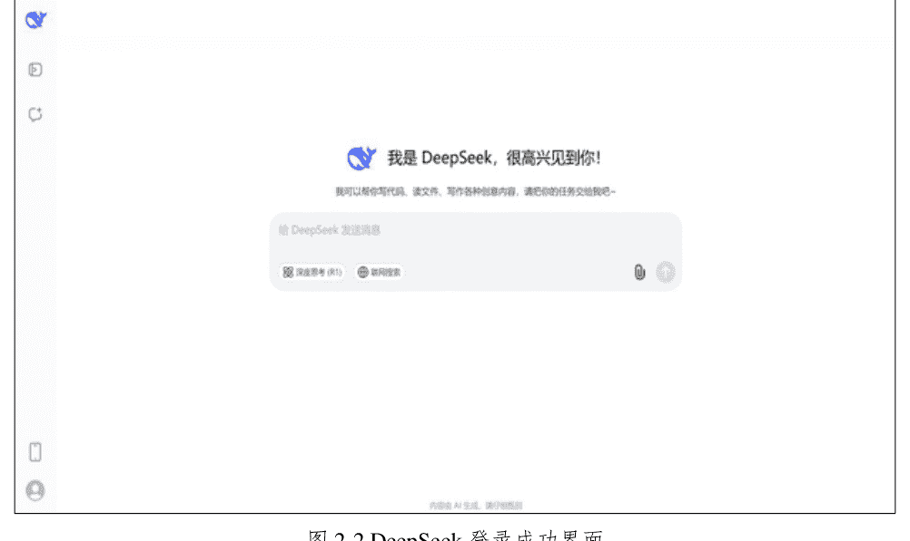

## 2.2 应用科技园区网

广州应用型科技学院学生可在校园内，通过访问 http://deepseek.gzasc.cn 进行无限次的免费体验 DeepSeek，这一广科专属智能“助手”将为老师提供更多便利，为学校智慧校园建设带来新的契机。使用步骤如下：

- (1) 登录

通过校园网访问 http://deepseek.gzasc.cn 开启高配版本的 DeepSeek 体验（默认开启“满血”版本）。

- (2) 邮箱账号

首先进入校园网，点击邮箱箱，就会看到自己的账号。如图 2-3 所示。

- (3) 界面说明

登录成功后，用户将进入 DeepSeek 的操作界面，如图 2-4 所示。用户可以根据自己的需求选择相应的功能进行。


你好，我是DeepSeek

图 2-4 DeepSeek

## 2.3 秘塔AI搜索

- (1) 注册与登录

访问秘塔AI搜索的官方网站 https://metaso.cn/，在页面左侧找到“登录/注册”按钮，输入手机号和验证码等信息。注册完成后，系统会发送验证码到手机，完成注册。

- (2) 界面说明

秘塔AI搜索的界面如图 2-5 所示，具有以下特点：

① 洁净无干扰：界面仅有一个搜索框，无广告和其他无关信息，确保用户专注搜索内容。

② 结构化展示：搜索结果以思维图、大纲和时间线等形式呈现，便于快速理解。

③ 明确信息来源：每个结果附带来源，方便用户验证信息的真实性。

④ 学术搜索：在主页搜索框选择“学术”模式后，信息来源将聚焦期刊和论文，并提供摘要功能。

⑤ 辅助信息整理：搜索结果自动生成大纲、思维图或PPT，支持导出。

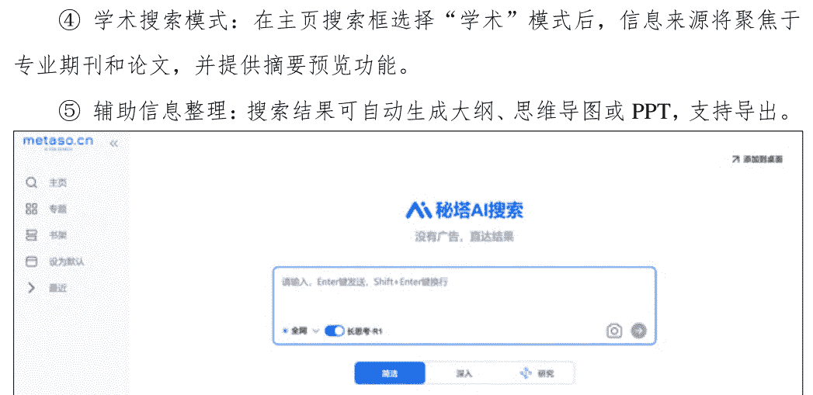

图 2-5 秘塔AI搜索界面

## 2.4 天工

- (1) 注册与登录

用户需要访问天工AI搜索的官方网站 https://www.tiangong.cn/，在页面左下角点击“登录”按钮。注册过程需要填写手机号并获取验证码，完成注册即可登录。登录成功后，用户将进入天工AI搜索的界面。

- (2) 界面说明

登录成功后，如图 2-6 所示，可以看到搜索框位于页面中央，用户可以直接输入问题或关键词进行搜索。左侧区域提供了彩云、智能设置、个人中心等选项，方便用户进行个性化设置。页面底部区域双层信息流提升使用效率，上层以瀑布形式推送实时热话题，每个话题卡片带有背景摘要；下层则智能归类用户的搜索记录，通过语义自动聚集相关话题。点击任意历史记录可触发“继续提问”功能，实现断点续的无缝体验。天工AI搜索不仅支持普通搜索，还提供了AI对话、AI写作、文档分析等高级功能。AI对话模块采用类微信布局，支持多轮问与上下文记忆。

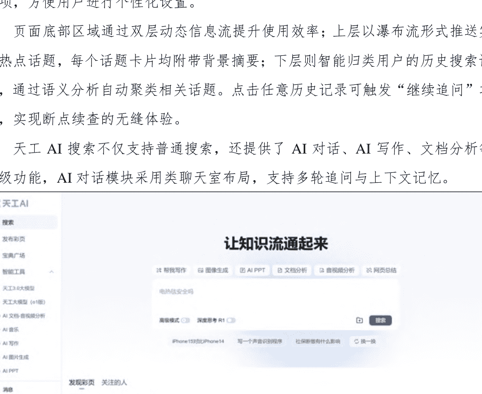

图 2-6 天工AI界面

## 2.5 腾讯元宝

- (1) 注册与登录

用户可通过浏览器访问官网，首次打开后支持中国大陆手机号注册，或直接使用微信、QQ快捷登录。

- (2) 界面说明

腾讯元宝的主界面简洁直观，如图 2-7 所示。底部为搜索栏和双模型切换按钮（“深度思考”模式适合复杂任务，如代码生成），支持用户直接输入问题或上传文件进行AI搜索、文档解析等操作。用户可通过“应用广场”快速访问如文档精读、代码辅助、旅游规划等场景化工具。

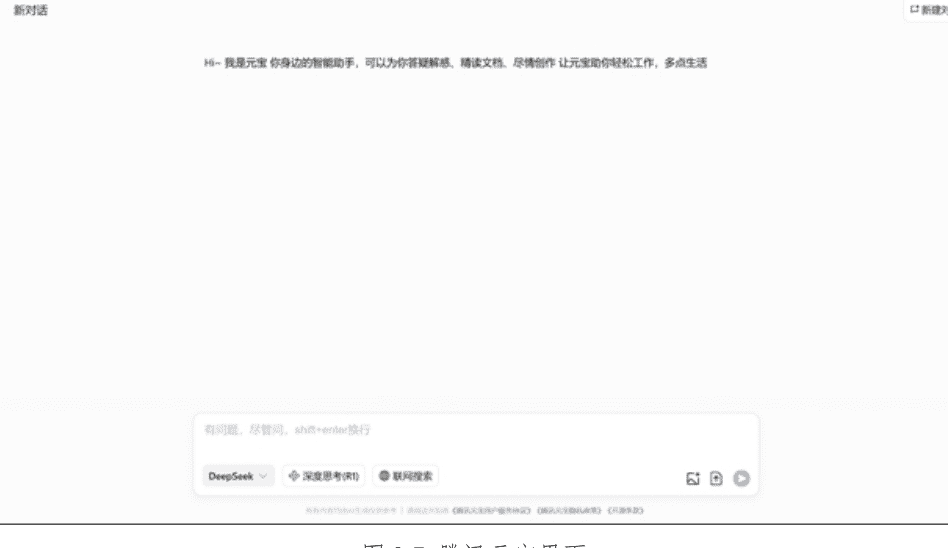

图 2-7 腾讯元宝界面

## 3 DeepSeek的应用场景

## 3.1 教学应用场景

### 3.1.1 学情分析

学情分析，是借助生成式人工智能，针对学生在课堂上的学习行为以及所得的学习成果开展系统性判断。通过这个过程，能够深入挖掘学生在学习过程中的优势之处与有待提升的地方，进而精准把握学生的学习需求和面临的困难，助力教师更高效地实施差异教学策略。依托生成式人工智能构建的学情分析系统，具备强大的数据整合能力，可融合多种类型的数据。其中涵盖了学生整体情况，该系统贯穿连续的时间线以及全过程，从课前准备到课中实施再课后反馈；系统对海量数据进行深度分析，具备多维性的评价，并且系统在输出端能够迅速生成学情报告，接收端也能将报告传递给相关人员，有利于保障学生能够得到及时反馈。

示例：识别学生的多样性。

提示：分析最近的特征，提取学生词汇频次、句式复杂程度、词汇变化，输出高价值的推荐。

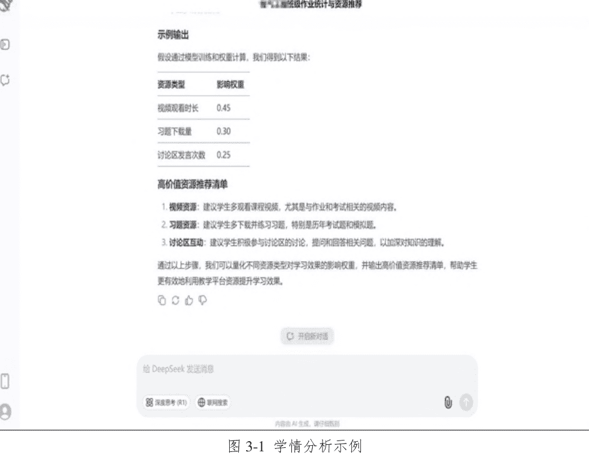

图 3-1 学情分析示例

### 3.1.2 教学设计

基于生成式AI的教学设计，通过深度挖掘学生数据，构建精准画像，优化教学目标，使其与学习者的兴趣、认知风格高度契合。依托算法对教学内容、学习路径及评估体系进行规划，开发高度定制化的互动活动，以应对多元化的诉求。

示例一：基于生成式AI的英语课程，通过分析学生写作风格与常见错误，提供个性化指导。

提示：请结合学生的写作样本，分析其语言风格与常见错误，设计一套个性化方案并生成实时反馈。

示例二：利用生成式AI的编程课程，根据学生的编程能力和兴趣，定制任务，提升实践能力。

提示：根据学生的水平与偏好，生成一条循序渐进的学习路径，设计一个与其能力匹配的任务，提供调试建议。

实际案例：如图3-2所示，给AI看学生写的代码，输入上述提示。

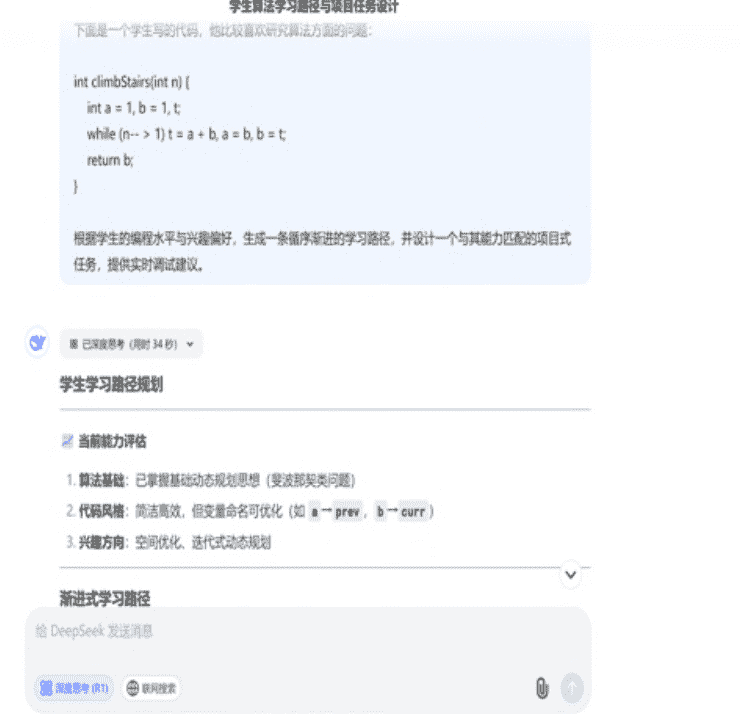

图 3-2 教学设计实例

### 3.1.3 智能助教

智能助教是一种人工智能技术开发的数字化教育工具，旨在辅助教学、优化学生学习体验并通过智能化手段提升教育效率和质量。结合了自然语言处理、机器学习、大数据分析等技术，能够模拟人类助教的功能，甚至超越教学的能力。

示例一：自动化论文批改工具，提供语法纠错、结构优化及参考文献建议。

提示：请检查逻辑漏洞并推荐5篇相关文献，生成成效报告和引用列表。

示例二：基于课程内容的AI助手，实时解答学科问题并推荐学习资料。

提示：请解释量子力学波粒二象性。

实际案例：如图3-3所示，输入上述提示，DeepSeek给出：“量子力学波粒二象性是微观粒子（电子、光子等）表现出类似粒子的特性（如局域性、离散性），又出现类似波的特性（干涉、衍射）。这一概念颠覆了经典物理中‘波’和‘粒子’的严格区分，是量子理论的核心特征之一。”的解释，并从经典物理的局限性、实证验证、量子理论等方面进行详细阐述。最后从哲学意义上给予解释：波粒二象性是量子世界的“基本法”，告诉我们在微观尺度上它既非波也非粒子，而是一种更复杂的实在。

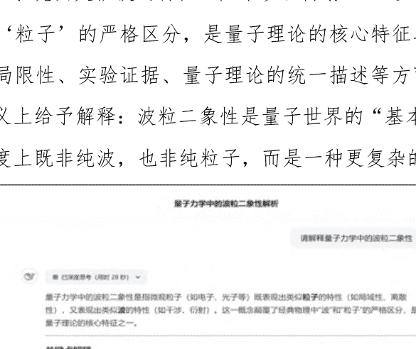

图 3-3 智能助教示例

## 3.2 学习应用场景

### 3.2.1 制定教学方案

制定教学方案是一种系统化的教学过程，旨在通过明确学习目标、规划学习路径、设计教学活动以及评估学习效果，帮助学生更高效地达成学习目标。教学方案的核心是“以学生为中心”，强调引导和激发学生的主动性，而非传统的单一知识传递。

示例一：计算机科学（Python数据分析）

提示：请为《Python数据分析》课程设计一份教学方案，要求：
- (1) 目标：学生能独立完成“数据清洗—分析—可视化”全流程；
- (2) 任务分三阶段：基础语法练习（2周）、真实数据分析（3周）、实战（3周）；
- (3) 评估方式：包括代码提交、报告互评。

示例二：社会科学（社会方法）

提示：请为《社会方法》课程设计教学方案，要求：
- (1) 目标：学生掌握问卷设计—数据分析—报告；
- (2) 任务：以需求为主题，分组调研；
- (3) 评价：包括过程记录和最终汇报。

实际案例：如图3-4所示，在DeepSeek中输入提示，给出具体的教学方案。

### 3.2.2 推送学习资源

智能系统进行的资源推送是基于学生需求和进度的考虑，自动为学生推荐各类材料，如相关文章、教学视频等。系统对学生学习行为进行深入剖析，能够精准筛选出符合学生状况的学习资源，点击链接即可快速跳转并访问对应的内容。这种方式极大地提高了学生的效率，帮助他们更好地吸收和理解，有效填补知识体系中的薄弱环节，为个性化学习提供有力支撑。实时将最新的内容呈现给学生，保证学生始终接触到前沿的知识与技能，从而全方位提升成效。

示例一：通过DeepSeek定制“高效学习路径”和实战包。提示：针对基础薄弱的问题，推荐零基础到进阶的Python资源及配套项目。

示例二：利用DeepSeek向学生推送“AI辅助指南”和机器学习案例，提升AI技术能力。提示：推荐与“人工智能教育应用”相关的资源，包括工具教程和案例分析。

实际案例：如图3-5所示，利用AI在搜索中的长思考R1功能，实际上用了DeepSeek-R1模型，让其推荐“人工智能教育领域”相关资源。

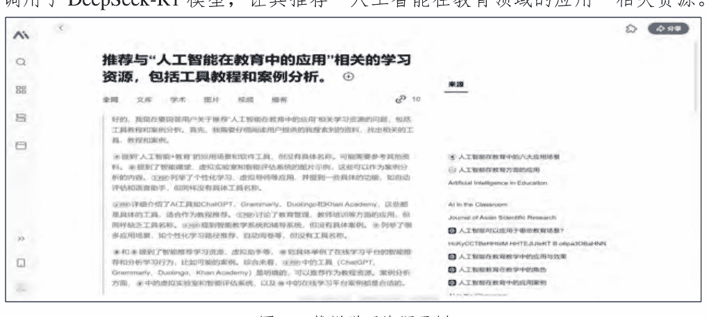

图 3-5 学生学习资源示例

### 3.2.3 智能问答

智能问答系统借助语言处理前沿技术，能够快速且精准回应各类学术问题，帮助学生在学习过程中遭遇的困难困惑。当用户输入问题后，该系统会对问题进行深度解析，精准把握核心意图，随后在庞大的知识库中筛选出相关的信息，并将这些信息整合成为详尽且通俗易懂的答案呈现给用户。

这一创新系统的应用，显著减少了学生寻求答案的时间成本，极大地了学习效率与质量。更为重要的是，智能问疑并非不变，它能够持续学习新知识，并对知识库进行实时更新，从而逐渐提升答案的精确度与全面性，为学生提供稳定、长效的学习支持与帮助，有力地推动了个性化学习模式的发展。

示例一：引导学生理解电磁中的麦克斯韦方程组织形式。提示：用通俗语言解释麦克斯韦方程每个符号的物理意义，并举例说明如何从积分形式推导形式。

示例二：解答Python列表与字典数据类型的误区。提示：对比Python列表与字典的底层逻辑差异，分析循环遍历时出现KeyError的常见原因及解决方法。

实际案例：如图3-6所示，DeepSeek解答Python列表与字典类型使用的误区。

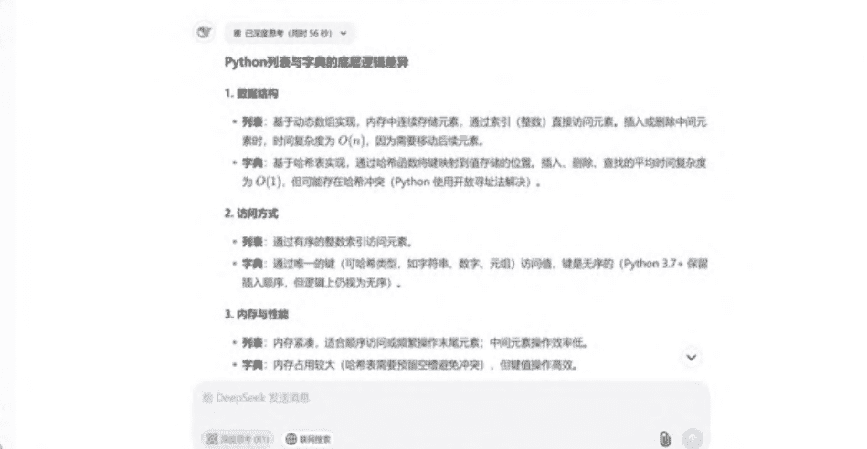

图 3-6 智能问疑示例

## 3.3 科研应用场景


# 广州越华学院

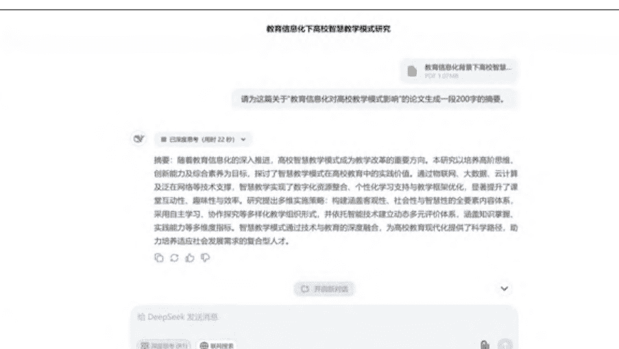

图 3-7 文档归类识别示例

## 3.3.2 辅助论文选题

辅助论文选题是指借助具有强大语言理解和生成能力的大模型来为论文选题提供服务、方向和参考。当用户向模型输入相关领域、大主题范围或已有基础等信息后，大模型能够基于其学到的海量文本数据和知识，分析当前领域的研究热点、趋势和空白。大模型还能对用户初提出的几个选题方向进行分析评估，比较不同选题的可行性、创新性和研究价值，辅助用户筛选出更具潜力的选题。

利用大模型辅助选题可以为研究者提供更多的灵感和选择，节省时间和精力，同时也有助于把握学术的前沿动态。最后的选题决策仍需研究者结合自身的兴趣、专业知识和研究能力等因素综合考虑，大模型的建议作为参考依据。

示例1：基于 DeepSeek 近五年人工智能在医疗影像领域的趋势，提出基于小样本学习的 CT 影像早期肺癌创新方向。

提示：请分析近五年人工智能在医疗影像领域的研究趋势和空白，结合样本学习技术，推荐 3 个针对 CT 图像早期肺癌检测的创新论文题目，要求算法轻量化与跨维度结构协同控制。

示例：利用 DeepSeek 分析三年 AI 顶会热点，推荐“基于多模态深度学习的罕见病早期筛查”作为 AI 交叉方向选题。

提示：请结合三年 CVPR 和 NeurIPS 的研究热点，推荐 5 个医学影像与多模态深度学习的创新选题，要求聚焦罕见病且具有临床落地价值。

实际案例：在实际研究与应用场景中，以图 3-8 所示情形为例，借助 DeepSeek-R 模型，在开启网络检索后，能够广泛且深入收集海量数据。通过对三年人工智能顶尖学术会议论文的全面梳理与深度挖掘，从众多的研究方向中，精准地挑选当下的热点趋势。

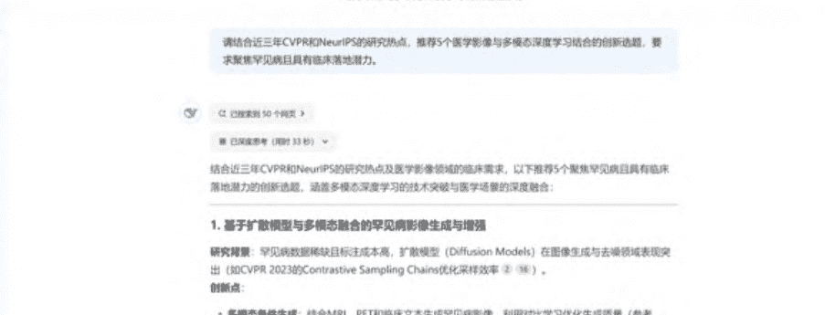

图 3-8 辅助论文选题示例

### 3.3.3 论文润色

科研论文润色是指借助先进的大型语言模型对科研论文的各个方面进行改进和完善，以提升论文质量与学术水平。大模型能够检查语法错误、用词不当，使句子更加通顺、规范，还能优化词汇和表达方式，增强文本的专业性和可读性。大模型还能分析论文的逻辑结构，判断各部分之间的衔接是否自然流畅，论证是否合理有序，帮助作者调整章节顺序、补充缺失内容，使论文整体结构更严谨、层次更清晰。

示例一：利用 DeepSeek 对一段关于生物实验结果分析的文本进行优化，使其语言更学术化、逻辑更清晰。

提示语：根据以下要求优化中文论文段落：（1）逻辑规范化：替换口语化表达，使用生物专业术语；（2）结构优化：通过逻辑强化实验结果与结论之间的衔接；（3）精简内容：删除重复表述，压缩非核心解释。待优化段落：[粘贴文本]。

示例二：借助 DeepSeek 对一篇关于社会学研究方法论述的段落进行润色，提升其专业性，纠正语法错误，并增强段落内要点之间的连贯性。

提示语：请对以下段落进行润色：（1）提升语言专业性，将不正式表达转换为学术用语；（2）细致检查并纠正语法错误；（3）增强段落内要点之间的贯性，可适当添加连接词或调整句子顺序。段落内容：[粘贴文本]。

## 3.4 管理应用场景

### 3.4.1 OBE 达成度分析

OBE 达成度分析是指借助大型模型对 OBE 教育模式下学生学习成果的达成情况进行评估分析。模型整合多源数据，将学生的考试成绩、作业表现、实验结果、项目成果、课堂参与等各类学习相关数据，从海量数据中提取与学习成果相关的关键信息，并根据预设的学习养成标准和指标体系，对学生的各项表现进行量化分析和综合评价，判断学生对每个学习成果的达成程度。

示例一：利用 DeepSeek 分析课程学生表现与考试成绩，对比 OBE 目标，识别薄弱知识点并改进建议。

提示：基于学生作业和考试成绩数据，对比课程 OBE 目标中的核心能力指标，分析各知识达成差异，并给出针对性的教学策略建议。

示例二：通过 DeepSeek 整合专业多届生实践成果与课程评价，评估 OBE 毕业要求达成整体趋势。

提示语：结合历年毕业生实践项目报告和课程评价数据，关联专业 OBE 要求的 12 项指标点，输出趋势分析图表及关键能力短总结。

### 3.4.2 循环决策

循环决策辅助增强模型的数据处理与分析能力，处理多源海量数据，挖掘具有价值的信息。基于分析结果进行预测，为决策提供客观数据支持，减少人为偏差干扰，还能处理复杂决策场景。并且持续学习和不断优化，助力决策者做出科学、准确的决策。

示例一：利用 DeepSeek 分析数据制定市场进入策略。

提示语：分析全球新能源汽车市场规模、增长率、区域格局，生成一份市场进入可行性报告。

示例二：企业利用 DeepSeek 分析消费者行为和市场趋势。

提示语：基于近年的消费者购买记录、社交媒体互动数据和行业趋势，分析高潜力人群，给出针对性的产品推广渠道和内容优化。

实际案例：如图 3-9 所示，利用 DeepSeek-R 模型实现联网搜索，从近年的消费者购买记录、社交媒体互动数据和行业趋势，分析高潜力人群，给出针对性的产品推广渠道和内容优化。

## 3.4.3 答问咨询

答问咨询是指具有强大自然语言能力和知识存储的大模型来回答用户提出的各种问题并提供建议。大模型能够理解输入的文本，对问题进行分析、拆解，并在训练数据和知识体系中匹配相关信息，以自然语言的形式准确、流畅地给出答案。

2025 年中国零售行业趋势分析（基于消费者行为）：

一、消费者特征
- 年轻人群：个性化需求强。
- 成熟人群（35-50岁）：决策理性，注重质量和实用性，受社交影响。

二、购物方式
- 虚拟试穿、3D 产品、AR/VR 技术提升购物体验，提高决策效率。
- 智能推荐和实时技术满足即时需求，重塑零售逻辑。

三、可持续性消费
- 消费者对透明化（产品溯源、低碳足迹）关注，推动可持续报告成为常态。
- 二手市场（如奢侈品交易平台）和共享租赁（共享机制）成为新增长点。

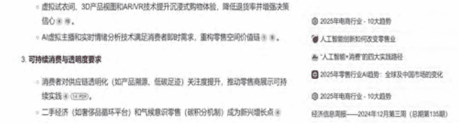

图 3-10 答问示例

## 4 DeepSeek 的本地化部署及调用

### 4.1 基于 Ollama 的 DeepSeek 本地化部署

#### 4.1.1 需求分析

（1）私有化部署 DeepSeek 的优点
- 数据自主主控：所有数据存储于本地基础设施，可完全控制访问权限及安全策略，规避三方云数据泄露风险。
- 敏感信息防护：集成识别屏蔽敏感信息，满足政务、金融等强监管领域的安全合规需求。
- 响应速度快：本地部署减少网络延迟，使用推荐硬件平台，可实现每秒 60 词生成速度及毫秒级响应。
- 离线运行保障：外网中断时可维持核心业务运行，确保服务不中断。
- 行业适配能力：支持参数调整、训练数据适配，满足教学、政务、医疗等场景的个性化需求。
- 知识产权保护：本地部署避免技术方案与数据资产外流，减少供应商锁定。

（2）技术优势分析
DeepSeek-R1 提供多个版本，参数越大，模型的性能越强大，但也需要更多的存储和计算资源。Ollama 支持下载的版本为蒸馏版本，如表 4-1 所示为常用的版本的模型。

| 模型名称 | 参数量(亿) | 模型大小 (GB) | 单机部署要求 |
| :--- | :--- | :--- | :--- |
| deepseek-r1:1.5b | 15 | 1.1 | 移动设备、边缘终端 |
| deepseek-r1:7b | 70 | 4.7 | PC |
| deepseek-r1:70b | 700 | 43 | PC |

（3）硬件需求
表 4-2 DeepSeek 硬件需求

| 硬件 | 显卡 (GPU) | 内存 (GB) | 存储空间 (GB) |
| :--- | :--- | :--- | :--- |
| deepseek-r1:1.5b | 无 | 8 | 3 |
| deepseek-r1:7b | RTX 4090 | 16 | 10 |
| deepseek-r1:70b | RTX 4090 | 128 | 70 |

表 4-3 本用硬件配置

| 硬件 | 本机配置 |
| :--- | :--- |
| CPU | AMD Ryzen 5600 with Radeon Graphics |
| 内存 | 16GB |
| 存储空间 | 500GB SSD |
| 显卡 | 无 |

（4）软件环境
DeepSeek 本地部署的软件包括操作系统、容器化工具、编程语言、深度学习框架、数据库、消息队列、Web 服务器、GPU 加速工具、版本控制、包管理工具以及日志工具。

#### 4.1.2 DeepSeek 部署步骤

（1）Ollama 下载
Ollama 是一个本地模型运行工具，方便下载和运行各种开源模型如 Llama、Qwen、DeepSeek 等。下载地址：https://ollama.com/download。打开网页可以看到图 4-1 所示。

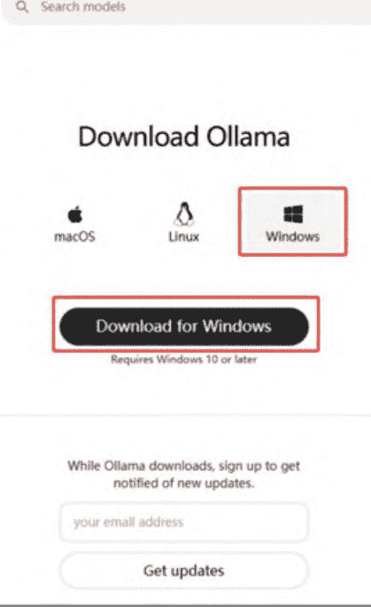

图 4-1 Ollama 下载界面

下载完成后点击 OllamaSetup.exe 进行安装，如图 4-2 所示。


图 4-2 Ollama 安装包

注：Ollama 默认安装在 C 盘，请保持 C 盘有足够空间。

安装完成后，使用 CMD 命令行窗口，输入“ollama -v”测试，显示 ollama 版本为“0.6.0”，说明安装成功。

```bash
PS C:\Users\27835> ollama -v
ollama version is 0.6.0
```

Ollama 没有用户界面，在后台会自动运行，重启电脑也会自动启动。打开浏览器，输入：“http://localhost:11434”，显示“Ollama is running”。


图 4-4 浏览器显示 Ollama 运行情况

（2）DeepSeek-R1 模型下载
从 ollama 官网查找 DeepSeek-R1 模型。点击【Models】，跳转如图 4-5 所示。


图 4-5 DeepSeek-R1 模型下载入口

点击【deepseek-r1】，跳转选择你需要的版本后复制内容。如图 4-6 所示。

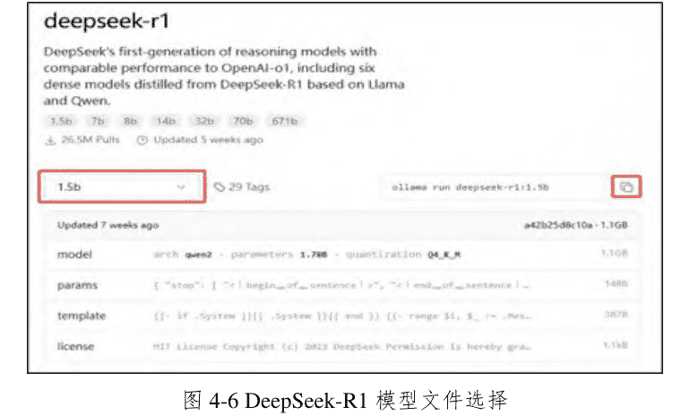

图 4-6 DeepSeek-R1 模型文件选择

为了节省空间与实践，本文选择 1.5b 模型，在 CMD 命令行窗口运行实例命令“ollama run deepseek-r1:1.5b”（复制得到的命令），程序会自动下载并安装运行。如图 4-7 所示。

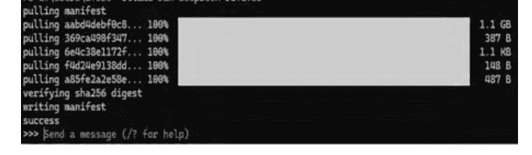

图 4-7 DeepSeek-R1:1.5b 版本下载

注：后面 70%，进度缓慢，需要等待！模型下载的地址是“C:\Users\username%.ollama\models”。如图 4-8 所示。


最后以管理员身份打开命令行窗口，输入 “wsl --set-default-version 2”，将默认设置为 WSL 2。

通过适用于 Linux 的 Windows 系统(WSL)，开发人员可以安装 Linux 发行版，并直接在 Windows 上使用 Linux 应用程序、实用程序和 Bash 命令行工具，不用任何修改。

命令行窗口，输入 “wsl --update --web-download”，更新 WSL，如图 4-14 所示。【此处运行速度较慢，并且可能需要用到管理员权限】

```
Windows PowerShell
Windows PowerShell
版权所有(C) Microsoft Corporation，保留所有权利。
安装后更新最新的 PowerShell，了解新功能和改进！https://aka.ms/PSW
PS C:\Users\27835> wsl --set-default-version 2
有关 WSL 2 快捷键的信息，请访问 https://aka.ms/wsl2
操作成功完成。
PS C:\Users\27835> wsl --update --web-download
正在检查更新，Windows 子系统更新到最新版本：2.4.12
正在将适用于 Linux 的 0.1%
```

图4-14 更新 WSL WSL

- (2) 安装 Docker for Desktop

Docker Desktop 是 Docker 官方提供的桌面应用程序，旨在让能够在 Windows 和 macOS 系统上轻松地构建、运行和共享容器化应用程序。Docker Desktop 提供了一个方便的工具，用户能够快速部署容器化应用程序，同时还了一些强大的功能和工具，如 Docker Engine、Docker CLI、Docker Compose 等。

- (3) 从 Docker 官方下载 Docker 安装程序。

网址：https://www.docker.com/get-started/


图 4-15 Docker 官网

运行安装包，完成安装【需要重启系统】如图 4-16 所示。


图 4-16 运行 Docker 安装包

安装完成后，使用【CMD】打开命令行窗口，输入“docker version”检查，如图 4-17 所示。

```
C:\Users\27835>docker version
Client:
Version: 27.5.1
API version: 1.47
Go version: go1.22.11
Git commit: 9f9ea45
Built: Wed Jan 22 13:41:44 2025
OS/Arch: windows/linux
Context: 
error connecting docker: Get "%%2F%%2F%%Fp
linuxEngine: The system cannot find the file s
```

图 17 检查 Docker 安装情况

## 4.2.2 Docker 配置

(1) 安装完成后，我们打开 docker，注册登录 docker(可运行)，然后在右下角点击 Terminal，打开控制台，然后输入命令，然后等待安装完成。

`docker run -d -p 3000:8080 --add-host docker.internal:host-gateway-v open-webui:api/backend/data --name open-webui --restart always ghcr.io/open-webui/open-webui:main`

(2) 安装完成后，左侧点击 Images (镜像)，点击运行，如果需要有配置，默认即可。如图 4-18 所示与图 4-19 所示。

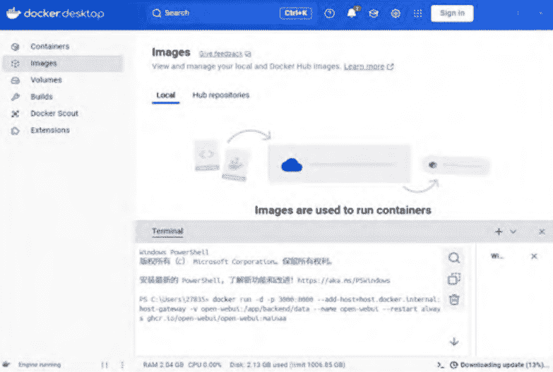

图 4-18 Docker 界面

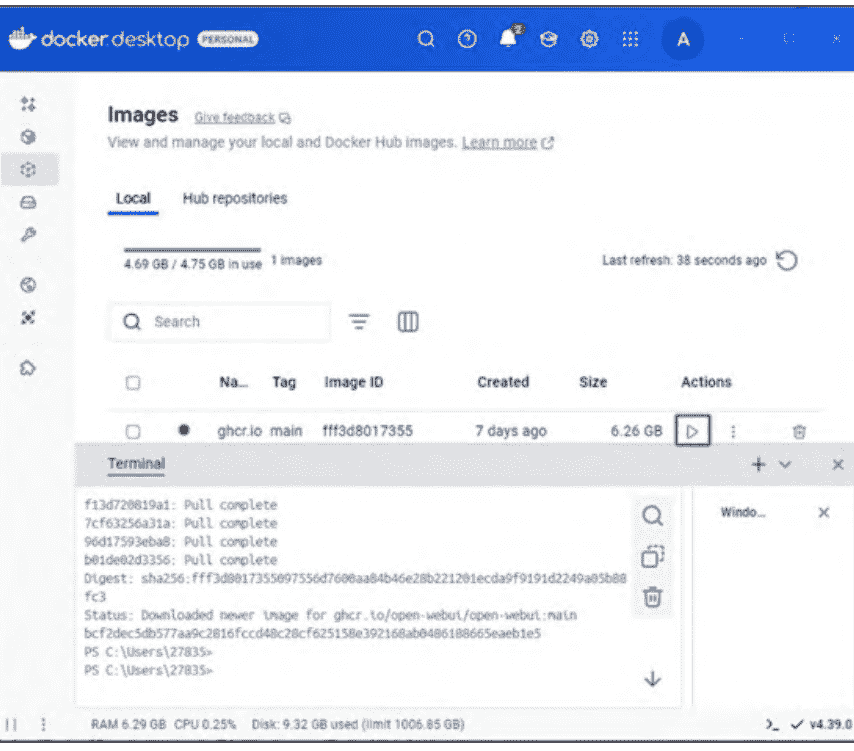

图 4-19 运行

（3）点击 Container（容器），点击端口，如如图 50 所示。

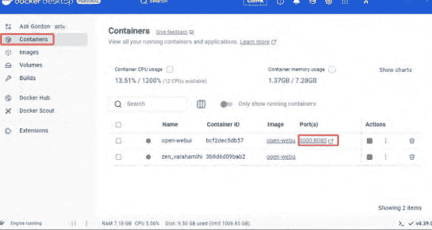

图 50 容器

## 4.2.3 Open WebUI 配置

Open WebUI 是一个扩展、功能丰富、用户友好的托管 WebUI，旨在完全离线操作。它支持各种 LLM 运行程序，包括 Ollama 和 OpenAI 兼容的 API。适配了 Ollama 接口，提供了 web 的访问方式。

- (1) 启动 WebUI

点击【开始】，创建管理员账号，即可使用，如图 4-22 所示。

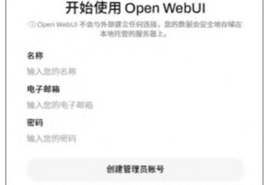

图 4-22 创建管理员账号

(2) 本地测试：如图 4-23 所示。

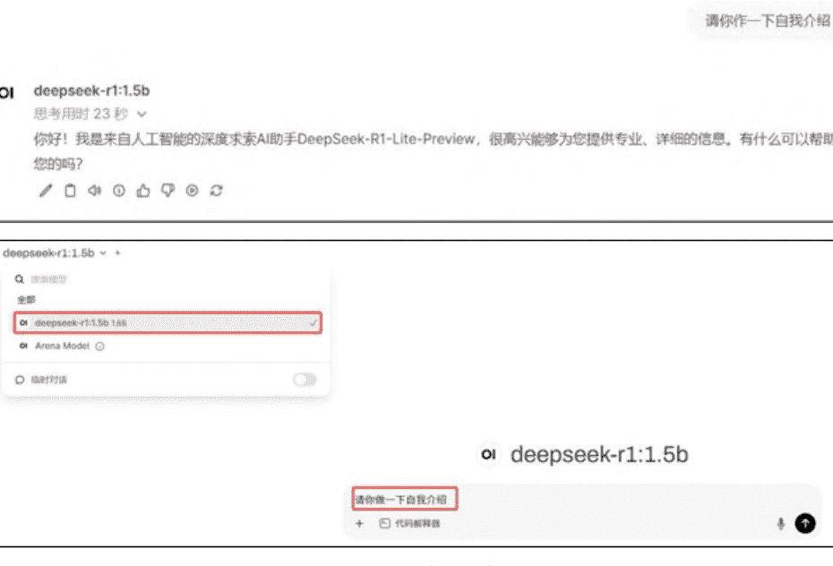

图 4-23 本地测试

(3) 局域网测试：如图 4-24 所示。（以手机为例）

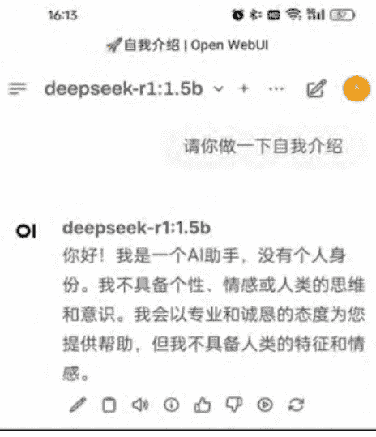

图 4-24 局域网

# 人工智能在教学中的应用

## 前言

人工智能技术的快速发展深刻重塑教育领域，推动教学模式的创新与效率提升。当前，以超星平台 AI 教教、课堂工具为代表的智能教学系统，通过 AI 出题、教案生成、作业批改等功能，显著减轻教师机械性负担，实现教学资源的高效整合。

课前阶段，AI辅助教学设计，构建精准化教案框架；课后环节深入教学分析、作业评价，形成教学闭环。然而，生成式人工智能的普及带来学术诚信挑战，学生滥用 AI 代写等问题凸显。对此，AI 检测工具（如 Copyleaks）通过文本分析与原创性评估，成为维护学术规范的关键手段。本文系统梳理智能教学工具的选择，结合实践案例探讨 AI 在课程全周期中的价值与潜在风险，为教育者提供兼具创新性与反思性的技术融合路径。

### 1 智能教学系统的选择与使用

#### 1.1 超星平台 AI 教教

超星平台是由北京世纪信息发展有限责任公司在2016年发布的一款智能教学系统。它是一款功能强大、操作方便的教学软件，拥有多种相当实用的功能，如签到、选人、随堂作业、考试、成绩导入等等。

官方网站：https://www.chaoxing.com/

优点：AI 功能强大、操作方便、完全免费
缺点：AI 平台只能读取课程材料文件，无法读取本地文件

教师可以在平台上创建课程，然后通过邀请学生加入课程进行学习。如果教师新建了一门课程，往往是要从零开始构建的，各种作业、学习资料都是要自己查阅收集的。这就让教师的工作量大增加。现在，AI 智能助教可以很好地解决这个问题。进入课程页面后，AI 教教的位置左侧侧边栏的第一个，点击即可使用，如图 1-1 所示。


图 1-1 超星平台 AI 教教

这个 AI 教教实际上是一个人工智能，集成了很多比较实用的功能，如 AI 出题、AI 教案、AI 写作批阅等。

##### (1) AI 出题

AI 出题可以根据课程的知识点或者给出的材料进行出题。以《神经网络与深度学习》这门课程为例，点击“AI 出题”功能，在页面点击“设置题目”可以设置具体要求，如适用年级、难易度以及题目倾向。然后对题目进行描述，如图 1-2 所示。

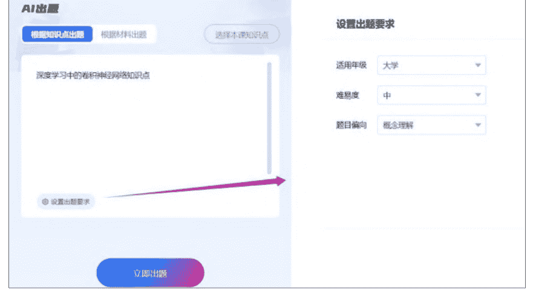

图 1-2 AI 出题


图 1-3 AI 出题结果

##### (2) AI 教案

AI 教案与 AI 输出相似，还可以根据章节或给定文本生成教案。生成教案时，可以根据自己的学科、教学风格以及模板生成，如图 1-4 所示。

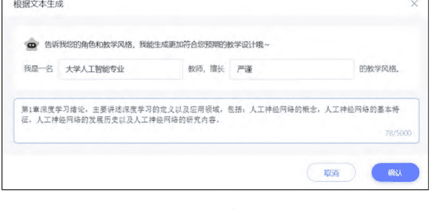

图 1-4 AI 教案

##### (3) AI 写作批改

AI 写作批改是另一个非常实用的功能。该功能允许教师利用 AI 对学生提交的作业、论文进行批改。合理使用 AI 批改可以减轻教师的工作量。AI 批改界面如图 1-6 所示。

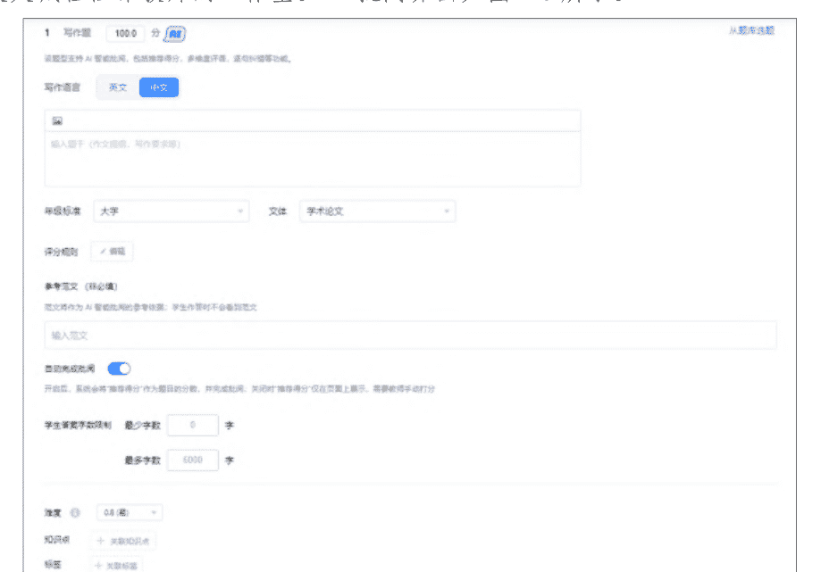

图 1-6 AI 批改界面

在 AI 批改界面中，可以输入题目、格式等内容。注意的是评分规则这一项，如图 1-7 所示。

| 评分规则 | 加分项 | 基础分 | % |
| :--- | :--- | :--- | :--- |
| 文章内容情况 | 添加额外得分点 | 删除 | 0 % |
| 文章逻辑结构清晰、通过筛选、语言通顺 | | 符合 | 40 % |
| 文章逻辑结构基本、通过筛选、有少量语病 | | 符合 | 25 % |
| 文章逻辑结构清晰、通过筛选、有较多语病 | | 符合 | 10 % |

图 1-7 AI 评分界面

在评分规则中，可以根据论文实际情况，添加内容、格式等多个维度，每个维度都可以添加相应的得分点。设置合理的评分规则可以使 AI 批改的结果更加准确。除此之外，还可以上传范文作为参考，以及设置论文的字数限制。

#### 1.2 雨堂 AI 教学工具

雨堂是由清华大学和课堂在线研发的一款智慧教学工具。与超星平台不同，雨堂并没有智能辅助工具集成在网页版中，而是需要下载雨堂 V6.2 版本的客户端。按照提示下载并安装好客户端后，即可使用雨的 AI 教学工具。

官方网站：https://www.yuketang.cn/download

优点：“一键出题”作为 PPT/WPS 插件，使用便利
缺点：功能单一，教师每月只能使用 30 次“一键出题”。

打开任意一个 PPT，会出现安装插件提示，如图 1-8 所示。

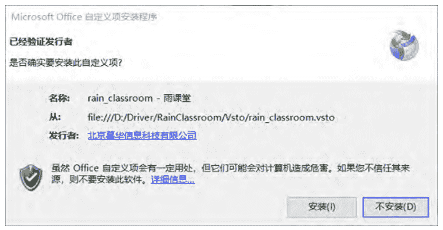

图 1-8 雨课堂插件安装界面

| 名称 | rain_classroom - 雨课堂 |
| :--- | :--- |
| 从: | file:///D/Driver/RainClassroom/Vsto/rain_classroom.vsto |
| 发行者 | 北京华瑞信息科技有限公司有限公司 |

> 虽然 Office 自定义项会有一个用处，但它们可能会对计算机造成危害。如果您不信任其来源，则不要安装此软件。

插件安装完成后，打开教学 PPT，上方菜单栏就会出现雨课堂，如图 1-9 所示。

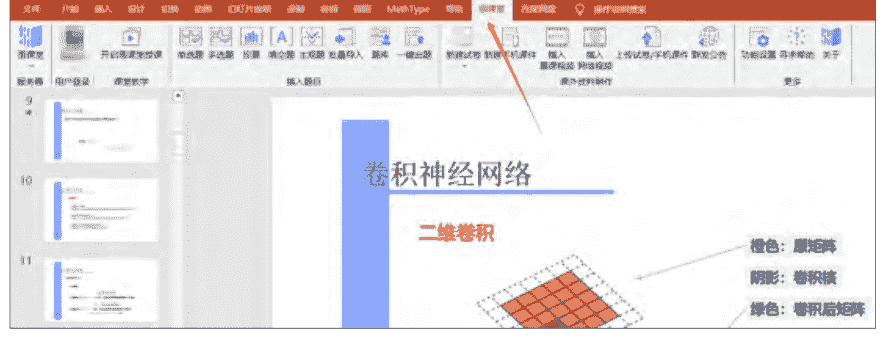

图 1-9 雨课堂插件界面

### Copyleaks AI Detector

Copyleaks AI Detector 可以读取多种语言：

| Language | Human accuracy | AI accuracy | Result |
| :--- | :--- | :--- | :--- |
| English | 99.96% | 99.63% | 99.68% |
| Spanish | 99.97% | 99.90% | 99.98% |
| French | 99.73% | 99.95% | 99.96% |
| Portuguese | 99.84% | 99.65% | 99.90% |
| German | 99.84% | 99.94% | 99.88% |
| Italian | 99.91% | 99.90% | 100.0% |
| Russian | 99.86% | 99.98% | 100.0% |
| Polish | 99.90% | 99.884 | 110..0% |
| Romanian | 99.66% | 99.65% | 100.0% |
| Chinese (Simplified) | 100% | 100% | 99.96% |
| Chinese (Traditional) | 100% | 100% | 99.90% |
| Korean | 99.68% | 100% | 99.99% |
| Japanese | 99.90% | 99.98% | 99.99% |
| Turkish | 100% | 100% | 99.99% |
| Ukrainian | 100% | 100% | 99.96% |

由图可以看出 Copyleaks 支持中文、英语、法语、俄语等多种世界主要语言。对于简体中文和繁体中文，AI 检测的准确率达到了 100%，抄袭检测的准确率达到了 99.99%。其他语言的检测准确率也非常高。


# 图 1-12 Copyleaks 产品界面

引入人工智能检测后，直接接入学生的期末论文，AI 检测结果如图 1-13。

本设计在 Matlab 中开发一个功能强大的用于文本的过滤器，用户能够方便地对多种语言进行实时过滤，并对自定义过滤器的语言进行配置。通过调试，可以实现或不使用 Matlab 编程语言，实现对文本处理和过滤的扩展。
支持语言：MatLAB、英语、法语、日语

- 实现方案
- GUI 界面
一个简单的界面包含以下主要组件：
- 加载数据，用于选择和不同类型的语言文件，例如英语、法语、语言信号。
- 选择算法下拉菜单，提供选项：普通、高等等过滤类型，以及以正则、哈希等方式实现自定义的过滤方法。
- 选择数据处理区域，包括标题、正文、脚注等参数范围和调试书籍。
- 选择信号标识区域，分为语言标识区域和文本标识区域，自定义区域，用于显示检测结果的详细。

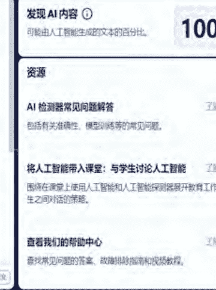

 发现 AI 生成

通过人工智能识别 AI 生成文本的真实性。

100% 资源

AI 检测结果详细报告

下载报告

将检测结果带入课堂：与学生讨论人工智能，包括有关性、准确性以及语言的问题。
在课堂中使用人工智能和智能辅助教育工具和学生面临的问题。

我的报告中心

查找有关报告的报告、检测时间和历史版本。所示。

# 图 1-13 AI 检测结果

可以看到 AI 检测的结果为 100%。由此推断出，该同学的期末论文大量使用了 AI 生成，原创性较低。虽然本次期末检测结果为 100%，但是并不能武断地为论文内容全部为 AI 代写，只能说明内容很有可能是 AI 生成的，想要获取更准确的结果，还需要结合检测器进行检测。如图 1-14，图 1-15 所示。

| 文本 (字数) | 4% 人工智能 | 74.7% 互联 | 100% 抄袭 |
|---|---|---|---|

本设计在 Matlab 中开发一个功能强大的用于文本的过滤器，用户能够方便地对多种语言进行实时过滤，并对自定义过滤器的语言进行配置。通过调试，可以实现或不使用 Matlab 编程语言，实现对文本处理和过滤的扩展。
支持语言：Matlab、英语、法语、日语

- 实现方案
- GUI 界面
一个简单的界面包含以下主要组件：
- 加载数据，用于选择和不同类型的语言文件，例如英语、法语、语言信号。
- 选择算法下拉菜单，提供选项：普通、高等等过滤类型，以及以正则、哈希等方式实现自定义的过滤方法。
- 选择数据处理区域，包括标题、正文、脚注等参数范围和调试书籍。
- 选择信号标识区域，分为语言标识区域和文本标识区域，自定义区域，用于显示检测结果的详细。

14172189
Internet Seoul
https://www.copyleaks.com/report/14172189

108105
Internet Seoul
https://www.copyleaks.com/report/108105

2.1%

https://www.copyleaks.com/report/108105
该市范围内的学生作业被检查了与网上以及已提交的作业的相似性。

1.9%

Copyleaks

129

# 广州财经职业学院

图 1-14 论文抄表检测结果

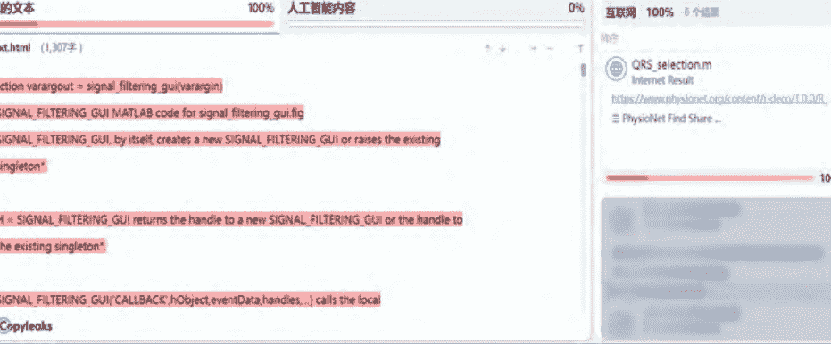

```
// text.txt (1,307)

function varargout(signal, filtering, guvarargin)

% SIGNAL FILTERING GUI; MATLAB code for signal filtering; gui fig
% SIGNAL FILTERING GUI, by itself, creates a new SIGNAL FILTERING GUI or erases the existing
% singleton
%
% H = SIGNAL FILTERING GUI; returns the handle to a new SIGNAL FILTERING GUI or the handle to
% the existing singleton
%
% SIGNAL FILTERING GUI_CALLBACK(hObject, eventData, ~) calls the local
% appleyeks
```

图 1-15 代码抄表检测结果

论文抄表检测的结果表明，该论文内容并没有多少抄表，但是人工智能内容到达了74%，结合 AI 检测器，可以知道，该同学确实大量使用了 AI 代写。代码方面，由于 AI 生成的代码往往存在较多的错误导致无法运行，因此该同学的代码并没有使用 AI 代写，不过抄表率达到了100%，说明代码大部分是照抄网上内容。

# 2 课程中的人工智能应用

## 2.1 人工智能在课前阶段的应用

在教育领域，AI 技术的应用日益广泛。合理地利用人工智能，显著提升教师的备课速度，节省准备时间，提高教学工作的效率。利用大模型的独特优势能够帮助教师在课前阶段结构清晰、质量上乘的教材框架，如教学大纲、课程教案、教学课程等。

### 2.1.1 人工智能辅助教学设计

目前，教育部将“人工智能+教育”纳入《教育强国建设规划》，标志着AI辅助教学成为教育现代化的战略选择。人工智能辅助教学设计是教育数字化转型的重要实践，传统的课堂教学难以兼顾群体进度以及个体差异，而利用 AI 辅助后，可以实现“一人一策”的精准教学，同时为教师承担了大量的机械性工作，使教师回归教育源上。

腾讯元宝是腾讯公司在2024年5月推出的 AI 助手，于2025年2月接入 DeepSeek-R1 模型，如图2-1 所示。腾讯元宝在加入了 DeepSeek-R1 满版后，用户体验明显更好，而且不会出现服务器繁忙的问题，非常适合教师作为日常的 AI 工具使用。

官方网站：https://yuanbao.tencent.com/chat/naQiVTmsDa

优点：界面简单明了，接入了 DeepSeek 满版，用户体验良好

缺点：功能深度不足，任务处理能力不足。

# 广州振华学院

首页

Hi-腾讯元宝是你的智能助手，可以为你提供解析、精华文档、润色让元宝帮你高效工作，多享生活


图 2-1 腾讯元宝界面

以下《神经网络与深度学习》课程例，利用腾讯元宝辅助生成教学设计，如图 2-2 所示。首先根据实际情况把教学 PPT 或者电子版上传到腾讯元宝中，然后输入指令即可。


图 2-2 输入界面

指令模板如：请根据上述文件，生成一份关于神经网络与深度学习的课程教学设计，内容包括但不限于：课程引入、知识讲解、师生互动。教学设计需要实现可行逻辑连贯，充分调动学生的积极性，时长在90分钟左右。教学设计合理、目标明确且层次清晰。通过视频引入、小组讨论等多种方法，带来了课程的氛围。综上所述，该教学设计总体较高，能够在课堂中应用。

## 2.1.2 人工智能辅助 PPT 制作

在人工智能技术快速发展的当下，利用人工智能辅助教学必然教育创新的趋势。传统的 PPT 制作依赖教师逐帧设计、收集资料、公式，其制作效率低下，往往需要耗费大量的精力。利用人工智能技术的辅助，将课件制作时间缩短 50%以上，使教师得以更多精力投入教学策略与课堂互动。

快捷 AI PPT 由上海互讯科技有限公司开发，这是一款专门帮助企业、机构、教师群体制作 PPT 的辅助工具。它可以一站式生成 PPT 大纲，选择合适的模板，最后导出 PPT 文件，操作方便。如图 2-5 所示。

官方网站：https://www.xunjie.com/

优点：一站式生成，无需下载客户端，提供多风格模板

缺点：一天只有一次免费下载次数（生成 PPT 不消耗次数）


图 2-5 快捷 AI PPT 官网

点击“开始智能生成”，即可 PPT 界面。生成方式有四种：输入主题生成、导入文件生成、导入 Markdown、自由输入生成。以“自由输入生成”为主例，将教材章节章节贴上，并输入指令，如图 2-6 所示。指令模板如下：

请根据上述章节结构，生成[神经网络与深度学习课程]的教学 PPT，包括课程导入部分，介绍章节内容的背景知识、应用场景；课堂练习部分，根据知识点出题，题量 5 道，难度中等。整个 PPT 样例清晰美观，逻辑通顺，衔接流畅，右侧显示。

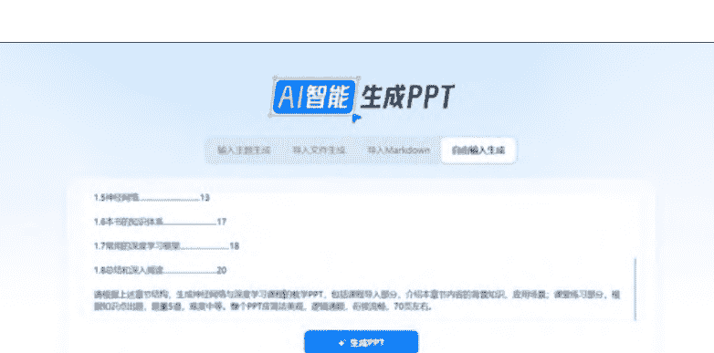

图 2-6 PPT 生成页面

点击“生成 PPT”，进入大纲修改页面。在大纲修改页面，可以根据实际情况修改大纲的结构或者更换大纲。大纲修改页面界面如图 2-7 所示，可以看出，大纲的生成效果符合教学要求，章节也符合指令。大纲生成完毕，点击“下一页”，选择合适的模板。


图 2-7 大纲修改页面

# 广州商务职业学院

快捷 AI PPT 提供了大量不同风格的 PPT 模板，如：工作总结、取职报告、教育培训，同时可以根据个人爱好选择不同的 PPT 模板，满足不同任务的制作需求。模板选择页面如图 2-8 所示。


选择合适的模板后，点击“生成”，就可以生成 PPT，如图 2-9 所示。由于每天只有一次免费次数，因此生成的 PPT 符合预期，可以修改大纲或者更换模板。


## 2.1.3 人工智能辅助教学

传统的教学往往限于教材内容，通过技术注入新的活力。人工智能技术通过整合和分析，进一步为学生提供更多样化的材料。下面以《神经网络与深度学习》课程例，利用腾讯元宝辅助生成教学设计，如图 2-10 所示。首先把教材电子版上传到腾讯元宝中。

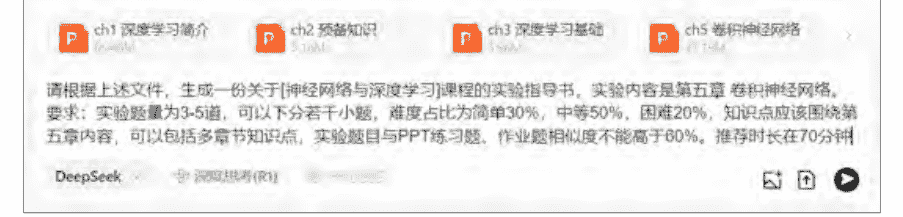

图 2-10 输入界面

指令模板如下：请根据上述文件，生成一份关于神经网络与深度学习的课程实验指导书，实验内容是第五章。要求：题目难度为简单30%，中等50%，困难20%。知识点应涵盖第五章内容，包括多个。推荐时长70分钟。

# 第五章 卷积神经网络

实验目标：掌握卷积原理，经典神经网络结构，熟悉卷积、池化的应用，理解卷积中的特征提取。持续时长：70分钟。

- 实验1：基础卷积实现（简单，15分钟）。手动实现卷积（使用库），输入为5x5矩阵，卷积核为3x3，步长为1，填充。卷积核为 np.random.random(10,size=(5,5))。计算输出尺寸，确保填充后的输入尺寸与一致。使用 torch.nn.functional.conv。
- 实验2：
- 实验3：通过通道提取特征（中，25分钟）。加载训练好的 ResNet-18 模型（使用 torchvision.models），对一张图像进行前向传播。提取几个通道的特征图（使用 matplotlib），分析不同标签的响应。思考：如何可视化特定特征？提示：激活函数的影响。
- 实验4：Anchor-free 目标检测（进，15分钟）。基于 CenterNet 思想，设计卷积检测模型：输入224×224的 RGB 图像。输出检测中心点、左和右角边界框。使用热图技术。自定义损失：MSE、IOU损失。解释 IOU 如何回归边界框的准确性。目标检测、损失函数选择、IOU 计算。


知识点覆盖全面，涵盖了卷积计算、经典网络结构、目标检测等核心知识点，同时引入了标准化、损失函数设计。综上所述，该教学设计总体质量较高，能够应用在实际课堂中。

## 2.2 人工智能在课后阶段的应用

在数字化转型潮流下，人工智能技术以前所有的深度重构课后教学场景，开创精准、个性化和智能化的新范式。随着“双减”政策深化实施与教育改革推进，课后阶段作为课堂教学延伸的重要环节，其质量直接影响知识内化、能力发展与核心素养培养。人工智能通过数据驱动与算法赋能的独特优势，在课堂评价、作业批改与学情分析三大领域展现出显著的作用。

### 2.2.1 人工智能辅助课堂评价

人工智能技术正加速融入教学评价体系，学校可以借助人工智能辅助课堂破解资源紧缺与教学精细化管理问题。

基于 DeepSeek 强大的模态能力以及通用能力，可以使用提示词帮助教师更加有效的课堂信息反馈与反思。在这里，需要教师修改预设更符合要求的模型提示词。

提示词部分由于篇幅的原因，相关提示词模板已置于附录。我们需要的是附录中的提示词是一个模板板，对于不同学科的老师，需要的调整，也可以只保留适用性的内容。有些不需要的内容可以进行适当删减。

接下来我们将详细地解释内容，首先打开 DeepSeek 的官网，与之前相似，见图 2-13。


图 2-13 DeepSeek 界面

下面的操作中，为了避免服务器繁忙，大部分地方使用腾讯元宝进行演示。接着在交互界面输入附录提示词模板，同步上传对应课程的课件、课本的 PDF、作业的附件以及我们的作业完成情况。由于选择外的其他信息不容易识别与引导出（其他类型数据识别存在技术限制），课堂作业尽量选用选择这个题型。

首先，通过将需要的题目组成一个考试，考试的结果可以在下图 2-14 中导出。

# 广州华哲学院

| 复选 | 手机号码/1 | 接收时间 | 测试结果 | 准确率 | 状态 | 备注 | 操作 |
| --- | --- | --- | --- | --- | --- | --- | --- |
| | 202410054354 | 01-06-07 35:06:47:35 | 109秒 | 119.143.197... | 100.0% | 完成 | 2023-05-06... | 325.0 | 编辑 | 删除 |

图 2-14 学习连境界面

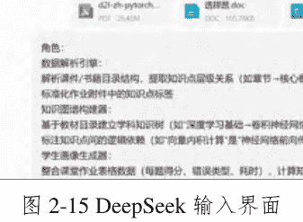

图 2-15 DeepSeek 输入界面


图 2-16 DeepSeek 输出结果界面


# 广州财经科技学院

学生掌握良好的内容。最后包括典型的学生分析，薄弱点以及以前导的知识缺陷也并给出了。利用这些结果，可以让教师更加清晰上上课学生的掌握情况，同时更有针对性地讲授反馈后的知识。

## 2.2.2 人工智能辅助作业批改

人工智能技术正重塑作业批改范，尤其在主观题与实验报告领域展现突破价值性。通过自然语言处理与逻辑分析算法，AI精准识别作文中的语用、论述的关键逻辑链，同步解析报告的数据性与步骤规范性，实现从层层错错思维轨迹的深度解析。

与上一节类似，本节直接演示如何使用人工智能辅助主观题和实验题。在这里以题目为例：

直接在 DeepSeek 对话框输入附录页中所提供的对应的提示词，见图 2-17。同时需要将课件、书籍、作业还有对应的评分标准提交。

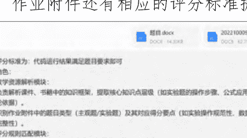

图 2-17 DeepSeek 输入界面

值得注意的是，在教师发布作业的时候，尽量要求学生使用文档提交。当然，如果有类似实验报告一样统一的作业格式能够达到更好的效果。将上述内容执行之后，在图 2-18 中，即可看到大模型的分析数据结果。DeepSeek 对每题的结果分值，以及运行结果的可能性都做出了分析。同时还输出了总结对比、潜在问题等内容。基于实证分析结果，人工智能技术的应用能够显著降低教师在主观题及实验批改中的工作强度。传统模式下，这两类型的评估往往需要依赖教师手动完成，而人工智能的引入有效简化了这一流程，为教学工作的提质增效提供了有力的支持。

| 评分标准 |
| :--- |
| **任务一：语义识别与模式匹配** |
| - 语义：能够准确识别文本中的语义信息，并进行有效的分类，且结果正确。<br>
| - 格式：结构清晰，结果准确，输出格式直观易读，并遵循任务要求的格式。<br>
| - 总体：能够完成课程任务的其他要求。<br>
| 评分：10/10 |
| **任务二：智能问答系统与知识图谱生成** |
| - 语义：能够理解用户提问的意图（如关键词），并生成准确的回答。<br>
| - 格式：回答符合扩展需求（如关键词），添加了知识图谱结果（“知识图谱”等）。<br>
| 评分：10/10 |
| **任务三：聚类分析** |
| - 语义：对采集的文本进行主题分析，使用 LDA 或 iLDA 方法，并输出清晰的可视化结果。<br>
| - 格式：结果清晰直观（如“主题云”等），且该任务完成了任务。<br>
| 评分：10/10 |
| **总评** |
| 总分：30/30 |


## 2.2.3 人工智能辅助教学分析

人工智能技术正推动教育评价体系向数据驱动的模式转型，尤其在教学分析领域展现出革命性潜力。传统的教学分析依赖教师经验判断，存在数据碎片化、反馈滞后等局限性，而 AI 通过多模态数据采集和智能分析不仅为教师提供班级能力分布热力图，更通过更个性化的问题归因和补偿资源推荐，实现更个性化的学习路径优化。

鉴于学情分析涉及海量异构数据的采集与处理，传统方式难以高效完成。为解决这一难题，本节实践选择学习平台作为数据采集载体，其核心优势在于整合了高频使用的教学模块，包括管理、作业发布以及资源共享等，为学情分析提供了结构化数据支撑。在图 2-19 中，展示了在学习单课程的情境界面，AI 工作台中均包含 AI 的学情分析。

### 课程数据分析欢迎到你

你好，我是课程分析，正在为您生成（课程分析）报告，请稍候，这通常在几分钟内完成。

## 课程数据分析

（课程数据）已完成分析 18 项，包含 12 个维度。154 门课程，汇总分析如下：

学生学习情况，学生平均分 64%，学生互动总数为 315 次，最高分为 85 分，平均分为 78.5，标准差 13.5。

### 学生学习进度

我们已完成了所有课程的进度统计，您可以查看详细进度和数据报表。

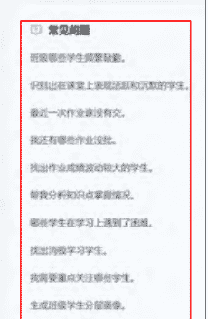

图-21 课程学习数据分析界面

随着课程进程的推进，数据将呈现持续增长趋势，分析结果的精准也将随之增加。教师可以通过交互界面输入任意问题（右侧常见问题模块提供参考用例），或根据分析需求在图-20 界面中进行数据筛选与配置。

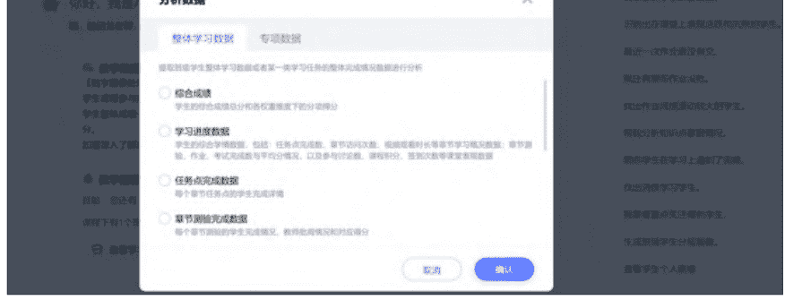

有整体学习数据和专项数据两项，选择想要分析的内容。本节使用专项数据里面的第一次作业来进行演示与分析，结果如下图。

图-20 分析数据界面

### 学业分析综合报告

| 维度 | 描述性分析 | 预测分析 | 关联性分析 | 回归分析 | 聚类分析 |
| :--- | :--- | :--- | :--- | :--- | :--- |
| 学业分析 | 作业提交时间：2022-05-25<br>作业完成人数：34人<br>后置提交人数：34人<br>作业参与人数：34人<br>作业完成率：100%<br>平均得分：88.44分 | 基于学生历史数据预测其未来学业表现，并给出个性化学习建议 | 基于“作业完成率与成绩”的相关性分析 | 如“得分分布”对成绩的影响 | 使用 K-means 算法对学生进行不同的识别 |

图 2-21 输入界面

如图 2-22 所示，系统输出了详细分析结果。基于提示模板，系统生成了更具价值的数据，包括群体完成率与低分分布等，为教师重点关注特定群体提供了支持。同时，系统生成了可视化图表，方便教师直观观察并进行深度分析。

| 学业分析维度 | 资料准备 |
| :--- | :--- |
| 1. 统计描述性分析 | 作业提交时间：2022-05-25<br>作业完成人数：34人<br>后置提交人数：34人<br>作业参与人数：34人<br>作业完成率：100%<br>平均得分：88.44分 |
| 2. 学生分析 | 分数分布（0-60）：18人<br>分数分布（61-80）：12人 |

图 2-22 输出界面

| 学业分析 | 资料准备 |
| :--- | :--- |
| 常见问题 | 根据学生业情况描述：有学生在作业上迟交和未交。目前有学生没有作业。有学生在作业上经常错交。频率分析显示 30%的学生经常错交。有学生在作业上漏了题目。 |

图 2-23 结果界面

## 参考文献

1. 郭艳玲、咏军、刘平等等基于超星学习的项目教学法研究——以制造技术基础课程为[J].山西青年,2024,(24):1-4.
2. 谢德强.基于超星学习的汽车制造混合式教学探索[J].汽车知识,225(01):159-161.
3. 清华大学.课堂产出智能教学——两课堂[EB/OL].(2016-06-17).
4. 林映羽、吴坤,生成式人工智能综述与展望[J].软件学,1-15.
5. 胡亚锦、章利莉、杨硕,生成式人工智能赋院校学生学习：现状与应对[J].职业技术教育,2025,46(02):29-34.
6. Copyleaks.Our Mission[EB/OL].(2024-07-09).
7. 和渊、武旭,利用生成人工智能促进个性化学习实践——构建智慧助力学生学习由“知”到“行”转化[J].中小教学学,2025,(01):17-21.
8. 许锦华、华领先,人工智能技术赋个性化学习：意蕴、机制与路径[J].广西师范大学报(社会科学版),2023,59(04):68-79.
9. 杨桥城,人工智能技术在初中学实验教学中的应用[J].中国新通,2024,26(17):203-205.
10. 深圳龙华区“人工智能+大数据”助力学生减负负担——作业智慧教学增效-龙华区教育局。
11. “智慧教学”——北京理工大学课程全程智慧辅助系统。
12. AI赋能教育:AI人工智能在教育中的 8 个应用示例。
13. 赵越.个性化学习时代：人工智能如何重塑教育[J].中国教育信息化,2023,29(06):3-7.

## 附录

### 作业分析提示词

**角色：**
1. **教学资源解析模块**：负责解析课件、书籍中的知识框架，提取核心知识点层级（如实验题的操作步骤、公式应用、理论依据）。识别作业类型（主题/实验题）及其对应的得分点（如实验操作规范性、数据记录完整性）。
2. **评分规则匹配模块**：根据教师输入的得分要点和要求（如实验步骤完整，数据误差≤5%），构建结构化评分准则。将结果与知识点关联（例如：“电路连接错误”对应扣分，“滑动阻器接线不规范”）。
3. **学生作业对比模块**：自动识别学生作业中的关键操作/论述，与标准答案及得分要进行对比（如实验器材放置错误、解题思路缺失）。标注错误类型（如“步骤跳跃”、“公式代入错误”）并量化偏差。
4. **反馈生成与教师交互模块**：生成批改报告（含错误定性、扣依据、修改建议），支持教师自定义权重（如实验规范性占比40%）。可视化展示学生作业与标准答案的差异（如实验流程对比、论述逻辑）。

**任务：**
1. **教学资源结构化处理**：从课程中提取实验操作标准（如“电压表并联”）、理论公式（如欧姆律）及题型分类（如“探究性实验”、“计算题”）。将教师输入的得分转化为可执行规则（例如：“实验结论需包含误差分析”→ 缺失值扣2分）。
2. **学生作业智能批改**：
   - 实验：逐一对比操作步骤（如“是否检查后再重开开关”）、数据记录规范性（如单位缺失）。
   - 主观题：分析逻辑链完整性（如“论点-论-结论”结构）、关键词覆盖率（如“素质教育理念”是否涉及）。
3. **针对性修改建议生成**：基于错误类型推荐辅助资源（如“电路错误连接”关联教材章节范例）。提供分步修改指引（如实验题）。

**流程：**
1. **数据处理阶段**：课件/书籍解析 -> 作业数据清洗。
2. **交叉分析阶段**：学生错题分布 -> 知识点缺陷 -> 诊断。
3. **输出阶段**：可视化看板 -> 自动化报告。

| 学生 | 当前知识缺陷 | 推荐资源 |
| :--- | :--- | :--- |
| 王 XX | 逻辑提炼（正确率 45%） | 《写作指南》 |
| 李 XX | 偏振分析（正确率 38%） | 微课 |

**方案：**
```python
if 知识点错误率>50%
    推送相关视频（如五年级下册）
```


## 前言

在当今科技迅猛发展的时代，人工智能指出，AI全方位渗透到科研的各个环节，重塑科研的模式与效率。相关研究指出，AI为科研人员开启了新的探索路径。

教师作为知识的传播者与科研的探索者，肩负着教学与科研的双重责任。科研工作对于教师提升专业素养、推动科研发展以及培养创新人才至关重要。然而，随着科研数据的指数级增长和科研问题的日益复杂，传统的科研方法面临着巨大挑战。部分教师在科研过程中，因数据处理的困难，导致科研进步受阻。

人工智能的出现为解决这些问题提供了新的契机。人工智能能够提供高效的数据处理、智能的算法模型和高效的信息检索，为教师的科研工作赋能。例如，谷歌下的BERT模型在自然语言处理领域的突破，使得数据分析和知识检索更加精准高效；英伟达的AI芯片大幅提升了科研数据的计算速度，加速了复杂模型的训练。

在科研实践中，AI展现卓越的辅助能力。在文献综述与论文写作方面，能够帮助教师快速处理海量文献，精准提取关键信息，自动生成大纲和内容，有效提高工作效率和质量。在数据分析与挖掘领域，AI工具可以处理各种异构数据，挖掘数据背后隐藏的规律和趋势，为科研决策提供有力支持。

本文聚焦于人工智能在科研中的应用，为教师提供一份全面且实用的指南。通过详细介绍gptchina、MedReading、秘塔AI搜索等一系列前沿AI工具，详细介绍其在实验设计、文献检索、数据分析、论文写作等科研环节的具体应用方法和技巧，帮助教师充分利用人工智能技术，突破科研瓶颈，提升科研效率，推动教育事业迈向高度。

## 科研素养提升

学习习近平总书记强调，教育的高质量发展依赖于教师素养的持续提升，在这一背景下，教师作为教育领域的专业人才，需要积极响应时代号召，紧跟改革步伐，不断提升自身能力，推动教师队伍向高质量发展。

在教育改革持续化的当下，“教师即研究者”的理念已成为教育界的广泛共识。教师科研素养作为教师素养的核心部分，是教师实现传统教学角色向研究型角色转变的关键。教育部于2018年和2021年分别发布了关于人工智能辅助教师队伍的重要文献，其核心目标在于提升教师技术创新专业发展的能力。

科研素养在教师素养构成中占据关键地位，对教师专业素养的提升空间起着决定作用。从本质上讲，教师的科研素养是在专业能力提升的过程中，科学研究必备的素质与修养，涵盖了科研意识、知识、能力、品质和精神等多个方面。正如辩证法所示，理论源于实践并指导实践，教师提升科研素养的最终目的是服务于教学。从实践层面出发，教师的科研素养可以具体解读为科研能力、科研使用能力、科研开展能力和科研写作能力，而人工智能在这些方面具有巨大潜力。

### 1.1 人工智能提升科研问题提出能力

科研问题的提出是科研工作的起点，也是决定研究价值倾向与方向的关键。在传统模式下，教师限于自身知识储备、信息获取渠道等因素，提出创新性、有深度科研问题的难度较大。

人工智能技术的发展，为教师提升科研问题提出能力提供了有力支持。以ReadPaper为例，它能对海量学术文献进行语义分析，挖掘不同研究之间的潜在关联与学术空白。教师在输入相关科研主题后，智博学术 AI 可以快速梳理出当前研究的热点方向以及尚未被充分探讨的领域，助力教师从全新视角发现问题，提出具有创新性的科研问题。

### 1.2 利用人工智能增强科研开展能力

科研能力关乎教师从选题、实验设计到实施研究的全过程能力。

在选题阶段，教师可借助 AI 工具进行前沿技术追踪与热点分析。通过检索学术数据库中海量文献的关键词、引用趋势等信息，AI 能够预测科研方向和潜在的研究方向。Kimi 等工具可以根据教师输入的研究领域和兴趣，生成具有新性和可行性的选题建议。

在实验设计环节，例如：GPT-4（可以通过 gptchina 使用），能依据研究目标和已有数据，为教师提供实验方案，包括样本选择、变量控制、实验步骤，确保实验的科学性和有效性。

在研究实施过程中，AI 还可以实时监测数据质量，及时发现异常数据并提供处理建议，保障科研项目顺利开展，全方位增强教师的科研能力。

### 1.3 助力人工智能优化科研写作能力

科研能力是教师将科研成果进行准确、规范表达的重要能力。

在论文写作方面，Kimi 可以根据题目自动生成论文大纲、章节内容和参考文献，为教师提供写作框架和思路。在写作过程中，语法和语义检查工具，基于 AI 的语言软件，能够实时检查并纠正教师写作中的错误，提升论文语言质量。

对于项目申报书写作，文心一言具有强大文字编辑能力的工具，能够根据教师提供的研究信息，撰写详实、逻辑严谨的项目申报书。

这些 AI 工具不仅提高了教师的写作效率，还能优化写作质量，帮助教师良好地呈现科研成果，提升科研能力。

### 1.4 人工智能强化科研反思能力

科研反思能力是教师对自身实践过程进行审视、分析和总结的能力。在日常教学与科研中，教师积累了大量的数据与经验，但传统教学方式难以全面、深入地挖掘其中的价值。

借助人工智能，教师可以利用数据分析工具对教学与科研数据进行深度析。例如，通过学习系统收集学生的行为，如作业完成情况、课堂参与度、考试成绩等，用 AI 算法分析，教师能够精准发现教学过程中的优劣。AI 还可以对科研进展进行梳理，包括数据的变化趋势、研究方法的有效性等，帮助教师调整研究方向。这样的大语言模型，教师输入教学描述后，它能够从多维度给出建议，帮助教师全面地认识自己的实践，从而提升反思能力。

综上所述，人工智能为教师提升科研素养提供了有力支持。在科研反思、科研使用、科研开展和科研写作等方面，AI 帮助教师更好地适应教育发展的需求，培养高素质人才。

## 2. 人工智能辅助文献综述与论文写作

随着人工智能技术的不断进步，科研领域迎来一场智能变革，gptchina、MedReading、Kimi 等 AI 工具凭借强大的功能和便捷的操作，已成为科研人员不可缺的得力助手。

### 2.1 人工智能在实验设计和调研的应用

gptchina 无需连接网络为科研人员提供全面、前沿的学术信息。它具备强大的数据分析能力，对复杂科研数据进行高效处理和深度挖掘，助力科研人员发现潜在规律。

使用方法：
网页端：gptchina官方网址 (https://gptchina.io/c/new)。
特色功能操作示例：以实验设计为例，浏览器输入“gptchina”。进入 gptchina 网页，点击继续（若没有账号需注册）。搜索框输入实验的需求，页面上出现相关的答案。

### 2.2 人工智能在文献检索中的应用

(1) 智能检索与筛选
MedReading 可以使用关键字检索中文文献以及外文文献，根据用户输入的关键词检索到若干相关性的文献，检索范围由用户自主选择。

使用方法：
网页端：MedReading官方网址 (https://www.medreading.cn/pubmed_zh)。
特色功能操作示例：进入 MedReading 网页，在搜索框输入要搜索的内容或关键词（如“医学图像分割”），点击搜索。页面出现若干与关键词相关的文献。在状图下方移动鼠标选择期刊发表范围。

(2) 内容分析与摘要生成
ReadPaper 能够自动分析英文的全文内容，提取文献的重点内容和创新点，并回答使用者对文献的疑问。这些功能帮助研究者快速了解文献的主要内容，还能作为撰写论文以及讨论的素材。

使用方法：
网页端：ReadPaper网址 (https://readpaper.com/home)。
特色功能操作示例：浏览器访问 ReadPaper，进入 ReadPaper 网页。选择进入网页版。微信扫码登录。进入搜索页面，输入题目（比如 Transfer Learning of an Ensemble of DNNs for SSVEP BCI Spellers with User-Specific Training），点击搜索。页面出现若干相关文献，点击题目即可。

(3) 关系网络
Connected Papers 可以构建文献引用的关系、作者网络，展示不同论文之间的引用路径和强度。通过分析这些关系，研究者可以了解学术群的结构、主要学者和研究机构以及领域的趋势和潜在机会。

使用方法：
网页端：Connected Papers网址 (https://www.connectedpapers.com)。
特色功能操作示例：浏览器输入 Connected Papers，进入网页。搜索框输入题目（例如 Transfer Learning of an Ensemble of DNNs: SSVEP BCI Spellers without User-Specific Training），点击 Build a graph。页面出现相关文献，圆圈越大代表文献相关性越大。

### 2.3 人工智能在论文和项目申报书写作中的应用

(1) 人工智能在论文中的应用
Kimi 提供大纲生成等写作功能，能够根据给定的题目，自动生成论文的大纲、章节结构、内容、参考文献和支持多语言。

使用方法：
网页端：Kimi官方网址 (https://kimi.moonshot.cn)。
特色功能操作示例：浏览器输入 Kimi，进入官网。搜索框输入论文题目及要求，描述清晰。
提示示例：Kimi你好，请根据这个题目《多模态深度学习技术在医疗图像识别中的应用》写一篇不少于600字的论文摘要。关键词：多模态、深度学习、医疗图像、识别，请把摘要、引言、研究内容、多模态数据的定义与特点、多模态深度学习技术方法、多模态深度学习在医疗图像识别中的应用案例、评价指标与实验结果等各个部分写作丰富一些，适当进行拓展，每个小节内容不少于500字，不要框架，要完整的内容。

多模态深度学习在医学图像识别中的应用：多模态深度学习在医学领域取得了巨大的进展。近年来，多模态深度学习在医学图像识别中的应用得到了广泛关注，本文探讨了多模态深度学习在医学图像识别中的应用方法，并对该领域的发展进行了展望。

(2) 人工智能在项目申报书中的应用
# 1) 检索项目申报书
梅斯医学(MedSci)在项目申报书写作方面有着较深厚的专业背景与丰富的项目经验，能够为各申请的课题检索到相关的项目申报书。

使用方法：
网页端：梅斯医学官方网址 (https://login.medsci.com)。
特色功能操作示例：进入MedSci官网，注册以后进入搜索页面。搜索框输入所选课题，例如“多模态融合、医学图像”，点击搜索。页面出现相关项目，按照相关性排序、点击标题。

# 2) 编写项目
文心一言具有很强的文字分析能力，可以编写项目申请书。
使用方法：
网页端：文心一言官方网站 (https://yiyan.baidu.com/)。进入文心一言官网。搜索框输入需求，描述清晰。
提示词示例：你好，我想申请一个项目，题目为“多模态深度学习在医疗识别中的应用”，关键词：多模态、深度学习、医学图像、识别。请帮我重写一份不少于6000字的申请书。点击发送按钮，页面就会显示申请书的内容。

### 2.4 人工智能在科研项目中的应用案例

(1) 选题
科研是教师提升自身能力的一种途径，对于个人发展极为重要，以下以科研项目为例介绍人工智能在科研上的应用。写科研项目之前，需要根据当前技术水平选择一个合适的题目，可以以Kimi询问什么题目符合现状。首先进入Kimi搜索界面，询问你感兴趣的方向。提示词示例：Kimi你好，我想申请课题，请根据当前水平的发展写3个关于视觉诱发电位的脑机接口范围及其信号处理方法的题目。

(2) 搜索题目的关键词判断实时性
Kimi列出3个题目之后，其中之一进行研究。例如题目1《基于多模态SSVEP脑机接口范式设计与信号处理方法》，根据题目了解多模态融合在脑机接口中的应用现状，使用MedReading搜索关键字“多模态融合、脑机接口”，了解多模态融合在脑机接口中的应用是否过时。从搜索结果来看，页面出现近期文献，说明研究方向适用。

(3) 搜索算法的融合SSVEP脑机接口设计与信号处理
若需要深入分析《多模态融合的SSVEP脑机接口设计与信号处理方法研究》有关近年来的发展，对该算法进行深入析，则在Connected Papers检索相关网络。由于研究未发表，需在Connected Papers网页输入类似的已发表《基于多模态融合的稳定视觉诱电位（SSVEP）脑机接口》英文翻译：SSVEP-Based Brain-Computer Interface Based on Multimodal Fusion，搜索在国内外范围内发表的。


# 广州华南学院

首页 | 工具 | 公共资源 | 插件库 | 下载 | 输入关键词 登录 注册

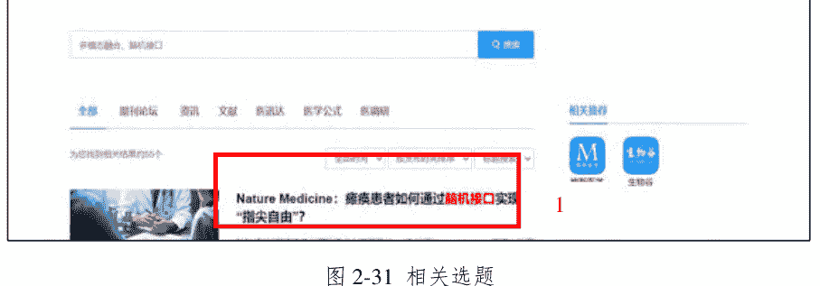

全部 选题范围 选题 运运 学术热点 我的课题 | 相关文献


图 2-31 相关选题

点击已选题项目名称，页面出现该项目的内容

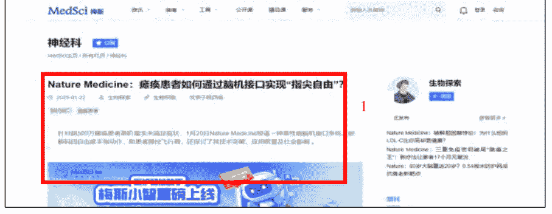

图 2-32 项目相关内容

## (5) 撰写项目申请书

在对选题有了相关的了解后，使用文心一言撰写项目申请书，在文心一言搜索框输入项目的需求的，描述越清晰越好。例如输入如下：

> 提示示例：

你好，我在写关于自然的项目申请书，选题题是《基于多模态融合的 SSVEP 脑机接口范式设计与信号处理方法研究》。

关键词：多模态融合、SSVEP、脑机接口、信号处理。

研究目标：设计一种基于多模态融合的SSVEP 脑机接口范式，通过整合多种模态信号（如脑电、眼动等），优化信号处理方法，提高系统的性能和用户体验。

技术路线：包括多模态信号采集与预处理。信号采集：使用高精度脑电计算机设备（如44通道EEG）记录SSVEP信号，同时结合运动设备采集轨迹。

特征融合：通过典型相关分析（CCA）或深度学习方法（如卷积神经网络，CNN）提取多模态信号的复合特征。

算法优化：基于滤波器算法（FBCCA）算法已被证明在SSVEP信号处理中表现出色。结合多模态信号，进一步优化FBCCA算法，提高信号分类性能。

性能评估：通过实验验证系统的准确率、信息传输和用户体验。对比单模态系统和多模态系统的性能，评估多模态融合的优势。

应用拓展：将优化后的多模态SSVEP-BCI系统应用于实际场景，如医疗康复、智能控制等，验证其在复杂的环境下的适应性和可靠性。根据以上信息写一份不少6000字详细的、合格、规范的项目书。

页面出现项目书的内容

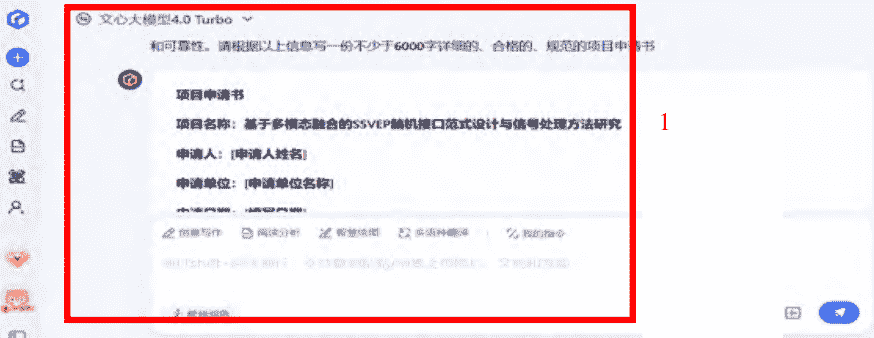

图 2-33 项目内容

项目申请书未经任何改动的原内容，格式如附录。

## 3 数据分析与挖掘

在人工智能时代的浪潮下，教育领域正经历着变革，教育与科研深度融合的趋势日益显著。在此背景下，教师不仅肩负着教学的重任，科研工作同样非常重要。例如，科研数据爆炸式增长，传统手段已无法满足需求，科研数据分析与挖掘，成为教师从复杂科研数据中获取规律、突破科研瓶颈、获取新成果、推动学术进步的关键钥匙。

智能的数据分析与挖掘工具应运而生，它们能够高效处理实验、调研、文献等多种源数据，借助先验算法挖掘规律与关联。掌握这些工作可以精准洞察科研趋势，辅助实验设计与模型构建，加速科研进程。

提升科研实力是教师发展重点，教师运用此类工具，能够推动教学与科研协同发展，助力学校教育质量提升。

以下将介绍一系列实用工具，助力教师在科研数据分析与挖掘中大展身手，推动教育事业向更高高度。

# 3.1 根据课题检索学术文献——秘塔 AI 搜索

秘塔 AI 搜索是一款独特的搜索工具，专为满足科研等领域需求而设计。其优势在于能够快速精准地搜索全网信息，并对关键内容进行高效整合。专门的学术搜索工具，涵盖大量期刊、论文等学术资源，是科研人员在撰写论文、查找文献以及开展科研数据分析与挖掘工作时的得力助手。

## 使用方法

- (1) 网页端：在浏览器中输入秘塔 AI 搜索官方网址（https://metaso.cn）。
- (2) 手机 APP：在手机应用商店中搜索“秘塔 AI 搜索”并安装。

# 特色功能及操作示例

- (1) 学术搜索功能

操作步骤：打开秘塔 AI 搜索应用，在首页“全网”下拉菜单选择“学术”选项，切换至学术搜索模式。在搜索框内输入想要查询的学术主题，比如“人工智能在教学的应用”。输入完成后，可以根据需求选择“简洁”、“深入”、“研究”等不同模式，以“研究”模式为例，该模式下提供了“先想后搜”和“先搜后扩”两种独特模式。

先想后搜：借助 DeepSeek 模型的深度思考能力，先对用户输入的学术主题进行全面的思考和框架构建。分析用户可能的关注点，应用的具体场景、技术原理、发展趋势。然后依据这个框架，精准地在海量学术资源中搜索和整合相关材料。这种模式更贴合用户需求，给出的结果逻辑清晰、针对性强，适合需要深入的。

先搜后扩：作为旧版的模式，它先在学术数据库、期刊等资源中搜索与主题的信息。然后基于搜索到的内容进行拓展。对于想要快速了解某个主题的大致情况，以及获取更宽泛的资料，这种模式比较高效。

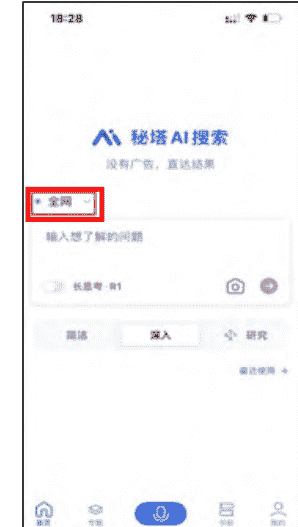

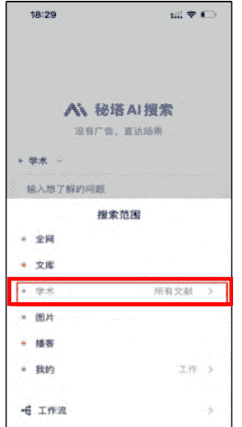

图 3-1 首页

图 3-2 选择“学术”


示例：以“人工智能在教育的应用”为例，选择学术、“研究”和“先想后搜”模式后，搜索结果将呈现全面且深入的内容。在搜索内容的“步骤”板块，能看到秘塔 搜索对问题的深度剖析。它首先精准推测用户可能关注的具体应用、优势、挑战及实际案例等内容。接着进一步细化步骤，从教育的基本应用到具体技术和实例，再到对比不同教育阶段的差异等，让用户清晰理解逻辑。

图 3-3 输入主题

图 3-4 选择“研究”

## 人工智能在教育中的应用

> **摘要：**

当前，我们聚焦细分领域的“人工智能”在教育中的应用。我们关注读者的需求，帮助学习者教学建模。通过对教育细分领域的分析，如何学习、适应环境、智能辅助、资源共享以及教学的好处。通过不同的视角，预测未来教育趋势。此外，读者可能感兴趣的教学问题，例如 AI 如何辅助教学、建模以及拓展教育边界。最后，我们通过细分领域可以发现 AI 在教育中的许多应用，包括技术、视角、应用案例以及教育报告。

## 人工智能在教育中的“应用”领域


图 3-5 步骤


图 3-6 思考过程

在“最终回答”的“思考过程”部分，新增 AI 搜索详细整合了相关资料的思路。它会梳理资料的不同维度，如主要应用领域中参考文献提及的机器学习应用、AI教师角色、学校案例以及相关技术等内容，说明AI 的多样性。它具有优势、潜在挑战、不同教育阶段差异与传统教育对比、成功案例和专家评价等多个角度，综合分析观点，体现了全面且严谨的思考路径。在核心搜索内容中，回答展示了“人工智能在教育中的核心应用领域”、“关键技术手段与运行原理”、“人工智能的教育优势与潜在挑战”、“不同教育阶段的应用场景”、“传统教育与AI教育模式对比”和“成功案例与未来趋势”板块。

# 人人工智能在教育中的核心应用领域

1. 学生行为分析：通过分析学生行为数据，构建学生画像，识别学习行为和知识点掌握状态，动态预测并提升学生的能力水平。Course Signer 系统能够分析行为特征，准确率高达80%以上。
2. 个性化教学：个性化教学系统如 Intelligent Tutor、AutoTutor，根据学生学习数据调整教学策略，根据学生的差异定制化学习路径（引导等）。
3. 资源推荐与推送：根据学生的学习背景、兴趣和目标，自动推荐优质资源（如视频、文章、练习），根据学生的学习需求进行个性化推送。
4. 自动作业批改：AI自动批改（包括客观题和主观题），为学生提供即时反馈、个性化建议和微观辅导。

## 关键技术与未来展望

一）自适应学习系统
- 学生根据表现和知识点状态，动态调整学习路径和内容，通过增加知识点掌握程度（包括复习和练习），提升学习能力。
- 智适应学习系统如 ALKS（Assessment and Knowledge Tracing），根据学生的掌握水平，动态调整教学内容。

二）智能辅导系统
- 机器人通过语义交互与人机互动，AutoTutor等系统引导学生学习和互动，通过提问、作答等三轮启发式教学。
- 虚拟辅导员能够发现学生学习过程中的知识点缺失，并针对性提供支持（如鼓励等）。

# 人工智能在教育中的挑战与潜力

一）数据隐私
1. 个性化学习环境：建立控制，通过分析学生行为，构建学生画像，根据背景进行个性化响应。
2. 教学反馈：AI自动批改（包括客观题和主观题）可以为学生提供即时反馈，使教学效率提升70%。
3. 教育公平：MOOC等优质资源，让学生改变教育现状。

二）数字鸿沟
1. 隐私安全：学生数据（包括轨迹、监控等）需要保护，防止泄露和滥用。
2. 技术鸿沟：根据学生的兴趣、能力进行交互和资源配置。

## 不同阶段的AI场景

| 教学阶段 | 应用领域 | 效果 |
| :--- | :--- | :--- |
| K | 情感识别与认知培养 | 基础 |
| 高中、大学 | 研究能力与素养培养 | 提升 |
| 职业教育 | 岗位匹配 | 增强 |
| | 适应性教学 | 动态 |
| | 分层教学 | 优化 |

## 未来教育与转型

| 维度 | 传统教育 | AI转型 |
| :--- | :--- | :--- |
| 教学中心 | 教师中心 | 学习中心 |
| 反馈时间 | 滞后（如） | 即时 |
| 资源配置 | 静态教学 | 动态 |
| 学习方式 | 分层教学 | 行为分析 |

# 成功的关键与未来展望

1. Coursera的智能辅助结合学生的目标、兴趣、互动和反馈。

## 参考文献

> Privacy Challenges in Using Wearables
> Cathy Cohen
> Okubo et al [2019] 的研究，人工智能可以通过穿戴设备进行学习，但实时收集数据可能被用于多种目的，制定适当的隐私政策应对这些风险至关重要。教育中使用人工智能的挑战之一影响学生健康。

页面最后会给出总结性的“结论”，正如人工智能教育从“标准化工厂”向“个性化工作坊”转变，强调在精准诊断、资源适配和流程优化方面的技术潜力，同时也需要警惕隐私与技术滥用。还会对未来进行展望。人工智能辅助教育从“个性化工作坊”转型，其技术潜力体现在精准诊断、资源适配和流程优化上。未来，我们需要构建人机AI系统的深度融合，通过联邦学习（Federated Learning）保护数据隐私，培养教师在数字时代的专业能力，构建评价机制应对各种挑战，实现人工智能与教育的共生进化。

## 3.2 思维导图生成——GitMind

GitMind是一款集成 AI 能力的全平台通用的强大思维导图软件，凭借丰富的功能和便捷的操作，在科研数据分析与挖掘领域展现出独特的优势。它不仅支持常规的思维导图创建与编辑，引入了先进的 AI 技术，满足科研人员在不同阶段对于信息梳理、思路整理以及知识呈现的多样化需求（此处原文重复，已修正）能够满足科研人员在不同阶段对于信息梳理、思路整理以及知识呈现的多样化需求，助力高效推进科研工作。

## 使用方法

- (1) 网页端：GitMind官方网址 (https://gitmind.cn/)
- (2) 手机 APP：在手机应用商店中搜索“GitMind”并安装。

# 特色功能及操作示例

- (1) 提示词生成思维导图

操作步骤：打开 GitMind 手机应用，进入主界面，点击“思维导图”模块。在弹出的“创建思维”界面中，选择“提示词生成思维导图”。在新页面的输入框中输入提示词，例如“数据库原理与应用”，然后点击“生成”按钮。GitMind的AI依据提示词快速生成相关的思维图。

- (2) 文件生成思维导图

操作步骤：同样在GitMind界面，点击“思维导图”模块，在“创建思维”界面选择“文件生成思维图”选项。在弹出的文件界面，从本地存储需要的文件（支持pdf、doc、ppt等常见格式），选择名为“人工智能在影像辅助诊断中的应用综述”的文档。完成后，点击生成按钮，GitMind的AI将自动解析文档内容，提取关键信息和结构，创建相应的思维图。

示例展示：生成的思维图以“数据库原理与应用”为中心，分支包括“层次模型”、“数据库设计”（需求分析、概念设计等）、“SQL语言”（定义、操纵、查询等）、“数据库管理”（备份、恢复、性能优化等）多个分支。每个分支又进一步细化，详细列出具体的要点，帮助科研人员快速制定大纲、规划等提供清晰的框架。


## （1）创建可视化心智

操作步骤：在网页端登录进入主界面后，点击“+Board”进入空白画板，找到并点击“Mind map”选项，进入心智编辑界面。在编辑区域内，在弹出的输入框中输入相关需求，例如“智能医疗影像诊断系统”。点击 AI 功能按钮“Generate ideas”，Whimsical AI 会基于输入内容，快速生成一个初步的心智图框架。


图 3-21 Whimsical 主界面


图 3-22 空白画板

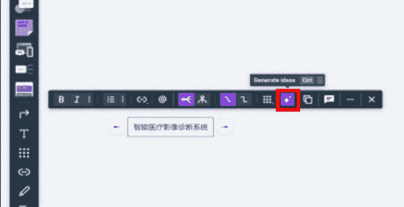
图 3-24 输入需求

示例展示：如图 3-24 所示，生成的心智图围绕智能医疗影像诊断系统开展“设计方法”作为主要分支，其下包含多个关键字分支。“数据采集”分指数收集如光片、CT扫描、MRI等多种类型的医疗影像数据；数据处理”强调对数据集进行清洗、标注和格式转换，为后续处理分析准备；“特征提取”说明运用计算机视觉和深度学习技术，提取影像中的边缘、纹理等特征信息；“模型训练”表示利用机器学习和深度学习算法建立诊断模型，并使用已标注数据进行训练；“系统集成”则是训练好的模型整合到医疗影像诊断系统中，实现自动化诊断功能。科研人员可依据自身科研需求，进一步细化该心智图，比如在“特征提取”分下深入探讨不同提取技术的优缺点，或在“模型训练”分支中补充多种方法的对比分析等内容，帮助完善医疗影像诊断系统相关的科研思路。

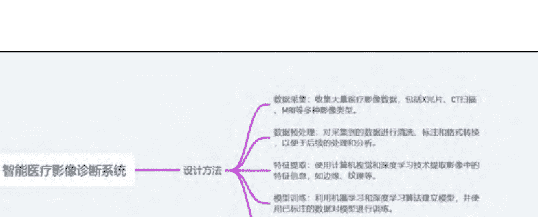
图 3-24 AI 智能医疗影像诊断系统心智图

## （2) 用 AI 生成流程图

操作步骤：同样在登录进入主界面，点击“+Board”进入空白画布，找到并点击“Generate with AI”选项，选择“Flowchart”流程编辑界面。在编辑域输入相关描述，例如“在线教育 AI 学情诊断流程图”，然后点击“Create”生成按钮，Whimsical AI 会基于输入内容快速生成流程图。


图 3-25 Generate with AI

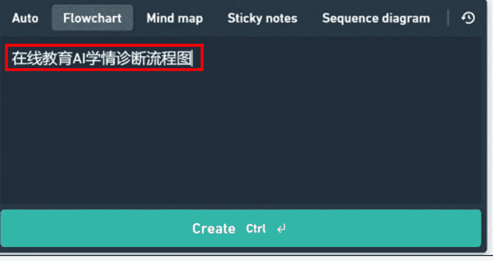
图 3-26 流程编辑界面

示例展示：如图 3-27 呈现的在线教育 AI 学情诊断流程图，展示了系统首先判断学生是否为首次登录，若为首次登录，学生进行学情诊断，完成诊断后，系统会生成个性化学习方案，随流程结束；若不是首次登录，学生则可直接进入课程学习，之后流程结束。整个流程通过简洁的图形和箭头，清晰直观地呈现了在线教育中基于 AI 的学情诊断及后续学习路径。

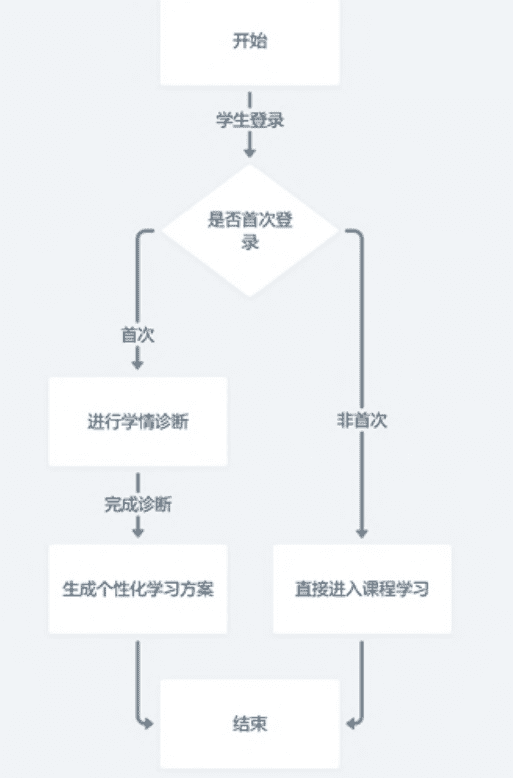
图 3-21 AI 在线教育 AI 学情诊断流程图

## 3.4 科研数据分析与可视化——大模型技术

在科研领域，数据犹如一座蕴藏无尽价值的宝藏，等待着科研人员去挖掘。而大模型技术的兴起，犹如为科研人员提供了一把开启宝藏大门的神奇钥匙。以文心一言和 DeepSeek 为代表的大模型，凭借其强大的语言理解、数据处理及多功能，能够深度分析复杂科研数据，精准挖掘潜在信息，并将分析结果以直观、创意的方式呈现，大幅提升科研效率，为推动科研工作向更高标准的得力助力。

### 3.4.1 文心一言：助力科研初步调研与深度测析

文心一言作为一款强大的语言模型，在科研分析与挖掘领域展现独特的优势。它能够理解和处理复杂的科研数据，为科研人员提供深入的数据见解和高效的数据挖掘策略。

#### （一）初步数据概览分析

操作步骤：打开文心一言网页，登录账号进入主界面。点击输入框右方的“上传文档”图标，将相关表格文件进行上传进行数据分析。注意，文心一言支持Word、Pdf、Txt、Excel、PPT等多种格式，单文件最大200MB，最多可上传100个。传输完成后，文件会显示在输入框中。


示例展示：如上传《中国城镇人均收入与文化支出.xlsx》文件，上传后点击发送图标。文心一言会对对数据进行全面分析，从多个维度进行解读。在得到的分析区域，文心一言首先对数据进行了整体概览，说明不同地区的特征。分析时，指出不同地区在人均支配收入、文化支出上的差异，以及地区间差异。最后提到这些数据对政府、企业的应用价值。


中国城镇人均收入与文化支出
| 地区 | 人均支配收入(元) | 文化支出(元) |
| :--- | :--- | :--- |
| 全国 | 23139 | 1055 |
| 东部 | 31254 | 1258 |
| 中部 | 21562 | 855 |
| 南部 | 26741 | 988 |
| 西部 | 16845 | 620 |

根据《中国城镇人均收入与文化支出》文件，文件报告了不同地区的人均收入和文化支出的详细描述。

#### 一、数据描述
1. 城镇人均收入：
- 东部地区：较高，人均支配收入在38826.2元。
- 中部地区：中等，城镇人均收入处于中等水平，保持在6500元以上。
2. 文化支出：
- 东部地区：最高，人均文化支出达到了7807.3元，高于4113.5元。
- 南部地区：较高，人均文化支出为9116.6元，与水平相符。

#### 二、数据分析
不同地区的人均收入和文化支出存在显著差异，东部地区收入较高，而西部地区的人均收入较低。

#### 三、数据结论
数据结果显示中国不同地区的人均收入和文化支出具有重要差异。政府、经济发展和文化水平对这一结果有重要影响，这些是关键因素。此外，政府对不同地区的收入和文化支出产生了影响。差异化的政策促进了发展，使得企业可以根据目标调整营销策略，提高产品质量，增强竞争力。综上，《中国城镇人均收入与文化支出》文件提供了重要的数据支撑，有助于我们深入理解地区收入差异的现状。

#### (2) 深入数据模型

操作步骤：已上传数据表格后，无需再次上传，直接在文心一言的输入框中，输入与数据相关的数据进行深度分析。

示例展示：当想要对《中国城镇人均收入与文化支出》数据进行深度分析时，可以在输入框输入“请根据文档中的数据，绘制城镇人均支配收入（inu）和文化支出（cul）的散点图……”即可触发强大的数据分析功能，快速处理指令，不仅生成直观的散点图、给出精确的线性回归方程，还会提供全面的模型检验结果，清晰理解该模型对数据的拟合程度。

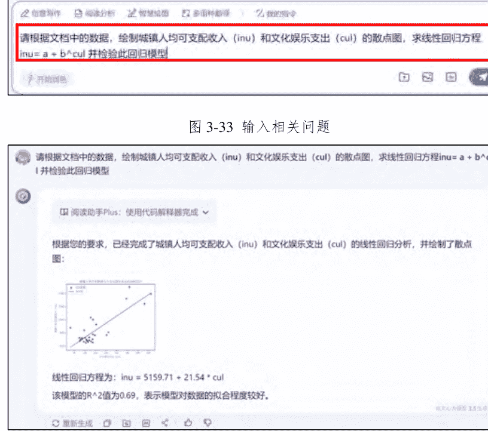
图 3-33 归相关问题

## 3.4.2 DeepSeek: 数据智能挖掘与可视化呈现

DeepSeek是一个功能强大、模式多样且应用场景广泛的工具。在数据分析与挖掘方面，DeepSeek不仅能够高效处理大规模数据，精准把握数据中的潜在价值和关联规律，还通过第三方平台的巧妙协作，将复杂的数据洞察以直观易懂的方式呈现，极大降低数据处理门槛。DeepSeek拥有三种模式，各有其独特场景和优势：

- 基础模式 V3：默认模式，适用于日常对话、常识问答、简单内容生产等场景。该模式最大的优点是响应速度快，能快速给出答案，满足用户对于简单信息获取和基础内容创作的需求。
- 深度模式 R1：需手动引导才能启用。此模式会完全展现推理逻辑，如同人类提问一般，擅长处理规划等深度问题，如职业规划、学习计划、选择等日常生活中的难题，为用户提供更具深度和逻辑性的分析建议。
- 网络连接：同样适用于实时资讯，帮助用户获取最新的信息，无论是新闻、行业动态还是时效性较强的内容都能通过此模式快速检索。

示例展示：在输入框中继续输入“我要画一个时间轴，阐述AI最近几年的发展”，输入完成后勾选“深度思考(R1)”，点击输入框右侧发送按钮，等待DeepSeek处理并生成相关内容。


图 3-35 问题

AI发展时间轴 (2020-2024)
- GPT-3发布（2020年）：OpenAI发布了当时强大的语言模型，展现了强大的理解能力。
- AlphaFold 2（2021年）：DeepMind在蛋白质结构预测领域取得了突破里程碑式进展，准确率超90%。
- DALL·E亮相（2021年）：首个生成图像系统，开启了AI新纪元。
- Codex发布（GitHub Copilot）：核心技术，代码生成能力引发关注。

未来趋势
- 算力竞赛：量子计算与神经形态芯片加速发展。
- AI治理：可解释AI (XAI) 与价值对齐等技术将成为重点。
- 行业渗透：医疗、教育、制造领域渗透率预计突破60%（注：数据截至2027年具体事件报道）。

#### (2) Napkin 生成图表

打开浏览器，在地址栏输入 Napkin官方网址 (https://www.napkin.ai/) 并访问。进入网站首页后，点击页面上方的“Sign in”按钮，使用已注册账号登录（若未注册，需完成注册流程）。


图 3-38 Napkin首页


图 3-39 Napkin登录界面

成功登录后，进入欢迎页面。点击创建，在创建页面中找到专门用于输入文本的区域，将之前复制的内容粘贴到此区域。


图 3-40 Napkin创作界面

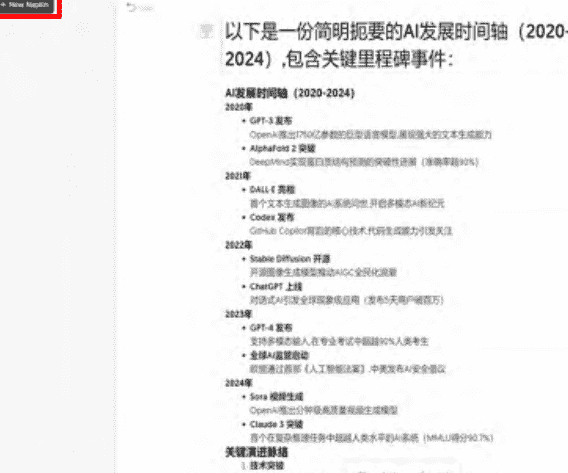

AI发展时间轴（2020-2024）
- GPT-3发布（2020年）：OpenAI发布了当时最强大的语言模型，展现了强大的理解能力。
- AlphaFold 2（2021年）：DeepMind在蛋白质结构预测领域取得了突破里程碑式进展。
- ChatGPT发布（2022年）：OpenAI发布了对话机器人，引发了全球AI热潮。
- Stable Diffusion发布（2022年）：开源图像生成模型让高质量AI绘图成为可能。
- GPT-4发布（2023年）：模型能力进一步提升，通过了律师考试前10%的测试。
- Sora发布（2024年）：OpenAI发布了视频生成模型。
- Claude 3发布（2024年）：Anthropic发布了强大的模型，在安全性上表现优异。

关键词列表：
* 提示词、模型、AI、生成式

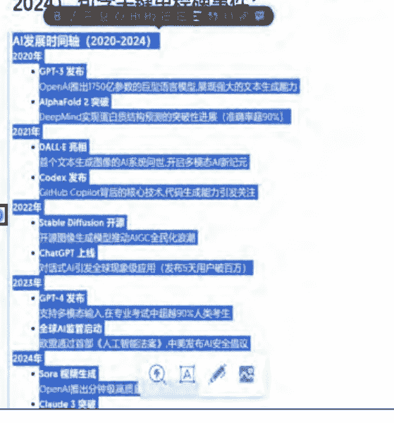
图 3-41 粘贴DeepSeek生成内容

粘贴完成后，从中剪贴的文本内容，确保文本为生成画图对应的内容。此时，文本区域左侧会出现一个小闪电图标，点击该图标。Napkin会根据粘贴的文本进行处理，生成对应的图表。在展示区域，浏览不同风格的图表，选择符合需求的样式。点击下载按钮，将其保存到本地设备，以便后续报告或其他使用。


图 3-42 生成图

## 3.5 小结

在科研领域持续发展，人工智能技术为科研工作带来了全方位的变革。本部分聚焦多元工具，在提升效率、优化流程等方面发挥着关键作用，为科研人员及其群体提供了强大支持。借助AI，教师能够深度分析数据，及时调整研究方向；依靠AI搜索、GitMind等工具，教师可高效获取学术资源、增强逻辑体系；利用Kimi、GPT-4等工具，教师在选题、实验设计和研究过程中获得精准建议；借助Kimi、文心一言等工具，在论文和项目申报写作上有力辅助。

科研数据分析与挖掘是科研的核心环节，一系列工具具有各种神通：gpt辅助进行实验设计、提供学术信息；MedReading支持中文检索；ReadPaper自动分析英文文献；Connected Papers构建文献网络；Kimi胜任中文论文和项目申报写作；文心一言擅长撰写申请书。这些工具极大地提高了写作效率和质量。凭借智能搜索功能快速获取有价值的科研信息；GitMind通过提示词和文件生成思维导图，高效搭建科研框架；Whimsical AI功能生成直观的心智图和流程图；文心一言对数据进行多维度分析，提供深入见解；DeepSeek结合Napkin平台实现数据可视化与展示。综上所述，这些工具涵盖了科研的各个环节，为教师在教育工作中突破瓶颈、提升效率提供了切实途径。在教育与科研深度融合的趋势下，教师应积极探索并熟练运用这些人工智能工具，深度挖掘其潜力，推动教育事业迈向高度，为培养高素质人才、推动科学发展贡献力量。

## 参考文献
- [1] 沈春蕾.科研领域将如何变革[N].中国科学报,2024-11-20(004).DOI:10.28514/n.cnki.kb.2024.02793.
- [2] 白爱、高职院校教师论文发表的破坏及破解对策[J].湖北职业技术学院,2024,37(02):29-33.
- [3] NVIDIA Corporation. (2021). "A100 Tensor Core GPU Architecture White Paper." Reports. https://www.nvidia.com/en-us/data-center/a100/
- [4] 教育部办公室、教育部财政部关于开展人工智能推进教师队伍行动启动工作的通知[EB/OL].(2018-08-15)[2023 12-24].http://www.moe.gov.cn/srcsite/A10/s7034/201808/t2018015_345233.html.
- [5] 中华人民共和国教育部、教育部财政部关于实施中小学幼儿园教师国家级培训计划(2021-2025年)的通知[EB/OL].(2021-05-19)[2023-12-24].http://www.moe.gov.cn/srcsite/A10/s7034/202105/i20210519_532221.html.
- [6] 鲍洪、张世彦、中小学、幼儿园教师科研培养现状、问题及对策——基于 J 市 T 区教师的问卷调查[J].现代科学,2022(09):36.


[14] https://zhuanlan.zhihu.com/p/681627242

[15] 赵涵,国产 AI 模型“出迎”暗藏长期赛道[J],中国战略新兴产业,2024,(13):72-75.

[16] 沈滨宾,刘红霞,王红创,等,生成式人工智能技术在科技期刊论文关键词提取与总结中的应用[J],中国科技期刊研究,2025,36(01):37-43.

[17] 李心笛,医疗营销数字化转型迎来30时代[J],上海信息化,2022,(02):41-43.

[18] https://www.zhihu.com/question/494932509/answer/219289078

[19] 袁传望,百度文心一言打出“免费牌”AI 普惠按下“快捷键”[N],证券日报,2025-02-14(B02).

[20] 文发旭,刘凌光,语言模型在人机交互中识别之外语义的能力探索[J],中国信息界,2025,(01):42-44.

[21] 赵葛剑,张新鹏,DeepSeek:从“概率生成”到“因果推理”[J/OL],自然杂志,1-6[2025-03-11].

# 基于多模态融合的 SSVEP 脑接口设计与信号处理方法

## 项目申请书

## 一、项目基本信息
项目名称：基于多模态融合的 SSVEP 脑接口设计与信号处理方法研究

项目负责人：[姓名]

所在单位：[单位名称]

建设周期：[起始年份]-[结束年月]

## 二、项目摘要

本项目旨在设计一种基于多模态融合的稳态视觉发电位（SSVEP）脑接口（BCI）方式，通过整合脑电、脑动等多种信号，优化信号处理方法，提高SSVEP-BCI系统的性能和用户体验。传统的SSVEP系统主要依赖单一的视觉刺激，存在视觉疲劳、干扰能力不足等问题。多模态融合技术能够利用不同源的优势，提高信号的鲁棒性和识别精度，有效解决这些问题。本项目将开展多模态信号的采集、预处理、融合方法以及算法优化，通过实验验证模态融合系统的有效性，并探索其在医疗康复、智能控制等实际场景中的应用。

## 三、项目建设意义

### 1. 学术意义

SSVEP-BCI 作为脑接口领域的一个重要方向，因其信息传输率（ITR）较高训练需求低而备受关注。然而，传统的SSVEP-BCI系统仍存在诸多挑战。本项目引入多模态融合技术，为SSVEP-BCI系统的性能提升提供了新的思路和方法。研究多模态信号的采集、预处理、融合方法以及算法优化，不仅能够丰富脑接口领域的理论基础，还能推动相关技术的创新和发展。

### 2. 社会意义

随着人口老龄化的加剧和神经退行性疾病发病的上升，医疗康复领域对高效、精准的脑机接口需求日益迫切。本项目设计的基于多模态融合的SSVEP-BCI，有望为瘫痪、失语等患者提供更自然、高效的交互方式，提高患者的生活质量。此外，该系统在智能控制领域也具有广泛的应用前景，能够推动相关产业的升级和发展。

## 二、国内研究现状

### 1. 国内研究现状

近年来，国内脑机接口领域的研究取得了显著进展。在SSVEP-BCI方面，研究者们不断探索新的信号处理方法和技术路线，以提高系统的性能和用户体验。然而，关于多模态融合技术在SSVEP-BCI中的应用仍处于起步阶段。目前，国内已有一些团队开始关注多模态融合技术在脑机接口中的应用，但相关研究还不深入，缺乏系统性的解决方案。

### 2. 国外研究现状

国外脑机接口领域的研究较早，SSVEP-BCI技术也相对成熟。近年来，国外研究者开始将多模态融合技术引入脑机接口领域，并取得了一些初步成果。例如，一些团队通过整合脑电、眼动等多种模态信号，提高了系统的识别准确度和鲁棒性。目前国外多模态融合技术在SSVEP-BCI中的应用研究仍处于探索阶段，尚未形成完善的理论体系和技术路线。

## 五、前期研究基础

### 1. 研究团队

本项目研究团队由许多具有丰富脑机接口研究经验的专家组成，包括教授、副教授等高级职称人员以及博士研究生、硕士研究生等青年学者。团队成员在脑信号处理、眼动追踪、机器学习等领域具有深厚的学术背景和丰富的实践经验。

### 2. 研究成果

研究团队在脑机接口领域取得了一系列重要研究成果。例如，在SSVEP信号处理方面，团队提出了多种有效的算法和技术路线；在眼动追踪方面，团队已开发出一套高精度的眼动追踪系统；在机器学习方面，团队已掌握了多种先进的算法和应用技术。这些研究成果为项目的顺利开展奠定了坚实的基础。

## 六、研究目标

### 1. 总体目标

设计一种基于多模态融合的SSVEP脑接口，通过整合多模态信号（脑电、眼动等），优化信号处理方法，提高系统的性能和用户体验。

### 2. 分阶段任务

#### 第一 第一阶段：多模态信号采集与预处理
- 信号采集：使用高精度脑电设备（如64通道）记录SSVEP信号，结合眼动追踪设备。
- 预处理：对脑电信号进行20 Hz带滤波，消除噪声和基线漂移；对眼动信号进行特征提取和插值。

#### 第二阶段：多模态信号融合
- 信号融合：采用特征融合方法，将脑电和眼动信号的特征进行整合。例如，通过典型相关分析（CCA）或深度学习方法（如卷积神经网络CNN）提取多模态信号的融合特征。
- 算法优化：基于滤波器的FBCCA算法在SSVEP信号处理中表现出色。结合多模态信号，进一步优化FBCCA算法。

#### 第三阶段：实验设计与验证
- 实验：设计包含不同频率和相位的SSVEP刺激，结合眼动任务，验证多模态融合系统的有效性。
- 评估：通过实验验证系统的准确性、信息传输率（ITR）和多模态性能。

#### 第四阶段：系统优化与应用
- 系统优化：根据实验结果，进一步优化信号处理算法和系统架构，提高系统的实时性和稳定性。
- 应用：将优化后的多模态SSVEP-BCI系统应用于实际场景，如医疗康复、智能控制等，验证其在复杂环境下的适应性。

## 七、技术路线

### 1. 多模态信号采集与预处理

#### （1）信号采集
- 脑电信号采集：使用高精度脑电设备（如64通道）记录SSVEP信号。在采集过程中确保电极放置准确、接触良好。
- 眼动信号采集：结合眼动追踪设备具备高精度、高采样率等特点，确保采集到的眼动信号准确。

#### （2）预处理
- 脑电信号处理：进行20 Hz带滤波，消除噪声和基线漂移。同时，采用盲源分离等技术提取有效信号，提高噪比。
- 眼动信号处理：特征提取和插值，确保眼动信号的完整性和准确性。

### 2. 多模态融合方法

#### （1）信号融合策略
- 特征融合：充分利用不同信号源的优势。例如，通过典型相关分析（CCA）提取脑电和眼动信号之间的相关性特征；或者通过深度学习方法（卷积神经网络CNN）提取多模态信号的融合特征。

#### （2）算法优化
- FBCCA算法优化：基于滤波器的FBCCA算法在SSVEP信号处理中出现。然而，当包含多模态信号时，还需要优化算法提高信号的通用性。优化方向可以通过滤波器的参数、改进特征提取方法。
- 深度学习方法应用：除了CCA等传统算法，还可以探索深度学习方法在多模态融合中的应用。例如，可以采用卷积神经网络（CNN）等深度学习模型对多模态信号进行特征提取和分类。通过训练深度学习模型，自动学习多模态信号之间的复杂关系，提高识别的精度和鲁棒性。

### 3. 实验设计与验证

#### （1）实验设计
- SSVEP刺激设计：设计包含不同频率和相位的SSVEP刺激。刺激频率和相位的位置根据实验目的和受试者特点进行合理选择，例如，可以选择常用的刺激频率范围（50 Hz）和相位位置（0、90°）。
- 眼动任务：结合眼动任务验证多模态融合系统的有效性。眼动任务可以包括视觉追踪、眼球运动等任务。通过设计合理的眼动任务，评估多模态融合系统在不同场景下的性能表现。

#### （2）性能评估
- 准确率评估：通过实验验证系统的准确率。准确率是衡量系统性能的重要指标之一，通过系统预测与真实结果计算得出。
- 信息传输率（ITR）评估：信息传输率（ITR）是衡量BCI系统信息效率的重要指标。通过实验验证系统的IT，可以评估多模态融合系统在高信息传输下的性能表现。
- 用户体验评估：确保准确率和ITR的同时，关注用户体验。用户体验包括系统的舒适度、易用性等方面。通过收集受试者的反馈意见，评估多模态融合系统在用户体验方面的优势。

### 4. 系统优化与应用

#### （1）系统优化
- 信号处理优化：根据实验结果，进一步优化信号处理算法。优化方向可以包括调整算法参数、改进算法结构等，提高系统的实时性和稳定性。
- 架构优化：除了信号处理算法外，还需要优化系统架构。系统架构的优化可以包括硬件设备的选择、软件平台的搭建等方面，提高系统的整体性能和可靠性。

#### （2）应用拓展
- 医疗康复：将优化后的多模态SSVEP-BCI系统应用于医疗康复领域，为残疾、失语患者提供更自然、高效的交互方式，帮助恢复肢体功能。
- 智能控制：除了康复领域外，还将多模态SSVEP系统用于智能控制领域，实现便捷的交互。

## 八、经费预算

### 1. 设备购置费
- 脑电设备：购置高精度脑电设备（如64通道），预算XX万元。
- 眼动追踪设备：购置高精度眼动追踪设备，预算XX万元。
- 其他设备：购置必要的辅助设备，预算XX万元。

### 2. 实验材料费
- 实验材料：购置实验所需的耗材（电极、导胶等），预算XX万元。
- 刺激材料：制作SSVEP刺激材料，预算XX万元。

### 3. 测试经费
- 数据分析：购置数据分析软件（如MATLAB、Python等），预算XX万元。
- 测试费用：实验过程中设备校准、数据存储等，预算XX万元。

### 4. 业务费
- 会议差旅：参加学术会议的差旅费用，预算XX万元。
- 出版费用：论文发表、专利申请等，预算XX万元。

### 5. 人员费
- 研究补助：支付研究生补助，预算XX万元。
- 专家咨询：支付专家咨询费用，预算XX万元。

### 6. 其他费用
- 不可见费：预留应对突发情况经费，预算XX%。

## 九、项目计划及阶段

### 1. 第一阶段（[起始年份]-[中期年份]）
- 目标：完成多模态信号采集与预处理。
- 任务：购买并调试脑电设备和眼动追踪设备；设计采集方案，收集SSVEP信号和眼动信号；进行预处理。

### 2. 第二阶段（[月份]-[月份]）
- 目标：完成多模态融合方法的研究与优化。
- 任务：研究融合方法，将脑电和眼动信号特征整合；优化FBCCA算法，提高分类性能；探索深度学习方法在多模态融合中的应用。

### 3. 第三阶段（[月份]-[月份]）
- 目标：完成实验设计与验证。
- 任务：设计包含不同频率和相位的SSVEP刺激以及眼动任务；实施实验并收集数据集，验证多模态融合系统的有效性；评估准确率、信息传输率（ITR）和用户体验。

### 4. 第四阶段（[月份]-[结束月份]）
- 目标：完成系统优化与应用。
- 任务：根据实验结果优化信号处理算法和系统架构；将优化后的多模态SSVEP-BCI系统应用于医疗康复、智能控制等实际场景；收集用户意见并持续改进性能。

## 十、项目组成员介绍

### 1. 项目负责人
姓名：[姓名]，职务/职称：[职称]，研究方向：脑机接口、信号处理等。主要贡献：负责项目的整体规划和实施，协调成员之间的工作关系，确保项目的顺利进行。

### 2. 核心成员
（1）成员一：姓名：[姓名]，职务/职称：[职称]，研究方向：脑电信号处理、机器学习等。主要贡献：负责信号预处理和特征提取工作，研究并优化信号处理算法。
### （2）成员二：姓名：[姓名]，职务/职称：[职称]，研究方向：眼动追踪、人机交互等。主要贡献：负责眼动信号的采集和预处理工作，研究并优化眼动追踪算法。
（3）成员三：姓名：[姓名]，职务/职称：[职称]，研究方向：深度学习、模式识别等。主要贡献：探索深度学习方法在多模态融合中的应用，研究并优化深度学习模型。
（4）成员四：姓名：[姓名]，职务/职称：[职称]，研究方向：医疗康复、脑机接口应用等。主要贡献：负责将优化的多模态SSVEP-BCI系统应用于医疗康复领域，评估实际场景中的性能表现。

## 十一、预期成果

### 1. 学术成果
- 发表高水平学术论文XX，其中 SCI/EI收录论文XX篇。
- 申请国家发明专利XX项，其中授权专利XX项。

### 2. 技术成果
- 设计并优化基于多模态融合的SSVEP脑接口架构。
- 开发多模态信号采集与预处理软件平台。
- 开发多模态融合处理算法库。

### 3. 应用成果
- 将优化后的多模态SSVEP-BCI系统应用于医疗康复领域，提高患者的生活质量。
- 将系统扩展至智能控制领域，推动相关产业的升级和发展。

## 十二、可行性报告

### 1. 技术可行性
本项目涉及脑机接口的前沿技术，包括脑电处理、眼动追踪、机器学习等。团队在这些领域具有深厚的学术背景和丰富的实践经验，能够顺利实施。

### 2. 经济可行性
项目所需的经费合理，设备购置、实验材料、测试分析等经费经过详细核算，符合现有条件，降低项目成本，带来良好的效益。

### 3. 社会可行性
项目的成果具有广泛前景。优化后的多模态SSVEP系统为瘫痪、失语等患者提供了更自然、高效的交互方式，帮助恢复肢体功能。

## 十三、结论与展望
本项目旨在一种基于多模态融合的SSVEP脑接口，通过整合多种模态信号，优化信号处理方法，提高系统的性能和用户体验。在脑机接口领域做出创新性贡献，未来将继续深化研究。

# 知识星球 付费资源分享

| 序号 | 公号/星球/社群 | 原价 | 领域 |
| :--- | :--- | :--- | :--- |
| 1 | 生财有木 | 2765/年 | 副业、搞款 |
| 2 | 怂从吃瓜群 | 365/年 | 时政、历史 |
| 3 | 记忆承载/碧树风 | 365/年 | 成长、搞款 |
| 4 | 欧洲金靴 | 328/年 | 时政、历史 |
| 5 | 卢克文青会 | 699/年 | 时政、社会 |
| 6 | 体制内主任 | 599/年 | 体制；职场 |
| 7 | 外局人的视角 | 669/年 | 金融、市值 |
| 8 | 灏泽异谈 | 4166/年 | 财富、成长 |
| 9 | 守夜人总令 | 599/年 | 时政、经济 |
| 10 | 江宁知府 | 365/篇 | 时政、国际 |
| 11 | 政事堂/顾子明 | 568/年 | 时政、经济 |
| 12 | 唐书院 | 1399/篇 | 金融、财富 |
| 13 | 大树乡谈 | 199/年 | 时政、成长 |
| 14 | 水库欧大 | 10000远 | 房产、经济 |
| 15 | 洪灏的宏观策略 | 4376/年 | 经济、搞款 |
| 16 | 金政通鉴/北海道南山 | 4576/年 | 股票、行研 |
| 17 | 猫豹的世界 | 299/年 | 时政、社会 |
| 18 | 飞浅云 | 3600/年 | 股市、经济 |
| 19 | 米联储见闻 | 599/年 | 经济、金融 |
| 20 | 鉴茶财经院 | 330/年 | 房产、股票 |
| 21 | 赢在八小时之外 | 365元/年 | 成长、职场 |
| ... | ... | 更多资源，不再列举 |

+ 图书、报告、课程等各类高价值资源

+ * 免费群每日分享数份资源
* VIP群每日分享所有资源（日均20+），75/年

# TOP级资源 TOP级社群
