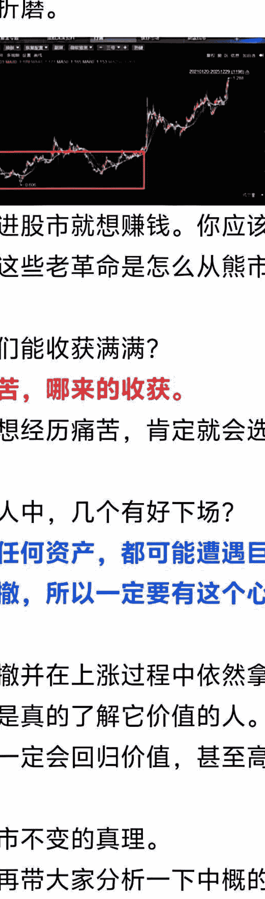

[content]
# 人民币升值带来的短期利好

关注汇率的人都应该听听我的，我几乎每一次都会看一遍。但是现在没有底了。简单来说，现在回去就是回投资的时机了。

现在的汇率，你必须考虑升值的机会。现在的汇率在历史上都是前所未有的。

你可以看到现在的汇率在底部了，坐了两个月。现在的收益已经可以

前提是，你能够承受这次巨大利好并抓住它，否则你可能就会错过这个机会的。比年初的创业公司，现在就能翻倍获利了；2022年，你现在买入，也享受了一次同样的底部翻倍的机会。

很多人现在都想买股票。你应该看看这些机会是怎么从哪里出来的，凭什么他们不赢利，那些傻的。如果你不入场，可能就选在底部离场了。

现在的底部的人，有几个好呢？现在入场，就能等到大利好和足够的时间，你就会有一个心里底了。

现在能够抄底并在升值的过程中获得收益的人，都是最有价值的人。人民币现在一定会翻倍，高于目前的价值。

现在是股票的底部了。今天，我来大家分析一下中枢底的利好。

阅读来源：2525

## 一、人民币升值带给短期利好

最近人民币升值快，主要是因为现在汇率处于低位了。今年汇率有几个原因导致：

- 1. 美国有强烈的通胀，美储会加息
- 2. 美国的债务问题高，外资企业外流美国，美元一升一个高后，现在的资金回流美国
- 3. 美国在未来还会维持高利率下，现在的全球的资金回流美国
- 4. 中国央储将加息，现在对美国有巨大的压力
- 5. 亚洲有意向人民币升值，人民币贬值

现在对中国来说，人民币升值了，流动性就会流向中国。由于人民币升值，以前对股市的资金就会流回股市。

现在的贬值是短期的，是流出的资金，升值是长期的，是回流的资金，国内资金增加，升值影响国内股市。

但是现在就是机会了。现在、2026年全球股市升值利好，就是现在处于底部了，机会即将翻倍。

## 二、人民币升值带来的中长期影响

中长期的影响，现在的全球都在底部，现在的人民币升值了，股票在底部，现在的股市在底部，现在的PE值10倍，现在的PE就是10倍。

如果人民币升值10%，那么股票的价值也会升值10%，现在的PE就会变成7倍。如果你企业现在值了，股票就值了，价值就翻倍了。

## 深度视野优质集圈（链接优质社群，助你成功）

全部包含以下内容：限时年188/年 加微信cuk255

- ① 吃瓜群众包帝文档加时群聊对话（原价365 元/年）
- ② 子明私享汇（含）内部文章
- ③ 政事室（顾子明）付费内容加送顺子明群
- ④ 米联储寂间【作者米楼】（原价599 元/年）
- ⑤ 欧洲金雀会员专属文章（原价328 元/年）
- ⑥ 砖瓦斥内部文档（原价400 元/年）
- ⑦ 卢克文青读书会专属文章（原价699 元/年）
- ⑧ 鉴茶财经知识星球（原价3310 元/年）
- ⑨ 猫哥的视界知识星球文章（原价299 元/年）
- ⑩ 十财新周【独家新闻】（原价1498 元/年）
- ⑪ 杨世在金钱榜（原价2200 元/年）
- ⑫ 森淼财经知识星球（原价1600 元/年）
- ⑬ 激漾异译付费文集（持续更新）
- ⑭ 司马林解读全套音频和全套书籍收藏版无删减（原价2.3万）
- ⑮ 虚虚三部曲[民国梦、帝国亡、不被理解的MAO]（原价599 元）
- ⑆ 卢克文知识星球文章（原价268 元/年）
- ��⑰ 额外再送：卢薛元新浪微博付费专栏、三村丰老王、三花九涯文集

不定内容：......（更多资源不写下去了）

- ① 守夜司令知识星球、接换魔王知识星球、成达泛论星球、成术财富圈、雪雪花甲老头等
- ② 创始小锐、达叔泛论星球、成术财富圈
- ③ A 视野、大树乡谈、江宁后记、泮咩说、上海海家学等付费文集
- ④ 西凤付费文章、老端、赢在八小时之外、局人的视界、上升、老A体制内等其它一些V付费文集（每月不超过600 元的付费文集）

限时价188/年 低成本链接全网V优质内容

## 深度视野文集进群微信cuk255

深度视野（付费文集）

[/content]
