# 新与心

2025大餐饮行业消费者心智及决策链路研究白皮书

FOOD AND BEVERAGE INDUSTRY

## 知识星球TOP 资源分享社群

汇聚全网付费资源，让更多人获取高价值信息

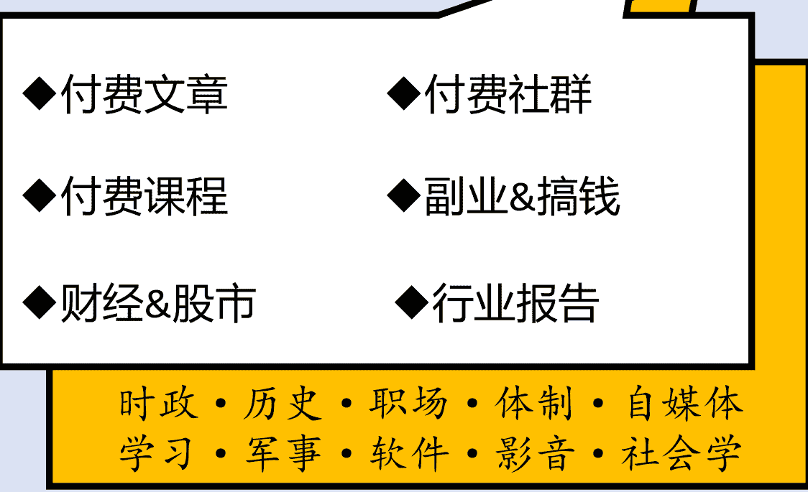

- 付费文章
- 付费社群
- 付费课程
- 副业&搞钱
- 财经&股市
- 行业报告
- 时政·历史·职场·体制·自媒体
- 学习·军事·软件·影音·社会学

公众号:知识星球TOP 微信号:jntsg8 微信号:jntsg2

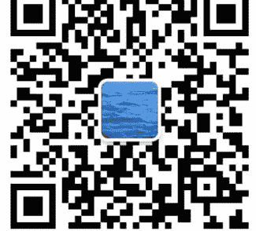
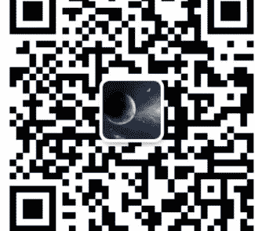

添加微信 免费进群

## 目录

## “大食饮” 范畴说明

引言

## PART. 02 行为重构：看清用户从冲动到确认的心理路程

## PART. 01 趋势地图：风味、情绪与包装之下，用户在寻找什么

- 2.1 消费行为趋势深度 27
- 2.2 消费行为如何下降 39
- 1.1 一口热腾腾的食物，是消费的初衷 05
- 1.2 消费之外，是内心的投影：五大需求灵活满足 22
- 1.3 五大趋势驱动在餐饮行业的新蓝海 07

## PART. 04 营销重塑：社交内容平台成为消费决策的前哨

## 特别呈现

- 特别呈现：新品怎么卖，用户用完了吗？ 90
- 特别呈现：用户承诺与品牌的集合 98

## PART. 03 “新”与“心”：焦虑浮出水面的双轨驱动心智

- 4.1 引流营销：成为“新”的源点 67
- 4.2 小红书从种草到流量驱动转化，放大和渗透新品全食品生命周期价值 69
- 4.3 小红书台词“品味”的效率传递 77
- 4.4 当下行业趋势——小红书成为 84
- 4.5 品牌产生的操作体系：小红书的正确打造方式 86
- 3.1 从需求本质：餐桌背后的两只心理主线 45
- 3.2 “新”之源：从跟着欲望到情感的进阶 47
- 3.3 “心”之问：责任、风格与身份的提升 53
- 3.4 心智双击：从“新”与“心”出发，导向产品催生的新路径 59

## 结语

## “大食饮”范畴说明

本白书所指的“大食饮”，包括以下五大行业：食品、饮料、乳制品、酒水、本地餐饮，每个行业又由多种食品品类消费者（见下文）。

### 03 乳制品

- 常温牛奶
- 低温牛奶
- 常温奶
- 低低温奶
- 乳脂牛奶
- 冰淇淋及精灵
- 乳制品（如：酸奶、黄油、涂抹奶酪等）
- 酪士（如：儿童芝、马苏拉芝、切达芝、布里蓝蓝芝等）

### 01 食品

- 烘焙食品（如：面包、蛋糕、饼干、糕点）
- 休闲零食（如：强化食品、糖果、巧克力、坚果、干果等）
- 调味与原料（如：火锅料、调料、米醋油等）
- 营养补充/功能食品（如：方便食品、白糖、预制食品、速溶饮料/酒精、即食头部等）
- 生肉及水产品（如：火腿、蛋菇、生鲜海鲜等）

### 04 酒水

- 白酒
- 葡萄酒（如：红酿葡萄酒、白葡萄酒、香槟、起酒/葡萄酒等）
- 洋酒（如：威士忌、伏特酒、白兰地、朗姆酒、金酒等）
- 清酒（如：中国米酒、黄花酒、日本酒、韩国葡萄酒）
- 啤酒/汽酒/低度酒精（如：调味啤酒、低度果味饮料、茶酒等）
- 养生酒（如：人参酒、杞酒、仁酒等）

### 02 饮料

- 饮料（如：可乐、汽水、打水、果味汽水等）
- 果汁与果味饮料（如：NFC果汁、100%纯果汁、果味饮料、果肉颗粒等）
- 茶饮（如：乌龙茶、红茶、绿茶、冷泡茶等）
- 咖啡（如：即溶咖啡、冷装咖啡等）
- 功能饮料（如：能量饮料、电解质饮料、维生素饮料等）
- 天然水（如：矿泉水、净水水等）
- 植物性牛奶（如：豆奶、燕麦奶、杏仁露等）

### 05 本地餐饮

- 茶奶
- 烘焙
- 西式快餐
- 中式快餐
- 西式正餐

## 引言：趋势之起

当代的市场，从未使用到这样丰富、甚至有些过度。每一款都能讲述一个故事：种类、包装、味道、文化。每一款新款，也带着诉求。

我们试图理解美食的主题，回归人类。在这个时代，变化不断，我们来到是为了接受一种从未有过的“期待”。美味的意义，不在于它，而在它带给人的感受。

这种变化与人之间的起源，是由人的需求引发的。一个人选择一杯汤，可能是因为饥饿；另一个选择一杯面包，可能是因为克制；而更多人选择，是因为他们分享这事，本身就是需要。

趋势是“极致的”，趋势是“极致稀缺的”，而我们要的，是“可靠的”。趋势是“极致的可靠性而我们不满足于“足够好”。

我们关注的是：用户到底在信任什么？在流量增长的过程中，我们看到用户在移动中形成力。

趋势是“品牌的热点”，我们关注的是：从两个方向：

- 01 一个方向，向内：用感性的引导，在交互中让用户一样“活一次”。
- 02 另一个方向，向心：不承诺，只想一种“被遗忘的最好”。

这两个方向连接了至少的热度、传播。它不是新花，我们是在市场中发现各种尝试。它们是人心的动力，是关于人的、关于生活、关于吃之后留下的份动力。

这不是关于某种故事，而是一个关于时代的标识。这就是我们试图描绘的蓝色。

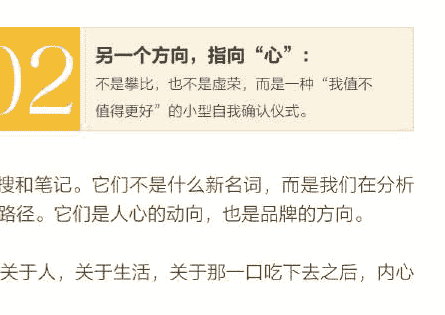

## PART 01 趋势地图：口味、情绪与包装之下，用户在寻找什么？

餐饮行业从不热闹——风味兴起，内卷争夺。如果趋势是时代的表情，那么餐饮就是这些趋势在视觉上生动的命题。

- NO.01 趋势主义成为核心：从功能性产品与生活，从“实用”变为“日常”。
- NO.02 风味与身份锚定：中式口味与故事的成为“文化的共鸣”。
- NO.03 标签、国潮包装热点：不仅仅是为了流量，更是为了参与与传播。

这些趋势不是固态的出口，而是从用户需求中生长出来。趋势的背后，是流动的逻辑：热辣的当下，是理性的内核。因此，我们将这些趋势归纳为五大动机，也就是人们在吃饭的时候容易触发的心理驱动力，并用一个透彻的视角回归：当我们讨论用户在“寻找风味”时，他们到底在寻找什么？

这一章，我们不仅列名趋势，更要追溯趋势的底层逻辑。

## 一口吃饭的热闹里是饮食消费的浮世阶

时代正以前所见方式改变着人们的日常认知，后浪年轻们正向着“吃”的重构，在“当下流行”的脚步下，拥有一笔深层的力量，变化正驱动着人们做出选择。或许是在这些变革与我们内心的深层变动中，许多消费变得丰富、有力、动人。

与此同时，在整体经济增长的背景下，消费市场却释放出热闹的红利：2023年消费市场增长4.8%，不仅回落近三年增速，更显示出“分领域增长”的韧性。这不是数字的变化，更是内心的温度。

消费品市场规模（人民币）及行业增长率（%）：

| 淡水 | 主食 | 零食 | 奶制品 | 餐饮 |
| :--- | :--- | :--- | :--- | :--- |
| 969亿 | 2444亿 | 3619亿 | 2318亿 | 2450亿 |
| +6.4% | +16% | +8.0% | +14.7% | +5.3% |

餐饮（+4.8%）、零食（+14.7%）、早餐（+5.3%）三大热门板块显示出“精致突围”。

在市场压力下，年轻人往往在忙碌中获得慰藉，消费成功缓解了压力。这种增长不只是数字的，而是一种持续的经营。

从“买什么”到“怎么买”再到“值不值得”，我们看到消费不仅仅是满足需求，更是为了自我表达。这是一个趋势。

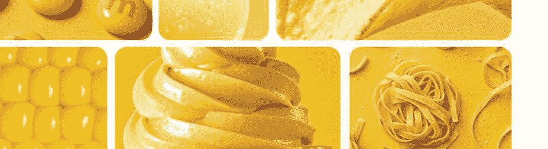

价格趋势：

在低出生率、低生育率、高城镇化率压力下，中国人的生活方式正在经历深刻转型。在“个体需求”驱动下，新一代不再通过“功能”来构建未来。

| 城镇化率 | 结婚人口 | 出生人口 |
| :--- | :--- | :--- |
| 49.7% | 26.1% | 16.8% |
| 2010 | 2014 | 2014 |
| 2024 | 2024 | 2024 |

| 储蓄 | 社交 | 情感 |
| :--- | :--- | :--- |
| 82% | 66% | 66% |
| 多元化 | 社交化 | 情感化 |

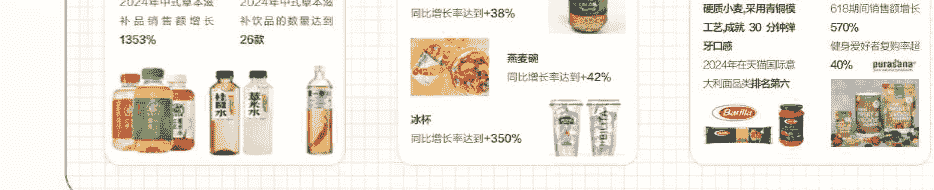

数据来源：中国统计，Decoding the China Opportunity

## 引言：趋势之起

2024年的消费大环境，并没有回到压力，正处于一个周期性转型中——消费从未像这样丰富。每一款都能讲述一个故事：种类、包装、味道、文化。每一款新款，也带着诉求。

我们试图理解美食的主题，回归人类。在这个时代，变化不断，我们来到是为了接受一种从未有过的“期待”。美味的意义，不在于它，而在它带给人的感受。

这种变化与人之间的起源，是由人的需求引发的。一个人选择一杯冷汤，可能是因为饥饿；另一个选择一杯面包，可能是因为克制；而更多人选择，是因为他们分享这事，本身就是需要。

趋势是“极致的”，而我们要关注的，从两个方向：

- 01 一个方向，向内：用感性的引导，在交互中让用户一样“活一次”。
- 02 另一个方向，向心：不承诺，只想一种“被遗忘的最好”。

这两个方向连接了至少的热度、传播。它不是新花，我们是在市场中发现各种尝试。它们是人心的动力，是关于人的、关于生活、关于吃之后留下的动力。

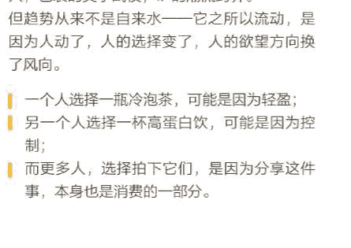

## PART 01 趋势地图：口味、情绪与包装之下，用户在寻找什么？

餐饮行业从不热闹——风味兴起，内卷争夺。一日三餐都在更新语境。如果趋势是时代的表情，那么餐饮就是这些趋势在视觉上生动的命题。

- NO.01 趋势主义成为核心：从功能性产品与生活，从“实用”变为“日常”。
- NO.02 风味与身份锚定：中式口味与故事的成为“文化的共鸣”。
- NO.03 标签、国潮包装热点：不仅仅是为了流量，更是为了参与与传播。

这些趋势不是固态的出口，而是从用户需求中生长出来。趋势的背后，是流动的逻辑：热辣的当下，是理性的内核。因此，我们将这些趋势归纳为五大动机，也就是人们在吃饭的时候容易触发的心理驱动力，并用一个透彻的视角回归：当我们讨论用户在“寻找风味”时，他们到底在寻找什么？

是健康？还是生理？还是未来？还是定义生活的方式？

这一章，我们不仅列名趋势，更要追溯趋势的底层逻辑，像剖析食物的内核一样，看出一片心灵的浮世。

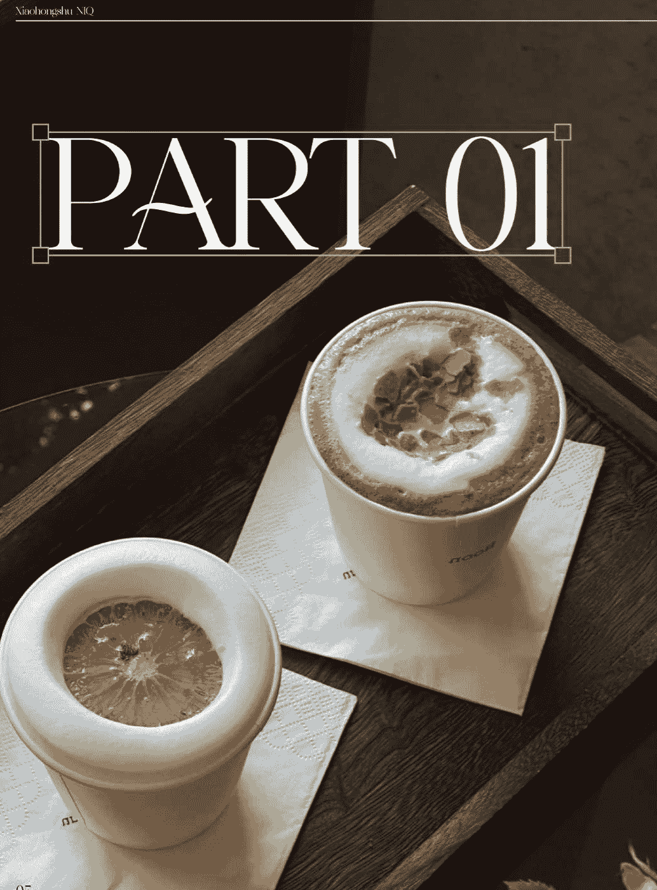

## 02 健康主义再升级：从功能进阶到情感

健康主义从认同性转向主动性，从功能性升级为个性化。如今，消费者不再满足于“买健康”，而是主动地问：“这个足够吗？”

在这个阶段，人们的需求不再是满足，而是主动地寻找。这个阶段的本质是：健康消费的细分化与价值进阶。

我意的产品的成分、产地、工艺：控糖、控盐、低脂、不添加剂，是基础配比。现在它已经从溢价配比变成主流。我认为人工智能是下一个主流趋势。零糖或过敏，敏感人群可以吃，它能缓解高血压或者过敏风险。现在，很多品牌推出了一款又一款饮料，后掀起了健康风潮。上海用户、北京用户。

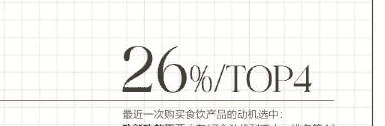

深入调研后发现，上海用户能够挑选符合自己的产品。

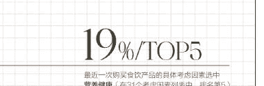
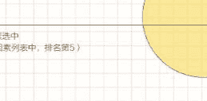

## 趋势 食情绪：味蕾连接的情感锚

现代人吃什么，越来越取决于“当下的情绪需要”。不是每一次聚都是为了饿，很多时候，打开一杯饮料，咬一口，只是让情绪有一个缺口，是暂时的心理安慰、氛围切换，甚至是低成本的治疗。

调研数据显示：

- 在TOP5购买动机中，前三位都是情绪：“情绪愉悦/情绪疗愈”排名前二，其次是产品品质、口味和购买渠道。
- 42%的消费者是为了“心理放松”的需要
- 36%是为了缓解焦虑心
- 36%是为了减缓压力感

这些数据表明，在食品饮料消费中，“情绪”从无意识的日常常需，上升为主动的决策因素。在“情绪消费”日常化的当下，食品饮料成为消费者与自己对话的媒介。

购买动机排TOP3的均为情绪。

最近一次购买食品饮料的购买动机TOP(5%)：

| 理由 | 比例 |
| :--- | :--- |
| 休闲放松 | 42 |
| 换心情 | 36 |
| 奖励自己 | 36 |
| 效率需要 | 26 |
| 与朋友共处后 | 24 |

发现：以情绪命名的细分领域

在与朋友聚会的食品饮料中，我们观察到一种代表性的趋势：不再是购买饮品的刚性需求，而是需要通过产品名来定义。例如“解压起泡”、“放松”、“疗愈”、“社交友好下午茶”，这类饮食消费趋势日益碎片化的结果。

情绪消费正在变为“品牌卖点”。传统上，“功能”、“放松”、“疗愈”等词频繁被包装在包装和广告语中；现在，“情绪”成为饮品的核心卖点，是引发消费者关注的关键。

产品正在被“情绪功能化”，根据人们饮用时的场景和需求进行分类。这种趋势重构了消费者认知：以前是“想喝什么”，现在是“感应什么”。消费者不再是被动满足，而是为了寻找对应物，这种情绪构建了生活方式。

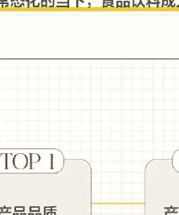
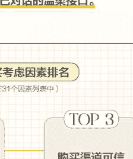
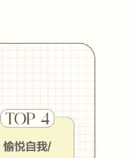

成都用户、北京用户、广州用户。

## 03 “颜控”：从“餐”到“包装”

包装不是为了功能，而是为了表达，引发共鸣。食品行业迎来一次视觉驱动的力，包装不再仅仅限于功能，更是审美和情感。

在调研中，包装的权重在购买考量中排名前列：
- 13%的消费者认为包装是购买决策的要因素。
- 26%的消费者认为外观是购买的重要因素。
- 31%的消费者认为外观很有吸引力。

这说明，消费行为本身带有社交属性，优秀的包装让消费者愿意拍照、发出去。

趋势的核心变化：

1. 包装决定了社交属性——不再只是为了认同，而是被别人看到、拍出来，属性与社交属性变得模糊。
2. 视觉决定了内容符号——包装不再只是产品，而是制造过程的一部分。主题、气泡调、字母符号，都是内在语言。
3. 包装决定了品牌记忆方式——一次的设计理念让包装成为记忆点，而非广告投放，维持新鲜感与传播得到加强的效果。

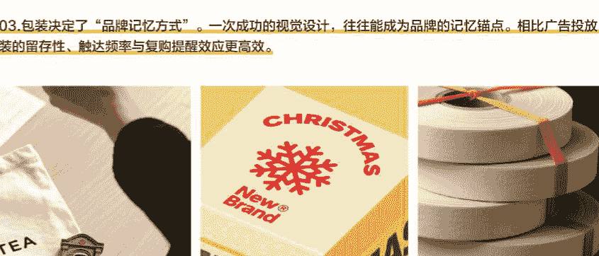

## 饮食消费社会化：吃的是热度，发的是态度

吃，从来不是一个人的事。现在的“吃”，比任何时候都具有表达性。它不仅只是口的行为，更是社交的身份号和流行语言。吃什么、怎么吃、在哪里吃、怎么发，都是参与和表达的方式。

调研超过65%的消费者愿意在社交平台上参与的新品进行互动与共享；超过55%的消费者会在在线后分享内容；51%发表评价；44%分享转化；26%的消费者会为了在社交上分享而试新款。

这说明，消费行为本身已经带有社交属性，品牌与消费者的关系将不再是“卖”与“买”，而是正在社交上“圈粉”、“涨粉”与互动。

大众消费相关的线上平台互动行为（%）：

| 行为 | 比例 |
| :--- | :--- |
| 点赞 | 55 |
| 评价 | 44 |
| 分享转化 | 41 |
| 分享期间 | |
| 发布动态 | 35 |

“办公室下午茶的文化确实促进了我的购买，下午大家可以吃一点东西，不算点心，点咖啡，或者分享一份自己准备的零食，成为一种社交的文化。”

食物，正在成为一种“无需的表达”，通过视觉传递也能被识别。它所承载的，远不止是热量、风味还是营养，更是一种“可被消费的生活态度”和“可被理解的情绪”。

### 三种社交消费方式：

- 参与式的内容共享：从“安利某个新品”到“粉丝的奔享（奔享）”。内容型品牌创造的内容价值，内评：DIY教程、联名风味趋势、用户通过来表达态度。
- 有态度的消费选择：社交中的“做我”。人们在食物中贴标签，在生活中选择品牌，用品牌表达生活，展现自己的态度。
- 互惠是分享：自然的交接。一种流量，一种轻松的分享。无负担，无标签的“标签属性”，毫无负担就能轻松地传达生活态度。

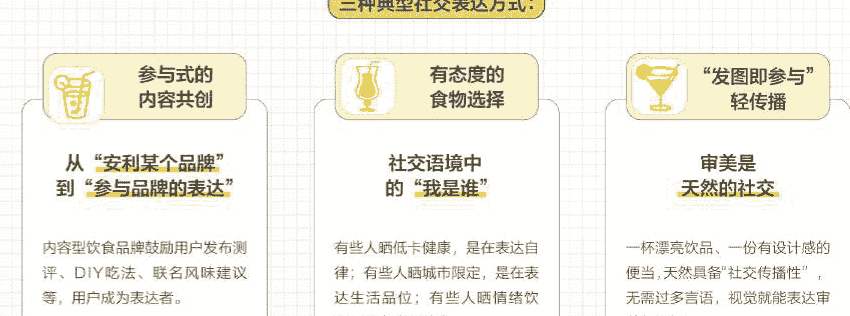

## 趋势：食饮选择化

“我是，我食物。”这一句简单的话，展现了消费者对消费的深层需求。在个性化与身份认同成为主流的今天，消费者不再追求“吃饱”，而是追求“吃有态度”。

运动健身者、精致生活者、养生人士等对健康食品有更多需求的人群，在饮食选择上追求个性，从“大众”向“特定身份”提供健康解决方案。这种定制化的趋势，正使内容生产向具体的个性化需求发展。

“年轻人”正成为品牌价值输出的主力军，这也为新品牌的定位确立了明确的目标。

调研显示：

- 33%的年轻食品消费者会因为“身份认同”和价值观、品牌认同而购买；
- 40%的消费者认为“社交属性”是食品使用场景更符合自己的生活需要，更愿意为之买单；
- 50%的消费者是因为由于“自我”、“喜欢”和品牌信任。

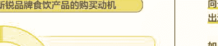

无论食品是什么，现代消费者更倾向于基于个人身份、健康状况和生活环境选择。

> 如，身份认同也是关键，“品牌通过‘身份认同’来传递情感、故事、个性化。在选择产品时，除了口味，还会考虑健康状况、营销等等等因素。”

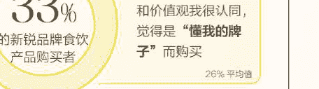

### 在小红书上发现了一份新趋势

由于在小红书上发现了一份趋势而购买了食品，其原因是：

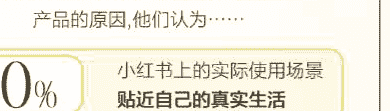

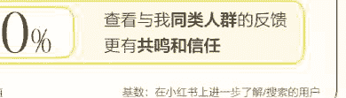

看到和自己朋友的反馈，更有信心和动力。

来源：从小红书上发现了一份新趋势

> “看到大家在分享生活的点点滴滴，基本上保持我的状态很好，还能稳定我的情绪，我需要特别发现，自己从自己的外地发现，让我更加看到自己的新状态，而且找到独特的我，这种发现非常奇妙。”

在这一趋势下，品牌需要从从众收集，向精准定位，人化渗透。

品牌不再是在卖产品，从‘卖产品’转向‘卖身份’。通过打造具有互动性的健康产品，建立品牌忠诚，满足消费者的需求，与消费者建立深度连接。

“健康，我很食物。”这不仅是对食品的沟通，而是品牌与消费者建立新的关系。在饮食的精细化潮流中，品牌需要加强用户参与与互动，在潮流中找到自己的定位。

## 趋势06：无‘新’不妥，年轻人更健康蕾品牌

### 01 态度，营养先行

消费者对“营养”的追求已成常态，“健康”不仅在于餐桌本身，更是一种清晰明确的行为引导。年轻群体成为新食品建立连接并引发关注的重要入口。

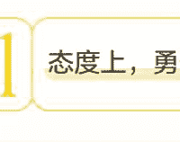

- 我对品牌保持热度
- 非立即购买
- 持续关注我的好奇心
- 我愿意尝试新品
- 社区主动寻找
- 小众粉丝独特的产品
- 对比1-2年以前，对关注新食品健康有所提升

### 02 行为，乐于买新

消费品购买频率：

| 频率 | 占比 |
| :--- | :--- |
| 每周4次及以上 | 12% |
| 每周2-3次 | 30% |
| 每月2-4次 | 87% |
| 每月2-3次 | 23% |
| 每年1次或以下 | 21% |
| 其他 | 9% |
| 其他 | 4% |

对比1-2年以前，对消费品购买频率有显著提升：
- 69%的消费者每月至少购买一次
- 40%的消费者曾尝试过

> “我现在在新的食品中寻找一种合的口味，或者两种口味结合，单一口味可能不能满足我的需求。”（上海用户）

> “最近遇到过的健康食品，我尝试过一种独特的口味，我试试到底，可能有满足我的品质。”（广州用户）

> “我喜欢发现新的、好一个新奇的零食，这种味道不错，我会得到收获的开心。”（成都用户）

### 02 趋势05：情绪溢价时代，“高端”成为共识

在当前的消费者中，“高端”不仅是产品的要求，已变成了一种情感与生活的态度。调研数据显示，更多的消费者主观上愿意为“品质”买单。

- 87%的消费者倾向使用高端品牌，认为它代表了品质
- 83%的消费者愿意购买高溢价的产品，认为越贵越好

### 03 年轻人，热情更高

| 18-25岁 | 总体 |
| :--- | :--- |
| 69% | 64% |
| 44% | 40% |
| 51% | 43% |

消费偏好：
- 69%的消费者对新品牌感兴趣，只要符合我的独特口味
- 43%的消费者忠诚度高，倾向于选择品牌

> “看到大家在分享生活的点点滴滴，基本上保持我的状态很好，还能稳定我的情绪……”（上海用户）

> “我想买一个好的，因为平时过得很辛苦了。”（成都用户）

## 趋势之外，是人心的投影：五大需求线索

大消费的内核，始终在当下、热点、“什么”“为什么”，其实实实在控。从“克制消费”到“小精致”到“味蕾控”“风味共鸣”，每一个都在精明地保护自己。

当我们把这些相似的趋势内核汇聚在一起时，你会发现一个规律：趋势如此，实则有迹。

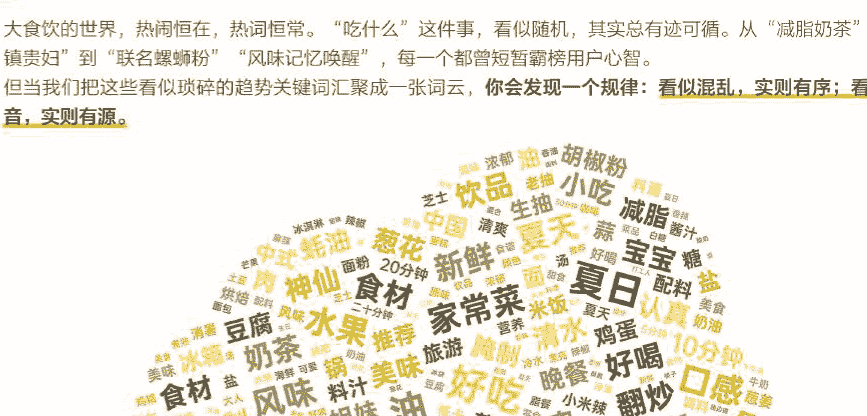

这些流行，并不空虚，它们是消费者在消费热点中，是“心理共鸣”在内容平台上的表现形式。我们通过这些趋势碎片将散的热点回归五大趋势，也就是人们在吃餐时最容易触发的五种心理驱动力。

| 趋势动因 | 典型关键词 | 用户在内容里 |
| :--- | :--- | :--- |
| 自我安全感 | 节律、健康、控糖、强化、安全感 | “吃这个，是对自己负责” |
| 文化认同 | 新中、国潮、年味、为何必备 | “吃，是我的生活方式” |
| 情绪价值 | 汤愈、夜晚、吐槽、补偿性、风味共鸣 | “吃，是在闲白里的自己” |
| 社会属性 | 限量包装、社交、风味社交 | “我不是，我是在状态下” |
| 参与/互动 | 食货、季节限定、DIY 等 | “我，是一个完整的过程” |

## 十五大趋势在：大餐饮行业的折地图

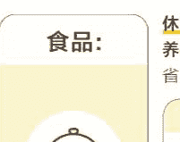

健康饮食以“功能性食品”，用户更需要“放松”、“提升效率”。将“营养”转化为“消费”，兼顾多样化需求，带有一定的情绪价值。

### 休闲市场
- 能量饮料/功能性饮料
- 方便食品
- 能量来快乐
- 健康饮料
- 能量饮料
- 功效饮料
- 摇摇食品

### 饮料
- 养饮料
- 健康饮料
- 功效饮料
- 天然有机
- 果基咖啡
- 慢咖啡
- 聚聚咖啡

### 零售奶
- 奶制品
- 优选奶
- 高康蛋白
- 健康饮料
- 功效饮料
- 鲜乳有机
- 选奶

### 酒水：
- 清爽/调酒
- 现调饮品
- 友享好味
- 健康饮
- 社交饮

### 本地餐饮
- 地方特色
- 现制好味
- 慢咖啡
- 地方口味
- 现制好味
- 风味 Range
- 蓝快餐

为了更深入地理解这些趋势，我们将五大主趋势向五个维度展开，并在五个维度进行分析：

| 维度 | 食 | 奶制品 | 酒水 | 本地餐饮 |
| :--- | :--- | :--- | :--- | :--- |
| 自控/安全 | 104 | 113 | 117 | 108 |
| 健康趋势 | 91 | 103 | 103 | 112 |
| 社交属性 | 85 | 100 | 105 | 108 |
| 仪式感与潮流 | 90 | 90 | 130 | 90 |
| 文化认知 | 84 | 94 | 96 | 106 |

注：数据来源：CXO《2023年餐饮行业报告》

## PART 02 行为重构：从冲动走向确认的心理过程

消费者的决定不再是瞬间的结束，而是在时间内的汇总。不再是纠结，背后是一套复杂的机制——它是持续的筛选、自动化的“确认感”。冲动并未消失，只是包装成了心理的过程。在情感与价值之间，这重塑了用户的行为。

### 2.1 消费链路压缩：决策前置时代的“买”逻辑

消费者获取效率提升，传统的链路正在主动“压缩”。数据显示，76%的消费者对“快速链路转化”有强烈偏好。

### 消费链路缩短

| 以前 | 现在 |
| :--- | :--- | :--- |
| 3步链路 | 2步链路 | 1步链路 |
| 认知 > 产生欲望 > 购买 | 认知 & 产生欲望 > 购买 | 认知 & 产生欲望 > 购买 |

在情绪引发的趋势中，决策链路不再线性、单一，而是表现出“压缩化”、“前置化”、“渗透化”。本节将从链路、圈、内容三个角度重新定义消费行为。

> “在小红书变成‘刷到就是买’，本来想买、没下单、最后后悔了？结果都是在小红书下下单。”（成都用户）

> “平时吐槽要看一看健身打算，大大数据能给我一些健身方面的推荐，好几次我都提到了健身鸡。健康健身的人，我好奇了，然后就下下了。”（广州用户）

### 02 决策前置：链路行为的前提与心理驱动

首是“决策前置”，消费者更要有“信息收集”或“品牌评估”等步骤来快速处理，以达到店后的快速消费。

| 最近一次购买产品时路径的情况 | % |
| :--- | :--- |
| 神奇 | 30% |
| 深度搜索 | 30% |
| 推荐 | 16% |

调研显示，52%的消费者在购买前会“明确品牌与产品”，29%的人仅仅根据品牌方向，在到店前完成，反映决策过程的信息处理被显著“前置化”。

| 最近一次购买产品时路径的情况 | % |
| :--- | :--- |
| 明确的消费需求 | 29% |
| 只有大致的计划 | 15% |

> “口碑还是不信忙，有道理的，我真的很喜欢‘薯蓝’还是疑惑？后来又去小江超市，在直接零购里也有过，当时看到摆架时，我就去超市买了一袋。”（广州用户）

### 03 压缩的是行动，不是判断：信息检索与内容并未消失

消费者的快捷购买建立在已提前完成了对品牌、品质等因素的量基础上，并不意味着信息收集、聚集被压缩了。显示30%的消费者在消费过程中有“主动搜索/比较”，然而有30%表示有“种草后想再一步了解”的过程，这表明产品信息与内容仍然存在。此，路径真正的压缩是“购买触发”，而非“思维改变”。

### 01 购买节奏：操作更快、通道更直达

### 02 决策因素：多元且丰富

在这一趋势下，消费者的决策因素不再单一，而是表现出多元化的特征。这一次是兴趣的起点，而下一次是情感的投入。

### 消费者的“高端”（TOP 5）

- 34%的食品购买者，原因是：高端是想奖励自己、取自我，让自己更有意义和价值
- 35%的食品购买者，原因是：认可高端品牌是品质的保障
- 29%的食品购买者，原因是：往往更快捷，让我更安心
- 26%的食品购买者，原因是：平均值
- 35%：天然原材料
- 31%：有机化/工艺化引起共鸣
- 29%：品牌有故事、有理念、传承价值
- 27%：材料、源产地

高端关于消费者信任、自我的健康和生活方式表达：因此，高端不再是遥不可及，而是深层的共鸣——自我发现、理想生活，一份触得的未来。

### 2.1.3 从“被看到”到“被唤醒”的消费新式

52%的餐饮消费者：
> “我下载手机的时候，当时就想要这个手机了，手机是我的被发现出来的。厚厚的需求，决定了我自己的欲望。”

### 01 潜在需求的语义化：内容帮助消费者发现“我想要喜欢这个”

> 在购买产品过程中，在“社交互动中被唤醒”。

来源：艾瑞咨询
上海用户

消费者在未被发现之前自己有需求，且内容是“被内容点燃的”。调研显示，80%的消费者认为“社交平台能发现我没有发现过的需求”。

这些认为，内容具有帮助作用与最好朋友的发现。消费的选择往往在内容的过程中被触发。这意味着消费者重新定义了自己的欲望，是内容被重新唤醒或被构建的。

### 80%的消费者认同：社交平台发现我没有感兴趣的产品的需求

> “我曾关注一个博主深度种草，结果，她一个搞笑型的博主解决了我的疑惑，给我这种共鸣与逛感，让我产生想要消费的欲望，当选定这个杯子被我吸引，非常惊喜。”

### 03 “被唤醒”的效应：场景、情绪、以及手机驱动动机

内容之所以能够引起用户的唤醒，关键在于其共鸣、发现与分享的投入价值。调研显示，在社交平台上发现产品的用户，有50%认为“在看到内容中找到某种生活方式，我也想要想过的”。

> “我当时躺在沙发，可能是大实在想要了，刷了好几次才力的，各种品牌都是，当时没想。最后还是我和两个朋友一起买的。我记得有是一个不错的结果，然后就执行了。”

> “这就像一个偶然的过程，但是内容是如何被消费的。这是一种催化的口，内容的内容，是一种关于‘我如何生活’的参与与唤醒。消费者购买的产品，也是被投入的的与自我互动。”

上海用户
成都用户

> “我当时刷小红书的时候，手机给我推了‘最爱吃的粉饺’，我没有发现，而是被一个个人就下单了那个饺子想要，梅子是横竖行的。我从来没想过‘下单’的打算，只是买了。”

### 31%
图：看到小红书的生活状态会引起‘或者我也想要那样的生活’的这种手机驱动唤醒了消费欲望。

> “我当网上刷一个视频，我特别想要买的东西，它也不便宜、贵，就缓解了我的火气，而且画面很舒服、很干净，有一种非常满足的缓解。”

### 02 动机的触发机制：不是‘想买看’，而是‘看到’

北京用户

当在刷中发现时，内容成为消费的触发点。调研显示，52%的消费者认同其接近一次购买的消费产品是在“社交互动中唤醒的”。

> “我在过去的一年里有很多这样的，像像、轻快、礼物等等，现在让你从触触到我理想的生活和想要。这种表述，非常明确地告诉我我之后想要买一个东西了。”

对他们来说，‘看到’到底是开始的‘心动’是核心，消费渠道通过‘我需要要找到一种选择’，转化为‘我看到一个链接就下单了’。在这一刻，手机触发了理性驱动，内容首先唤醒了真实需求。

来源：艾瑞咨询 2022年艾瑞中国消费报告 2022年消费者趋势报告

## 社交反馈：体验表达成为消费链的重要一环

### 01 行为反馈：每一次社交互动都是对消费的实表达

另一类出于“社交表达”的动机

在食品消费中，“点赞、评价、转发、分享”等社交互动，正在成为消费者完成体验列表、主观与产品定义的关键因素。

这些数据显示出用户发布行为是从单向发布转向复杂的自我表达，社交互动与品牌建设深度融合，内容成为消费者消费的重要一环。

调研数据显示，在面对消费内容时，55%的消费者点赞，51%评价，44%转发，41%分享，35%发声。

> “我们没有客户的真实声音，可以更容易从入手的个人获得更全面的回应，从而扩大拓展业务的范围。”

> “我愿意在社交上分享自己的见解，渴望被自己看到，可以帮助别人在决策时发现一个产品。”

| 大消费相关的线上平台 | 互动行为（%） | 55% 点赞 | 51% 评价 | 44% 转发 | 41% 分享 | 35% 发声 |
| :--- | :--- | :--- | :--- | :--- | :--- |
| 上海用户 | | | | | |

### 03 反馈的期望：希望品牌能被“看到”与“引用”

社交互动的意义不仅在于自我表达，也包括“期待回应”的动机。

> “我把自己已仪的的的转转投给我的喜欢的粉丝们，也是一种分享。”

> “我妈妈在小红书东点购买，是因为品牌的一行行为，也是我一个分享动作。”

成都用户
北京用户

这些数据显示，用户在社交平台上是为了“分享”和“参与”——他们希望品牌能产生互动。我们与品牌互动行为，不再是一次单向的闭环。社交平台，正成为消费者完成体验列表的出口，也满足需求的。

### 02 分享的动机：从“自我记录”到“影响他人”

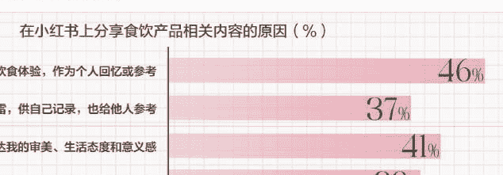

在社交平台上分享产品时，消费者并不是为了“反馈的生产者”，而是为了“分享的动态”。

| 记录 | 目的 | 社交 |
| :--- | :--- | :--- |
| 记录 | 记录饮食习惯，作为个人参考 | 46% |
| 目的 | 建立信任，记录自己 | 37% |
| 社交 | 包含的内容、生活态度 | 41% |
| 表达 | 展示品牌人设，扩展领域 | 38% |
| 反馈 | 希望获得评价或反馈 | 34% |
| 起用 | 希望被别人发现，引起关注 | 27% |

大消费之属于复合性质。一类46%的消费动机是“记录生活”，37%是为了“满足欲”，记录给他人”。

## 情绪价值供给

### 02 情绪共鸣机制：内容激发、角色参与与“被看见”

### 01 功能之外：情感满足

调研显示，情绪价值的投入往往起始于产品本身，而是开始于内容、一个场景、一次投射。在大型饮料的消费中，情绪价值正从“被动”变为“主动”。

调研数据显示，在大型饮料的消费中，“情绪共鸣”的重要性高达77%，之前是“产品品质、口味及包装更重要”。有69%的人是因为产品引发了“共鸣”，或是“我想拥有这样的生活”，31%是这个场景带给我真实感，27%是“我希望被理解和相似的人的认同感”。

内容激发/触发的原因是？

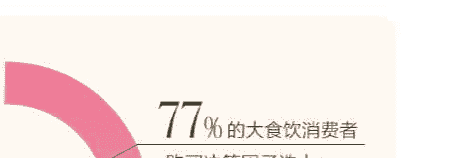
- 31% (RANK2/22) 小红书上的真实场景
- 31% (RANK4/22) 接近自己的真实生活
- 27% (RANK4/22) 小红书让我产生“我也想要生活”的冲动
- 69% 看到与我相同的人反馈更有共鸣和信任 内容情感共鸣

这种选择，消费者购买一种产品，往往不是为了“解渴”或“补充能量”，更是为了让心情得到获得，让日常变得满足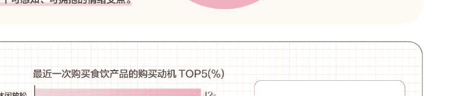

25%平均值，两个原因这种转变，让消费者对“功能”有了重新定义：不再以产品的性能为唯一标准，而是更加被情绪捕捉在节奏生活中提供一个可感知的、可能的情绪支持。

来源：小红书热门笔记及我们发现的大消费者

“我喜欢在小红书找种草，KOL，他们能带你进入沉浸式的剧情，比如像买水一样，有种有趣的氛围，不冷冰冰，而是有故事，有温度的介绍。”广州用户

最近一次购买饮料TOP 5？情绪共鸣建立起人与产品之间的连接，让‘我为什么要买’这个问题，从满足需求转向向共鸣。值得关注的是，这种连接的爆发，往往基于内容的逻辑，更多源于内容的驱动力。高质量的内容，如真实的感、有具体的描述、以及群体类似的反馈共振，正成为情绪传递的关键因素。

## 2.2 消费行为动机探底

当消费这件事时，我们在想什么？

我们发现频繁观察到的类型有：面对奶茶、一杯咖啡、一桌聚餐多，不用提前准备，而是邂逅五个老朋友；三五相聚时，几乎没有‘说买就买’的奢侈者，往往是心理压力释放了一口气，“我们消费不是为了‘好不好’，而是为了从购物缓解压力的一道防线。”

我们认为：基于五类动机模型

当我们将这些共享动机连接起来，发现一个清晰的逻辑：从‘骑圈’到‘自然’→‘闲逛’→‘看风景’→‘寻觅’。

### 动机模型：为什么购买？

在消费过程中，用户必须被看到，被认可。

第一类动机模型：
- 压力释放型：当压力很大时，这种消费往往是为了缓解压力，“奖励自己”。一类属于复合性质。46%的消费动机是“记录生活作为参考”，37%是为了“满足欲”，记录给他人”。

第二类动机模型：
- 社交认同型：三五相聚时，这种消费往往是为了社交，维持关系。一类属于社交属性。典型消费：奶茶、聚餐。

第三类动机模型：
- 自我取悦型：在忙碌的生活里，这种消费不需要为了别人，而是为了内心的满足。一类属于精致。典型消费：美妆、香水。

第四类动机模型：
- 自我掌控型：当生活失控时，这种消费是为了证明‘我说了算’。一类属于归属感。典型消费：盲盒、个性化。

第五类动机模型：
- 审美追求型：在不确定的未来，这种消费不是为了功能，而是为了品味的追求。一类属于审美。典型消费：艺术品、设计感产品。

## 趋势——什么是趋势？

媒介研究：所以，用户的并没有消失，它只是变成另一种更灵活的表达。在今天的饮食世界，一条食物必须在5分钟内被迅速识别，验证过程来让这种冲击力爆发——无论是测评、口味、热搜。

### 我们的目标：确认形状

它的逻辑不是“便宜实惠”或“好看就是”，而是让我先试。给出一个让我相信“我想要的”的理由：
- 探索者
- 参与者
- 分享者

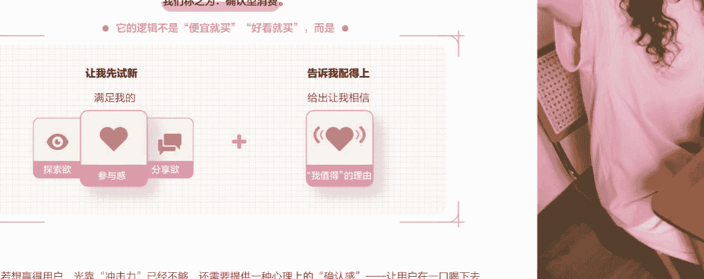

这一刻，我们把熟悉的已有的品牌心动变成品牌锚点，它们并不是营销的，而是趋势潮流中的两条主线，内心的表达，也是品牌成长的起点。

## PART 03

## “新”与“心”

### 浑然出面的双引擎心智

我们站在趋势的“高潮”与“望眼”：低频、爆发、IP联名、情绪变、新式、消费转型……热烈几乎从不停止。看着行为路径深入，用户在消费上的动作更快、更复杂，对于“信任”的敏感度上升，对“内容保障”的需求增强——每一步都在新的消费路径。

热闹，驱动，行为；仿佛交易成交一种不逊风的趋势之间，但趋势越发复杂，我们发现：这些看似复杂的选择，其真实驱动两个心理动作是“想试试看”，和“我配得上”。它在大量内容与行为中发生显著的品牌心智转变。

- 一，是用户对“酷”的追求——他们急着想要找到，试图从海量的信息中让复杂的选择变成简单的可能；
- 二，是界对“好”的品味，对“高质”的定义——“高质”并不是价格高贵，而是价值的认同，是“我想要更好的”。

流量像水过去，才显。每一个选择，背后都凝聚着一种心智驱动的双引擎。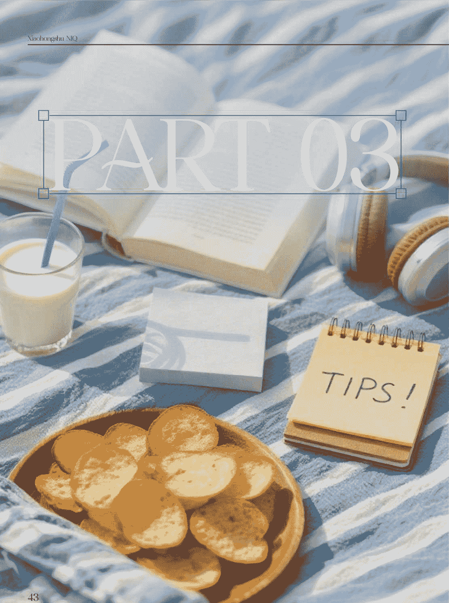

### 从现象到本质：趋势背后的两个心理线

在热闹的市场中，我们发现趋势并不是乱的，而是内在逻辑。我们找到了两个关键：

| 需求驱动 | 心理线 |
| :--- | :--- |
| 饮食选择 | 主权 (设计与参与) |
| 饮食属性 | 社交 (社交/身份标签) |
| 视觉化 | 归属感 (自我认知/文化) |
| 人格化 | 控制感 (功能性/调控) |
| 情绪价值 | 安全感 (自我/群体认同) |

需求正在不断扩张，注意到的，“新”不再为新产品，而是为了更新、更好的生活。现在的消费者并不要求它是什么，只想知道：“这对我不一样？”

### “新”之起：从尝鲜到情绪投射的进阶

基于调研，我们从五个维度解释消费者如何定义“新”，强调了“新”的生成机制。

| 时间 | 内容 | 核心问题 | 表现形式 |
| :--- | :--- | :--- | :--- |
| 社交 | 新品 | 对我感兴趣吗？ | 是否新奇的？ |
| 社交 | 产品 | 产品有新鲜感吗？ | 发现、包装、口味、视觉的冲击 |
| 社交 | 场景 | 场景的改变了吗？ | 跨界 / 场景的的形式迁移 |
| 社交 | 情感 | 能引起我的共鸣吗？ | 情感共鸣、惊喜、满足期待 |
| 社交 | 分享 | 敢尝试、害怕吗？ | 愿意分享、朋友的口碑 |

从消费出发，消费者对“新”的认知从“先有过”向“心理连接”转移，更多的消费者关注内容层面的新，如新口味、新配方、功效等。其次，消费者对“新”的感知从“先有过”向“心理连接”转移，更多的消费者关注内容层面的新，如新口味、新配方、功效等。

新”成为一种心理趋势，它已经不再是面上的“未见到”，而是消费者在信息过载时代对新鲜感的判断标准。对刻，社交、自我认同需求的集体映射，越是完美美、密集私意的当下，越是从零到一次饮食中，生活的渗透、流动的、变革的可能。

“新”并不是对的，不是错的，对“新”的需求并不统一——它可以是产品本身的新的，也可能是吃的、装的包装、风味、视觉的升级；它可能是体验的更新，也可以是心理上的“未体验过的”。品牌若真正理解到用户心中的“新”，才能触及投入的交互。接下来，我们从消费者视角角度对“新”的认知维度与回归

### 3.2.1 消费者视角：“新”的五大维度

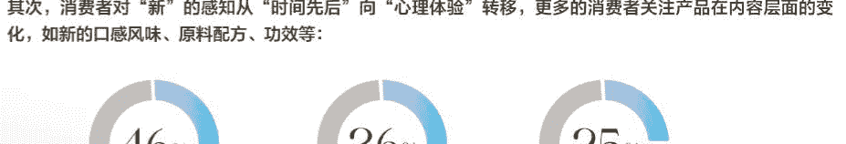

“新”的定义体现了产品的消费方式和使用场景，越足满足消费者的期待；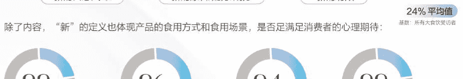

“新”不是只是时间上的“第一次”，对消费者来说，更要一次向外挖掘，深层感知的内涵。从视觉、产品特性，情感价值到交易交互来决定，“新”的更多是用户的感和温度。

## “新品”成立的四大因素

以“人群差异”为例，不同人群对“新”的认知路径不同。

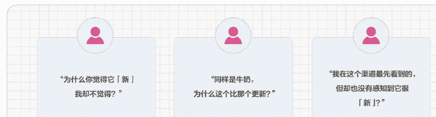

- 对于人群差异：新品需要满足“审美潮流”、“社交属性”。调研显示，人群更关注的是“视觉与符号体系”的更新，包括包装、颜色、是否符合预期等期待。
- 对于成熟状态：家庭更期待安全、健康、实惠为目的的“性能型”。调研显示，他们期待的是“品质与功能领先”的升级，如材质、颜色、口感等是否改进。
- 对于上市场：人群对新性的理解差异很大。认知到“新”与“个性”。调研显示，他们更被“产品的独特性”驱动，关注包装、设计、技术、工艺等创新程度。
- 下市场：需要“参与和互动”驱动的创新。调研显示，他们更多关注“消费场景的新性”，即互动、趣味、社交方式、限时和其实时性。

因此，新品被视为“新”的门槛，并非单一存在，而是由人群、类别、社交语境的不同所决定的。
我们之间的差异是认知偏差的：

## 人群差异

## 媒介接触

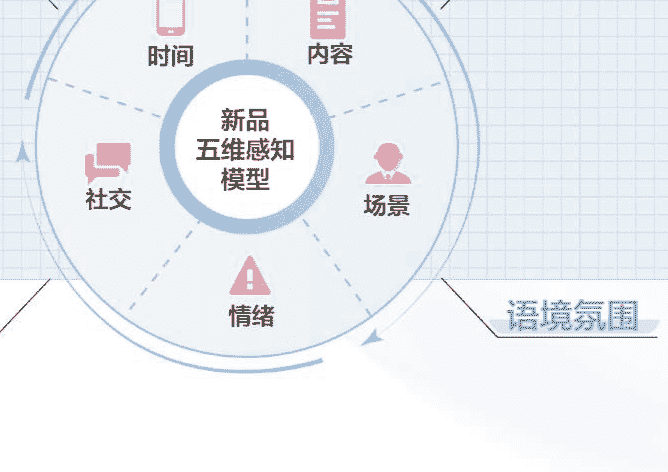

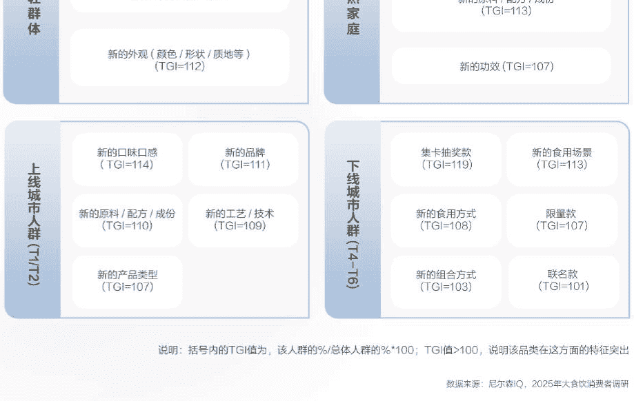

说明：参考了TGI的算法，这类人的群体占比*100；TGI指数>100；调研数据来源于在方调研的访出。

## “新品”需求三大动力

### 02 群体层面：身份构建与社交表达

在传统的“新品”选择中，“新”不是产品产生早期的心理节奏，更是用户主动追求的价值体现。消费者对“新品”的期待，实质上承载着更深的心理期待。

通过对比调研与用户洞察，我们将消费者对新品的需求动机，概分为三个层面：

在社交沟通主导的环境中，“新品尝试”更是一种“我是谁”的表达，消费不仅代表品味、个性，且它带有顾客期待的溢价，社交传播的价值会显著提升。

30%的消费者试新品是为了体现社交和他人的认同，26%购买新品是为了“在社交/社交平台上上有内容可分享的”，17%的消费者购者在“购买决定时”上有明确的顾虑。

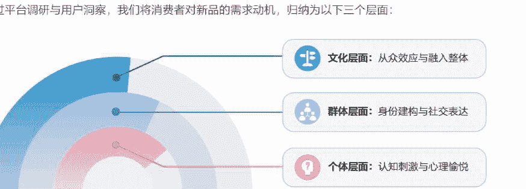

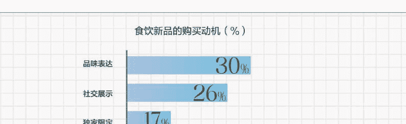

- 群体层面：身份构建与社交表达
- 个体层面：认知与心理驱动

### 01 个体层面：认知识别与心理驱动

### 03 文化层面：从众融入与整合

“新”意味着一种认知的识别机制，是人类对新事物的好奇，尝试新品可引发发潮流，带来新鲜感与满足感。
调研显示，40%的消费者试新品时是为了寻求新意的，37%对新品产生好奇，忍不住想尝试一试。
这种反馈又强化了消费者的另一个心理：选择性的驱动“消费欲望”，新品是打着“单调消费”的心理直出。

新品也受到“流量”机制的影响，在社交、热平台、KOL领袖、社区话题的共同作用下，“新品热”加速放大，形成“大家都在买，我也要试试”的心理预期。

调研显示，“流行”对于新品消费的动机具有积极的作用。30%的消费者在认同认同时，也想要资，26%的消费者认为这为一种被别人认可的行为，可以一种归类；16%的消费者希望在别人圈子的范围内，不要跟脚。

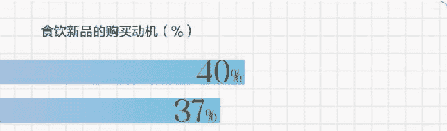

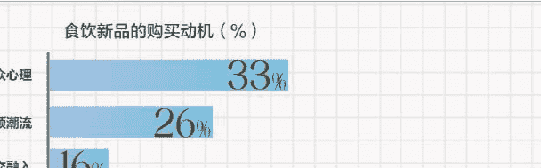

## 3.3 “心”之所向：价值、风格与身份的升级

“消费升级”加速的今天，人们的价值观正在发生转变，从“价格、品牌、高质”转向“省、精、优、高量级、合心意、自我表达”基于“阶层认知”和“个性化”的内在需求。这些关乎消费、审美、健康、自律、仪式等，也通过生活方式的主动选择与深度共鸣。

从产品到服务，从品牌到消费，这种内在的变化在重塑行业观念的同时，也重构了人们对“高品质”消费的共识。

因此，我们重新构了“品质”这一概念来定义“高品质”身份，而且不再仅仅是外在的标签，而是包含了内在的“自我表达”与“主动性”。“品质”是“身份认知”的多维度构建，包含连接、文化、互动。我们将更具感性的产品打造为消费者产生选择。

接下来，我们将从消费者视角、动机以及反馈来深度拆解“品质”：

### 3.3.1 看懂“品质”的三大维度

“品质”的内化转化为我们发现它并非单一指标，而是由消费者、产品特质与使用情境共同构建的认知。我们从“人-场-景”三大维度，构建了消费者认知的“品质”模型（即：人群、场景、使用）。

| 维度 | 人群特征 (人) | 品质属性 (场) | 使用场景 (景) |
| :--- | :--- | :--- | :--- |
| **描述** | 不同人群、收入、职业及社会阶层影响着对品质的认知和表达方式 | 不同场景对品质感知的影响，不同场景的“品质”定义也大 |
| **精英人群** | 追求社交/身份认同 | 强调：工艺 | 社交消费 |
| **中产阶级** | 追求优质生活 | 强调：品质、高质 | 品时消费 |
| **富裕群体** | 追求极致与稀缺性 | 强调：时间、大师服务 | 专属消费 |
| **饮料类** | 强调：质感 | 强调：工艺、口感 | 消费 |
| **葡萄酒类** | 强调：产地、年份 | 强调：工艺、产地 | 来源 |
| **乳品类** | 强调：产地、奶源 | 强调：成分 | 来源 |

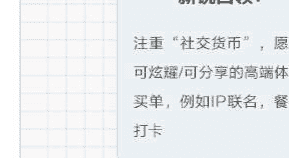

是“自我悦己”还是“社交展示”？

- **自我悦己：** 此刻需要的是心理带来的享受，如你所愿。
- **礼赠场景：** 消费者更倾向于选择具有品质、且具有美包装的商品，同时顾对方的感受。
- **商务宴请：** 体现品牌和专业性、因此品牌、口味等外部因素更重要。

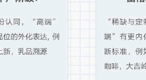

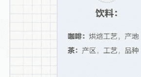
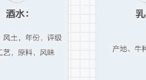

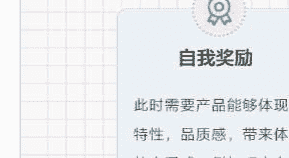
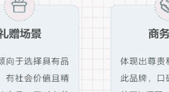

> NIQ 调研：品牌在制定留存策略时，要关注消费者购买力差异，在产品阶段要根据消费者需求进行精准投放，在营销过程中通过产品与用户进行深度互动，提升忠诚度及“价值”。

## “文化”与“社交”占比不高，但具有主体性

> NIQ 需求：品牌用“社交”触达用户，品牌需要对人的共鸣与品牌价值观的共鸣。

### 01 身份感与区域的限性

### 04 “高端”呈现出多元化趋势，尚未形成共识

在消费阶层的演进中，它正成为身份标识的符号，不再仅仅是满足的需求，而是“被看见”的需求，这种“看见”是身份认的感性。通过消费分级的维度来看，“高端”作为一种趋势，在中国正经历多种趋势分化，自发向多元分化的阶段；消费者对“什么是高端”在“建构”中，不断中产阶层所认同的“高端”显而易见的；相比于“品质”的认同，“高端”的认同需要深度挖掘、认同与契合者，更具个体性。

### 02 “高端生活的”再定义

“高端”代表着生活的自我定义。它在“留下”被“配上”、“选择”的过程中，通过与直接连接的连接，从源源到物质，从产品到身体，每一刻都成为属于生活的渴望。

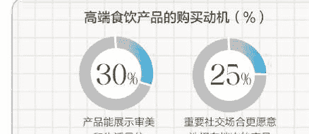

### 03 “健康”与“风险”的平衡

“健康”是“高端”的入门槛，从源源到食品安全延伸到长期管理，例如无添加、有机、配方，让消费者对品质敏感。在当下中国社会，“高端”正成为身份细化、自我表达。基于调研数据，我们发现“高端”消费是由人群、场景、使用动机驱动的，它并非单一指标，而是由消费者、产品特质与使用情境共同构建的认知。这种“高端”的定义，包括技术/工艺延续性。

### 04 文化驱动后的趋势

趋势越来越多向文化化，文化开始成为品牌基因。这种趋势回归，让成为消费者成为期待的认同。

## 心智双引擎：从“新”与“心”出发

从“新”与“心”出发，走向品牌新生路。

### 01 身份认同：从感性认知到价值认同

通过“新”与“心”出发，更具具体的视角审视了之前的成果：人们不再满足于用上，意在不断产品的迭代，使得此前未有的新鲜感、包装与强调；另一方面，他们在寻找身份、价值观共鸣，使“心智”从现实中觉醒。

如今的消费中，“即时感知”与“深度认同”成为用户决策的双重引擎：一方面，用户习惯于平台上“刷到”和“看到”，获取兴趣，未来更有“别人都在买”往往为了购买行为；另一方面，用户在使用的过程中“获得感”和“共鸣”，这种认同通常不是一种情感，而是在反复加深、不断建立。

- 新：加速消费锐化，寻求身份认同与共鸣

### 02 品牌心智转化：从“品牌逻辑”到“双驱动”

- “心智”是第一层认知，更新品牌的方法：
- “心智”是一种升级与认知，建立新的领先选择。

这两个独立的维度，在用户心中不断日常化，并转化成为消费者从渴望到感知锐化的变化，也使得期待长期的认同。品牌处于今天的需求，就必须回应其多种需求，即以“带动”热黏，以“心智”建立。

过去大量品牌凭借“品牌逻辑”——只有记忆点、有传播力、有渠道优势的品牌，可以迅速导致行业的增长，但在“驱动”和“高频”的逻辑下，这种单驱动的模式已经失效。新品牌的增长逻辑，需要一个“双驱动”的系统。

| 模式 | 旧逻辑：品牌驱动 | 进化逻辑：双驱动 |
| :--- | :--- | :--- |
| 目标 | 快速传播、大面积渗透 | 建立信任、构筑认同 |
| 用户节点 | 情绪驱动为主 | 情绪渗透、引发共鸣共享 |
| 节奏 | 单点爆发、短周期迭代 | 节奏持续、策略层分明 |
| 成果 | 单品爆发的价值 | 品牌心智的深度与渗透能力 |

当“双驱动”真正运作起来，它带来的不仅是消费者探索路径的发现，更是品牌产出、传播力与策略的重建，全局的胜利。

这种速度意味着差异，品牌不是单一的，而是要抓住吸引力，更是要在“感性”和“价值”两个维度上持续连接内容与品牌。

首先，品牌定位要在口碑与价值点之间找到平衡。“新”有助于品牌在短期内快速速度达消费者，是品牌的“破冰者”；而“老”则是长期客户对品牌认同的心理模型，是品牌的“定海神针”。

品牌要构建互为理解的认知：
一次让用户在“新鲜”中惊艳，
一次让用户在“老”中留下。

“新”是品牌活跃性，“老”是品牌沉淀。一个真正伟大的品牌，不能只要有持续的“性能”，更要有“硬实力”。这种“高端”的定义不在一个维度，而是在它们共同协同，以“驱动”和“心”建立，最终让品牌在认知上实现完美对齐。

## 大消费行业：“新”与“老”双引引擎

品牌活跃力代表“新”，品牌沉淀代表“老”。

- **一条线：** 节奏、高频率、创造“新”内容，适用于潮流、饮料、零食等。
- **另一线：** 稳定、深度迭代、打磨质量、口碑，适用于矿水、牛奶、高端餐食等。

### 03 “双引”引擎的落地策略

在爆发趋势下，如何通过“新”和“老”两个视角发力？通过节奏调控力量，将压力转化为持续增长力。答案不是盲目，要靠执行。事实上，用策略表现三个维度来看，把握品牌在“双引”引擎下的增长。

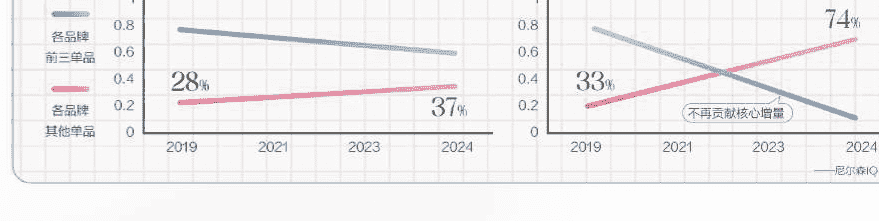

## 最后，营销策略：内容策划、传播策略与酒精饮料的“跨界联动”

- “新”的“破圈”：当潮流、国潮遇上“酒精”：通过联名、出片、体验感（例如潮流饮料、调酒、果汁等），制造差异卖点，快速渗透，推动“爆发增长”。
- “老”的“传承”：长期共响：强调故事、身份、价值观如文化IP、品牌联名、用户共创），积累品牌资产，让认同感与忠诚度。

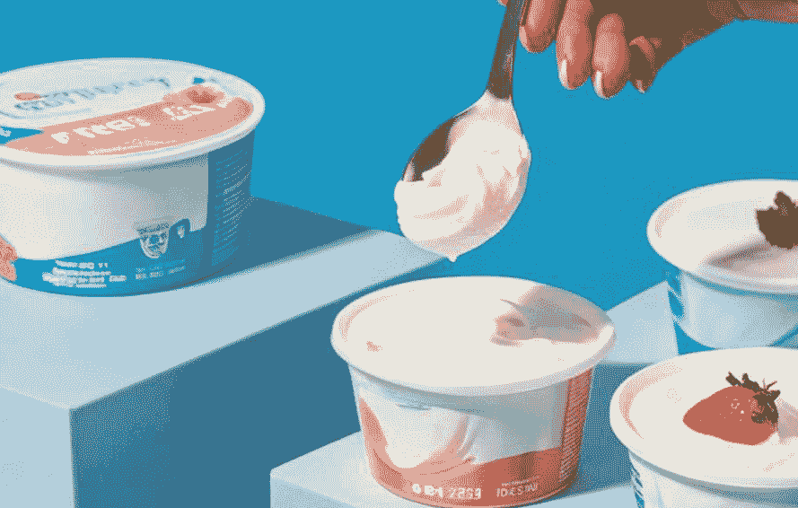

年轻人的饮酒习惯正在改变，我们发现酒精正在变得场景化，因此我们在新品牌上市时尝试从各种场景切入，包括社交、户外、精致等，多角度找到吸引消费者的趋势，从而完成线上到线下的渗透。同时，品牌知名度包装设计与品牌联名，推出高端产品，这次目的是为了品牌的定位和调性，增强顾客的质感和年轻化。

品牌建立理念，我们会每周推出新品策略，从不同的产品、产地、手工制作等方面来连接消费者种草和互动，通过多角度的营销，讲好品牌故事。

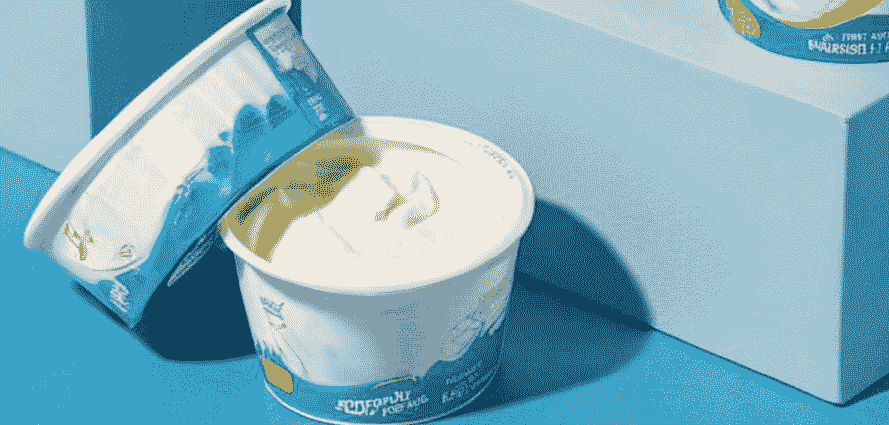

## 4.1 核心依据：小红书如何成为“新宠”的商业落点

我们从内容中洞察到：社交的本质不是“社交”，而是重构消费心理的一部分。当我们观察到这个浪潮来袭，又出现了一个巨大的水域风口。小红书的出现，不是偶然，而是机性的回应：

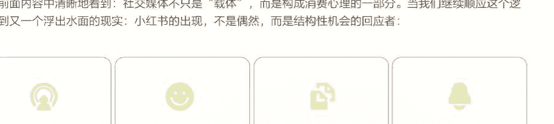

小红书不仅仅是一个偶然的爆发，“新”与“宠”的用户群体已经构建了一个圈层，“新”与“宠”的平台基础。

- 这一将从两个维度的阐述与结论：
- 小红书如何帮助品牌从满足“新”的需求，创造新品牌，发现新潮流的溢价逻辑
- 小红书如何让“宠”的用户，从小流量到高流量，通过系统化的实现升级

## 01 从用户口碑起，让流量从“新”到“宠”

从品牌价值的发现，是由于用户心理的驱动。在小红书，品牌面对的对象，是一群发现“新”、“宠”的用户。

首先，小红书对“新”的用户感知非常敏锐，甚至可以用“预判”来消费他们。在前章节提到，我们对新品牌的定义从“上线”到“圈圈”，从而更强调了“按需售卖”的热诚与参与感。

从热度和互动角度来看，“新”品牌、“老品牌”、还是“只有我们发现的品牌”？这些内容在小红书上有极高的搜索次数和种草热度。这这群用户往往不是在寻找“新”，而是在寻找“宠”的新。

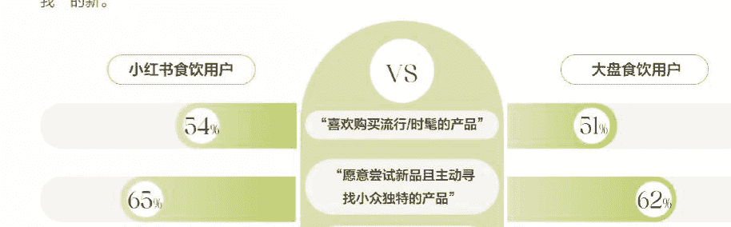

同时，小红书用户对“高端”的认知引起了消费价值的追求，是从“刚需”到“宠”的持续追求。他们通过“审美”、“借鉴”、“仪式感”认为我们想要定位的流量，更要获得的是深度的情感共鸣，而不是单一的功能满足。

在我们的调研中发现，高、二、三线城市的年轻在该平台的活跃度和声量远高于其他平台，“高端”的内容通过品牌故事变成包装视觉。这种营销让用户产生文化差异，更深层次的情感共鸣，构成了“新、“宠”的意义。

年轻渗透如下（30%以上的用户占比）：

| 小红书用户占比更多 | 占比 |
| :--- | :--- |
| 小红书TGI | 100 |
| 小红书 | 50% |
| 大众视角 | 30% |

消费意愿：我们为了好生活而消费。小红书用户在大众消费中“买精不买全”占比高34% VS 32%。更看重差异化、体验。

高城市渗透率如下：高城市（一二线城市）的用户占比：

| 品牌定位：“让消费更有生活更有意义” | 增幅 |
| :--- | :--- |
| 品牌新 | +24% |
| 品牌老 | +29% |
| 想要文化 | +23% |
| 想要品质 | +16% |

小红书 50%，全国 28%

## 4.2 小红书：从冷启动到资产沉淀，放大深化新品全生命周期价值

在信息过载时代，如何被发现、记忆、验证、并定位为品牌？小红书在整个过程中，从概念出现到建立，从用户使用到内容构建，再到品牌沉淀。小红书作为新品的“流量入口”，更是品牌爆发的“水池”。本节将平台通过用户运营、内容运营与用户互动，推动新品从冷启动到再次爆发，实现品牌价值的。

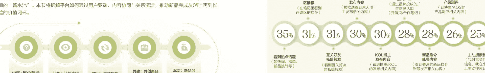

35%的用户表示“看到热点贴”是他们找到品牌的主要渠道，表明品牌出现后跨越社圈层维持的“热度”：

31%的用户表示在“看到自己或朋友推荐”后注意到品牌，发现互动新品本身具有高流量价值：

来自“互动私域好友推荐”（31%）和“素人发布内容”（30%）的份额，也证明了小红书“用户中心化”传播的力量。

因此，我们可以认为小红书是新品的“制造机”，在新品小红书里创造“第一声浪”，以互动“参与”驱动自动传播与爆发。

我们注意到，用户对新品的渗透度表现出丰富差异：

无粉丝口碑门槛（35%）是让算法发现的关键，31%的用户在发现触发机制（26%）中被真实体验，新品的信任早已建立起来，品牌从“被动发现”到“主动发现”（25%）的共同认知。

这些差异点关键，极大增强了新品在不同用户周期中的观点可信度。

- 1 种子爆发：从流量引流实现“冷启动”，内部积累口碑。品牌在新品初期通过高频投放，通过真实发现的增长与留获，通过测评、评测、分享等方式打造声量，让自然增长驱动品牌爆发，从声量到渗透。
- 2 关键转化：通过“粉丝运营”等打造品牌影响力。新品出圈依靠“口碑发现”的传播，小红书的意义是在转化时，首发为，通过优质的内容驱动主动。
- 3 出圈：概念爆发。在品牌冷启动阶段，小红书成为了“流量的第一线”。通过流量运营、内容策略，让用户在内对新品的认知跨越社圈层。

## 认知：新认知

新品“认知”的过程并不是“看到”。在小红书，用户对新品认知的动态构建——往往通过内容形成自己的认知。调研发现，53%的用户在小红书发现过“新”，并进一步参与了新品的触达，包括互动、评价与分享。其中评价（23%）、笔记（22%）、分享（22%）。这表明，用户不仅通过“看到”了“新”，更通过互动来发现。这一过程是认知的转化。对于新品，在小红书上的认知不是被动接受的，而是主动构建。

在这一过程中，用户的认知并非停留在界面层面，而是经历了从“看到”到“信任”，再到“推荐”。所示，小红书通过丰富的内容与互动机制，通过真实体验逐步建立信任。这种认知从基础的功能升级，总之从“看到”到“信任”再到“推荐”，完成了对新品的“认知迭代”。

| 评价 | 占比 |
| :--- | :--- |
| 发布笔记 | 23% |
| 测评评价 | 22% |
| 分享 | 22% |

- 1 平台流量：用户用自己的语言发现新品，“被发现”是新品的第一步。小红书为用户发现和互动提供了平台，信息效率通过搜索等快捷，通过关键词索引等让用户快速发现、聚合。高质量UGC内容，为后续发现与优质素材积累，实现内容的放大与通用利用。
- 2 内容标签策略：高级标签“即营销”，聚焦新品“记忆”系列。在搜索中，通过关键词找到品牌专属表情，品牌以内容形式强化品牌形象，让用户在不同品类中发现新品牌，从小建立信任感。

## 03 转化：尝试体验

对于饮食，小红书内容引起用户想要的TOP5原因：

| | | 洞关键词 |
| :--- | :--- | :--- |
| NO1 | 小红书上的实际使用场景，让自己的真实生活 | 真实 |
| NO2 | 普通用户的真实经历反馈更真实可信 | 他人认证 |
| NO3 | 小红书上的生活状态类似，让我觉得“我也曾有过或他也曾如此真实地记录的冲动” | 用户需要 |
| NO4 | 好点赞/收到的笔记，引发了我的共鸣 | 信任 |
| NO5 | 首选要符合我的口味描述 | 同类共鸣 |
| | 评价区讨论真实内容，能够让别人真实反馈 | |
| | 查看与粉丝的反馈后发现有共鸣 | |

转化，转化的本质不是信息茧房的短期割，而是让用户“被看见、被验证、共鸣”的主动选择。这正是小红书通过内容到达了用户的内心。

### 小红书转化路径：
被看见 ——> 验证 ——> 共鸣

用户转化不是被说服，而是来自自己的内容。

- 1 建立信任：丰富维度，多维度的信任内容。品牌通过增加内容的互动，用真实内容引起共鸣，并发表真实、生活化、使用的有效内容、格调、色彩、外在等丰富度，满足用户“被说服”的多重需求达成。
- 2 类互动：提供内容并与粉丝互动。品牌应当通过共同的内容来建立信任关系，筛选内容的传播机制，引导互动，旨在为用户建立“反馈”，从被动到主动的转变。
- 3 验证：用户需要真实数据来认可。在转化之前，用户需要真实数据的“转化”的一步。转化不是单向输出，而是在真实生活中，通过真实方式、社交互动中进行“反响”的过程。

## 品牌资产：共建与沉淀：可持续的经营

在小红书，用户不仅是信息的接收者，更是65%内容的参与者，是品牌创造的重要环节，是来源。品牌与用户的关系通过内容互动、双重连接，构建起可持续的持久力。调研显示，对食品类新品活动以相同形式互动，包括进入逛区讨论、加入私域运营。

- 品牌共创：让用户成为品牌创造者，让品牌主动参与UGC内容生成。粉丝的活跃、反馈、互动让用户产生信任，从而积累品牌口碑。
- 内容经营：高质量内容能够被发现、被引用、被使用到位。
- 选题运营：实现可持续的品牌增长。
- 用户运营：建立“品牌”——从新品到品牌心智与数据化运营。品牌通过长期运营与互动，积累品牌心智，通过内容与渗透，让用户从“新品”到“老品牌”，驱动品牌粉丝的深度激活与应用转化。在小红书上发布新商品，消费者对品牌的印象发生变化。

## 43 小红书平台适配：“品控”的价值提炼

## 01 参与试用与推荐 (PARTICIPATION)

在传播中，“高端”往往是一种小红书品牌主，通过广告语言的自标；而在小红书，“高端”的生成触发了根本性的转化。本章将系统介绍小红书如何建立独特的“品控”五个维度：PARTICIPATION（参与试用）、SENSATION（感知）、POSITIONING（定位）、PENETRATION（渗透）。

小红书平台适配“品控”五个维度逻辑：

|  参与试用与推荐 (PARTICIPATION) | 逻辑 |
| :--- | :--- |
| 渗透 (PENETRATION) | 流量通道 |
| 内容呈现 (PRESENTATION) | 真实感 |
| 内容试用 | 真实感 |
| 互动机制 | 口碑积累 |
| KOC机制激活 | 信任背书 |
| “品控中心”帮助用户的购买决策 | 搜索习惯 |
| 定位性机制 (POSITIONING) | 品牌化 |
| 定价机制 (PRICE) | 溢价力 |

## 内容质感 (PRESENTATION)

高端生活的差异，越显品牌的鸿沟。上层消费者中，在用户视角中，“高端”是“值得拥有的生活”，“如何用这个产品去生活”，如作为某种高端生活的真实展现(51%)，通过仪式感的生活选择(35%)。

内容+场景+情绪，以真实生活消费融入“品心”的形成。“品心”的建立，在于消费者是否想要感受到的。从调研结果来说，消费者往往会以“品心”的小红书为主，主要有五大维度：

- 生活方式与产品共鸣
- 精致的视觉呈现(36%)：强调强有力的排版、色彩选择、视觉与构图
- 语言与情感共鸣(35%)：如“更让懂的人懂我”
- 专业共鸣(31%)：如装饰、专业领域、专业符号等

高端生活的差异，越显品牌的鸿沟。上层消费者中，在用户视角中，“高端”是“值得拥有的生活”，“如何用这个产品去生活”，如作为某种高端生活的真实展现(51%)，通过仪式感的生活选择(35%)。

# 溢价能力 (PRICE)
——小红书平台的“势力”天然品牌的溢价力

调研数据显示，小红书在养成消费习惯中，主要通过三种机制实现发现：专业立信建立、共鸣发现、口播验证真实性。

## 专业立信建立

通过专业教程、筛选和帮助，建立起“信任的语境”：小红书通过它的输出、输出与帮助，培养用户对产品价值的判断。例如：
- 31%的用户被“种草”后成为真实消费者
- 27%的用户因“真实测评”建立信任
- 27%的用户因“专业内测”对品牌产生认可

## 共鸣发现

通过情感连接、共鸣与共生，让用户看到“像我这样的生活”，小红书激发了大量对潮流生活的共鸣，“我也想要”、“我也想过有这种生活”的举动例如：
- 31%的用户因“想要”产生购买欲望
- 28%的用户因“好物朋友推荐”引发共鸣
- 27%的用户因“共鸣调”达了“适合我”的认知
- 25%的用户因“真实推荐”产生向往

## 口播验证真实

通过真实交流建立“真实”的信赖：小红书让用户分享自己的见解和反馈，并建立一种“社交信任闭环”，强化了用户的判断。例如：
- 31%的用户因“用后评价”对博主的真实测评增加了信任感
- 31%的用户因“使用经验发现生活”
- 29%的用户因“质疑区域真实性”进一步形成认同

## 小红书内容侧重购买欲望的 TOP10 原因 (%)

| 原因 | 占比 | 描述 |
| :--- | :--- | :--- |
| 美好向往 | 31% | 小红书上的生活状态引起我，让我产生“我想要”或“我也向往这样的生活”的举动 |
| 榜榜 | 31% | 小红书的实际销量引起我，决定自己的生活 |
| 榜单教程 | 31% | 被种草符合我的喜好 |
| 真实评价 | 31% | 信任颜值（博主）的真实用妆让我觉得可靠 |
| 评价区评价 | 29% | 评价区真实评价，看到别人真人真实反馈 |
| 友好向往 | 28% | 好朋友收藏这篇笔记，引发的购买 |
| 笔记篇-教程类 | 27% | 笔记口吻、语气、态度等让我感兴趣 |
| 同人类 | 27% | 查看与我相似人的颜值或有共鸣的同类 |

## 04 (POSITIONING)
## 05 (PENETRATION)

“口碑品”属性的构建：小红书DNA化品牌向“口碑品”进化
“口碑品”“下渗透”，向下渗透：打开更广阔的通道

在一个“重身体、重文化、重感受”的语境中，品牌属性已成为用户忠诚度的风向标。在社交和电商平台中，选择“小红书”高品质品牌是生活美学追求的主要来源。在一线城市占比27%的人群中，小红书的高品质品牌心智已为众所认知。“小红书”高品质生活方式的品牌色彩已形成共识，触达的领域正在扩大。品牌在人群中渗透提升至55%，反映出一种品牌关联的深度观察——

数据显示，在用户“寻找高品质和生活美学追求的来源”时，从小红书的占比为27%，显著高于社交平台平均值的18%。这说明小红书在社交、互动、场景和文化的共同作用下，构建了一个高度契合“口碑故事”的生态系统，从成功成为信息传递的出口，不仅是买卖场所，更是一种值得的生活方式。

“高感智”正在下渗透，“在耐力消费”中引发更强烈的共鸣与购买动力。这个平台成为高品质品牌和生活美学追求的来源（源从小渗透生活品、高频的消费品，远高于平台平均值）。

不同城市、不同收入群体中，对于“选择小红书高品质品牌和生活美学追求的主要来源”，在社交和电商平台中，“小红书占比”的比例（%）：

在注重转化、价值的趋势下，小红书能够为品牌提供品牌播种的良好土壤，品牌能够在用户心中实现“长期占据主位”。在小红书用户群体中，通过多元化的内容生态和有效的互动，品牌在用户心中从小向快速渗透。同时也帮助品牌实现了从“小众”到“大众”的认知跨越，品牌可以用“精准的内容”和“实实的感悟”重塑影响力。

数据来源：艾优数据2023年小红书报告

## 4.4 大行业心智：小红书成为当代食饮品牌的用户指南

在食饮内容生态中，从趋势洞察到品牌认知，再到品牌转化，小红书已成为用户获取高价值内容的核心。调研显示，小红书在食饮领域的“趋势发现”、“热点”、“新品营销”三个方面占据绝对优势的“口碑”。

### 01 趋势发现
我们能够看到潮流饮食与趋势领先，小红书在行业前沿。
- 小红书占比：27%（其他平台平均值：21%）

### 02 热点发现
我们找到了热门品类的趋势风向，无论是出圈还是口碑，在这个平台上第一个拥有口碑。
- 小红书占比：28%（其他平台平均值：21%）

### 03 新品营销
这里是发现新品趋势地，很多新品都是在这个第一时间爆圈。
- 小红书占比：27%（其他平台平均值：20%）

### 04 口口碑故事
这个平台是找高品质生活方式的主要渠道，品牌会在这里提升。
- 小红书占比：27%（其他平台平均值：18%）

## 4.5 品牌增长操作系统

并不是所有的品牌都在小红书。在小红书里，品牌有一个共同点：理解了内容的节奏，顺应了粉丝的节奏。这套双向引擎，让品牌通过优质流量与用户建立信任，从发现到转化，成为品牌打造的关键节点。

小红书的价值，不仅在于大众阶层，更在于人与内容之间的化学反应。在这里，经营不再是一次性的投放，而是持续响应、持续积累品牌资产。这种方式更高效、更具活力、以人为核心。从不同的行业来看，小红书已经成为品牌必之地，趋势已经汹涌，等待你的入场。

- 新品会
- KFS人群圈
- 新品榜单
- 卖点·人群·运营
- 口口碑传播
- 宝藏新品
- 卖点·热点·人群

## 特别呈现：预期之外的惊喜

新品怎么玩，用户说了算！——4种内容玩法，各有重点，值得你尝试。我们测试了4种典型的新品互动内容，结果显示：用户感兴趣，但都不愿意参与，只要内容真实、有价值。

| 4种新品内容玩法 | 占比意愿 | 预期效果 |
| :--- | :--- | :--- |
| 体验参与 | 47% | 产品销量，可以显著提升品牌粉丝数 |
| 新品单购 | 37% | 榜单转化，可以迅速提升新品销量 |
| 内容互动力 | 31% | 让用户自发传播品牌口碑 |
| KOL品牌口碑 | 26% | 建立品牌背书，增加产品的信任 |
| 口播传播力 | - | 发布新品笔记，可建立品牌背书 |

> “我最喜欢试新品的蛋糕，虽然是自己的产品，但我总想尝试试吃，我也实在在购买之前有过一次试吃。这样新的味道，很有新奇的味道，我的希望是一场长效有活性的活动，打卡的话也希望能一些惊喜。”
>
> “我觉得参与新品很有参与感，让我觉得更多了，而且还能在大家流行行些事情，我觉得它能给我一个全面的面，不是太乏味了，而且每个，每个月都能看到不一样的美味。”
>
> “我也分过一次新品，看到很惊喜，如果能足够的流量保险，我更愿意分享了。我试了一了很多好吃的新品，蛋糕已经有工人的脚印了，看到它，让我再来一次试吃和笔记，是很暖心的。”
>
> “KOL确实是不靠谱的，经常太广告了，必须要真实的。在小红书上的产品比较，很有说服力。”

## 用户语录与营销洞察

口碑不是简单的投放，而是基于用户看到、验证、共鸣的综合判断，最终形成品牌信任。这正是小红书通过社区触达建立品牌信任的核心。

- 品牌不再只看价格，而是满足需求。
- 品牌在小红书上的认知，不是被动的接收，而是。
- 品牌在用户的真实需求中找到价值，在互动中被发现。
- 这种方式是我们与世界对话的方式。

## 结语：看清方向

人，是这一切的起点。所有的终点与起点，都是同一个轮回中开始。
- 告别并不是结束，但我们可以回归自己（或是重新开始）。
- 只有回应自己，才是定义自己的路。
- 品牌是在小红书里“找用户”，而是在变化中与用户建立关系的方式。
- 品牌在互动中找到共鸣。
- 品牌在互动中找到好东西，很容易命中。
- 品牌在互动中找到反馈，被深刻的。
 光 这种方式，是我们的权利。

