# 新经济时代精智人群长寿新旅程

复旦发展研究院与中宏保险联合发布
2025年10月

## 核心亮点

精智人群理想寿命认知更理性，追求有规划、有自由、高质量的长寿体验，强调以主动规划主导长寿阶段，均衡重视身体、心理和财富等维度维持对长寿的影响，尤其是财富对长寿质量的保障。

精智人群健康预防行为活跃，提升能够带动长寿管理行为的，如群体中的中宏保险MOVE参与完成起步挑战的次数增加次数，其保持量提高0.24%，充分显示出精智人群健康管理中经济行为与预防行为的一致性。

精智人群将保险和健康预防作为长寿管理的入口，人均保持量2.14张，中宏保险MOVE参与率为42.07%，显著高于全人群，量化体现其主动健康管理和充分财务保障的意愿。

精智人群主动的健康行为对降低风险有显著的积极作用，平均每增加一次起步挑战，精智人群的人均缴付次数减少0.73%，且在男性中更为加强。

精智人群积极主动的健康预防行为具有显著效果，人均缴付次数及首期后年龄缴付次数均低于全人群，且年龄越大这一效果越显著，45岁及以上人均缴付次数较全人群少0.05次。

精智人群对自身长寿阶段的财富准备乐观态度，81.29%认为自己有足够的资金应对人生下一阶段，且不同年龄段的财富规划契合生命周期理论，因此精智人群具备较强的财富操控力。

## 6大核心亮点

## 中国人的“新长寿观”

延长寿命不再是群体首要的目标，追求生活质量、有尊严、独立、人生目标的新长寿。

图1晚年/退休生活的首要期望不是“活得更久”的受访者比例
图2为什么活得更久/最大限度延长寿命不是您的第一期望？（此处显示前三选择）
图3三维健康对理想寿命的重要性

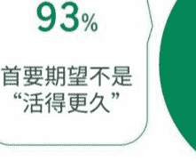
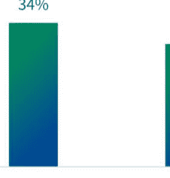
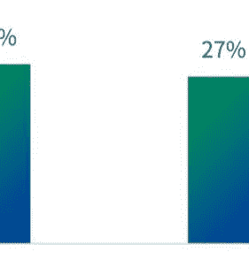
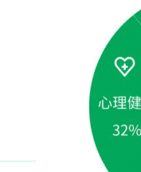
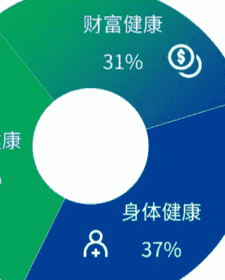

为了实现有质量的长寿，中国群体认为身体健康、心理健康、财富健康都很重要，且采取从健康预防到财富投资的多种行动。

数据来源：2025宏利亚洲调查数据样本

## 报告

复旦发展研究院联合中宏保险，延续中宏复旦报告2023年《新经济时代精智人群财富新规划》、《2024年《新经济时代精智人群养老新洞察》所关注的精智人群，以长寿旅程为核心议题，从健康预防和财富规划两个关键赛道切入，系统描精智人群的长寿旅程蓝图，旨在为其在新经济时代实现“新长寿”（“有质量的长寿”）提供启示与建议。

## 精智人群

### 01 精智人群特征
- 足够的养老保障
- 高品质的生活
- 高稳定的家庭收入
- 高质量的医疗服务
- 高的家庭责任
- 高层次子女教育
- 高性的财务规划

数据来源：2025年宏利亚洲调查（Manulife Asia Care Survey 2025），通过随机抽样的方式覆盖亚洲八国家和地区，中国内地共1000个样本，其中精智人群样本为310个，分别来自北京、上海、广州、天津、杭州、沈阳、南京等核心城市。数据主要统计了精智群体的个人特征、健康预防及财富配置等。

### 02 中宏保险MOVE参与数据
中宏保险2021~2024年精智人群客户保单持有、使用、完成起步挑战、健康权益等等方面。其中精智人群样本近6万，集中来自上海、成都、北京、杭州、广州、深圳、沈阳、武汉、无锡、西安等一线城市或全国前10%。

## 长寿新认知

### 观点一 精智人群呈现出科学驱动的“高质量长寿”倾向
| 平均理想寿命为86.7岁 | 中位数为88岁 | 以90岁为核心目标 | 排除极端低龄或超高龄 |

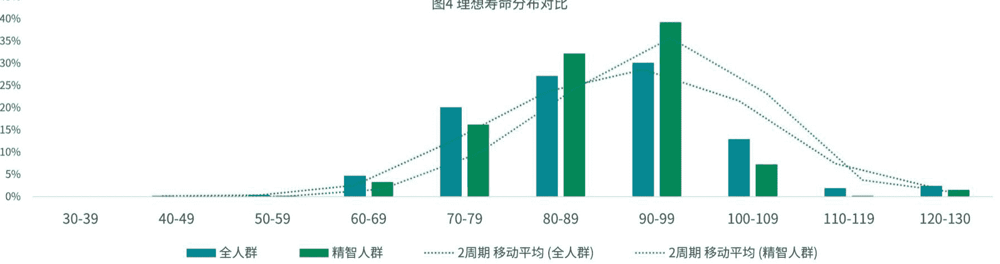

数据来源：2025年宏利亚洲调查样本
| 全人群（移动平均） | 精智人群（移动平均） | |

### 观点二 精智人群最重视身体健康，但也展现出更明显的“财富优先”倾向，尤其在60+年龄段突出。

图5 精智人群三维健康重要性结构对比
| | 身体健康 | 心理健康 | 财务健康 |
| :--- | :--- | :--- |
| 全人群 | 37.3 | 31.5 | 33.4 |
| 精智人群 | 35.5 | 31.1 | 31.2 |

图6 各年龄段精智人群三维健康重要性结构对比
| | 全精智人群 | 25-34 | 35-44 | 45-54 | 55-59 | 60+ |
| :--- | :--- | :--- | :--- | :--- | :--- | :--- |
| 身体健康 | 33.4 | 30.6 | 33.3 | 34.9 | 32.1 |
| 心理健康 | 31.1 | 29.1 | 33.5 | 30.3 | 30.8 |
| 财务健康 | 35.5 | 40.3 | 33.2 | 34.8 | 37.2 | 34.2 |

数据来源：2025宏利亚洲调查数据样本

### 观点三 精智人群认可财富—健康—长寿质量的正向关联，但在认知深度和均衡度上存在显著缺口
- 财富→健康→长寿质量的正向传导路径
- 强调财富对生活的直接保障
- 少关注财富在延长寿命与提升健康寿命中的深层价值

图7与财富相关的描述中，您有多同意......
选项评分中位数为
| :--- | :--- |
| 拥有保险保障可以让我在退休/老年阶段无忧生活 | 5.56 |
| 我的财务状况会影响我维持心理健康的时间 | 4.96 |
| 拥有保险保障影响我维持身体健康的时间 | 4.92 |
| 我的财务状况会影响我维持身体健康的时间 | 4.91 |
| 我的财务状况会影响我的寿命 | 4.75 |
| 拥有保险保障影响我的寿命 | 4.70 |

注释：数据来源于2025宏利亚洲关调查，1-7评分制，7为“完全同意”，1为“完全不同意”。

### 观点四 精智人群应顺应衰老的自然进程，但缺乏对心理健康日常预防与调适的主动投入
- 顺应衰老进程，健康管理聚焦重大
- 重视心理健康的影响，忽略心理健康
- 生病是衰老的一部分，与其能够独立生活、做自己认为重要的事情，这才是真正的健康。

图8在老年年龄阶段，与心理健康相关的表述中，您有多少同意......
| : 项目 | 比例 |
| :--- | :--- |
| 心理健康影响我理想生活质量 | 5.36 |
| 心理健康对寿命有显著影响 | 5.30 |
| 心理健康是长期身体健康最重要的因素 | 5.26 |
| 心理健康问题在老年人中常见 | 5.16 |
| 我的财务状况会影响我维持心理健康 | 4.76 |
| 心理健康问题主要由遗传因素引起 | 4.50 |
| 当谈到健康时，我主要关注重大疾病而不是与衰老相关的问题 | 5.03 |

注释：数据来源于2025宏利亚洲调查，1-7分制，7为“完全同意”，1为“完全不同意”。

### 观点五 精智人群期待长寿旅程成为主动规划的主导，兼顾弹性与松弛。
- 既往生活的延续——继续相同节奏
- 人生的新阶段——不再再工作，追求新的兴趣，享受理想的生活方式
- 放慢节奏的时期——通过加强训练，实现更好的工作与平衡

图9下哪一项最描述您的生活态度？
图10您想到退休/老年生活时，哪一句最描述您的感受？
| 描述 | 比例 |
| :--- | :--- |
| 我倾向于在人生各个方面以自己舒适的节奏来经营它 | 47.42% |
| 我对个人各个方面有清晰的中长期计划，并愿意投入一切 | 30.32% |
| 我有一个弹性的目标，可以随时调整并寻求 | 12.90% |
| 对我来说，最重要的是关注当下，因为未来充满了不性 | 5.81% |
| 我完全没有目标，尽量保持乐观和“知其命”的心态 | 3.55% |

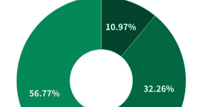

数据来源：2025年亚洲调查数据

### 观点六 精智人群将保险视作风险防范的经济映射
精智人群均保单持有量达2.14张，显著高于全人群。
精智人群女性人均持有1.52张，高于男性的1.35张，进一步证明了高收入家庭中女性在自身和家庭规划中发挥作用。
精智人群和全人群的保持量呈现典型的“倒U型”分布，在35-44年龄段达到峰值，精智人群为2.23张。

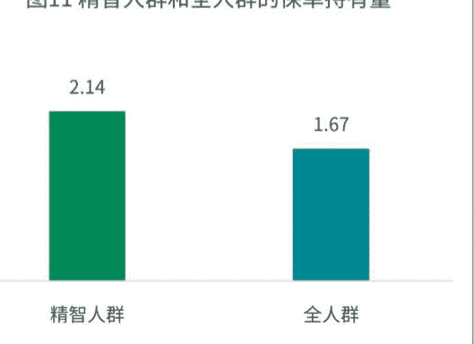
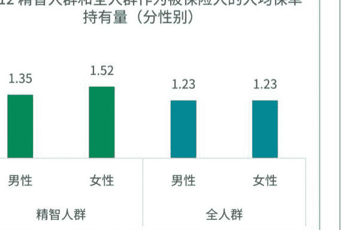
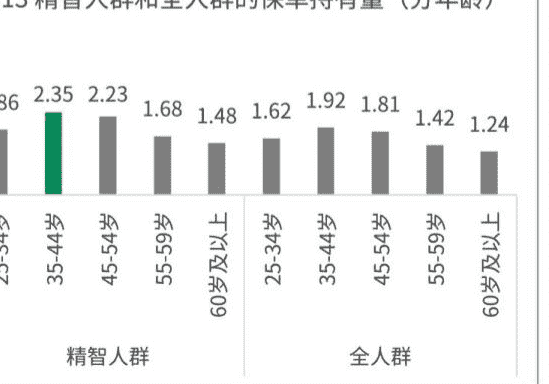

数据来源：中宏保险MOVE计划用户

### 观点七 精智人群在中宏保险MOVE的高参与率量化体现了主动健康管理意愿
01 精智人群在中宏保险MOVE参与率显著高于全人群，是其主动健康管理意愿的量化体现，也是源于健康意识升级且该服务契合其预防管理需求。
| | 参与率 |
| :--- | :--- |
| 精智人群 | 42.07% |
| 全人群 | 33.39% |

02 精智人群35-44岁群体参与率最高，凸显不同群体健康管理的驱动逻辑。

### 观点八 精智人群健康管理行为兼具普遍性和个性化，主动根据个体健康目标、生活习惯筛选管理行为
为了保持健康/延长寿命，您目前积极采取了哪些预防措施（精智人群选择前6）？
- 每年定期进行体检（32.58%）
- 每天保证符合健康专家建议的睡眠时间（30.32%）
- 服用维生素或其他营养补充品（28.71%）
- 每周进行符合健康专家建议量的运动（27.74%）
- 减少饱和脂肪和糖的摄入（26.45%）
- 食用有机食品/超级食品（26.45%）

平均3.92种，集中在3-6种。

数据来源：2025宏利亚洲调查数据样本

### 观点九 精智人群对健康管理指标具有较为全面的认知，且重视程度较高，定期检测关键指标，意识与行动相匹配
图15哪些指标是您目前定期关注的/重点关注的，判断自身身体健康状况或预测寿命？
| | 关注比例 |
| :--- | :--- |
| 睡眠质量 | 34.52% |
| 血糖水平 | 32.90% |
| 脉搏/心率 | 30.97% |
| 胆固醇水平 | 30.97% |
| 动能力（如步行能力） | 25.81% |
| 血压 | 25.81% |
| 体重 | 25.48% |
| 营养状况 | 24.84% |
| 平衡能力 | 20.32% |
| 肌肉质量 | 15.81% |
| 以上定期监测 | 9.90% |

数据来源：2025亚洲调查数据

### 观点十 精智人群将健康视为“长期资产”，精智人群愿意为预防（如高端体检、营养补充）花费。
为了保持健康/延长寿命
| 项目 | 比例 |
| :--- | :--- |
| 每年定期进行体检 | 32.58% |
| 服用维生素或其他营养补充品 | 28.71% |
| 食用有机食品/超级食品 | 26.45% |
| 每年超过5%的总收入用于健康生活方式的产品与服务 | 22.90% |

数据来源：2025宏利亚洲调查样本

### 观点十一 精智人群在健康行为中偏好效率与价值，活跃度指标完成少但健康权益更多，显著对其专业服务的导向。
| | 精智人群 | 全人群 |
| :--- | :--- | :--- |
| 人均完成步数挑战的次数 | 13.8 | 15.37 |
| 人均登录中宏保险次数 | 17.21 | 15.48 |
| 人均使用各种健康权益的次数 | 2.45 | 2.25 |

数据来源：中宏保险MOVE计划用户

### 观点十二 精智人群中男性活跃度及健康权益使用方面低于女性，而女性数字化习惯彰显健康管理中的主导地位。基于此，精智人群女性更频繁接触健康相关信息，而且善于利用权益工具将健康转化为收益。
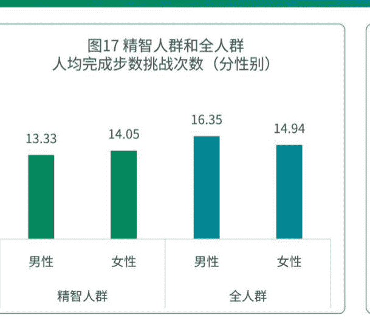
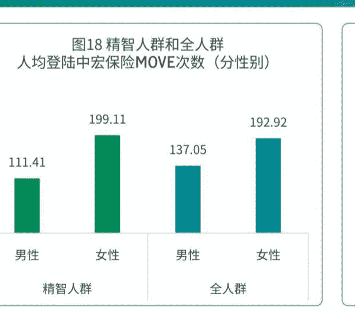
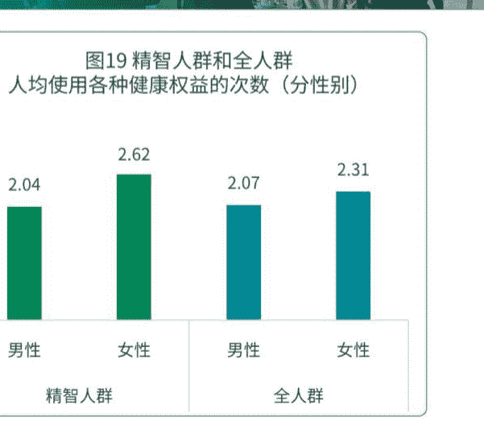

数据来源：中宏保险MOVE计划用户

### 观点十三 精智人群中35-44岁群体在健康行为指标上表现最佳，因其处于事业家庭双重高峰与健康临界点，危机意识和经济能力驱动其重视健康管理。
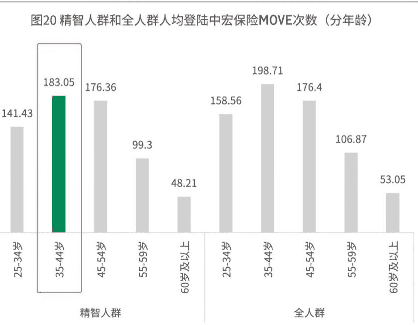
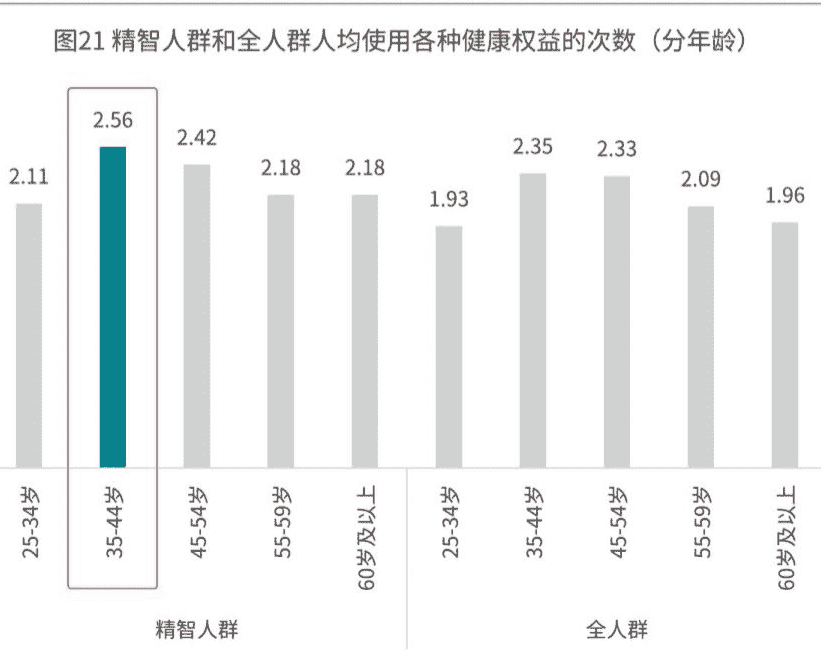

数据来源：中宏保险MOVE计划用户

### 观点十四 精智人群人均赔付次数及首赔后年均赔付次数均低于全群，这是其优质医疗资源获取、强风险防范意识与有效健康管理共同作用的结果。
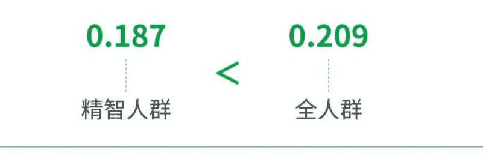

精智人群的人均赔付次数为0.187次，显著低于全人群的0.209次。从首次赔付开始的年均赔付次数来看，精智人群为0.052次，同样低于全人群的0.068次。

精智人群更低赔付率的原因：
- No.1 更优质的医疗资源
- No.2 更强的风险防范意识
- No.3 对健康权益更有效的使用

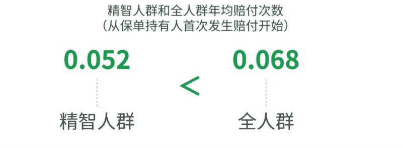

数据来源：中宏保险MOVE计划用户

### 观点十五 精智人群的保单赔付次数随年龄增长而上升，显露出健康风险自然规律的普遍性，而高收入人群借优优势能够有效应对
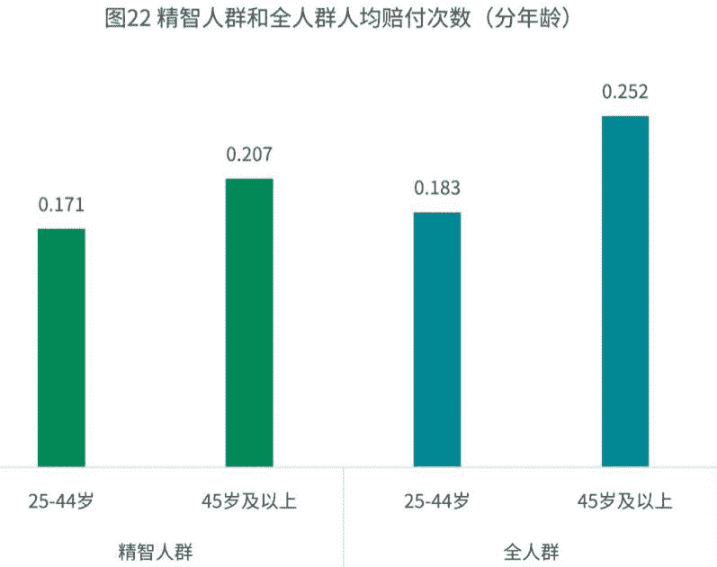

| | 精智人群 | 全人群 |
| :--- | :--- | :--- |
| 人均完成步数挑战的次数 | 13.8 | 15.37 |
| 人均登录中宏保险次数 | 17.21 | 15.48 |
| 人均使用各种健康权益的次数 | 2.45 | 2.25 |

数据来源：中宏保险MOVE计划用户

## 3. 精智人群长寿管理新闭环 - 健康预防新挑战

### 观点十六

92.43%的精智人群认为采取的预防措施很大程度足以以保持健康/延长健康寿命，但已采取健康预防行为在深度、可持续性仍存在显著不足。

图23 在您看，您目前采取的预防措施在保持健康/延长退休或老年阶段的健康寿命方面是否足够？

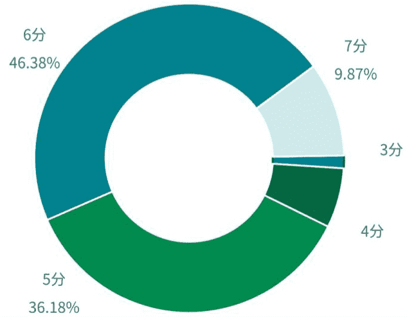

现有措施（如“与心理咨询师交流”）占比只有10%，每年定期进行体检仅32.58%）在深度、持续性上可能不足，说明精智人群对于当前健康框架，但未充分预测长寿阶段的特殊健康挑战。

注释：数据来源于中宏保险MOVE计划使用数据，图23使用1到7的数值范围，其中1表示“完全不够”，7表示“非常足够”

## 3. 精智人群长寿管理新闭环 - 健康预防新挑战

### 观点十七

精智人群收入提升后未面对预防性健康管理参与度，部分高收入群体行为为下滑，显现财富与健康投资意识未必正相关

表1 精智人群收入和健康管理行为（分月收入）

| | 高收入群体 | 更高收入群体 | 变化趋势 |
| --- | --- | --- | --- |
| 每周保持健康专家建议的运动量 | 30.45% | 20.96% | 减 |
| 每天保持健康专家建议的睡眠时间 | 30.49% | 23.33% | 减 |
| 减少饱和脂肪和碳水（例如蛋糕、糖、饼干、黄油）的摄入 | 25.67% | 20.62% | 减 |
| 用食用有机食品/超级食品 | 25.69% | 20.40% | 减 |
| 花费年总收入的5%以上购买于改善健康生活方式的产品和服务 | 20.02% | 12.99% | 减 |
| 坚持吃早餐 | 24.44% | 14.59% | 减 |
| 保持健康体重 | 21.56% | 14.63% | 减 |
| 使用维和其他补充剂 | 30.36% | 36.17% | 增 |

更高收入人群中，除了在部分行为（如服用维生素和其它补充剂）中有所提升，其他多数关键行为（如自我照护、合理饮食等）参与率反而低于高收入群体。

数据来源：2025宏利亚洲关注调查数据样本

## 3. 精智人群长寿管理新闭环 - 健康预防新挑战

### 观点十八

精智人群心理健康管理呈现阶段性阶段错配，各年龄段认知与行为存在差异，整体呈生命周期式演变需要对性干预

图24 精智人群不同年龄阶段认知 - 行动落差（心理健康）

| | 全样本 | 25-34岁 | 35-44岁 | 45-54岁 | 55-59岁 | 60+岁 |
|---|---|---|---|---|---|---|
| 01 | 7 | | | | | 10% |
| | 6 | | | | | 8% |
| | 5 | | | | | 6% |
| | 4 | | | | | | |
| | 3 | | | | | 4% |
| | 2 | | | | | 2% |
| | 1 | | | | | | |
| | 0 | | | | | 0% |

- 25-34岁：此年龄段认知水平较高，高度认同心理健康对生活质量和寿命的影响，且行为比例高，认知-行动落差小。
- 35-54岁：认知高位，同样重视心理健康的重要性，行动比例较低，以实际需求不匹配，落差较大，可能因家庭压力导致延迟延。
- 55-59岁：认知和行动水平相对均衡，由于年龄增长或社会支持缺乏，对心理健康的关注和咨询行为有所下降，但行动比例略回升，落差中等，显示出滞期需求。

- 认同心理健康对我能够理想的生活质量/生活方式有极大程度的影响，尤其是晚年/退休时期
- 认同心理健康对寿命有很大影响
- 咨询治疗的比例

数据来源：2025年宏利亚洲关怀调查样本

## 3. 精智人群长寿管理新闭环 - 健康预防新动能

### 观点十九

精智人群中健康管理活跃度指标上升带动健康保持持有量增加，充分显示健康预防意识与风险防范经济行动的联动效应，且这一效应在年轻群体和女性群体中更强

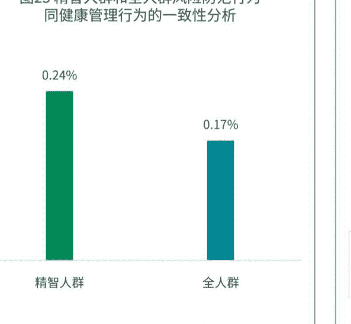
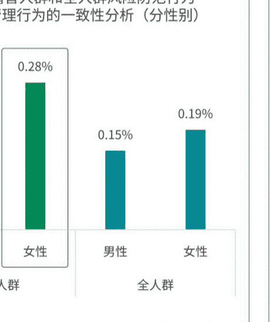
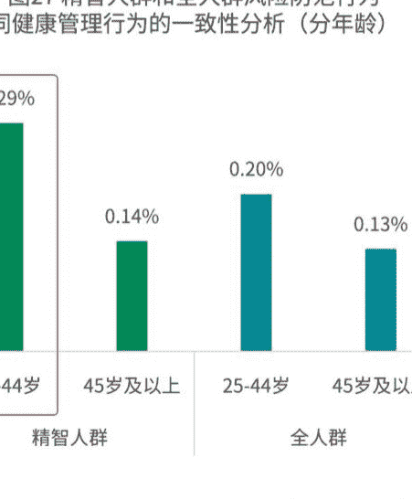

*数值含义：中宏保险MOVE参与者完成步数增加一次，相关的保持持有量提升
*数值含义：中宏保险MOVE参与者完成步数增加一次，相关的保持持有量提升
*数值含义：中宏保险MOVE参与者完成步数增加一次，相关的保持持有量提升
数据来源：中宏保险MOVE计划用户

## 3. 精智人群长寿管理新闭环 - 健康预防新动能

### 观点二十

精智人群主动健康行为对降低风险具有显著的积极作用，且这种作用在不同特征中呈现出不同的“效应”

| | 01 | 平均多完成一次步数挑战，精智人群人均付次数减少73%，全人群减少62% |
| | 02 | 精智人群中的男性，尽管其日常运动频率较低，但多完成一次步数挑战，人均付次数减少97% |
| | 03 | 60岁及以上积极进行健康管理的作用最强，精智人群中这类的付次数减少80% |

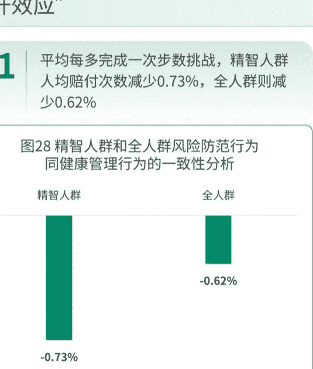
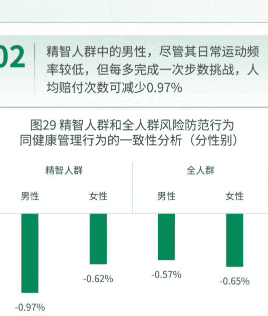
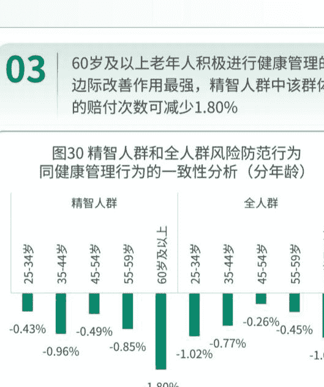

*数值含义：平均多完成一次步数挑战，精智人群人均付次数变化值
*数值含义：平均多完成一次步数挑战，精智人群人均付次数变化值
*数值含义：平均多完成一次步数挑战，精智人群人均付次数变化值
数据来源：中宏保险MOVE计划用户

## 3. 精英长寿管理新闭环 - 健康预防动能

### 观点二十一

精英人群在健康信息中专业，积极拥抱数字化信息化，且让科技对健康管理的助力

| | 图31 在获取有关健康与长寿的建议时，您最信任以下信息来源? | 图32 为维持或实现您现在/老年阶段理想的生活质量，您会考虑从哪些方面改变? |
|---|---|---|
| 网络上的新闻与信息 | 17.42% | 采用最新技术，例如健康监测设备和智能家居系统 | 43.87% |
| 电视和广播的新闻与信息 | 7.42% | 参与更多社交与社区活动，保持社会联系 | 39.03% |
| 报纸和杂志中的新闻和信息 | 6.77% | 改变您的工作安排以增加稳定收益，延长工作年限或推迟退休 | 35.48% |
| 医疗专业人士 | 31.94% | 增加健康与营养方面的投入 | 33.55% |
| 社交媒体上的意见领袖 (KOL) | 20.00% | 调整您的财务/投资计划 | 32.58% |
| 亲友 | 7.74% | 搬至适居条件更好或适合老年居住的地区 | 30.32% |
| 学术研究 | 8.71% | |

31.94%的人群信任“医疗专业人士”，社交媒体上的意见领袖(20.00%)+在线新闻和信息(17.42%)占比较高，反映出精英人群均衡数字化信息化渠道。

维持或实现退休/老年阶段理想的生活质量，43.87%的精英人群考虑采用最新技术，如健康监测设备和智能家居系统，显示他们对科技助力健康管理的认可和期待。

数据来源：2023宏利亚洲调查数据样本

## 3. 精智人群长寿管理新闭环 - 健康预防动能

### 观点二二

精智人群在生活质量提升上关注全方面的改变，且对专业健康管理服务兴趣浓厚，偏好更科学、更便捷的健康管理方式

图33 以下哪些健康方式是您感兴趣尝试的？

- 由专业健康管理服务机构提供的线上体检、评估与咨询服务 40.00%
- 由专业健康管理服务机构提供的线上营养、心理健康及智慧养老咨询服务 37.10%
- 参与线下健康公益活动、健康知识讲座等 36.13%
- 由专业健康管理服务机构提供的线上慢性病远程管理服务 35.16%
- 由专业健康管理服务机构提供的线下康复与护理服务 34.84%
- 由全科医生或医疗机构提供的线上问诊与医疗咨询服务 33.23%

## 3. 精智人群长寿管理新闭环 - 健康预防动能

### 观点二三

精智人群长寿阶段需求升级，从全周期支持，注重激励，寻求更富的场景

| | |
| 健康生活方式提供措施 | 35.16% |
| 与医疗服务合作 | 29.68% |
| 更多知识和教育资源 | 26.77% |
| 更多保障选项 | 26.45% |
| 仅海外可用的药物和治疗途径 | 26.13% |
| 用于预防疾病的先进工具（筛查） | 25.48% |
| 心理健康与咨询服务 | 23.87% |
| 健康教养服务 | 20.32% |
| 健身项目 | 17.74% |
| 辅助疗法（如中医、针灸等） | 14.19% |

35.16%选择“健康方式提供措施”，这表明精智人群对外部激励具有积极意愿。29.68%选择“医疗服务合作”，26.77%需要“更多知识和教育资源”。

数据来源：2025宏利亚洲调查数据

## 4. 精智人群财富保障新行动 - 财富规划

### 观点二四

精智人群对自身财富持有乐观，81.29%认为自己有足够的资金应对一生阶段，且财富规划涵盖生命周期，显示出合理性。精智人群中，绝大多数人对长寿财务准备乐观。35-44岁人群在股票(15.62%)、共同基金(15.18%)与债券(14.40%)的配置比例最高。45-54岁人群的资产分布稳健。55岁以上人群的存款占比显著上升至47.49%，权益占比下降

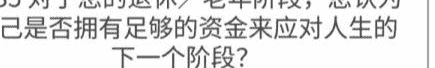

您目前如何在不同的产品类别/渠道中配置您的储蓄与投资？

| | 现金/储蓄/定期存款 (本币与外币) |
| --- | --- |
| 35.64% | |
| 14.48% | 股票 |
| 13.98% | 共同基金/单位信托 |
| 12.42% | 债券 |
| 23.40% | 储蓄型保险/年金保险 |
| 0.080% | 其他 |

| | 0.15% | 0.14% | 0.00% |
|---|---|---|---|---|
| 24.77% | 25.56% | 21.99% | 18.46% | 其他 |
| 10.14% | 14.40% | 10.00% | 12.22% | 储蓄保险/年金保险 |
| 12.74% | 14.16% | 12.68% | 11.84% | 债券 |
| 13.52% | 15.62% | 14.86% | | 共同基金/单位信托 |
| 38.68% | 29.11% | 36.31% | 47.49% | 股票 |
| 25-34 | 35-44 | 45-54 | 55岁以上 |

数据来源：2023宏利亚洲财富调查报告

## 4. 精智人群财富保障新行动 - 财富规划

### 观点二十五

在对未来重大财务问题的认知中，48.95%认为自己不会遇到重大财务问题，体现了其较强的财富掌控力与信心，但仍有41.05%认为60岁以上是财务风险高发期，呈现出对风险贯穿全生命周期的理性认知。

你认为自己未来大约在多少岁时可能面临大的财务问题？

| 3.16% | 6.84% | 18.42% | 48.95% |
| --- | --- | --- | --- |
| 40-49 | 50-59 | 60-69 | 70以上 | 不遇到任何财务问题 |

数据来源：2025宏利亚洲调查样本

## 4. 精智人群财富保障新行动 - 财富规划

### 观点二十六

为了应对资金不足的预期，96.5%认为需要对目前配置进行调整，12.07%的人将超过一半的无风险资产转投其他。在认为拥有足够资金的人中，绝大多数表现出较强的行动意愿。65.52%将大部分资金、储蓄或定期存款转投其他产品。

| 产品 | 比例 |
| --- | --- |
| 现金/储蓄/定期存款 | 33.23% |
| 养老金计划 | 24.19% |
| 房产 | 13.23% |
| 年金 | 10.65% |
| 股票 | 7.77% |
| 有定期分红/收益的共同基金 | 13% |
| 债券 | 5.81% |

## 4. 精智人群财富保障新行动 - 财富规划

### 观点二十七

83.87%的精英人群有专业的理财规划师，按照需求定制的财富规划，关注长寿的可持续性与适配性。精英人群对养老金提供的有关退休的增值服务更关注长寿的可持续性与适配性：

- 投资的长期潜力（32.26%）、定向投资和调整（31.94%）：追求增长的持续性；
- 根据需要定制退休计划（30.00%）、确保退休期间稳定的收入来源（29.35%）：强调退休规划的个性化与现金流稳定性；
- 养老金管理的透明清晰（28.71%）：管理透明化，消除长寿规划的信息黑箱，增强可控。

| 项目 | 比例 |
| --- | --- |
| 投资的长期增长 | 32.26% |
| 对投资进行定期监测及调整 | 31.94% |
| 基于个人需求的定制化退休计划 | 30.00% |
| 在退休期间保障稳定的收入来源 | 29.35% |
| 养老金管理的信息传递 | 28.71% |
| 投资组合多元化 | 25.48% |
| 从财富积累阶段顺利过渡到退休阶段 | 24.84% |
| 风险管理策略 | 23.23% |
| 获取专业技能的渠道 | 21.61% |
| 抵御通胀保障措施 | 20.32% |
| 税收效率高的投资策略 | 19.03% |
| 低费用且成本有效的管理服务 | 15.48% |

## 4. 精智人群财富保障新行动 - 长寿财富

### 观点二十八

精智人群对保险的风险保障和财富规划双重认知清晰，97.74%将在两年内增配保险，其中储蓄型配置比例将上升至92.58%

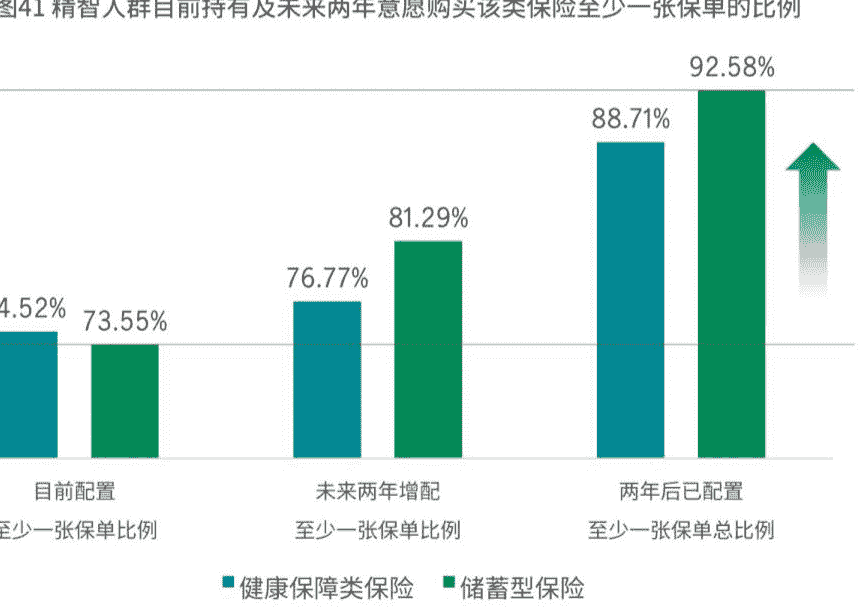

97.74%的人群在未来两年内增配保险，既补全保障的深度，拓展财富规划的广度。在储蓄型保险中，养老/储蓄保险成为精智人群的首选，远高于其他类型。且在未来两年的增配中，储蓄型保险持有比例增长幅度超健康保障保险（19.03%~14.19%）。

数据来源：2025年华利亚亚洲调查样本

## 05 | 政策与启示

## 政策与启示 - 精智人群群

实施“三早”长寿规划策略（早认知、早行动、早选择）

| 前置长寿阶段财富规划核心架构 | 退休保险配置 | 疾病保障兜底 | 现金流模拟测试 |
| --- | --- | --- | --- |

## 善用数字化工具破解“高焦虑 - 低行动”困境

| “激励 - 服务 - 反馈”闭环 | 保险激励 | 数字反馈 | 将预防意愿转化为固定习惯 |
| --- | --- | --- | --- |
| 同龄人健康管理社群 | 群体监督 | 共享资源 | 降低单独行动的心理成本 |

## 构建周期心理健康防御体系

| 心理健康管理流程 | 定期筛查 | 短期干预 | 长期跟踪 |

# 谢谢观看

新经济时代精智人群长寿新旅程
