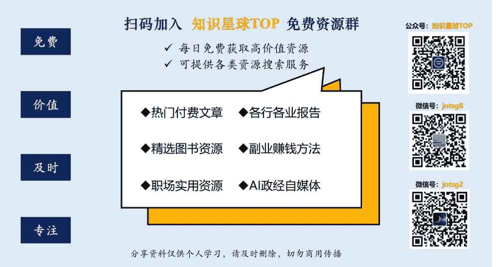
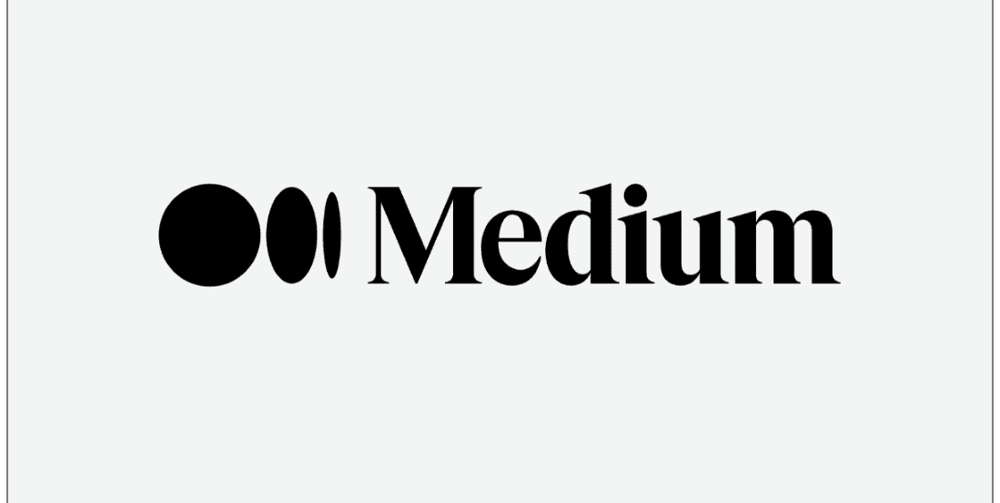

# Medium 绝求生

# 250717 新闻实验室

做支持优质内容生产和消费的平台，又多了一个未能实现野心的案例。

新闻实验室会员通讯 (856) Medium 绝求生

## 你还记得这个网站吗？

它曾经是互联网上最纯粹、最优的写作平台之一。大概在2012-2017年间，Medium经历了它最辉煌的几年，一度成为那些拥有重要信息和观点分享的写作者们的线上家园。

然而，近年来，Medium却陷入了前所未有的困境。你可能已经很久没有听说过这个网站的名字了。

好在，正如现任 CEO Tony Stubblebine 在几天前的一篇长文中写，Medium已经走出了危机，算是活过来了。

公司的起起落落，也是互联网内容生态及商业局的一个缩影。本期新闻实验室会员通讯，我们就基于这篇长文，对 Medium 绝地生存的过程做一个深入的了解。

## “辉煌到困境：Medium 如何掉进深渊”

Medium 创立于 2012 年，创始人 Evan Williams 还曾是 Blogger 和 Twitter 的联合创始人。他创立 Medium 的最初动机，正是希望在 140字的 Twitter 之外，建立一个可以进行长文写作和分享的平台。

按照 Tony Stubblebine 的说法，Evan Williams 在 Medium 带领两个重要时期。第一个是“设计时代”，也即从无到有了一个写作平台，让写作、发表和阅读的体验得到了极大的简化和美化，很多人使用 Medium 正是因为它提供了一种良好的体验。第二个时期是“新商业模式时代”，也即 2017 年开始建立付费墙，在广告模式之外寻求激发优质内容的商业模式。

推出付费墙的时候，Medium 给出的定价是 5 元一个月，可以通览全站所有文章。而发布文章的作者，每篇文章得到的报酬是一个固定的数额，与阅读无关。

为了让 Medium 上有足够吸引的文章，公司雇了一支经验丰富的媒体高管和编辑大军，然后联系稿人创作了数千篇专业制作的文章。在这种模式的激励下，付费会员数量一度增长到超过 76 万。

然而，正是这种商业模式让公司开始陷入深困。Tony Stubblebine 总结说：事实证明，既要变得更好，又要服务读者和作者，还要成为一种可持续的生意，同时抵制骗子、营销号和网络喷子，这实在是一件几乎不可能完成的任务。

一个重要的原因应该是钱：会员的付费无法支撑巨大的内容生产开销。更何况，这种模式还打击了一群作者的士气。那是因为，在这种付费商业模式下，公司的战略逻辑是：只有最高质量的内容，才会吸引人们付费，因此 Medium 应该通过付费大量专业作者，来提供这种高质量内容。

可是，当时的 Medium 已经有 5 年的积累，有一批非专业作者在上面活跃内容，尽管这些内容可能质量不参齐，但这种社区氛围是良好的。有了付费墙之后，这些非专业作者们感到：专业人士把“氧气”都吸光了，所有的注意力、资源都分配到了他们身上。

回过来看，Tony Stubblebine 认为，Medium 最好的时候，是为那些不试图为专业内容创者提供平台的非专业的声音往往能说出最有价值的故事。他觉得，互联网不仅为媒体专业人士、网红、骗子和营销号服务，也必须有一个地方供普通用户分享自己的心所想和日常感。

烧钱佣专业人士撰写高质量内容的模式，到 2022 年左右再也以为继。Medium 当时的做法是：向站内的内容生产者撒钱，激励他们出优质内容。可是，这样的内容激励计划同样行不通，因为它吸引了大量骗子的营销号，它们让 Medium 变成了一个充斥标题党和低质内容的平台。

Tony Stubblebine 的文中甚至提到了当时的营销号们流行的一种做法：找一篇维基百科文章，给它加上一个耸人听闻的标题，将内容改成流量目的、几个字起一段的脑残体，这样篇文章甚至可以在 Medium 上赚到 2 万。

这样的状况当然更令 Medium 的员工们绝望，大家一度怀疑：如果只是营销号送钱，我们为什么还要上班？

## “破产边缘的挣扎”

2022 年 7 月，Tony Stubblebine 从 Evan Williams 手中接过 CEO 的职位——后者成为董事会主席。

上任的 CEO 面着双重任务：修复内容质量和修复财务状况。当时，Medium 的财务状况岌岌危，每月亏损 260 万美元，而且在不断失去付费会员。也就是说，亏钱不是因为公司在发展业务，而一边亏钱一边筹备。

投资者当时基本上对 Medium 已经放弃了——对他们来说，投资失败是非常正常的事情，所以他们也没有什么兴趣让 Medium 爬出深渊。公司当时欠着这些投资者 3700 万美元的逾期贷款，意味着公司在纸面上资不抵债。

投资者还持有额外的 2.25 亿美元清算优先权——这是最常见的创业投资条款，目的是让投资者在员工得到回报之前收回他们的投资资金。对于当时的 Medium 来说，这相当于告诉员工：即使你们继续努力多年，终于 Medium 赚钱了，赚来的钱也会 100% 流向什么都不用再干的投资者，而不是累死累活的员工。

这显然是一件需要改变的事情。然而，员工没有士气去努力工作。身为 CEO，Tony Stubblebine 将继续受到投资人的限制——对于重大决策，他需要获得五个不同投资者群体的多数票，即便这些投资者早已放弃了这家公司，甚至正在考虑将他们的持股出售给专门收购垃圾股份的。

更复杂的是，Medium 还拥有并经营另外三家公司。面对如此复杂且令人绝望的局面，Tony Stubblebine 得到了一个最好的建议：不要做英雄。也就是说，不要去发明新东西、新方法，因为即便再好的新东西，即便有超强的执行力，也可能被这些投资者中的任何一个突然破坏。

总之，Medium 自救的方法不是推出新的商业模式、新的产品，而是在现在的环境下寻找出口。

## “绝地重生：从月亏 260 万到月盈 7 万”

2024 年 8 月，Medium 实现了盈利。自此之后，公司一直保持盈利，他们将部分利润用于储备，大部分则重新投资于改善产品。Medium是怎么做到的？

首先是重新调整资本结构（recapitalization）。简单来说，就是要投资者同意放弃自己的一些特殊权利，如清算优先权和治理，只有这样员工才能带着公司前进。此外，原有投资者的股份会被大幅稀释——比如，之后可能只拥有 1%。

那么，为什么投资者会同意割肉？原因有三：
- 第一，当时的 Medium 看上去已经是死局，如果不割肉，公司起码还有点希望。
- 第二，Tony Stubblebine 说：如果不接受割肉，管理层就会集体辞职。
- 第三，市场很低。如果市场不好，投资者也知道根本卖不出去，所以没有别的选项：割肉，或者放手。

值得一提的是，在这个过程中，持有股权的初始员工也被割了。Tony Stubblebine 打电话给他们：其实手上的股权可能不值，割肉的话意味着他们工作不会白费。

这次 recapitalization 的过程好像新一轮融资。除了重组之外，Medium 走出困境必须实现盈利。他们做了三件事：
- 首先，通过内容质量控制，止住了用户数量下降的趋势。
- 其次，优化服务器成本从每月 150 万减到了 90 万。
- 第三，Medium 的员工从最高的 250 人减少到了现在的 77 人。他们退掉了旧金山的一个 120 个座位的办公室，租金是每月 1.5 万。但是并不容易，因为疫情，包括 Medium 在内的很多科技公司都转向了远程办公。

总结而言，Medium 绝地求生的故事不是英雄大片，而是一个如何商业模式创新的故事。最辉煌的时候，Medium 的估值曾高达 6 亿美元，而现在，Tony Stubblebine 透露：Medium 已经盈利了，而很多高估值的创业公司还在亏损。这的确是一个成就。毕竟，Medium 的影响力已经萎缩，也不被视为某种成功模式的代表。
