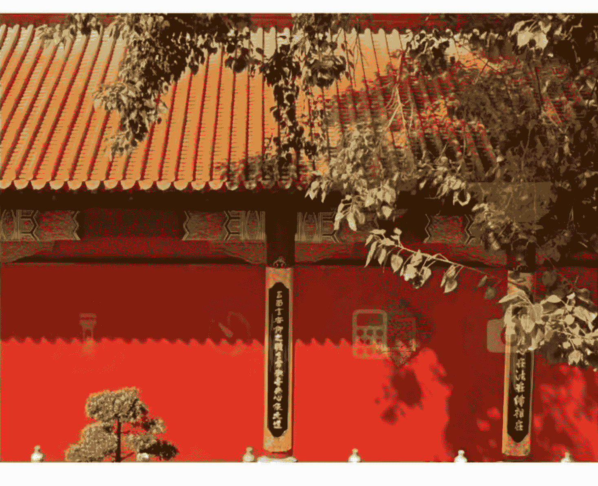
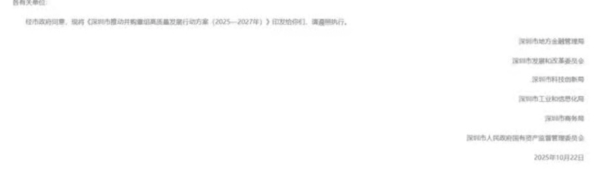

# 2025–2027 已付费

原创 轻风吹阵 无送亦迎

2025年11月22日 04:38 广东 3人 星标

# 声声哗阵

任铜

最近看似运气不错，逆势走强。

其实还是因为足够的动态逻辑支撑。当然，也要感谢老老爷子助力。

今天，把这段时间不断动态挪仓的深层原因发出来。进群加微信cuk255

# 深圳2025–2027

老人当年画了一个圈，引发了春天的故事。

作为全国的排头兵，以画线为第一要素的城市——人气选择，带着自己的钱，持仓不断增加含量、国资、创投方向，支持弄潮。

南方热烈，生生不息。进群加微信cuk255

就这么简单。

> “一纵直生死地，离岸自信自在光”

喜欢作者

597 人付费 >

无送亦无迎 91 26 4 7

# 深度视野优质集团（链接优质社群，助你成功）

全部包含以下内容：限时年费188/年 加微信cuk255

- ① 吃瓜群众倍帝时圈加时群对话 (原价 365 元/年)
- ② 子明私享汇（含）内部文章
- ③ 政事室（顾子明）付费内容加送顾子明群聊
- ④ 米联储闲兜【作者米穗】(原价 599 元/年)
- ⑤ 欧洲金雀会员专属文章 (原价 328 元/年)
- ⑥ 砖瓦斥内部文档 (原价 400 元/年)
- ⑦ 卢克文青读书会专属文章 (原价 699 元/年)
- ⑧ 鉴茶财经知识星球 (原价 3310 元/年)
- ⑨ 猫哥的视界知识星球文章 (原价 299 元/年)
- 10 财经周刊【独家新闻】(原价 1498 元/年)
- 11 杨世光在金钱爆 (原价 2200 元/年)
- 12 森淼财经知识星球 (原价 1600 元/年)
- 13 潇漾异译付费文章（持续更新）
- 14 司马林解课牟选全套音频和全套书籍版权无损减 (原价 2.3 万)
- 15 虚构三部曲[民国梦、帝国战争、不被理解的 MAO] (原价 599 元)
- 16 卢克再送：星球文章 (原价 268 元/年)
- 17 额外加送：卢祺新浪浪爆付费专栏、三村丰老王、三花九洞文集

不定内容：......（更多资源下去了）......

- ① 守夜人司令星球、接换魔王后星球、成达谈论星球、成术财富、雪光花甲老头等
- ② 创始笔记、达叔谈论星球、成术财富、雪光花甲老头等
- ③ A 视野、大树乡谈、江初序、咩咩说、上海海家学等付费文集
- ④ 西凤付费文章、老端、赢在小时之外、局外人的视界、升值、老体制内等等一些 V 付费文章（每月不超过 600 元的付费文章）

深度视野（付费文集）
进群微信cuk255

