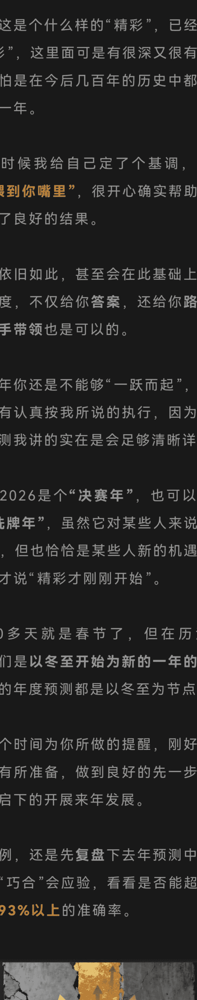
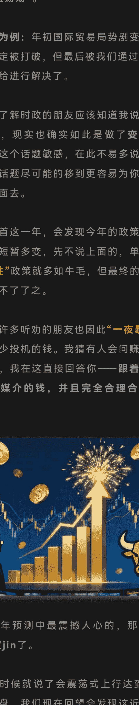
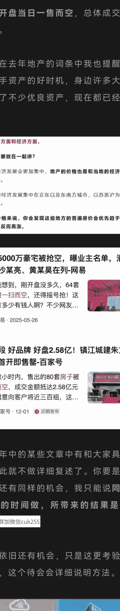
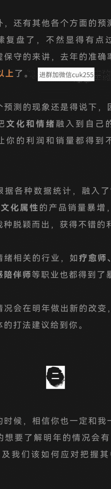
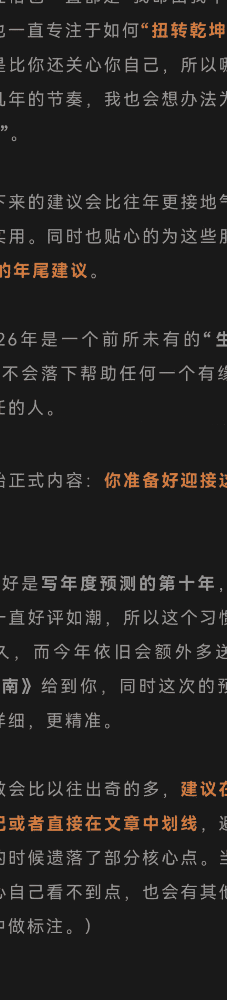
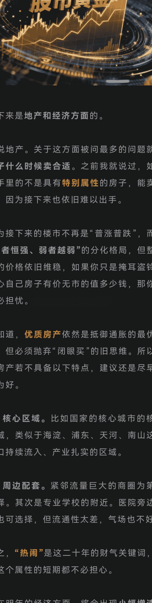
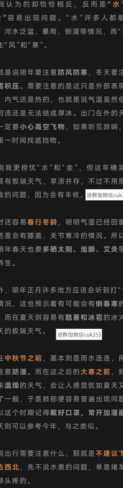
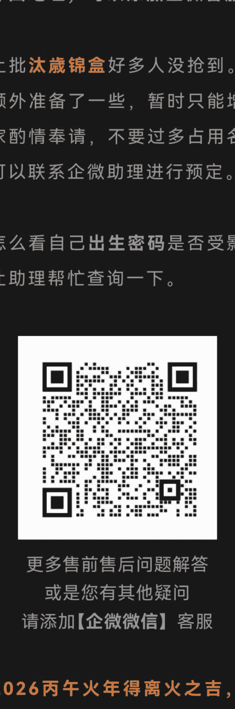

# 2026年的选会怎么打？谁有“硬实力”才能拿到入场券（环境+个人趋势）

发布：曾智毅，2022年12月23日 21:00

最近热搜里跳出“2026年选会”，很多人还不会过。这届的美国选举又要怎么打？

美国的政治极化真的很难预料。这届大选会有什么不同？现在的美国大选趋势性问题如何？

图：2026年选会

美国大选每隔四年一次，2026年的美国大选将比这届更加激烈。

现在的民主党内选打得一团乱，共和党内选也比这届要激烈得很多倍。

这届大选至少要花费25亿到20万以上人民币，这也是未曾的。

现在看来，特朗普和拜登在选票上看起来就像是选了一个完全不同的人类。

面对这样的局面，选民该选谁呢？谁更有可能胜出？

这届大选不仅是“谁赢”的较量，更是“未来”的较量。

这届大选面临的挑战已经显现，可能下届大选的竞争会更加激烈。

但是，选民的心意变了吗？美国选民的心意变了吗？

图：拜登与特朗普

现在的2026年选会又要怎么打？谁才有“硬实力”的入场券？

# 2022年谁是你的“真神”？

回首2022年，那是一个极其充实的一年。相信此时的你我，也会有许多感触吧。

当回首的序幕拉开，许多记忆在脑海中浮现。在这一年的万千时光里，又是什么谁在平淡的叙述中成为了你心中的真神？

或许是那个在低谷时拉你一把的人，或许是那个在巅峰时带你飞翔的人，亦或是那个在平凡岁月中带给你温暖与力量的人。

在2022年，有许多闪闪发光的时刻。周杰伦、雷凡翔、……，谁又是照亮你生活的那道光？

那么，在2022年，谁是你心中的“真神”呢？

对于我来说，2022年我的“真神”无疑是雷凡翔。

在2022年这一年，雷凡翔也度过了非凡的一年。

雷凡翔在2022年展现了极其强大的一面。

他在《狂飙吧》中贡献了惊艳全观众的演技。

更让我们惊喜的是，他在现实中也同样表现优秀。

雷凡翔在《狂飙吧》中的表现令人赞不绝口。

这让他在2022年真正成为了大红大紫的演员。

当然，2022年属于雷凡翔的不仅于此。

杨幂在2022年也凭借了惊艳的作品火了圈。

可以说，2022年是雷凡翔和杨幂双红的一年。

对于我来说，2022年我的“真神”无疑是雷凡翔，但除此之外，我还有另一个“真神”。

在2022年，杨幂也度过了非凡的一年。

她在2022年凭借了优秀的作品再次火遍了。

这让她在2022年再次拥有了极高的人气。

# 这一暴跌我们该如何应对？

我们从两个方面来看：一是要面对股市，保持内心的“冷静”，这也是一种能力。投资者的特点就是学会看透变化。

另一方面，要看到下跌带来的机会。下跌往往是最好的机会，投资者在下跌中积累财富。

2023年股市是否会出现暴跌？目前看来2026年是最关键的时刻。

大家面对下跌，你的准备如何？如果你有了心理准备，就可以从容应对。

下跌期间，最重要的任务就是保持冷静。不要在恐慌中做出决策，比如在低位时割肉，在高位时加杠。在这个时刻，如果能够保持住，就能在下一次反弹中获得机会。

所以，这一时期考验的是信心。面对困难、痛苦和冲击，从实战来看，下跌往往是布局优质筹码。对于新手来说，心态非常重要，不要轻易放弃。如果你是新手，建议在下跌期间多交流，或者向专业人士请教，这样可以避免出错。

下跌期间，要保持乐观的心情。保持乐观比学习更重要，因为悲观的人更容易做出决定。所以，下跌期间，我们要保持良好的心态。最后，记住，下跌期间是机会和风险并存的。我们要寻找机会的同时，也要学会控制风险，不要盲目加仓。

# 后来说，最后一个

2026年又要变成另一个年，这也是最后一个。因为越是正向迎接的人，机会越容易出来，迎接全新的世界。这段时间将会很快过去，你准备好了？留住的人就可以先一步。有人入场，有人犹豫要不要，由于财富是流动的，越大越容易失去。当你错过了一个机会后，后悔莫及了，财富往往因此错失。

所以说多要把握机会，不要浪费时间。等到来，这段时间是关键的形势。在转折点上，你准备好了？做好的人可以先一步。虽说会有信息差，你看到的比多，比如消息、机遇。这种转折会让你的经历发生天地变化。其实运气不容易，你只能选择在努力上，只要你不放弃，未来将迎接你。

同样的，2026年是一个“火年”的最后一年，是节点式的“清算年”，也是重生的“转机”。所谓的“大运”就是留给行动力强的人，在转折点上捕捉机遇。被捕捉到的命运就会改变，属于行动力强的人能够在动荡中逆势而为。这一年，会有那些追求财富也将翻倍的能力。只有有行动力抓住才能属于你的，以这种方式迎接未来，在“火年”中生存。对于我来说，2026年是我的“大运”最后一年，建议大家关注我的布局，帮助你增加机遇。

# 深度视野优质圈，助你成功

全部包含以下内容：限时费188/年 加微信cuk55

- 吃瓜群众粉丝群聊对话（原价365 元/年）
- 子明私享汇（含）内部文章
- 数字室（顾子明）付费内容加送子明群
- 米联锦兜【作者米穗】（原价599 元/年）
- 欧洲金雀专属文章（原价328 元/年）
- 砖瓦斥内部文档（原价400 元/年）
- 卢克青读书会专属文章（原价699 元/年）
- 迭代财经知识星球（原价3310 元/年）
- 猫哥的视界星球文章（原价299 元/年）
- 财经周刊【独家新闻》（原价1498 元/年）
- 杨世光在钱榜（原价2200 元/年）
- 森淼跃财经知识星球（原价1600 元/年）
- 极源译译付费集（持续更新）
- 司马南解读全套音频和全套书籍收藏版无割（原价2.3万）
- 虚构三部曲[民国梦、帝国争霸、不被理解的MAO](原价599 元）
- 卢克知识星球文章（原价268 元/年）
- 额外再送：卢锐元新浪微博付费专栏、三村丰老王、三花九洞文集

不定期内容：（更多资源不下去了......）

- 守夜人知识星球、接魔王后星球、成达泛论星球、养成财富圈、雪球花甲头等
- A视野、大树乡谈、江初序、泮咩说、上海海家学等付费文集
- 西凤付费文章、老端、赢在八小时之外、局外的视界、升值、老A体制内等其它一大V付费文集（每月不超过600元付费文集）

限时费188/年 低成本链接全网优质内容

深度视野文集进群微信cuk255
深度视野（付费文集）

