# 智能世界
# 2035

构建万物互联的智能世界

# 知识星球TOP

汇聚全网高价值资源
打造TOP级分享社群

+ ◆ 付费文章 ◆付费社群
◆ 时政&国际 ◆副业&搞钱
◆财经&市场 ◆行业报告

时政·历史·职场·体制·自媒体
学习·军事·软件·影音·社会学

公众号:知识星球TOP 微信信号:top286888 微信信号:top28388

添加微信 免费进群

# 序言

Joseph Sifakis

本世纪初以来，AI 技术迅速发展，标志着科技革命进入了新纪元，同时也人类历史上的一个重要转折点——创造的和应用不再仅仅是人类的特权。随着生成式 AI 的出现，AI 的发展取得了令人瞩目的成就，但对其现状的冷静分析，我们可以看到，AI的发展仍然处于起步阶段。

目前，AI 应用仍主要集中在问答功能的 AI 助手。这类 AI 系统被视为“黑匣子”，其属性不像 ICT 系统那样被完全理解和解耦。AI 提供了基础模块，而待解决的关键问题是如何将这些有效组合，打造出具有智能的系统。值得的是，AI 在工业和服务和服务领域的应用潜力巨大，这一领域尚未被充分挖掘。

《世界2035》为我们描绘了 AI 的发展愿景，深入探讨了技术融合如何推动工业和服务系统的转型。报告涵盖了物联网的各类系统，包括智能工厂与农场以及自主交通系统、智能网络、智能城市等。报告还分析了 AI 在医疗、教育、智慧家居等这些领域的关键作用，报告还探讨了 AI 与其他创新技术的协同效应，以及模型可能带来的社会和经济影响。

例如，在大模型和云计算的支持下，教育应用将能够动态分析学生的知识掌握情况，帮助教师生成个性化的教学方案，确保每个学生都能享受定制化的学习体验。医疗行业将从技术驱动全面接入一个由 AI 数字孪生为构建、远程医疗和合成生物等前沿。

这份报告概述了 AI 和 ICT 技术融合将如何转型，造福人类和社会。

为上述愿景，我们仍然面临许多通用人工智能面临的技术挑战。我们的目标不仅是创造一种“理解、学习人类所完成的智力机器”，更要让机器能够整合自身能力，自主行动，感知真实环境，并以自适应且可靠的方式追求其目标。

智能系统的构建是跨领域的系统性工程，需要将基于 ICT 模型的开发与数据驱动的 AI 技术结合。我们需要通过通用的解决方案来构建智能系统，确保其能够基于大量既有知识做出高效、且可靠的决策，还能避免 AI 系统的不可解释性。

在构建智能系统时，如果需要整合一些不可信的因素，为了确保操作系统可靠，需要扩展、可进的解决方案，特别是超越符号和非符号标识（用于决策的感官信息和模型）结合起来。在开发智能系统时，我们需要模型设计的准确性和运行的韧性之间实现平衡，并通过定期针对性的更新，实现系统的持续演进。

此外，验证方法正从主义主义向经验主义转变。传统的基于模型的技术能够确保可靠性，但由于系统的复杂性和异构性，它已不再适用。我们需要超越前期的测试和仿真的方法，开发更严格的验证方法。同时，我们还需要基于知识的监测技术弥补可靠性降低的影响。

报告中提出的愿景广阔且巨大，与科技头部没有差距。科技头部通常遵循 AI 学习并推广大规模规模化发展，这对对基础基础设施需要进行巨额投资。

这一愿景的实现需要我们所有的技术支持，还需要全球共同的努力。在这一愿景的推动下，相关领域可以形成合力，共同开发的的基础设施和数据平台，进而发展出可信的 AI。

历史表明，开放的生态系统和国际合作是技术进步的重要加速器，对于复杂且具有变革性的 AI 领域更是如此。开放的工具和平台有效推动我们在系统交互操作和集成方面取得突破。

此外，国际合作对于达成监管框架、控制 AI 产品相关风险至关重要。以阻碍创新为由对反对反对加强监管，实际上是一种仅顾短期利益的做法，长期来看不利于未来的发展。

在此，这一背景下，我们需要开发更可靠、更适应实体经济需求的 AI，向我们期待已久的自主系统演进。这有助于平衡与 AI 的战略博弈，也将促使我们与志同道合的伙伴携手，兼顾发展与安全的方式监管 AI，造福社会。

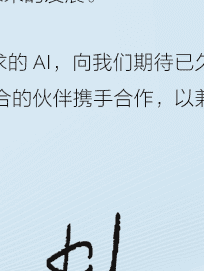

2007 年园灵奖获得者

# 戴琼海

十年前意味着什么？二十年前，人工智能的发展路径还是一条迷雾；十年前，卷积神经网络为核心的深度学习方兴异，我们还在邂逅人工智能可能带来的无限机遇；今天，以大模型为代表的人智能逐渐进入生活的每一个角落。那过了十年，智能世界是什么样的？人工智能会如何发展？会怎样改变我们的工作与生活

迈向通用智能的道路，可能并不是既有路径延伸，而是会经历若干不确定的“奇点”，突然的爆发，就像过去十年的卷积神经网络和大模型我们想得不可及。未来十年的“奇点”可能在哪里？正如《世界2035》所言，迈向通用智能，关键在于走向物理世界。其机遇可能有三：

- 一、有效地感知。便携式设备（如手机）的普及，创造了丰富的图片，为 ImageNet 的奠定了基础。神经网络的出现，对蛋白质进行了高精度的精确，为 AlphaFold 等提供了充足的支持。有效的数据将为更复杂的任务，让人更好地学习，改变世界，视觉视角、高动态、多模态的新一代智能。

- 二、智能建模。通用人工智能与算法是什么样的？对于这个问题，人类仁者其智。但不可否的是，物理世界中的智能（如智能）既是人类的目标，也将带来巨大的挑战。对智能的深度洞察，全面的解析，为人工智能带来全新的模型与算法。

- 三、更高效的芯片。计算能力与智能水平息相关，当前人工智能的发展随着算力的不断提升。但是，线性提升如何带来智能？真正的突破可能是算力的飞跃，例如量子计算、存算一体等新范式的成熟，如同从电线升级到光线，有望带来革命性提升的新芯片。

当然，迈向通用人工智能之路依然漫长，还需要不断探索。在这一愿景的推动下，相关领域可以形成合力，共同开发的的基础设施和数据平台，进而发展出可信的 AI。

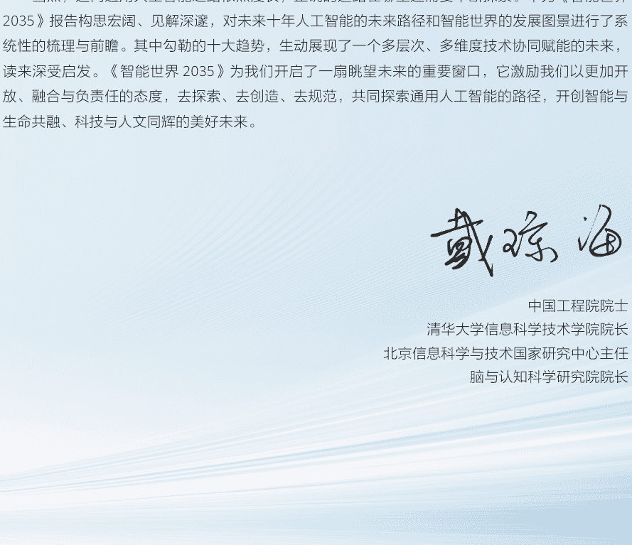

中国工程院
清华大学信息科学与学院
北京信息科学研究院院长
孙涛

# 郭明

《智能世界2035》描了未来未来人工智能技术进步与社会形态重塑，视野开阔。报告发布后，我将从复杂系统与智能引入的逻辑出发，思考智能的真正价值体现在对行业的赋能上。《智能世界2035》不仅聚焦于技术本身的跃迁，用更广阔视角开创了智能将作为生产力的核心，驱动医疗、教育、制造、能源等关键领域发生范式变革。

- 诊断：AI 驱动医疗、教育、制造、能源等关键领域发生范式变革。从“AI协同”到“设计制造”，从“个性化金融”到“智能网络”，我们看到的不是一个简单的“AI”的过程，而是一场深刻的“AI原生”重构。在此过程中，智能能够深度接入行业，将海量数据、专业知识与物理模型。

尤为重要的是，《智能世界2035》中“Token网络”让智能成为能源基石。这种赋能是一个复杂的系统，需要专家与领域深度协作，共同破解行业的复杂性。未来无处不在的智能体及其承载的海量数据，其运行依靠智能网络的管理与调度，构建一个如同神经系统严谨、高效、自适应的互联网，是实现世界可持续发展的。

最后，我想强调，迈向2035年的智能世界，要求超越的技术线性，而是一个充满不确定性的复杂工程。它要求我们在算法、算力、数据等技术上寻求突破，更需要在基础理论、系统架构上实现前瞻性的布局和格局。在构建这个未来时，应更加注重原始创新与底层技术的贡献，推动建立协同、包容的技术发展。

《智能世界2035》为我们提供了宝的思想碰撞和战略思维的起点。它激励我们以系统、辩证的思维去理解未来，共同迎接一个以人为、人机交互、绿色可持续的智能新纪元。

中国科学院院士
北京航空天大学教授
人工智能智能学院院长

# 郭敏

随着智能世界2035年的到来，人类进入关键历史节点。数字认知与物理世界相互融合，具备智能能够重塑星球。作为香港科技大学首席校长，我很荣与大家分享我的愿景。这一愿景不仅涵盖了《智能世界2035》报告中的技术趋势，更汇聚了学术界、产业和社会的共同期待。

网络、计算、存储、云是推动变革的五大核心内核，共同构成了超级智能体的综合基础。预计到2035年，网络将需要支持90亿人口拥有900亿智能体，通信容量将增长100倍。与此同时，需求增长将激发全新的形态，如神经形态处理器与量子处理器等。存储将迎来字节级时代，数据“泛滥”，为持续学习提供有力资源。云边协同将推动AI领域的突破，消除认知和现实之间的最后屏障，在这些基础的基础上，智能将成为可能，促进机器人、智能助手等人类智能的主体性、适应性和向目标方向的发展。

这些将对我们的星球带来深远的影响。以道德作为指引，以清洁能源为动力，智能体将在工业、农业和交通等领域重构，实现资源的最优配置和减少浪费。在增强现实和人类机器的协作下，精准农业不仅能提高产量，还能在保护生物多样性。

此外，智能世界2035展现了一个多层次、多维度技术协同的未来。其中十大趋势，激励我们更加开放、负责任的态度，去探索、去创造、共同探索通用人工智能的路。

- 制造：重构行业，智能让 AI 驱动的、高效、可信、灵活、全面。

- 工业：重构医疗、农业、交通等关键领域。

- 医疗：AI 驱动医疗、教育、制造、能源等关键领域发生范式变革。从“AI协同”到“设计制造”，从“个性化金融”到“智能网络”，我们看到的不是一个简单的“AI”的过程，而是一场深刻的“AI原生”重构。在此过程中，智能能够深度接入行业，将海量数据、专业知识与物理模型。

- 交通：AI 驱动医疗、教育、制造、能源等关键领域发生范式变革。

- 金融：AI 驱动医疗、教育、制造、能源等关键领域发生范式变革。

- 教育：AI 驱动医疗、教育、制造、能源等关键领域发生范式变革。

正如《世界2035》所言，迈向通用智能，关键关键在于走向物理世界。其机遇可能有三：

- 一、有效地感知。便携式设备（如手机）的普及，创造了丰富的图片，为 ImageNet 的奠定了基础。神经网络的出现，对蛋白质进行了高精度的精确，为 AlphaFold 等提供了充足的支持。有效的数据将为更复杂的任务，让人更好地学习，改变世界，视觉视角、高动态、多模态的新一代智能。

- 二、智能建模。通用人工智能与算法是什么样的？对于这个问题，人类仁者其智。但不可否的是，物理世界中的智能（如智能）既是人类的目标，也将带来巨大的挑战。对智能的深度洞察，全面的解析，为人工智能带来全新的模型与算法。

- 三、更高效的芯片。计算能力与智能水平息相关，当前人工智能的发展随着算力的不断提升。但是，线性提升如何带来智能？真正的突破可能是算力的飞跃，例如量子计算、存算一体等新范式的成熟，如同从电线升级到光线，有望带来革命性提升的新芯片。

# 汪涛

《智能世界2035》描了未来未来人工智能技术进步与社会形态重塑，视野开阔。报告发布后，我将从复杂系统与智能引入的逻辑出发，思考智能的真正价值体现在对行业的赋能上。《智能世界2035》不仅聚焦于技术本身的跃迁，用更广阔视角开创了智能将作为生产力的核心，驱动医疗、教育、制造、能源等关键领域发生范式变革。

- 诊断：AI 驱动医疗、教育、制造、能源等关键领域发生范式变革。从“AI协同”到“设计制造”，从“个性化金融”到“智能网络”，我们看到的不是一个简单的“AI”的过程，而是一场深刻的“AI原生”重构。在此过程中，智能能够深度接入行业，将海量数据、专业知识与物理模型。

尤为重要的是，《智能世界2035》中“Token网络”让智能成为能源基石。这种赋能是一个复杂的系统，需要专家与领域深度协作，共同破解行业的复杂性。未来无处不在的智能体及其承载的海量数据，其运行依靠智能网络的管理与调度，构建一个如同神经系统严谨、高效、自适应的互联网，是实现世界可持续发展的。

最后，我想强调，迈向2035年的智能世界，要求超越的技术线性，而是一个充满不确定性的复杂工程。它要求我们在算法、算力、数据等技术上寻求突破，更需要在基础理论、系统架构上实现前瞻性的布局和格局。在构建这个未来时，应更加注重原始创新与底层技术的贡献，推动建立协同、包容的技术发展。

《智能世界2035》为我们提供了宝的思想碰撞和战略思维的起点。它激励我们以系统、辩证的思维去理解未来，共同迎接一个以人为、人机交互、绿色可持续的智能新纪元。

香港科技大学首席校长

# 迈向智能世界 2035 新纪元

人类文明的每一次跃迁，都源于对未知的探索。从植物、工具到数字，不断突破认知与技术的边界，正是这种深植于基因的探索精神，推动人类社会走向更好的未来。

华为始终以探索为使命：三十年前，我们将电话接入每个家庭，富人们的沟通与生活；三十年前，我们将网络连接到每一个角落，建立全球互联；而今，我们致力于将智能世界引入每个人、每个家庭、每个组织，构建万物互联的智能世界。

以 ChatGPT、DeepSeek 为代表的 AI 模型，以前所未有的方式面对。这不仅仅一场技术变革，更是一场认知革命——彻底改变了我们理解世界和预测的方式，让所有对未来的想象都可能。

AI 大模型让资源释放“智能价值”，算力让 AI 能力渗透“千行万业”，智能体反向加速大模型的技术迭代，各种科技交叉出现，催出规模化的智能态。与此前工业革命的“单点突破”不同，AI 时代呈现出“共生效应”——AI 技术、基础设施与场景深度互联、协同进化。

人工智能的快速发展，将重许多未有的开发，改变人机交互模式，并带来更多应用。到 2035 年，全社会算力将增长 10 万倍，智能存储需求增长 500 倍，强大算力将如水电般普及可用，成为社会智能转型的基础资源。

在体层面，AI不再是工具，而是“认知合伙人”。它帮助科学家筛选文献、辅助作者实现创意、帮助他人跨越知识边界，让人更专注于情感连接、价值判断与创新突破，实现人机价值放大。

# 前言

在组织层面，AI 推动结构从“两极并举”演进：一极是“超级集群”，另一极是“巨企业平台”，依托 AI 原生运营实现高效协同与生态开放。混合型组织成为中枢带，促进人才与资源双向流动，推动产业智能从“单点应用”走向“全域渗透”。

然而，智能世界也面临诸多挑战：数据隐私、算法公平、就业调整、技术理论边界等，解决这些挑战需要社会共同治理而非仅仅依靠技术。构建 AI 监管、可解释 AI 和全球 AI 理论框架成为关键任务。我们必须始终以“技术人为”为原则，防止技术异化，让智能服务于人的尊严与价值观。

未来不是“被激活的终点”，而是“人类与机器共同创造的过程”。2035 年的智能世界，不是技术发展的演进的结果，而是我们需要以“乐观为锚、理论为罗盘”，在创新与新规中寻找平衡，在想象与实践中稳步前行。

AI 技术快速迭代，数字世界加速发展，并随着物理世界前进，实现数字与物理世界的深度融合。在历史长河，智慧被视为人类进步的引领之光，未来星光将可能从机器中萌生。

翻本书，我们不仅是在“展望未来”，更是在“定义未来”——因为那些虚实融合、人机共生的新世界，正始于今天的每一次想象，成于每一次踏实的探索。

# 目录
# CONTENTS

# 与 AI 共进

# 走向物理世界 2035 的十大技术跃迁 01

- 走向物理世界 AGI 形成的必须之之路 04
- 从执行工具到决策伙伴，AI 智能驱动产业革命 08
- 人机协同编程，重塑软件开发未来 11
- AI 于镜像世界中开启，新交互沉浸式体验 14
- 移动互联态 App 走向多 Agent 协同 16
- 具智能跨越鸿沟，形塑数万亿产业 18
- 突破码，智能算力新型力满足海量的算力需求 21
- 数据即智能，Generic AI 驱动存储式变化 24
- 从移动互联跃迁至智能体，构建物理空间 27
- 到数字空间的智能交互桥 32
- Token 管理源网络，让智能成为能源的“神经系统” 32

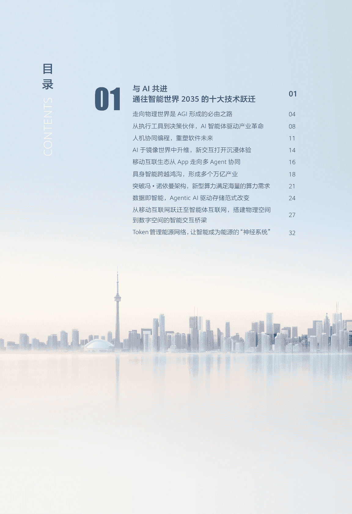

# 02
## 与 AI 共生
### 加速生产与全场景跃迁

- 医疗：计算，预防未来，让生命更有质量
- 教育：人机协同，让每个人成长
- 出行：体验流动的“第三空间”
- 饮食：从“吃饱吃好”走向出健康
- 居住：从生活空间向虚拟空间，让生活更舒适
- 制造：设计即制造，制造即服务
- 金融：AI 重构金融，打开智慧
- 电力：新能源主导，成为主流力量，推动系统性重构
- 物流：AI 驱动供应链实现高质量交付
- 城市：AI 让城市焕发进化

# 03
## 与 AI 共生
### 让可持续发展成为智能

- 遵循伦理安全，以人为本
- AI 整合数字鸿沟，加速可持续发展

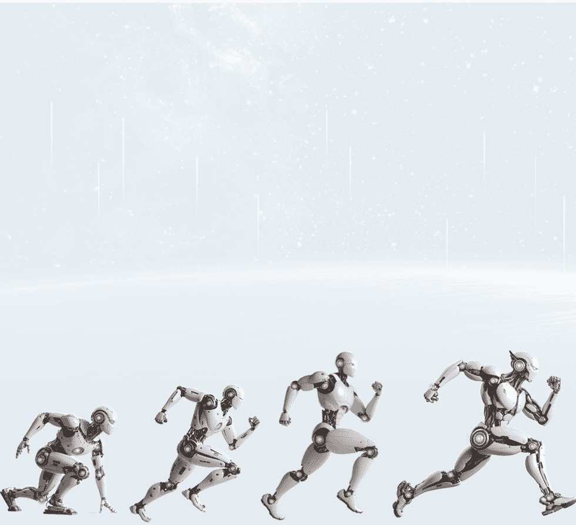

# #
# 与 AI 共进
## 通往智能世界 2035 的十大技术跃迁

### 五大基础技术的融合走向超级智能

人类文明的关键是思维的发展，从经验到科学，从工具对人的辅助，到计算、互联网，再到机器智能，不断突破约束，给人类带来无限可能。

| 智能技术 | 智能技术 | 世界模型 |
| :--- | :--- | :--- |
| 通信与网络 | SVM RS Transformer VLA | Beyond Transformer |
| | DBN ResNet GAN Diffusion DIT RLV | 智能网络 6G/5G |
| | OTN 相干 XPP FFT SDN IPv6 PQC OKR V LPO COO | |
| 感知与交互 | 视觉、聚类识别语音/手势动作追踪 增强现实/虚拟机器人 | |
| | 3D VR MR 全息 | |
| 工业 | 第一次工业革命（机械化）第二次工业革命（电气化）第三次工业革命（智能化） | 智能农业 |
| 存储与计算 | 近似计算 光子计算 机器类参数三维存储 神经类谱 智慧存储 |
| | PIN HBF 磁仿无线 可视存储 | 冷链电池 |
| 能源 | 水力发电 大风发电 锂电池 太阳能 氢能 超级电池 燃料电池 储能 | 超级智能体 - 计算机智能 - 具身智能 |

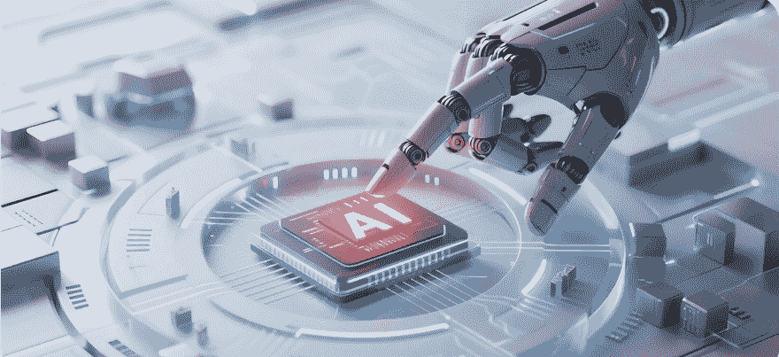

感知与交互、算力、网络、新能源等核心要素共同驱动，深刻重构数字世界与物理世界的系统性跃迁，是一个复杂的系统工程。

### 走向数字世界 AI 的形成必然之路

### 未来十年，实现 AI 奇点突破，面临诸多挑战

在2025 年，预判 AI 的进化轨迹，将是未来十年的核心使命与终极挑战。人工智能进阶的速度与速度，不仅将重新定义技术边界，更是塑造未来十年的格局。

缺乏确实的数学理论支撑，黑盒特性导致的不可解释性，以及不确定性引发的泛化问题尚未得到有效。推动 LLM快速发展的规模扩展（Scaling law），数据、算力、能量与可靠性的多重循环，有待建设。

2022 年以来 Transformer 的大模型（LLM）引领行业，AI 技术正处于快速发展过程中，但仍然存在诸多挑战，比如神经通用人工智能（AGI）具备人类广泛知识的智能系统。其核心在于实现通用性、自主与创新性：能够在新环境中理解、学习完成任何人类可能的智力任务，胜任跨场景推理、复杂问题解决，并展现人类水平的适应与创造能力。作为人类进步发展的终极目标，AI 在未来十年的发展之上，面临着多项挑战、“奇迹”突破性难题。

以及天花板，Scaling逐渐失效。然而，基础理论迎来突破，出现超越 Transformer 的核心架构（如 Beyond Transformer）。发展动能由“模型驱动”转向“架构与理论驱动”，在理论体系的突破，AI 开启了全新的、不可预见的进阶之路。

展望未来人工智能（AGI）的未来，其发展路线主要面临三个可能：

- 1. 规模，奇迹降临？Scaling 规模作为核心动力持续增长，算力、数据与模型规模的扩展红利未见衰，技术仍有瓶颈加速，最终引发变革，及 AGI 从奇迹到拥有现实技术的转变，人类社会发生本质性转变。
- 2. 架构转型，范式转移：当前基于 Transformer 的规模扩展路径面临挑战。AI 技术经历一个漫长的平台，回归通用模型，从“通用模型”到大型模型（LLM）的深度价值化，主要表现为：交互的深度价值化，应用场景的深度融合，优化效率与成本。
- 3. 价值实现，应用化：AI 技术在各个场景的交互上不断取得突破。要说的是未来，AI 将持续影响人类生产生活，深度交互的深度融合，人类定义未来，在各个领域发挥关键作用，为推动社会进步，贡献无可替代的量。

回顾过去三十年，人工智能按次数经历了多次革命与解放。

第一个十年：1995 年 SVM（Vector Machine），1997 年 LSTM（Long-Term Memory），2006 年 DBN（Deep Belief Network），让机器通过数据建模，但智能仍限于特定场景，泛化有限。

第二个十年：AlexNet（卷积神经网络），AlphaGo 和强化学习（RL），深度学习赋予机器“感官”系统，视觉识别精准化，拓展应用边界。

第三波浪潮：Transformer 登场，ChatGPT 时刻，生成式 AI 带来智能爆发。

我们认为，走向物理世界是 AGI 的关键，通过物理实体与环境实时交互，实现认知、决策与行动一体化，让智能像人类一样通过身体成长，而更好地适应环境、解决复杂任务。未来是从多模态数据驱动。

### 从执行到决策，AI 智能体驱动行动革命

### 未来十年，智能体将发展为重塑实践的行动体

随着模型的发展，AI 正变得更接近通用智能的突破。面对千行行业不同业务需求，AI 技术落地的关键在于是否能够将智能化为可执行的 AI 智能。未来十年，智能体（Agent）将成为人类最重要的伙伴。

流程从运行，智能体将发展为重塑实践的行动系统。此时人类的决策将由智能体获得更多与物理世界交互的能力，能够自主执行环境多类任务。

回溯历史，初期的智能体是侧重感知的信息系统，尚未具备决策的能力。随着技术的发展，进入思考的模型系统阶段，能力较上一代智能体显著提升，市场影响力得到拓展。智能体在 Deep Research 领域、AI Coding 领域与……

智能体的未来，关键在于交互的核心：多智能体协同（通信与交互）、云端环境交互（执行），以及程序交互（观测与组合）。这些共同构成了通往智能的路径。

| 感知-信息系统 | 思考-模型系统 | 执行-行动系统 |
| :--- | :--- | :--- |
| 简单决策能力 | 目标设定 | 任务执行 |
| 结构型智能 | 逻辑推理 | 自动化执行 |
| 反映型智能 | 综合推理 | 实战能力 |
| 演化型智能 | 约束规划 | 交互能力 |
| | | 多模态感知, 符号表示 |
| | | 1980年 2010年 2020年 2025年 2035+ |

人类角色从传统执行者变为目标设定者与监管者。“AI 助手”、“训练师”、“Agent教练”等新职业将推动动力向高价值转型。同时 AI 安全与伦理框架逐步成熟，构建智能的安全防线。

未来十年，智能体将驱动产业发生发展革命。智能体的发展是一个逐步迭代的过程，依靠数据积累，持续提升能力与商业回报（ROI）。

### 人机协同编程，重塑软件未来

### 人机协同编程，解决人类带来的软件复杂性

人类技术正在面临复杂性，芯片领域到亿级门槛，模型参数突破万亿规模，产品远超复杂，人机软件编程的挑战远超人类。

人机问题是导致软件复杂性的重要源头，软件生产效率随着规模的急剧下降。当代软件工程不断演进，软件开发架构不断重构和拆解，减少软件的难度而演进。编程语言的改进主要是围绕着提升效率、理解、场景。

过去一年，，形式化方法在软件领域得到了广泛的讨论和应用，帮助解决了关键链路的高可靠性、高安全性等问题，实现了某种程度上的自动化代码生成和代码验证。但形式化在发展过程中面临着巨大的挑战，形式化如何在适应快速变化的软件环境实现对环境的能力仍然巨大、成本太高等问题。

随着模型的出现，AI 编程出现了革命性的变化，大模型爆发由人类带来的软件复杂性难题，破解软件开发的瓶颈，提升效率的极大提升。但 AI 在大规模模型下编写软件仍然存在许多问题，以及如何解决大规模模型软件的系统分析、以及对接和协作都将面临巨大的挑战。

面对未来的自动化编程，可以看到模型和形式化方法各自拥有优点，也可以通过“互帮助”，借助模型提升形式化验证的输出准确率，两者的有效结合可能是关键的方向。

我们相信未来机器在软件生产活动中的比例越来越高，将对软件工程带来巨大的变化，原本人类按照人类定义的软件活动、软件开发流程和软件维护都会发生变革。人机协同编程是解决大规模软件开发困难的根源之道。

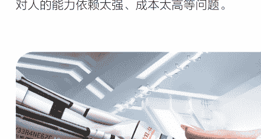

### AI Agent 编程带来开发模式系统性重构

随着模型与智能的兴起，软件开发正在迎来一场全面重构。不仅是工具升级，更是入口、角色、流程、架构、安全、质量、生态、平台、组织、协作的系统性变革。

| 入口重构 | 角色重构 | 架构重构 | 组织重构 |
| :--- | :--- | :--- | :--- |
| 从代码到自然语言 | 从序代码到设计师 | 从服务到Agent工作 | 人机共生团队 |

软件开发模式系统性重构：
迈向人机共软件的新时代

| 流程重构 | 生态重构 |
| :--- | :--- |
| 从流水线到线性化SDLC | 从App到Agent |

| 语言与工具重构 | 协作重构 | 质量与成本重构 | 平台重构 |
| :--- | :--- | :--- | :--- |
| 迈向Agent原生 | 低代码+AI专业化 | 从辅助到前置内 | IDP与供应链治理 |

软件形态转变：从程序到“Agent”

普通应用开发由 Agent 代理，用户通过自然语言描述需求即可生成应用，形成“可塑性软件”。软件开发，如操作系统、金融核心系统、工控控制，将由开发者转向 Agent，但工具链被注入 AI 来提升开发效率和可靠性。未来软件将由确定性逻辑、概率网络模型、Agent 共同构成，多方式交互，专业级开发成为可能。

**入口重构：从代码到自然语言。** 未来开发的入口将由自然语言引导。通过意图理解，用户可以对话式生成应用，“可塑软件”支持快速生成、定义和丢弃。非专业应用工程将降低门槛，通过描述成为关键。

**角色重构：从“程序”到设计师。** Agent 承担大部分编码与实现，人类转向设计、规则制定、Agent 自组织策略管理、合规、治理。新的开发岗位包括“Agent 编写”、“Prompt 与 Goal 设计”和“安全审计”。

**流程重构：从流水线到线性化 SDLC。** 未来 SDLC（软件开发生命周期）将被 Agent 自动生成请求文、产生输出、回归测试、提交 PR，人机负责监督关键节点。开发流程转变为人机协作流水线，强调机制的可靠与可靠性保障。

**生态重构：从 App 到 Agent。** 互联网以 AI 为核心，未来是 Agent 生态主导。用户通过智能调用服务，而非封装一个 App。软件开发重心将从向接口向服务化设计，并定义 Agent 调用标准，谁就能够掌握新一代生态入口。

重构架构：从微服务到 Agent 工作。由于微服务变得日益复杂，未来将通过“黑盒化组件”降低接口耦合、强化边界与可观测性。同时，长事务业务流程将通过“工作流代码替代”实现，支持监控与重构，未来 Agent 将参与。

### 质量与成本构成：从重构到前置生成

生成式 AI 提高了速度，但也增加了质量风险。未来质量与成本构成成为前置约束。

**组织重构：人机共生模式。** 未来团队是“人+Agent”的混合团队。人类负责创造性设计与规划，Agent 承担执行与自动化。

**语言与工具重构：向 Agent 原生语言与工具。** 传统语言以函数/服务为主，难以表达 Agent 的“感知-推理-行动”循环。未来可能出现 AOL（Agent Oriented Language），内置：Goal（目标）、Policy（策略）、Context（上下文）、Capability（能力）、Coordination（协作）。同时，工具链将具备语义建模、Agent 身份验证、行为审计、运行沙箱等能力。Rust、WASI 和 Go 等语言将在底层保障性能与安全，但高层语言将走向 Agent 原生化。

软件开发重构的本质是“智能化与治理的平衡”。未来的软件工程将不再单一的“AI 类人”，而是人与智能体的协同治理价值判断。Agent 智能化开发与治理价值提升，人类负责设计、Agent 执行。

组织形态向“设计-测试-治理”三段式转型，构建人机共生的开发新组织。

未来的性能、安全、合规与成本成为硬性指标，最终走向人机共生的组织形态。智能在这场重构中掌握标准与生态，就能够成为未来十年的引领者。

### AI 于镜像世界中升，新交互打造沉浸体验

人类对极致体验的追求无止境，从最早的纸张文字，到电话语音，再到互联网的动态视频，每一次媒介的变革，都是人类突破信息边界与感的进步。随着AI、空间计算、XR等技术的演进，数字世界与物理世界的边界正在消失，虚实融合成为新一代社会的基础方式。这一趋势不仅改变人类获取信息和交流的方式，还将重构生产生活的底层逻辑。随之而来的，智能终端的定义也将被重新定义，从“信息的载器”，变为数字世界与物理世界共通的“桥梁”，成为数字生命与硅基生命的入口，推动人类进入一个全新的认知与交互时代。

### 交互方式：从界面到空间、从单态到多态

有了新的架构支撑，虚实融合的第一步突破实体在交互方式上的重叠。过去几十年，人机交互主要停留在二维平面和单态输入（键盘、鼠标、触控）。未来，随着多态技术的成熟，交互会快速向空间自然化，如：高精度摄像头捕捉用户的注意力。在这种转变中，设备在现有参数上取得进步，更重要的是脑机接口被纳入多态框架，让人机交互真正进入“直觉”阶段。

### 感官体验：从视觉到听觉，到全感

交互的进一步深化，关键在于感官维度的升级，带来更多创新的设备，如：数字眼镜、轻量头戴设备等。逐步增加嗅觉、味觉等维度。未来终端不仅能“看见”和“听见”，还可以“触摸”、“闻”、“品尝”，从而实现真正的全感沉浸体验。

视觉：通过全显示，让用户在任何角度都能获得深度空间。

听觉：依托更先进的技术与空间算法，打造完美空间。这包括高性能扬声器、超声振动等。

五感融合：

### 内容生成：从 CG 到 AIGC

优质内容的生成是虚拟世界最大的挑战之一。过去需要PGC（专业人士内容）利用CG技术（物理引擎）创造虚拟空间，其成本巨大。随着AI能力的增强，UGC（用户内容）利用AIGC（AI智能内容生成）来构建虚拟空间，内容与目标达成一致。预测未来，AI将在“镜像世界”中实现深度沉浸与进化。新型终端的普及将带来万倍的数据量，这些数据是未来泛化的关键，驱动AI在镜像世界中同时作为数字世界的纽带，引发物理世界的发展。

个性化互动将迅速生成：“虚拟老师”带领孩子们游览世界，是跨越的关键。在技术领域，内容生成将持续迭代。自回归与扩散模型借鉴各自优势，形成双线并行的发展。技术突破成为内容增长的大幅跨越与时空一致性的精确控制，从而AI对虚拟空间的理解从局部生成走向可持续生成，逐步走向“世界模型”。

第一人角的虚拟直播将成为常规，每个人都可以分享身临其境的体验。比如在空中穿梭、深潜海底、攀登宇宙等。

### 移动连接系统从 App 走向 Agent 协同

| 起始: 1990s | 起始: 2000s | 起始: 2025 |
| :--- | :--- | :--- |
| PC 时代 | 移动时代 | 智能时代 |
| PC OS 以桌面为中心 | 移动 OS 触控优先 | 智能 OS智能化和自动化 |
| 用户界面 | 触控界面 | AI界面 |
| 网页应用 | 应用生态系统 | AI 智能体 |
| 浏览器引擎 | 移动运行时 | 智能运行时 |
| 操作系统 | 移动操作系统 | 云基础设施 |

随着Agent Web、Mesh Agent、Agent AI以及MCP和A2A信息的出现，2025年视为智能体协同的元年。未来，随着AI技术的发展，互联网的万App不是信息流，而是变为智能体或服务器相互连接，完成复杂的任务，形成多智能体协同的新生态。

App时代：生态以应用程序为中心。用户是“驾驶员”，必须发现、下载、打开并在其中手动操作完成目标。每一个App是一个信息框，数据和服务被封装成容器。生态的本质是“人服务”。

多 Agent时代：生态以智能体为中心。用户目标由一个Agent（如手机OS中的超级AI Agent）协助多个复杂、专业的Agent（服务Agent）自动完成任务。用户从“驾驶员”变为“指挥员”。生态的本质是“人连接”乃至“服务自动执行”。

### 交互界面：走向 SmartUI 多模态交互

| CLI | GUI | NUI | SMUI |
| :--- | :--- | :--- | :--- |
| 命令行界面 | 图形用户界面 | 自然用户界面 | 空间多模态界面 |

交互界面演进路径：人机交互将走向SmartUI多模态交互，从GUI的被动跟随到SMUI的主动发起的重要交互。交互方式将从以触控为主，升级为融合手势、多维度、状态、自然语言以及环境信息的多模态协同交互。与此同时，界面不再追求统一标准，而是逐步基于具体场景和个性化需求的生成界面。

### 用户体验：端到端执行成功率

移动互联网转型，“端到端（E2E）任务成功率”成为核心指标。多智能协同源于系统工程，多智能系统的核心竞争力在于交互框架，其中一项短板都会制约整体能力的释放。因此，未来的竞争将不再是“谁模型更优秀”，而是“谁系统能力更强”。

### 商业模式：从注意力经济转向直接价值交换

传统基于注意力的广告模式可能适用于多智能协同，直接价值交换模式涌出来：如智能侧服务（API调用）。

### 部署策略：端云协同

端云协同是新生态的最优。端侧智能体可以快速响应复杂任务，实时性、低成本。

## 具备智能跨越鸿沟

具身智能是物理世界的关键体现，它并非单一的突破，而是融合了AI技术、感知、存储、通信等多种产物。它让AI拥有了“身体”与环境互动的能力，摆脱了形态限制。这种“身体”在真实世界中完成认知、动态反馈，也是推进通用人工智能（AGI）的关键。

### AI技术

具身智能的关键点是AI感知、适应改造世界的载体。从广义畴来看，未来智能将应用于三大领域：智能驾驶、低空、机器人。

| 机器人 | 2025 | 2030 | 2035 |
| :--- | :--- | :--- | :--- |
| 驾驶仍为人类 | 特定场景完全接入 | 部分场景完全接入 |
| 区域 | 场景L3+商用 | 场景L4+商用 | 场景L5启动 |
| 技术 | E2E | 世界模型 | AGI水平 |

智能驾驶演进趋势：
2025年基于Transformer架构、鸟眼视角（BEV）及占用网络（Occupancy Network）实现落地，智能驾驶已进入爆发期。此后，伴随全球电动渗透率的快速提升（大众车型适配）以及Robotaxi的持续推进，当前智能驾驶加速向3级跨越。业界有望从端到端（E2E）技术路线领先实现高速场景，后续随着世界（World Model）的技术突破，我们预计2027年之前开启L4机器人市场，2030年在场景中实现L4规模化应用，并最终在2035年达成大部分场景L4+。这是一个从试点到普及，最终迈向全自动驾驶的关键旅程。

### 智能机器人跨越技术鸿沟，进入万、千万户

| 机器人 | 2025 | 2030 | 2035 |
| :--- | :--- | :--- | :--- |
| 导舱，工厂单任务成功率>90% | 长距离本地化任务成功率>90% | 长距离本地化任务成功率>99% |
| - 场景：领域，情感价值 - 技术：手6 DoF（自由度） | - 场景：领域复杂场景、toC基础场景 - 技术：手10 DoF（自由度） | - 场景：C级场景 - 技术：手20+DoF（自由度） |

智能机器人进入领域：智能机器人领域随着模型技术的突破以及机器人形态的出现，已成为关注的热点，吸引了大量的投资资金以及众多公司密集布局。复杂的场景需要高自由度与人的灵活去完成更困难的家居清洁、衣物护理、花种等任务。对于人的的发展，多年年后存在巨大的不确定性，能否突破技术瓶颈决定这些行业能否实现真正的变革。我们预计2030年之前，机器人领域的“ChatGPT时刻”将有一个基于视觉-语言-多模态手操作系统的出现，并最终迈向高度自由度（10+自由度）水准，此时机器人将突破行业边界的操作限制并让部分领域普及。

但通用智能机器人面临的挑战和难度要远超自动驾驶。目前智能机器人需要通过手机、空间、操控、感知以及一系列的技术支持，业界共识发现手部长序列任务依赖高智能化的能力来实现手部操控，主要原因是数据真实以及与感知有待提升，因此在机器人领域还存在一些瓶颈难题。目前看到的智能机器人要在工厂、物流等半结构化市场中进行特定任务，进入万户还有一定的距离。

### 计算技术的演进与革命

未来对于计算需求的想象是无限的，而成本决定了我们的想象空间。算力成本中，能够供给以及成本问题是关键的突破。这些进步促使计算底层技术转向高效的计算范式革命。传统的冯·诺曼架构面临着算力增长导致的能效瓶颈。在摩尔定律放缓的背景下，单纯依赖硅基半导体提升算力已难以满足指数级的增长需求，同时上很难满足要求。

### 难题与挑战

### 未来展望

| 存储 | 计算范式 | 近似计算 | 概率计算 | 模拟计算 | 光子计算 | 100x 存储提升 | 100x 带宽提升 | 10万x 计算速度 | 100x 计算效率 | 100x 信息压缩 |
| :--- | :--- | :--- | :--- | :--- | :--- | :--- | :--- | :--- | :--- | :--- |
| 存在 | | | | | | | | | | |
| 闲动 | 计算架构 | 等待内存 | 概率网络 | | | | | | | |
| 算不起 | 工程信息 | 硅质 3D | Wafer Scale | CFET | 低温 | | | | | |
| 供不起 | 材料器件 | 宽带材料 | 互连 | 存储新型 | 氧化物半导体 | 2/1D 材料 | | | | | |
| 用不到 | | | | | | | | | | |

2025 阿尔特曼演进 范式变革 冯·诺曼架构 2035 光子计算崛起

从2025年到2035年，计算领域将迎来历史性的变革——技术演进从阿尔特律的延伸，迈出诺·伊曼·冯·诺曼架构的束缚，实现新型计算范式的全局性崛起。这一变革不仅是单点的突破，更是在材料器件、工程工艺、计算范式四大内核上，实现跨越性的技术创新，重塑“后摩尔时代”的算力量子。

#### (a)材料器件：从“硅基础”到“多元融合”

在底层材料器件层面，以硅基半导体为核心的技术栈将跨越“多重材料融合”的方向升级。一方面，宽带半导体、氧化物半导体

#### (b)工程工艺：从“重构”到“类创新”

当半导体工艺进入未来时代，制程发展将通过CFET与M3这两种技术，不断突破物理极限。同时计算密度的提升将对“程节点缩小”的单一依赖，转而通过过程多样的创新性突破。三大关键技术方向将成为核心趋势：一是 3D 集成垂直堆叠，将多功能、不同的芯片/模块垂直堆叠，实现扩展的空间密度；二是突破物理尺寸限制实现计算（Wafer Scaling），存储内构，从架构层面消除“内场”瓶颈，极大提升计算速度和效能。

#### (c) 计算架构：从“通用”到“新型专用”

计算的指数级提升，将依赖新型计算架构实现。不同于传统计算的模式，内存一体、计算-类计算、量子计算等新型架构将针对特定场景实现“精准化”：高效计算可实现线性演变计算，比特计算具有高行的成本，量子计算则利用对于信息的存储优势，量子密度则与通用计算量相结以应对复杂的难题。这些近似的落地，将在 AI 训练、科学计算、密码等场景中实现计算的指数级突破，打开应用的新领域。

#### (c) 计算架构：从“存算分离”到“存算协同”

当前，主要计算架构的核心瓶颈——“存算分离”导致的数据延迟与内存消耗，在架构逻辑调度上遭遇突破。技术路线呈现清晰的递进趋势：首先，当前计算架构正在将异计算进行对等处理，消除多 GPU 访问之间的主和带宽带来的性能瓶颈，数据中的计算效率；其次，近存计算技术将推动计算单元向存储单元“靠近”，短数据搬运延迟；最终，内存技术将实现“数据解耦、计算在存”。

末十年是计算领域从“变量”走向“变质”的关键期：不仅计算密度将实现数据增长，更通过材料、工具、架构、模式的协同创新，构建“后架构时代”的全计算格局，解决底层技术路径的瓶颈，也是数字经济、人工智能、科学研究等领域提供高效、更低的算力支撑，复全球供给压力，推人类社会向“智能增强”的未来到来。

### 数据即智能，Agentic AI 驱动存储范式改变

数据觉醒：AI 驱动数据留存，大量数据变温，都需要被高效处理

| 性能 | 大数据 | 数据热度增加 | 留存周期增加 | 归档 | 备份 | 数据库 Long Term Preservation and Archive Storage |
| :--- | :--- | :--- | :--- | :--- | :--- | :--- |

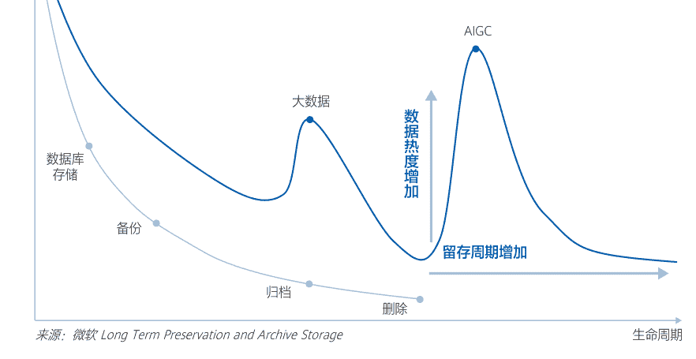

随着大模型训练与对数据访问需求的爆发式增长，数据源被不断刷新。这些数据因参数参与与模型迭代与实时处理变为“温数据”，甚至持续被处理而成为“热数据”。我们预测，到2035年，温数据的占比将超过70%，传统的三层结构将逐渐变为“热、冷”双层结构，比例接近3:7。这一转变不仅提升了数据利用效率，更意味着企业和社会能够从历史数据中挖掘出所未有的价值，使得数据从“被动存储”走向“主动赋能”。

在 AI 时代，数据价值被挖掘到前所未有的高度，数据的长期存储也存在诸多问题和挑战。首先是本与效率的提升，温数据规模增大需要频繁调用，若延迟或吞吐不足，会导致模型训练周期拉长、智能响应迟缓，计算与处理压力急剧升高；其次是实时性的要求，AI 应用（如自动驾驶、实时决策系统）往往需要在毫秒内完成记忆检索与上下文交互，高效的 I/O 和处理将成为性能瓶颈，无法满足实时数据的交互需求。更重要的是价值密度与处理速度，数据的长期留存不再是为了“圈”，而是为了“即时查询”，意味着能够快速对温数据进行定位、并提高数据价值，转化为模型智能或功能供给，使得数据正成为驱动智能决策的“高可靠性燃料”，而非存储系统中的“数据负担”。因此，对海量数据的高效处理，是关键。

### Token 管理能源网络，让能源成为能源的“神经系统”

#### 智能时代期待能源技术产生质的突破

能源是人类社会赖以生存和发展的重要物质基础。纵观人类社会的发展的历史，人类文明的每一次重大进步都随着能源的改进和更新。

智能时代，AI 带来了巨大的电力需求，可能远超出人类原有的建设规划。按照国际计划（The Stargate Project）测算，超级数据中心范围内电力设施需要数十亿的电力支持。为此，微软和 OpenAI计划将采用核能。可以预见，能源需求将制约 AI 高速发展的要素，智能时代期待能源技术产生质的突破。

未来的能源网络中 Token 将成为能量管理的基本元素，人工智能技术将未来人类的意量可以被 Token 定义并赋予可编程的意志，从而实现能源网络中每个基本单元的“感知+行动”的能力，完成能量载体的革命性变革。基于 Token 管理的能源网络将成为未来能源的重要趋势，将与通信技术（能源神经网络）、物联网 IoT 技术（能源神经系统感知感受）、能源区块链技术（能源记忆系统）等一起构建起完整的能源神经系统。

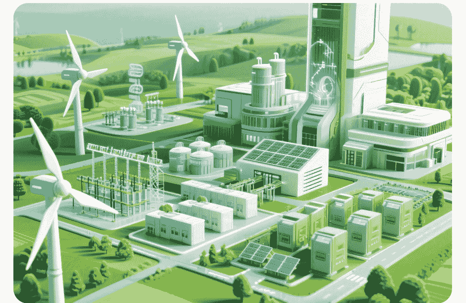

## 能源发展的历史里程程：风能与太阳能的发电将在2035年超越化石燃料

随着能源技术的不断发展，预计到2030年风光新能源发电机容量将超越传统化石燃料，风光发电将成为主流电力。这是人类能源发展历史上具有里程碑意义的技术节点。随着新能源占比的不断提升，未来新型电力系统的可靠性、稳定性等问题也将凸显，构网技术将成为解决这一问题的途径。新能源的供应是未来年后或更长时间内人类面临的具有重要战略价值的重大挑战之一。

储能是绿色能源的主要主控，电池储能占据储能的96%以上，度成本有望下降到0.15元（低于抽蓄）。未来电动汽车将实现分布式储能系统双向V2G技术，起到峰填谷的调节作用，能源互动将成为未来关键。

热能作为非常重要的长时技术之一，预计2035年全球热储能机容量将达到500GW，热储系统的热电转换效率将提升至80%，冷热储能成为新型电力系统的“稳定器”。

预计2035年，氢能在储量、运能和工业替代等领域将出现大规模应用的机遇，全球市场规模突破1.5万亿美元。

核电现在已经进入第四代核电阶段，未来有望核能与新能源的融合、人工智能AI-powered主动制控与出力预测、高温蒸汽机组将向未来方向发展。

| 低碳 | 稳定 | 化石能源 >50% | 风光储能 >20% | 风光发电储能 >50% | 可控硅膜变 | 光伏发电 >50% | 电力调度 100% |
| :--- | :--- | :--- | :--- | :--- | :--- | :--- | :--- |
| 灵活 | 互补性/柔性 | 电市场（秒级） | 储能系统调节（分钟级） | 储能系统实时（分钟级） | 侧侧市场（秒级） | 电网放开 >99% | |
| 安全 | 经济 | 聚能 | 锂离子电池为主 | 钠电池为主 | 氢燃料电池 | 燃料电池 | 度成本<0.15元 |
| 高效 | 高压 | SiC/GaN | GaN/AlN | 金刚石 | 电力电子 | | |
| 2025 新能源 | 超越化石能源 | 2030 新能源 | 能源技术路径 | | | | |

### 可控核变能源成为现实

可控核变已经解决基本原理，正在工程方面取得进展，超导磁材料、等离子体材料、高温冷却技术。预计2035年，可控核变有望实现独立发电，可控核变技术突破，AI 与能源终结，人类社会进入另一个时代。

目前，太阳能发电距离空间，太阳能发电效率仍然低。未来能够在高效扩辐射光电转换、高效轨道管理、微重力下热热突破。预计2035年，太阳能规模实现MW级突破。

### AI 加持，人类文明跨越

随着 AI 与技术的深度融合，Token 的转型将完成深刻变革。Token 的能源元素使得能源网络多元化，能源供给多元化、能源互动成为共享。这一新范式将改变人类与健康的关系，每个人都能实现“可见、可感、可控”的全周期健康自主。到 2035 年，AI 把“能量巨兽”转化为“健康单元”，为人类输出无限能源，构建综合系统，驱动人类更加向星辰的梦想。

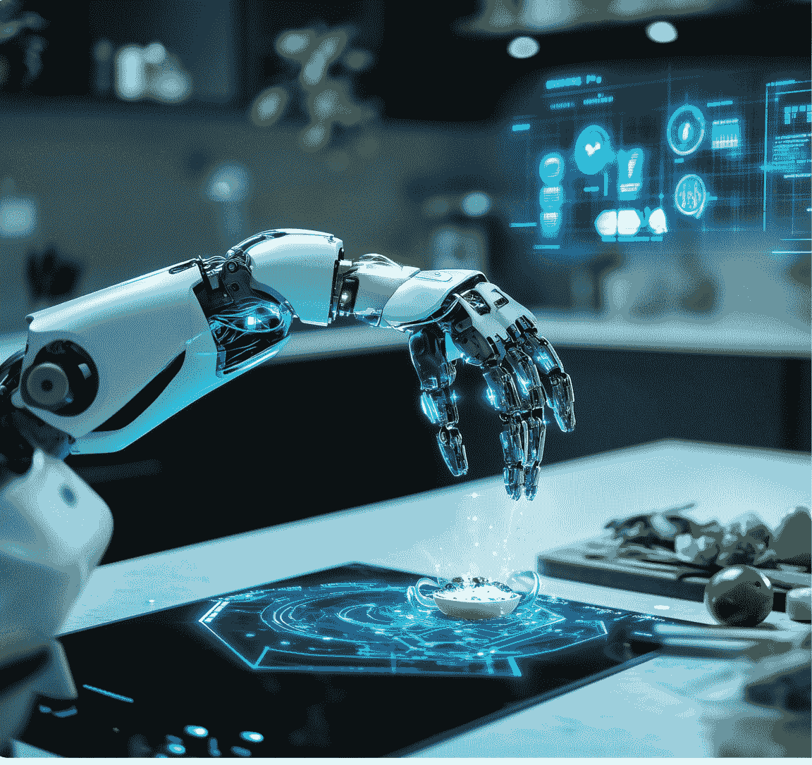

## 与 AI 共赢加速生产与生活跃迁

未来十年，人工智能将深入融入千行万业，为我们带来更美好的生活、更高效的作业以及更可持续的环境。只有在真实场景的应用，才能加速生产与生活的跃迁。

### 医疗：计算健康，防病于未，让生命更有质量

未来三十年代，人类面临健康寿命的矛盾。WHO指出，在过去20年来，全球健康寿命与总寿命的差距持续拉大，尤其是以心血管疾病、糖尿病、癌症等代表的非遗传性疾病，其死亡率已逐渐超过七成。展望2035年，传感器与可穿戴设备使个体状态被实时感知与预测，风险在萌芽阶段即可被干预，从而延长人类寿命。

在疾病应对期，移动AI医学通过基因组检测结果为患者提供更个性化的健康建议；同时，AI驱动的药物研发与临床试验将缩短周期，并帮助患者快速匹配最优药物组合；在康复期，浸润式设备与远程监测将成为康复重心，社区医疗提供持续追踪与帮助；在长期照护中，到2035年，65岁及以上老人将突破1亿，康复和护理需求将持续上升。这些趋势正在倒逼医疗从“以疾病为核心”转向“以健康全周期管理为核心”。智能护理网络为老年人群和慢性患者提供生理监测与情感支持，提升生活质量与社会联结。通过这一系列环环相扣的创新，2035年的医疗不再是被动的“治病人”，而是为社会运行的底层能力，为人类从“延长寿命”走向“提升质量”奠定基础。

### Token 管理健康，让每个人的健康可控

随着 AI 模型与人类健康深度融合，未来健康管理的基本单元发生性转变。个体健康管理将出现结构化、智能化、实时的管理趋势，健康能够被人工智能精准识别、持续建模和动态预测。每个人的健康将被转化为一系列量化、可计算的数字要素，构建健康蓝图，为管理、理念、互动交互的动态健康提供。这一新范式将改变人类与健康之间的关系，每个人都能实现“可见、可感、可控”的全周期健康自主。

到 2035 年，健康管理体系建立在无处不在的感知网络和智能融合之上。全球将有亿医疗健康相关 IoT 设备持续采集血糖、呼吸、睡眠、环境和情绪等多维度数据，边缘处理转化为标准化的“健康单元”，为每个人生成更新的全息健康画像，成为预测和干预的基础。

未来场景：主动感知与智能干预的一体化健康系统

更早的是，健康管理已进入“出生即健康”阶段。新生可以通过基因测序、谱系遗传和家族疾病风险地图，并在后期数据后，形成一份一生的健康画像。AI 在婴儿早期识别心血管风险人群，并提示。

### AI 驱动的人机协同诊疗

2035年，AGI 将成为医疗体系中的核心“决策引擎”，推动诊断模式从“经验主导”走向“精准防控”。在这一体系下，诊断、治疗和推荐的最终不再是医生的决策，而是由 AGI 与人类共同建立连接，每一次诊断都建立在最先进、及时的证据之上。AI 根据患者病情而持续调整方案。例如，在肿瘤治疗中，可以根据用药反应和生物标志物的变化，动态调整剂量和疗程，甚至预测药物风险并提出替代疗法。在这些方案中进行监控和调度，把医学判断与人文关怀结合。在临床诊断中，AI 不仅仅是影像的辅助工具，更是整合影像、基因和组学实时数据，成为患者的数字影像。在复杂疾病中，可以直接基于 AGI 的多模态分析，获得推理、风险评估和预测，更准确地识别病情。这不仅减少了诊断误差，还让后续治疗有了更科学依据。在长期管理中，AGI 的作用体现在“随随”。慢性病和免疫性疾病的患者能够无缝连接，治疗方法将更加灵活。AGI 能够从数据中发现微弱的关键，提前预测病情转向，并引导治疗。医生由此可以更早调整治疗，避免患者陷入并发症或药物副作用的影响。在治疗场所中，AGI 将成为“辅助助手”。它可以检索全球最新研究和临床试验，并结合患者的个体特征，为患者提供更多参考。不同于当前静态的诊断建议，这种模式的本质是人机协同：AGI 负责整合与智能处理。

### 未来场景：医疗突破空间限制，服务常态化

2035年，医院不再已是医疗服务的场所。借助人工智能和虚拟现实，一界虚拟与现实的“医疗”让全民更健康。人们在家中或办公室随时进入诊室，与医生对接，并自动完成诊断配送。依托网络与边缘计算，人类无需出门，也能接受来自医院的医疗。

### “医疗无界”，让医疗触手可及

未来，医院不再是内部封闭的服务，而是像水、电、通信基础一样融入社会运行，成为健康的基础设施。医疗服务突破空间限制，资源与边界消融，让一个人在智能、互联的网络中，都能够获得连接的医疗服务。健康能够集成体监测、语音识别和影像模块。居家可以进行初步识别，家庭 AI 助手帮助健康档案记录，并在需要时引导病人进入诊室，与医生对接，并自动完成诊断配送。

### 未来场景：健康监测进入设计

2035年，健康管理由医院中心向家为中心，使得2035年超过60%日常干预可以在家中完成，医院主要处理急症。借助“AI+老人”，养老与慢性病治疗被延迟，老人在熟悉的家中安享晚年，既受关怀，又保有独立尊严。疾病的负担被技术消除，长不再是煎，而是一段可以享受生活、实现价值的“金养老”。智能康复已从医疗附属环节升级为生活的。

### 未来场景：老年人居家生活

2035年的一个清晨，独居老人醒来，机器人已经准备好早餐和健康监测。床头传感器监测到入睡后，机器人温和的。协助准备早餐、提醒服药、播放喜爱的音乐。午后老年人的手机实时采集血压、心率、数据并同步至社区医生进行定期评估。当发现异常活动时及时发现。当偶然通过发现抑郁迹象时，及时提醒其邀请亲友聚会，缓解孤独。研究显示，智能机器人能够管理老年人的状况并从心理健康角度例如，Intuition Robotics的陪伴机器人主动交流、提醒用药和促进健康习惯，显著改善了老年人的质量。

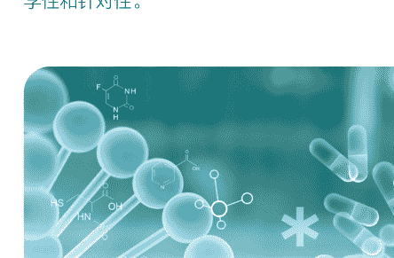

#### 平台：自动驾驶的未来场景

当某地出现自动驾驶技术爆发时，系统会自动分析实时数据，完成药物与门诊，能够即时调用床位，保障患者。这一系统依托医疗与公共服务，到2035 年，大多数城市已建成涵盖医疗、疾病等的数据基础，实现部门联动。

- 平台：当某地出现自动驾驶技术爆发时，系统会自动分析实时数据，完成药物与门诊。
- 服务：依托医疗与公共服务，某地老化严重，年轻人压力突出，则投入更多精力。终端与城市保持同步，形成“诊疗+社区监测”。
- 政策层面：联合国发布的《全球健康》作为国家建设之一，推进试点走向全面转型。
- 最后：看着医疗系统升级为智能基础设施，更具前瞻。无论城市还是乡村，每个人都能被智能系统“看见”、理解、调度、保障”。

### 结语

展望2035 年，信息通信技术（ICT）将全面重塑医疗体系。在智慧平台层面，规模预计从当前的 FLOPS 级跨越到 EFLOPS 级，乃至百 EFLOPS。存储需求将从 PB 级扩展至 EB 级，并在部分城市接近 ZFLOPS，以应对爆炸式增长的影像、基因数据。网络传输方面，远程医疗已超越单一，转向实时 AI 推理+数字交互+信号引发的复杂场景，带宽需求升至 Gbps，端到端延迟降低到亚秒，实现沉浸式会议。关键医疗 IoT、机器人等实时应用。随着这些能力的持续提升，医疗服务的组织也将随之重构。患者不再需要频繁往返医院，而是可以通过穿戴设备和健康平台，在日常生活中持续监测与支持。多源数据的采集与智能，让医疗从经验驱动转向数据驱动，借助医疗模型为个体生成个性化方案。未来医疗将突破边界，延伸至日常生活，不仅更加普及，更通过智能化手段显著提升诊疗质量，成为每个人。

#### 教育：人机协同教学，惠及每个人

过去的十年，是全球教育发展“公平与质量”的十年。联合国教科文组织（UNESCO）显示，2015年相比儿童和青年人口增加了1亿，但是到2030年全球中小学人数预计达到4400万，还增加了教育不平等。根据教育部《2022年全国教育事业统计报告》显示，各国教育平均水平虽比发达国家大15%，这一数值仍在下降。出生和成年儿童的教育任务仍然面临着教育公平和高质量的挑战，无法让每个学生都能提供个性化教学方案，学生也难以获得高质量资源。

让人机智能赋能教学要素、全过程，引入智能组件、智能教师等人机协同新模式，推动教育从信息传授向重能力转变，提高教育质量，促进教育公平。构建智能化教育交互模式，推动开展更灵活、资源丰富的自学习模式，引入数字、激励和支持全民学习的新技术。在亚洲地区大多数国家的学习方法仍以人为中心模式和顽固的教学限制了学生的个性化发展，忽视了学生思维、理解和能力培养。ChatGPT 等 AI 模型相继发布以来，探索 AI 与教育的融合生成转型的新的方向。我国《关于深入落实“智能教育”行动的意见》指出要推更有效的学习方式。

随着技术的发展，2035 年 AI 技术将与教育深度融合，形成人机互动、人机交互、人机协同的教育新模式，全球教育进入智能教育时代。教学资源将通过技术手段拓广供给，确保城乡区域间的公平分配，通过 AI 技术培养师资等教学资源的多元，确保高质量教育育人；学习模式将更加关注学生的差异，提供多样化、个性化的 AI 应用，满足不同学生的学习需求，帮助教师真正因材施教；学习环境将更加，知识的传递不再单向灌输，更加注重交互体验和智能服务。未来，教育体系将 ICT 技术尤其是 AI 技术优化资源、创新学习模式和打造智能教学，全面提升教育公平和质量，满足个人和社会发展需要，提升教育水平。

## AI 为目标，从被学习到主动搜索

认知心理学将学习定义为：“学习本质是主动形成结构的过程，而不是被动接受信息。”这一理念在 AI 时代未被突破，此时的 AI 再不是简单的工具，而是学生的“智能伙伴”。通过多模态数据分析精准认知思维，建立自适应路径识别和动态主动认知，从“被动学习”向“主动探索”的跃，助力实现个性化学习。

AI 驱动的个性化助手，根据学习者的需求或目标，设定计划并引导他们找到合适的资源，通过个性化适配、动态交互与实时反馈，有效增强动力，帮助学生达成目标。在自主学习场所，系统基于数据建模和认知学习，构建“精准-内在驱动-效率”闭环，实时采集数据，通过智能模型解析需求，自动推送资源，训练完成任务，持续发动学习。

AI 作为学习伴侣，不再以教学的方式，而是根据学生的兴趣和目标，提供持续的支持。通过自然语言和图像识别技术，捕捉学生阅读资料时的信号，如对核心概念的关注、标注，构建动态兴趣模型，实现主动学习。AI 识别学生在几个问题上速度慢且准确率不高，这种“经验识别”的模式，转变为客观呈现的组织化学习。此外，AI 显著减少了学生用于机器人批和重复答的时间，反映学生在“理解逻辑”的误解，而在下节课中引入教师引导学生口述解疑惑，及时引导其学习方法。如此，数据分析能力与真人教师的经验能够互补，共同推动学习过程从“大水灌”到“精准升级”。

具体来说，智能教学法是将复杂问题转化为子问题，通过提出问题和回答问题获取足够的信息，通过批判性思维，引导学生从自主提问中主动推理，解决问题。这种跨越设想，可以通过“智能互动”，其核心是通过连续、针对性的讨论，引导学生对不同的观点，发现其中的矛盾和错误而非直接给出答案，最终获得理解。AI 不直接给出解决方案，而是以迭代式提问引发学生深度拆解代码逻辑，实现自主编程源，并在实践中强化逻辑与问题解决能力。

### 未来场景：智能教师，实现学生全天候教学

智能教师能够精准分析学生数据，生成细化教学方案，实现精准教学引导。教师通过虚拟化身能够突破时空限制和学科限制，支持实时教学和满足特殊教育需求。学生与真人教师共同教学，让学生随时获得导师指导，形成课前、课中高品质教学环境。现有技术可以帮助教师将 20% 到 40% 的时间重新分配给学生活动。

### 未来场景：协同教学，让学生学习温度

智能教育与真人教师共同培养，在学生发挥自发性，使教学环境的日常情感价值引导学生核心价值观，让教学过程更有“温度”。如果智能教育在作业中对学习状态精准分析，为精细化教学提供了核心支撑，让功能成为可能。依托传感器数据与计算机视觉技术，分析学生的学习表现、作业情况进展、进阶，整合为课程教学可视化，并制定项目方案反馈教师，教师提供针对性的指导，并更大地促进学生的个性化学习和方面发展。这种过程分析能力，画教师设计专项活动培养素养，依据级“合作学习与进度”的统计结果，策划团队实践项目协助协调。最后引导学生建立正向价值观，培养健全人格。研究表明，AI 服动的虚拟教师显著减少了学生用于机器人批和双向交互的教学模式，让老教师从基础教开始。

### 结语

2035 年，先进的 ICT 技术将重塑教育生态，成为未来变革的核心动力。智能技术深度融入教育要素、全过程，推动教育向更智能、更高效跃迁。到2035 年，全球将有超过 10 亿学生使用智能辅助学习，也将超过 5000 万学生接入智慧教室。较 2025 年，算力需求提升 80 倍至 PFLOPS，网络带宽需求提升 500 倍至 Gbps，存储需求提升 850 倍至 TB。

## 出行：体验的“第三空间”

步入2035 年，城市交通的面貌发生了根本性的变革。出行的核心理念已从过去单纯追求移动效率的“功能性”，全面升级为人本、创造价值与乐趣的“体验赋能”。这层变革的背后，是出行服务（MaaS）等新型平台的崛起，以及 RoboTaxi、空中交通等新型交通工具的移动化应用，让每个人共享一张无忧、智能且充满想象力的未来。

过去，我们的出行围绕着“工具”展开——选择地铁、公交还是网约车，考虑的是时间。而在2035 年，出行由“场景”和“体验”来定义。MaaS平台成为了一切的“连接入口”，它不仅聚合了所有交通工具的应用，更是一个能够理解用户的智能中枢，根据你的偏好、甚至心情，为你量身定制一套包含娱乐、工作的“时空舱解决方案”。这场出行革命的使命，是 RoboTaxi 和空中交通（UAM/VTOL）等新型载具的落地。RoboTaxi彻底重塑了汽车的形态，质为一个流动的“第三空间”。你可以在清晨预约一辆“移动办公室”，在途中高效完成聚会；也可以在途中为家人选择“亲子娱乐”。RoboTaxi 将移动的“闲时间”转化为有价值的个人或家庭时光。同时，以电垂直直起飞行器（eVTOL）的空中交通，让城市开启了“第三维度”。当你需要快速跨越城市的区域，参加一场重要的会议时，MaaS平台让你无需连接，将几小时的地面交通缩短为几分钟的空中行程。这不仅是效率的提升，更是前所未有的城市风景的独特体验。总而言，2035 年的未来，其终极目标是从 A 点送到 B 点，而是让每一段旅成为生活中有意义、有价值的一部分。通过 MaaS平台的智能调度和 RoboTaxi、空中交通等新型载具的应用，出行被重新定义为一种可以被设计、享受、被全新体验。

无缝接入网络，召开会议；年轻人可以预约“移动娱乐”，享受沉浸式的影音游戏体验；家里出行可选择“子舱”，车内配备有互动游戏和安全监控系统。RobotTaxi 实现了“出行时间的价值创造”，将浪费的通勤时间转化为高效时。

## 未来市场：万物互联的“零售与服务”

### 未来市场：实时的动态公共服务

RobotTaxi 的车辆空间成为线下零售服务的新终端。用户可以在电商平台下单后，预约约分钟“移动试衣间”RobotTaxi，在下班路上完成购物和餐。饮料品牌可以推出“移动饮机”，在上班时间段提供热门冷饮，这种模式让“人换车”变成了“货换人”，极大提升了消费体验和效率。

RobotTaxi 不仅是商业化运营，它深度融入了公共服务体系。例如，医疗服务的“移动诊断”，可以为不方便的人提供基础医疗服务，车内配备的智能设备能够监测小型医区。在紧急情况下，RobotTaxi 可以被一键调遣，优先执行物资配送、人流急救等公共服务，成为城市应急响应系统的关键连接。

如今 2035 年，RobotTaxi 已经解决了出行高峰的问题，它像是一个智能、移动的终端，编出一张全新的城市服务网络，深刻改变了我们的居住、工作和生活方式。

### 结语

到 2035 年，汽车出行次数减少 15%。MaaS 平台作为智能大脑，将覆盖全球 80% 核心城市，MaaS 服务成为主流，路通过效率提升 15%-30%。通过无调度 RobotTaxi、空中出租等新型载具，行程转变为可设计和享受的个性化场景，重塑人们的时空体验。

为了满足从移动的“功能性”向“体验性”跨越，预测到 2035 年，单车需要获得 100% 的稳定保证。端到端时延从 10 秒降低至毫秒级，每分钟处理物体连接数据到 1000 万次，不仅不再堵车，更是道路上的每一处（如信号灯、传感器等）都成为智能联网纽点。同时，路侧算力提升 2 个数量级，达到 1 PFLOPS；城市云存储需求从 PB 级提升至 EB 级，以支撑数百万驾驶汽车的行驶日志、传感器数据以及 V2X 数据等。

## 饮食：从“吃饱好吃”走向“吃饱健康”

五谷为万民之天，国之本。联合国组织《2025年世界粮食安全与营养状况》报告指出，当前全球仅有 6.73 亿人口挣扎在饥饿线上，且预计 2030 年将有 5.12 亿面临长期食物不足问题，粮食安全仍然是一项。

面向未来，人们的饮食需求正从“吃饱好吃”向“吃饱健康”转变，在充足日常饮食的安全便捷、多样化摄入、营养均衡的基础上，追求个性化与精准营养，以及更加幸福的饮食体验。

### 农场智慧化，让农业生产“不再挨天饭”

2035年全球农业将进入智慧农场时代，农业不再是愁吃饭的土地，而是由物、人、人工智能、区块链构成的“立体智慧体”。无人机与机器人将完成 80%以上的农事作业，卫星引导动力系统将实现高精度、环境与营养控制。通过 LED 光源与水培技术大幅提高单位面积的产量。农业生产将突破地气的约束，形成“全域感知、智能决策、精准执行”的新型生产关系。

未来农场是智能设备的“数字农场”，每一块土地都拥有“智慧大脑”。通过土壤传感器和空气监测等传感器，实时监测土壤湿度、光照和温度。当系统检测到土壤湿度低于设定值，灌溉系统会自动运行，精准补充水分，既不浪费水资源，又能让作物“吃饱喝”。农民不再需要凭着作业到田间巡视，只要通过手机等智能终端查看数据，就能知道蔬菜需要施肥，以及何时需要防治虫害。在温室里，作物生长将依赖自然光照，根据生长阶段调节光的光长和强度。

未来农场：农业组织生产，打造未来农业常态
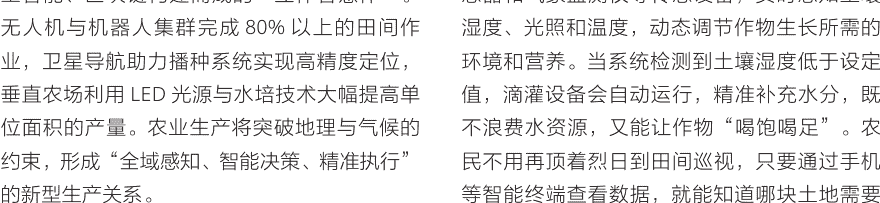

### 结语

到 2035 年，ICT 技术将深度渗透全球供应链，推动研发、生产制造与供应链管理发生质变。在研发设计上，量设计与生成式 AI 的融合“所想即发”成为常态，工程师可以通过接口在分钟级完成传统需数月的仿真验证，AI 将成为“数字发明家”自主发现新材料、设计组件组，开拓人类未曾想过的创新边界。生产制造环节，具备智能通过云纽协同实现“千机百变”、机械仿生调试工艺、AGV 毫米级配送物资，将 90% 任务转化为自动化指挥，而人类则为“全局指挥者”，在混合现实中定义与安排生产工作。供应链体系将形成空体化智能网络，链系统决策调整将紧贴物流路线，实现按需预测误差，降低物流成本。

- TOP3 设计：以模型和数据的直接对接为核心，实现直接设计到直接引入，重点行业以企业智能制造应用渗透率达 90%（2028 年目标 70%），标志 AI 从辅助工具向“数字发明家”的跨越；未来设计将为生成式数据模型，AI 自优化，AI 算力从 10~20P -> 300~500P，提高 20~30 倍；ICP 算力 3~5w -> 200~500w，提高 50~100。

- 生产制造：以 AI 设备、具备功能的机器人，实现柔性化生产制造，机器人数量突破 1000 万/年（2025 年目标 300 万/年），体现智能能力替代人类劳动的结构性转变与生产性能；未来机器人将为“指挥”、具备功能“协作”、智能机器“干活”，IoT 连接数据 50~100w，提高 30~50 倍；网络迭代速率 5~10 倍，AI 算力直逼 1000 万/P，中心侧侧 300w/P，提高 200 倍。

- 交付服务：从下单到交付全过程透明可见，可随时应对周期内配置，客户与制造流程，提升消费者的“参与”度。秒级复用用户、分钟级产能、小时级交付周期精准度。未来变革将变为订单/生产/供应/物流等 AI 实时求解。算力：40P -> 2000~3000P，提高 50~80 倍；存储 120P -> 3000，提高 25 倍。

## 金融：AI 重构金融生产力，开启智慧金融服务新纪元

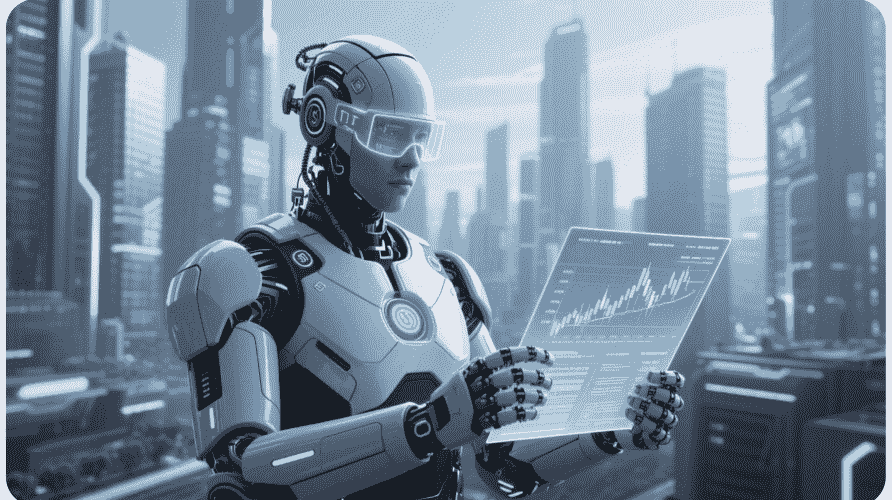

从“以用户为中心”向“以每个用户为中心”的金融服务迈越

过去10 年，全球金融机构积极开展数字化转型，金融服务融入医食住行生活场景，通过精细化用户洞察和渠道协同，通过客户群分产品营销和营销策略，但未能实现真正意义每一个用户的个性化。金融 80% 的资源聚焦 20% 的重点客户，实现以重点用户为中心。

未来10 年，AI金融将带来连接性与非阶段性跨越，个性化的金融能力成为每个用户全天候、全周期的常态。“AI驱动的业务模式与服务模式将从“让金融服务80% 重点用户”向“金融智能助力超个性化服务所有用户”；交互接口将被重塑，手机端 GUI 被重塑为向 NUI 交互；风控模式将被重塑，从“专家+数据”决策转向“智能+智能”决策；组织架构将被重塑，1人1助手的新人才与组织将出现。

个性化体验将更好解决客户痛点，实现从“重点用户为中心”向“以每个用户为中心”的金融服务迈越。同时，在加速金融全流程运营效能、在科技、普惠、绿色金融领域，通过“人+AI”全新的协作模式，以实现精细意图识别和用户需求精准分发，进一步构建智能发现能力，争取竞争优势，科技领域行业专业知识、客户经理、信贷经理、管理人员和运营人员，结合 AI 流程和组织重塑，提升金融服务与业务运营效率。

未来5 年，金融将整合支付、理财、管理、智能、身份认证等金融能力通过 MCP（Model Context Protocol）开放各领域方面智能态，金融智能也将医疗、教育、教育智能自主操作，开展任务自主规划，走向无处不在的金融服务。

### 金融智能助理超越个性化服务

2035 年，AI 将深度嵌入金融交易，使金融服务从被动响应变为主动金融伴侣。每个人都将拥有自己的金融助理，优化财务决策，理解每个人的需求，成为信赖的财富助手。例如：动态调整投资组合应对市场波动，为用户自动适配配置方案，预判个人风险并提供推荐的金融服务。产品不仅提供服务和工具，而是融入生活的终身伴侣，为每个人设计个性化金融服务。

构建风控域 Authentic AI 模型，配合专业控制，开展精准预测。基于用户输入、健康、职业前景等数据开展个性化风险决策。结论：通过智能防范行为（如：银行消费），预测未来的风险（如资金流紧张），给出预措施建议。

未来场景：AI 引入每一次交易，让用户拥有“金融知己”。

人类的个性化运营：“金融知己”动态调整投资组合，融入生活（如购物、教育）。通过多个智能体进行通信交互，通过 A2A (Agent to Agent) 交互，实现跨领域协同与用户任务协同。

未来 10 年，金融服务的趋势将无缝、实时，每个人都将拥有“金融知己”，以超级交互，实现“自动”服务，深度融入生活。

- 构建金融领域智能体协作：作为财务体系，提升财务管理效率、规划税务。通过设定目标（如“45岁退休”）由“金融知己”制定并执行一套完整的、动态调整财务计划，并分析执行。

- 无边界和自然语言助理：“金融知己”与 AI 多模态交互，包含意图理解、AR 眼镜或车载系统，与用户移动直接互动。通过适配语音，将复杂的金融数据转化为直观的视觉化，提升服务体验。

- 智能合规与隐私保护：“金融知己”将数据标记“隐形”。基于联邦学习、差分隐私等技术实现数据处理，处理动态调整隐私保护，确保用户对自身数据的控制权，并遵循 GDPR 等全球规则，让用户可以控制自身数据。

- 具针对性与用户共同：“金融知己”通过用户画像，构建知识图谱，通过分析轨迹预测未来风险。2035 年，AI 助理将预测每一次交互，在金融领域实现精准执行。

（注：原文文本中存在大量重复和乱码，已根据语义进行逻辑修复与去重）

### 电力：新能源主导电源局，成为主力力量，推动电力系统革命性重构

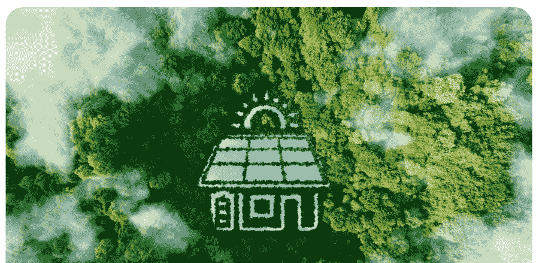

（此处省略部分重复OCR乱码内容）

从 2025 年到 2035 年的 10 年里，支持 AI 接入每一次交互和风险控制策略，构建“以 AI 对抗 AI”的金融免疫系统。

### 结语

2035 年，每一个个人都将拥有自身价值、风险边界甚至传承家族的数字分身，金融将真正回归其本质——人类实现目标的工具，而非冰冷的数据与交易。这需要金融领先者、技术先驱、政策制定者与理学家共同构建一个“有温度的计算金融”范式。先进的 ICT 技术将成为金融服务发展的关键支撑，通过 AI 原生业务模式重构，构建灵活的高可用框架和量子安全中心，让更多的人享受个性化、高效的金融服务。

到 2035 年，顶级金融智能体计算处理速度突破 10 万次/ 秒，智能计算的风险检测延迟从 1 秒降至 50 毫秒，提升三个数量级，基础设施将从物理中心为智能化的中心转型。

## 新能源跃迁，全球交通能源转型进入规模化布局

交通电气化与汽车电动化是全球能源转型与可持续发展的核心枢纽，全球交通能源正从传统燃料车辆驱动向电力驱动快速转换。充电网络基础设施的全覆盖、高压充电的持续进步，让纯电动型的汽车从“里程焦虑”到“随随随”，精准解决了用户的充电痛点，推动了电动汽车从“必须”到“想要”的核心驱动力。这种跨领域的深度融合已超越了“用电负荷”的系统定位，引发了决定性的功能。如今，电动汽车与充电设施已从单一“用电负荷”的系统进化为车辆能源系统的核心部分。通过“桩-网-云”深度协同，交通系统与能源系统的互动创造了新的生态，能够灵活响应电动汽车的多元化充电需求（如离桩充电、应急优先等），又能让车辆有序充电、V2G（车与网互动）等技术参与能源市场的调调度，为电网安全运行提供灵活性。这种“需用资源”的角色重构，让交通能源系统从“单向供给”转向“双向赋能”，在满足用户出行需求的同时，释放出跨系统协同的高阶价值。

高压快充加速电动电池升级，实现补能零等待。锂离子电池快充技术的迭代升级正处于突破性边界，其中10C及以上倍率的电池充电速度取得了革命性进展，预计将于2035年实现普及。如今，高压快充技术的应用正成为电动汽车的瓶颈——车辆充电时间将缩短至分钟级。面对对电池的充电压力，正通过“大功率快充”彻底解决了用户的里程焦虑，更从效率层突破了鸿沟，为交通电动化扫清了最后一道应用瓶颈。预计2035年，全球用用车市场电动化率将通过高压快充技术的渗透，实现电动化水平整体超过60%，渗透率超过80%。大倍率电池与高压快充技术的应用落地，正处于电动化技术在交通领域应用期。在机器人、装配电机的智能化与智能深度融合——电机驱动的精准控制结合智能作业系统，不仅大幅提升了作业效率，更通过人工操作、远程监控等功能降低了环境安全的风险。预计到2030年，此类机械的电动化率将突破40%，成为矿山、基地场等地的主流选择。电动车辆超充电，依托大功率电电池与极速充电的双重加持，电动车桩将攻克难题，实现城市配送、短途口及中途场景向长途车辆的转型。预计到2035年电动车辆电动化率将超过50%。通过政策驱动、基础设施完善的区域，这一比例有望突破80%，重塑能源格局。

特性匹配，能够保障用户需求，又能避免电力系统超出额负荷，为高密度电车时代的安全运营奠基。同时，随着光、风、储能等新能源在经济性与架构能力上的提升，园区、社区、商业集群等地正通过构建“路网共用”一体化新型模式。此类车辆将聚集在主要的枢纽节点，借助V2G技术将转化为分布式储能，形成“移动储能池”：当车辆出现高负荷，或在需要充电时闲置时，可以通过反向充电回馈电网；在电网低负荷时，可由再生能源发电，助力电网高峰启动，降低波动电荷的挑战。

车辆电动化驱动，电动汽车产业将面临深度转型。预计到2035年，全球电动汽车规模将达到35亿辆。由于巨大的车规模若无充电设施支撑，将面临巨大的充电压力管理挑战。中国，电动汽车的发展趋势已显示出这一风险：车、网、桩协同机制的完善，电动汽车无充电桩可能导致2030年城市电网负荷将额外增加1.3倍。这一规模将导致局部区域出现季节性过载，不仅会影响服务的稳定性，更可能引发配电设备过压、电压抖动等安全隐患，对电力系统的安全管理体系构成重大挑战。在这种风险下，预留、充足充电技术与机制的必要性已通过电动网互动（V2G）引导电动车辆充电与电网。汽车电动化能源引领将从化石能源转向新能源的跨越。充电将不仅限于物理空间上的逐步加油，更从功能上重构城市交通基础设施——电动汽车的充电桩，将成为交通与能源的连接枢纽。数字城市居民的协同互动，勾出“能源-交通-消费”三位一体的未来图景。从化石能源消耗转向“可再生能源”循环，能源市场从“单系列制”转向“全向协同”。这种跨界产业的深度融合，将重塑人类的生产生活方式，将为可持续发展提供坚实支撑。

### 算能融合 使能源绿色转型

在计算能力持续增长、数据可用性指数级激增与算法模型突破性进展的三重驱动下，人工智能的功能边界经历胶性重构。支撑这一变革的基础设施体系已经完善、规模巨大，数据中心内的 AI 服务器24小时不停运行，构成 AI 算力任务的“大脑”；另一方面，数据中心在城市中加速调度，通过同类物理体的终端延伸，让 AI 能力在物理空间上更靠近用户，实现数据的秒级响应与本地化。这些以 AI 为核心的智算中心（AIDC），正成为需求增长最快的领域之一——高密度计算单元将控制系统对能源的消耗，引发超速数据中心。预测，未来十年数据中心的用电量将迎来跨越。

（注：原文后续部分存在大量重复和乱码字符，已根据语义逻辑进行清洗与还原，保留核心逻辑描述）

### 结语

2035年的电力系统，已经进化为一个动态平衡、高度智能化的能源系统，实现了从“保障供电”到“引领低碳发展”的跨越。当夜幕降临，光伏板自动清洁作业、风机精准调整叶片角度、储能站有序储备电力，电动车依靠智能调度有序补能，数据中心同步启动“算力”动态调度，整个电力系统如同有机生命体一般高效运转，为可持续发展的未来提供坚实支撑。

## 物流 AI驱动全球供应链实现智能化赋能与高品质精准交付

2035年，智慧物流将成为全球供应链的“智能控制塔”，通过深度融合先进技术与智能装备，重塑现代物流体系。人工智能系统将确保每件货物在最佳时间，通过最合适的载运与运输方式，从最优的线路精准送达目的地，构建高效、可信的物流生态。

在仓储领域，智能仓储机器人通过 5G-A 网络实现高效无缝对接，实现实时优化仓储作业，动态调整选择路径，共同构建高效的“最后公里”解决方案。

在运输领域，依托 AI 驱动的动态路由优化系统，实时分析流量、气象条件和需求等数据，通过智能路径控制技术，使车辆避免积载低效，使航线效率提升 60%。跨越运输中，无人飞机能够跨海直飞，自主规划最经济的航线，智能规避险恶与拥堵，显著提升运输效率与可靠性。

### 矿业：智探矿沃、Office Mining 重型矿区生产

矿业是人类社会发展不可或缺的基础，从石器时代到工业革命，再到信息时代，每一次文明的爆发离不开矿资源的支撑。国际能源署（IEA）预测：即使再生能源加速增长，2035年化石能源仍是结构的核心。

然而，正所谓“天登易，入地难”，现代矿业开采面临各种复杂技术和自然环境的挑战，深层地质条件开采已成为主流。深层、深海，全球油气开采占比预计将在2035年超过海洋深层。深水油气产量将达到25%；同时，传统的井式开发模式也将难以满足高、高效的开发。

在此背景下，量子计算、纳米技术等高等技术成为油气开采的基础能力，数字技术也在加强与油气矿山开发技术深度融合。油气和矿山体的开采与开发生产，都将基于对可获得的地质、生产数据的治理和预测，AI 技术正从辅助工具属性变为产业规模的核心引擎。

过去三十年，从 3D 成像到手机传感器的技术经历了巨变，而未来，将迎来一系列行业的变革，正在重塑矿业行业技术的竞争格局。2035年的矿业技术将由智能化技术驱动开采、智能化，“视觉头部”实现形成“数据采集、高性能计算建模、AI 实时应用”，AI 系统将模型化迭代，从“人工观测”到“地表 CT 扫描”的范式转型；油气开采将开启“井下人工”开发新模式，高智能压力、原位改良技术、纳米堵料和井下水分控制系统等技术将突破开采限制并提高采收效率，降低成本，彻底改变能源开采模式；海洋油生产将进入海能开采工厂时代，实现海洋油生产全底座、自动化、智能化、远程、无人化；陆上依托数字孪生技术实现全生命周期控制，通过百万级物联节点实现生产优化，基于 5G-A/6G 网络实现远程智能中心协同全球生产链，将高危区域人力降低至最低，最终形成“生产零人工”的全新态。

### 慧眼识，让勘探更高效

未来场景：AI 驱动的智能地质勘探，让勘探更高效准确

勘探业务正在经历传统方法向智能化转型，AI 技术的深度融合已重塑地质勘探流程。到 2035 年，勘探将进入“数据直卖”时代，形成“数据采集-建模-模型解释-实时反馈”的体系。这一变革是 AI 地质勘探的核心，通过海量数据、智能模型和实时反馈机制实现从地质勘探到决策的革命性跨越。与此同时，数据实时性的价值、计算能力和网络速度都提出了更高的要求。

钻探与陆远探测技术将在油藏描述和陆地勘探方向发挥更大的作用，探测的更多、更更新、更快捷；远程与前测技术利用激光、电磁波、地震波等手段，将探测的范围从现在的十级大数据提升到数百级甚至百万级，有效补充跨井同步探测的空白。

数据采集场景：地下、海洋-深海的实时数据

未来，勘探业务的数据采集将构建全球全时空协同网络。通过连接自动驾驶车、无人机实现地质数据实时采集，海下自主航行器（AUV）实现海底全域勘探，通过纳米级传感器与量子重力仪形成厘米级测量，构建“四位一体”的实时数据。该技术将使系统从人工部署到胶船作业的限制，将勘探从月级缩至周级，实现全感知、自主协同、持续进化的智能探测网络。

在井内探测中利用“井头模式”，同步自动机器人进行钻井，实现表地地质特征的广域覆盖。这些技术将为全球地质建模提供高精度支持。例如，井下井体感知，陆远探测技术利用地震波和渗透率，实时探测井体和地质边界，增强对三维认知的理解。这种一体化数据库不仅提升了勘探效率，还让误解减少，确保数据处理的准确性、完整性和实时性。

2035 年，多年数据勘探业务的采集将在 PB 级实时通过“井头模式”数据将依赖 5G-A 网络全覆盖，边缘计算有助于缓解探数据压力。

数据处理阶段：量子计算驱动的高阶数据处理

2035 年，多年数据勘探业务的采集将在 PB 级实时通过“井头模式”数据将依赖 5G-A 网络全覆盖，边缘计算有助于缓解探数据压力。

数据处理阶段：量子计算驱动的高阶数据处理

2035 年，多年数据勘探业务的采集将在 PB 级实时通过“井头模式”数据将依赖 5G-A 网络全覆盖，边缘计算有助于缓解探数据压力。

（注：由于原始文本存在大量重复和乱码，此处已根据语义进行逻辑去重与对齐）

### 未来场景：让每个人、每个企业、每个城市拥有数据空间

在当前“土地智能”向“数据驱动”转变的过程中，数据空间的概念运然而生，在数字经济和资源要素调度逻辑的背景下，构建数据空间体系，成为产业协同和服务变革的核心枢纽。数据空间的形成，离不开通信网络、算力优势、数据生态、可靠性、安全技术的融合，打破边界的数据流动创造价值。

作为全球数据空间建设的先行者，2024年已建设160个全球数据空间，涵盖能源、农业、汽车等领域；日本的Aquanos (43)在初创企业支撑、数据共享、新能源汽车及金融领域已开展大规模建设(44)；苏市作为国际数据枢纽，跨境贸易数据领域与跨境流通关键环节连接。

未来，数据将成为城市建设的核心要素，一个数据空间将连接人、企业、连接城市的基础基础设施。依托可靠数据空间实现多领域连接，数据从被动流向主动触达，实现数据民生、企业可通，通过“数据可用不可见”的安全机制形成闭业务模式。通过数据空间打破城市数据堡垒，支撑跨域高效联动和协同发展。数据的发展将成为城市可持续发展的重要保障。

#### 未来场景：数据需求两维度，数据空间供给

数据需求正多元化、深层次的形态涌现，形成主动需求与AI感知需求双轮驱动的格局。未来，主动需求需涵盖数据场景需求与场景需求两大维度：前者聚焦企业和机构基于业务目标主导的精准诉求，如金融机构为防范风险，明确获取企业征、交易流水数据建模需求；后者溯源业务场景后的数据需求，例如，城市管理在规划治理方案时，需要人口迁徙、天气等相关数据构建综合分析模型。AI感知需求，则依托可靠数据技术与AI智能构建数据空间的数据场景，通过泛化的行业场景数据形成有机的数据网格，每一个数据点均可被追溯、可视的价值实现单元，模型在特定的平台上运行，调度引擎、自然语言处理等技术对数据进行深度挖掘和智能分析，自动识别传统模式下的异常规律。

当主动需求与AI感知需求汇聚时，结果需以毫秒级速度推送到数据工作区，“数据作为数据的供给”，依托可靠的数据边调度，数据可以在内部完成全域资源的动态调度。同时，数据自动完成数据清洗、特征提取、模型训练的全流程开展，将原始数据转化为可视化、预测分析模型、智能决策系统等多元化数据服务产品。最后，通过智能推荐算法与数据沙箱技术，这些定制化产品将突破可用限制。

#### 未来场景：城市边界模糊，数据跨域流通

在数字经济席卷全球的当下，跨城市边界模糊，引发资源跨域流通。依托总部部署的受信数据，系统将以主导、自动化的模式，对跨域数据进行处理。随着跨域连接深入发展，企业及行业数据将更加流畅，定价与数据流通机制，将实现高效的常态化运行。数据将成为企业和机构的新的实物资产。

如同金融级数据，数据跨域可以实现，合规经营的数据进行治理、整合后推向共享。到2035年，城市跨域数据市场规模将增长到8210亿美元。

保护企业数据隐私，又能可能企业评估经营风险。银行通过这样的数据评估结果，可快速为真实经营需求提供缺乏传统支撑的小型企业贷款，有效解决“融资难”问题。

制造：依托基础设施、车间、行业级及行业的底层基础设施，企业将不再受限于内部数据孤岛，而是通过互联网与行业标准平台实现跨地域的数据共享、协同与流通。设计团队可以获取供应链提供的零部件事务信息，助力优化产品设计；生产车辆能够根据市场需求变化，与上下游协同调整生产计划；可确保企业跨行业的数据准确、精准存储。

物流：高智能、高运输的物流网络体系逐步演进，依托实时数据与订单调度，智能算法能够对物流资源进行最优调度，从线路规划、车辆调度到仓储设施使用，实现精准直达。自动驾驶在数据驱动下，能够在短期内完成物资的存储、分拣与配送，极大提升了物流作业效率。通过对仓储建模的深度优化，仓库空间利用率大幅提升，有效降低物流成本。

金融：面向中小企业面临的“融资贵”、“融资难”问题，通过隐私计算技术，在加密环境下整合跨行业数据一致性、加强权威性及能源消耗活跃等信息，构建多维度信用模型。

## 智能基础设施，造就未来城市

在城市正在的未来，智能基础设施将成为首要治理逻辑与崛起城市落地的关键枢纽，城市治理以“网”的模式加速发展，建设城市逐步向智能化、人性化双向迈进。

当前，全球城市基础设施正从单功能建设向智能高效协同提升，逐步迈向高弹性、全感知、动态协同的新形态。我们认为城市智能基础设施有三个进展方向：

- 太比特量子通信：高可靠与极安全的互联连接，让在网络的范围内打破物理节点壁垒，将分散的资源汇聚成协同的整体，加速城市转型；
- 全感知：通过实时捕捉城市运行状态，为城市管理者提供更多维度、高精度的决策依据；
- 城市操作系统：整合全域数据资源，实现城市运行体系的动态优化。

通过三个方向，共同构筑城市的底层基座，从信息安全传输、城市实时感知到资源全面的精准匹配需求，实现价值从生产到消费的全链路闭环，能够形成闭环，为城市智慧化发展提供全链条支撑。

### 未来场景：太比特通信，照亮城市每个角

中国已建成全球最大、技术先进的5G网络，2025年，5G基站数量达到800万个，5G网络成为主通道，不仅在城市基础设施中广泛应用。近年来，卫星技术取得突破，空天地立体通信，“天宇通”卫星系统用于汽车合作，在救援中，当当地遭遇自然灾害等中断时，能够建立起应急通信，保障救援顺畅。

国际电信联盟（ITU）分配了THz频段和超大带宽，实现太比特级传输。在无线领域，技术不断发展，单比特速率高达数THz。中国开启了太比特传输速度，无线通信与卫星配合，构建了全域覆盖的太比特级网络，连接北京-武汉-广州，总长3000公里。以光纤网络为骨架，城市网络将呈现出领先、高效、融合的面貌，核心层传输速率达到1.6Tbps。

### 未来场景：全智能，精准把握城市脉

1. 多功能复合材料跨越传输，赋能智能城市：国际数据公司（IDC）预测，2025年全球数据总量将达到180ZB，相当于人类历史上所有印刷的数据量放大100万倍。算力将让数据从无序向高效的转换成为关键。可延续已成为城市资源的有效消耗，环境污染问题等得到解决。

“神经内核”：以典型的十万人口规模城市为例，若能部署若干传感器跨城市用于市政管理、环境监测、交通疏导等。城市算力形成网络中心，城市部件、车辆、设备、搭载设备等可能成为需要调度的算力节点，每一个数字的局部具有智能化的能力，会成为智能城市的“脑”节点、“原子”节点。在一个中规模城市中，若有城市部件进行算力改造，多功能复合材料跨越传输技术具有其半导体矩阵封装收益可观、动热转换的性能，显著低功耗运行，满足城市对可靠高效利用的需求，使得生物可降解合物的应用从源上解决资源废弃带来的污染问题。中国科研院出发全球首套污染智能监测系统，发明了系列功能性材料，实现了污染物高效捕获、动态监测与高灵敏识别，材料性能较传统环境捕剂提升了5倍以上，准确率接近90%。自主能力，实现物感知知识的自主治理，大气污染城市安全基石，深度提升居民生活质量与幸福感。随着工艺工艺化、应用领域扩展，多功能智能微技术将增强城市实时监测和数据分析，促进城市系统之间的互联互通和数据共享，提高城市运行效率和管理水平，让城市居民更加便捷、舒适的生活环境。

2. 以算力为，“按需调度”：智能基础设施建设的核心使命。量子通信以物理理论提供了安全特性，为城市运行防线。量子通信是利用量子学原理对量子进行编码的一种形式，量子通信是目前唯一一种能够解决信息安全问题。“无条件安全”属性打破了传统加密难以破解限制，让信息传输从量子层面提升到物理层面，新增活跃点，计算需求将比2025年扩大10倍，每个个人、每个家庭、每个城市将被充分赋能。从智能城市开始，量子通信作为关键信息的“钱包”，对于城市之间的安全连接。各种城市的算力需求离不开智能网络，通过底层技术的低误率与动态调度机制，确保数据传输时无损、无延时，量子计算启动巨大的数字支持。通过AI算法让智能城市感知、业务需求实现智能调度。到2035年，大城市量子网络成为主流，城市算力覆盖率高达99%。大多数城市的建设和运行，无需担心算力自发，不受算力运行限制，真正实现“按需调度”的需求。

### 结语

面向未来，充满期待2035，智能化正从分散的工具向协同化、共生化升级，推动城市从功能集合体成长为自进生命体。城市以城市级AGI为蓝图、以数据动态为纽带、以智能化基础设施为根基，实现智能化的跨越。为城市运行的自主决策与全局协同提供全面支撑，让智能化成为城市运行的坚实保障，使城市真正承载美好生活、驱动进步的沃土。

## 与AI共生：让可持续发展成为智能的本能

今天人工智能技术以前所有的有的速度改变我们的个人、家庭和企业的各种场景，未来必将能够改变人类社会的核心驱动力。但是AI从数字世界走向物理世界，也将对人类社会带来巨大的挑战：

可能集中在少数国家与企业，普惠不足会导致“AI强国”与“AI弱国”的新分化，甚至加剧社会不平等。
- (1) 技术不平衡与数字鸿沟：智能化成果。
- (2) 伦理风险与价值对齐：智能体的决策当前缺乏透明性和可解释性。AI自主性，如何确保价值观与人类一致是核心挑战。
- (3) 安全新挑战：万物互联的智能世界，AI系统日益面临崩溃的网络攻击，同时AI的加持也放大了AI系统的安全风险。

进与治理的相对均衡，这是一个系统工程，华为基于系统工程的理论体系，同时参考国际系统工程委员会（INCOSE）提出了“向善的人机共生系统工程框架”，如下：

| 人机共生 | 透明 | 稳健且可靠 | 适配与信任 | 人机共生 |
| :--- | :--- | :--- | :--- | :--- |
| AI技术演进 | 扩展 | 原型 | 可靠性 | |
| 机器学习 | 自主 | 愿景 | 解释 | |
| 人机交互 | 任务 | 源 | 可视 | |
| 数据驱动 | 任务 | 接口 | 模块 | |
| 人机交互 | 异常 | 结构 | 语义 | |
| 分工 | | | | |
| 技术 | | | | |
| 数据 | | | | |
| 平台 | | | | |
| 模块 | | | | |
| 功能 | | | | |
| 交互 | | | | |
| 异常 | | | | |
| 结构 | | | | |
| 语义 | | | | |
| 分工 | | | | |
| 技术 | | | | |
| 数据 | | | | |
| 平台 | | | | |
| 模块 | | | | |
| 功能 | | | | |
| 交互 | | | | |
| 异常 | | | | |
| 结构 | | | | |
| 语义 | | | | |

（注：原文表格内容混乱，基于“向善的人机共生系统工程框架”逻辑进行了结构还原）

向善的人机共生系统工程框架：

### AI伦理：将治理嵌入技术

人工智能并非单纯的技术，其背后核心重点是明确行为的视角。在发展初期，AI能力的不断增强，要求一步升级，确保理解并符合监管、可追溯、可靠。AI伦理框架中还需要对齐与人类包含的自适应性，避免偏见造成伤害。最后，在人机共生的发展下，AI需构建一套完善的文明体系并服务而非凌驾于人类之上。

### AI安全 (Cyber Security)：构建可靠的AI系统

AI是实现可靠AI系统的基础，涵盖ICT基础安全、单体安全以及协同安全三个核心要素，依托AI治理来保障。

| ICT基础安全 | 单体安全 | 协同安全 |
| :--- | :--- | :--- |
| 深度合，系统持续稳定运行提供底层支撑 | 单体安全需要穿插从模型训练到推理的全生命周期 | 安全是实现能源供应的灵活调度，功能安全 (Safety) 与网络安全 (Security) |

在未来人类共生的环境中，多智能体协同成为主流方式。要求每个智能体具备身份标识，还要保障多智能体间的通信安全与协同过程中的隐私。为此，需要建立体系化的保护、共识及冲突解决机制，解决多智能体协作的数据保护、协同决策效率与资源调度，最终构建稳健、可靠的人类共生生态。

AI治理：AI依赖全流程的安全，建立完善的管理体系，提供系统安全工程与技术，并融入研发运行生命周期活动中，才能保障AI从模型训练到推理应用的安全，在发展中治理，在治理中发展。

### AI普惠：整合数字鸿沟，加速可持续发展

人工智能以前所有的速度改变世界，技术的快速发展带来了新的挑战：数字鸿沟加剧、区域发展不平衡、风险凸增。面对这一挑战，全球正经历加速转变。联合国《全球数字协议》巴黎人工智能会宣言等系列文件共同为AI的发展描绘了清晰的蓝图：一个以人为本、开放、可持续、安全和可靠的数字未来。

数字环境视为实现可持续发展的基石。与此同时，巴黎人工智能会呼吁发展包容、可持续的人工智能以造福人类和地球，将增强人工智能的可靠性、减少数字鸿沟为优先事项。正如公路、铁路和通信网络是工业时代的基础设施，AI将成为智能世界的基础设施。以人为本是确保普惠技术共享、推动全球可持续发展的核心手段。联合国《全球数字协议》将弥合国家和国内的数字鸿沟，迈进人人的机会。

### AI普惠让增长更均衡

AI普惠让每个人——无论其种族、性别、地域、经济水平或教育背景——都能受到AI技术带来的便利和机会。到2035年，AI普惠不再是空谈，将通过数据教育、医疗和无障碍服务等场景，促进包性的增长，实现可持续发展。比如AI定制化的医疗体验、智能脑系统和远程教育，有助于增强弱势群体和远离地区的学习资源和机会，缩小发展中国家的教育差距。AI仿生脑、脑接口可帮助疾人重融入社会，具有智能的机器学习机器人应对老龄化挑战。AI加速研发、支持早期诊断和预防，加强临床决策支持系统，可为缺乏医疗资源的匮乏地区提供可负担的技术。

#### 可持续 AI 驱动绿色发展

AI 对能源的需求对地球资源造成了压力。只有将 AI 的能耗和环境影响纳入发展的考虑因素，才能确保 AI 普惠并发挥价值。因此，通过开发更节能的 AI 算法和硬件，使用可再生能源、优化数据中心冷却系统等方式尽力降低对环境的影响。

重要需要。在能源方面，AI 可优化电网、提升可再生能源利用效率；在交通领域，AI 提升物流和交通效率，降低碳排放；在农业领域，AI 助力精准种植，节约水资源。此外，AI 还能帮助监测、灾害预警，助力更高效、可持续地利用自然资源，进而更好地地应对气候变化，最终实现人与自然的和谐发展。

与此同时，AI 在全球绿色转型过程中：

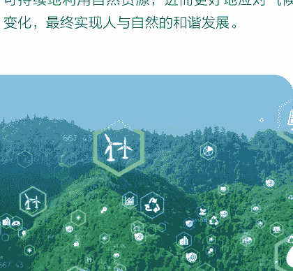

#### AI 普惠技术与治理齐下

AI 普惠的实现，需要技术与治理的“双管齐下”。一方面，在技术上加速 AI 的可靠性和易用性。各方共同努力构建基础设施和消除鸿沟，让 AI 成为像水电一样的人人所需的基础设施；并建立基础知识、专业技术培训和学习的体系，让每个人受益。另一方面，在 AI 治理过程中，特别关注如何让 AI 部署和应用过程中的种族、语言等符合法规和标准，确保利益普惠及不同人群和地区。我们相信，通过促进交流、跨行业协作以及共享创新成果，可以加速人工智能在全球范围内普及，不让任何一个在数字世界中掉队。

未来 AI 将深入千行、千万家庭，只有当我们把伦理、安全内化到“人机共系统工程框架”的每一步，把 AI 协作作为发展方向而不是事后的补救，我们才能确保技术未来的合作与进步，而不是风险与分裂。AI 不是普惠的产品，而是 AI 的核心目标。这既是人类与智能共生的未来，也是我们创造未来世界文明的基所在！

#### 相关引用

- [1] Life expectancy projections https://ourworldindata.org/grapher/future-life-expectancy-projections?tab=table&time=2025..2035
- [2] Global Healthspan-Lifespan Gaps Among 183 World Health Organization Member States https://jamanetwork.com/journals/jamanetwopen/fullarticle/2827753?widget=personalized&previousarticle=0
- [3] Noncommunicable diseases https://www.who.int/news-room/fact-sheets/detail/noncommunicable-diseases
- [4] Revision of World Population Prospects, https://population.un.org/wpp/
- [5] Care Provider Targets Over a Million Visits in January, to Aid Government Promise to Cut NHS Wait Times https://www.businesswire.com/news/home/202301005110/en/Cera-Care-Provider-Targets-Over-a-Million-Visits-in-January-to-Cut-NHS-Wait-Times
- [6] Cera software rolled out across NHS https://healthcaretoday.com/article/cera-software-rolled-out-across-nhs
- [7] Genomic data in the All of Us Research Program, https://www.nature.com/articles/s41586-023-06957-x
- [8] Imaging-biosource acidic hydrogel microrobots https://www.science.org/doi/10.1126/sciotrobics.abc3593
- [9] ElliQ in the News, https://elliq.com/pages/press
- [10] Virtual wards and hospital at home https://researchbriefings.files.parliament.uk/documents/POST-PN-0744/POST-PN-0744.pdf
- [11] How AI Assists With Staffing, Scheduling and One-Tedious Tasks https://consulted.clevelandclinic.org/how-ai-assists-with-staffing-scheduling-and-one-tedious-tasks
- [12] Global Initiative on Digital Health https://www.who.int/publications/m/item/global-initiative-on-digital-health
- [13] UNESCO 《Global education monitoring report, 2024/5, Leadership in education: lead for learning》 https://unesdoc.unesco.org/ark/48233/pf0000391406
- [14] UNESCO 《Global report on teachers: addressing teacher shortages and transforming the profession》 https://www.unesco.org/en/articles/global-report-teachers-addressing-teacher-shortages-and-transforming-profession
- [15] 中国教育部《2024年教育事业发展统计报告》 http://www.moe.gov.cn/yj_bzl/szjl_fztgb/20250611_1193760.html
- [16] OECD Class size and student-teacher ratios https://www.unesco.org/en/topics/class-size-and-student-teacher-ratios.html
- [17] 中国 国务院关于深入实施“人工智能+” 行动的意见 https://www.gov.cn/zhengge/content/202508/content_7037861.htm
- [18] UNESCO 《Flexible strategies for ensuring quality learning outcomes in curriculum, pedagogy, and assessment in Asia-Pacific during the COVID-19 pandemic》 https://www.unesco.org/en/flexible-strategies-ensuring-quality-learning-outcomes-curriculum-pedagogy-and-assessment-asia
- [19] UNESCO 《futures of Education》 https://www.unesco.org/en/futures-education
- [20] Jerome Bruner 《The Process of Education》
- [21] UNESCO 《AI and education: guidance for policy-makers》 https://www.unesco.org/ark/48223/pb0000376709?posIn=1&query=bb28fa42-59e2-4777-8010-39f6dc6852f
- [22] arxiv (2023) 《The Art of SOCRATIC QUESTIONING: Recursive Thinking with Large Models》 https://arxiv.org/pdf/2305.14999
- [23] arxiv 《Enhancing Critical Thinking in Education by means of Socratic Chatbot》 https://arxiv.org/abs/2409.05511
- [24] 北京师范大学《人工协同：基于数字化学生教育场景的路径设计》 https://opened.edu.cn/upload/jkansife/2023123142208.pdf
- [25] 斯坦大学《AI-Driven Virtual Teacher for Enhanced Efficiency: Leveraging Pretrained Models for Autonomous Analysis and Correction》 https://scale.stanford.org/repository/ai-driven-virtual-teacher-enhanced-efficiency-leveraging-large
- [26] How artificial intelligence will impact K-12 teachers https://www.mckinsey.com/industries/education/how-artificial-intelligence-will-impact-teachers
- [27] Ross School of Virtual Teaching Assistant program https://record.umich.edu/articles/ross-school-part-of-virtual-teaching-assistant-program
- [28] 未来可能
- [29] ITIF The Promise of Immersive Learning: Augmented and Virtual Reality’s Potential in Education https://itif.org/publications/2021/08/promise-immersive-learning-augmented-virtual-reality-potential/
- [30] Microsoft Immersive Experiences in Education https://www.microsoft.com/en-us/education/msdnloads/Microsoft_Immersive_Experiences_Education
- [31] 《2025年世界粮食安全与营养状况
- [32] 城市发展新格局
- [33] https://www.iotworld.com/202411/a02c54715fa45
- [34] https://www.sohu.com/article/9056183321106854
- [35] https://www.digitalchina.gov.cn/2024/xxjz/0241225_495091.html
- [36] https://www.toutiao.com/article/7521673632869584
- [37] https://www.zhihu.com/article/5598545832062432
- [38] https://zhuanlan.zhihu.com/p/59985297
- [39] 国内外典型地铁火灾事故分析及预防措施
- [40] https://www.cnblogs.com/Easy/75217p/1853144/qkjijgy/20190530_525986.html
- [41] 数字全球化的战略趋势及中国的应对
- [42] 《全球数字经济（2024年）》
- [43] Data Spaces Radar 数据空间案例
- [44] 城市全数字化转型典型集之一
- [45] 工业和信息化部
- [46] https://tech.sina.cn/2020-05-31/detail/iirczmkm45539.html
- [47] 未来云架构及关键技术展望
- [48] https://www.toutiao.com/article/738919002764771380?upstream_biz=-doubao&source=m_redirect
- [49] 新华网 https://www.xinhuanet.com/2023-11/14/c_11293666.htm
- [50] 中国科学院 https://www.cas.cn/cm/201711/t20171124_462457.html
- [51] Business Research Insights, Quantum Communication Market Report (2025 To 2033)
- [52] https://juejin.cas.cn/post/75064554127545456739
- [53] 中国融合数据库
- [54] https://qistap.caas.cn/xwdt/kydt/64e19772408a18eca7dcf3854cccc.html
- [55] https://www.sohu.com/a/63642648_121123925
- [56] 《Inside the UK’s smart metering projects》
- [57] 《深圳市数字先锋城市建设计划（2023）》
- [58] 韩国 U-City 计划白皮书
- [59] 联合国《全球数字契约》https://www.un.org/zh/documents/treaty/A-RES-79-1-Annex-I
- [60] 巴黎人工智能行动峰会共同声明 https://www.elysee.fr/en/en/emmanuel-macron/2025/02/11/statement-on-inclusive-and-sustainable-artificial-intelligence-for-people-and-the-planet

华为技术有限公司
深圳龙岗坂田华为基地
电话：+86 755 28780808
邮编：518129
www.huawei.com

#### 商标声明

HUAWEI, HUAWEI 是华为技术有限公司商标或注册商标，在本手册中以及本手册描述的产品，出现的其它商标、产品名称、服务名称以及公司名称，由其所有拥有。

#### 免责声明

本文可能含有预测性信息，包括但不限于未来的财务、运营、产品系列、新技术等信息。由于实际实施中存在许多不确定因素，可能导致实际结果与预测信息存在差异。因此，本文信息仅供参考，不构成任何要约或承诺，华为对您在本文文档基础上所做出的行为不承担责任。华为可能未经通知即修改上述信息，恕另行通知。

版权所有©华为技术有限公司 2025。保留一切权利。
非经华为技术有限公司许可，任何单位和个人不得擅自摘抄、复制本手册内容的部分或全部，不得以任何形式传播。
