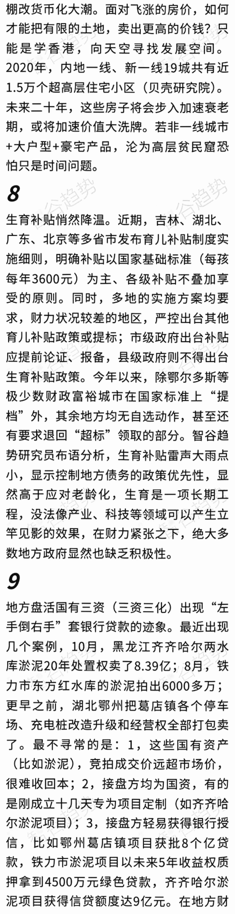

# 智筹亚洲

11月1日，国家统计局数据显示，第三季度GDP增长4.9%，去年同期为6.3%。前两个季度增长5.5%显示我国经济运行总体平稳，回升向好动力充足。需求、投资、出口三需总体回升，制造业投资平稳中有回升，出口增速符合我国经济运行总体预期。

从宏观环境来看，我国经济运行压力并存，但结构性调整空间不断扩大，内需仍有较大空间。政策层面持续发力，财政、货币政策协同发力，确保经济平稳运行。

面对全球经济复苏乏力、不确定性增加的挑战，我国应保持信心，坚持稳中求稳，精准发力，增强政策协调性、有效性和韧性。

当前我国经济面临的困难与挑战并存，包括需求不足、外需收窄、动力转换、房地产风险、地方债风险等。压力确实客观存在，但从长远来看，机遇与挑战并存。

面对复杂的国际形势，我国应保持信心，坚持稳中求稳，精准发力。

# 2023考研人数

2023年考研人数首次破百万

热搜！考研人数首次突破百万

据统计，2023年国家规定研究生报名人数为4388万人，同比增长5.9%。2022年报名人数为413.2万人，同比增长8.8%。从这一数据来看，考研竞争愈发激烈，挑战与机遇并存。

随着考研人数的持续增加，就业压力也随之增大。然而，考研不仅是学历的提升，更是个人能力的磨炼。对于许多人来说，考研是一次人生的赛道。

从另一方面来看，2023年毕业生就业形势依然严峻。据统计，2023年届毕业生总人数达到1179万人，比历史新高。这意味着就业压力进一步增大。

面对严峻的就业形势，政府出台了多项政策，如扩大高校规模、促进创业等。

另一方面，高校毕业生人数下降3.2%，这显示高校毕业生的供需压力有所缓解。

# 深度视野优质集团（链接优质社群，助你成功）

全部包含以下内容：限时年费188/年 加微信cuk255

- ① 吃瓜群众倍时圈加时群对话（原价 365 元/年）
- ② 子明私享汇（内部）文章
- ③ 政事室（顾子明）付费内容再送顾子明群聊
- ④ 米联储闲【作者米穗】（原价 599 元/年）
- ⑤ 欧洲金钻会员专属文章（原价 328 元/年）
- ⑥ 砖瓦内部图（原价 400 元/年）
- ⑦ 卢克文青读书会专属文章（原价 699 元/年）
- ⑧ 鉴茶财经知识星球（原价 3310 元/年）
- ⑨ 猫哥的视界知识星球文章（原价 299 元/年）
- 10 财新周刊【独家新闻】（原价 1498 元/年）
- 11 杨世光在金钱爆（原价 2200 元/年）
- 12 蒜森财经知识星球（原价 1600 元/年）
- ⑬ 激游异译付费文章（持续更新）
- 14 司马林解读课全套音频和全套书籍版无删减（原价 2.3 万）
- 15 虚三三曲[民国梦、帝国争霸、不被理解的MAO]（原价 599 元）
- 16 卢克文知识星球文章（原价 268 元/年）
- 17 额外再送：卢祺元新浪微博付费专栏、三村丰老王、三花九树文集

不定内容：......更多资源不写下了）......
