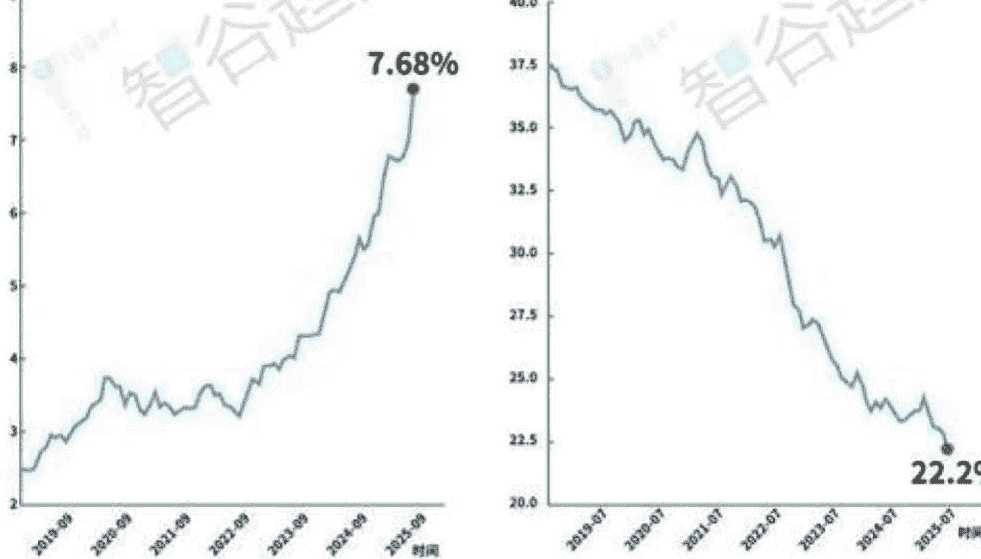

# 智谷趋势内部研判第192期

2025年10月14日

内部资料仅提供于会员投资与决策参考之用，所有观点与分析勿直接作投资之依据，请诸位对市场风险保持足够的敬畏。

中美“贸易战”突然升级。中国按美国方式，对稀土实施长臂管制；特朗普宣布自11月1日起对中国加征100%的关税。但市场认为是双方为下一步的关税谈判筹码，大震后很快恢复平静。然而更深层次的变化已经发生。智谷趋势研员、老肥观察到，美国各部门已把制裁东大当作正确，密集出击，很多已关乎谈判筹码：技术出口管制扩大封锁范围；对中国船舶收费；制裁中国购买伊朗石油；禁航中国航空飞越俄空……此次罕见的主动出招，我们首次引入“长臂管制”，目的是迫使美方形成“挑衅必报复”的条件反射，从而在未来三思而行。

展望未来：
1. 禁俄和100%关税落地的概率偏低，但中美时不时出现冲击激烈冲突的情形，会大量增加；
2. 中方应对模式改变，更加主动，仿照美方极限施压，“谈判向前迈一步，谈判退后半步”，双方博弈的烈度增加；
3. 接下来的关键节点，是十月末的APEC峰会，看双方老大否见面（更务实的是关注贝格和副团的会议消息），二是看11月关税免豁到期的谈判走向。

这一次贸易战激化，虽然主流意见倾向其属于“临时战术动作”，也强烈警示了大国博弈随时可能陷入以牙还牙式向下螺旋的风险。

智合趋势研究员S博士分析，值得庆幸的是：
1. 排除特朗普式的夸张反应，双方团队的公开表态和具体动作，都在力避免关土管制与关税升级形成负面强叠加的效果；
2. 双方的约定重要议程，如APEC领导人会等继续；
3. 双方的举措与反制都给后续议程预留了处置的空间，比如特朗普允许12月1日生效，美方对特定技术产品的调整窗口截至11月28日，显示双方遵循“先升级，再通过谈判降温”的短期博弈模式。

需要特别注意的是，中国关土管制引入美式长臂管制，这是一罕见的先发制人。智合集团这一动作显示：一是中美四轮谈判之后，全面深入深水区，达成蜕变很困难；二是中方对美式胡萝卜（谈判）加大（制裁不断强度）的循环感到厌烦，必要时会干预重置谈判边界；三是中国主体通过谈判赢得缓解的预期大幅下，，未来立场将更多向回头倾斜。整体来看，中美脱钩将提前，但还未达到高度担忧时。

## 4000美元不是黄金的顶

黄金已经“脱锚”。国际金价冲破4000美元，但期间美元指数上涨，美债利率并无显著走弱，意味着行情很难用弱美元或利率下行的传统框架来解析。华创证券宏观团队分析，利率、美元、通胀等传统框架已难以解释金价；债务、信用、货币多元化、地缘政治非传统因素，跟黄金走势愈密切。黄金和传统框架的锚定关系越趋远。

智合趋势研究员吕晨称为，大部分资产都有其锚定，房产锚定人口，股票锚定业绩，汇率锚定经济基本。资产价格和锚定强度相关，一旦“脱锚”，基本面分析就会失去理论依据，资产价格的天板就会被不断抬高。黄金脱锚，便是其不断预期上涨的重要原因。值得注意的是，GLD（全球最大黄金ETF）的持有量，以及黄金期货非商业多头持仓，未创新高，这意味着海外仍有许多机构或个人未配置黄金，黄金仍较大的空间。

## 9月进出口增长全面超出预期

以美元计，9月中中国出口同比增长8.3%（比8月多3个百分点）；进口同比增速加速6.1个百分点至7.4%，创24年来新高。智合趋势研究员陆口分析：
1. 新兴市场的爆发，有效对冲了美国市场的下滑，9月出口增长高达6.8%，非洲、拉美、欧洲、东盟保持平稳；
2. 出口结构进一步优化，高技术高附加值产品增长20个百分点至24.9%，而劳动密集型产品增长收缩；
3. 亮点在于进口环节，主要依然依赖原油、铁矿等大宗商品以及关键中间品，比如集成电路，进口额实现两位数增长（14%），或预示国内生产活力增强。

虽当前全球贸易摩擦，也可能是中国主动扩大进口、缩小顺差。统计局在记者会上提到，“看中国市场，不仅看规模，更要看质量”。

## 黄金周，今年楼市最冷

相比去年，今年黄金周上涨，二三线城市处处冷。重点城市（北京、广州、深圳、合肥、天津、南京、青岛、佛山）二手住宅成交量下降2900套，环比下降43%，同比下降76%。尽管住健部最新披露，目前全国15个省市区住宅交易量超过XX。智谷趋势研究员分析，二手房相比新房有三大优势：
1. 所见即得，没有风险；
2. 通常地段价格更低，性价比明显；
3. 急卖业主越来越多，对自己而言，概率更高。

不过，考虑到中央三季度会议对楼市态势的表述是“稳固市场”，与其等待“救市大招”，不如早清场。

## “天坑”与“就业陷阱”

大V张雪峰粉丝账号（累计粉丝超过400万）被禁止关注，背后揭示了当下特殊的政策信号。智谷趋势研究员申注意到，南方网等官媒用严厉吻批评，“严重侵蚀国家科技创新的根基”。南方认为，不断强化“天坑”的概念，将数学、物理、化学、学术等基础科学和重要工程学科视为“就业陷阱”，“动国家的人才根基”。这一事件远超普通的网络治理，《日报》连发8章文章，凝聚共识、引导预期的意义强烈。当下的政策逻辑是大国博弈相关的硬科技突破作为最重要的路径；与此相反，所有的资源将为此倾斜。

## 重庆消费数据，改善仍需耐心

节前各项数据亮眼（规上工业利润、出口大增，上证指数屡创新高）。但重庆的消费数据一出，暴露经济基本面依然疲弱：长假出行日均萎缩不仅比去年少了13%，甚至回到了10年前（2015年14.4元）。今年购买相差巨大，消费到底萎缩了多少，不言而喻。智谷趋势研究员郭同学认为，重庆消费萎缩在于供给侧的价格战和需求侧的分化：尤其是需求侧，“两头热、中间冷”趋势明显。消费持续收缩，自驾周边人数增加，更多人选择住在车里或帐篷营，酒店等消费量价齐跌：跨市和跨省消费大幅下降，而高端消费如出境则较明显增加（民生证券研究院）。

## 雄安“小北京”

经过八年酝，雄安终于成为“小北京”又前进了一步。最近，华能和中化将总部迁至雄安，2000多名员工从北京搬入，开始常态化办公。不同于之前新设的中国卫星集团总部，现在是存量迁是真正意义上的疏迁，意味着承载北京首都功能能够进入实质性阶段。接下来将有大唐、华电、中诚、农友等8家央企总部陆续入驻，如果这一进程持续，雄安有望为“央企一城”。智谷趋势研究员黄汉同学认为，央企总部数量不多，但北京100余企业在全国各地员工超1000万，日常有大量进京开会、培训、辞职等需求，总部迁移将减少北京人口日常流入。雄安目前各类资源远不如北京，但经济下行之际，员工不会轻易离职，此情况会让迁入雄安顺利。

## 公务员国考，打破年龄限制

今年公务员国考首次打破35岁年龄限制，应届生扩大到38岁，博士放宽到43岁。一些地方也在四川、上海、江苏等省份放宽招聘年龄。智谷趋势研究院黄认为，“35岁门槛”隐性存在，已成为普遍的社会问题。决策层关注不仅限于应届毕业生，还有中年群体、退休潮。

## 铁矿石结算的战略意义

双方达成协议，进行人民币现货结算，启动2026年铁矿石长期合约谈判。智合趋势研究员马彦分析，这背后凸显了中国三大竞争进展：
1. 人民币国际大宗商品方面获益，此前规模仅亿美元，此次进一步扩大到数十亿；
2. 中方利用自身的规模和产业优势，强化价格供应的话语权；
3. 通过谈判压低铁矿石价格，降低生产成本，同时以人民币计价也能减少汇率波动对利润的影响。但人民币结算体系相比美元在便利性、风险对冲、保障方面仍旧有差距。

## 全球财富报告

据汇银行发布的2025年《全球财富报告》，香港、内地企业家对财富增长乐观者分别为84%、82%（2024年为90%、80%），均低于全球平均的89%，更低于其他发达国家（英国96%、新加坡95%、美国90%）。香港敏感性使得“财富旋”打折扣，内地信心下滑，本土科技与政策托底有所缓冲。相对于“财富信心”不振，两地企业家“商业前景”信心可以相当好。2025年，两地商业前景（93%、91%）接近全球平均的94%。智合趋势研究认为，一方面AI等全球的技术革命给企业带来期待，另一方面技术革命的价值被关税、金融市场波动等冲击释放，且两地面临资产波动带来的保值压力（地产行业的调整）。两地企业家如新加坡、美国企业那样，通过全球布局对冲风险，仍是待完成。

本周最重要的图：中国官方储备资产中，黄金和美债占比例变化情况

| 黄金总储备比重(%) | 美德外汇储备比重(%) |
| :--- | :--- |
|  | |

注：黄金占比至2025年9月；美德占比至2025年7月
数据来源：中国国家外汇管理局、美国财政部

央行囤金，不能停！

金价暴涨，中国央行依然在持续囤金。官方数据显示，9月外汇储备增加了165亿美元。
