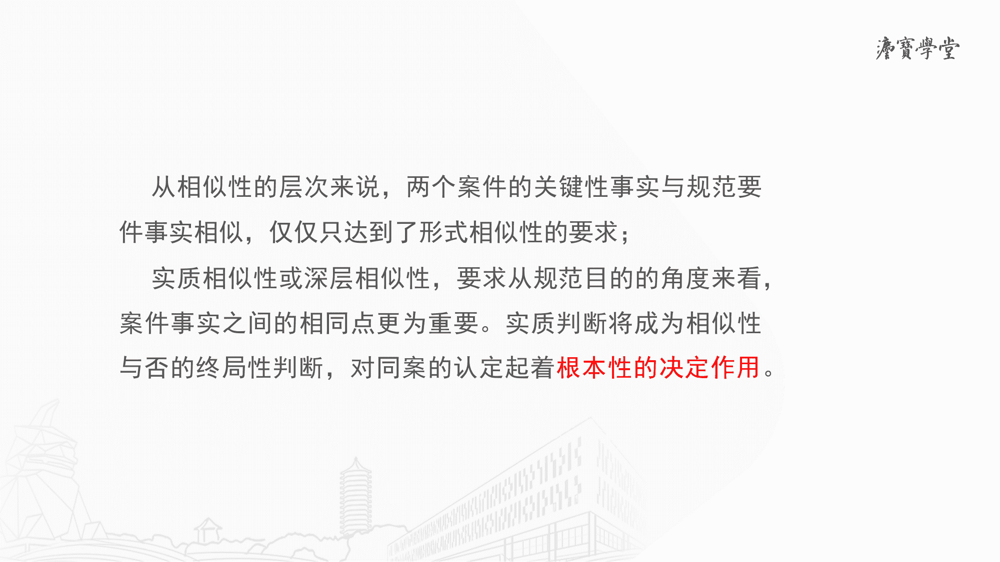

# 类案识别别判断与冲突协调

主讲：孙海波
中国政法大学
sunhaibo@cupl.edu.cn

# 扫码加入 知识星球TOP 免费资源群

公众号: 知识星球TOP

免费

- ✓ 每日免费获取高价值资源
- ✓ 可提供各类资源搜索服务

微信:jntsg8

价值

| | |
|---|---|
| ◆热门付费文章 | ◆各行各业报告 |
| ◆精选图书资源 | ◆副业赚钱方法 |
| ◆职场实用资源 | ◆AI政经自媒体 |

及时

微信:jntsg2

专注

分享资料仅供个人学习，请及时删除，切勿商用传播

- 如何在这些众多案例中挑选出真正具有相似性的案件?
- 是否存在一种“类案”的判断标准?
- 检索类案的目的是什么?
- 检索到众多类案在裁判要点/规则上存在冲突该怎么办?

# 目录

- 01 是否存在类案判断标准
- 02 既有观点的类型及评价
- 03 形式相似性的三个判断步骤
- 04 实质相似性的终局判断
- 05 类案的参照
- 06 类案裁判规则的提炼与冲突协调

## 第七章 类案的判断标准与判断方法

参考：

- (1) 孙海波：“重新发现‘同案’：构建案件相似性的判断标准”，“中国法学》2020年第6期；
- (2) 孙海波：“类案检索在何种意义上有助于同案同判”，“清华法学》2021年第1期。

## 亚当斯诉新泽西轮公司案

### Adams v. New Jersey S. B. Co.

在新泽西轮公司的一艘从纽约驶往奥尔巴尼的轮船上，亚当斯是轮船包厢里的一名乘客。在夜间锁好门窗之后，他将钱包放在自己衣服的兜里，但是有迹象表明夜里有一个人从窗户跳进来偷偷了钱包。于是亚当斯向法院提起诉讼，要求轮船公司的经营者承担已所遭受的损失。

法院在受理该案之后，发现现有的成文法及判例并未直接解决轮船经营者的责任问题，但对此存在两个相近的判例（close cases）。

酒店案（该案中住客在住宿的过程中财物被盗，法院判决论点的经营者应应对旅客的损失承担责任/Crozier v. Boston, N.Y. & Newport Steamboat Co., 43 How. Pr. 466, 1871 N.Y. Misc. LEXIS 208 ）

卧铺火车案（该案判决火车的运营者无需卧铺包内乘客的财物损失负责/Carpenter v. New York, N. & H. & R. R. Co., 124 N.Y. 53, 26 N.E. 277, 1891 N.Y. LEXIS 1340 ）

## 游轮案更像卧铺火车案还是旅店案案？

## 面对此情此情，法院该去何去从？

带有密闭客舱的轮船是更像卧铺车厢还是更像旅店？法院对游轮包厢的事实特性进行了审慎描述，将其与卧铺车厢和旅店的事实特征加以对比，与此同时还考虑到了相关规则背后的目的，综合这些因素得出了一个判断：认为带有密闭客舱的轮船更像卧铺火车（floating inn，是一个移动的旅店），就此认定亚当斯和旅店是实质意义上的相似案件。

# 实学术堂

## 是否存在类案判断标准

### 一、类案的客观存在

依照不同的标准，我们可以对事物进行分类，很容易发现事物在某些方面是非常相似的。类案是按照其指向的法律基础，它们也是一种类型化的存在。由于类型本身是开放性的，总会有案件因为共享若干特征而被归为一类，因此类案是客观存在的。

### 二、类案的分类

#### 1、“弱意义”的类案通常以争议类型判断，比如合同纠纷、撤销纠纷、买卖纠纷等类型。这些案件因为属于同一个大类，但是彼此之间仍然存在较大的差异。

#### 2、“强意义”的类案要求两个案件不仅属于同一争议类型，更为关键的是它们的争议焦点和关键事实具有高度一致性。

### 学者对于“是否存在类案标准”这一问题的各种主张

- 否认同案的存在。
- 类案是客观存在的，并且通过一定标准来认定。
- 承认“同案”或“类案”的概念，但认为难以找到统一的客观标准来判断案件之间是否相似。

## 既有观点的类型及评价

我们大致可以区分出两种不同类型的“同案”：一种是简单版本的“同案”，案件事实相对清晰并能够自然呈现事实特征，法官凭借感性认识就能看出相似性；另一种是复杂版本的“同案”，需要借助理性化的实质判断，亦即是一种评价后的“同案”。

### 一、常见观点类型梳

- 1 案情相似+争议焦点相似
- 2 案情相似+法律适用相似
- 3 构成要件或要件事实相似
- 4 依靠主观判断

#### 1、案情相似+争议焦点相似

目前我国主要有民事案由及行政案由制度。案情或案由可以判断类案提供初步指引，但不能达成终局性的判断：首先，案由本身法律规范及其要事实的高度抽象仅发挥指示作用，而不具备明确争议焦点的功能。其次，两个案件案情或案由相似，但争议的法律问题却不相似，那么也难以称得上类案。

案情或案由只能确认两个案件属于“弱意义”的类案，而非在实质意义上真正具有相似性的案件。于是，不少学者主张在案情相似之外，附加上争议焦点相似。

如胡云腾持有只有基本案情相似，同时争议的法律问题也相似时，才能认定两个案件是相似案件。在指导性案例的情形下，比较相似性应以裁判要点作为基准：“待决案件的事实与‘裁判要点’所包括的事实具有相似性，待决案件所解决的法律问题与裁判要点涉及的法律问题具有相似性”。

#### 2、案情相似+法律适用相似

只要基本案情和法律适用相似，两个案件就是类似案件。

《最高人民法院关于案例指导工作的规定>实施细则》选择“基本案情+法律适用”模式。在制度设计师看来，法官判决无非就包括案件事实与法律适用两部分，争议焦点指代并不明确、容易发生歧义，其可能包含的对某一事实的认定、证据的采信或程序及实体法律的适用内容，都可以囊括到案件事实与法律适用之中，仅此二者就已足够，加上争议焦点属多余。

争议焦点是一个案件中最为核心的部分，它对于判断案件相似性而言是必要的。单纯以法律适用取代争议焦点的做法在逻辑上存在问题，相似性的判断目的是通过类比解决问题，但这里却以法律适用用来判断相似性，似乎犯了循环论证。

#### 3、构成要件或要件事实相似

认为构成要件之间的“相似性”根本上决定着案件是否相似。需要说明的是，无论是构成要件还是其中包含的事，都是相对于法律规范的。由于案件事实是法律前提，构成要件（规范）相对应，构成要素P和构成要素Q相似，所以可以将R应用于构成要素Q。

案件事实作为相似性判断具有很大说服力，但仍有一些不足。如案件事实所包括的范围仍然广，尚未聚焦于核心事实，两个案件构成要素基本相似并不足以保证相似。即便案件事实能指向关键事实，但难以将其归入。

#### 4、依靠主观判断

认为案件是否相似依靠裁判者的主观判断。这种主观判断，可能依靠实践经验、法感甚至直觉（intuition）。直觉、法感等主观因素对发现和判断类案具有重要意义，尤其是某一具体领域的法官，在多年实践中积累很多经验，也会形成精准的法感，这些都能有力地判断案件相似性。尽管如此，仅依靠主观判断是远远不够的，相似性的认识过程是依靠理性和客观方法的。

### 二、对既有观点的评价

- 第一，类案判断标准客观存在；
- 第二，类案判断标准是复杂的；
- 第三，类案判断标准具有一定的相对性。一方面，在不同的领域标准并不相同；另一方面，随着时空的变化，类案判断标准也会发生相应的变化。
- 第四，类案判断标准不是单一的。由此，我们有必要转向复合标准：“关键性事实+争议焦点+规范目的”。这一新的综合模式，具有明显的二阶性，是初步判断与终局判断的统一、形式判断与实质判断的统一。

## 03形式相似性的三个判断步骤

如何将待决案件与检索到的案件进行相似性比对，需要实体性的论证。实体性的论证包括案事实论证和法律上的实质判断。

### 一、锁定关键事实

整体来看，案事实建构过程可以分为两部分：一部分是对案实的发现，这一阶段呈现的事实真伪不明，其所依靠的是感性的认识与判断；另一部分是案事实论证，即借助一定的证据规则或逻辑标准将案事实加以理性化建构。

案事实论证主要遵循以下路径：

- 首先，根据诉讼参与主体的陈述，依靠感知判断形成初步的案事实；
- 其次，依照证据规则对前述事实进行检验和筛选，确立证据事实；
- 最后，结合相关法律规范，根据法官的解释与评价，在证据事实与规范事实之间的权衡，最终确立案件的裁判事实。

这一过程显然并不是三段论式的推理过程，相反，它更多的是依靠类型化的归纳方法，同时选择哪些事实特征加以提炼，或者赋予哪些特征以更大的权重，必然会涉及价值评价的问题，可以说，案事实推理过程是事实与规范、形式与实质价值的统一。

### 什么是案件中的关键性事实？

关键性事实，也称事实事实（material fact），简而言之是对判决来说具有必要意义的事实。也有学者提出了必要事实（necessary fact）与非必要性事实（unnecessary fact）。在其他一些学者那里，也常用事实来指代关键事实。

### 以何种方法来确定关键性事实？

观点一：一个判决书中的哪些内容是必要事实并非言自明。

观点二：一个案件中何者是关键事实在判决书制作出来那一刻就已确定，所有具有意义的事实，除此之外无关事实都是非关键事实。

### 二、区分相同点和不同点

这个过程类似于“提取相同点”，实际上是寻找两个案件之间的共同事实，另一方面发现它们不同的点。首先需要强调：

- 第一，相同点并不要求完全一样，而是在相似意义上的；
- 第二，无论是相同点还是不同点，很少是自然呈现的，而是经过评价的；
- 第三，区分相同点与不同点的过程是非演性的，有时需要借助于法感、直觉以及实质性判断。

待决案件“北雁依”案（最高人民法院第89号指导性案例）其中关键事实包括：

- （1）父母为女儿创设；
- （2）所选取姓氏既非父姓或母姓，而是任意创设的第三姓。

相同点：

- （1）均系新生儿办理登记；
- （2）都未选择父姓或母姓，而是选择了第三姓，系任意创的。

不同点：

- （1）“北雁依”案中是父母为女儿办理登记，而待决案件中系父母办理登记；
- （2）虽然都选择了第三姓，但一个是任意创设的，另一个则是祖姓。

待决案件“沈阳律诗”案争议焦点：当事人申请法院变更姓氏遭到拒。

关键事实：

- （1）当事人申请向户籍登记机关变更姓名的申请；
- （2）当事人申请将原姓更为父母姓之外的“耶律”。参见2005沈行252号行政判决书

相同点：所选择的姓均为父母姓之外的第三姓，系任意创的。

不同点：

- （1）一个是父母为子女创设姓，一个是自己为自己创设姓；
- （2）一个是出生阶段户籍登记引发的争议，另一个是姓名创设以后进行的姓氏争议。

### 三、从相似性到相关性

并不是相同点的越多越多就能证明两个案件相似。与单纯的列举不同，“类比并不取决于例子的量（quantity），而是取决于个体间的相似点的质（quality）”“根据一个相关类比的论证，比举出不相关的类比的论证，更有服力”。问题的关键在于，哪些相同性或不同性对我们的比较目的而言是相关的。

相关性判断可以沿着两个方向展开：

其一，是否具有相关性取决于其能否直接指向争议问题并助于该问题的解决，也就是说，**与形成争议焦点紧密相关的事实**具有相关性；

其二，所谓“相关”是针对请求权基础背后的法律规范而言，如果某个事实与规范所要解决的问题及其核心事实密切关联，那么可以认为该事实具有相关性意义。

肖尔提出“相关性规则”（rules of relevance）的概念：从先例事实和判决理由中所提炼生成的先例规则，它反映了一些既有的语言或社会类型，借此可以描述先例案件中的事实，同样也可指导如何在未来案件中提炼事实特性。

布鲁尔提出了“类比保证的规则”（analogy-warranting rule）：通过反性均衡建立一条推理规则，能够在已知的比较特征与推断特征（或结论）之间建立起逻辑联系，其基本功能是用来解释和判断那些被拿来充当比较点的事实是否具有相关相似性。

既然唯独具有相关性意义的事实对比比较而言才才有意义，“河南祖姓命名”案中新生儿系男女并不重要，具有相关性，因此选择祖姓还是自创姓具有相关意义；“沈阳律诗”案中，自己为自己创设与父母为子女创设具有具有相关意义。

###  四实质相似性的终局判断

### 一、实质性判断理由来源及确定

两案件是否具有实质相似性：两案在关键事实上的相关相同点和不同点何更为重要。

如果相关相同点的分量压倒相关不同点，那么可以说两个案件是实质相似的；相反，如果经过判断确证两案的相关不同点更重要，则可得出两案是不同案件的结论。

从相似性的层次来说，两个案件的关键性事实与规范要事实相似，仅只达到了形式相似性的要求；

实质性理由的来源范围很广、内容多样，为什么要选择规范目的作为评价依据？

法律所提供的理由：权威性理由和实质性理由。前者是法律表面上提供的行动指引，后者是一种解释性或证成性理由。

规范目的与规范之间的关系是一种“魂”与“形”的关系，规范是表达目的的外在载体或形式，而目的才构成了规范的最高灵魂或价值追求所在。

## 规范目的到底是什么？

## 规范目的与价值、原则及政策是什么关系？

## 在实践中如何确定规范目的？

## 规范目的到底是什么？

法律的目的，主要是指法律背后的理由，它们能使法律得以正当化，同时也包括法律旨在增进和维护的价值，体现为秩序、自由、正义、安全、效率等各种各样的价值。但从整体的角度来看，法律的根本目的是要通过具体制度的安排来实现正义，并设法让这个社会变得更好。

我们对于规范的理解不能脱离其背后目的的关照，对“法律是什么”的判断离不开对“法律应当是什么”的理解。

## 规范目的与价值、原则及政策是什么关系？

与规范目的的不同，原则和政策相对具体一些，并且通常有成文的形式，尤其是法律原则已经被实实在法加以实定化了。在进行相似判断时，这三者均可称为实质性理由，但比较麻烦的是它们在某些时候可能会发生冲突，此时如何进行权衡就会变得很困难。

## 在实践中如何确定规范目的？

规范目的的主要有三个方面的渊源：

- 首先，从可能的文义范围内获取目的，实践中普遍的做法是直接引述相关的法律条文，并从中直接提炼出规范目的的；
- 其次，参考历史解释标准来确定法律目的，包括历史上的立法背景资料、立法理由及相关记录；
- 最后，体系也可作为目的渊源，具体又分为直接体系渊源和间接体系渊源。

目的是在多元的质料中借助助于解释和评价性方法推导出来的。

## 二、通过价值权衡实现最终判断

规则1：在只涉及一种规范目的时，应以规范条文为基础，在文义范围内探寻规范的目的。

价值判断的形式首先要受到规范的限制。即便此处探求的是规范的目的，该目的仍应和可能的文义保持一致，一般情况下不得过度诠释，从而引申规范本身可能并不具有目的的。文义解释一般具有优先性。

在遵守规则1时，还应特别注意的一点是，如果规范中对某些要件事实作出了区别对待，尤其是重点突出了某些事实的不同将产生不同的法效果时，要特别注意这些事实要件。

同样地，如果涉及规范竞合的情况，针对我们要对比的两个案件，争议问题涉及两个及以上的规范，而如果这两个以上的规范对相关事实作出了不同的规定或强调，则意味着法律对这些不同点给予了不同的评价意义。

规则1.1：如果待比较的两案争议焦点均指向同一规范，且该规范就某个事实点已作出了不同的法效果评价，那么两案在这一事实上出现的不同点更重要，它们不属于实质意义上的类似案件。

规则1.2：如果待比较的两案争议焦点均指向两条（或以上）规范，且这些规范就某个事实点作出了不同的法效果评价。如果这个不同点的出现将适用其中规范而其他其它规范，那么这个不同点在评价性意义上就是重要的，它们不属于实质意义上的类似案件。

规则2:在多种规范目的并存时，以反思均衡的眼光在各目的之间优先选择更使规则正当化的那种目的。

从不同的角度可以发展出不同的解释性态度，因此观察点或出发点不同就很有可能推导出不同的规范目的。目的作为一种实质理由或价值，从性质上讲是一阶理由，其适用需要依赖于权衡（weighing and balancing）。以反思性均衡的原则在各目的之间进行综合判断，同时考量各目的与规则之间的紧密程度，对各规范目的的赋予大小不同的权重。

一般而言，应慎用法律之外的目的，主要目的优于次要目的的，基本目的优于普通目的，深层目的优于表面目的的，个别目的优于整体目的。

从优先性目的的角度来判断，如果相同点比不同点更重要，则可以认定两个案件是相似的，反之亦然。

尽管如此，在如何运用规则2时，尤其是如何权衡各个目的的分量大小时，判断者不可避免地仍然享有一定的自由裁量权。

规则3：在规范目的的、法律原则以及政策等多种实质性理由并存时，应坚持实质性权衡的方法，结合具体情境作整体性判断，选择带来最小损害的目的或原则作为依据，判断两案之间的相似性。

（注：此处原文存在逻辑混乱，法官不应基于自己的价值偏好或哲学观来判断重要程度，应以促进法律的目的、原则和政策的方式判断重要程度。）规范目的、原则以及政策都属于一阶理由，其适用模式是权衡。当规范目的与政策、原则与政策出现紧张时，通常应赋予目的和原则更大的权重，而在目的与原则、原则与目的之间紧张时，除了上述个别目的具有优先考量的地位之外，很难概括来说一个实质理由能绝对胜出。一般情况下，在目的和原则、原则和原则之间何者更优并不存在一个定式供参照。

## 应当参照类案

从类案检索到类案的逻辑结果，是要参照检索到的类案，保证它们在法律适用上一致，如此才实现了检索的目的。《指导意见》第九条：检索到的类案为指导性案例的，人民法院应当参照，与新的法律、行政法规、司法解释冲突或者被新的指导案例取代的除外。检索到其他类案的，人民法院可以作为参考。“检察机关、当事人及其辩护人、诉讼代理人等提交指导性案例的，人民法院应当在裁判书中回应是否参照；提交其他类案的，人民法院可以通过释明等方式予以回应。”这对最高人民法院关于案例指导工作的规定的延续。

### 一、法院主动与被动参照类案

#### 一、案例提出

案例使用过程有两个阶段：首先是相关主体在裁判过程中提出了某个或某些案例，主张其与待决案件相似或不相似；其次是在经过一系列的调查和比较之后，法院最终决定参照或不参照该案例。(img/56b070db3d41eaf7a8e037b4816e1556_77_0.png)

因此，从逻辑上讲，案例提出是最终获得参照的前提。理论上，法院、当事人、当事人的律师或其他代理人以及检察机关（刑事案件中的控方）均有权在庭审过程中提出与其待决案件相关的案例。从当前的司法实践来看，提出案例的主体更多是当事人一方，当事人提交相关案件或指导性案例已经是很普遍的做法，而法院及法官主动提出案例的积极性还有待提高。(img/56b070db3d41eaf7a8e037b4816e1556_79_0.png)

# 瀚实学堂

相关主体对案例的使用受到了直接或间接的利益驱动。举例来说，24号指导性案例确立了“交通事故的受害人没有过错，其体质状况对损害后果的影响不属于可以减轻侵人责任的法定情形”，后来交通事故案件中的受害者一方自身也存在体质因素，那么他就极有可能用24号指导性案例所确立的裁决要点来反对体质因素作为减轻侵人责任的主张，从而确保自己的损害得到有效的赔偿。如当事人不熟悉法律和司法案例，他的代理律师也会设法找到助于己方的指导案例，其目的是为了获得胜诉。

### 二、案例提出的不同方式

由于指导性案例究竟以何种方式被提出并没有统一的定式，实践中存在许多做法，主要有以下四种形式：

- (1) 相关主体（主要是当事人一方）只提出“存在指导性案例”；
- (2) 只提出指导性案例的编号，并不明确其它信息；
- (3) 提出指导案例的裁判要点，这是实践中最普遍的做法，从一个侧面也反映了相关主体对于裁判要点的青睐；
- (4) 在极个别的案件中，相关主体提出的是指导案例的裁判说理或案件事实内容。

以上四种方式各有优劣，我们认为在案例指导制度初创时期，人们并不可能对所有指导性案例都能耳熟能详、信手拈来，因此在提出指导性案例的时候，至少需要明示以下信息：指导性案例的编号、名称、裁决要点以及提出该指导性案例的目的。

### 三、法官的回应义务

为了防止法官对相关类案不闻不问，尤其是对当事人一方或公诉方提出的类案不予予理，《指导意见》设置了强制回应的义务，应以明确的方式对当事人及律师或公诉机关提出的类案进行回应或参照，尤其是其决定不参照该类案时，这种回应义务尤为迫切。(img/56b070db3d41eaf7a8e037b4816e1556_84_0.png)

总而言，对于当事人或公诉方提出的类案，法官无论是决定参照还是拒绝参照，都必须给出给出理由。

## 应当参照与可以参照类案

### 一、二元参照模式

根据检索到的案例性质，《指导意见》确立了两种参照模式。这种二元模式源于指导性案例与其它案例地位上的不同。指导性案例虽然像法系国家中的先例那样权威，但也不同于一般案例，它似乎介于两者之间，是一种特殊的案例。

### 二、指导性案例的效力

《最高人民法院关于案例指导工作的规定》第七条：各级人民法院审判相似案件时应当参照。实践中产生了较大的分歧，主要有“规范约束力”和“事实约束力。(img/56b070db3d41eaf7a8e037b4816e1556_87_0.png)

目前一种观点成为了主流：指导性案例的约束力是由权威和理性共同保证的。权威是指它经过权威途径遴选和发布；理性是指由于其内在的说理所呈现的一种说服力。(img/56b070db3d41eaf7a8e037b4816e1556_88_0.png)

### 三、参照案例的部分

从指导性案例的编写体系来看，包括标题、判决要点、相关法条、判决理由、决决结果等几个部分。法官可以参照哪些部分？教授指出三种选择：

- 一是针对相应案事实作出的判决的具体内容；
- 二是案例中说明判决理由；
- 三是案例对有关法律问题或观点的类似于规则的表述。即“结果模式”、“理由模式”和“规则模式”。

#### (1) 结果模式

它强调的是判决结果对于后来案件的约束力。但一旦将它从案事实剥离出去，便很难产生普遍性的约束力，同时它忽视了依据作出的判决理由。

#### (2) 理由模式

它主张后案法官不受裁判规则的约束，而是受到推理或说理的约束。法官参照的并非指导性案例的全部内容，主要是判决说理部分。由于多数情况下，法院实际上适用的准则并不体现在判决书中，此时法官必须深入到判决理由中，结合事实抽象、归纳和发现先例规则或先例原则。就此而言，判决理由是案件裁判规则生成的母体、源头。

#### (3) 规则模式

规则模式主张指导性案例中具有指导性或约束力的部分应当蕴含规则，或者采取规则形式所描述的内容。这种模式是普通法中的主流模式，遵循先例原则要求法官必须区分“判决根据”和“附带意见”，只有前者对于本院以及下级法院未来类似案件的审判具有约束力，后者只是法官对法律适用中的一般问题所说明，只有说服力。在指导案例中采取规则形式所述的内容是裁判要点以及紧随其后列出的相关法条。裁判要点的总来说是对判决理由的一种提炼和浓缩，表达的内容是对争议问题的分析、是对法律适用的解释与说明。裁判要点虽然大多采取了规则的形式，但它本身不是法律规则，这决定了后案法官不能将其作为依据直接引用。就此，那种主张运用类比推理直接类比适用于裁判要点的观点是对裁判要点本身性质的严重误解。另外，后案法官对裁判要点的参照只能出现在反映在判决说理部分。

#### (4) 小结

综合以上三种模式来看，我们倾向于支持一种折中模式，即法官应当将指导性案例看作是一个整体，不能机械地将之拆成单个的部分并仅仅参照其中的一部分内容。

“结果模式”自然不足为取，但是单单“理由模式”或“规则模式”也尚不足以充分指导性案例的作用，况且判决理由和裁判要点相互交融，它们各自互相离不开谁。脱离了判决理由的裁判要点仅仅是一条干瘪瘪的条文式表述，而离开了裁判要点的判决理由会让指导性案例的指导方向变得分散而丧失确定性。
