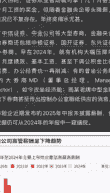
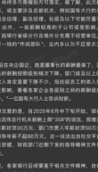

# 最新预测 | 金融业迎来未来

随着全球经济环境的复杂演变，地缘政治不确定性加剧，全球金融市场正面临前所未有的变革与挑战。

当前，金融科技正处于数字化转型的关键期。

面对未来的挑战，金融机构如何通过自身转型，在变局中实现稳健增长，已成为业内广大从业者关注的核心议题。

## 银行业业绩与未来展望

近年来，银行业表现备受市场关注。尽管宏观经济环境存在不确定性，但中国银行业依然展现了较强的韧性和抗风险能力。

从业绩数据来看，大型商业银行的利润增长保持了稳健。虽然净息收入增长面临一定压力，但通过多元化业务模式的拓展，整体盈利水平依然维持在较高位置。

然而，随着低利率环境的持续下行，银行的息差空间可能会进一步收窄。这对传统的盈利模式提出了严峻挑战，也对银行的精细化管理和风险控制能力提出了更高要求。

展望未来，银行业将继续深度服务实体经济，加大对绿色金融、科技创新等重点领域的支持。同时，通过数字化转型提升服务效率，优化客户体验。

2023年，中国银行业整体表现平稳。尽管受宏观环境影响，净利润增速略有放缓，但整体规模依然保持了增长。数据显示，2022年大型国有银行的净利润创了新高，而2023年，虽然受市场利率下行影响，息差空间有所收窄。

从资产质量来看，中国银行业的不良贷款率维持在较低水平。通过持续的风险管理和信贷拨备，银行能够有效抵御宏观波动带来的潜在风险。这为后续的稳健经营奠定了坚实基础。

未来，银行业将面临更加激烈的竞争。这不仅来自传统银行之间的竞争，更来自互联网巨擘的跨界挑战。如何在竞争中寻找新的增长点，将是银行未来制胜的关键。

## 保险业的转型与新机遇

保险业近年来也经历着深刻的转型。从过去的规模驱动转向现在的质量驱动，保险公司更加注重产品的创新和服务的精细化以满足客户日益多元化的需求。

在财富管理领域，投财寿险等产品受到了青睐。随着客户资产配置意识的提升，对长期稳定收益的需求增加。保险公司通过提供灵活的产品组合，为客户提供更专业的增值服务。

此外，健康险和养老险也成为新的增长点。随着人口老龄化的加剧，对养老保障的需求愈发迫切。保险公司积极布局养老赛道，为行业注入了新的活力。

2023年，中国保险业表现出良好的复苏趋势。尽管保费收入面临波动，但内核心业务增长稳健。通过优化保单结构，保险公司成功提升了抗风险能力。

未来，保险业将继续深化科技应用。利用大数据、人工智能等技术，提升风控精准度和理赔效率。同时，加强合规经营，也将是行业健康发展的基石。

## 证券市场的波动与长期价值

证券市场在过去一年内经历了较大的波动。受政策和宏观数据的影响，市场情绪频繁切换。但从长期来看，中国资本市场的潜力依然巨大。

随着注册制改革的推进，市场机制作用不断增强。机构投资者的占比增加，也使得市场定价更加合理。这为企业的长期价值发现提供了良好的土壤。

对于投资者而言，保持理性、关注长期价值至关重要。在波动中寻找优质资产，是穿越周期获取回报的关键。

# 深度视野优质集圈（链接优质社群，助你成功）

全部包含以下内容：限时年费188/年 加微信cuk255

- ① 吃群众粉丝深度圈文加时群对话（原价 365 元/年）
- ② 子明私享会（内部文档）
- ③ 政事堂（子顺明）付费内容再达子明群聊
- ④ 米联锦顶【作者米楷】（原价 599 元/年）
- ⑤ 欧洲金雀会员专属文章（原价 328 元/年）
- ⑥ 砖瓦斥内部文档（原价 400 元/年）
- ⑦ 卢克青文读书会专属文章（原价 699 元/年）
- ⑧ 鉴茶财经知识星球（原价 3310 元/年）
- ⑨ 猫哥的视界知识星球文章（原价 299 元/年）
- ⑩ 财经周刊【独家新闻】（原价 1498 元/年）
- ⑪ 杨世光在金钱（原价 2200 元/年）
- ⑫ 森淼财经知识星球（原价 1600 元/年）
- ⑬ 潇游译译付费文章（持续更新）
- ⑭ 司马林解读谋选全套音频和全套书籍珍藏无删减（原价 2.3 万）
- ⑮ 虚虎三部曲[民国梦、帝国争亡、不被理解的MAO]（原价 599 元）
- ⑖ 知识星球文章（原价 268 元/年）
- ⑰ 额外再送：卢薛元微博付费专栏、三村丰老文、三花九术文集

不定期内容：——（更多资源不下去了……）

- ① 守夜人司令星球、接魂魔王知识星球、生有财富知识星球、
- ② 创世纪老笔记、达叔谈论星球、成术财富圈、雪球花甲老头等
- ③ A视野、大树乡谈、江宁后、咩译说、上海海家等付费文集
- ④ 西风付费文章、老端、赢在八小时之外、局人的视界、升值、老A体制内等其它一些大V付费文章（每月不超过 600 元付费文集）

# 深度视野文集
进群微信cuk255

深度视野（付费文集）

