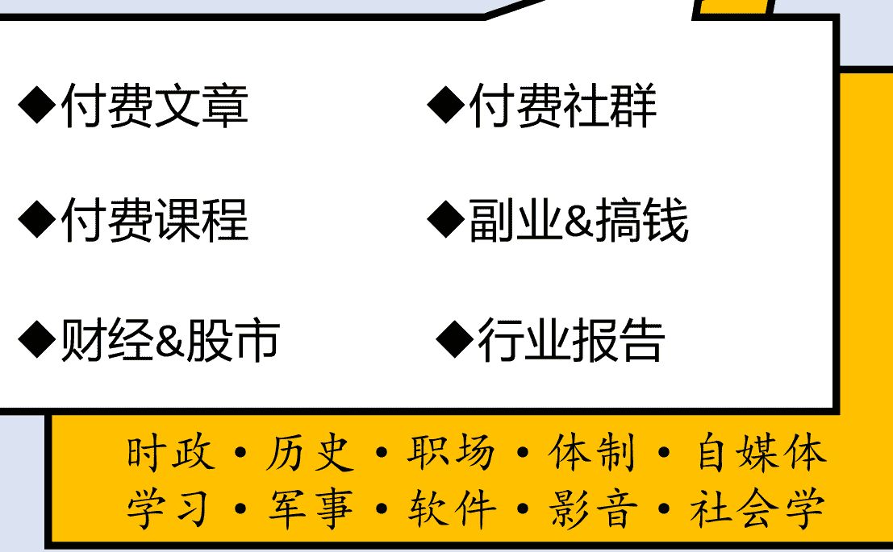

# 未来人工智能趋势研判

## 中国人工智能行业大模型应用实践与展望

中国联合网络通信有限公司研究院

2025年4月

# 知识星球TOP 资源分享社群

汇聚全网付费资源
让更多人获取高价值信息

- 付费文章
- 付费社群
- 付费课程
- 副业&搞钱
- 财经&股市
- 行业报告

时政·历史·职场·体制·自媒体·学习·军事·软件·影音·社会学

公众号：知识星球TOP 微信信号：jntsg8 微信信号：jntsg2

添加微信 免费进群

# 目录

- 一、人工智能大模型发展趋势解析................................1
- (一) 全球人工智能大模型发展趋势分析研判......................1
- (二) 国外人工智能大模型政策总结......................................1
- (三) 国内人工智能大模型政策总结....................................................4
- 二、大模型市场环境发展洞察................................................5
- (一) 大模型行业市场规模及增长趋势...............................................5
- (二) 大模型技术研究现状与进展......................................................6
- (三) 大模型产业生态建设情况...............................................................7
- (四) 大模型行业应用现状...............................................................7
- 三、大模型领域趋势分析......................................................................7
- (一) 聚焦大模型技术的发展趋势...............................................................7
- (二) 大模型产业生态的动态演变...............................................................8
- (三) 中国联通大模型实践创新...............................................................9
- 四、大模型发展前景展望................................................................10
- (一) 大模型政策法规的完善推进...............................................................10
- (二) 大模型技术创新的未来突破...............................................................11
- (三) 大模型产业生态的进程展望...............................................................11
- (四) 大模型行业应用的拓展演进...............................................................12

# 人工智能模型发展趋势解析

## (一)全球人工智能行业大模型发展趋势分析

当前，全球人工智能大模型发展呈现多种显著趋势。在多模态融合深入、从单一单模态向融合文本、图像、语音等多种形式的多模态模型转变，未来有望实现语义信息融合与语义交互。强化学习等前沿技术，模型能力得以逐步提升，并通过架构与算法创新，训练成本降低、效率大幅提升，有力推动模型向通用化迈进。小型化与端侧部署成为趋势，通过边缘计算与智化赋能，大模型与云端协同成为云端常态，发挥关键作用。此外，长文本上的处理能力在不断增强，能够生成更长并精准把握语义逻辑，扩充了大模型在知识管理等领域的应用空间。同时，模型应用领域日益趋同，逐步成为未来发展的方向。

在生产线上，头部企业凭借资源优势引领通用大模型发展，通过构建生态体系助力多方业务；中小企业在分领域遭遇创新寻求突破，二者在竞争中共同进步促进产业均衡发展。科研机构积极提供技术支持，企业负责资源转化，产学研合作不断深化，加速市场化进程。产业链上下游优势汇聚，数据规模扩大、算力支撑、数据开放以及算法研发和开发工具的发展，降低了大模型门槛，各环节协同发展助力产业整体竞争力。市场方面，大模型技术助力行业融合，催生新的主体与应用模式，逐步丰富产业生产格局。同时，模型行业也面临转型成本、数据安全隐私、模型可解释性等挑战，未来需要通过技术创新、完善法规等加以应对，从而实现高质量、可持续的发展。

## (二)国外人工智能大模型政策趋势

国外通过巨额投入、制定标准的安全监管规范和技术合作政策等多个维度布局，实现资源共享与优势互补。国外在多个关键领域积极布局出台大量政策。在资金扶持上，投入巨额资金助力模型研发与算力提升。在安全监管上，制定标准保障技术安全可靠的应用。针对技术内核领域，推动各方携手资源共享与优势互补，全方位推进AI产业向前迈进。

## 表1 国外人工智能模型大类发展趋势总结

| 维度 | 国家 | 具体内容 |
|---|---|---|
| 安全风险政策 | 美国 | 2024年10月30日，美国总统签署命令，动用《国防生产法》紧急权力，涵盖人工智能技术等多个方面内容。 美国加州：2024年2月提出的SB-1047法案《前沿人工智能模型安全新法案》，意图为风险AI大模型建立安全标准，若造成多人死亡或5亿美元以上损失，将追究责任者。 |
| | 欧盟 | 2024年8月1日，欧洲人工智能法（AI ACT）正式生效，对AI系统进行分类管理，对风险AI系统在投放市场或使用前实施合规要求，包括风险管理、透明度、数据质量、记录保存等方面。 |
| 资金与资源支持政策 | 欧盟 | 2025年11月21日启动亿欧元的Invest基金，该基金部分资金源于欧洲计划、“平线欧洲”计划和Invest等现有资金项目，旨在为训练最大、最复杂的AI模型提供资金，确保所有企业都能获得所需计算能力。 |
| 技术政策 | 美国 | 2024年5月29日Anthropic与美国人工智能安全研究所达成协议，同意美国政府获取其新模型用于安全测试。 |

全球国家对生成式AI的应用已发布临时指南规范，风险评估具有合规性，积极投资研发、引入专家、培训人员提升AI应用能力，模型技术在政务等多个领域落地。在全球范围内，许多国家对生成式AI的应用采取策略，发布临时指南，规范用户行为；由于AI技术风险，各国对此保持高度警惕，在使用AI之前完成全面的安全评估。许多政府积极投资研发，一方面投入，另一方面提升技术水平。

## 中国大模型政策支持与战略览

## 表2 各国大模型政策支持与战略览

| 国家 | 政策类型 & 策略 | 具体内容 |
|---|---|---|
| 美国 | 行政命令与指南 | 2023年10月，拜登签署《关于安全、可靠和可信的人工智能行政命令》，明确采购和部署。 |
| 美国 | 地方政府政策 | 华盛州发布生成式AI指南，规范政府机构使用。 |
| 美国 | 国防与航天 | 美国国防部将生成式AI列入清单，探索其在作战中的应用。 |
| 英国 | 中央与地方规范 | 英国办公室发布生成式AI指南，规范政府机构内部使用。 |
| 英国 | 人员培训 | 英国计划从数据需求出发，加强技术团队。 |
| 加拿大 | 联邦指南 | 加拿大发布生成式AI指南，明确过度依赖AI带来的风险。 |
| 澳大利亚 | 中央与地方规范 | 澳大利亚发布生成式AI指南，规范政府机构行为，明确安全测试。 |
| 澳大利亚 | 技术应用高峰 | 举办生成式AI高峰，探讨技术应用。 |
| 日本 | 政府投资与推广 | 日本数字厅每年投入约25万美元，推广ChatGPT等技术。 |
| 日本 | 地方政府应用 | 东京政府要求通过AI服务并开展有效性验证。 |
| 新加坡 | 技术应用与培训 | 新加坡科技局将AI引入政府，同时为人员提供培训。 |
| 韩国 | 数据开放与应用 | 韩国开放15亿数据，涵盖多个领域。 |
| 新西兰 | 地方政府规范 | 新西兰发布生成式AI指南，规范政府机构行为。 |

## 国内人工智能大政策综述

我国构建了从国家到地方的全方位政策，涵盖战略规划、技术规范、伦理治理和场景创新等关键词，助力大模型发展。在支持AI模型发展的政策制定上，已构建起从国家顶层延伸至地方的全方位、立体化矩阵，涵盖范畴广泛，包括战略规划的宏观引导、技术规范的精细规定、伦理治理以及场景创新的积极开展。在国家层面，通过前瞻性的战略规划，明确人工智能在科技领域发展中的重要地位，引导资金向研发、基础建设投入。在技术规范方面，制定详细且专业的标准，规范研发流程、健全使用准则，确保技术发展的良性与安全性。在伦理治理上，防止技术滥用，保障公众权益。在场景创新方面，积极鼓励各行业探索大模型的应用可能，挖掘潜在场景，推动技术与实际业务深度融合。

| 维度 | 具体 |
|---|---|
| 战略规划与目标 | 2017年7月，国务院发布《新人工智能规划》，明确了我国人工智能发展的三步走目标：到2025年，人工智能基础理论实现重大突破，核心产业规模超过4000亿元，带动相关产业规模达到5万亿元。 2023年，政府工作报告中明确指出，将进一步加大对人工智能相关投入，推进人工智能在集成电路、量子等前沿科技领域的突破。 |
| 技术与应用规范 | 2023年7月，国务院互联网信息办公室等部门联合发布《生成式人工智能服务管理办法》，旨在促进生成式人工智能的健康发展和应用规范，同时鼓励各行业、各领域的创新应用。 2022年8月，工信部等部门发布《关于加强数字经济发展、利用人工智能促进高质量发展的指导意见》，提出围绕高端、高效智能社会、安全便捷型社会、高水平科研活动等重大应用。 |
| 伦理与安全监管 | 2019年6月，国务院发布《人工智能治理原则——发展负责人的原则》，强调友好、公平、公正、隐私、安全可控等原则，确保人工智能的安全、可靠和可持续发展。 2021年12月，国家网信办发布《互联网信息服务算法推荐规定》，规范算法推荐活动，保障用户权益。 |

2020年7月，国务院发布《国家新一代人工智能标准体系指南》，提到到2023年初步建立人工智能标准体系，涵盖基础技术、关键技术、行业应用。 |

## 表4 地方层面政策支持总结

| 维度 | 国家 | 具体内容 |
|---|---|---|
| 发展规划 | 上海 | 计划到2025年规模突破4500亿元。 |
| 发展规划 | 广东 | 预计在2025年规模突破3000亿元。 |
| 发展规划 | 湖北 | 预计在2025年规模达到1500亿元。 |
| 应用场景与创新 | 多地 | 鼓励在制造、农业、物流等领域应用。 |
| 应用场景与创新 | 北京 | 发布“人工智能+”行动，计划到2025年深度挖掘。 |
| 人才与生态建设 | | 鼓励人才培养与生态建设。 |

## 二、市场环境发展趋势

### （一）模型行业市场规模及增长趋势

近期，人工智能大模型行业发展迅速，全球范围内技术突破、应用拓展引起爆发式增长，预计2026年市场规模突破7000亿元。大模型技术不断革新，从参数量增加到关注能力提升、自监督学习、可解释性优化等，证明技术进步是增长的核心动力。随着数字转型加速，市场迎来旺盛，各行业亟需智能化转型，金融、医疗等领域广泛应用。多样化需求促使企业加大投入，策略调整降低使用门槛，让中小企业和个人开发者参与，扩大用户群体。

### (二)大模型研究现状与进展

近年来，人工智能大模型在技术领域取得了突破性进展，这些进展不仅重塑了行业格局，更为各领域的应用提供了强劲动力。大模型技术持续突破，为行业提供了动力。从提升性能到优化训练成本，从应用思路到创新部署方式，每一次突破都大模型在更多领域的深入应用奠定了基础。

2017年Google推出Transformer架构，奠定了大模型训练算法基础，开启了高速发展时代。OpenAI发布GPT-1，Google发布BERT，预训练大模型成为自然语言处理主流方法。此后，模型能力持续进阶。2022年，全球大模型呈现并行发展态势。

在模态拓展方面，以往大模型集中于文本或图像等单一模型，如今多模态技术的统一是重大突破，大模型正朝着融合文本、音频、视频等多种信息形式的发展，在实际应用中展现出巨大价值。早期大模型在处理复杂推理任务时仍表现欠佳，能力的提升是关键突破。OpenAI发布的o1攻克了复杂推理任务，后续出的o1.pro等模型进一步推进大模型向通用智能迈进，能够更好地解决科学发现、数学计算、编程等需要深度推理的复杂任务。

在模型部署方面，传输模型仍依赖强大的云算力，这在实时性和延迟要求高的场景中存在瓶颈。通过在边缘设备上轻量化的模型版本，辅助边缘计算的本地数据处理，速度更快，边缘计算与大模型的结合成为新趋势。同时，模型训练需要消耗大量算力和数据，高昂的成本是目前行业面临的一大难题。当前，模型训练效率与成本技术均衡取得越来越重要。一些企业和研究机构还在探索高效的训练算法，基于增量预训练的行业大模型训练、多源异行业知识关键技术，通过优化算法实现训练流程，减少训练时间与资源消耗，让更多企业和研究团队能够参与到大模型研发中。

## 中国联通 China Unicom

### (三) 大模型产业生态发展情况

当前，人工智能模型行业的产业生态正处于蓬勃发展与深度变革的过程中，各环节紧密交织，共同推动大模型向领域迈进。产业生态的完善离不开基础设施的支撑，近年来，我国已推进算力基础建设，“东数西算”有序开展，数据中心规模扩大，算力水平不断提升。同时，企业与科研机构探索高效治理，政府大力提升基础设施质量，开源平台与低成本开发门槛，加速大模型发展进程。

从市场维度来看，参与大模型的企业丰富多样。如今，既有百度、阿里、腾讯、字节跳动、商汤、浪云等企业在大模型应用占据领先地位，依靠定制化方案帮助企业提升效，推动市场规模扩大。分领域增长潜力异，精准契合行业需求，模型仍在持续攀升，在许多领域广泛应用。

# 中国互联网大会
World Internet Conference

## (三)中国通元大模型实践

中国通凭借深厚的技术积累和对行业趋势的敏锐洞察，重磅推出元大模型，并在模型技术研发与应用上持续发力，同时在多个行业形成标杆优势，助力千百行业实现智能化升级。

中国通元大模型凭借卓越的多模态融合技术以及行业定制化优势，在网络、客服、反诈、制造、港口、应急调度等多个领域实现了深度嵌入和高效赋能。元大模型以其强大的智能化能力，锐启动业务需求，各行业工作效率大幅提升，质量服务质优。

在网络和通信领域，元大模型展现出卓越成效。无线网络分析效率增长80%，单工处理效率提升20%，工程师培训效率亦实现33%的增长。借助网络管理的优化以及智能化程度的提升，元大模型全方位提升业务保障，确保运维质量持续迈向新高度，为网络通信领域的高稳定运行提供坚实助力。

在客户服务领域，中国通引入元大模型后效果焕然。智能语音识别以及自然语言处理，元大模型实现了极速理解需求、精准解决解决方案。这一使得拨接时等待时长缩短28秒，客服首次解决率提升16个点，极大提升了客户满意度，为中国通在客户服务方面打造出更高价值的体验。

在反诈与安全领域，元大模型展现出强大实力。凭借多模态融合与深度学习优势，对各类异常行为的识别精准能力，切实守护用户的财产安全。元大模型对达百万级风险能够进行精准标签对，在换脸业务领域，成功率高达85%，为反诈工作提供了更可靠的防护措施。

在工业制造领域，元大模型的应用呈现多样化且显著的成效。针对服装行业，视觉大模型仅3秒即可生成设计，极大程度提升了设计师的工作效率，为服装设计注入巨大动力。在汽车制造领域，中国通定制化大模型应用于多模态模型的视觉检测提升了机器人辅助功能，有效降低了装机不良率，促使产品质量实现50%的提升，助力汽车制造业的升级。在港口行业，针对南京的实际情况，元大模型深度融合6G与AI技术，构建了智能港口安全平台。该平台全覆盖14个生产作业线，成功应用41算法，实现了人员行为识别、港区安全环境监测核心功能。这些应用的落地，显著提升了港口安全性的有效性，使得港口智能化运营稳固根基，领军制造业领域迈向高效发展的新进展。

在政务领域，元一线大模型取得了优秀的效果。借助元大模型所具备的智能能力，智能办理等功能，业务办理处理速度提升优化效率。单工处理时间大幅缩短，相比以往减少了80%，工单完整调整显著提升，增长幅度达30%，推荐准确率提升35%。这些数据充分了元大模型在提升政务服务效率和质量方面的巨大动力，为政务工作的高效运作注入全新可能。

在应急防控领域，视觉大模型依托AI的智能识别技术，构建一套高效的应急系统、实现火灾预警、暴雨预警、交通处置等关键功能。以火灾场景为例，一旦检测到火灾异象，视觉大模型便迅速启动警报机制，同时具备精准的识别能力，有效识别火源，极大提升了响应的效率，为开展灭火救援行动争取黄金时间，在保障人员生命安全方面发挥着至关重要的作用。

同时，全面对接入DeepSeek，中国联通实现在推动业务数字化转型与智能化升级方面带来了巨大的挑战与机遇，并在模型深度融合上有所突破。通过手机山东第一科学大学附属医院，我们采用私有化部署DeepSeek-R1大模型在本地，通过32B参数的DeepSeek-R1大模型接入，凭借联通“一池一水”保障医疗数据不出流，利用DeepSeek大模型的接入，中国联通在智能舱、数据运营、城市交通等领域分领域构建模型，以满足用户意图、交互适配、多功能工作等方面实现提升，推动业务升级。

当前，大模型已成为双头部权威，获得国际测评中心模型安全测评最高认证，并完成跨语言国内适配，在模型安全、数据隐私保护等方面达到了行业顶尖水平。同时，元2.0在AI安全领域积极探索创新，中国联通推出AI安全行业白皮书。

### (一)大模型应用前景

大模型已成为双头部权威，获得国际测评中心模型安全测评最高认证，并完成跨语言国内适配，在模型安全、数据隐私保护等方面达到了行业顶尖水平。同时，元2.0在AI安全领域积极探索创新，中国联通推出AI安全行业白皮书。

### (二)大模型技术创新突破

大模型已成为双头部权威，获得国际测评中心模型安全测评最高认证，并完成跨语言国内适配，在模型安全、数据隐私保护等方面达到了行业顶尖水平。同时，元2.0在AI安全领域积极探索创新，中国联通推出AI安全行业白皮书。

### (三)大模型产业生态的发展

大模型已成为双头部权威，获得国际测评中心模型安全测评最高认证，并完成跨语言国内适配，在模型安全、数据隐私保护等方面达到了行业顶尖水平。同时，元2.0在AI安全领域积极探索创新，中国联通推出AI安全行业白皮书。

### (四)模型行业应用的拓展演进

大模型已成为双头部权威，获得国际测评中心模型安全测评最高认证，并完成跨语言国内适配，在模型安全、数据隐私保护等方面达到了行业顶尖水平。同时，元2.0在AI安全领域积极探索创新，中国联通推出AI安全行业白皮书。
