# 抄底的逻辑和方法

原创 | 杨平 杨平 2025年09月04日 10:31
上海

我的抄底从7100直到做至清仓，在82.7年抄底，正是空头，目前是最高点。

选了抄底之后，已经经历过所有路，而且用牛视角看来抄底超过200万。

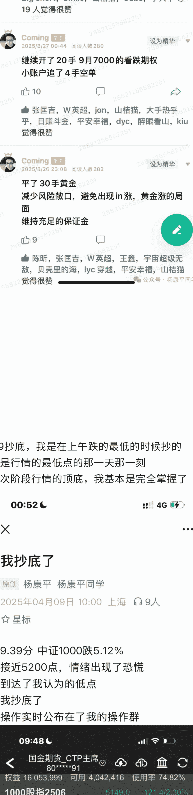

这是那天，空头在布的图。

# 4.9抄底，我是最低的最低时候，也是行情的最低的那天一刻

这段行情的趋势，我基本上完全掌握了。

## 我抄底了

原创 杨平 2025年04月09日 10:00 | 9人 | ⭐星

9.39抄底接近5200，情况却让我恐惧，我抄到了我认为的底部。
我抄底了。

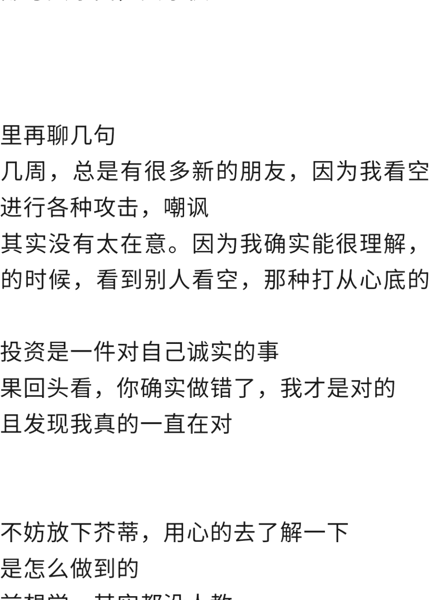

- 25.6老抄底
- 25.63回油抄顶
- 25.4.26的黄金抄顶
- 24.8的抄底
- 24年的2.5抄底
- 22.4的26抄底
- 18年的10.18抄底

我都是在最低（高）的那一天。
那么多的反转都是卖运气。
如果还要这样抄底，抄底的逻辑和方法。

我有一次，抄顶，抄底趋势突破。
再遇反涨把腿甩进去，到底是底部的那一刻。
我就在那里，还没反抄底之前，并明确了我的表现的。

我对我一次，可以选择我运气好到时候。
可是真的是太多太多了。

股抄底，逃顶，本质是同一件事。
我每次的动作，整体是3个步骤。

## part 1

第一是审题，判断当下的顶底是哪一种。

常规的顶底一般分为3种：

- 事件黑天鹅
- 阶段性顶底
- 牛顶熊底的终极大底

情况不同，具体的思路都有不同。

如2022年4月，2020年的2月，当时是因为新冠疫情，属于黑天鹅事件。
那么主要关注的就是情绪和短期筹码分布。筹码分布有很多具体的看法，我用简单最实用的办法，就是最近的那个v的尖尖头作为基准。

如18年10月，24年2月，24年9月的历史大底。逻辑上，这是整个下行周期的终点，也就是熊市的终点。

这时候的下注一般是最重的。

所以我会看所有的估值指标，也会关注情绪。但我只要考虑这2点，其他都当无效的噪音。

并且估值指标 > 情绪。因为底部的绝望和顶部的沸腾情绪可能持续很久，但极化的指标却不能维持很久（因为大资金会自动修正）。

至于哪些指标，我等下会在part 2列举。

再如24年11月、25年12、24年9月、25年13这些逻辑上，我会认为这是阶段行情的顶部和底部。

我会参考部分阶段性指标，会特别关注情绪。对于阶段性的行情顶点和底部：

情绪 > 估值指标。
因为阶段行的指标，牛顶熊底的指标不同，不会过于极化，因此可持续时间久。

而情绪差不多，骗人上车和交费筹码就行，不是真的要赶尽杀绝，还要大伙一起推牛市这类大车呐。如此从滞腾开始算起，2周，就崩了。

所以判断某个行情，就像做一道题目。考虑用什么公式，要考虑参考什么指标，就是先解题，看题目类型是那种，判断是黑天鹅，阶段顶底，还是牛市推进，然后再抽丝茧，套用公式，逐步推进。

## part 2

第二步就是具体使用的指标。
篇幅有限，本文侧重说明，这次阶段行情，我用了哪些公式，哪些参考指标。

1 pe / pe区间 / 3年pe区间 / pe历史区间。
pe是一个最为古老，长期有效的指标，始终需要关注的。

如16:55 江苏利9日在互动平台显示，公司研发已实现量并推广至市场，随着整体需求以及新客户业务量持续中，相关业务后续重大进展，公司及时履行。

### 估值水平

| 综合估值 | 市盈率 | 市净率 |
| :--- | :--- | :--- |
| 高 | 45.7 | 2.42 |
| 中 | 35.7 | 30.9 |
| 低 | 历史近三年 98.9% | | |

2025-08-28 市盈率 47.1，百分位 99.5。
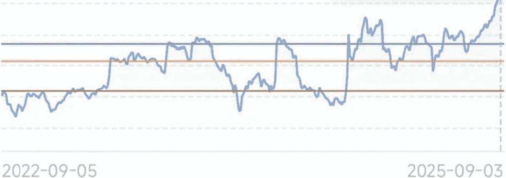

### 指数回报

回顶部，设置加入自选。类似于图里的区域一般是低于牛市最高点的泡沫区。这时如果以牛市最高点对标，就会陷入判断的陷阱，主要还是看3年的区间。
/区间这是一个最客观的指标，在判断阶段顶底的时候，一样用3年内数据。

### 股债性价比

当前适中（股市估值适中），均衡。

### FED风险溢价

股息溢价 FED风险溢价（美债）。万得全证800、沪深300、中证500、中证1000、恒生差值。

2025-09-03（最新）风险溢价（差）2.77%，分位9.77%，平均值（静态）3.39%，曲线显示全。
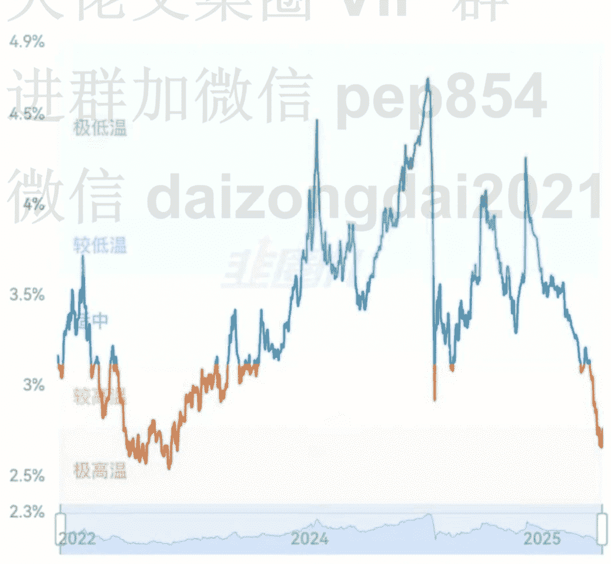

### 风险溢价状态

分享一下你的FED经验。注意的是，拉长时间上一轮牛市，那么就是看整体的牛市进度。落在蓝色区间，给人一种安全的错觉。阶段行情，必须是用3年的区间去看醒目的红色就是巨大的警示。

### 证券涨幅

我一直说，从去年9.24到现在的行情称之为牛1，牛1是估值的修复轮。这时牛市急锋证券春水暖先知，但牛1轮，券商的涨幅一般是个额度大约1倍，并且这次主要是微盘股的狂欢，所以还要一点动态修正。像这次80%的，基本就是极限了。

#### 1673.73 高

开、量。6.30 -0.37% 低、换、额。相关ETF证券ETF 1.250跟踪度:100%。

分时日K、周K、月K、五日均线日线 MA5:1725.94，10:1756.19，20:1728.81，30:1695.35。
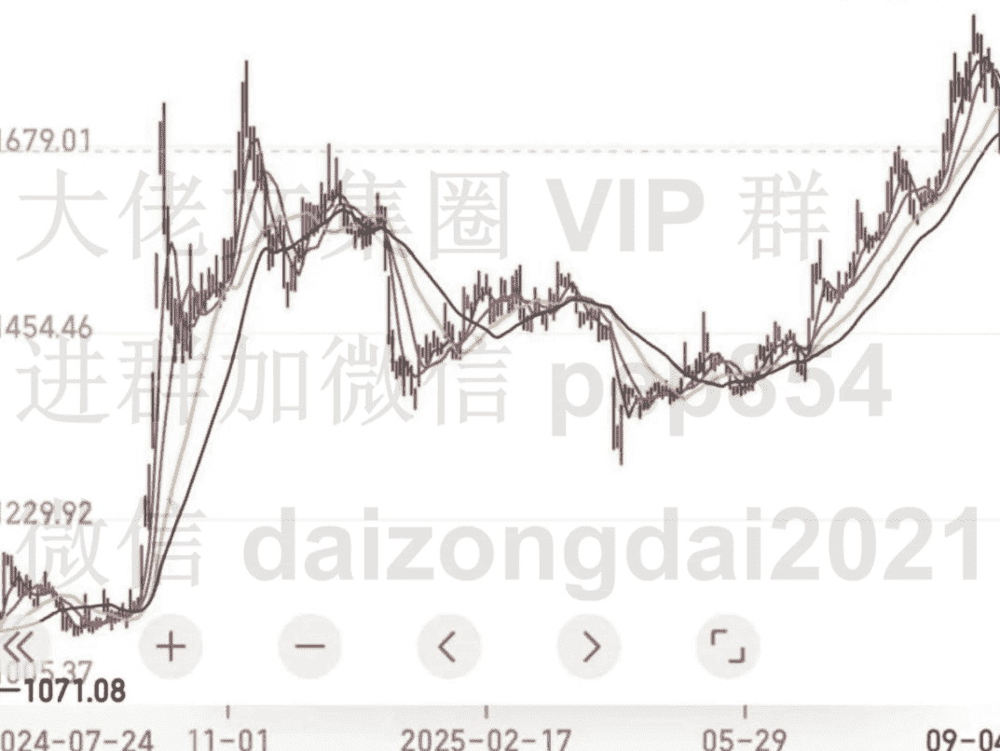
成交量：MA5:6181.37万，10:6747.88万。
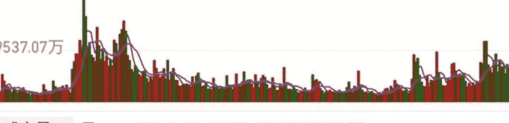
成交量：MA5:6181.37万，10:6747.88万。
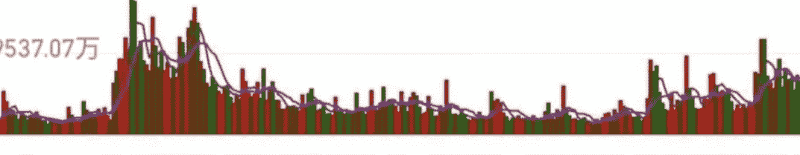

## 情绪指数

我要的是看非圈的恐慌指数和芝士财富的情绪指数。

### 恐慌指数

更新时间:2025-09-03

- 1日前 贪婪
- 1周前 贪婪
- 1月前 贪婪
- 1年前 恐畏

### 恐慌指数

2025-9-3（最新）
- 恐慌指数 79.47
- 上证指数 3813.56
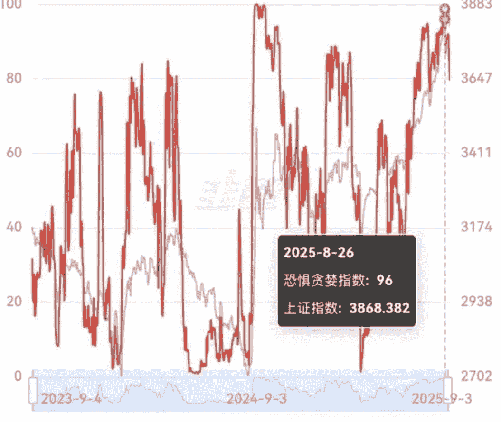

> 2025-8-26 恐慌指数:96，上证指数:3868.38。近年近年由于官方向资金披露，该指标将会修改。

## 行情

搜资讯7x245418。大佬文集。跌停>7-4-7-2-0平-2-4-7>涨。

### 情绪

情绪极高，97.27%，上证指数3800.35。
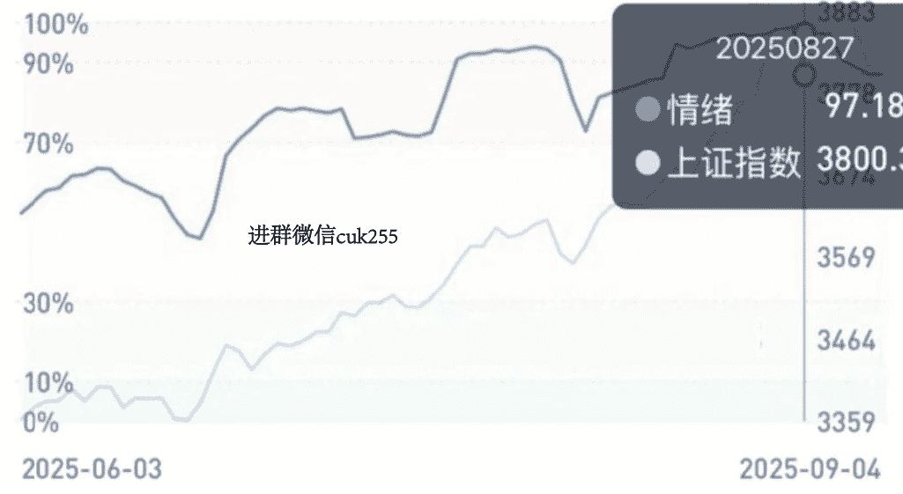

### 股价异动

无异动信息。股票选股基金自选。在这次8.28都是肉眼可见的，在过去的年时间里都是高的。这不需要太多的语言说明情绪指数了，就是阶段顶部。这次涨最好的微盘股和科创50，0608。

### 估值水平

| 综合估值 | 市盈率 | 市净率 | 市销率 |
| :--- | :--- | :--- | :--- |
| 高 | 164 | 2.88 | 2.35 |
| 中 | 75.7 | 59.5 | 47.9 |
| 低 | 历史高于近十年 99.6% | | |

### 指数回报

阶段、月度、季度、年度。科创50，31，跌7.67%。

### 估值水平

| 综合估值 | 市盈率 | 市净率 | 市销率 |
| :--- | :--- | :--- | :--- |
| 高 | 187 | 6.13 | 6.04 |
| 中 | 77.7 | 46.8 | 42.8 |
| 低 | 历史高于上市以来 99.7% | | |

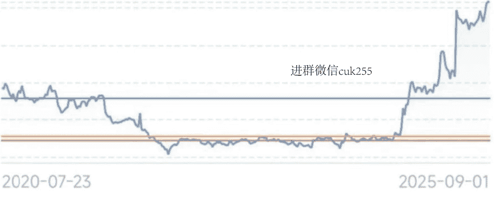

这些都不用pe区间了，而且绝对值本身代表了绝对的泡沫。

### 微盘股

1806.75 高，1818.091809.56量，171.66万-1.53-0.08%低，1806.75换0.39%额，12.29亿。相关ETF中证2000ETF富国1.401，0.86%。

分时日K、周K、月K、五日更多。均线日线 MA5:1827.23，10:1856.58，20:1851.06。
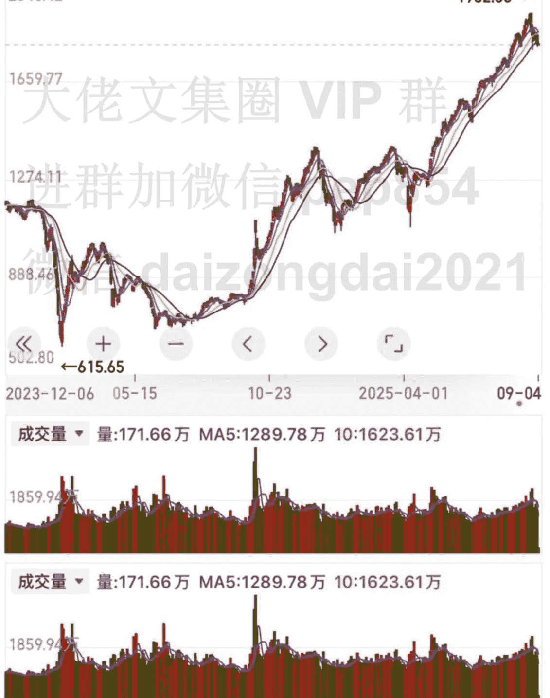

并且微盘股这个3倍的涨幅。

且微盘股这个3倍的涨幅足够任何资金吃饱了，这个时候完全是考虑撤退的时候了。

这里，这一轮主要就是看这些指标。我不喜欢研究的太细，但我善于抓主要的矛盾。

pe fed是一个纯粹的便宜情绪体系。两个情绪指数，代表的就是市场情绪。微盘股、证券、科创是一个先行指标。

人的精力有限，没办法关注到太多的东西，所以必须抓核心的要素。阶段行情，这几个点每个都是核心的核心，每个都要看看，每个都很重要。如果每个核心都指向同一个结果，那么这里就是最高点，这就是开仓的时刻。

当然，牛市的顶点，或者熊市的底部，也是看情绪指标，并且会更多。但是有些指标是用来看牛市大顶的，用在阶段性的顶端，就是一种错误的错配，给他人一种还会涨的错觉，最终导致错误的结果。

比起大牛股文章提到的微信指数，这是牛市大后期才用的指标，这次的阶段行情去用来判断行情，是彻底的错配，完全不合适。

人的执行部分，进微信。其实也是最难的一部分，我会努力尽量写出来，但你还需要深度的考虑，并且才能落实。

冲顶是一个过程，需要时间。交易计划应该是理性的。没有交易的人，可能会被情绪支配，一拍就空，因为恐惧迅速离开。做了交易计划，应该充分考虑自身，让交易变得实际。

在这个点，最大的敌人是贪婪。在低点，最大的敌人是恐惧。

执行计划，制定好交易计划，不让心魔上路。至少给了自己一条路。

从市场里杀出来的实战型选手，靠得住。这些都是真干货，不需要太复杂，每一条都是绝对有效的。

## 深度视野优质集团（链接优质群，助你成功）

全部包含以下内容：限时年费188/年加微信255

- ① 吃瓜群众圈时群对话（原价365/年）
- ② 子明私享会（内部）文章
- ③ 政治事室（子明优）付费内容加送子明群
- ④ 米联储闲文【作者米穗】（原价599/年）
- ⑤ 欧洲金雀专属文章（原价328/年）
- ⑥ 砖瓦仁内部圈（原价400/年）
- ⑦ 卢克文青读书会专属文章（原价699/年）
- ⑧ 鉴茶财经知识星球（原价3310/年）
- ⑨ 猫哥的视界知识星球（原价299/年）
- ⑩ 财经周刊【独家新闻】（原价1498/年）
- ⑪ 杨世光在钱煽（原价2200/年）
- ⑫ 蒜森财经知识星球（原价1600/年）
- ⑬ 激源译付费文集（持续更新）
- ⑭ 司马林解课全套音频和全套书籍珍版无割（原价2.3万）
- ⑮ 虚构三部曲【民梦、帝国争国、不被理解的DAO】（原价599/年）
- ⑯ 卢克文知识星球文章（原价268/年）

十七、额外再送：卢薛元微博付费专栏、三村丰老王、三花九洞文集。

不定内容：......（更多资源不下去了......）

- ① 守夜人司令知识星球、接换魔王星球、成达谈论星球、成后财富、雪雪甲头等
- ② A视野、大树乡谈、江初付阳、咩咩说、上海海家学等付费文集
- ③ 西风付费文章、老端、赢在八小时之外、局外的视界、升级优、老A体制内等其它一些大V付费文集

# 限时年费188/年 底本链接全网优质内容

## 深度视野文集

## 进微信255

深度视野（付费文集）

