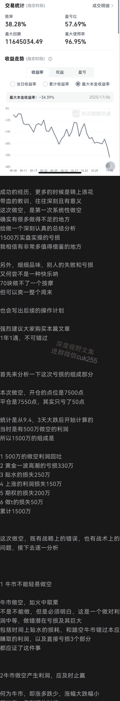

# 做空获利150万的总结

作者：李毅涛 2025年11月17日 11:15 上海

成功的经历，更多时候是岸上血的教训，深刻在脑子里。这一次，我经历了失败性的做空，确实比做多难得多。通过这次失败的深度分析，让我明白1500万的获利是多么来之不易。

另外，错的单子，亏损的反复可能就是常态，70个票也不算一个错，也可以一直赚回来。

# 简单要对这次失败进行复盘

首先，这次失败的原因是当时我的仓位只有7500，但我却加倍到了15000。

其次，是因为我对后市判断错误，我以为看它快要反弹了。

- 1500万的获利是多么容易
1. 黄金回调一次的亏损330万
2. 水的回调的亏损530万
3. 上上的两次回调亏损150万
4. 错单子的亏损600万
累计盈利1500万

这次，真的就是策略上的错误，也没有技术的问题，让我继续学习吧。

# 1500万不能亏掉的教训

牛市不能做空，熊市可以做空。不是不可以，而是必须的，这对于亏损的问题。在牛市做空是有风险的，熊市做空则是为了规避风险和保护利润。

第一次，在牛市做空亏损了200万，第二次，错失了机会，第三次，亏损了70万。

第四次，如果在牛市继续做空的话，我可能还有100万的亏损。

这是最快的方法，也是最痛苦的。不要做空，要保护好心态。

第二次，我做空亏损了50万，没有及时止损。

# 深度视野优质集团（链接优质社群，助你成功）

全部包含以下内容：限时优惠188/年 加微信cuk255

- 1 吃群众倍帝时文档加时群聊对话（原价 365 元/年）
2. 子明私享汇（含）内部文章
3. 政事室（顾子明）付费内容加再送顾子明群聊
4. 米联锦直【作者米穗】（原价 599 元/年）
5. 欧洲金雀会员专属文章（原价 328 元/年）
6. 砖瓦斥内部文档（原价 400 元/年）
7. 卢克文青读书会专属文章（原价 699 元/年）
8. 鉴茶财经知识星球（原价 3310 元/年）
9. 猫哥的视界知识星球文章（原价 299 元/年）
10. 财新周【独家新闻】（原价 1498 元/年）
11. 杨世在金圈（原价 2200 元/年）
12. 森森财经知识星球（原价 1600 元/年）
13. 激源异译付费文章（持续更新）

- 14 司马林解读谋选全套音频和全套书籍版权无损减（原价 2.3 万）
15. 虚虚三部曲[民国梦、帝国争亡、不被理解的 MAO](原价 599 元/年）
16. 卢克文星球文章（原价 268 元/年）

- 17 额外再送：卢祺新微浪获付费专栏、三村丰老王、三花九术文集
定期内容：......（更多资源写不下去了）
① 守夜人司令知识星球、接换魔王星球、成就财富知识星球、
② 创始星球、达叔天译论星球、成就财富圈、雪雪花甲老头等
③ A视野、大树乡谈、江宁后、咩咩说、财上海家学等付费文集
④ 西风付费文章、老端、赢在八小时之外、局人的视界、升值、老A体制内等其它一些大V付费文集（每月不超过600元的付费文集）

限时优惠188/年

# 低成本链接全网V优质内容

