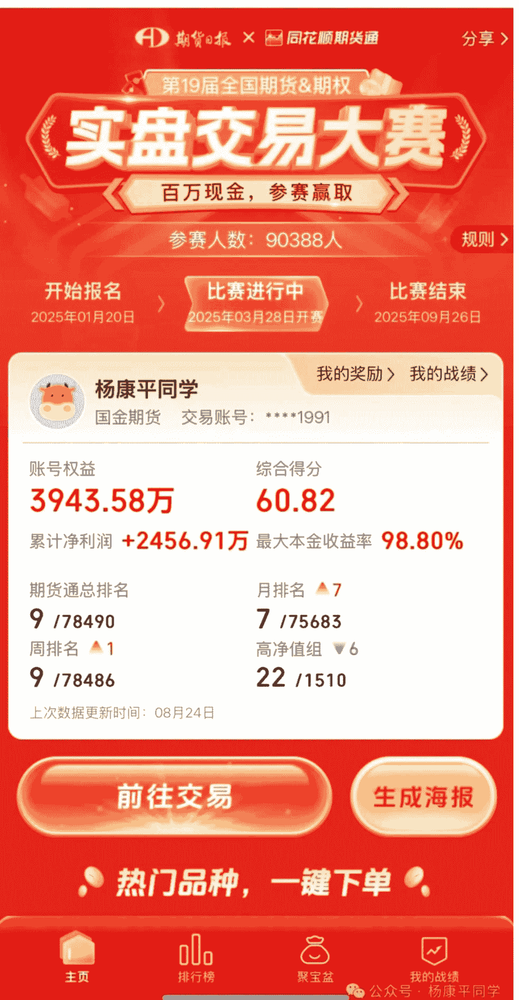

# 关于仓位逻辑的说明

原创：杨康平 公众：杨康平同学 25年8月25日

从中证1000指数7100点我开始减仓，
到今天7500点，正式清仓。

我被骂了快2个礼拜。
很多不理解我的策略、逻辑、仓位表达、内在思考的同学，已经被骂了我快2个礼拜了。
他们只知道，他们冲进来了，就要喷每一个空仓的大V，
却完全忽略了，直到今天，我的账户都是创高的，我在期货全国大赛的比赛里还是第9名的成绩。

加微信jntsg2，进资料分享群。

## 实盘大赛

今天正式清仓了，正好趁机梳理了一下，我所有的策略、逻辑和对应的思考。
我是真正的5000万实盘，市场赚钱的实战派，也许你对于高点的具体位点判断有所不同，但我的思路，一定会对你有所启发和帮助。

加微信jnts2，进资料分享群。

这篇文章是没有任何藏私的完全分享，相信一定会让每一位都觉得物有所值。
毕竟，不是每个有几万人的实盘大V这么充分深度的分享。

全文共15条：

1. 我是7100点就开始看空，减仓了60%，但依旧维持了40%的底仓。
2. 我是今天7500点清仓im，减了90%的仓位。在7100-7500这个区域，我的仓位表达是很多，属于看空做多，逐步走向空仓的位置。
3. 看空不等于做空，看空是降低仓位，降低波动，减少回撤，对于我这种大几万的资金，是一种保留胜利果实、进退有余的常规方法。投资，不是来比谁对、谁能封神，而是谁能赚钱，谁能带钱走。7100开始，1000的所有估值指标都进入泡沫区，接近最高点，但是泡沫吹到哪里，是由最疯狂的资金决定的，情绪才是阶段性行情的主宰。所以这个部分，我就是有底仓逐步减仓，逻辑就是不要在牛市里轻易的和疯狂的情绪对抗。
4. 看空到今天接近空仓，整体的策略中代表的是容错的区域。我的观点是7100是顶部的。我在7100就减了60%的仓位。但人的判断可能会错，终要敬畏市场，所以在7100-7500，我实际的情况是看空做多，仓位逐步递减。
5. 7500-8000点，我实际的仓位代表的是空仓，并不多少或偏空。持续的上涨让我踏空，但会有实际的损失。所以本质上，我是预留了13%，自己散户在这样的情绪里，总是很浮躁。
6. 散户在这样的情绪里总是浮躁，唯晚进了一天，这个钱就被别人赚走了，就是吃大哑亏了。现实里，我们会因为不能和刘浩存交互、肖战谈恋爱就很急啊！大佬圈不会，因为我们知道那本就不属于我们，我们不谈、不谈，我们也没有任何损失。相反追求刘浩存、肖战，可能会投入大量的成本还没有任何结果，造成实际的损失。在股市里也是一样的，10个投资者基本9个亏钱，踏空从真的不会任何损失，甚至可以说省钱了。
7. 8000点以上我因为卖call的存在，会成为空头持仓，持续的上涨会给我造成实际的损失。
8. 我的卖call在逻辑内。9.10之前不会涨到8000点以上，并赚取10万的权利金利润。
9. 比如真的10月割前涨到8800点，亏损的就是800万左右；如果8400，就是亏损400万左右，占盈利较小部分，不影响大局。
10. 所以卖call部分的投资下，总体是一个胜率与赔率的博弈。我认为10月超过8000点的概率不超过10%，超过后也不一定能到8800点，总体是一个超高胜率，而且绝对EV的行为。
11. 买put是独立的亏损上限下的。如果不跌就会亏损所有的权利金。但是因为买call的胜率非常高，权利很大概率可以赚到，可以完全cover买put的成本，就是90%的概率白嫖一张可以挂百万的彩票。错了的话，亏损一个确定的几十万金额，不会造成任何系统性风险。
12. 8000点以上会开空单，总数不会超过30，因为底层逻辑就是要在牛市里多重轻空，长多短空。这样长期就会实现EV。
13. 但是是开空单，我会非常非常非常谨慎，判断非常多的估值指标、情绪指标。绝不会轻易出手，而是会在最最最最有把握的时候才动手。
14. 今天，评论区基本已经都是嘲讽的声音了。但是其实这不会让我亏一分钱。投资是面对自己内心的事，坚持做对的事，不被嘲讽长期才能取得好成绩。
15. 到今天为止，我的账户实际上是在盈利的。但在公众号已经被骂了快2个月了。这本质是因为大部分读不懂我的仓位表达、实际策略。加微信jntsg2，进资料分享群。

风险控制，战略目标。

总结一下：
- 4400到7100：我是坚定的持有多单吃利润。
- 7100到7500：我逐步减仓，锁定利润，减少回撤。
- 7500到8000：我会维持空仓，无惧踏空，等待机会。
- 8000以上：我会谨慎开仓。

我对于点位的判断和策略，是基于当下估值数据的结论。随着美储降息、国内环境的改善，我的行为会随着时间推移动态调整。还是那句话，估值锚。

# 知识星球
# 付费资源群

添加微信
免费入群

| 序号 | 公号/星球/社群 | 原价 | 领域 |
| :--- | :--- | :--- | :--- |
| 1 | 生态有木 | 2765 | 副业、搞钱 |
| 2 | 怂众吃瓜群 | 365 | 时政、历史 |
| 3 | 凯树风 | 365 | 成长、搞钱 |
| 4 | 欧洲金准 | 328 | 时政、历史 |
| 5 | 卢克文会 | 699 | 时政、社会 |
| 6 | 体制内主任 | 599 | 场所 |
| 7 | 外局人的视界 | 669 | 金融、时政 |
| 8 | 激异谈 | 4166 | 财富、成长 |
| 9 | 守夜人总 | 599 | 时政、经济 |
| 10 | 江宁知府 | 365 | 时政、国际 |
| 11 | 政堂/顾子明 | 568 | 时政、经济 |
| 12 | 唐书院 | 1399 | 金融、财富 |
| 13 | 大树乡谈 | 199 | 时政、成长 |
| 14 | 水库欧大 | 10000 | 房产、经济 |
| 15 | 洪灏的宏观策略 | 4376 | 经济、搞钱 |
| 16 | 金政通鉴/北海道山 | 4576 | 股票、行研 |
| 17 | 猫豹的世界 | 299 | 时政、社会 |
| 18 | 飞沫 | 3600 | 股市、经济 |
| 19 | 米联储见闻 | 599 | 经济、金融 |
| 20 | 鉴茶财经院 | 330 | 房产、股票 |
| 21 | 赢在八小时之外 | 365 | 成长、职业 |
