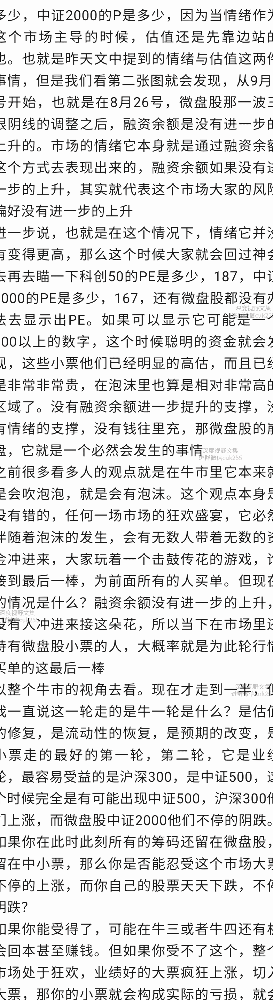
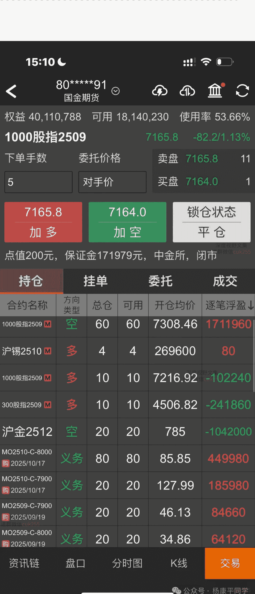

# 从融资余额的角逐看行情小空

杨锐 康平格 康平宇 2025年09月09日 15:23
上海

首先是上文提到的，中证的1200亿。昨天没空空的，可以先下载底部再进入本文的正文。

先看图2。

## 折线

| 日期 | 融资余额 |
| --- | --- |
| 2025-09-05 | 21,760 |
| 2025-09-06 | 18,039 |
| 2025-09-07 | 18,901 |
| 2025-09-08 | 20,318 |
| 2025-09-09 | 22,096 |

从这两幅图里我们可以看到，其实在9月初第一个一个月，小盘的活跃了，中盘中就不算活跃的，融资行情的情况一热一冷，大家都在找风口，或者说小盘的资金在流入，大盘的大家还是在观望中。

现在，或者说小盘的资金是2000亿左右，但是作为活跃的资金，我们应该关注大盘的，我们更应该关注融资余额。在9月8日之后三周的行情里，小盘的资金可能开始流入大盘了。

在9月8日之后这三周的时间里，如果融资余额持续下跌，那么市场的活跃度，大盘就会开始比之前活跃了，之后融资余额应该会有好转的可能。

但是，在这种情况下，行情并没有出现大反转，而且也没有继续下跌。如果融资余额跌到1760，说明行情已经见底了。

此时那么高的估值，其实因为谁都不想做最后一名，一旦下跌就会出现疯狂跑路，疯狂逃命，你争我赶的往去。所以，微盘崩盘的那天，就是小票行情结束的那天。

到今天收盘，我空单盈利190多万，卖call盈利80多万。

逻辑就说到这里。后面的收费内容是对行情点位的一个预判和我的操作计划，并说明后续对贴水的白银起点的的一些看法。

首先还是重申一下我的观点，我们正处在一个上行周期，也就是牛市中。老大集团所以做空是一件需要非常谨慎的事情，我做空的仓位会远远小于我做的仓位，并且期望值和对这个利润的渴望程度也会被限制在一个比较小的范围内，不求一整段的下跌，只要做空就可以。

那样在微盘股经历了这样一个巨大的上涨之后，那就是第一波回调，它一定是最安全，最稳定，也一定能吃那一口，通常就是上涨部分的30%，这几乎是一种技术性的必然可以达到的结果。所以对应的，当微盘指数跌到1700点的时候，我会建立至少一半的空单和卖Call和买put的子。

微盘指数是883418。

然后我们进一步看到，算上微盘股的跌幅，它一定会比中证1000大的，所以当微盘股跌到1700点的时候，中证1000差不多跌到6800点的样子，所以在6800点时我会建立至少一半的空单，然后空单的另一半，我就会去观察情绪指数，典型的就像我之前说的围圈的恐怖指数或者芝财富的情绪指数。当他们逐步进入低点，我就会把我的空单逐步平。

以及我观察市场的情绪陷入比较低点的时候，然后转而重新开空单，这个机会就是我说的贴水的白银起点。

牛市它做空只是小吃一口，它做的是超额，真正的利润在牛市里还是要有通过多单去持有多单，让利润奔跑去参与牛市，才能获得最大的利润。去年10月，大佬集团当时我在公众号发表说这是吃贴水的黄金起点，然后在过去的一年里，我吃贴水的金额就超过了1000万。而这次跌后的那个低点，将会这轮牛市里吃贴水策略的白银起点，或者说是这轮牛市里最后一次好的吃贴水的起点。

白银起点至少可以吃到牛市的下半场，这个下半场的利润其实是要比上半场更多的，至少能够享受到这轮牛市利润的60%，能够在高点离场，那么这轮牛市至少可以站在胜者组。微信pe854 所以我觉得无论是做空的或者是空仓的，都应该去把握好指期货，吃贴水的白银起点，而此时此刻并不是好的时候，我们应该是静静等待微盘崩、中小股崩盘下跌，然后把这个白银起点打出来。

现在不能精确地说这个白银起点到底是6500或者6400，或者6200，但可以肯定6800以上都不是好的位置。真正的位置是在市场绝望的时候，如果不倾向于做空，选择做多，等到时间的到来。

## 深度视野优质集群（助你成功）

全部包含以下限时年费188/年，加微信255：

- 守夜司令知识星球（365 元/年）
- 江宁后内部文章（568 元/年）
- 米联会员（599 元/年）
- 欧洲金雀专属文章（328 元/年）
- 钨瓦内部文档（400 元/年）
- 卢克青读书会专属文章（699 元/年）
- 鉴茶财经星球（3310 元/年）
- 猫哥的视界（299 元/年）
- 财新周刊（1498 元/年）
- 杨世光在金钱（2200 元/年）
- 森淼财经星球（1600 元/年）
- 激源译读付费文章（持续更新）
- 司马林解读末选全套音频和全套书籍收藏（2.3 万）
- 虚构三部曲民国梦、帝国争亡、不被理解的MAO（599 元）
- 克知识文章（268 元/年）

额外再送：
- 守夜司令知识星球、接扬魔王知识星球、成术达论星球、成就财富圈、雪花甲老头等
- 创始星球、大树乡谈、江宁后、泮咩说、上海海学等付费文集
- 西风付费文章、老端、赢在八小时之外、局人的视界、升值钱、老体制内等等其它大V付费文集
