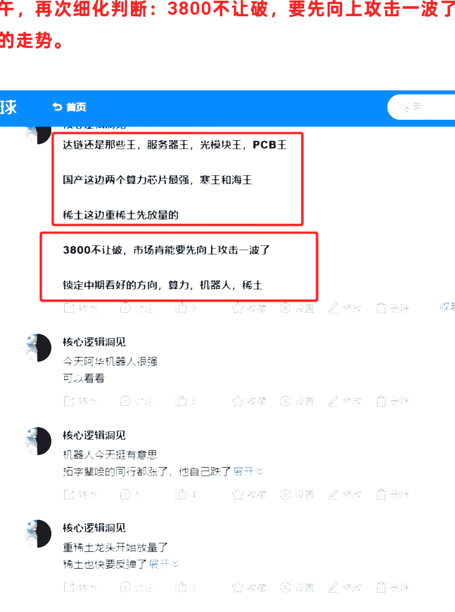
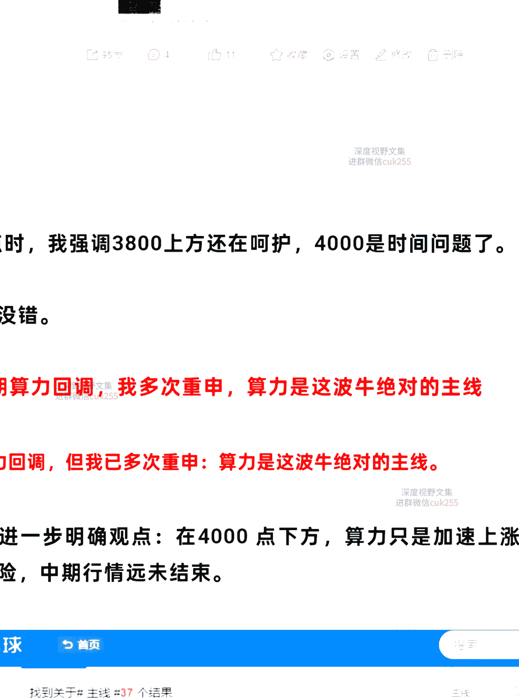
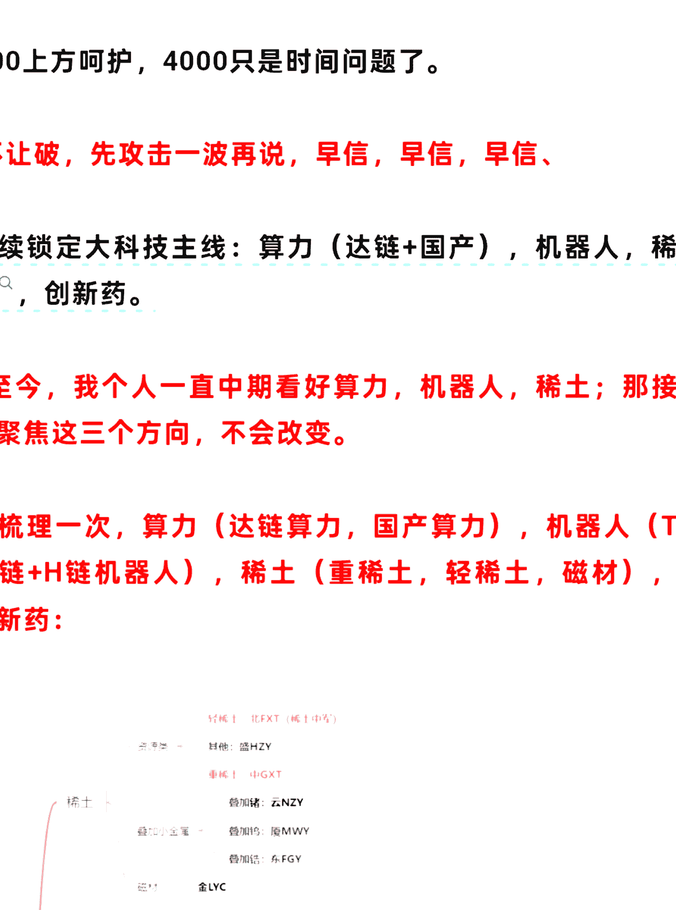

# 3800不再，锁定了机会，早早，早早！

基金投资

## 基金

跌天又一跌，3800上方反复回踩3800点，3700点还是关键了。

今年，两次经历洗底：3800还不破，要不要再向上冲一次了，老哥是难受了。

## 基金

回望之前关于沪深指数的几个关键点：

6月份现在还是年底了，看准的信号了。

3200点，我们坚持在3200点上方站住了问题，就不再退出了。

3500点，我们坚持在3500点上方回踩，注定是行情了。

## 基金

3800点时，我们坚持在3800上方在护，4000点时又问题了。一步都没有。

2、近跌4000点，多次洗筹，其实是年底最后的筹筹机会

还应该加仓，已经多次加仓：其实是年底的最后的机会了。

若今天再一跌，在4000点就是底部，其实只是年底最后上车后的机会了，心里很难受的。

## 深度视野优质集团（链接优质社群，助你成功）

全部包含以下内容：限时年费188/年 加微信cuk255

- ① 吃瓜群众倍帝文档加时群群对话（原价 365 元/年）
- ② 子明私享汇（含）内部文章（原价 568 元/年）
- ③ 政事室（子明优）付费内容加送额外子明群聊
- ④ 米联锦兜【作者米磊（原价 599 元/年）
- ⑤ 欧洲金雀会员专属文章（原价 328 元/年）
- ⑥ 砖瓦斥内部文档（原价 400 元/年）
- ⑦ 卢克文青读书会专属文章（原价 699 元/年）
- ⑧ 鉴茶财经知识星球（原价 3310 元/年）
- ⑨ 猫哥的视界知识星球文章（原价 299 元/年）
- ⑩ 财经新周【独家新闻】（原价 1498 元/年）
- ⑪ 扬世光在金钱圈（原价 2200 元/年）
- ⑫ 森森财经知识星球（原价 1600 元/年）
- ⑬ 莱森译译课付费文章（持续更新）

## 深度视野文集

## 群微微信cuk255

深度视野（优良文集）

14 司马林解读求选全套音频和全套书籍隐藏版无删减（原价 2.3 万）

15 虚构三部曲[民国梦、帝国争亡、不被理解的DAO]（原价 599 元）

16 卢克知识星球文章（原价 268 元/年）

17 额外再送：卢祺新浪微博付费专栏、三村丰老王、三花九洞文集
不定期内容：——（更多资源不下下去......）

- ① 守夜人司令知识星球、接换魔王知识星球、成术财富圈、雪花桃花老头等
- ② 创始佳笔记、达叔浅论成星球
- ③ A 视野、大树乡谈、江初优、咩咩说、上海海家学等付费文集
- ④ 西风付费文章、老端、赢在八小时之外、局人的视界、升值优、老体制内等其它一些大V付费文章（每月低于600元的付费文章）

## 限时年费188/年 低成本链接全网V优质内容
