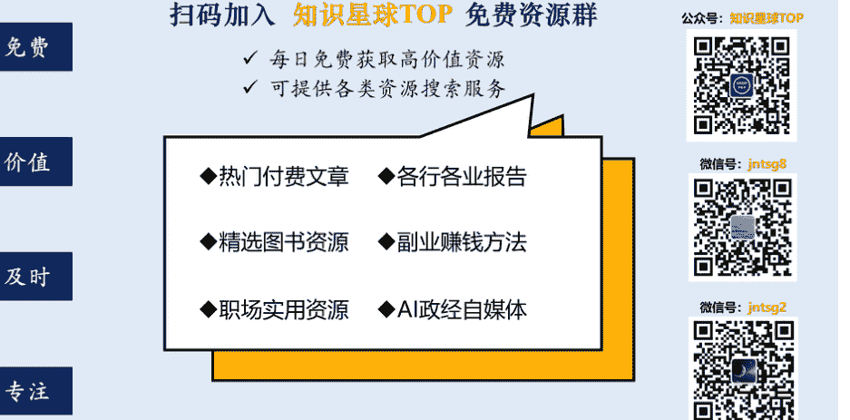

## 你这般焦虑不已的父母
20250417 糟底往事

就我自己的观察，周围那些为人父母的人，有一个算一个，就没有不焦虑孩子的。焦虑健康，焦虑成成绩，焦虑就业，焦虑心理，焦虑恋爱婚姻……我又不想说说什么，说了就是‘你不能懂’，说多了就是‘你凭什么’。
但我也懂一点，我也懂一点点观察生活，碰巧情商也不算高，所以总可以无遮挡。

不谈孩子教育，不谈孩子健康，不谈孩子培养，这类家长是可以的吧？那么，以下的话虽然出自我的本意，但是考虑到其中情商含量极低，所以请酌量口服，同时密切观察自身心跳：

我就所见，大部分家长都是一般的家长。特别聪明，特别好看，特别稳定的家长其实很少，用一句话总结来说，那就是都是都是班上的普通同学。然后普通同学也有上学，也有工作，也谈了恋爱，也结婚生子，也这一一路走到了今天。

那为什么不焦虑一下自己呢？或者说，为什么不焦虑一下曾经的自己呢？因为自己稀里糊涂也就走到了今天。那，稀里糊涂走到今天这件事里，什么才是关键因素？是自己父母曾经的焦虑吗？是他们给予的某种指导，某种教育，某种纠正吗？他们那时候一周工作六天，哪里有那么多时间？

所以，一般的家长们当初就是靠着自己成长起来的，没歪，也没坏。

既如此，是什么让今天的孩子无法自然成长？世界突然到处充满了致命的陷阱，一次失败就万劫不复的竞争。

因为这是父母对于世界的内心看法，用毫无情商的话来说，那就是面对一个无法预测的世界，内心充满焦虑和担忧的父母，不想自己直接面对，于是就把这个意象出来的世界，尤其是这个世界的阴影投射在自己孩子身上，投射到他们的未来，这样就可以为别人焦虑，而不是为自己焦虑，于是可以自我感觉轻松一些。

这个做法我觉得不太公平，也不大观，而且有点浪费。

一个人活到我这个年纪，其实已经经历了很多事情，也亲身体验过不同的时节。如果要残酷的竞争，当初大学的录取比例是从200:1慢慢降下来的。如果要匮乏的生活，当初家里都经历过养鸡种菜凭票购买粮油的艰难岁月。如果要动荡的时代，当初所有人都都目睹或经历过不分配、买断工龄、合同制改革、货币分房改革，连个救生圈都没有就进了大海。我记得在最艰难的时代，变化最剧烈的时代，有一句民间俗语曾经给我提供了极强的支撑：“别人过，咱也能过”。事实也是这样，并没有什么聪明人从天降给出出口秘密道路，也没有白衣骑士从远方来伸出手，都是一群人那么跌跌撞撞“过”着，最后也真就过去了，一直到今天。

所以，当我看到父母焦虑“孩子将来该怎么办”，我就觉得浪费，大家浪费了这种个人经历。这些经历没有转化之后交给孩子，也没有变成孩子“父母当初可以那么走过去，那么现在我也可以，这是我们家族的传统”一类的信心。

当然的，也不排除父母可以为孩子安排近乎无限的资源。从教育到健康，从婚到事业，全部配置最好的资源，全部都一早安排妥当。然后呢？这些东西可以确保孩子未来的幸福人生吗？没有人知道答案，倒是常见这个世界上比自己有钱有名地位有前途的人过得很愁，为什么占据了那么多资源之后人还是不开心呢？

这里我又想说一句情商为零的话：在我看来，恰恰是因为个人努力加上代助力，让父母们拥有了一定的能力和资源之后，终于获得了焦虑的权限。彻底没能力没资源，那么大概率是不会焦虑什么的，用张纸巾盖着肚眼被孩子睡觉的人要焦虑什么孩子的未来？拥有近乎无限能力和无限资源，同样是不会焦虑什么的，因为在他们的心中世界如何运转还有另一套逻辑。

在那套逻辑之下，那些焦虑的对象本身就构不成问题。比如：孩子能否顺利上大学？有点能力，有资源的人最麻烦，因为可以很费事地焦虑起来。似乎这点能力，这点资源可以做什么改变，但是感觉又不够，或者不确信效果。完全不去，心里又放不下，总觉得可以做而没有过，可以做但没做就会损失全世界一样。

在这里我又想说一句情商为负的话：自我的能量能维持吗？以大多数人的资源和能力根本改变了什么。上不能改变自己父母买保健品，下不能改变宠物的散步路径，中间不能改变伴侣或是自己最小的一个生活习惯。怎么现在就觉得投入一点资源，动用一点能力，就能“培养”、“塑造”出一个“好孩子”了？而且，就能培养得刚刚好，在未来确定无疑有一席之地。你要真有那双慧眼，有那种能力，怎么自己现在不去跑跑圈呢？让孩子直接继承富二代岂不是更简单些？

就此打住吧，像这样任由情绪持续下滑，我怕自己会被所有人放逐，只能去山里放养。我也见过一些父母，他们有一条很清晰的原则：人生是自己的的人生，孩子到底是他的人生，他人是有人的的人生。因此，他们不认为自己有什么“成功”让孩子必须继续，也不认为自己的人生让孩子用类似的经历克隆一份，更不认为孩子必须拥有某些人生才是正确的，才是恰当的，才能获得满足。

至于说孩子在未来如果过得好，他们会很高兴，但是不会认为是自己的功劳。在未来如果过得不好怎么样，他们也会难过，但都能帮忙，不至于全量输血。如果一般般，他们同样能够接受，因为一般般就是过去，这个世界上大部分人人都处于这种状态里。于是，他们也会因为孩子而烦恼，有时也会暴跳如雷，但是他们很少受到焦虑的折磨。

我作为一个旁观者，站在我的角度去分析，这种类型的父母和其他父母最大的不同在于一点：他们能够认知自我，知道自身的限度，并且控制自我的边界。所以，以他们的有限自我，不会膨胀到试图覆盖和控制未来的程度，也不会越界产生克隆自己的镜像注入孩子内心的野望。

同时，对于他们自身而言，因为清楚知道自身的限度，也不会因为时代改变而感到多大的焦虑——那改变的力量远远超过自身边界，多想也无益，不如考虑一下晚上晚餐吃什么菜。

这种心态，这种想法是可以让孩子知道到的，也可以让孩子去模仿的，所以我希望孩子没有遗传性焦虑，更容易获得人生的幸福和满足，和资源多少能力高低没什么关系。
