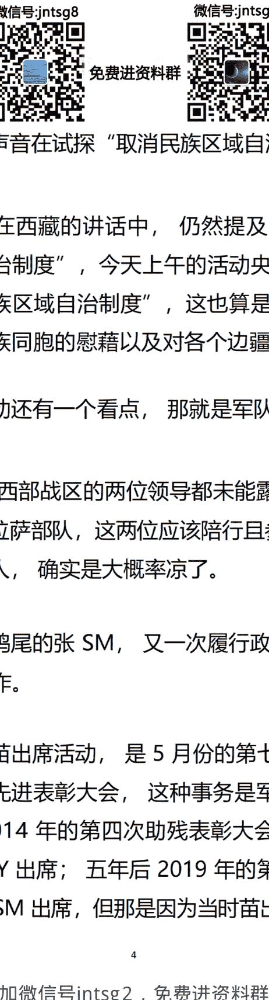

# 西藏庆典，两个看点

文 / 欧洲金靴

文章不长，一个短评。

这次驾临西藏的规格相比以往极高，这是历史上第一次党的最高领袖来参加自治区建区周年纪念活动。

全藏乃至整个西部地区都进入戎备状态，西部省份个别段的高铁站都实行二次安检了...

四年前西藏解放 70 周年时，大海作为政协朱家代为出席的，但是那时是因为那个月之前领袖已经去过西藏，故而没有再去。

真正对比意义的是十年前的西藏自治区五十周年，领袖就没去，那时也是政协朱家（老冕）代为出席。

但这一次，72 岁高龄的领袖竟然亲带队雪域高原，在 5000 米海拔之上走遍拉萨...不说多少人意料，也是蛮让人赞叹的。

至少这传达出了一个明显的信号：身体好看着呢！

其其实是一个非常非常重要的政治提醒，面向全党，也面向全球。

过去很长一段时间，关于健康方面的谣言时不利就会弥散，只要稍超过 24 小时不露面，马上就会引发海内外舆论血雨风的各种揣测。

而这次高出席，且精神劲足，庆祝活动整体有条不紊，算是给出了一个清晰的答案。

还有一点不可忽视，那就是老和尚最近频繁在海外搞动作，就算是交代后事（主要就是有关下一任领袖），关于他在印度的健康状况传闻倒也是层出不穷，随时可能爆发出凉的新闻。

就在几日前，90 岁的老和尚在印度非法占有的我国领土拉达举行活动，也算是隔空喇板了。

老和尚只要一晾凉，不论从任何角度对于对我党治藏工作都是一个利好，这将重创藏区内那些反动分子的气焰——同时更重要的是，藏区确实直到今天都还存在相当大部分“观望者”，他们确实不敢明目张胆对抗抗领导，但也未放弃境外老和、阿嘉仁波切、赞颂波切等反动势力上层的幻想。

此番领袖高调入藏，既是温情安抚，也是无声震慑。

信息传递是必须需要仪式感的，通过这样一场盛大的庆典，反复总结半个多世纪以来党对西藏群众生活的巨大变化，这必然能够形成渲染效应。

还有一点就是，这次高调在西藏举行庆典，给予自治少数民族同胞积极舆对待，也有一层“抚慰”之意。

从已经落马的广西的蓝总理（壮族），到还未官宣的蒙古的王力（蒙古族），连续的自治少数民族一号人物即党政二把手被斩落下，难免引人心惶。

确保确实有声音在试探“取消民族区域自治制度”......

这次领袖在西藏的讲话中，仍然提及及“坚持和完善民族区域自治制度”，今天上午的活动解说词也复提及“民族区域自治制度”，这也算是一种全国范围内少数民族同胞的慰藉以及对各个边疆地区的维稳。

这次西藏活动还有一个看点，那就是军队的动向。

不其然，西部战区的两位领导都未能露面，按照道理领袖接军驻拉萨部队，这两位应该随行参加影响的，但仍旧不见人，确实是大概率凉了。

还有就是军纪还有张术，又一次履行行政事务，即此前的工作。

上一次代为出席活动，是 5 月份的第七次全国模范助残先进表彰大会，这种事务是军委政部内工作，2014年的第四次助残表彰大会就是当时的政主任张硕出席；五年后 2019年的第六次助残大会倒也是张术出席，但是因为当时访问古巴（社会主义国家的军队之间交流其层级高于一般国家的军队交流，所以要派政委委员，而不仅仅国防部长这个花瓶国务委员，否则也是苗出席）。

这次的西藏建区周年纪念亦，十年前的五十周年庆典，同样是政工部主任张硕代表出席，按理如果不出事，也应该来西藏。

所以这就等于连续两次佐证了一个事实：张术已经接管了苗的政工事务，但是是否会直接接政工主任这一极其关键的军内要职，不得知，继续观察。

张术已经执掌军委长达八年，是解放史上等待时间最长的纪书记，同时也是十八之后解放军内担任同一职位时长最长的军人，如果他接政工主任，倒也资格足够。

这位张同志是个奇人，从兰州军区 47 军，到北京的解放军总总部，再到二炮，他连续“陪伴”郭徐魏三只老老虎，尤其是老虎堪称张的伯乐+贵人，一步步将张提拔至高位。

张仕途重要的一步就是二十年前外调二炮 55 基地政治部主任，晋升副军级，年仅...
