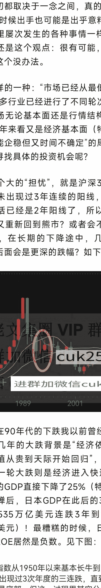
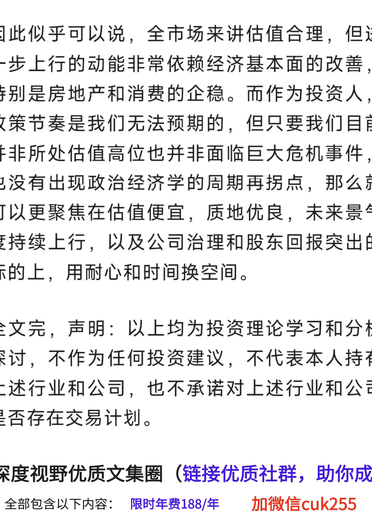

# 当下的沪300，主机会在哪里？

2023-11-22 16:55

当下的沪300，很多投资者感到非常迷茫。现在的市场环境下，大家很难看到未来的机会。长期以来，指数一直在下跌，但现在是否意味着底部已经到来了？很多投资者认为沪300已经跌到了足够的位置，但并没有看到反弹。然而，在过去的很多行情中，机会可能已经出现了，但往往在犹豫中错失了。

首先，我们要回顾沪300的历史。沪300指数成立于2005年，在2007年达到了6124.04点的高点，此后它经历了长期的调整，直到在2015年再次达到了5178.18点的高点，随后在2018年跌到了2664.89点左右。

从2015年到2020年，沪300指数下跌了约12%的幅度。在2020年，沪300一度最高达到了5358.72点。随后在2022年，沪300再次跌到了2910.52点，并在2023年初跌到了2819.63点。

那么，当下的沪300的机会在哪里？我们需要从多个维度来分析。首先，从估值来看，沪300目前处于历史低位。其次，从分红来看，沪300也处于历史高位区域。

但是，对于沪300来说，机会真的存在吗？从长期来看，虽然指数已经跌到了3000点附近，但由于过去几年市场环境的恶化，很多指数的盈利能力萎缩了。这种估值的修复，并不意味着真正的机会。

对于沪300来说，机会可能存在于那些能够发生结构性反转的行业。例如，白酒、消费电子、新能源以及先进制造等行业。如果这些行业能够发生结构性反转，那么沪300的未来将迎来大机会。

从图中我们可以看到沪300的走势。虽然在波动中前进，但整体趋势是在缓慢下降的。

所以，对于沪300来说，机会可能不在于指数本身的反弹，而在于那些能够走出重围的行业。

我们需要保持耐心，等待机会的出现。沪300的未来依然是可能的。

## 一、宏观因素分析

人民币汇率受国际、国内等多重因素影响，呈现出双向波动的特征。在这一过程中，人民币汇率受到市场预期、政策调整等多种因素的影响，表现出在波动中保持均衡的趋势。

从国际因素来看，美联储加息预期引发了美元走强。随着美联储多次加息，美元指数维持高位，这也给人民币汇率带来了下行压力。同时，由于全球经济复苏存在后性，全球贸易需求疲软，也限制了人民币汇率的上行空间。

从国内因素来看，中国经济基本面保持稳健，出口贸易持续回暖，这为人民币汇率提供了坚实支撑。然而，受国内经济结构调整的影响，外资流入速度有所放缓，人民币结汇需求有所增加，这也给人民币汇率带来了一定压力。

## 二、微观因素分析

微观因素方面，企业的避险情绪是影响汇率波动的重要因素之一。当市场不确定性增加时，企业更倾向于结汇避险，这在一定程度上推升了人民币的贬值压力。此外，企业的套保需求也随着市场预期的变化而波动，加剧了汇率的波动。

此外，资本市场的流动性也是影响汇率的重要因素之一。当市场预期人民币贬值时，外资可能会流出，导致人民币汇率进一步贬值；反之，当市场预期人民币升值时，外资流入，则有助于人民币汇率回升。

## 三、政策因素分析

政策因素方面，央行的货币政策对人民币汇率具有直接影响。央行一直坚持保持汇率在合理均衡水平上的双向波动，避免出现趋势性贬值。通过调整利率、存款准备金等工具，央行可以有效引导人民币汇率的波动。

此外，国际货币政策的变化也对人民币汇率产生影响。当主要经济国家采取紧缩政策时，可能会导致资金外流，给人民币汇率带来贬值压力。因此，央行需要灵活调整货币政策，以在维护国内稳定和维持汇率稳定之间找到平衡点。

综上所述，人民币汇率的波动是宏观、微观及政策因素共同作用的结果。在未来的预测中，我们需要密切关注这些因素的变化，并采取相应的应对措施，确保人民币汇率稳定。

虽然人民币汇率面临一定压力，但只要中国经济基本面稳固，政策引导得当，人民币汇率完全可以在波动中保持其在合理均衡水平上的运行。

更多：kucuk255
