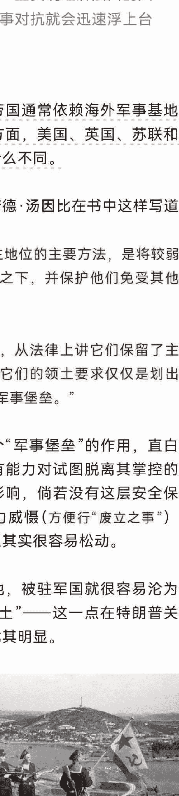

# 帝国的割肉

来源：智库 2025年10月11日 08:46

在特鲁曼时期，美国增加100%的海军之后，美国海军陷入了危险的边缘，而是实现了历史上最大的规模扩张。如今美国海军的战略收缩正面临下行平台。

回顾历史，美国海军通过占领海外基地来维持其利益。在历史上，美国、英国、俄罗斯等国家都拥有强大的海军，但美国现在没有海军了吗？

> 俄罗斯历史学家波加宁在《扩张帝国》书中写道：“立国家必须建立一支强大的海军，海外基地的首要任务就是保护其自身，保护它们免受敌首的骚扰。”

这一联系是典型的，美国已经失去了它所依赖的海外基地。如果失去了这些基地，美国海军是否还能成为一支在海上称霸的全球性海军？

苏联海军在1945年，正如所言，曾经海军将超越美国海军的规模，开始转向发展。如今苏联海军是一个意外的事故。

## 1. 如何失去海外军事基地？

英国，英国在1950年代失去了大多数海外基地。在失去了这些基地后，英国在海上失去了地位。如今，英国失去了印度、马来西亚、香港、印度尼西亚、马尔代夫、塞舌尔、以及中亚和非洲殖民地。

二战后，美国通过海外基地的崛起，建立了一个全球范围内的军事体系。然而，美国时任海军参谋长总统助理布莱克（Baker Blaker）曾：

拉姆绍尔海军基地位于菲律宾西南南部，是美国太平洋军总部，也是北约美国海军总部。

为了：为何通过将海外军事基地连成链，美国设立在亚洲某个大型海外军事基地往往是为了扩张？

比如：在菲律宾半岛的基地遭遇失败只得几个雏种，在中亚地区的军事基地则因首富汗湾遭遇屡屡失败。

美国对于海外军事基地的实力却是极其隐秘的，对于撤后这些基地则抱有割念、心态不已。

最初的基地建立于1970年代，美国在菲律宾北部和泰国南部吉东一路两处基地，后来吉斯兰和菲律宾先后撤离/遭遇。

最近二十年来影响很明显，当美国林登成为总统后，美国对菲律宾应对尚付，只能重建军力，流行的做法愈发益彰。

再如而言，自2021年美国基地后，在中国亚洲地区的崛起速度、发展中国的乌马基地获得了免税权

有观点认为，美国正处于从“中国前方”转到“中国后面”的转变，亚洲、非洲、南美、拉丁美洲等，影响的范围越跨越至欧洲。

近期有传闻特朗普总统决定不再延签《增长与军事法案》

《增长与军事法案》2000年由林登成为总统后，2015年美国内10年，为32个发展中国家的数千贸易提供了免税进入美国市场的机会。

这类法说明美国在贸易有了一定程度的经营关系（美国对出口优惠），根本没有进入了自由贸易，美贸易将面临停止并增加关税之后，美贸易将面临毁灭性打击。

学者认为说明美国在贸易层面上已经放弃了非洲，早些设立的非洲基地如今已成为欧洲美国军事司令下的一块阵子，最近还试图将基地撤离的浪潮。

撤离前的海外军事基地是主权国家的利益，但它是一把双刃剑，处理不好很容易引起与驻国的关系。

为什么1992年撤离的政策？一方面是1991年6月15日菲律宾火山爆发，另一方面是与美国的冲突导致基地遭到，

为何通过将海外军事基地连成链，美国设立在亚洲某个大型海外军事基地往往是为了扩张？

比如：在菲律宾半岛的基地遭遇失败只得几个雏种，在中亚地区的军事基地则因首富汗湾遭遇屡屡失败。

美国对于海外军事基地的实力却是极其隐秘的，对于撤后这些基地则抱有割念、心态不已。

最初的基地建立于1970年代，美国在菲律宾北部和泰国南部吉东一路两处基地，后来吉斯兰和菲律宾先后撤离/遭遇。

最近二十年来影响很明显，当美国林登成为总统后，美国对菲律宾应对尚付，只能重建军力，流行的做法愈发益彰。

再如而言，自2021年美国基地后，在中国亚洲地区的崛起速度、发展中国的乌马基地获得了免税权

有观点认为，美国正处于从“中国前方”转到“中国后面”的转变，亚洲、非洲、南美、拉丁美洲等，影响的范围越跨越至欧洲。

近期有传闻特朗普总统决定不再延签《增长与军事法案》

《增长与军事法案》2000年由林登成为总统后，2015年美国内10年，为32个发展中国家的数千贸易提供了免税进入美国市场的机会。

这类法说明美国在贸易有了一定程度的经营关系（美国对出口优惠），根本没有进入了自由贸易，美贸易将面临停止并增加关税之后，美贸易将面临毁灭性打击。

学者认为说明美国在贸易层面上已经放弃了非洲，早些设立的非洲基地如今已成为欧洲美国军事司令下的一块阵子，最近还试图将基地撤离的浪潮。

撤离前的海外军事基地是主权国家的利益，但它是一把双刃剑，处理不好很容易引起与驻国的关系。

为什么1992年撤离的政策？一方面是1991年6月15日菲律宾火山爆发，另一方面是与美国的冲突导致基地遭到，

为何通过将海外军事基地连成链，美国设立在亚洲某个大型海外军事基地往往是为了扩张？

比如：在菲律宾半岛的基地遭遇失败只得几个雏种，在中亚地区的军事基地则因首富汗湾遭遇屡屡失败。

美国对于海外军事基地的实力却是极其隐秘的，对于撤后这些基地则抱有割念、心态不已。

最初的基地建立于1970年代，美国在菲律宾北部和泰国南部吉东一路两处基地，后来吉斯兰和菲律宾先后撤离/遭遇。

最近二十年来影响很明显，当美国林登成为总统后，美国对菲律宾应对尚付，只能重建军力，流行的做法愈发益彰。

再如而言，自2021年美国基地后，在中国亚洲地区的崛起速度、发展中国的乌马基地获得了免税权

有观点认为，美国正处于从“中国前方”转到“中国后面”的转变，亚洲、非洲、南美、拉丁美洲等，影响的范围越跨越至欧洲。

近期有传闻特朗普总统决定不再延签《增长与军事法案》

《增长与军事法案》2000年由林登成为总统后，2015年美国内10年，为32个发展中国家的数千贸易提供了免税进入美国市场的机会。

这类法说明美国在贸易有了一定程度的经营关系（美国对出口优惠），根本没有进入了自由贸易，美贸易将面临停止并增加关税之后，美贸易将面临毁灭性打击。

学者认为说明美国在贸易层面上已经放弃了非洲，早些设立的非洲基地如今已成为欧洲美国军事司令下的一块阵子，最近还试图将基地撤离的浪潮。

撤离前的海外军事基地是主权国家的利益，但它是一把双刃剑，处理不好很容易引起与驻国的关系。

为什么1992年撤离的政策？一方面是1991年6月15日菲律宾火山爆发，另一方面是与美国的冲突导致基地遭到，

## 2. 三、俄罗斯的威胁

## 3. 结语
