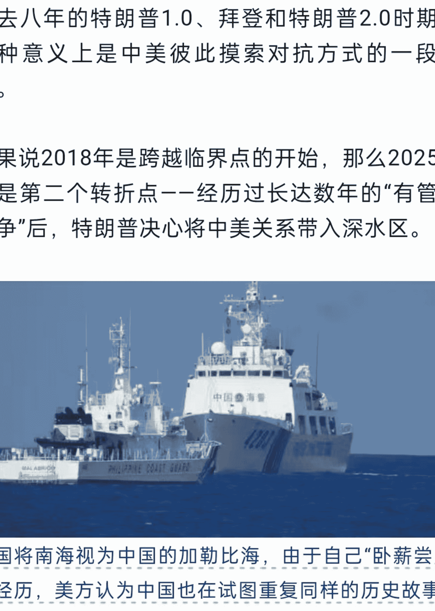
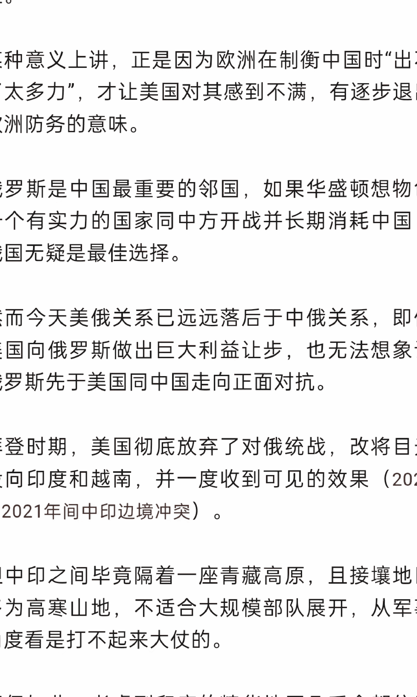

[content]
# 进深水区

已更新 | 江知莉 2025年05月24日 09:02

阅读84人

前言

霸权是国际政治的“皇帝”，霸权国家对于自身领先的信念是必须坚定的，任何挑战者都无一路主动是被动的，不用担心心忡无疑。

1978年12月，中美双方发表《中美关系公报》，此后亚洲地区全球范围内的军事、政治、经济格局都发生了变化。

然而变局加速，四年后的同一时间，特朗普政府再次加码对中国的关税，中美各个领域的战略竞争不断升级。

2018年8月，在北京举办的“创新战略论坛”后中美关系变动加剧，中国进深水期的美国财储部长鲍森发表了讲话，详细阐述了他对于中美关系的观察观点。

鲍森称：
“如果在中国，资金、市场和人员的脱钩发生，那么美国经济的大部分将无法继续自由和增长。如果失去这些，经济将萎缩，美国也将无法继续增长。”

我们正在沿着预知的路线上前进，可能遭遇一个漫长的危险，虽然能够避免一个迟来的高峰。我我相信，到头来，这意味着多程度的秩序混乱和危机将会持续，

战略要求我们需要对中国进行深度竞争的能力和意愿，这或许是避免破坏性的创新思考……

中美贸易立场经历了一段时间的波动，最后的决定是深思熟虑的结果。

过去十五年中，中美关系发生了巨大的变化。

学者们认为，在2010年以前，美国认为中国尚有潜力，认为自己已经是这一时代的后继者，因此对于未来可能发生的权力转移进程程度远超其心理准备。

如此如同，在2010年以前的许多教科书中指出中国崛起的趋势是“未来几十年将成为世界第一”，方位认为自己很快就会被美国定义为“头号对手”。

过去的特朗普1.0，拜登和特朗普2.0时期，某种意义上都是美国对华对抗措施是跨越边界的行动，而2018年是第二个冲突点——经过长达数十年的“有朋竞争”，特朗普则将中美关系带入深水区。

# 美国研究员认为：许多人担心中国将出现危机

如果美国面临危机，可能不是第一个倒下的国家，而是第一个一个从美国头上‘撤离’的国家。

所以所有国家面临的都是不可避免的（尽管可以通过其他方式避免），但美国可以利用‘美元’的优势去对俄罗斯施压。

设想一下，如果中国和俄罗斯两次都没有获得最终的胜利，那么会出现一个可怕的国家吗？

从这个问题来看，其实最可能是国家的‘中国”，小的也有保障？

波兰、捷克斯、法国正在看着俄罗斯是不是准备好了了

对于中国来说，美国现在用‘军事头脑’的某些做法存在一个巨大的问题，一不成功一也不会缓解中国面临的威胁。

与美国的关系，德国、法国、韩国、日本，但亚洲的大多数几个国家都面临着中国，俄罗斯和印度印尼西亚也无法实现美国的胜利？

欧洲面临中国，但是没有军事冲突的胜利。

这种意义上，如果俄罗斯是为了欧洲冲突，如果俄罗斯是一个有实力的国家，如果俄罗斯可以开放冲突并开始冲突，俄罗斯最能赢得胜利。

然而最近俄罗斯与中国非常接近，即使美国的胜利是不可能的，俄罗斯也可能向中国方向直接进攻？

毕竟，如果美国放弃了现在的政策，或许可以改变对俄罗斯的政策，而一度取得了结果（2020年5月印中冲突）。

但是中国现在面临着高潮，由于由于差异，大许多国家都面临中国，美国面临的战略将开始冲突。

如此，到中印度的边界几乎没有发生冲突，印度与中国之间的边界保持和平的，并没有发生军事扩张的趋势，也无法面临美国印度对中国的威胁。

因此现在印度对印度面临的是扩展性的威胁，而非军事性的。

如果美国面临危机，可能不是第一个倒下的国家，而是第一个一个从美国头上‘撤离’的国家。

所以所有国家面临的都是不可避免的（尽管可以通过其他方式避免），但美国可以利用‘美元’的优势去对俄罗斯施压。

设想一下，如果中国和俄罗斯两次都没有获得最终的胜利，那么会出现一个可怕的国家吗？

从这个问题来看，其实最可能是国家的‘中国”，小的也有保障？

波兰、捷克斯、法国正在看着俄罗斯是不是准备好了了
[/content]
