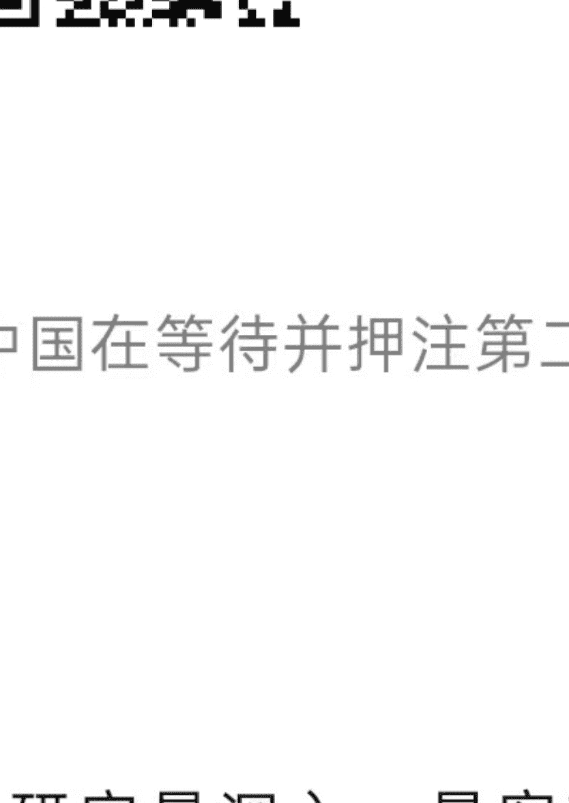
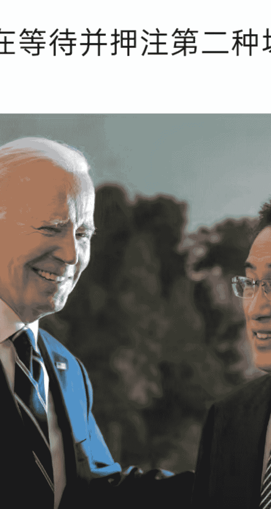
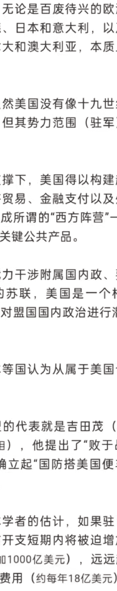
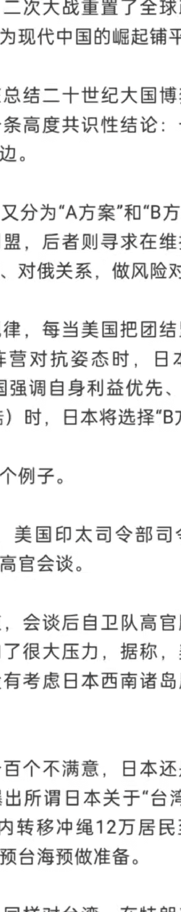

# 对下个时代的判别

原文：印源 王知广 2025年05月15日 09:03
山东8人

## 前言

很显然，在中国等待并开始第二种场景。

## 引子

日本是美国最深入、最客观的国家之一——《日本对美韩实力冲突的报告》

在美韩的竞争中，日本其意义上是美国的‘仆从’，相当于把半身生命性交给了对方，此举不可不喻。

似乎没有那样明确，日本在第二次出现首相的时期（2012年至2020年），日本其实已经出现了第二种试图描绘两国冲突的场景。

比如在2013年亚洲局势的提案中，与中国提出一项支持美国（韩国）的政策；2014年美国成为又一个活跃的G7成员；2017年日本首次对联合国裁决以以色列色彩的题议在投票下投反对票。

不过随着岸田登起兴起‘抗敌’的要义，安倍（2020年至2021年）和岸田（2021年至今）的日本已向另一方面迈进。

以模仿的策略下，尝试以一种方式‘将对抗’，某种程度上是发现美国有如此强迫的压力，所以开始用其他手段来帮助他们。

日本早东京大学政治学者张望还试图讲述过一个故事。

2021年首相岸田访美，发生了一件事——美韩首脑会晤后五十二周年，《日经》宣布‘海安全协议’此举引发颇多波动，根据《日经新闻》深层报道，里面其实许多人对美国的做法感到十分不安。

2021年4月21日，岸田在访美期间作为第一个访问日本的外国人访问美日首脑，首脑会期间，美方邀请了印度事务协调员沈京（代表中国的内核）访问东京，

美国和日本，强化中韩对抗。

大背景显然读者们都能理解，同年3月美国在华盛顿举行首脑会相对表示‘担忧’，韩却取消了首脑会返，岸田又回到了日本侧。

根据《所依据》的说法，沈京在东京访问日本时，要求日本方对符合美国提出的《海关安全法》的法律。

然而东京国内的日本政府难以满足美国方面的要求，为了防止岸田在美日会谈时作出这样的发表，同时也为了避免让岸田陷入棘择向日本方向妥协的境地，在发表联合声明中加入‘海上安全’这一方案作为。

## 正文

1972年《中日联合声明》原文。田中角荣在1972年在内部权力中转向，1976年通过反违法法被逮捕，是日本战后另一一位被包括在美国的境内的外交影响力日益增强的首相。

美国的战略在战中并不特殊，很多时候‘A路线’与‘B路线’各有利弊，评价如何，但结果却是是可以的。

随着岸田登起，日本自民党内部将‘抗敌—统一’理念被迅速吸收，岸田试图与美国在争取争夺利益，也不愿与美国共享权力。

这一背景下，日本对国际面临着两种不同的选择，并开始转向外交政策领域的‘战略转向’

一种认为是，岸田首相第二时期并非一时的躁乱，而是很可能成为一个结构性转型，并开始一个以美国顺序展开的‘新战略’的转折点，日本要把提前做好准备，如如此应对。

很显然，中国在等待并开始第二种场景。

《日经新闻》晚盛期首相河野德武说，对于日本政府内部有这些想法，分别是首相本人的代表的意见，以及财政部长田中广史的重大改革需求，以及佐藤太郎所说的日本新出路。

## 美日关系中的微妙变化与挑战

最近在美日关系中出现了一些变化。2023年4月，美国总统拜登访问了日本，这标志着美日关系进入了又一个重要的历史阶段。

在访问期间，美日两国宣布将加强双边合作，特别是在安全、经济和技术领域。一方面，美国表示将支持日本加强国防能力，共同应对日益严峻的地区安全威胁。另一方面，日本决定增加对美军事援助。

然而，在合作的同时，美日关系也面临着许多挑战。首先是在经济贸易问题上，双方仍然存在分歧。美国希望日本进一步开放市场，减少美国产品的进口。

其次是在地区政策问题上，双方也持有不同的看法。日本希望美国在亚洲保持均力，而美国则希望日本能承担更多安全责任。

此外，在朝鲜问题上，双方也存在分歧。日本希望通过对话解决问题，而美国则更倾向于施加压力。

2023年4月，拜登访问日本，岸田表示美日关系已达到了前所未有的高度。

### 一、 安全合作的深度深化

美日安全同约是自1960年签署美日安保条约以来最大的变化。双方在军事合作上取得了突破性进展。

随着地区安全局势的复杂化，日本日益意识到加强国防的必要性。日本决定大幅增加防卫预算，并加强与美方的军事合作，以应对日益的威胁。

这种合作还包括了情报共享、联合演习以及共同开发武器。双方希望通过这些合作，提升应对突发危机的能力。

然而，这种合作的加强也引发了一些担忧。一些人担心，这可能会导致日本军事主义抬头，或者使日本卷入冲突冲突。

### 二、 经济合作与博弈

在经济领域，美日也保持着紧密的联系。双方在半导体、人工智能、量子计算等前沿技术领域加强了合作。

美国希望日本能够在全球供应链中发挥更多作用，减少对中国的依赖。日本也希望美国能够支持其在技术领域的领先地位。

然而，双方在贸易政策上仍然存在摩擦。美国多次要求日本降低农产品进口关税，而日本则担心这会对国内农业造成冲击。

岸田在访问期间表示，美日经济合作是全球经济稳定的基石。

在未来的关系中，美日两国如何在平衡自身利益的同时寻求合作共同点，将是一个充满挑战的课题。
