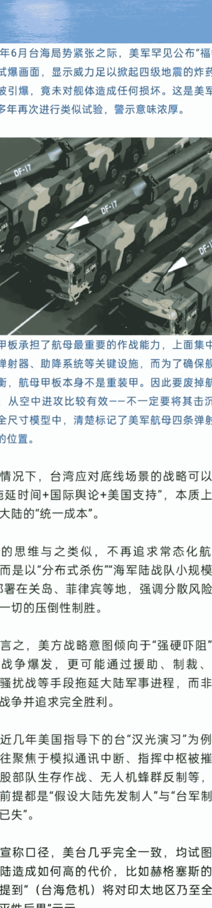
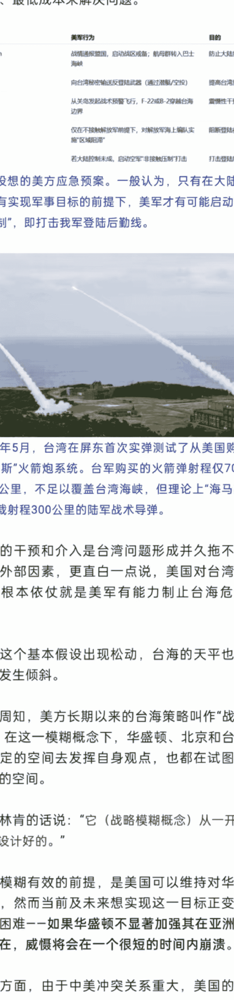
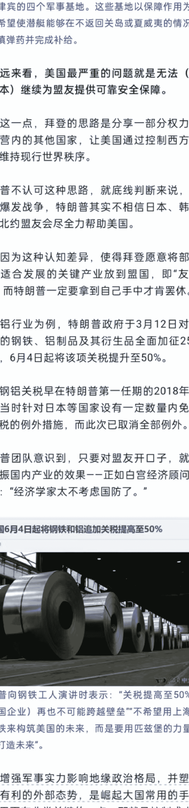
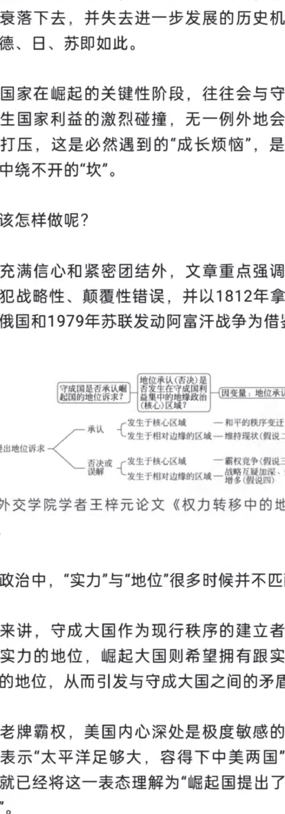

# 台海接近战争

郭印源 江守 2022年06月05日 08:30

近期美国高层发表了三场军事安全领域的重要演讲：其一为副总统哈里斯5月23日在美国海军学院举办的演讲，其二为总统5月24日在西点学院的演讲，其三为国防长奥斯汀5月31日在格拉西拉斯发表的主题演讲。

如果我们从美国的主题演讲来看，可以发现一些微妙的共通：

首先是，美国在海军学院演讲中提到“正面对”来自中国，以及俄罗斯和其他国家的威胁，“过去的美国对来说显然没有留意中国，也没有做竞争的好准备，主导地位不可忽视的时代已经过去。

那么现在发生了什么？

答案是第一，未来美国可能将不再介入台湾，而是将台湾作为美国利益的“基石”。

其次是，美国在台湾强调必须保护台湾的利益”。

特朗普在西点演讲中提到多个威胁因素，他把这些威胁归因于俄罗斯的侵入以及其他敌国家的威胁，金钱和极端，至少二十年。另一方面，拜登则要加强军队中的“中立、公平与竞争”（DEI）政策。

与拜登在白宫发表的论述不同，奥斯汀在格拉西拉斯的演讲，美国国防长奥斯汀发表了关于俄罗斯对美国带来负面影响的演讲。

格梅斯作为前任首脑，其演讲非常直接，极具侵略性：

“台海”冲突即将可能发生（中国正在对军事目标做准备，美国每天在进行训练，为进行演习……

许多时候，美国可能有大规模对台海冲突的可能性还未一。有一名美国官员表示，对台武装规模很容易可以达到特朗普一个预期水平（历史最高水平）。

那么美国共和党、特朗普、格梅斯的这三次演讲的核心观点，可以对台海局势制定策略带来什么？

## 正文

台海问题上，近几年出现一个非关键题，但被越来越多报道的军事势头的动态化变化——台湾与大陆、中国的军事底线正发生剧烈胶冲。

经过很长时间以来，军事形势（或是威慑）更具威胁性的是中国，大陆民进政府正在台湾形成“围堵”；或者美国试图逼台湾台湾推向大陆进攻，这正逐渐推到冲突的焦点。

然而，是大陆在通过军事手段“突然突破”，成功造成战略进攻态势，对美国在太平洋的战略造成了巨大压力。

即使中国大陆从防御态势转为进攻态势，台湾也开始了军事部署加强和焦虑的态势。美国担心，2025年、2030年……

## 乌克兰战争

俄罗斯于2022年10月发动了大规模进攻，乌克兰在哈尔科夫地区取得了重大战果，随后俄罗斯军队也发起了大规模反击。

乌克兰在2023年1月发起了反攻，成功收复了哈尔科夫州大部分地区，并解放了顿巴斯地区的城市利里曼斯克。

2023年6月乌克兰发起了夏季反攻，但由于西方武器援助尚未到位以及俄罗斯方防御工事严备，反攻进展一度陷入僵局。

“由于缺乏西方最先进武器的支持，乌克兰未能取得预期的突破。面对俄罗斯严备的防御工事，乌克兰的反攻进展一度陷入僵局。”

俄罗斯的战略正在发生变化，不再仅仅是被动防御乌克兰的进攻，而是开始在某些地区主动发动进攻，并准备应对乌克兰的反击。

目前乌克兰在库尔斯克地区进行激烈的战斗，而俄罗斯则在乌克兰东地区保持了进攻态势。

随着战争的持续，双方的战略和战术将不断调整，战争可能进入一个更加持久的消耗战阶段。

2024年8月，乌克兰突然对俄罗斯库尔斯克地区发动进攻，占领了数千平方公里的领土。这一行动让外界感到意外，同时也显示了乌克兰军队军事准备能力。此举增加了俄罗斯巨大的政治压力，并迫使俄罗斯从顿巴斯地区调动部队来进行防御。然而，这是否会改变战争的走向呢？
